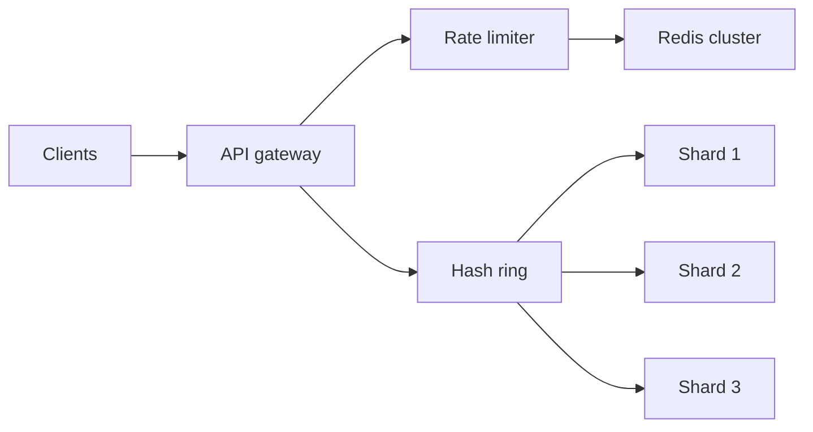

# Rate Limiting & Consistent Hashing

> Fairness under concurrency and minimal resharding when nodes change
>
> Teaching-style study guide from Algoroq senior interview PDFs. Practice each answer aloud with a diagram and one production anecdote.

---

## Why this matters

Rate limiters partition **time and tenants**; consistent hashing partitions **keys** across nodes with bounded data movement when the cluster changes.



## Reference patterns

```python
import time

class TokenBucket:
    def __init__(self, rate: float, capacity: float):
        self.rate, self.capacity = rate, capacity
        self.tokens, self.updated = capacity, time.monotonic()

    def allow(self, cost: float = 1.0) -> bool:
        now = time.monotonic()
        self.tokens = min(self.capacity, self.tokens + (now - self.updated) * self.rate)
        self.updated = now
        if self.tokens >= cost:
            self.tokens -= cost
            return True
        return False
```

| Algorithm | Burst | Memory | Distributed |
|-----------|-------|--------|-------------|
| Token bucket | Yes | O(1) | Moderate |
| Fixed window | Edge spikes | O(1) | Easy |
| Sliding window log | Controlled | O(n) | Harder |

---

## Interview Q&A

## Rate limiting

*15 questions from the Algoroq guide.*

### Q1. Explain the token bucket algorithm and its trade- offs compared to other rate limiting approaches.

> **What they're really asking:** Do you have a mental model of the fundamental rate limiting algorithms and can you articulate when each is appropriate?

**Answer framework**

The token bucket algorithm works by maintaining a bucket that holds tokens up to a maximum capacity. Tokens are added at a fixed rate (the refill rate). Each request consumes one or more tokens. If the bucket is empty, the request is rejected or queued. The key property is that it allows bursts up to the bucket capacity while enforcing a long-term average rate equal to the refill rate.

Contrast with three other approaches. The fixed window counter divides time into fixed intervals and counts requests per interval. Simple to implement but has the boundary problem: a client can make 2x the limit by clustering requests at the boundary between two windows. The sliding window log stores timestamps of all requests and counts those within the trailing window. Precise but memory-intensive because it requires storing every timestamp.

The sliding window counter combines fixed windows with interpolation: it weights the previous window count by the overlap percentage. This provides a good approximation with O(1) memory per client. The leaky bucket algorithm processes requests at a constant rate, queuing excess requests. Unlike the token bucket, it smooths out bursts entirely. Choose the leaky bucket when downstream services cannot handle any burst traffic.

Choose the token bucket when bursts are acceptable and you want to optimize for user experience by allowing occasional spikes. For implementation, the token bucket requires storing only two values per client: the current token count and the last refill timestamp. On each request, calculate how many tokens should have been added since the last refill, add them (capped at max capacity), then attempt to consume tokens.

This lazy refill approach avoids background timer threads. Discuss the trade-off matrix: token bucket optimizes for burst tolerance with simple state, fixed window optimizes for implementation simplicity with boundary issues, sliding window log optimizes for precision with memory cost, and sliding window counter balances precision and memory.

### Q2. How would you design a distributed rate limiter that works across multiple application servers?

> **What they're really asking:** Can you handle the core distributed systems challenge of rate limiting: maintaining consistent counters across multiple nodes without introducing unacceptable latency?

**Answer framework**

The fundamental challenge is that rate limit state must be shared across all servers handling requests for a given client. There are three architectural approaches with different trade- off profiles. Centralized approach using Redis: all application servers check and update rate limit counters in a centralized Redis instance. Use Redis MULTI/EXEC or Lua scripting for atomic check-and- increment.

The Redis command pattern is: MULTI, GET key, INCR key, EXPIRE key ttl, EXEC. A Lua script is better because it executes atomically without round-trip overhead. This approach is simple, consistent, but adds network latency to every request (typically 0.5-2ms per rate limit check) and makes Redis a single point of failure. For high availability of the centralized store, use Redis Cluster or Redis Sentinel for failover.

Accept that during failover, some requests might bypass rate limits (a few seconds of over- admission is usually acceptable). This relates to the CAP theorem trade-off: during a partition, you choose availability (allow requests) over consistency (strict enforcement). Local approximation with synchronization: each server maintains local counters and periodically synchronizes with peers or a central store.

This reduces per-request latency but allows temporary over-admission proportional to the sync interval multiplied by the number of servers. If you have 10 servers syncing every second with a limit of 100 requests per second, you might admit up to 1,000 requests in a burst before synchronization catches up. Sliding window with distributed coordination: partition the rate limit space by client ID using consistent hashing.

Each rate limit check is routed to the owning node. This eliminates the centralized bottleneck but requires a coordination layer for routing and rebalancing when nodes join or leave. The production-recommended approach for most systems is centralized Redis with Lua scripts, combined with a local fallback cache. If Redis is unreachable, fall back to local rate limiting with a conservative limit.

This follows the circuit breaker pattern: degrade gracefully rather than fail completely.

### Q3. You need to implement rate limiting for an API gateway handling 500,000 requests per second. Walk through your design.

> **What they're really asking:** Can you reason about rate limiting at extreme scale where the naive approach breaks down and you need to think about performance, memory, and operational constraints?

**Answer framework**

At 500K RPS, every microsecond of overhead per request matters. A naive Redis round-trip per request adds approximately 1ms, consuming 500 Redis connections continuously. Start by calculating memory requirements: if you have 10M unique API keys, each needing a counter and timestamp (16 bytes), that is 160MB of state, which fits comfortably in memory. The architecture uses a multi-layer approach.

Layer 1 is connection-level rate limiting at the load balancer using IP-based limits implemented in kernel space (iptables, eBPF, or hardware). This catches volumetric attacks before they reach your application. Layer 2 is local approximate rate limiting in the API gateway process using an in-memory sliding window counter per API key. This handles 99 percent of rate limit decisions with zero network overhead.

Layer 3 is a distributed synchronization layer where local counters are periodically flushed to a shared store and updated from it. For the local layer, use a concurrent hash map with lock striping. Partition the key space into 256 segments, each with its own lock. This reduces contention to approximately 2,000 RPS per lock, which is easily handled without significant wait times.

Use the sliding window counter algorithm for O(1) memory per key. For synchronization, batch local counter values and send them to Redis every 100ms. Receive global counter values from Redis at the same interval. The effective over-admission window is (sync_interval * num_servers). With 20 gateway servers and 100ms sync, you might over-admit by 20x the per-interval limit before correction.

Tune the sync interval based on how strict the limits need to be.* For memory management, use an LRU eviction policy to cap the local hash map size. Inactive clients are evicted and their state lives only in the central store. On the next request from an evicted client, fetch their current counter from Redis (a cold start penalty of one network round-trip). Discuss observability: track rate limit decisions (allowed vs rejected) per endpoint, p99 decision latency, synchronization lag, and memory usage.

Alert when rejection rates spike, which might indicate a legitimate traffic increase rather than abuse.

### Q4. How do you handle rate limiting in a microservices architecture where a single user request fans out to multiple internal services?

> **What they're really asking:** Do you understand the amplification problem and can you design rate limiting that accounts for internal fan-out without over-restricting users?

**Answer framework**

The fan-out problem occurs when a single API request triggers multiple internal service calls. If each internal service independently rate limits, the effective external rate limit becomes much lower than intended. For example, if a user search query fans out to 5 internal services each with a 100 RPS limit, the effective external limit is 20 RPS. The solution is to separate external rate limiting from internal service protection.

External rate limiting happens at the API gateway and controls how many requests a client can make. Internal rate limiting protects individual services from overload regardless of the source. For external rate limiting, implement it exclusively at the API gateway or load balancer. Assign rate limits per API key or user account. The gateway is the single enforcement point for client- facing limits.

Use different limits per endpoint based on cost: a simple read might cost 1 unit while a complex search costs 5 units (weighted rate limiting). For internal service protection, use a different mechanism: adaptive concurrency limiting. Instead of fixed rate limits, each service measures its latency percentiles and adjusts the maximum concurrent requests it accepts using algorithms like TCP Vegas or gradient-based approaches.

When latency increases, reduce the concurrency limit. When latency is healthy, increase it. This automatically adapts to the service's actual capacity without manual tuning. For request priority, propagate a priority header through the call chain. During overload, internal services shed low-priority requests first. A user's first request of the day (high priority) should succeed even if the system is shedding load.

Discuss quota allocation: for multi-tenant systems, allocate a percentage of each service's capacity to each upstream caller. Service A gets 40 percent of Service B's capacity, Service C gets 30 percent, and 30 percent is reserved for burst absorption. This prevents one upstream service from consuming all of a downstream service's resources. Address the distributed tracing connection: instrument rate limit decisions with trace IDs so you can correlate an external rejection with the specific internal bottleneck that caused it.

This is essential for debugging production incidents. See our guide on distributed systems for more on observability patterns.

### Q5. Describe how you would implement rate limiting that is fair across multiple tenants in a multi-tenant SaaS platform.

> **What they're really asking:** Can you design a system that prevents noisy neighbor problems while maximizing overall resource utilization?

**Answer framework**

Multi-tenant fairness requires three layers: hard limits per tenant, fair sharing of unused capacity, and isolation guarantees during contention. For the base layer, assign each tenant a guaranteed minimum rate based on their subscription tier. A free tier might get 10 RPS, a standard tier 100 RPS, and an enterprise tier 1,000 RPS. These guarantees must be honored regardless of other tenants' behavior.

Implement with per- tenant token buckets stored in Redis. For burst capacity, allow tenants to exceed their base rate up to a burst limit when the system has spare capacity. Implement with a two-level token bucket: the first level is the guaranteed rate (always replenished), and the second level draws from a shared burst pool. The shared pool is replenished at the system's total spare capacity rate.

When the system is under-utilized, all tenants can burst. When contention occurs, tenants are limited to their guaranteed rate. For isolation, the critical requirement is that one tenant's burst behavior must not degrade another tenant's guaranteed capacity. Implement this with weighted fair queuing (WFQ). Each tenant gets a weight proportional to their tier. During contention, available capacity is distributed proportionally to weights.

This is similar to how load balancing distributes traffic. For implementation, maintain three metrics per tenant: current request rate (sliding window), guaranteed rate (static per tier), and burst allowance (dynamic based on system load). The admission decision is: if current_rate is below guaranteed_rate, always allow. If current_rate is above guaranteed_rate but below burst_limit and system has spare capacity, allow.

Otherwise, reject. Discuss the business implications: rate limiting directly impacts revenue. Overly aggressive limiting causes customer churn. Overly permissive limiting causes outages that affect all customers. Track the relationship between rate limit rejections and customer satisfaction metrics. Provide clear upgrade paths for tenants who consistently hit limits. Reference pricing strategies and how rate limits map to plan tiers.

For transparency, provide tenants with a rate limit dashboard showing current usage, remaining quota, and historical patterns. Include rate limit headers in API responses (X-RateLimit-Limit, X- RateLimit-Remaining, X-RateLimit-Reset) so clients can self-regulate.

### Q6. How does rate limiting interact with retry behavior, and how do you prevent retry storms?

> **What they're really asking:** Do you understand the dangerous feedback loop between rate limiting and client retries that can amplify failures?

**Answer framework**

The retry storm problem occurs when rate-limited clients retry immediately, creating a multiplicative effect. If 1,000 requests are rejected and each retries 3 times with no backoff, the system now faces 4,000 requests total, causing more rejections and more retries. This positive feedback loop can take down entire systems. Prevention requires coordination between server-side rate limiting and client-side retry behavior.

On the server side, return HTTP 429 (Too Many Requests) with a Retry-After header specifying exactly when the client should retry. This transforms uncoordinated retries into coordinated, time-spaced attempts. Implement server-side retry budgets: track the ratio of retries to first-attempt requests per client. If a client's retry ratio exceeds a threshold (for example, 3:1), apply progressively more aggressive rate limiting to that client specifically.

This penalizes clients with broken retry logic without affecting well-behaved clients. On the client side (and in your documentation/SDKs), enforce exponential backoff with jitter. The retry delay should be: base_delay * 2^attempt + random_jitter. The jitter is critical because without it, all clients that were rate-limited at the same time will retry at the same time (the thundering herd problem).

Full jitter (randomize the entire interval) provides better distribution than equal jitter (randomize half).* Implement a client-side circuit breaker that stops retrying after a threshold of consecutive failures. This prevents a client from futilely hammering a service that is clearly overloaded. The circuit breaker pattern transitions from closed (normal) to open (all requests fail fast) to half- open (test with one request).

For adaptive rate limiting on the server, implement a feedback mechanism. When the system detects increasing retry rates across clients, proactively reduce admitted traffic and extend Retry-After values. This gives the system breathing room to recover. The algorithm is similar to TCP congestion control: on overload signals, multiplicatively decrease; on recovery signals, additively increase.

Discuss the relationship with load balancing: a load balancer that routes retries to the same overloaded server worsens the problem. Use retry-aware load balancing that routes retried requests to different backends.

### Q7. Design a rate limiting system that handles both per-user and per-resource limits simultaneously.

> **What they're really asking:** Can you compose multiple rate limiting dimensions without creating combinatorial complexity or missing edge cases?

**Answer framework**

Real systems need multi-dimensional rate limiting. A single request might need to pass: a global system limit (protect infrastructure), a per-user limit (prevent abuse), a per-resource limit (protect specific endpoints), and a per-user-per-resource limit (prevent targeted abuse). The request is admitted only if all dimensions allow it. For implementation, model this as a set of independent rate limiters evaluated sequentially.

Use short-circuit evaluation: if any limiter rejects, stop checking and return 429. Order checks from cheapest to most expensive (global limit is a single counter check, per-user-per-resource requires a composite key lookup). For the key schema in Redis: global limits use a single key (ratelimit:global:{window}), per-user limits use (ratelimit:user:{user_id}:{window}), per-resource limits use (ratelimit:resource: {resource_id}:{window}), and per-user-per-resource limits use (ratelimit:user:{user_id}:resource: {resource_id}:{window}).

The memory challenge: with 10M users and 100 resource types, per-user-per-resource limits create up to 1B keys. In practice, most users access a small subset of resources, so actual key count is much lower. Use TTL-based expiration (keys expire after the rate limit window) to automatically clean up inactive combinations. For atomic multi-check, use a Redis Lua script that checks all applicable limits and increments all counters in a single atomic operation.

This prevents the race condition where a request passes the first check, another request takes the last slot on the second check, and the first request then fails the second check after already incrementing the first counter. Discuss limit inheritance and overrides: default limits are defined per tier, but individual users or resources can have custom limits. Store the limit hierarchy as user override then resource override then tier default then global default.

Resolve at request time by checking overrides first. Provide a concrete example: an API with /search (expensive, 10 RPS per user), /read (cheap, 100 RPS per user), and a global limit of 50,000 RPS total. A single user making 15 search requests per second should be limited to 10, but those 10 still count against the global 50,000.

### Q8. How would you implement rate limiting for a real- time streaming API like a WebSocket connection?

> **What they're really asking:** Do you understand that rate limiting for persistent connections is fundamentally different from request-response APIs?

**Answer framework**

Streaming APIs present unique challenges because the connection is long-lived and messages flow bidirectionally. Traditional per-request rate limiting does not apply cleanly. Instead, you need message-level rate limiting within an established connection. For inbound message rate limiting (client sending to server), implement a per-connection token bucket in the WebSocket handler.

Each message consumes tokens based on its type and size. Chat messages cost 1 token, file uploads cost 10 tokens, and administrative commands cost 0 tokens (never rate limited). The bucket refills at the allowed message rate. When the bucket is empty, buffer messages (up to a limit) or send a rate limit notification back to the client. For outbound rate limiting (server sending to client), implement backpressure.

If the client cannot consume messages fast enough (the send buffer fills up), the server must decide whether to buffer (memory cost), drop messages (data loss), or slow down the source (backpressure). For real-time data feeds, dropping old messages and sending only the latest is often the right choice. For connection-level limits, enforce maximum connections per user (for example, 5 simultaneous WebSocket connections).

Track active connections in a shared store. On new connection, check the count and reject with a clear error if exceeded. For bandwidth-based limiting, some streaming APIs need to limit bytes per second rather than messages per second. Implement with a token bucket where tokens represent bytes. A client subscribed to a market data feed might be limited to 1MB per second of data regardless of message count.

Discuss graceful degradation: when a client is being rate limited on a WebSocket, do not close the connection (reconnection is expensive). Instead, send a rate limit control message, buffer briefly, and resume when the client's budget refills. If sustained abuse continues beyond a threshold, then close the connection with a specific close code (4029 for rate limiting). Address the distributed challenge: if WebSocket connections are distributed across multiple servers, you need to aggregate message rates across connections.

A user with 5 connections on different servers should share a single rate limit budget. Synchronize via a centralized counter with the same Redis-based approach as request-response rate limiting, but batch counter updates (every 100ms) to avoid per-message Redis round-trips.

### Q9. Explain how you would implement adaptive rate limiting that adjusts limits based on system load.

> **What they're really asking:** Can you move beyond static rate limits and design a system that dynamically protects itself based on real-time signals?

**Answer framework**

Static rate limits are fragile: they are either too conservative (rejecting legitimate traffic when the system is healthy) or too permissive (allowing overload when the system is degraded). Adaptive rate limiting uses real-time system health signals to adjust limits dynamically. The core signals to monitor are CPU utilization across the service fleet, request latency percentiles (especially p99 and p999), error rates (5xx responses), queue depths (message queues, thread pool queues), and downstream dependency health (database connection pool utilization, cache hit rates).

Implement a control loop inspired by TCP congestion control. Define three states: healthy (all signals within normal bounds, apply relaxed limits or no limits), degraded (some signals elevated, reduce limits proportionally), and critical (signals at dangerous levels, apply aggressive limits and shed non-essential traffic). The adjustment algorithm: maintain a load_factor between 0.0 (no load) and 1.0 (at capacity).

Calculate load_factor as the maximum of (cpu_utilization / cpu_threshold, p99_latency / latency_threshold, error_rate / error_threshold). When load_factor exceeds 0.8, start reducing rate limits. The effective limit equals the base_limit multiplied by (1.0 minus load_factor). At load_factor equal to 1.0, the effective limit is zero (reject everything). For implementation, run a background thread that samples system metrics every second and updates a shared load_factor variable.

Rate limiting decisions read this variable (atomically, no lock needed) and adjust their admission threshold accordingly. This adds zero latency to the request path. Discuss priority-based shedding: during degradation, do not reduce limits uniformly. Assign traffic priorities (P0 for health checks and auth, P1 for paid tier users, P2 for free tier users, P3 for background jobs).

Shed lowest priority first. Only shed P0 traffic during catastrophic overload. Address stability: naive adaptive systems oscillate. When you reduce limits, load drops, so you increase limits, load rises, and you reduce again. Use dampening: change limits slowly (no more than 10 percent per adjustment interval) and require the signal to be stable for multiple intervals before increasing limits.

This is analogous to the eventual consistency convergence problem.

### Q10. How would you rate limit at the edge using a CDN or global anycast network?

> **What they're really asking:** Do you understand the distributed consistency challenges of rate limiting when enforcement happens at dozens of globally distributed points of presence?

**Answer framework**

Edge rate limiting enforces limits at CDN PoPs (Points of Presence) close to the client rather than at origin servers. This provides two advantages: abuse traffic is blocked before consuming expensive origin resources, and rejection latency is low (client to nearest PoP, typically under 20ms). The fundamental challenge is that a client's requests might hit different PoPs (due to DNS round- robin, anycast routing changes, or client mobility).

If each PoP independently tracks counters, a client can effectively multiply their rate limit by the number of PoPs they hit. Approach 1 is sticky routing: use DNS or anycast tuning to ensure a client consistently hits the same PoP. This is imperfect (BGP changes can shift routing) but handles the common case. Each PoP independently rate limits its clients. Simple and low-latency but leaks during routing changes.

Approach 2 is synchronous global coordination: PoPs communicate with a central authority (or each other) for every rate limit decision. This provides exact enforcement but adds latency (cross-continent round-trip is 100-200ms). Unacceptable for most use cases. Approach 3 is asynchronous coordination with local enforcement (the production approach). Each PoP maintains local counters and periodically (every 1-5 seconds) reports them to a regional aggregator.

The aggregator computes global rates and broadcasts updated budgets back to PoPs. Each PoP enforces its allocated budget locally with zero per-request latency. Budget allocation: if the global limit is 1,000 RPS and you have 10 PoPs, do not simply give each 100 RPS. Allocate proportionally to observed traffic: a PoP serving 40 percent of a client's traffic gets 400 RPS budget. Rebalance allocations every sync interval.

Include a small over-allocation buffer (5-10 percent) to handle traffic shifts between syncs. Discuss how rate limiting works at the network level: kernel-level enforcement using eBPF programs can make rate limit decisions in microseconds without context-switching to user space. This is how Cloudflare handles volumetric DDoS mitigation. For IP-based rate limiting at the edge, be aware of shared IPs: large corporate networks, university networks, and carrier-grade NAT can funnel thousands of legitimate users through a single IP.

Use additional signals (API key, TLS fingerprint, behavioral patterns) to disambiguate.

### Q11. Design a rate limiting system for a GraphQL API where queries have variable cost.

> **What they're really asking:** Can you handle the complexity of rate limiting when requests have vastly different resource costs and you cannot determine the cost until you parse the query?

**Answer framework**

GraphQL APIs present a unique rate limiting challenge because a single request can range from trivial (fetching one scalar field) to catastrophic (deeply nested query fetching millions of records). Traditional per-request rate limiting is meaningless: 100 cheap queries per second is fine, but 1 expensive query can bring down the server. The solution is cost-based rate limiting. Assign a point cost to each query based on its complexity, then rate limit on points consumed rather than request count.

The challenge is computing the cost before executing the query. For static cost analysis, parse the query AST and compute cost using rules: each field resolution costs 1 point, each list field costs (1 * estimated_list_size), each nested level multiplies cost by a factor, connections (pagination) cost (first/last argument * cost_per_node). For example, a query fetching a user's first 100 posts, each with first 50 comments, costs approximately 100 * 50 = 5,000 points.* The problem with static analysis: estimated list sizes are guesses.

A field might return 3 items or 3,000. Solutions: use schema-defined maximum page sizes (enforce first/last arguments below a cap), use historical averages for fields without pagination, and add a post-execution actual cost measurement. For the rate limit algorithm, use a token bucket where the capacity represents the client's point budget per window. A client might have 10,000 points per minute.

A simple query costs 5 points, a moderate query costs 500 points, and a complex query costs 5,000 points. Return remaining points in response headers. Implement query depth limiting (reject queries deeper than N levels) and breadth limiting (reject queries requesting more than M fields at any level) as safety rails independent of the point system. These prevent pathological queries that the cost model might underestimate.

Discuss the URL shortener analogy: just as a URL shortener needs to handle variable-length URLs efficiently, a GraphQL rate limiter needs to handle variable-cost queries. The key insight is that the cost model need not be perfect, just good enough to prevent abuse while allowing legitimate usage. For introspection queries, assign them a fixed moderate cost. For persisted queries (queries registered at build time), pre-compute and cache their cost.

This eliminates runtime cost calculation for known queries.

### Q12. How do you implement rate limiting that distinguishes between legitimate traffic spikes and abusive behavior?

> **What they're really asking:** Can you go beyond simple counting and use behavioral signals to make intelligent admission decisions?

**Answer framework**

Simple rate limiting treats all requests above the threshold identically. Intelligent rate limiting uses behavioral analysis to distinguish between a popular product going viral (legitimate spike) and a scraping bot (abuse). This distinction prevents revenue-impacting false positives. Signals for abuse detection: request pattern regularity (bots tend to make requests at machine- precise intervals), endpoint access patterns (legitimate users browse naturally, bots systematically crawl), session behavior (legitimate users have login, browse, action patterns; bots often skip prerequisite steps), geographic consistency (legitimate users access from one location, credential stuffing attacks distribute across geographies), and user-agent diversity (bot farms often share fingerprints).

Implement a scoring system. Each request receives an abuse_score from 0.0 (definitely legitimate) to 1.0 (definitely abusive). The score is computed from behavioral features using a lightweight model (logistic regression or a decision tree, not deep learning, to maintain sub- millisecond latency). Apply rate limits proportionally: clients with score under 0.3 get full limits, 0.3 to 0.7 get reduced limits, and above 0.7 get aggressive limits.

For implementation, maintain per-client feature vectors that update with each request. Features include: requests_per_minute (current rate), unique_endpoints_per_session (diversity), average_time_between_requests (regularity), error_rate (bots trigger more 4xx errors), and authentication_failures. Store these in a time-decaying data structure so recent behavior matters more. Discuss the false positive problem: overly aggressive abuse detection blocks legitimate automated integrations (CI/CD pipelines, monitoring systems, partner APIs).

Solution: provide an explicit allowlisting mechanism for known automated clients, separate rate limit tiers for authenticated automation versus anonymous access, and a gradual enforcement ramp (warn before blocking). For the Netflix-like system, this distinction is critical: a movie release causing millions of legitimate streaming requests should not trigger the same response as a DDoS attack, even though both present as traffic spikes.

Address the adversarial evolution: sophisticated abusers adapt to detection signals. Implement continuous monitoring of blocked traffic patterns and regularly update detection models. Use honeypot endpoints to identify sophisticated bots that evade other detection methods.

### Q13. Explain the challenges of implementing rate limiting with eventual consistency and how you would address them.

> **What they're really asking:** Do you understand the deep connection between rate limiting accuracy and consistency guarantees in distributed systems?

**Answer framework**

Rate limiting inherently requires counting, and distributed counting with strong consistency is expensive. The CAP theorem forces a choice: either rate limiting is strongly consistent (correct but adds latency and reduces availability) or eventually consistent (fast and available but allows temporary over-admission). Quantify the inconsistency: with N nodes and a synchronization delay of D seconds, the maximum over-admission is N * rate_limit * D.

For 10 nodes with a 1-second sync delay and a limit of 100 RPS, you might admit up to 1,000 extra requests during a sync window. This is the price of eventual consistency. Strategies to minimize the impact. Reduce N (the number of independent counters): use sticky routing so most of a client's requests go to the same node. This makes the effective N close to 1 for well-behaved traffic.

Only during routing changes or failovers does N increase. Reduce D (the synchronization delay): use aggressive sync intervals (50-100ms instead of seconds). The trade-off is increased network and coordination overhead. For Redis-based systems, pipeline multiple client updates in a single network round-trip. Accept the inconsistency but bound it: set the per-node limit to (global_limit / N) and allow temporary violation up to some multiple.

This guarantees that even without synchronization, the system never admits more than N times the intended limit. For most applications, admitting 2-3x the limit briefly is acceptable compared to the cost of strong consistency. For critical rate limits (financial transactions, authentication attempts), use strongly consistent implementation despite the cost. Use a single-leader approach: route all rate limit checks for a given key to a single node that maintains the authoritative counter.

This adds latency (routing to the leader) but guarantees exactness. Discuss the split-brain scenario: during a network partition, two groups of nodes independently count requests. When the partition heals, counters are reconciled. Use CRDTs (specifically a G- Counter that monotonically increases) for conflict-free reconciliation. The merged count is the sum of all partition-local counts.

Relate to real-world experience: describe how Google and Stripe handle this. Stripe's rate limiting documentation acknowledges that limits are approximate during brief inconsistency windows and communicates this to developers through clear documentation.

### Q14. How would you implement rate limiting that gracefully handles clock skew across distributed nodes?

> **What they're really asking:** Do you understand the practical challenges of time-based systems in distributed environments where clocks are not perfectly synchronized?

**Answer framework**

Rate limiting algorithms depend on time: fixed windows use clock-aligned intervals, sliding windows compute elapsed time, and token buckets calculate refill amounts based on time differences. Clock skew between nodes introduces errors. Quantify the problem: NTP typically maintains clocks within 1-10ms of each other across a well- configured data center, but can drift by 100ms or more during NTP jumps.

With a 1-second rate limit window, a 100ms clock difference means two nodes disagree on which window a request belongs to. For fixed window algorithms, clock skew causes window boundary disagreements. Node A thinks window 12:00:00-12:00:01 has ended while Node B thinks it is still active. Requests at the boundary might be counted in different windows on different nodes. Mitigation: use server- generated timestamps from the central store (Redis TIME command) rather than local clocks.

This adds latency but eliminates skew. For token bucket algorithms, clock skew affects refill calculations. If a node's clock jumps forward by 1 second, it will add 1 second worth of extra tokens on the next request. Mitigation: cap the maximum refill per calculation. If the elapsed time since last refill exceeds a reasonable threshold (for example, 2x the expected refill interval), clamp it.

This limits the impact of clock jumps. For sliding window log algorithms, out-of-order timestamps make pruning unreliable. A request timestamped 500ms ago might arrive at a node whose clock is 500ms ahead, appearing to be from the future. Mitigation: use a tolerance window. When pruning old entries, keep entries from (now - window_size - tolerance) rather than (now - window_size).

The robust approach: use logical time instead of wall-clock time. Assign each request a monotonically increasing sequence number from a centralized source (Redis INCR). Rate limit based on sequence numbers per time window rather than timestamps. The time window boundaries are still clock-based, but the counting is sequence-based, eliminating double- counting from skew. For extreme precision requirements, use TrueTime (Google's approach) or similar systems that provide bounded clock uncertainty.

Your rate limiting decision becomes: if (current_time - uncertainty) is past the window boundary, the window has definitely ended. If (current_time + uncertainty) has not reached the boundary, the window definitely has not ended. In between, make a conservative choice.

### Q15. Design a rate limiting system for a financial trading API where both correctness and latency are critical.

> **What they're really asking:** Can you handle the extreme constraints of a system where over-admission has legal or financial consequences and latency directly impacts revenue?

**Answer framework**

Financial trading APIs have unique constraints: regulatory requirements mandate strict rate limit enforcement (exchanges impose order-rate limits with penalties for violations), latency budgets are in microseconds (every microsecond of added latency reduces trading advantage), and correctness cannot be traded for performance (over-admission results in fines or account suspension).

For architecture, rate limiting must be in the critical path but add near-zero latency. Implement entirely in-process using lock-free data structures. No network calls (Redis is too slow), no locks (contention at high rates creates unacceptable tail latency), and no memory allocation on the request path (preallocate all structures at startup). For the algorithm, use an optimized token bucket implemented with atomic compare-and-swap (CAS) operations.

Store the token count and last refill timestamp in a single 64-bit atomic variable (pack both into the bits). The refill-and-consume operation: load the current value, compute new token count based on elapsed time, subtract the request cost, and CAS the new value. Retry on contention (which is rare at microsecond timescales). For multiple rate limit dimensions (orders per second, orders per minute, messages per second, notional value per day), evaluate all dimensions with a single function call that checks preallocated arrays of counters.

Use SIMD instructions for parallel threshold comparison across dimensions. For the regulatory dimension, exchanges publish their rate limit specifications. Your system must mirror these limits exactly. Maintain a configuration layer that maps exchange-specific limits to your internal rate limiter parameters. When an exchange updates its limits (which happens via market bulletins), your system must update within the compliance window.

Discuss pre-trade risk checks: rate limiting for trading is part of a broader pre-trade risk framework including position limits, order size limits, price deviation checks, and fat-finger prevention. All these checks must complete within the total latency budget (often under 50 microseconds combined). For failure modes, a bug in rate limiting that blocks legitimate orders causes direct revenue loss.

A bug that allows excess orders causes regulatory fines. Implement a shadow mode: run new rate limiting logic in parallel with production logic, compare decisions, and alert on divergence before switching over. This is the testing approach that Stripe and similar companies use for critical path changes. Address the kill switch: in an emergency (rate limiter bug blocking all orders), operators must be able to bypass rate limiting within seconds.

Implement a master disable flag checked before any rate limit evaluation. Log extensively when the bypass is active for post-incident audit.

## Consistent hashing

*15 questions from the Algoroq guide.*

### Q1. Explain consistent hashing and why it is preferred over modulo-based hashing for distributed systems.

> **What they're really asking:** Can you articulate the core problem that consistent hashing solves and demonstrate understanding of both approaches with concrete numbers?

**Answer framework**

Begin by framing the problem. In any distributed system that partitions data across multiple nodes, you need a function that maps each key to a node. The simplest approach is modulo hashing: compute hash(key) mod N, where N is the number of nodes. This works when the cluster is static, but the moment you add or remove a node, N changes and almost every key maps to a different node.

If you have 1 million keys across 10 nodes and add an 11th node, roughly 90 percent of keys need to be remapped. For a distributed cache like Redis or Memcached, this means a near-total cache miss storm that can overwhelm the backend database. Consistent hashing eliminates this problem by mapping both keys and nodes onto a circular hash space (typically 0 to 2^32 - 1). Each node is assigned a position on the ring by hashing its identifier.

Each key is assigned to the first node encountered when walking clockwise from the key's hash position. When a node is added, only the keys in the arc between the new node and its predecessor are reassigned. When a node is removed, only its keys move to the next node clockwise. The expected number of keys that move is K/N, which for 1 million keys across 10 nodes is only about 100,000 keys rather than 900,000.

Explain the practical implications: during a rolling deployment or a node failure, the majority of requests continue to hit the correct node. This keeps cache hit rates high, avoids thundering herd problems on the database, and allows the system to scale incrementally without downtime. Mention that Amazon's Dynamo paper (2007) popularized consistent hashing for production key-value stores, and it is now a standard pattern in distributed databases, caches, and load balancers.

Conclude by noting the limitation of basic consistent hashing: with a small number of nodes, the key distribution can be uneven because random hash positions do not guarantee equal arc lengths. This motivates virtual nodes, which you should mention briefly but save detail for when the interviewer asks.

### Q2. What are virtual nodes and why are they essential in practice?

> **What they're really asking:** Do you understand why naive consistent hashing fails in production and how virtual nodes fix the distribution problem?

**Answer framework**

Start with the problem. In basic consistent hashing with N physical nodes, each node owns one arc of the ring. The expected arc length is 1/N of the ring, but the variance is high. With 5 nodes, standard deviation of load per node is approximately 60 percent of the mean. One node might handle 40 percent of keys while another handles 5 percent. This imbalance worsens cache efficiency, creates hotspots, and complicates capacity planning.

Virtual nodes solve this by mapping each physical node to multiple positions on the ring. Instead of hashing the node identifier once, you hash it with suffixes (for example, node-A-1, node-A-2, through node-A-150) to create 150 virtual nodes per physical node. Each virtual node owns an arc, and the total load on a physical node is the sum of its virtual node arcs. By the law of large numbers, with 150 virtual nodes per physical node, the load variance drops dramatically.

The standard deviation shrinks to approximately 5-10 percent of the mean, giving near- uniform distribution. Discuss the additional benefits. First, heterogeneous hardware support: a more powerful machine can be assigned more virtual nodes (for example, 300 instead of 150), receiving proportionally more traffic. This is critical in real clusters where machines have different CPU, memory, and disk capacities.

Second, smoother rebalancing: when a node is removed, its virtual nodes are scattered across the ring, so the load is distributed among many surviving nodes rather than dumped entirely on one successor. Third, during planned maintenance, you can gradually remove virtual nodes to drain traffic before taking a machine offline. Discuss the trade-offs. Virtual nodes increase the size of the routing table: with 100 physical nodes and 150 virtual nodes each, the ring has 15,000 entries.

This must be stored in memory on every client or routing layer, consuming a few megabytes. For most systems this is negligible, but for embedded clients or very large clusters (thousands of nodes), the memory overhead becomes a consideration. Also, the virtual-to-physical node mapping adds a layer of indirection that slightly increases lookup complexity from O(log N) to O(log V) where V is the total number of virtual nodes, though in practice this is still sub-microsecond.

Mention that Cassandra uses 256 virtual nodes per physical node by default (configurable via num_tokens), and Amazon DynamoDB uses a similar approach for partition distribution.

### Q3. How does consistent hashing work in a distributed cache like Memcached or Redis Cluster?

> **What they're really asking:** Can you connect the abstract concept to a concrete caching architecture and discuss the client-side vs server-side implementation?

**Answer framework**

Distinguish between two models. In Memcached, consistent hashing is implemented client-side. Each cache client maintains a local copy of the hash ring containing all Memcached server addresses. When the application performs a cache operation, the client library hashes the key, finds the responsible server on the ring, and sends the request directly to that server. The Memcached servers themselves have no knowledge of each other.

This is a shared-nothing architecture. Libraries like libketama (originally from Last.fm) implemented this pattern and became the de facto standard. The advantage is simplicity: no coordination between servers, no cluster management. The disadvantage is that every client must have an identical, up-to-date view of the server list, and there is no automatic failover. In Redis Cluster, the approach is different.

Redis uses hash slots: the key space is divided into 16,384 fixed slots using CRC16(key) mod 16384. Each node owns a contiguous range of slots. This is not exactly consistent hashing but achieves similar goals. When a node is added, a portion of slots is migrated from existing nodes to the new node. The cluster itself manages slot assignment through a gossip protocol, and clients are redirected (MOVED response) if they contact the wrong node.

The advantage is automatic rebalancing and built-in replication. The disadvantage is operational complexity. Discuss the cache stampede problem in the context of consistent hashing. When a cache node fails, all of its keys are remapped to the next node on the ring. That node suddenly receives both its own traffic and the failed node's traffic. If the failed node held popular keys, the successor is hit with a flood of cache misses that all go to the backend database.

Mitigation strategies include replication (each key is stored on multiple consecutive nodes on the ring), bounded load consistent hashing (Google's approach, which caps the maximum load on any single node by probing the next node when the first is overloaded), and background cache warming. Discuss monitoring considerations: track per-node cache hit rates, memory utilization, and request latency.

Uneven metrics across nodes indicate a consistent hashing configuration problem, such as too few virtual nodes or a hot key issue.

### Q4. Walk through what happens when a node is added to or removed from a consistent hash ring.

> **What they're really asking:** Can you trace the exact sequence of operations during cluster membership changes and identify potential data loss or inconsistency windows?

**Answer framework**

Trace the node addition scenario step by step. Suppose you have nodes A, B, C on the ring and add node D. Node D's virtual nodes are computed and placed on the ring. For each virtual node of D, the keys in the arc between D's predecessor and D must be migrated from D's successor to D. During migration, there is a transition window. The system must handle requests for keys that are being migrated.

Discuss migration strategies. In a cache system, you may choose not to migrate data at all. Instead, let the new node start with an empty cache and serve cache misses, which will naturally populate it. The cost is a temporary increase in backend load proportional to the fraction of keys remapped (approximately K/N). For a data store where durability matters, active migration is required.

The source node streams data to the new node. During streaming, the source continues to serve reads and writes for the migrating keys. Once streaming completes, ownership is atomically transferred. Discuss the double-write problem: during migration, a write to a migrating key must be applied to both the old owner and the new owner to prevent data loss. Alternatively, use a split-phase approach: route all reads and writes to the old owner until migration completes, then switch.

This is simpler but does not spread the load benefit of the new node until migration finishes. For node removal (planned or unplanned), the keys owned by the removed node become the responsibility of its successor on the ring. If the removal is planned (graceful shutdown), the node can proactively stream its data to the successor before departing. If the removal is a crash, the successor has no data for those keys.

This is why replication is essential: if each key is stored on R consecutive nodes, a single node failure causes no data loss because the next replica has a copy. Discuss how systems like DynamoDB use a preference list: each key is stored on the first N distinct physical nodes encountered clockwise on the ring (skipping virtual nodes of the same physical node). This ensures that a single physical node failure does not affect availability for any key, because at least N-1 replicas remain on distinct machines.

### Q5. How would you handle hot keys (skewed access patterns) in a consistent hashing scheme?

> **What they're really asking:** Do you understand that consistent hashing distributes keys uniformly but not access uniformly, and can you propose solutions for real-world skew?

**Answer framework**

First, clarify the distinction between key distribution and access distribution. Consistent hashing with virtual nodes achieves near-uniform key distribution, meaning each node stores approximately the same number of keys. However, access patterns are rarely uniform. A viral tweet, a flash sale product, or a popular user profile can generate orders of magnitude more requests than average keys.

The node responsible for that hot key becomes a bottleneck while other nodes sit idle. Discuss multiple solutions at different layers. First, application-level caching: for read-heavy hot keys, cache the value in application memory (local cache) or a dedicated hot-key cache in front of the consistent hash ring. This absorbs the majority of reads without hitting the assigned node.

The challenge is cache invalidation when the hot key's value changes. Second, key splitting (sharding the hot key): append a random suffix to the key (for example, popular_item_data_0 through popular_item_data_9) to spread it across 10 different nodes on the ring. Writes go to all 10 shards. Reads randomly pick one shard. This distributes load but adds complexity for writes and consistency.

Twitter uses this approach for celebrity timelines. Third, bounded-load consistent hashing (from Google's 2017 paper by Mirrokni, Thorup, and Zadimoghaddam): modify the ring lookup so that each node has a maximum load capacity (for example, 1.25 times the average load). When a key maps to an overloaded node, the lookup algorithm probes the next node on the ring, and so on until finding a node with available capacity.

This provides provable load balance guarantees with at most epsilon extra load on each node. The trade-off is that key-to-node mapping becomes dynamic and depends on current load. Fourth, reactive splitting: monitor per-key access rates in real time. When a key crosses a threshold, automatically trigger the key-splitting strategy. When access drops, collapse the shards back. This requires a monitoring layer and an orchestration system but handles unpredictable hotspots gracefully.

Discuss how load balancing at the request routing layer complements consistent hashing. Even with consistent hashing for data placement, a separate load-aware routing layer can redirect overflow traffic to replicas.

### Q6. Compare consistent hashing with rendezvous hashing (highest random weight). When would you choose one over the other?

> **What they're really asking:** Do you know alternatives to ring-based consistent hashing and understand the trade-offs in terms of performance, distribution quality, and implementation complexity?

**Answer framework**

Explain rendezvous hashing (also called HRW hashing). For each key, compute a score for every node using a hash function: score = hash(key, node_id). Assign the key to the node with the highest score. When a node is removed, only the keys that were assigned to it are remapped, because all other keys still have the same highest-scoring node. When a node is added, it steals keys for which it scores highest, approximately K/N keys.

This provides the same minimal disruption property as consistent hashing. Compare the two approaches across several dimensions. Lookup complexity: consistent hashing with a sorted ring uses binary search for O(log V) lookups, where V is the number of virtual nodes. Rendezvous hashing requires computing a hash for each of the N nodes, so lookups are O(N). For small clusters (under 100 nodes), this difference is negligible.

For large clusters (thousands of nodes), rendezvous hashing becomes expensive per lookup. Distribution quality: rendezvous hashing provides perfectly uniform distribution by construction, since each key independently and uniformly selects the highest-scoring node. Consistent hashing requires virtual nodes to approximate uniform distribution, and the quality depends on the number of virtual nodes.

Rendezvous hashing achieves uniformity without any tuning parameter. Memory overhead: consistent hashing with virtual nodes requires storing the ring (V entries). Rendezvous hashing requires only the list of N node identifiers. For clusters with hundreds of virtual nodes per physical node, consistent hashing uses significantly more memory for the routing table. Weighted distribution: both support heterogeneous nodes.

In consistent hashing, assign more virtual nodes to bigger machines. In rendezvous hashing, apply a weight multiplier to the hash score. When to choose rendezvous hashing: small to medium clusters where O(N) lookup is acceptable, when you need perfect distribution without tuning virtual node counts, and when memory for the routing table is constrained. When to choose consistent hashing: large clusters (hundreds or thousands of nodes) where O(log V) lookup is necessary, when you need to minimize the per- request computation overhead, and in established ecosystems with library support.

Mention that Microsoft uses rendezvous hashing in their Caching Service, and many CDN providers use it for request routing.

### Q7. How does consistent hashing apply to database sharding? Walk through a design for sharding a user database.

> **What they're really asking:** Can you apply consistent hashing to a stateful system where data migration is expensive and correctness is critical?

**Answer framework**

Start with the requirements: a user database with hundreds of millions of records, growing at 10 percent annually, with a need to add shards without downtime. The shard key is user_id. Design the sharding layer. Hash each user_id onto a consistent hash ring with virtual nodes. The ring maps each hash position to a shard (a database instance or replica set). Maintain a routing table derived from the ring in a coordination service like ZooKeeper or etcd.

Every application server caches this routing table and routes queries to the appropriate shard. Discuss shard splitting. When a shard grows too large (by data size or query load), you need to split it. With consistent hashing, you add a new shard to the ring, which claims a portion of the overloaded shard's key range. The data migration process: (1) create the new shard as a replica of the source shard, (2) start replicating writes to both shards, (3) run a background migration job that copies the relevant key range to the new shard, (4) once caught up, update the routing table to point the migrated key range to the new shard, (5) delete the migrated data from the source shard.

Discuss the critical consistency requirement during migration. Reads for migrating keys must continue to hit the source shard until migration is complete. You can implement this with a two- phase routing table: the routing layer first checks if a key is in the "migrating" state and routes to the source shard for reads and to both shards for writes. Address cross-shard queries. Consistent hashing distributes users across shards, so queries that span multiple users (for example, "find all users in a city") require scatter-gather across all shards.

This is a fundamental limitation of hash-based sharding. Mitigate with secondary indexes stored in a search engine like Elasticsearch, or use a different sharding strategy (range- based on geographic region) for queries with known access patterns. Discuss how DynamoDB handles this: it uses consistent hashing for partition assignment and automatically splits partitions when they exceed size or throughput limits.

The application is unaware of the underlying partitioning. This abstraction simplifies operations but limits query flexibility. Reference the CAP theorem implications: during shard migration, the system must choose between availability (serve potentially stale data) and consistency (block queries for migrating keys).

### Q8. Explain how Amazon DynamoDB uses consistent hashing internally.

> **What they're really asking:** Can you connect the textbook concept to a real production system, showing depth of knowledge beyond academic theory?

**Answer framework**

DynamoDB's design is rooted in the Amazon Dynamo paper (2007), one of the most influential papers in distributed systems. The original Dynamo used consistent hashing with virtual nodes to partition data across a cluster of commodity servers. In the original design, each physical node was assigned multiple virtual nodes (tokens) on the ring. The partition key of each item was hashed using MD5 to produce a 128-bit hash.

The item was stored on the first N distinct physical nodes clockwise from its hash position (the preference list), providing replication factor N (typically 3). Discuss how DynamoDB evolved beyond the original paper. Modern DynamoDB uses a refined partitioning scheme. The key space is divided into partitions, each responsible for a contiguous range of the hash space. Each partition is a storage unit hosted on SSDs, replicated 3 times across different availability zones.

The partition assignment is managed by a metadata service rather than a peer-to-peer gossip protocol, which simplifies operations and improves consistency. DynamoDB automatically splits partitions when they exceed 10GB of data or when the read/write throughput exceeds the partition's capacity. When a split occurs, the hash range is divided, a new partition is created, and data is migrated.

This is transparent to the application. The routing layer (request routers) maintain an in-memory cache of the partition map and route requests to the correct partition. Discuss the adaptive capacity feature. In earlier versions, hot partitions could throttle even if the table's overall capacity was underutilized. Adaptive capacity solved this by allowing individual partitions to borrow unused capacity from the table, effectively load-balancing at the partition level.

This is conceptually similar to bounded-load consistent hashing. Address global tables: DynamoDB replicates data across multiple AWS regions using last-writer- wins conflict resolution. Each region has its own consistent hash ring, and cross-region replication is asynchronous. This design illustrates the evolution from academic consistent hashing to a production system that adds layers of optimization, monitoring, and automatic management.

### Q9. How would you implement consistent hashing for a load balancer that distributes requests across backend servers?

> **What they're really asking:** Can you apply consistent hashing in the networking/infrastructure layer, handling session affinity, health checks, and graceful degradation?

**Answer framework**

Explain the use case. In a load balancer, consistent hashing ensures that requests from the same client (or with the same session key) are routed to the same backend server. This provides session affinity without sticky sessions stored in the load balancer. The hash key can be the client IP, a session cookie, a user ID, or a combination. Design the implementation. Build a hash ring with virtual nodes for each healthy backend server.

On each incoming request, extract the hash key, compute its position on the ring, and find the first server clockwise. This is the primary backend for that request. Maintain the ring in the load balancer's memory and update it when backend servers are added, removed, or fail health checks. Discuss health checking integration. When a backend fails a health check, remove its virtual nodes from the ring.

Requests that were routed to the failed backend automatically shift to the next server on the ring. When the backend recovers, re-add its virtual nodes. This causes a small fraction of requests to shift (only those that were originally assigned to the recovered server), minimizing disruption. Address the connection draining problem. When a backend is being removed (for deployment or maintenance), you want to stop sending new requests to it while allowing existing connections to complete.

Implement this by removing the node from the ring for new lookups but keeping existing connections alive until they close naturally or a timeout expires. Discuss the trade-off between consistent hashing and other load balancing algorithms. Round- robin provides perfect load distribution but no affinity. Least-connections adapts to slow backends but also has no affinity. Consistent hashing provides affinity but can create imbalance if some hash keys generate more load than others.

In practice, many load balancers (Envoy, HAProxy, Nginx) offer consistent hashing as one option alongside others. Envoy's implementation uses the Maglev algorithm (from Google), which provides both consistent hashing properties and excellent distribution. Discuss Maglev hashing briefly: it builds a lookup table rather than a ring, providing O(1) lookups and near-perfect distribution.

The table is constructed so that adding or removing a backend disrupts only a minimal fraction of mappings.

### Q10. What is jump consistent hashing and how does it differ from ring-based consistent hashing?

> **What they're really asking:** Do you know about modern alternatives to ring-based hashing and can you evaluate when they are appropriate?

**Answer framework**

Jump consistent hashing, published by Google's Lamping and Veach in 2014, is a remarkably simple algorithm. The entire implementation is about 5 lines of code. Given a key and the number of buckets N, it returns a bucket number in the range 0, N). It provides perfectly uniform distribution and minimal disruption: when the number of buckets changes from N to N+1, only 1/(N+1) fraction of keys move, which is the theoretical minimum.

[blocked] The algorithm works by simulating a series of coin flips. For each key, it starts at bucket 0 and progressively jumps forward. At each step, the jump distance increases so that the probability of landing in each bucket is exactly 1/N. The beauty is that the algorithm needs no stored ring or routing table; it is purely computational. Compare with ring-based consistent hashing.

Distribution quality: jump consistent hashing is perfectly uniform by construction. Ring-based hashing with virtual nodes approximates uniformity but is never perfect. Memory: jump consistent hashing uses O(1) memory (no ring, no table). Ring-based uses O(V) memory where V is the total virtual nodes. Speed: jump consistent hashing runs in O(ln N) time with very small constants. Ring-based uses O(log V) binary search with hash computation.

However, jump consistent hashing has critical limitations. Buckets must be numbered 0 through N-1 sequentially. You can only add or remove the last bucket. You cannot remove an arbitrary node from the middle. If server 3 out of 10 fails, you cannot simply remove it; you would need to map its data to server 9 and decrement to 9 buckets, which disrupts many more keys. In contrast, ring-based hashing handles arbitrary node additions and removals gracefully.

This means jump consistent hashing is ideal for systems where nodes are numbered sequentially and failures are handled by replacement rather than removal: for example, sharded databases where a failed shard is replaced by a new machine that takes the same shard number. It is not suitable for dynamic clusters where arbitrary nodes join and leave. Mention that Google uses jump consistent hashing internally for data partitioning in systems with stable cluster membership.

### Q11. How do you handle replication in a consistent hashing scheme? Explain the interaction between hashing and replica placement.

> **What they're really asking:** Can you reason about the interplay between data distribution and fault tolerance, particularly the subtlety of avoiding co-located replicas?

**Answer framework**

The standard approach is successor-based replication. For a replication factor of 3, each key is stored on 3 consecutive distinct physical nodes clockwise from the key's position on the ring. The first node is the primary; the second and third are replicas. This ensures that reads can be served from any of the three nodes, and the system tolerates up to 2 node failures for any given key.

Explain the virtual node complication. With virtual nodes, walking clockwise from a key's position might hit multiple virtual nodes belonging to the same physical node. If you store replicas on the first 3 virtual nodes, two replicas might reside on the same physical machine, which defeats the purpose. The solution is to walk clockwise and skip virtual nodes that belong to a physical node already in the replica set.

This is the preference list approach from Amazon's Dynamo paper. Extend this to rack-awareness and availability zone awareness. In a production deployment at Amazon or Google, you want replicas on different racks (to survive rack switch failure) and in different availability zones (to survive zone failures). Modify the replica selection algorithm: walk clockwise and select nodes that satisfy diversity constraints (different physical machine, different rack, different AZ).

This requires encoding topology information into the node metadata. Discuss the trade-off between diversity and latency. Placing replicas in different AZs provides maximum fault tolerance but increases write latency (cross-AZ replication) and read latency (if the nearest replica is in a different AZ). Some systems use synchronous replication within the same AZ and asynchronous replication across AZs, accepting a small window of potential data loss for cross-AZ failures.

Discuss quorum reads and writes. With R replicas, configure a write quorum W and read quorum R such that W + R > N (the replication factor). For example, with N=3, W=2, R=2: writes are acknowledged after 2 replicas confirm, reads query 2 replicas and return the latest version. This guarantees strong consistency while tolerating 1 node failure for both reads and writes. This is directly tied to the CAP theorem trade-offs.

### Q12. Design a consistent hashing scheme for a multi-region distributed database.

> **What they're really asking:** Can you extend consistent hashing to a global scale, handling cross-region replication, latency, and data sovereignty?

**Answer framework**

Describe a hierarchical approach. At the top level, route data to a region based on data sovereignty requirements or user preference (for example, EU data stays in EU regions for GDPR compliance). Within each region, use consistent hashing to distribute data across nodes. For global data that must be available in all regions (for example, user profiles), use a per-region consistent hash ring with cross-region replication.

Each region has its own ring with its own nodes. A key is assigned to a node within each region independently. Writes in one region are asynchronously replicated to all other regions. This is the approach used by CockroachDB and Cassandra with NetworkTopologyStrategy. Discuss conflict resolution for multi-region writes. With asynchronous replication, two regions can independently update the same key.

Strategies include last-writer-wins using synchronized timestamps (NTP provides millisecond accuracy; vector clocks provide causal ordering), application-specific merge functions (for CRDTs), and single-leader per key (route all writes for a key to one region, replicate to others). The Raft consensus protocol can be extended across regions for strong consistency, but at the cost of latency proportional to the inter-region round- trip time.

Discuss the latency implications. A strongly consistent multi-region system using Raft requires a majority quorum across regions. If replicas are in US-East, US-West, and EU-West, every write must wait for 2 of 3 regions to acknowledge, adding 60-100ms to writes. Google Spanner solves this with TrueTime (GPS and atomic clock-synchronized timestamps) to provide strong consistency with lower commit latency, but this requires specialized hardware.

Address the client routing problem. Global clients need to discover the nearest region and the correct node within that region. Use GeoDNS or Anycast for region selection, then a region-local routing service that maintains the consistent hash ring for that region. Discuss failover. If an entire region goes down, redirect traffic to the nearest surviving region. The surviving region must have up-to-date replicas.

With asynchronous replication, some recent writes may be lost. With synchronous replication, no data is lost but normal-case latency is higher. This is a fundamental trade-off in distributed systems.

### Q13. How would you test a consistent hashing implementation to verify correctness and performance?

> **What they're really asking:** Can you think about correctness properties, edge cases, and performance characteristics of distributed algorithms, not just implement them?

**Answer framework**

Define the correctness properties to test. First, monotonicity: when a node is added, no key should move from one existing node to another existing node. Keys can only move from an existing node to the new node. Second, balance: with virtual nodes, the key distribution across nodes should be approximately uniform. Third, minimal disruption: when adding or removing a node, the number of keys that change assignment should be approximately K/N.

Fourth, consistency: the same key should always map to the same node given the same ring configuration. Design the test suite. For unit tests: hash a large number of random keys (1 million), verify distribution uniformity using chi-squared tests (no node should have more than 1.5 times the average number of keys with 150+ virtual nodes). For monotonicity: hash 1 million keys with N nodes, add a node, re-hash, and verify that every key that moved went to the new node.

For minimal disruption: measure the fraction of keys that moved and assert it is within 10 percent of the theoretical K/(N+1). For edge cases: test with 1 node (all keys should map to it), test with 2 nodes (should be approximately 50/50), test adding a node with the same hash as an existing node (collision handling), test with keys that produce hash collisions, and test with empty string keys and very long keys.

For performance tests: benchmark lookup latency with varying ring sizes (100 to 100,000 virtual nodes). Measure memory consumption of the ring data structure. Benchmark the time to rebuild the ring when adding or removing a node. For a production system, latency should be under 1 microsecond for lookups and under 10 milliseconds for ring rebuilds. For chaos testing: simulate node failures during a traffic simulation.

Verify that keys are correctly reassigned. Simulate rapid node additions and removals and verify the ring converges to a correct state. Use property-based testing (like Jepsen for distributed systems) to discover edge cases through random exploration.

### Q14. Explain the relationship between consistent hashing and the CAP theorem in the context of a distributed key-value store.

> **What they're really asking:** Can you connect consistent hashing (a data placement mechanism) to the fundamental consistency and availability trade-offs in distributed systems?

**Answer framework**

First, clarify that consistent hashing and the CAP theorem operate at different levels. Consistent hashing is a data placement strategy: it determines which nodes store which keys. The CAP theorem governs the behavior of the system during network partitions: you must choose between consistency (all reads return the most recent write) and availability (all requests receive a response).

However, the two interact in important ways. Consistent hashing with replication means each key is stored on multiple nodes. When a network partition separates some replicas from others, the CAP trade-off manifests. Suppose key X is replicated on nodes A, B, and C. A network partition isolates node C from A and B. CP choice: the system requires a quorum (2 of 3 nodes) for reads and writes.

A and B can form a quorum, so reads and writes for key X succeed on the A/B side. Node C rejects reads and writes because it cannot reach a quorum. Consistency is maintained, but clients connected to C experience unavailability. This is the approach of systems like ZooKeeper and etcd. AP choice: all three nodes continue to accept reads and writes independently. Node C serves stale data for reads and accepts writes that may conflict with writes on A/B.

Availability is maintained, but consistency is sacrificed. After the partition heals, conflicts must be resolved (last-writer-wins, vector clocks, application merge). This is the approach of DynamoDB and Cassandra. Discuss how consistent hashing affects the partition scenario. Because consistent hashing distributes keys across nodes, a partition that isolates one node affects only the keys assigned to that node (or its replicas).

Other keys on non-partitioned nodes are unaffected. This is a significant advantage over centralized architectures where a partition can affect all data. Discuss tunable consistency. Systems like Cassandra allow per-query consistency levels. A read with consistency ONE hits one replica (fast, available, possibly stale). A read with consistency QUORUM hits a majority of replicas (slower, consistent).

This flexibility is enabled by the consistent hashing replication scheme where the client knows all replica locations and can query as many as needed.

### Q15. You need to migrate a production system from modulo-based hashing to consistent hashing with zero downtime. How would you approach this?

> **What they're really asking:** Can you design a safe migration plan for a critical distributed system, handling the dual-write problem, gradual rollout, and rollback?

**Answer framework**

This is a real-world scenario many engineers face. The migration is essentially changing the key- to-node mapping for every key in the system while the system is serving live traffic. A naive approach (switch all at once) would cause massive cache misses or data unavailability. Design a phased migration plan. Phase 1 - dual-write setup: deploy a new routing layer that maintains both the old modulo hash function and the new consistent hash ring.

For writes, compute both the old and new node assignments. If they differ, write to both nodes. For reads, continue reading from the old node. This phase has zero user impact. Duration: deploy and monitor for 1-2 days. Phase 2 - background data migration: run a background job that iterates over all keys in the old system. For each key, compute the new assignment. If the key should move to a different node, copy it to the new node.

Use a progress tracker to resume from where you left off if the job fails. Throttle the migration to avoid overloading the cluster. Duration: depends on data volume, typically days to weeks for large datasets. Phase 3 - read migration with fallback: switch reads to use the new consistent hash ring. If a read misses on the new node (because migration has not reached that key yet), fall back to the old node.

This is a shadow migration pattern. Monitor the fallback rate; it should decrease as migration progresses. Duration: until fallback rate reaches near zero. Phase 4 - cutover: once all data is migrated and the fallback rate is zero, stop dual-writes and route all traffic through the new consistent hash ring. Keep the old system running in read-only mode for a rollback window (1-2 weeks).

Duration: 1-2 weeks of monitoring. Phase 5 - cleanup: decommission the old routing logic and the old hashing function. Remove the fallback code path. Archive the old data. Discuss rollback at each phase. In Phase 1-2, rollback is trivial: stop dual-writes and background migration. In Phase 3, rollback means switching reads back to the old hash function. In Phase 4, rollback means re-enabling dual-writes and the old hash function.

The old data is still available during the rollback window. Discuss risk mitigation: canary the migration on a small subset of keys first (for example, keys matching a specific hash prefix). Monitor error rates, latency, and cache hit rates throughout. Set up automated alerts that trigger a pause if metrics degrade. Reference the broader pattern: this is similar to database migration strategies used at Google and Amazon, where zero-downtime schema changes require careful multi-phase rollouts.


---

## Practice loop

1. One question per day — 8 minutes, no notes.
2. Redraw the mermaid from memory.
3. End with **metrics** that prove health or failure.
4. Keep one war story per section (incident, migration, or perf win).

*Sources: Algoroq interview PDFs (2026). 30 questions in this guide.*

---

## Senior Pitfalls

| Mistake | Impact | Fix |
|---------|--------|-----|
| Assuming perfect clocks for ordering | Violated causality, duplicate leadership | Logical clocks, hybrid logical time, lease + fencing tokens |
| Leader election without fencing | Stale leader writes after partition heals | Monotonic epoch/token checked by storage layer |
| Gossip without anti-entropy bounds | Unbounded metadata or slow convergence | Version vectors, periodic repair, cap fan-out |
| CRDT misuse across security boundaries | Unauthorized merges | Authenticate replicas; separate CRDT domains per tenant |
| Consensus on every small decision | Latency and ops burden | Use consensus only for metadata; lease local decisions |
| Incorrect quorum math after membership change | Split brain or lost writes | Joint consensus / two-phase membership (Raft conf change) |

---

## Production-grade Practice

1. Implement a **lease-based lock** with fencing token against a simple KV API; demonstrate stale leader cannot write after TTL.
2. Simulate **network partition** with toxiproxy between nodes running Raft/etcd; document observed behavior vs CAP expectations.
3. Benchmark **consistent hash** ring: add/remove node, measure key movement % and request redistribution time.
4. Compare **Lamport vs HLC** timestamps in a log merge demo; show an example where wall clock alone fails.
