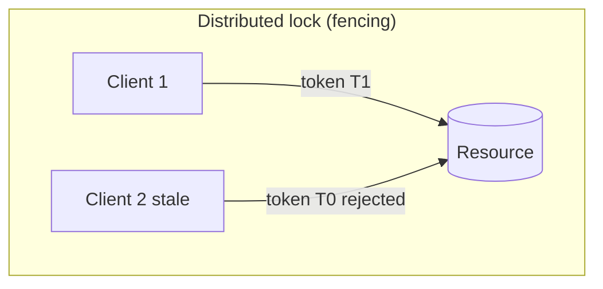
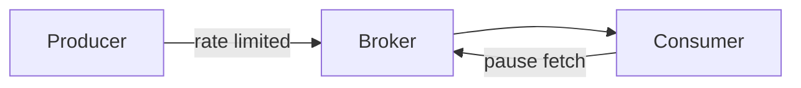

# Distributed Coordination — Senior Interview Study Guide

> **Scope:** Distributed locks, leader election, and message queues (Kafka-style semantics). Synthesized from Algoroq (2026) interview question banks.

---

## Coordination problems

| Problem | Goal | Typical tool |
|---------|------|--------------|
| **Mutual exclusion** | One writer at a time | Redis Redlock, etcd lease, DB advisory lock |
| **Leader election** | Single coordinator | Raft, ZooKeeper, K8s lease |
| **Work distribution** | Parallel consumers | Consumer groups, partition assignment |
| **Ordering** | Per-key sequence | Kafka partition key |



> **Fencing tokens:** A lock alone is insufficient if a slow holder resumes after lease expiry — the resource must reject stale tokens (Martin Kleppmann).

---

## Leader election patterns

| Algorithm | Messages | Best for |
|-----------|----------|----------|
| **Bully** | O(n²) worst case | Small, synchronous LAN clusters |
| **Ring** | O(n) | Token passing topologies |
| **Raft** | O(log n) steady state | Replicated logs, strong leadership |
| **ZooKeeper** | Sequential ephemeral nodes | Curator recipes, metadata |

**Split brain** happens when two nodes believe they are leader — prevent with **quorum + epoch/term** monotonicity.

---

## Message queues vs streams

| | **Queue (RabbitMQ)** | **Log (Kafka)** |
|---|---------------------|-----------------|
| Model | Messages deleted after ack | Retained log, consumer offset |
| Ordering | Per queue | Per partition |
| Replay | Hard | Native |
| Fan-out | Competing consumers | Consumer groups + multiple groups |

### Delivery semantics

| Semantic | Meaning | How |
|----------|---------|-----|
| **At-most-once** | May lose | Fire-and-forget |
| **At-least-once** | May duplicate | Retry until ack |
| **Exactly-once** | Effectively once | Idempotent consumers + transactional outbox / Kafka EOS |

```python
# Idempotent consumer sketch
def handle(msg):
    if store.seen(msg.id):
        return  # duplicate delivery
    process(msg)
    store.mark_seen(msg.id)
```

### Backpressure



Slow consumers should **reduce fetch rate**, **scale out** (more partitions/consumers), or **dead-letter** poison messages after bounded retries.

---

## Distributed Locking

*Source: Algoroq senior interview guide — 15 core questions.*

### 1. What is a distributed lock, and why is it

> **What they're really asking:** Do you understand the theoretical and practical challenges that make distributed locking an order of magnitude harder than single- process locking?

**Deep answer:**

A local lock (mutex, semaphore) provides mutual exclusion within a single process or machine. It
relies on guarantees provided by the operating system and hardware: atomic compare-and-
swap instructions, shared memory visibility, and the assumption that if the process holding the
lock crashes, the OS can release it. These guarantees do not exist in a distributed system.
A distributed lock provides mutual exclusion across multiple processes running on different
machines connected by a network. The fundamental challenges include the following.
Partial failure: in a local system, either the whole machine is working or it is not. In a distributed
system, the lock service might be up but unreachable from the client, or the client might crash
while holding the lock without the lock service knowing. There is no reliable way to distinguish a
crashed node from a slow node or a network partition.
No shared memory: processes on different machines cannot use atomic CPU instructions to
coordinate. They must communicate through messages, which can be delayed, duplicated,
reordered, or lost.
No global clock: without a perfectly synchronized clock, you cannot reliably determine the order
of events across machines. This makes timeout-based lock expiration inherently imprecise.
A client might believe its lock is still valid while the lock service has already expired it due to
clock skew.
The FLP impossibility result tells us that in an asynchronous system (where message delivery time
is unbounded), no deterministic consensus algorithm can guarantee both safety and liveness.
This means every distributed lock implementation must make a trade-off: either it can
potentially deadlock (sacrifice liveness) or it can potentially allow two clients to hold the lock
simultaneously (sacrifice safety).

In practice, distributed locks use timeouts and leases to provide eventual liveness at the cost of
requiring careful reasoning about safety during edge cases. The critical insight for senior
engineers is that a distributed lock alone is often insufficient. You need additional mechanisms
like fencing tokens to ensure correctness when the lock's safety guarantee is violated.

**Follow-up questions:**
- Can you describe a scenario where a distributed lock's mutual exclusion guarantee is violated?
- What does the FLP impossibility result imply for the design of distributed locks?
- When would you choose not to use a distributed lock and use a different coordination mechanism
- instead?

---

### 2. How does Redlock work, and what are its limitations?

> **What they're really asking:** Do you understand the most debated distributed lock algorithm, and can you articulate both sides of the Redlock controversy?

**Deep answer:**

Redlock is a distributed lock algorithm proposed by Redis creator Salvatore Sanfilippo. It uses N
independent Redis instances (typically 5) to provide a lock that survives the failure of a minority
of nodes.
The algorithm works as follows. The client records the current time T1. It sequentially attempts to
acquire the lock on all N Redis instances using SET with NX (only if not exists) and PX (expiration
in milliseconds). Each acquisition attempt has a small timeout (much smaller than the lock TTL) to
avoid blocking on unresponsive nodes. If the client successfully acquires the lock on a majority
(N/2 + 1 or more) of instances, and the total elapsed time (T2 - T1) is less than the lock TTL, the
lock is considered acquired. The effective lock validity time is TTL minus the elapsed time. If the
client fails to acquire the majority, it releases the lock on all instances it did acquire.
The limitations and controversy, famously articulated by Martin Kleppmann, center on
several issues.
Clock dependency: Redlock assumes that the clocks on Redis instances advance at roughly the
same rate. If a Redis instance's clock jumps forward (due to NTP adjustment, VM migration, or a
leap second), it might expire the lock prematurely while the client believes it still holds it. This
violates mutual exclusion.

Process pause problem: after acquiring the lock, the client might experience a long GC pause, a
page fault, or a context switch. By the time the client resumes, the lock may have expired, but
the client does not know this. It proceeds to access the shared resource, potentially conflicting
with another client that has since acquired the lock.
No fencing mechanism: Redlock itself does not provide a fencing token, a monotonically
increasing value that the shared resource can use to reject stale operations. Without fencing,
even if mutual exclusion is momentarily violated, there is no way for the resource to detect and
reject the stale lock holder's operations.
The counter-argument from Sanfilippo is that Redlock provides better guarantees than a single-
node Redis lock and is sufficient for use cases that can tolerate occasional safety violations. The
key insight for interviews is knowing when Redlock is appropriate (efficiency-based locking
where double-processing is merely wasteful but not catastrophic) versus when it is insufficient
(correctness-based locking where double-processing causes data corruption).

**Follow-up questions:**
- How does a single-node Redis lock compare to Redlock in terms of safety guarantees?
- What would you use instead of Redlock when you need strict correctness?
- How does the clock jump problem affect Redlock, and can it be mitigated?

---

### 3. Explain fencing tokens and why they are

> **What they're really asking:** Do you understand that the lock itself is not sufficient for correctness, and can you explain the mechanism that provides end-to-end safety?

**Deep answer:**

A fencing token is a monotonically increasing number issued by the lock service each time a lock
is acquired. The client includes the fencing token in every request to the shared resource. The
resource tracks the highest fencing token it has seen and rejects any request with a lower token.
Why this is necessary: consider the following scenario without fencing. Client A acquires the lock
with a 10-second TTL. Client A experiences a long GC pause lasting 15 seconds. The lock expires
after 10 seconds. Client B acquires the lock. Client B writes to the shared resource. Client A
resumes from GC, believes it still holds the lock, and writes to the shared resource, overwriting
Client B's write. Mutual exclusion has been violated, and data is corrupted.

With fencing tokens: Client A acquires the lock and receives fencing token 33. Client A pauses for
15 seconds. The lock expires. Client B acquires the lock and receives fencing token 34. Client B
writes to the resource with token 34. The resource records 34 as the highest token. Client A
resumes and tries to write with token 33. The resource rejects the write because 33 is less than
the recorded high watermark of 34. Data integrity is preserved.
The critical insight is that fencing tokens shift the safety guarantee from the lock service to the
resource being protected. The lock service provides best-effort mutual exclusion and a
monotonically increasing token. The resource enforces the hard safety guarantee by rejecting
stale tokens. This works even if the lock's mutual exclusion guarantee is temporarily violated.
Implementation considerations: the resource must support conditional writes based on the
fencing token. For databases, this can be a version column checked in every UPDATE WHERE
clause. For file systems, it can be a generation number. For distributed storage systems like
ZooKeeper, the zxid (transaction ID) naturally serves as a fencing token. Not all resources
support fencing natively, which limits the applicability of this pattern.
The leader election pattern is closely related: a leader holds a lease with an epoch number
(equivalent to a fencing token), and followers reject commands from leaders with stale epochs.

**Follow-up questions:**
- How would you implement fencing for a resource that does not natively support conditional
- writes?
- What is the relationship between fencing tokens and optimistic concurrency control?
- Can fencing tokens be implemented on top of Redlock?

---

### 4. How would you implement a distributed lock using ZooKeeper?

> **What they're really asking:** Do you understand consensus-based locking and can you explain the specific ZooKeeper primitives that make it reliable?

**Deep answer:**

ZooKeeper provides a much stronger foundation for distributed locks than Redis because it
uses the ZAB (ZooKeeper Atomic Broadcast) consensus protocol, which guarantees linearizable
writes and sequential consistency for reads. This means ZooKeeper can provide fencing
tokens natively.

The standard lock recipe uses ephemeral sequential znodes. To acquire the lock: create an
ephemeral sequential znode under a designated lock path, for example /locks/my-
resource/lock-. ZooKeeper appends a monotonically increasing sequence number, creating
/locks/my-resource/lock-0000000001. Get all children of /locks/my-resource/. If this client's
znode has the lowest sequence number, the lock is acquired. The sequence number serves as the
fencing token. If the client's znode is not the lowest, set a watch on the znode with the next lower
sequence number (not on all children, to avoid the herd effect). When the watched znode is
deleted (lock released or holder crashed), re-check if this client's znode is now the lowest.
The ephemeral node property is crucial: if the lock holder's session expires (due to crash or
network partition), ZooKeeper automatically deletes the ephemeral node, releasing the lock.
This avoids the indefinite lock holding problem. The session timeout is configurable (typically 10-
30 seconds) and is based on heartbeats between the client and ZooKeeper, not wall-clock time.
Advantages over Redlock: ZooKeeper provides linearizable operations backed by consensus, so
there is no clock dependency. Ephemeral nodes handle lock holder crashes automatically. The
sequential znode number is a natural fencing token. Watches provide efficient notification
without polling.
Disadvantages: ZooKeeper is operationally complex to run. Write throughput is limited by the
consensus protocol (typically thousands per second, not millions). The session timeout introduces
latency in failure detection. ZooKeeper is a CP system under the CAP theorem, meaning it
sacrifices availability during network partitions.
Alternatives in the same category include etcd (uses Raft consensus, provides similar guarantees
with a simpler operational model) and Consul (provides distributed locking with session-based
semantics similar to ZooKeeper).

**Follow-up questions:**
- What happens if there is a network partition between the lock holder and ZooKeeper?
- How does the herd effect problem manifest in a naive ZooKeeper lock implementation?
- How would you choose between ZooKeeper and etcd for distributed locking?

---

### 5. What is the difference between a

> **What they're really asking:** Do you understand time-bounded ownership and why leases are the practical foundation of almost all distributed coordination?

**Deep answer:**

A lock in the traditional sense grants indefinite exclusive access until explicitly released. A lease
is a lock with an expiration time. The distinction matters enormously in distributed systems
because indefinite locks combined with the possibility of holder crashes create the risk of
permanent deadlock.
A lease grants ownership for a bounded duration. If the holder crashes or becomes unreachable,
the lease eventually expires, and another client can acquire it. This provides a strong liveness
guarantee: the system will always make progress, even in the presence of failures. The trade-off
is that the holder must continuously renew the lease before it expires, and there is a window of
vulnerability if the holder's operation takes longer than the lease duration.
Lease mechanics involve three parameters: the grant duration (how long the lease is valid), the
renewal interval (how often the holder should renew, typically at half the grant duration), and
the grace period (additional time after expiration before another client can acquire, optional).
The holder must complete its work and release the lease, or renew it, before expiration. If the
holder cannot renew (due to network issues or load), it must assume the lease is lost and stop
accessing the protected resource.
The fundamental tension in lease design is the duration. A short lease (1-5 seconds) provides fast
failover when the holder crashes but requires frequent renewals and is sensitive to transient
network hiccups. A long lease (30-60 seconds) is more tolerant of transient issues but delays
failover. In practice, lease durations of 10-30 seconds with renewal at half the interval provide a
reasonable balance.
Real-world lease usage extends far beyond mutual exclusion. Leader election in systems like
Kafka and Elasticsearch uses leases to maintain leadership. DHCP uses leases for IP address
allocation. Distributed storage systems use leases for cache coherence. Chubby (Google's lock
service) is fundamentally a lease manager that provides a file-system-like interface for
acquiring and renewing leases.
The relationship to leader election is direct: a leader holds a lease. When the lease expires, a
new election occurs. This ensures that at most one leader exists at any time (safety) and that a
new leader will eventually be elected if the current one fails (liveness).

**Follow-up questions:**
- How do you handle the case where a lease holder's operation takes longer than the lease
- duration?
- What is the impact of clock skew on lease-based systems?
- How does Google's Chubby service use leases, and what lessons does its design teach?

---

### 6. How would you handle the problem of

> **What they're really asking:** Do you understand one of the most insidious failure modes in distributed locking, and do you know practical mitigation strategies?

**Deep answer:**

Garbage collection pauses in languages like Java, Go, and C# can cause a lock holder to stop
executing for milliseconds to seconds. During this pause, the lock's lease may expire without the
holder knowing. When the holder resumes, it incorrectly believes it still holds the lock and
proceeds to modify the protected resource, potentially conflicting with the new lock holder.
This is not a theoretical concern. Production systems at major companies have experienced data
corruption due to this exact scenario. A 15-second GC pause is uncommon but not impossible,
especially in JVM-based systems with large heaps.
Mitigation strategies operate at multiple levels. First, use fencing tokens as described in question

---

### 7. Explain the Raft consensus algorithm and its role in distributed locking.

> **What they're really asking:** Do you understand the consensus foundation that powers modern distributed lock services like etcd, and can you explain it clearly?

**Deep answer:**

Raft is a consensus algorithm designed to be more understandable than Paxos while providing
the same guarantees. It ensures that a cluster of nodes agrees on a sequence of operations
even when a minority of nodes fail. This property is exactly what a correct distributed lock
service needs.
Raft has three roles: leader, follower, and candidate. At any time, at most one leader exists. The
leader handles all client requests and replicates them to followers. Safety is guaranteed as long
as a majority (N/2 + 1) of nodes are operational.
The leader election process works through terms (monotonically increasing epoch numbers).
When a follower does not receive a heartbeat from the leader within the election timeout, it
becomes a candidate, increments its term, votes for itself, and requests votes from other nodes.
A node votes for at most one candidate per term. A candidate wins if it receives votes from a
majority. If multiple candidates split the vote, a new election starts with a higher term after a
randomized timeout.
Log replication: the leader appends client operations to its log and replicates them to
followers. An entry is committed when a majority of nodes have stored it. Committed

entries are guaranteed to be present in any future leader's log. This is the foundation of
linearizable operations.
For distributed locking, services like etcd implement a lock on top of Raft. When a client requests
a lock, the leader writes the lock acquisition to the Raft log. Once committed (majority
acknowledgment), the lock is durably held. If the leader fails, the new leader's log contains the
lock state, so the lock is preserved. Because Raft provides linearizable writes, there is no window
where two clients can simultaneously believe they hold the lock (as long as the lock service itself
is correct).
The compare-and-swap (CAS) operation is the key primitive for locking on etcd: "set this key to
my value only if it does not currently exist or has the expected revision." Raft ensures this CAS is
executed atomically and durably.
Compare with leader election: Raft's leader election is itself a form of distributed locking where
only one node can be the leader at a time. This is why Raft-based systems are natural choices
for implementing distributed locks.

**Follow-up questions:**
- What happens to distributed locks during a Raft leader election?
- How does Raft handle network partitions, and what does this mean for lock availability?
- What is the performance overhead of Raft-based locking compared to Redis-based locking?

---

### 8. How would you implement distributed

> **What they're really asking:** Can you apply distributed locking to a practical problem while recognizing when a lock is the right tool and when alternative approaches are better?

**Deep answer:**

Distributed rate limiting ensures that a global rate limit is enforced across multiple server
instances. For example, an API might allow 1,000 requests per minute per API key, but requests
are handled by any of 50 servers.
The naive approach uses a distributed lock: acquire a lock, read the current counter from a
shared store, increment it, check if the limit is exceeded, write the updated counter, and release
the lock. This works correctly but has severe performance problems. Every rate-limited request
requires acquiring and releasing a distributed lock, adding latency (milliseconds per lock

operation). The lock becomes a bottleneck since all traffic for a given API key is serialized
through the lock. If the lock service is slow or unavailable, all rate-limited requests are blocked.
A better approach eliminates the lock entirely using atomic operations. Use Redis INCR with
EXPIRE for a simple sliding window counter. INCR is atomic in Redis, so concurrent increments
are safe without a lock. The key is the API key plus the current time window (for example,
apikey:123:minute:2026-04-21T14:30). INCR atomically increments and returns the new value. If
the value exceeds the limit, reject the request. If this is the first increment, set an expiration on
the key.
For the token bucket algorithm in a distributed setting, use Redis with a Lua script that atomically
refills tokens based on elapsed time and attempts to consume a token. The Lua script runs
atomically in Redis, providing the mutual exclusion needed without an external lock.
For even higher throughput, use local rate limiting with periodic synchronization. Each server
maintains a local counter and a local token allocation. Periodically (every few seconds), servers
synchronize with a central store to redistribute tokens. This sacrifices precision (the global limit
might be slightly exceeded) but dramatically improves throughput and eliminates the central
bottleneck. This is the approach companies like Google and Stripe use for high-volume API
rate limiting.
The lesson for distributed locking interviews: a distributed lock is a tool of last resort for
coordination. Before reaching for a lock, ask whether the problem can be solved with atomic
operations, optimistic concurrency control, or eventual consistency.

**Follow-up questions:**
- What are the failure modes of Redis-based rate limiting when a Redis node goes down?
- How would you rate limit across multiple data centers with independent Redis clusters?
- When is a distributed lock genuinely necessary for rate limiting?

---

### 9. How do you prevent deadlocks in a

> **What they're really asking:** Do you understand that distributed deadlock is harder to detect and resolve than local deadlock, and do you know practical prevention strategies?

**Deep answer:**

Deadlock occurs when two or more processes each hold a lock and are waiting for a lock held by
another. The classic conditions are mutual exclusion, hold and wait, no preemption, and circular
wait. In a distributed system, deadlock detection is harder because no single node has visibility
into all lock-wait relationships.
Prevention strategy one: lock ordering. Define a global total order on all lockable resources (for
example, alphabetical by resource name). All clients must acquire locks in this order. This
prevents circular wait, eliminating the possibility of deadlock. This is the simplest and most
reliable approach. Example: if a transaction needs locks on accounts A and B, always lock A first
regardless of which account is the source and which is the destination.
Prevention strategy two: timeout-based acquisition. When attempting to acquire a lock, set a
timeout. If the lock is not acquired within the timeout, release all currently held locks and retry
(possibly with exponential backoff and jitter to prevent livelock). This breaks the hold-and-wait
condition. The trade-off is that transactions may be aborted and retried, reducing throughput
under contention.
Prevention strategy three: try-lock with rollback. Attempt to acquire all needed locks without
blocking. If any lock acquisition fails, release all acquired locks and retry. This is similar to
optimistic locking: assume no conflict, back off if there is one. Works well when contention is low.
Detection and resolution: if prevention is not feasible, implement deadlock detection. Build a
wait-for graph by periodically collecting which client is waiting for which lock from the lock
service. Detect cycles in the graph. When a cycle is found, choose a victim (typically the client
that has done the least work) and forcibly revoke its locks. In a distributed system, constructing
the wait-for graph requires coordinating information from multiple lock servers, which
introduces latency in detection.
For practical systems, prefer prevention over detection. Lock ordering combined with timeouts
handles the vast majority of cases. Reserve deadlock detection for systems where lock ordering
is impractical due to dynamic, unpredictable access patterns.

**Follow-up questions:**
- How does distributed deadlock detection differ from local deadlock detection?
- What is the risk of livelock when using timeout-based deadlock prevention?
- How would you implement lock ordering in a system where the set of required locks is not known
- in advance?

---

### 10. How does Google's Chubby lock service work?

> **What they're really asking:** Do you understand the design of a production-grade distributed lock service and the lessons learned from operating it at scale?

**Deep answer:**

Chubby is Google's distributed lock service, described in the 2006 paper by Mike Burrows. It
provides coarse-grained locking and a small file storage system for loosely-coupled distributed
systems. Chubby is not a general-purpose lock service. It is designed for locks held for hours or
days (leader election, master selection), not milliseconds.
Architecture: a Chubby cell consists of 5 replicas, one of which is elected master using Paxos
consensus. The master handles all client requests. Replicas maintain a replicated database that
stores the lock state. If the master fails, a new master is elected, and the replicated database
ensures continuity.
Chubby exposes a file-system-like interface. Locks are represented as files or directories.
Acquiring a lock means opening a file with exclusive access. The contents of the file can store
metadata (for example, the current leader's address). This dual-purpose design (lock plus small
data store) is what makes Chubby so useful for leader election: the leader acquires the lock and
writes its address to the file, and followers read the file to discover the leader.
Sessions and leases: each client maintains a session with the Chubby cell via periodic KeepAlive
RPCs. The session has a lease that the master extends on each KeepAlive. If the client fails to
renew within the timeout, the session expires and all locks held by that session are released
(similar to ZooKeeper's ephemeral nodes).
Sequencers (fencing tokens): when a client acquires a lock, it can request a sequencer, an opaque
byte string containing the lock name, mode, and lock generation number. The client passes the
sequencer to servers that should verify the lock is still held. This provides the fencing token
mechanism critical for correctness.
Key design lessons from Chubby: developers often misused Chubby for fine-grained locking,
causing performance problems. The service was designed for coarse-grained locks held for long
periods. Chubby included a mechanism to detect and break locks held by unresponsive clients,
but this was controversial because it violated the expectation of mutual exclusion. The solution
was sequencers, which provide safety even when locks are broken.

**Follow-up questions:**
- Why did Google choose coarse-grained locking for Chubby instead of fine-grained locking?
- How does Chubby handle the case where the master fails during a lock acquisition?
- What are the similarities and differences between Chubby and ZooKeeper?

---

### 11. How would you implement optimistic locking in a distributed database?

> **What they're really asking:** Do you understand lock-free coordination and when optimistic concurrency control is preferable to distributed locks?

**Deep answer:**

Optimistic locking is not truly a lock at all. It is a concurrency control strategy based on the
assumption that conflicts are rare. Instead of acquiring a lock before reading, the client reads
data along with a version number, performs its computation, and then writes the result only if
the version has not changed. If the version has changed (indicating a concurrent modification),
the write is rejected and the client retries.
Implementation in a relational database: add a version column to each row. A read returns the
current version. An update includes WHERE version = expected_version and sets version =
version + 1. If the WHERE clause matches zero rows, the update failed due to a concurrent
modification. The client must re-read the current state and retry its operation.
Implementation in a distributed key-value store: etcd's transactions support compare-and-swap
on the revision number. DynamoDB's conditional expressions support attribute_not_exists
or attribute_equals for optimistic locking. CockroachDB and Spanner use timestamp-
based optimistic concurrency control as part of their MVCC (Multi-Version Concurrency
Control) implementation.
Advantages over distributed locks: no lock service dependency (one fewer infrastructure
component), no risk of deadlock (there are no locks to deadlock on), higher throughput under
low contention (no lock acquisition overhead), and simpler failure handling (if a client crashes
mid-operation, no lock needs to be released).
Disadvantages: under high contention, optimistic locking causes excessive retries, wasting
resources and increasing latency. The retry logic must be carefully implemented with exponential
backoff and jitter to prevent livelock. Long-running transactions are particularly problematic
because they are more likely to conflict, and retrying a long transaction is expensive.

The decision framework: use optimistic locking when conflicts are rare (less than 5 percent of
operations conflict), transactions are short, and retry overhead is acceptable. Use distributed
locks (pessimistic locking) when conflicts are frequent, transactions are long or expensive, or the
cost of a failed transaction is high (for example, external side effects that cannot be retried).
In practice, many systems use a hybrid approach. Use optimistic locking for the common case
and fall back to a distributed lock under high contention (for example, after three failed
optimistic attempts, acquire a lock).

**Follow-up questions:**
- How do you handle the ABA problem in optimistic locking?
- What is the relationship between MVCC and optimistic locking?
- How would you implement optimistic locking across multiple tables in a single transaction?

---

### 12. How do distributed databases like Spanner achieve

> **What they're really asking:** Do you understand the most sophisticated approach to distributed coordination and how TrueTime enables lock-free serializable transactions?

**Deep answer:**

Google Spanner achieves external consistency (also called strict serializability or linearizability
of transactions) using a combination of two-phase locking for write transactions and TrueTime
for assigning globally meaningful timestamps.
TrueTime is a clock API that returns a time interval [earliest, latest] rather than a single
timestamp. It guarantees that the actual current time falls within this interval. The interval width
is typically 1-7 milliseconds, kept tight by GPS receivers and atomic clocks in Google's data
centers. This is fundamentally different from NTP, which provides a single timestamp with
unbounded error.
For read-write transactions, Spanner uses traditional two-phase locking: the transaction
acquires read locks and write locks on the data it accesses. At commit time, the transaction is
assigned a commit timestamp using TrueTime. The key insight: the transaction leader waits until
it is certain that the commit timestamp is in the past (waits for the TrueTime uncertainty interval
to pass). This wait, called commit-wait, ensures that any transaction that starts after this one

commits will see this transaction's writes. This provides external consistency without requiring a
global lock manager.
For read-only transactions, Spanner uses snapshot reads at a timestamp. Because committed
transactions have globally meaningful timestamps and Spanner's MVCC retains multiple
versions, a read at timestamp T sees all transactions committed before T and none
committed after T. Read-only transactions require no locks at all, which is critical for read-
heavy workloads.
This relates to distributed locking because Spanner shows that with sufficiently accurate clocks,
you can reduce the need for distributed coordination. The commit-wait delay (a few
milliseconds) replaces what would otherwise require a distributed consensus round for ordering.
This is a profound trade-off: invest in clock infrastructure (GPS, atomic clocks) to simplify the
distributed coordination protocol.
The lesson for broader distributed locking design: the quality of your time source determines
what coordination shortcuts are available. With NTP (millisecond to second accuracy), you
cannot rely on timestamps for ordering. With TrueTime (microsecond accuracy with bounded
error), you can use timestamps with commit-wait. With perfect clocks (impossible), you would
not need distributed coordination at all.
For related concepts, see CAP theorem to understand the theoretical constraints that
Spanner navigates.

**Follow-up questions:**
- Why cannot NTP provide the same guarantees as TrueTime?
- What happens to Spanner's consistency guarantees if the TrueTime interval becomes very wide?
- How does CockroachDB approximate Spanner's approach without specialized clock hardware?

---

### 13. How would you design a distributed lock

> **What they're really asking:** Can you extend the basic distributed lock model to handle priority, ordering, and starvation prevention?

**Deep answer:**

A basic distributed lock is often a try-lock: either you get it or you do not. For many systems, this
is insufficient. You need queuing so that waiters are served in order, fairness so that no client

starves, and potentially priority so that urgent operations can jump the queue.
For FIFO fairness (first come, first served), use the ZooKeeper-style approach with sequential
nodes. Each client creates a sequential node. The client with the lowest sequence number holds
the lock. Others are queued in sequence number order. When the lock holder releases, the next
in line is notified. This provides strict FIFO ordering and prevents starvation since every client
eventually reaches the front of the queue.
For priority-based queuing, extend the model with priority levels. Maintain separate queues per
priority level. A high-priority client jumps ahead of lower-priority clients but is still ordered within
its priority level. Implementation: use the sequential node approach but prefix the node name
with the priority level. When selecting the next lock holder, choose the node with the highest
priority, breaking ties by sequence number. This risks starvation of low-priority clients, so
implement a priority aging mechanism: if a client has been waiting longer than a threshold,
temporarily boost its priority.
For read-write lock semantics, support shared (read) and exclusive (write) locks. Multiple readers
can hold the lock simultaneously, but a writer requires exclusive access. Implementation: use
sequential nodes with a type prefix (R for read, W for write). A reader can proceed if all earlier
nodes are readers. A writer can proceed only when it is the first node in the queue. This provides
concurrent read access while ensuring write exclusion.
For scalability, the lock queue should not become a bottleneck. If thousands of clients are
queuing for the same lock, the notification overhead when the lock is released could be
significant. Use the watch-predecessor pattern (as in ZooKeeper) where each client watches only
the node immediately ahead of it, providing O(1) notification cost per lock release.
For timeout-based queue management, allow clients to specify a maximum wait time. If the lock
is not acquired within the timeout, the client removes its queue entry and receives a failure. This
prevents unbounded queue growth and allows clients to take alternative action when contention
is high.

**Follow-up questions:**
- How would you implement a try-lock-with-timeout on top of a queuing lock?
- What is the thundering herd problem in lock queuing, and how do you prevent it?
- How do you handle the case where a queued client crashes before its turn comes?

---

### 14. What are the alternatives to distributed

> **What they're really asking:** Do you understand the full toolkit for distributed coordination and know when not to use a lock?

**Deep answer:**

Distributed locks are one coordination mechanism among many. Senior engineers should know
the alternatives and choose the most appropriate tool for each situation.
Idempotent operations: design operations so that executing them multiple times produces the
same result as executing once. If operations are idempotent, you do not need mutual exclusion
because concurrent or duplicate executions are harmless. Example: SET key=value is
idempotent, INCREMENT key is not. Designing for idempotency often eliminates the need for
distributed locks entirely.
Optimistic concurrency control: as discussed in question 11, use version numbers and conditional
writes to detect conflicts without locks. Suitable for low-contention scenarios.
Event sourcing and CQRS: instead of coordinating access to mutable shared state, model the
system as an append-only log of events. Each event is immutable and ordered. Consumers
process events sequentially. Since there is no shared mutable state, there is nothing to lock.
Kafka-based architectures often follow this pattern.
Single-writer principle: assign each piece of data to a single writer (owner). Only the owner can
modify the data. This eliminates write contention by design. If the owner fails, a new owner is
elected using leader election. The trade-off is that all writes for a given piece of data must route
to the same node, which can be a bottleneck.
CRDTs (Conflict-free Replicated Data Types): data structures that can be updated
independently on different nodes and merged automatically without conflicts. Counters, sets,
and registers all have CRDT variants. CRDTs trade coordination for convergence since they
always converge to the same state without any locking or consensus.
Partitioning: divide the data space so that each operation touches only one partition. Within a
partition, use a local lock or single-threaded processing. This is how databases like Kafka
achieve high throughput. Each partition is processed by a single consumer, eliminating the need
for distributed coordination.

The decision framework for senior engineers: start by asking whether coordination can be
avoided entirely (idempotency, CRDTs, partitioning). If coordination is necessary, prefer
optimistic approaches (conditional writes, version checks). Use distributed locks only when
pessimistic coordination is required and the failure mode of the lock is acceptable for your
use case.

**Follow-up questions:**
- How would you choose between a distributed lock and an event-sourced architecture for a
- specific problem?
- Can CRDTs replace distributed locks for all use cases?
- How does the single-writer principle relate to Kafka's consumer group model?

---

### 15. How would you test and validate a distributed locking implementation?

> **What they're really asking:** Do you know how to verify correctness of distributed systems, including testing failure modes that are difficult to reproduce?

**Deep answer:**

Testing distributed locks is uniquely challenging because the most important bugs manifest only
under specific timing conditions: network delays, clock skew, process pauses, and partial failures.
Standard unit and integration tests are necessary but insufficient.
Correctness testing with Jepsen: Jepsen is a framework designed specifically for testing
distributed systems. It runs operations against the system while injecting faults (network
partitions, node crashes, clock skew) and verifies that the system maintains its safety
guarantees. For a distributed lock, the key property to verify is mutual exclusion: at no point
should two clients simultaneously believe they hold the same lock. Run thousands of test
iterations with randomized fault injection to build confidence.
Linearizability checking: record a history of lock operations (acquire, release) with their real-
time ordering. Use a linearizability checker (like the one in Jepsen or the Knossos checker) to
verify that the observed history is consistent with a sequential specification. If the checker finds a
non-linearizable history, you have a correctness bug.
Fault injection testing: systematically test each failure mode. Network partition between client
and lock service: does the client correctly detect that it lost the lock? Process pause injection
(using SIGSTOP to simulate GC pauses): does the fencing token mechanism correctly prevent

stale operations? Clock skew injection (using libfaketime): does the lock expire correctly under
clock drift? Lock service node failure: does the lock service correctly hand off to a new leader
without violating mutual exclusion?
Performance testing under contention: measure lock acquisition latency and throughput as you
increase the number of competing clients. Identify the contention level at which performance
degrades unacceptably. Test the queue behavior: with 1,000 clients waiting for the same lock,
how long does the average client wait? Is the wait-time distribution fair?
Chaos engineering in production: once the implementation is deployed, run controlled chaos
experiments. Use tools like Chaos Monkey to randomly terminate lock service nodes. Use traffic
control (tc) to inject latency and packet loss between clients and the lock service. Monitor the
safety property (no concurrent holders) and the liveness property (locks are always eventually
acquired after release) during these experiments.
Observability: instrument the lock service with metrics including lock acquisition latency (p50,
p99), lock hold duration, contention rate (percentage of acquisitions that must wait), timeout
rate (percentage of acquisitions that time out), and fencing token rejection rate at the resource.
Alert on anomalies in these metrics, which may indicate correctness issues before they cause
data corruption.
For a broader perspective on testing distributed systems, see our distributed systems guide.

**Follow-up questions:**
- How would you set up a continuous integration pipeline that tests distributed lock correctness on
- every commit?
- What is the value of formal verification methods like TLA+ for distributed lock design?
- How do you test the interaction between your lock implementation and GC pauses in a controlled
- way?

---

## Leader Election

*Source: Algoroq senior interview guide — 15 core questions.*

### 1. What is leader election in distributed systems and why is it necessary?

> **What they're really asking:** Can you articulate why distributed systems need leaders, what problems leader election solves, and what alternatives exist?

**Deep answer:**

Begin with the fundamental problem. Many distributed system operations require serialization:
only one node should process a given write at a time, or only one node should hold a distributed
lock. Without a designated leader, you face two options: every node can process any operation
(which requires expensive coordination on every operation) or no node processes operations
until they coordinate (which hurts availability). Leader election provides a middle ground: nodes
agree once on a leader, and then the leader makes decisions without per-operation
coordination, dramatically simplifying the system and improving throughput.
Explain the concrete use cases. In database replication, the leader accepts all writes and
replicates them to followers. This avoids write-write conflicts that plague multi-leader setups. In
distributed locking, the leader manages lock state, preventing deadlocks and ensuring mutual
exclusion. In task scheduling, the leader assigns tasks to workers, preventing duplicate execution.
In stream processing, each partition has a leader consumer that processes messages in order.
Discuss why leader election is hard. The FLP impossibility result (Fischer, Lynch, Paterson, 1985)
proves that in an asynchronous system with even one faulty process, no deterministic algorithm
can guarantee consensus (and thus leader election). Practical systems work around this by using
partial synchrony assumptions (timeouts) and probabilistic guarantees. The key challenge is
distinguishing between a crashed leader and a slow or network-partitioned leader. False failure
detection leads to split-brain; slow detection leads to extended unavailability.
Briefly mention leaderless alternatives. Some systems avoid leader election entirely: DynamoDB
uses leaderless replication with quorum reads/writes, CRDTs allow concurrent updates without

coordination, and gossip protocols disseminate state without a central coordinator. These
approaches trade coordination overhead for conflict resolution complexity. Discuss when
leader-based systems are preferred (strong consistency requirements, ordered operations)
versus leaderless systems (availability-first, write-heavy workloads).
Connect to the CAP theorem: leader-based systems typically favor consistency over availability
during partitions (CP systems), while leaderless systems favor availability (AP systems).

**Follow-up questions:**
- What happens during the window between a leader failing and a new leader being elected?
- How does the choice of leader election algorithm affect the system's availability SLA?
- Can you name a system that switched from leaderless to leader-based architecture or vice
- versa, and explain why?

---

### 2. Explain the Raft consensus algorithm

> **What they're really asking:** Do you understand Raft deeply enough to trace through a leader election scenario, including edge cases like split votes and network partitions?

**Deep answer:**

Raft was designed by Ongaro and Ousterhout (2014) to be an understandable consensus
algorithm, in contrast to Paxos which is notoriously difficult to implement correctly. Raft
decomposes consensus into three sub-problems: leader election, log replication, and safety.
In Raft, every node is in one of three states: follower, candidate, or leader. Time is divided into
terms, which are monotonically increasing integers. Each term begins with a leader election. All
nodes start as followers. A follower that does not receive a heartbeat from the leader within an
election timeout (randomized, typically 150-300ms) transitions to candidate state, increments its
term, votes for itself, and sends RequestVote RPCs to all other nodes.
A node grants its vote to a candidate if: (1) the candidate's term is greater than or equal to the
voter's current term, (2) the voter has not already voted for another candidate in this term, and
(3) the candidate's log is at least as up-to-date as the voter's log (compared by last log entry's
term and index). This last condition is critical for safety: it prevents a node with a stale log from
becoming leader.

A candidate becomes leader when it receives votes from a majority of nodes (including itself). It
then sends heartbeat AppendEntries RPCs to all nodes to establish authority and prevent new
elections. If a candidate receives a heartbeat from a leader with a term greater than or equal to
its own, it steps down to follower.
Discuss the split vote scenario. If two candidates start elections simultaneously, neither may
achieve a majority. Raft handles this by using randomized election timeouts: each candidate
waits a random duration before starting a new election. This makes it extremely unlikely that two
candidates will start elections at the same time twice in a row. In practice, elections complete in
one or two rounds, typically under 500ms.
Discuss the network partition scenario. If the leader is partitioned from the majority, the
majority will elect a new leader (they can form a quorum). The old leader is now in the minority
partition and cannot commit new entries (it cannot reach a majority). When the partition heals,
the old leader discovers the new term and steps down. Any uncommitted entries on the old
leader's log are overwritten by the new leader's log.
Mention Raft's production implementations: etcd (Kubernetes' backing store), CockroachDB,
TiKV, and Consul.

**Follow-up questions:**
- What is the minimum cluster size for Raft to tolerate one node failure, and why?
- How does Raft's pre-vote optimization reduce disruptions from network-partitioned nodes?
- What happens in Raft if the elected leader crashes before replicating any entries?

---

### 3. Compare Raft and Paxos for leader election.

> **What they're really asking:** Do you understand the practical differences between these two consensus algorithms beyond the theoretical equivalence, including implementation complexity and operational characteristics?

**Deep answer:**

Paxos, introduced by Lamport in 1989, is the original consensus algorithm and has been proven
correct. However, it is notoriously difficult to implement correctly. The basic Paxos algorithm
(Single-Decree Paxos) solves consensus for a single value. Extending it to a replicated log (Multi-

Paxos) requires significant additional design decisions that Lamport's original paper left
unspecified, leading to many different (and sometimes incorrect) implementations.
In Paxos, leader election is not a distinct phase but emerges from the protocol itself. Any node
can act as a proposer. A proposer sends a Prepare message with a proposal number. If a
majority of acceptors respond with Promise messages, the proposer can send an Accept
message. If another proposer starts with a higher proposal number, it can preempt the first. In
practice, Multi-Paxos optimizes this by having a stable leader that skips the Prepare phase for
subsequent proposals, but the leadership mechanism is implicit rather than explicit.
Raft, by contrast, makes leader election an explicit, well-defined phase. This clarity makes Raft
significantly easier to implement, test, and debug. The term-based leadership model is intuitive:
each term has at most one leader, and the leader has complete authority during its term.
Compare along practical dimensions. Implementation complexity: Raft has a single canonical
specification with clear invariants. Paxos has many variants (Basic Paxos, Multi-Paxos, Fast
Paxos, Flexible Paxos) with implementation choices left to the engineer. Studies have shown that
students implement Raft correctly more often than Paxos. Understandability: Raft was explicitly
designed for understandability. Its leader-centric approach means the log is always managed by
one node, simplifying reasoning about correctness. Performance: both achieve similar
performance in stable state (leader-based log replication). Raft may be slightly slower during
leader elections due to the election timeout, while Multi-Paxos can elect a new leader faster
since any proposer can start proposing immediately. Flexibility: Paxos is more flexible. Flexible
Paxos (Howard et al., 2016) showed that the Prepare and Accept quorums need not be the same
majority, enabling optimizations like read quorums of 1 node. Raft's rigid majority quorum model
does not allow this.
When to choose Raft: when you need an understandable, well-documented implementation,
when the team does not have deep distributed systems expertise, and for most production
systems. When to choose Paxos: when you need maximum flexibility in quorum configuration,
when building a research or specialized system, or when integrating with existing Paxos-
based infrastructure.

**Follow-up questions:**
- What is the Flexible Paxos optimization and how does it improve performance?
- How does Multi-Paxos achieve stable leadership similar to Raft?
- Can you explain the livelock problem in basic Paxos and how it relates to leader election?

---

### 4. How does ZooKeeper implement leader election, and how

> **What they're really asking:** Can you explain both ZooKeeper's internal leader election (ZAB protocol) and the pattern for building leader election on top of ZooKeeper as a client?

**Deep answer:**

Distinguish between two levels. First, ZooKeeper itself uses the ZAB (ZooKeeper Atomic
Broadcast) protocol for internal leader election among ZooKeeper server nodes. Second,
applications use ZooKeeper as a building block to implement leader election for their
own services.
For ZAB internal leader election: ZooKeeper servers elect a leader using a protocol similar to
Paxos. Each server proposes itself as leader with a (epoch, zxid) pair, where epoch is the election
round and zxid is the server's last processed transaction ID. Servers vote for the candidate with
the highest zxid (most up-to-date), breaking ties by server ID. Once a majority agrees on a
leader, the leader synchronizes all followers to its state and begins accepting client requests. The
leader handles all write requests and broadcasts state changes to followers.
For application-level leader election using ZooKeeper: the standard pattern uses ephemeral
sequential znodes. Each candidate creates an ephemeral sequential znode under a designated
path (for example, /election/candidate-). The znode names are automatically numbered:
candidate-0000000001, candidate-0000000002, and so on. The candidate that created the
lowest-numbered znode is the leader. All other candidates set a watch on the znode with the
next lower number than their own (not on the leader's znode, to avoid the herd effect). When the
leader crashes, its ephemeral znode is automatically deleted (ZooKeeper detects the session
timeout), the watch fires on the next candidate, and that candidate becomes the new leader.
This pattern is elegant because: (1) ephemeral znodes automatically handle leader failure
detection, (2) sequential numbering provides a total order for tiebreaking, (3) watching only the
predecessor avoids the thundering herd problem where all candidates react simultaneously, and
(4) ZooKeeper's linearizable guarantees prevent split-brain.
Discuss the limitations. ZooKeeper itself must be available for leader election to work, so
ZooKeeper becomes a dependency. ZooKeeper sessions have a timeout (default 30 seconds), so
leader failure detection is bounded by this timeout. Long GC pauses on the leader can cause the
session to expire and leadership to transfer even though the leader is alive, known as the false
leader expiry problem.

Mention alternatives: etcd (uses Raft directly, provides a simpler API), Consul (provides a built-in
leader election primitive), and Apache Curator (a ZooKeeper client library that provides a high-
level leader election recipe).

**Follow-up questions:**
- How would you handle the case where a leader's ZooKeeper session expires due to a GC pause
- but the leader is still functioning?
- What is the herd effect in ZooKeeper leader election and how does the sequential znode pattern
- avoid it?
- How would you implement leader election using etcd's lease mechanism instead of ZooKeeper?

---

### 5. What is the split-brain problem in

> **What they're really asking:** Do you understand the most dangerous failure mode in leader-based systems and can you design safeguards against it?

**Deep answer:**

Define split-brain precisely. Split-brain occurs when two nodes simultaneously believe they are
the leader. This can happen when a network partition separates the old leader from the rest of
the cluster. The old leader continues to act as leader on its side of the partition, while the rest of
the cluster elects a new leader. If clients can reach both leaders, the system processes conflicting
operations, leading to data corruption, lost updates, or inconsistent state.
Explain why split-brain is so dangerous. In a database, two leaders accepting writes can cause
divergent state that is impossible to automatically reconcile. In a distributed lock service, two
leaders can grant the same lock to two clients, violating mutual exclusion. In a task scheduler,
two leaders can assign the same task to two workers, causing duplicate processing.
Discuss prevention strategies. First, fencing tokens: every leader is assigned a monotonically
increasing token (for example, Raft's term number). All operations carry the leader's fencing
token. Downstream systems (databases, storage, workers) reject operations with a stale token.
Even if an old leader continues sending requests, its lower token causes them to be rejected. This
is the most robust defense.
Second, majority quorum requirement: a leader can only commit operations if it can
communicate with a majority of nodes. Since only one majority can exist in any partition
configuration (by the pigeonhole principle), only one leader can successfully commit. The old

leader on the minority side of a partition will fail to get quorum confirmation and must step
down. This is how Raft and Paxos prevent split-brain.
Third, lease-based leadership: the leader holds a time-limited lease. It must renew the lease
before expiration by contacting a quorum. If it cannot renew (due to partition), the lease expires
and the leader steps down. A new election cannot begin until the old lease period has expired
(pessimistic approach) or a new leader waits one lease duration before acting (optimistic
approach). The trade-off is that the unavailability window is at least one lease duration.
Fourth, STONITH (Shoot The Other Node In The Head): in infrastructure-level leader election
(like database failover), physically fence the old leader by powering off its machine, revoking its
network access, or unmounting its storage. This is a last-resort mechanism used in traditional
HA setups.
Discuss the real-world case study. In 2013, a GitHub outage was caused by a split-brain in their
MySQL HA setup. The old leader was not properly fenced, continued accepting writes, and when
the partition healed, data corruption required manual intervention. This illustrates why fencing
tokens and proper quorum requirements are essential.

**Follow-up questions:**
- How do fencing tokens work in practice when the leader communicates with an external system
- like a database?
- What is the relationship between lease duration and failover time, and how do you choose the
- right duration?
- Can split-brain occur even with a majority quorum requirement? Under what circumstances?

---

### 6. Explain the Bully algorithm for leader election.

> **What they're really asking:** Do you know classical distributed algorithms beyond Raft/Paxos, and can you analyze their properties critically?

**Deep answer:**

The Bully algorithm, proposed by Garcia-Molina in 1982, is one of the oldest leader election
algorithms. It is based on a simple principle: the node with the highest ID wins. Every node knows
the IDs and addresses of all other nodes in the cluster.

When a node detects that the leader has failed (via timeout), it initiates an election by sending an
Election message to all nodes with higher IDs. If no higher-ID node responds within a timeout,
the initiator declares itself the new leader and sends a Coordinator message to all lower-ID
nodes. If a higher-ID node responds (an OK message), the initiator backs off and waits for that
higher-ID node to complete the election. The highest-ID node that is alive always becomes the
leader, hence the name "bully" since the biggest node always wins.
Analyze the strengths. Simplicity: the algorithm is easy to understand and implement.
Deterministic outcome: given the same set of alive nodes, the same leader is always elected (the
one with the highest ID). Fast convergence: in the best case, the highest alive node detects the
failure and immediately declares itself leader in one round of messages.
Analyze the weaknesses. Assumption of reliable failure detection: the algorithm assumes you can
reliably distinguish between a crashed node and a slow one. In practice, this is impossible in
an asynchronous network. A slow high-ID node might not respond in time, causing a lower-
ID node to win, and when the high-ID node recovers, it triggers another election. This leads to
election oscillation.
Message complexity: in the worst case (the lowest-ID node initiates the election), the number of
messages is O(N^2). Each of the N-1 nodes sends Election messages to all higher-ID nodes. For
large clusters, this is prohibitive.
No partition tolerance: the Bully algorithm does not handle network partitions. If the network
splits, each partition can elect its own leader (the highest ID in each partition), causing split-
brain. There is no quorum requirement.
No log consistency: unlike Raft, the Bully algorithm only selects a leader by ID. It does not
consider which node has the most up-to-date data. If the highest-ID node was down for a long
time and has stale data, it still becomes leader. This is dangerous for replicated state machines.
When to use the Bully algorithm: in small, trusted clusters (under 10 nodes) where simplicity is
valued over robustness, and where the nodes are on a reliable local network. It is sometimes
used in embedded systems or small-scale coordination tasks. It is not suitable for production
distributed systems that require partition tolerance or strong consistency.

**Follow-up questions:**
- How would you modify the Bully algorithm to prefer nodes with the most up-to-date data rather
- than just the highest ID?
- What is the Ring election algorithm and how does it compare to the Bully algorithm?
- Can the Bully algorithm be made partition-tolerant? What would you need to add?

---

### 7. How does Kubernetes handle leader

> **What they're really asking:** Can you connect leader election theory to a modern infrastructure platform that many senior engineers work with daily?

**Deep answer:**

Kubernetes has several components that require leader election: the kube-controller-manager,
kube-scheduler, and various custom controllers. Only one instance of each should be actively
processing at any time to avoid duplicate actions (like creating duplicate pods or double-
scaling). Other instances run as standby replicas.
Kubernetes implements leader election using a lease-based mechanism backed by the
Kubernetes API server (which itself is backed by etcd, which uses Raft consensus). The
mechanism works through a Lease resource (or historically a ConfigMap or Endpoints resource)
that serves as the lock.
The election process: a candidate attempts to create or update the Lease resource with its
identity and a lease duration (default 15 seconds). The Kubernetes API server's optimistic
concurrency control (using resource versions) ensures that only one candidate can successfully
update the Lease at a time. The winner is the leader. The leader must renew the lease before it
expires (default renewal period is 10 seconds, retry period is 2 seconds). If the leader fails to
renew (crash, network issue, GC pause), the lease expires and other candidates can acquire it.
Discuss the client-go leader election library. Kubernetes provides a leader election package in
client-go that implements this pattern. It exposes three callbacks: OnStartedLeading (called
when this instance becomes leader), OnStoppedLeading (called when leadership is lost), and
OnNewLeader (called when any instance observes a new leader). Custom controllers use this
library to ensure only one replica is active.
Discuss the edge cases. Lease expiry during GC pause: if the leader has a long GC pause
(greater than the lease duration), the lease expires and another instance becomes leader. When
the original leader's GC pause ends, it discovers it lost leadership via the OnStoppedLeading
callback. During the GC pause, there is a brief window where neither instance is active
(unavailability) followed by the new leader starting. Leader election storms: if many replicas

compete simultaneously, the optimistic concurrency means many will fail on each attempt and
retry. The retry jitter helps but elections can take several seconds under contention.
Mention that this is a lease-based leader election, not a consensus-based one. The consensus
happens inside etcd (Raft). The Kubernetes leader election clients are building on top of etcd's
strong consistency guarantees rather than implementing consensus themselves. This is a
common pattern: use a strongly consistent coordination service as the foundation for leader
election in application services.

**Follow-up questions:**
- What happens if the etcd cluster backing Kubernetes loses quorum? How does this affect leader
- election for controllers?
- How would you implement leader election for a custom Kubernetes operator?
- What is the trade-off between lease duration and failover time in Kubernetes leader election?

---

### 8. Design a leader election mechanism for a

> **What they're really asking:** Can you design a complete leader election system for a critical stateful system, addressing all the failure modes and correctness requirements?

**Deep answer:**

Define the requirements. The database uses single-leader replication: the leader accepts all
writes and replicates to followers. When the leader fails, a follower must be promoted to leader
automatically. Requirements: no data loss (or minimal, bounded data loss), no split-brain,
failover within 10 seconds, and no human intervention.
Design the failure detection mechanism. Each follower sends heartbeat pings to the leader. If a
follower receives no response for 3 consecutive heartbeats (with 1-second intervals), it suspects
the leader has failed. To avoid false positives from transient network issues, the follower consults
other followers. If a majority of followers agree the leader is unreachable, the failure is
confirmed. This majority-based failure detection prevents a single partitioned follower from
triggering an unnecessary election.
Design the election process. Use a Raft-like term-based election. The follower with the most up-
to-date replication log (highest last applied transaction ID) initiates the election. It sends a vote
request to all other followers, including its transaction ID. Followers vote for the candidate with

the highest transaction ID (breaking ties by node ID). A candidate that receives votes from a
majority of all nodes (including the failed leader, so it needs (N-1)/2 + 1 votes from alive nodes
where N is total nodes including the failed leader) becomes the new leader.
Design the data safety mechanism. The critical question is: does the new leader have all
committed transactions? In a synchronous replication setup, yes, because the old leader only
committed transactions after a majority of followers acknowledged. In an asynchronous
replication setup, the new leader might be missing some transactions that the old leader
committed but did not replicate. This is the fundamental trade-off: synchronous replication
guarantees zero data loss but adds latency to every write; asynchronous replication has lower
latency but risks losing recent transactions during failover.
For semi-synchronous replication (a practical middle ground): the leader waits for at least one
follower to acknowledge each transaction before committing. This guarantees that at least one
follower has every committed transaction. The election algorithm preferring the most up-to-
date follower will select this follower, ensuring zero data loss.
Design the fencing mechanism. After the new leader is elected, it must prevent the old leader
from accepting writes if it recovers. Use fencing tokens: the new leader's term number is higher
than the old leader's. All clients and followers reject requests from a leader with a stale term.
Additionally, the new leader can revoke the old leader's storage access (if using shared storage)
or update a routing layer to redirect traffic.
Address the client reconnection problem. After failover, clients must discover the new leader.
Options: (1) clients connect through a virtual IP (VIP) that is reassigned to the new leader, (2)
clients use a discovery service that is updated during failover, or (3) clients maintain connections
to all replicas and query them for the current leader.

**Follow-up questions:**
- How would you handle the case where the most up-to-date follower is also unreachable?
- What is the maximum data loss window in a semi-synchronous setup?
- How would you test this failover mechanism without affecting production traffic?

---

### 9. What are the trade-offs between leader-based

> **What they're really asking:** Do you understand when leader election is the right choice versus when to avoid it entirely?

**Deep answer:**

Leader-based replication (single-leader): all writes go to the leader, which sequences them and
replicates to followers. The leader provides a total order of operations, making consistency
straightforward. Reads from the leader are always consistent. Reads from followers may be
stale (eventual consistency).
Leaderless replication (multi-writer): any node can accept writes. Reads query multiple nodes
and reconcile. Systems like DynamoDB and Cassandra use this approach. There is no leader
election because there is no leader.
Compare along key dimensions. Write availability: leaderless wins. If one node is down, writes
continue on other nodes. Leader-based systems are unavailable for writes during leader failure
and election (typically 5-30 seconds). Read consistency: leader-based wins. Reading from the
leader gives strong consistency trivially. Leaderless requires quorum reads and conflict
resolution, with eventual consistency as the default.
Write throughput: for a single key, leader-based provides higher throughput because the leader
can sequence writes efficiently. Leaderless requires conflict detection and resolution. For
aggregate throughput across all keys, leaderless can be higher because writes are distributed
across all nodes without a single bottleneck.
Conflict handling: leader-based avoids write-write conflicts by construction (all writes are
serialized by the leader). Leaderless must handle conflicts, using strategies like last-writer-wins
(simple but can lose data), vector clocks with application merge (correct but complex), or CRDTs
(automatic merge but limited data types). The CAP theorem formalizes this trade-off.
Operational complexity: leader-based requires leader election infrastructure, failure detection,
and failover procedures. Leaderless requires conflict resolution logic, anti-entropy protocols,
and read repair mechanisms. Both have complexity, but it surfaces in different areas.
When to use leader-based: when strong consistency is required (financial systems, inventory
management), when write-write conflicts would be difficult or impossible to resolve
automatically, and when the write throughput of a single leader is sufficient. When to use
leaderless: when availability is more important than consistency, when the system must survive
regional failures without downtime, and when the data model supports automatic conflict
resolution (counters, sets, registers).

Discuss the hybrid approach: multi-leader replication, where each region has a leader but writes
happen in multiple regions. This provides lower write latency for global users but introduces
cross-region conflict resolution. Google Spanner uses a variation with synchronized clocks to
achieve global strong consistency with distributed writes.

**Follow-up questions:**
- How does the write amplification compare between leader-based and leaderless replication?
- In what scenarios would you use multi-leader replication instead of either single-leader or
- leaderless?
- How does the Raft consensus protocol make leader-based replication practical?

---

### 10. How do you implement leader election using a

> **What they're really asking:** Can you use a coordination primitive to build a higher- level abstraction, and do you understand the subtle correctness issues?

**Deep answer:**

The basic pattern: use a distributed lock service (ZooKeeper, etcd, Redis with Redlock) to
implement leader election. A candidate acquires a lock with a TTL. The lock holder is the leader.
The leader must periodically renew the lock before the TTL expires. If the leader fails to renew,
the lock expires and another candidate acquires it.
Implementation with etcd: create a lease with a TTL (for example, 10 seconds). Attempt to put a
key (for example, /election/leader) with the value set to the candidate's ID, using the lease and a
condition that the key does not already exist (if-not-exists). If the put succeeds, the candidate is
the leader and must keep the lease alive by sending heartbeats. If the put fails (key exists), the
candidate watches the key for deletion and retries when it is deleted.
Discuss the challenges. First, the process pause problem (described by Martin Kleppmann).
Suppose the leader acquires the lock, then experiences a long GC pause or CPU starvation.
During the pause, the lock TTL expires and another node acquires the lock. When the original
leader resumes, it believes it still holds the lock (it has not yet detected the expiration). Now two
nodes think they are leader. This is the classic split-brain caused by process pauses.
The solution is fencing tokens (as advocated by Kleppmann). Each lock acquisition returns a
monotonically increasing token (the etcd revision, for example). All operations by the leader

include this token. Downstream systems reject operations with a stale token. Even if the old
leader acts after its lock expired, its token is lower than the new leader's token, so its operations
are rejected.
Second, the Redis Redlock controversy. Redis's Redlock algorithm attempts to implement
distributed locks across multiple independent Redis instances. Kleppmann argued that Redlock is
fundamentally flawed because it relies on timing assumptions (clocks, network delays) that
cannot be guaranteed. A process pause or clock jump can cause Redlock to grant the same lock
to two clients. Redis creator Antirez disagreed, arguing that the timing assumptions are
reasonable in practice. The debate highlights the fundamental difficulty of building correct
distributed locks without consensus.
Third, the thundering herd problem. When the leader's lock expires, all candidates
simultaneously try to acquire it. Only one succeeds, but all generate load on the lock service.
Mitigate with randomized retry delays and ZooKeeper's sequential ephemeral node pattern
(where only the next-in-line candidate competes).
Recommend using etcd or ZooKeeper (which are built on consensus protocols) rather than Redis
for leader election in critical systems where correctness matters more than simplicity.

**Follow-up questions:**
- How does the fencing token approach work when the leader communicates with multiple
- external systems?
- What is the minimum lock TTL you should use, and how does it relate to the worst-case GC pause
- time?
- How would you implement leader election with Redis if etcd or ZooKeeper is not available?

---

### 11. Describe a production incident caused by a

> **What they're really asking:** Do you have real-world awareness of how leader election failures manifest, and can you design systems that are resilient to these failures?

**Deep answer:**

Describe a well-known incident. In July 2015, a major GitHub outage was caused by a leader
election failure in their MySQL infrastructure. The setup used a combination of MySQL
replication and an orchestration tool (orchestrator) for automatic failover. A network issue
caused the orchestrator to incorrectly determine that the MySQL primary had failed. It

promoted a replica to primary, but the original primary was still alive and accepting writes. This
created a split-brain situation. Both primaries accepted writes, leading to divergent data.
Resolving the inconsistency required hours of manual intervention and data reconciliation.
Analyze the root causes. First, unreliable failure detection: the orchestrator relied on network
connectivity checks that were affected by the same network issue causing the false alarm. The
failure detector was not independent of the failure mode. Second, no fencing: the old primary
was not fenced (its ability to accept writes was not revoked), so it continued operating after the
failover. Third, no quorum requirement: the orchestration tool made the failover decision
unilaterally rather than requiring agreement from multiple observers.
Design preventive measures. First, multi-observer failure detection: do not rely on a single
orchestrator to decide the leader has failed. Use a consensus-based approach where multiple
observers must agree. If 3 of 5 observers agree the leader is unreachable, then proceed
with failover.
Second, mandatory fencing: before promoting a new leader, fence the old leader. Options:
revoke its network access at the switch level (STONITH), change the virtual IP so clients cannot
reach it, or use database-level mechanisms (change the server's read-only flag). The new leader
should not accept writes until fencing is confirmed.
Third, lease-based leadership: the primary holds a lease that must be renewed via the consensus
system. If the primary cannot renew (network issue), it voluntarily steps down and stops
accepting writes. The new primary is only elected after the old lease expires, guaranteeing
no overlap.
Fourth, reconciliation mechanisms: even with all preventive measures, assume split-brain can
happen (defense in depth). Maintain transaction logs that allow post-hoc reconciliation. Use
checksums or hash chains to quickly detect divergence. Alert immediately when divergence
is detected.
Connect to the broader principle: in distributed systems, design for failure rather than trying to
prevent all failures. Use fencing tokens, quorum-based decisions, and lease timeouts to limit the
blast radius when things go wrong.

**Follow-up questions:**
- How would you design a monitoring system that detects split-brain situations in real time?
- What is the trade-off between aggressive failure detection (fast failover) and conservative
- detection (fewer false positives)?
- How would you handle the situation where the fencing mechanism itself fails?

---

### 12. How would you implement leader election

> **What they're really asking:** Can you handle the latency and partition challenges of cross-data-center consensus while maintaining acceptable availability?

**Deep answer:**

Cross-data-center leader election faces two fundamental challenges. First, latency: inter-data-
center round trips are 50-200ms depending on distance. Consensus protocols require multiple
round trips per election, so elections can take seconds. Second, partitions: network partitions
between data centers are more common than within a data center, so the system must handle
them gracefully.
Approach 1 - Global consensus with Raft/Paxos: run a single Raft cluster spanning all data
centers with an odd number of nodes (for example, 2 in DC-East, 2 in DC-West, 1 in DC-Central
for 5 total). The leader can be in any DC. Writes require a majority quorum (3 of 5), so every
write incurs at least one cross-DC round trip. This provides strong consistency globally but at the
cost of write latency. Reads from the leader are consistent; follower reads can serve stale data.
Approach 2 - Regional leaders with global coordination: each data center has its own leader for
local operations. A global coordination layer (using cross-DC consensus) handles conflict
resolution and data that must be globally consistent. Most reads and writes are local (fast), while
cross-region consistency is eventual. This is similar to DynamoDB's global tables or
CockroachDB's locality-optimized reads.
Approach 3 - Designated leader DC with fast failover: one data center is designated as the
leader DC, and a local Raft cluster within that DC elects the primary. If the entire leader DC fails,
a pre-designated secondary DC takes over. The failover process: (1) detect DC failure (multiple
observers in other DCs agree), (2) wait for a safety period to confirm the failure is not transient,
(3) elect a leader in the secondary DC, (4) update DNS/routing to redirect traffic. The trade-off:
failover can take 30-60 seconds, during which writes are unavailable.
Discuss the Google Spanner approach. Spanner uses Paxos groups across data centers with
TrueTime (GPS and atomic clock synchronization) to provide globally consistent reads. Each
Paxos group has a leader that can be in any DC. TrueTime allows Spanner to assign globally

meaningful timestamps, enabling consistent reads from any replica without contacting the
leader. This requires specialized hardware (GPS receivers and atomic clocks in every DC) that
most organizations cannot replicate.
Discuss the witness/observer pattern. Instead of running full consensus nodes in every DC, place
lightweight witness nodes that participate in voting but do not store data. This reduces the
resource cost of cross-DC consensus while maintaining quorum guarantees. CockroachDB uses
this approach.
Address the network partition scenario. If the network between DCs partitions, the DC(s) with
the majority of consensus nodes can continue operating. The minority DC becomes unavailable
for writes (CP behavior). For services that prefer availability (AP behavior), fall back to local
operations with conflict resolution when the partition heals.

**Follow-up questions:**
- How do you minimize the impact of inter-data-center latency on write performance in a global
- consensus setup?
- What happens when a DC failure coincides with a network partition between the remaining
- DCs?
- How would you handle a scenario where clients in a minority-partition DC need to continue
- writing?

---

### 13. Explain pre-vote optimization in Raft

> **What they're really asking:** Do you understand the practical problems that arise in production Raft implementations beyond the basic protocol?

**Deep answer:**

Describe the problem pre-vote solves. In standard Raft, a node that is partitioned from the
cluster keeps incrementing its term (because it times out and starts elections it cannot win).
When the partition heals and the node reconnects, it has a very high term number. It sends
RequestVote messages with this high term, causing the current leader to step down (because the
leader sees a higher term and reverts to follower). This triggers an unnecessary election,
disrupting the cluster even though the current leader was functioning correctly. The partitioned
node cannot win the election (its log is stale), so the same leader is re-elected, but the disruption
causes a brief unavailability window.

In a large cluster or one with frequent transient partitions, this can cause repeated leader
disruptions, reducing availability. This is sometimes called the "disruptive server" problem.
The pre-vote optimization (introduced in Ongaro's thesis and implemented in etcd,
CockroachDB, and TiKV) adds a preliminary phase to elections. Before incrementing its term
and starting a real election, a candidate sends a PreVote message to all other nodes. The
PreVote message says: "I would like to start an election. Would you vote for me?" Other nodes
respond based on: (1) whether they have heard from the leader recently (within the election
timeout), and (2) whether the candidate's log is sufficiently up-to-date. If a majority responds
positively, the candidate proceeds with the real election (incrementing its term). If not, the
candidate does not increment its term and does not disrupt the cluster.
The key insight is that a partitioned node's PreVote messages will be rejected by the majority
because they have been receiving heartbeats from the current leader. The partitioned node
never increments its term, so when it reconnects, its term is not artificially inflated and it does not
disrupt the leader.
Discuss the implementation details. The PreVote is a read-only operation: it does not change any
persistent state (no term increment, no vote record). This makes it safe to retry without side
effects. The PreVote response includes the responder's current term, allowing the candidate to
discover if it is behind and update its own state.
Discuss when pre-vote is not sufficient. If the entire cluster partitions into two halves, pre-vote
does not help because neither half can achieve a majority. In this case, the standard partition-
handling mechanisms apply (the half with the old leader continues operating if it has a majority).
Mention that etcd enabled pre-vote by default starting in version 3.4, reflecting its importance
for production stability.

**Follow-up questions:**
- Are there any scenarios where pre-vote could prevent a necessary leader election?
- How does pre-vote interact with leader transfer (when you intentionally want to move leadership
- to a different node)?
- What other Raft optimizations are important for production systems beyond pre-vote?

---

### 14. How do you handle leader election in

> **What they're really asking:** Can you adapt traditional leader election concepts to modern cloud-native architectures where nodes are short-lived and infrastructure is abstracted?

**Deep answer:**

Serverless and container-based environments (AWS Lambda, Kubernetes pods, ECS tasks)
introduce unique challenges for leader election. Instances are ephemeral: they can be
terminated at any time, scaled down to zero, or replaced during deployments. Traditional leader
election assumes relatively stable node membership, which does not hold in these environments.
Approach 1 - External coordination service: use a managed service like Amazon DynamoDB
(with conditional writes for lock acquisition), AWS ElastiCache (Redis with Redlock), etcd (via
Amazon EKS), or Google Cloud Spanner for leader election. The compute instances are clients
of the coordination service. The leader acquires a lock with a short TTL (5-10 seconds for
serverless, where instances can disappear instantly) and renews it periodically. If the instance is
terminated, the lock expires quickly and another instance takes over.
DynamoDB-based leader election: use a DynamoDB table with a single item representing the
lock. Use conditional PutItem with attribute_not_exists (to acquire) or attribute_equals (to
renew). Set a TTL column for automatic expiration. This is simple, fully managed, and scales
well, but provides only eventual consistency for reads (use strongly consistent reads for the
lock check).
Approach 2 - Lease-based with liveness probes: in Kubernetes, combine leader election (via the
Lease resource) with readiness probes. Only the leader pod is marked as ready and receives
traffic. When the leader is terminated (during scaling or deployment), its lease expires,
another pod acquires it and becomes ready. This integrates leader election with Kubernetes'
traffic routing.
Approach 3 - Queue-based leadership: instead of explicit leader election, use a message queue
(SQS, Kafka) where only one consumer processes each message. The consumer that picks up the
"coordination" messages is the de facto leader. This avoids explicit election entirely and works
naturally with auto-scaling.
Discuss the challenges unique to ephemeral environments. Cold start latency: when the leader is
terminated and a new instance must be started from scratch, there is a delay (seconds for
containers, potentially longer for serverless). During this time, there is no leader. Mitigate by
keeping at least one standby instance warm.

State transfer: the new leader may need state from the old leader. Since instances are
ephemeral, this state must be stored externally (in a database or object store). Design the leader
to be stateless or to load state from external storage on startup.
Address the cost consideration: keeping standby instances running in serverless environments
incurs cost. Balance the cost of standby instances against the acceptable failover time. For non-
critical workloads, a few seconds of unavailability during cold start may be acceptable.

**Follow-up questions:**
- How do you handle leader election for AWS Lambda functions that have a maximum execution
- time of 15 minutes?
- What happens if the coordination service (DynamoDB, Redis) itself experiences an outage?
- How would you implement leader election for a fleet of spot instances that can be interrupted at
- any time?

---

### 15. Design a leader election system that prioritizes

> **What they're really asking:** Can you extend basic leader election to incorporate application-specific criteria, and do you understand the trade-offs of preference- based election?

**Deep answer:**

In many production systems, not all nodes are equally suitable as leaders. You want the leader
to be the node with the most up-to-date data, the most compute resources, the lowest latency
to other nodes, or the best network connectivity. This requires a preference-based leader
election algorithm.
Design the capability scoring system. Each node periodically computes and publishes a
capability score based on weighted factors: data freshness (how close the node's data is to the
latest committed version, weighted highest for databases), available resources (CPU, memory,
disk headroom), network quality (latency to other nodes, measured via periodic pings),
and historical reliability (uptime percentage, recent crash count). The weights depend on
the application: a database prioritizes data freshness, a compute coordinator prioritizes
CPU availability.
Design the election protocol. Extend Raft's election mechanism. During a vote request, include
the candidate's capability score in addition to the term and log index. Modify the voting rule: a

node votes for a candidate if (1) the candidate's term is at least as high, (2) the candidate's log is
at least as up-to-date (safety requirement, non-negotiable), and (3) among candidates
satisfying conditions 1 and 2, prefer the one with the highest capability score. This ensures safety
(the leader always has all committed entries) while optimizing for capability.
Discuss the challenge of stable leadership. If capability scores change frequently (for example,
CPU load fluctuates), the preferred leader might change often, causing unnecessary re-
elections. Implement hysteresis: the current leader retains leadership unless a challenger's
capability score exceeds the leader's by a significant margin (for example, 20 percent).
This prevents oscillation while still allowing better nodes to take over when the difference
is substantial.
Discuss proactive leadership transfer. Rather than waiting for the current leader to fail,
implement a mechanism where the leader voluntarily transfers leadership to a more capable
node. Raft supports this via the LeaderTransfer mechanism: the leader sends a TimeoutNow
message to the preferred successor, causing it to immediately start an election. The current
leader stops accepting new requests and the successor wins the election because the current
leader does not compete.
Address the data freshness priority in databases. For databases, data freshness must always be
the primary criterion. A node that is missing committed transactions must never become leader,
regardless of its other capabilities. Raft's log comparison in the voting rule ensures this.
Capability scoring should only be a tiebreaker among nodes with equally up-to-date logs.
Discuss rack and zone awareness. In a cluster spanning multiple availability zones at Amazon or
Google, you might prefer a leader in a specific zone (for example, the zone closest to the
majority of clients). Include zone preference in the capability score, but ensure it does not
override data freshness or safety requirements.

**Follow-up questions:**
- How would you handle a scenario where the most capable node has intermittent connectivity?
- What metrics would you monitor to evaluate whether the capability-based election is making
- good decisions?
- How does capability-based election interact with consistent hashing for data placement?

---

## Message Queues

*Source: Algoroq senior interview guide — 15 core questions.*

### 1. Explain the fundamental differences between a message

> **What they're really asking:** Do you understand the architectural implications of choosing a queue-based (RabbitMQ, SQS) vs log-based (Kafka, Kinesis) messaging system?

**Deep answer:**

A traditional message queue (RabbitMQ, ActiveMQ, Amazon SQS) follows a point-to-point or
competing consumers model. A producer sends a message to a queue, one consumer receives
and processes it, and the message is deleted. If multiple consumers listen on the same queue,
each message goes to exactly one consumer (load balancing). The queue does not retain
messages after consumption.
An event stream (Apache Kafka, Amazon Kinesis, Apache Pulsar) uses a log-based architecture.
Producers append events to an ordered, immutable log (a topic partition). Consumers read from
the log at their own pace using an offset (position). Multiple independent consumer groups can
read the same events. Events are retained for a configurable duration (hours to indefinitely), not
deleted after consumption.
The architectural implications are significant. Event streams enable event sourcing
(reconstructing state by replaying events), stream processing (joining and transforming event
streams in real-time), and temporal decoupling (a new consumer can start from the beginning
and process historical events). Message queues are better when you need complex routing (topic
exchanges, header-based routing in RabbitMQ), per-message acknowledgment with selective
retry, priority queues (process high-priority messages first), and request-reply patterns.
Concrete guidance: use Kafka/event streams when you need to fan out events to multiple
independent consumers, need event replay for debugging or reprocessing, need strict ordering
within a partition, or are building stream processing pipelines. Use RabbitMQ/SQS when you
need flexible routing patterns, want simpler operational model for smaller scale, need per-
message acknowledgment with dead letter queues, or have a traditional work queue with
competing consumers.
At Netflix, Kafka is used for the event backbone (viewing events, recommendation signals,
operational metrics) while SQS is used for task queues (encoding jobs, notification delivery). The
choice is driven by whether the use case needs fan-out and replay (Kafka) or simple work
distribution (SQS). For more on these trade-offs, see Kafka vs RabbitMQ.

**Follow-up questions:**
- Can you implement event stream semantics on top of a message queue? What would you lose?
- How does Apache Pulsar combine both models?
- When would you choose Amazon Kinesis over Kafka?

---

### 2. How does Kafka guarantee message

> **What they're really asking:** Do you understand partition-level ordering, the implications for consumer parallelism, and the practical challenges of maintaining order in a distributed system?

**Deep answer:**

Kafka guarantees ordering within a single partition only. Messages sent to the same partition
are stored in the order they were produced and delivered to consumers in that same order.
There is no ordering guarantee across partitions.
The ordering guarantee depends on the producer configuration. With
max.in.flight.requests.per.connection=1 , the producer sends one batch at a time and
waits for acknowledgment before sending the next. This guarantees order but limits throughput.
With max.in.flight.requests.per.connection=5  (the default) and retries enabled, a batch
could fail and be retried while subsequent batches succeed, resulting in out-of-order messages.
Starting with Kafka 0.11, setting enable.idempotence=true  solves this: the broker tracks the
producer's sequence number per partition and rejects out-of-order batches, allowing multiple
in-flight requests without sacrificing ordering.
The practical challenge is choosing a partition key. All messages with the same partition key go
to the same partition, ensuring they are ordered relative to each other. For example, in an e-
commerce system, using the order ID as the partition key ensures all events for a single order
(created, paid, shipped, delivered) are processed in order. Using the user ID ensures all events
for a user are ordered.
The trade-off: ordering within a partition limits parallelism. One partition can be consumed by
only one consumer in a consumer group. If you need strict global ordering, you need one
partition, which means one consumer, which limits throughput to what one consumer can
handle. For Uber's trip events, they partition by trip ID to get per-trip ordering while allowing
thousands of consumers across thousands of partitions.

Limitations: if you need ordering across different entity types (for example, all events for a user's
orders and a user's payments in a single ordered stream), you need all of them on the same
partition. This creates hot partitions for active users. The solution is often to accept partial
ordering: order events within an entity (per-order, per-payment) but not across entities, then
reconcile at the consumer level using timestamps or vector clocks.
See how Kafka works for a deeper exploration of partition architecture and replication.

**Follow-up questions:**
- What happens to message ordering when you increase the number of partitions for a topic?
- How would you handle ordering for events that span multiple aggregate roots?
- Can you achieve exactly-once ordered delivery end-to-end?

---

### 3. Explain exactly-once delivery semantics.

> **What they're really asking:** Do you understand the theoretical impossibility and practical approximations, and can you discuss idempotency as the real-world solution?

**Deep answer:**

The three delivery semantics are: at-most-once (fire and forget, message may be lost), at-least-
once (message is guaranteed to be delivered but may be duplicated), and exactly-once
(message is delivered exactly one time). In a distributed system with network partitions and
process crashes, true exactly-once delivery is theoretically impossible. This is closely related to
the two generals problem and the CAP theorem.
Here is why: a producer sends a message to a broker. The broker persists it and sends an
acknowledgment. If the acknowledgment is lost (network partition), the producer does not know
if the message was persisted. It has two choices: retry (which may create a duplicate, violating
exactly-once) or not retry (which may lose the message, violating at-least-once).
What systems actually implement is "effectively exactly-once" through a combination of
mechanisms. Kafka achieves this with idempotent producers (each message has a producer ID
and sequence number; the broker deduplicates based on these), transactional writes (a
producer can atomically write to multiple partitions, either all succeed or none), and consumer
offset management within the same transaction (reading a message, processing it, and
committing the offset are atomic).

However, Kafka's exactly-once only covers Kafka-to-Kafka scenarios (read from topic A,
process, write to topic B, commit offset). The moment you involve an external system (write to a
database, call an API), you are back to at-least-once with idempotent consumers. The consumer
must be designed so that processing the same message twice produces the same result.
Common patterns: use the message's unique ID as a database primary key (duplicate inserts
fail), use conditional writes (UPDATE WHERE version = expected_version), maintain a processed
message ID set in a deduplication table.
At Amazon, SQS provides at-least-once delivery by default. SQS FIFO queues provide exactly-
once processing through message deduplication IDs. In practice, every team at Amazon designs
their consumers to be idempotent regardless of the queue's guarantees, because defense-in-
depth is essential.
The senior-level insight is that exactly-once is a systems property, not a broker property. You
achieve it through careful end-to-end design: idempotent producers, transactional processing,
and idempotent consumers. For further context, explore eventual consistency and how it relates
to messaging guarantees.

**Follow-up questions:**
- How does idempotency differ from exactly-once delivery?
- What is the performance cost of Kafka's transactional produce?
- How would you implement exactly-once processing for a consumer that writes to both a
- database and another message queue?

---

### 4. How do you handle backpressure in a message queue system?

> **What they're really asking:** Can you design systems that degrade gracefully when consumers cannot keep up with producers, rather than cascading into failure?

**Deep answer:**

Backpressure occurs when producers generate messages faster than consumers can process
them. Without handling, the queue grows unboundedly, eventually consuming all available disk
(for persistent queues) or memory (for in-memory queues), leading to broker crashes, message
loss, or both.
There are several strategies, ordered from simplest to most sophisticated.

Queue size limits with rejection: set a maximum queue depth. When exceeded, the broker rejects
new messages (RabbitMQ returns a basic.nack , Kafka returns a
ProducerFencedException  if the buffer is full). The producer can then apply its own
backpressure to upstream systems. This is the simplest approach but can cause message loss if
producers are not designed to handle rejections.
Consumer scaling: automatically add more consumer instances when the queue depth exceeds a
threshold. In Kafka, this means adding consumers to the consumer group (up to the number of
partitions). In SQS, this might mean scaling up Lambda function concurrency or ECS tasks.
Monitor consumer lag (the difference between the latest offset and the consumer's current
offset) and scale when lag exceeds a threshold. At Amazon, auto-scaling based on SQS queue
depth is a standard pattern.
Producer-side rate limiting: throttle the producer to match the consumer's processing capacity.
This shifts the backpressure upstream. The challenge is determining the right rate: too
aggressive and you waste consumer capacity, too lenient and you still accumulate backlog.
Adaptive rate limiting based on consumer lag feedback works well.
Tiered processing with priority queues: separate messages into priority tiers. When
backpressure occurs, deprioritize low-priority messages. A common pattern: normal processing
goes through the main queue, but when lag exceeds a threshold, switch to a "degraded mode"
that skips non-essential processing (skip analytics enrichment, skip secondary index updates).
Dead letter queues (DLQ): messages that repeatedly fail processing are moved to a DLQ after N
attempts. This prevents a single poison message from blocking the entire queue. The DLQ can be
monitored and processed separately (manually or with a special consumer). RabbitMQ, SQS,
and Kafka (with custom implementation) all support DLQs.
The most important consideration is visibility. You need dashboards showing: queue depth over
time, consumer lag per partition (for Kafka), processing rate (messages per second), error rate,
and DLQ size. Without these metrics, backpressure goes undetected until it causes an outage.
For more on building observable systems, see the distributed systems guide.

**Follow-up questions:**
- How do you differentiate between a slow consumer and a consumer that is stuck?
- What happens to message ordering when you scale up consumers under backpressure?
- How would you implement flow control between two microservices communicating via Kafka?

---

### 5. Design a message queue system that

> **What they're really asking:** Do you understand replication, leader election, and the consistency trade-offs involved in making a messaging system fault-tolerant?

**Deep answer:**

The key mechanism is replication. In Kafka, each partition has a configurable replication factor
(typically 3). One replica is the leader (handles all reads and writes), and the others are followers
(replicate the leader's log). The set of replicas that are fully caught up is called the ISR (In-Sync
Replica set).
When the leader fails, Kafka's controller (running on one of the broker nodes, elected via
ZooKeeper or KRaft) detects the failure through heartbeat timeouts and promotes a follower
from the ISR to be the new leader. This typically takes 1-5 seconds. Producers and consumers
receive metadata refresh notifications and redirect to the new leader.
The critical configuration is min.insync.replicas  combined with the producer's acks
setting. With acks=all  and min.insync.replicas=2  (and replication factor 3), the
producer's write is acknowledged only after 2 replicas (the leader plus one follower) have
persisted the message. If a broker fails, one replica remains in the ISR, and writes can
continue. If two brokers fail, the partition becomes read-only because the ISR size drops
below min.insync.replicas .
The trade-off triangle: durability vs availability vs latency. acks=all  maximizes durability but
adds latency (wait for all ISR members to acknowledge, typically 5-15ms additional latency).
acks=1  only waits for the leader, offering lower latency but risking data loss if the leader
crashes before replicating. acks=0  is fire-and-forget with no durability guarantee.
For RabbitMQ, the equivalent is quorum queues (replacing the older mirrored queues). Quorum
queues use the Raft consensus algorithm to replicate messages across multiple nodes. A write is
acknowledged after a majority of nodes confirm. This provides strong consistency guarantees: a
message acknowledged to the producer is guaranteed to survive any single node failure.
Beyond broker-level replication, consider rack-aware and zone-aware replica placement. In
AWS, place replicas across three availability zones so that an entire AZ failure does not lose the
majority. Kafka supports broker.rack  configuration for this purpose.

At Netflix, Kafka clusters are deployed across 3 AZs with min.insync.replicas=2  and
acks=all  for critical event streams like billing events. For less critical streams like clickstream
analytics, they use acks=1  to prioritize throughput over durability. Understanding these real-
world configurations demonstrates operational maturity. For related concepts, see how Kafka
works and eventual consistency.

**Follow-up questions:**
- What happens during a network partition that splits the Kafka cluster in half?
- How does unclean leader election trade durability for availability?
- How do you handle the "split brain" scenario in a replicated message queue?

---

### 6. How do consumer groups work in

> **What they're really asking:** Do you understand the partition assignment mechanism, the performance implications of rebalancing, and the cooperative vs eager rebalancing protocols?

**Deep answer:**

A consumer group is a set of consumers that cooperatively consume from a topic. Each partition
in the topic is assigned to exactly one consumer in the group, ensuring each message is
processed once. If a consumer group has 3 consumers and the topic has 6 partitions, each
consumer gets 2 partitions. If you have more consumers than partitions, the extra consumers
sit idle.
A rebalance occurs when: a consumer joins the group, a consumer leaves (gracefully or by
crashing and timing out), or the topic's partition count changes. During rebalance with the eager
(stop-the-world) protocol, all consumers stop processing, release all partition assignments, and
the group coordinator reassigns partitions. This causes a processing pause that can last seconds
to minutes depending on the group size.
The performance impact is significant. During a rebalance: no messages are processed (total
pause), consumers may need to re-initialize state (local caches, database connections per
partition), and offset commits may be disrupted leading to duplicate processing when consumers
restart from the last committed offset.

Cooperative (incremental) rebalancing (introduced in Kafka 2.4) dramatically improves this.
Instead of revoking all partitions, only the partitions that need to move are revoked and
reassigned. Consumers continue processing their stable partitions throughout the rebalance.
This reduces pause time from seconds to near-zero for most consumers.
Static group membership (introduced in Kafka 2.3) eliminates rebalances caused by transient
consumer disconnections. Each consumer is assigned a group.instance.id . If a consumer
disconnects and reconnects within the session timeout, it gets its previous partition assignments
back without triggering a rebalance. This is critical for stateful consumers that build local state
per partition.
Best practices for production: use cooperative rebalancing
( partition.assignment.strategy=CooperativeStickyAssignor ), use static group
membership for stable consumer deployments, set session.timeout.ms  to 30-45 seconds
(not too short to avoid false positives, not too long to delay detection of genuinely failed
consumers), and set max.poll.interval.ms  based on your actual processing time plus
generous headroom.
At Google and Amazon, Kafka consumer groups are sized carefully: too few consumers means
underutilization of partitions, too many means idle consumers wasting resources. The partition
count should be set to the maximum expected consumer count at peak load. See the system
design interview guide for more on capacity planning.

**Follow-up questions:**
- How would you implement exactly-once processing across a consumer group rebalance?
- What is the difference between session timeout and heartbeat interval?
- How do you handle a consumer that processes messages very slowly and triggers rebalances?

---

### 7. What is a dead letter queue and how

> **What they're really asking:** Do you handle failure cases systematically, with observability, alerting, and remediation processes?

**Deep answer:**

A dead letter queue (DLQ) is a separate queue where messages that cannot be successfully
processed after multiple attempts are sent. It prevents a single poison message (malformed

data, triggering a bug, referencing a missing entity) from blocking processing of
subsequent messages.
Implementation varies by system. In SQS, DLQ is a native feature: configure a
maxReceiveCount  on the source queue, and after that many failed processing attempts
(message returned to queue without deletion), SQS automatically moves the message to the
configured DLQ. In RabbitMQ, use the x-dead-letter-exchange  queue argument to route
rejected or expired messages to a DLQ exchange. In Kafka, there is no native DLQ; you
implement it by catching exceptions in the consumer and producing failed messages to a
separate DLQ topic.
The DLQ implementation should include: the original message payload (unmodified), metadata
about the failure (exception message, stack trace, consumer ID, timestamp, number of
attempts, original topic/queue), and the original message headers/metadata (timestamps,
producer ID, correlation ID). This metadata is essential for diagnosing and remediating failures.
Production operations around DLQs are equally important. Monitoring and alerting: alert when
the DLQ receives any messages (for critical flows) or when the DLQ depth exceeds a threshold
(for flows with expected occasional failures). Dashboard showing DLQ depth, message arrival
rate, and error category distribution.
Remediation workflow: build tooling to inspect DLQ messages, diagnose the root cause (is it a
data issue, a bug, or a transient dependency failure?), fix the issue, and replay messages back to
the original queue. The replay mechanism must handle idempotency since the message may
have been partially processed before failing.
Retry topology: before sending to the DLQ, implement graduated retries. First retry
immediately, second after 1 second, third after 10 seconds, fourth after 60 seconds, fifth goes to
DLQ. This handles transient failures (downstream service temporarily unavailable) without filling
the DLQ with messages that would succeed on retry. Some teams implement this with separate
retry topics in Kafka (main-topic, main-topic-retry-1s, main-topic-retry-10s, main-topic-retry-
60s, main-topic-dlq).
Common mistake: implementing a DLQ but never monitoring it. At Amazon, DLQ alarms are
mandatory for every queue, and a non-empty DLQ triggers an operational review. Another
mistake is replaying DLQ messages without fixing the root cause, creating an infinite loop. Relate
this to broader resilience patterns in the distributed systems guide.

**Follow-up questions:**
- How do you prevent a DLQ from growing indefinitely?
- How would you handle a DLQ for a Kafka topic with ordering requirements?
- What is the difference between a DLQ and a retry queue?

---

### 8. How would you migrate from RabbitMQ to Kafka without downtime?

> **What they're really asking:** Can you execute a complex infrastructure migration safely, with rollback capabilities and zero data loss?

**Deep answer:**

This is a common real-world scenario as companies outgrow RabbitMQ's throughput or need
Kafka's log-based semantics. The migration must be zero-downtime and zero-message-loss.
Phase 1: Dual-write. Modify producers to write to both RabbitMQ and Kafka simultaneously. The
existing RabbitMQ consumers continue processing normally, ensuring zero disruption. Kafka
consumers start processing but write to a shadow database or discard results (shadow mode).
Compare results between RabbitMQ and Kafka processing paths to verify correctness. This
phase typically runs for 1-2 weeks.
Phase 2: Kafka-primary with RabbitMQ fallback. Switch the "source of truth" consumers to read
from Kafka. Keep RabbitMQ consumers running in shadow mode. Monitor Kafka consumer lag,
processing rates, and error rates. If issues arise, switch back to RabbitMQ consumers
immediately (the RabbitMQ queue still has all messages since producers are dual-writing).
Phase 3: Remove RabbitMQ. After Kafka consumers have been stable for a defined period
(typically 1-2 weeks with at least one high-traffic event), stop dual-writing to RabbitMQ and
decommission RabbitMQ consumers. Keep RabbitMQ infrastructure running (but idle) for
another week as a safety net.
Critical considerations during migration. Message format: RabbitMQ and Kafka have different
serialization conventions. Define a canonical message format (Protocol Buffers or Avro with a
schema registry) and convert during the dual-write phase. This is also an opportunity to clean up
technical debt in message schemas.
Ordering: RabbitMQ queues provide FIFO ordering within a single queue. Kafka provides
ordering within a partition. Ensure your partition key strategy preserves the ordering guarantees
your consumers depend on.

Consumer semantics: RabbitMQ uses per-message acknowledgment (consumer explicitly acks
each message). Kafka uses offset-based commits (consumer commits its position periodically). If
your application depends on per-message acks (for example, partially processing a batch), you
need to refactor the consumer for Kafka's offset model.
Monitoring during migration: compare message counts between RabbitMQ and Kafka to detect
message loss, compare processing latency, compare downstream state (do both paths produce
the same database state?), and track consumer lag in Kafka to ensure consumers are keeping
up. For deeper comparison, see Kafka vs RabbitMQ and related learning resources.

**Follow-up questions:**
- How do you handle the dual-write period when message formats differ?
- What happens if Kafka and RabbitMQ consumers produce different results during the shadow
- period?
- How would you estimate the Kafka cluster size needed to handle your current RabbitMQ traffic?

---

### 9. Explain the role of a schema registry in a message queue architecture.

> **What they're really asking:** Do you think about data contracts, backward/forward compatibility, and the challenges of evolving message formats in a distributed system?

**Deep answer:**

A schema registry is a centralized service that stores and manages schemas (Avro, Protocol
Buffers, JSON Schema) for message payloads. Producers register schemas and serialize
messages using the schema. Consumers look up schemas to deserialize messages. Confluent
Schema Registry is the most common implementation for Kafka.
The core problem it solves: in a microservices architecture with dozens of services
communicating via message queues, message format changes are a major source of incidents.
A producer team changes a field name, removes a field, or changes a type, and downstream
consumers break. Without a schema registry, these incompatibilities are discovered
in production.
The schema registry enforces compatibility rules. Backward compatibility: a new schema can
read data written by the old schema (you can add optional fields but not remove or rename
existing fields). Forward compatibility: the old schema can read data written by the new schema

(you can remove optional fields but not add required fields). Full compatibility: both forward and
backward compatible.
The enforcement happens at produce time: the producer sends its schema to the registry,
the registry checks if the new schema is compatible with the existing schema for that
topic, and rejects the produce if incompatible. This catches breaking changes before they
reach consumers.
Practical implementation: use Avro for Kafka messages (compact binary serialization with
schema evolution support). Register schemas as part of your CI/CD pipeline (schema changes go
through code review). Set compatibility mode per topic based on the use case (most topics use
backward compatibility).
The schema ID is embedded in each message (typically the first 5 bytes: 1 magic byte + 4 byte
schema ID). The consumer uses this ID to fetch the correct schema from the registry for
deserialization. This means producers and consumers can use different (but compatible) versions
of the schema simultaneously, enabling independent deployment.
At Google, Protocol Buffers serve a similar role with strong backward/forward compatibility
rules enforced at build time. The schema registry pattern applies regardless of the serialization
format. Consider how this relates to REST vs GraphQL API evolution patterns.

**Follow-up questions:**
- How do you handle schema evolution for complex nested types?
- What is the impact on consumer performance of fetching schemas from the registry?
- How would you migrate from JSON messages to Avro with a schema registry?

---

### 10. How do you implement event sourcing with a

> **What they're really asking:** Do you understand event sourcing as an architectural pattern, its benefits for auditability and debugging, and its real-world challenges around storage, replay, and schema evolution?

**Deep answer:**

Event sourcing stores the state of an entity as a sequence of events rather than a snapshot of
current state. Instead of storing "account balance = $500", you store the sequence:

AccountCreated($0), Deposited($1000), Withdrawn($300), Deposited($200),
Withdrawn($400). The current state is derived by replaying the events.
Kafka is a natural fit for event sourcing because it is an immutable, ordered log with configurable
retention. Each entity type gets a topic (orders-events, accounts-events). The entity ID is the
partition key, ensuring all events for one entity are in one partition and ordered. Log compaction
can be used to retain only the latest event per key, acting as a snapshot store.
Benefits: complete audit trail (every state change is recorded), temporal queries (what was
the account balance at 3 PM yesterday?), debugging (replay events to reproduce bugs),
and decoupled projections (multiple read models can be built from the same event stream
without coordination).
Operational challenges are significant, and this is where senior candidates
differentiate themselves.
Storage growth: event logs grow forever (or until retention expires). A high-throughput entity
with thousands of events per day generates massive data. Solution: periodic snapshots. After
every N events, create a snapshot of the current state. To rebuild, start from the last snapshot
and replay only subsequent events. This reduces replay time from "all events since entity
creation" to "all events since last snapshot."
Schema evolution: events stored years ago used schema version 1, but your application now uses
version 15. You need to deserialize old events with old schemas and upcast them to the current
schema. This is where the schema registry is essential. Each event is stored with its schema
version. The event handler chain includes upcasters that transform old event formats to
current formats.
Replay performance: rebuilding state from millions of events is slow. For read models
(materialized views), maintain pre-computed projections that update incrementally as new
events arrive. For full rebuilds (new projections, bug fixes), you need efficient bulk replay
infrastructure that can process millions of events per second.
Eventual consistency: read models are asynchronously updated from the event stream, so they
may lag behind the write model. This means a user who just created an order might not see it in
the order list for a few hundred milliseconds. This connects directly to eventual consistency
patterns. For background on these patterns, see the distributed systems guide.

**Follow-up questions:**
- How do you handle an event that was stored incorrectly and needs to be corrected?
- How do you test event sourcing systems?
- What is the relationship between event sourcing and CQRS?

---

### 11. How do you handle message ordering

> **What they're really asking:** Can you navigate the fundamental tension between parallelism and ordering, and design practical solutions for different ordering requirements?

**Deep answer:**

The fundamental tension: ordering requires sequential processing, but scalability requires
parallel processing. These are fundamentally at odds. The key is determining what scope of
ordering you actually need.
Global ordering (all messages in total order): extremely expensive. Requires a single partition
(Kafka) or a single queue (SQS FIFO). Limits throughput to one consumer. Rarely actually
needed. If you think you need global ordering, challenge the requirement. Usually, you need per-
entity ordering.
Per-entity ordering (all messages for entity X are in order, but entity X and entity Y can be
processed in parallel): achievable with proper partitioning. In Kafka, use the entity ID as the
partition key. All events for one entity go to one partition and are consumed by one consumer.
Different entities are on different partitions and processed in parallel. With 100 partitions and
100 consumers, you get 100x parallelism while maintaining per-entity ordering.
The challenge arises when a single partition becomes a hot spot: one entity generates a
disproportionate amount of traffic, overwhelming its consumer while others are idle. Solutions
include sub-partitioning (route the hot entity to a dedicated topic with more partitions),
consumer-side buffering (batch messages for the hot entity and process them in micro-batches),
or redesigning the data model to split the entity into smaller units.
For systems that need partial ordering (some messages must be ordered relative to each other,
but not all), use sequence numbers per ordering group. The consumer buffers messages and
processes them in sequence-number order, reordering any out-of-order deliveries. Set a
reorder window (for example, wait up to 5 seconds for a missing sequence number before
assuming it was lost).

At Uber, trip events are partitioned by trip ID for per-trip ordering. Driver events are partitioned
by driver ID. When a business process needs both trip and driver events in order, they use a
single consumer that reads from both topics and merges events using logical timestamps. This is
more complex but avoids the scaling limitations of global ordering.
Common mistake: assuming you need stronger ordering than you actually do. Most systems
work fine with per-entity ordering, and many can tolerate eventual consistency with
reconciliation. Understanding the CAP theorem helps frame these trade-offs.

**Follow-up questions:**
- How do you maintain ordering when a consumer crashes and partitions are rebalanced?
- How would you implement ordering guarantees with SQS, which does not have partitions?
- What is the performance impact of maintaining ordering in a high-throughput system?

---

### 12. Describe how you would implement a

> **What they're really asking:** Do you understand how to coordinate multi-service transactions without distributed locks, and can you handle compensation logic for failures?

**Deep answer:**

A saga is a sequence of local transactions across multiple services, where each step has a
compensating action that undoes its effect if a later step fails. Unlike two-phase commit (2PC),
sagas do not hold locks across services, making them suitable for microservices architectures.
Example: an e-commerce order involves (1) reserving inventory, (2) charging payment, (3)
creating shipment. If payment fails after inventory is reserved, the compensation is to release
the inventory.
There are two saga implementation patterns.
Choreography (event-driven): each service listens for events and produces events. OrderService
creates an order and publishes OrderCreated. InventoryService hears OrderCreated, reserves
stock, and publishes InventoryReserved. PaymentService hears InventoryReserved, charges the
card, and publishes PaymentCharged. If PaymentService fails, it publishes PaymentFailed.
InventoryService hears PaymentFailed and releases the reservation.

Orchestration (command-driven): a central SagaOrchestrator service directs the saga. It sends
ReserveInventory command to InventoryService, waits for InventoryReserved, sends
ChargePayment command to PaymentService, waits for PaymentCharged, then sends
CreateShipment to ShipmentService. On failure, the orchestrator sends compensating
commands (ReleaseInventory, RefundPayment).
The message queue is the communication backbone for both patterns. Use Kafka or RabbitMQ
to decouple services. For choreography, use Kafka topics per event type. For orchestration, use
request-reply queues or a combination of command topics and reply topics.
Key challenges. Idempotency: each step and each compensation must be idempotent because
messages can be delivered more than once (at-least-once delivery). If ReserveInventory is
received twice, it should not double-reserve. Use the saga ID as an idempotency key.
Timeouts: if a step does not respond within a timeout, the orchestrator must decide whether to
retry or compensate. This requires tracking the saga state (which steps have completed, which
are pending) in a persistent store.
Partial failures in compensation: what if the compensation itself fails? You need a retry
mechanism for compensations with alerting for permanently failed compensations (which
require manual intervention).
Orchestration vs choreography trade-offs: choreography is more decoupled (no central
coordinator) but harder to understand, debug, and modify (the saga logic is distributed across
services). Orchestration centralizes the logic but introduces a single point of failure and a
potential bottleneck. At Amazon, both patterns are used, with orchestration preferred for
complex sagas with more than 3 steps. See the system design interview guide for more patterns.

**Follow-up questions:**
- How do you handle a saga that takes hours to complete?
- How would you implement saga observability and debugging?
- What is the relationship between sagas and the outbox pattern?

---

### 13. How does Kafka handle data retention,

> **What they're really asking:** Do you understand Kafka's storage model deeply enough to configure it for different use cases: high-throughput event streaming, changelog topics, and

**Deep answer:**

Kafka offers two retention strategies that serve fundamentally different purposes.
Time/size-based retention: messages are retained for a configured duration (default 7 days) or
until the total size exceeds a limit. Older messages are deleted in segment-sized chunks (default
1GB segments). This is appropriate for event streaming use cases where consumers process
events within the retention window and do not need historical data. Configure with
log.retention.hours , log.retention.bytes .
Log compaction: Kafka retains only the most recent message for each key within a partition. If
key "user-123" has been written 1000 times, compaction retains only the latest value. Deleted
keys are represented by a tombstone (null value) that is retained for a configurable period
before being removed. This transforms a Kafka topic into a distributed key-value store and is
essential for changelog topics (capturing the latest state of each entity), KTable materialization
in Kafka Streams, and CDC (Change Data Capture) pipelines.
Log compaction details: compaction runs as a background thread that reads dirty segments
(segments with uncompacted keys), deduplicates keys, and writes clean segments. Configure
with log.cleanup.policy=compact , min.compaction.lag.ms  (minimum time before a
message is eligible for compaction), and max.compaction.lag.ms  (maximum time before
compaction is guaranteed to run).
Tiered storage (KIP-405, available in Kafka 3.6+): separates storage into local (hot) tier on
broker disks and remote (cold) tier on object storage (S3, GCS). Recent data is served from local
fast disks for low latency. Older data is transparently moved to cheap object storage.
Consumers reading recent data see no performance change; consumers reading historical data
experience higher latency but the data is available. This enables infinite retention without
expensive broker disk expansion.
Practical configuration by use case: clickstream events (high volume, short-lived) use time-based
retention of 3-7 days with large segments for write efficiency. User profile changelog (low
volume, long-lived) uses log compaction with infinite retention. Compliance/audit logs (medium
volume, long-lived) use tiered storage with local retention of 7 days and remote retention of 7
years. Understanding these configurations shows production experience. For more, see how
Kafka works and explore learning resources.

**Follow-up questions:**
- How does log compaction interact with consumer offsets?
- What are the performance implications of reading from tiered storage?
- How do you handle data retention for topics with regulatory requirements (GDPR right to
- deletion)?

---

### 14. When would you use a message queue versus

> **What they're really asking:** Do you understand when asynchronous communication adds value versus unnecessary complexity, and can you articulate the trade-offs clearly?

**Deep answer:**

Use synchronous API calls (HTTP/gRPC) when: the caller needs an immediate response to
continue (user-facing request that must show results), the operation is fast (sub-100ms), the
coupling between services is intentional (the caller cannot function without the response), and
the volume is manageable without buffering.
Use asynchronous messaging when: the caller does not need to wait for the result (send email
after sign-up, generate report, update search index), you need to decouple services for
independent scaling and deployment, you need to buffer traffic spikes (absorb a 10x traffic burst
without scaling backends), you need fan-out (one event triggers processing in multiple
independent services), you need retry and dead-letter handling for unreliable operations, or the
processing takes a long time (video encoding, ML model training).
The nuanced cases where the decision is not obvious. Request-reply over messaging: some
teams implement synchronous-looking request-reply on top of a message queue. The caller
publishes a request to a queue, then blocks waiting for a response on a reply queue with a
correlation ID. This adds complexity and latency compared to a direct API call. It is justified when
you need the queue's buffering and retry capabilities but also need a response. AWS Step
Functions and temporal.io provide this pattern more elegantly.
Event-driven vs command-driven messaging: events ("OrderCreated") are notifications that
something happened, with no expectation of a specific response. Commands
("ProcessPayment") are instructions that expect a specific service to act. Events enable looser
coupling (the publisher does not know or care who listens) while commands create tighter
coupling (the publisher knows exactly which service should handle it).

The anti-pattern to avoid: putting a message queue between every service pair "for decoupling."
This adds latency, operational complexity (monitoring, DLQ management), and debugging
difficulty (tracing a request through 5 queues is harder than through 5 API calls). At Amazon, the
guideline is: start with synchronous API calls, introduce messaging only when you have a concrete
need for decoupling, buffering, or fan-out. For related architectural patterns, see REST vs
GraphQL and the system design interview guide.

**Follow-up questions:**
- How do you implement timeouts and retries for async messaging?
- How would you trace a request that flows through both sync and async services?
- When would you replace a message queue with a shared database table as a coordination
- mechanism?

---

### 15. Design a notification system that uses message queues to

> **What they're really asking:** Can you apply message queue concepts to a real system design, handling fan-out, rate limiting, user preferences, and delivery guarantees?

**Deep answer:**

The architecture has four layers: event ingestion, notification processing, channel delivery, and
feedback tracking.
Event ingestion: upstream services publish notification events to a Kafka topic (notification-
events). Each event contains: event type (order-shipped, payment-failed, friend-request), user
ID, event data (order details, payment amount), and priority (critical, normal, marketing).
Partition by user ID to ensure all notifications for a user are processed in order (preventing a user
from getting a shipping confirmation before an order confirmation).
Notification processing: a consumer group reads notification events and performs: user
preference lookup (has the user opted in to this notification type? which channels: push, email,
SMS?), template rendering (apply event data to the notification template for each channel), rate
limiting (prevent notification fatigue by limiting to N notifications per user per hour for non-
critical notifications), and deduplication (prevent sending the same notification twice if the event
is replayed).

After processing, the consumer publishes channel-specific messages to separate Kafka topics:
push-notifications, email-notifications, sms-notifications. This decouples processing from
delivery and allows independent scaling of each channel.
Channel delivery: each channel has its own consumer group. Push notifications use APNS (Apple)
and FCM (Google) with batching (send up to 1000 notifications per API call). Email uses SES or
SendGrid with rate limiting per sender domain to maintain deliverability reputation. SMS uses
Twilio or SNS with per-region rate limiting and cost optimization (SMS is expensive).
Feedback tracking: delivery receipts, opens, clicks, and bounces flow back through Kafka to
update delivery status and feed analytics. Failed deliveries trigger retries (up to 3 for push, up to
2 for email, no retry for SMS). Permanent failures (invalid device token, unsubscribed email)
update the user's channel preferences.
Scaling considerations: at 10M users with 5 notifications per day average, that is 50M
notifications per day across all channels. Push notifications are the highest volume (fastest,
cheapest), email is medium volume, SMS is lowest volume (most expensive). The push notification
consumer group might have 50 consumers, email 20, and SMS 5, scaled independently based on
throughput needs.
For priority handling, use separate Kafka topics per priority level (critical-notifications, normal-
notifications, marketing-notifications) with different consumer group sizes and processing
guarantees. Critical notifications (security alerts, payment failures) get higher consumer counts
and more aggressive retry policies. For global delivery, see how load balancing works for
distributing notification processing across regions.

**Follow-up questions:**
- How do you handle a notification that must be delivered within 5 seconds?
- How would you implement "do not disturb" hours for different time zones?
- How do you prevent a single viral event from overwhelming the notification system?

---


## Quick revision checklist

- [ ] Can you run the 45-minute design loop without skipping estimates?
- [ ] Can you name CAP/PACELC trade-offs for each component you draw?
- [ ] Can you explain idempotency, backpressure, and fencing tokens in your own words?
- [ ] Can you whiteboard Raft leader election in under 3 minutes?

*Compiled from Algoroq senior engineer interview PDFs (2026). 45 formatted questions across this guide.*

---

## Senior Pitfalls

| Mistake | Impact | Fix |
|---------|--------|-----|
| Distributed locks without lease TTL | Deadlocks after client crash | Short leases, heartbeat renewals, fencing on commit |
| etcd/ZK used as application database | Throughput collapse, large value issues | Coordination only; keep values small, watch sparingly |
| Ignoring watch storms on config changes | Control plane outage | Debounce, incremental snapshots, pull-based config with ETag |
| Single-region coordination for global apps | High latency and partition sensitivity | Regional leaders + async reconciliation, or CRDT where safe |
| Curator/recipes copied without understanding | Subtle bugs on session expiry | Read recipe semantics; test session loss paths |
| No jitter on coordinated retries | Thundering herd after recovery | Full jitter backoff, rate limits at shared resources |

---

## Production-grade Practice

1. Build a **leader election** wrapper for a batch job: only one runner per cluster, clean handoff on SIGTERM, metrics on leadership changes.
2. Load-test **etcd** with realistic key sizes and watch counts; define safe operating limits for your team’s control plane.
3. Implement **distributed semaphore** with max concurrency; chaos-test client deaths and verify slots return within lease TTL.
4. Document **split-brain recovery** for your coordination store: who decides, manual steps, and how apps validate epoch before writes.
