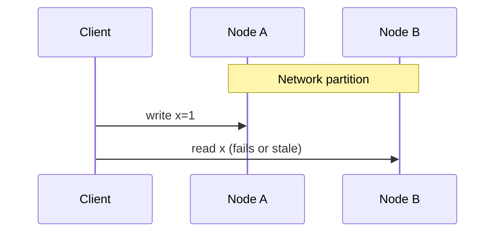
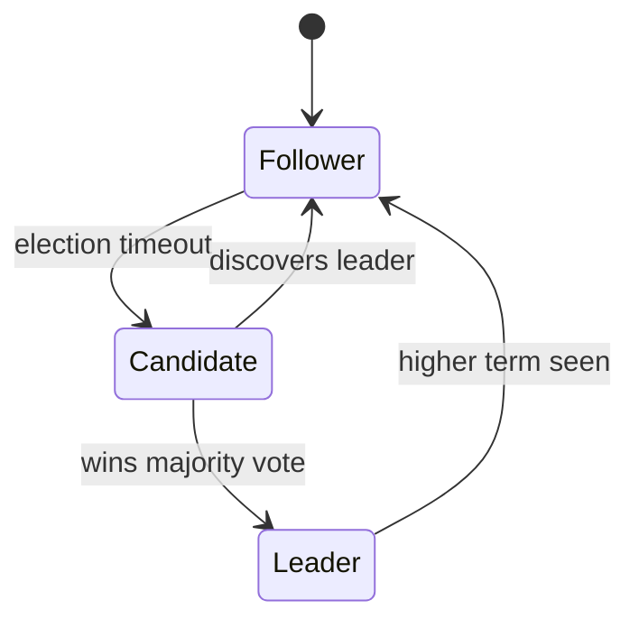

# Distributed Systems Theory — Senior Interview Study Guide

> **Scope:** Failure models, CAP/PACELC, replication, consistency, and consensus (Raft/Paxos). Synthesized from Algoroq (2026) interview question banks.

---

## Why distributed systems are different

A function call is **fast and reliable**. A network call is **slow and may fail silently**. Senior interviews test whether you internalize:

- **Partial failure** — some nodes up, some down; responses may be lost or duplicated.
- **No global clock** — ordering requires logical clocks or consensus.
- **Safety vs liveness** — you cannot always have both under partition.



---

## CAP and PACELC

**CAP (during partition P):** choose **CP** (consistent, may reject requests) or **AP** (available, may return stale/conflicting data).

**PACELC (Brewer extension):** *Else* (no partition), choose **latency (L)** vs **consistency (C)**.

| System | Partition behavior | Normal-case bias |
|--------|-------------------|------------------|
| ZooKeeper / etcd | CP | Strong consistency |
| DynamoDB (default) | AP | Low latency writes |
| Spanner | CP with TrueTime | External consistency |
| Cassandra | AP tunable | QUORUM for balance |

> **Trap answer:** "We are CA." A distributed system cannot opt out of partitions; single-node DBs are not the question.

---

## Consistency spectrum

| Level | What users observe | Example |
|-------|-------------------|---------|
| **Strong / linearizable** | Reads see latest write | Bank balance |
| **Sequential** | All see same order | Single leader log |
| **Causal** | Related ops ordered | Social comments thread |
| **Eventual** | Converges if no new writes | DNS, caches |

**Vector clocks** detect concurrent writes; **CRDTs** merge without coordination; **LWW** is simple but loses data.

---

## Consensus in one picture (Raft)



Leader **appends** client commands to its log, **replicates** to followers, **commits** after majority ack, then **applies** to state machine.

```go
// Simplified commit rule (Raft)
func (n *Node) tryCommit(index int) {
    if n.role != Leader { return }
    if countReplicated(index) > len(peers)/2 {
        n.commitIndex = max(n.commitIndex, index)
    }
}
```

**Paxos** is equivalent in power but harder to teach; **Multi-Paxos** elects a stable leader like Raft. **Zab** (ZooKeeper) is leader-based for coordination metadata.

---

## Quorums

For `N` replicas, quorum `Q` must satisfy:

- Writes contact `W` nodes, reads `R`, with `W + R > N` for strong read-your-writes variants.
- Typical: `N=3`, `W=2`, `R=2`.

---

## Distributed Systems

*Source: Algoroq senior interview guide — 15 core questions.*

### 1. Explain the CAP theorem and its practical implications

> **What they're really asking:** Do you truly understand CAP beyond the textbook definition, and can you apply it to real system design decisions?

**Deep answer:**

Start with the precise definition: in a distributed system experiencing a network partition (P), you
must choose between consistency (C, every read returns the most recent write) and availability
(A, every request receives a response). You cannot have both during a partition.
The key insight interviewers want: CAP is often misunderstood. It does not say you pick two of
three. Partitions are not optional in distributed systems, they will happen. So the real choice is
between CP (consistent but may be unavailable during partitions) and AP (available but may
return stale data during partitions). When there is no partition, you can have both C and A.
Discuss real examples. DynamoDB is AP: during a partition, it accepts writes on both sides and
reconciles later using vector clocks. ZooKeeper is CP: during a partition, the minority partition
stops accepting writes, ensuring consistency but sacrificing availability for those nodes. A
banking system chooses CP because showing an incorrect balance is worse than temporary
unavailability. A social media feed chooses AP because showing a slightly stale feed is better
than an error page.
Discuss the PACELC extension: even when there is no partition (the normal case), there is a
trade-off between latency and consistency. This is often more relevant in practice since
partitions are rare but the latency-consistency trade-off affects every request.
Common mistake: saying a system "is CA." In a distributed system, partitions will occur. A single-
node database is CA but it is not distributed. Another mistake: treating CAP as a binary choice
for the entire system. Different parts of the same system can make different CAP trade-offs.
Your user profile might be CP while your news feed is AP.

**Follow-up questions:**
- How does the PACELC theorem extend CAP?
- Can you give an example of a system that switches between CP and AP behavior?
- How do cloud providers handle CAP in multi-region deployments?

---

### 2. How does Raft consensus work and why is it preferred over Paxos?

> **What they're really asking:** Can you explain a consensus protocol clearly enough that the interviewer learns something, and do you understand the practical considerations of implementing it?

**Deep answer:**

Raft is a consensus algorithm designed for understandability. It decomposes consensus into
three sub-problems: leader election, log replication, and safety.
Leader election: one node is the leader at any time. Nodes start as followers with a randomized
election timeout (150-300ms). If a follower does not receive a heartbeat before timeout, it
becomes a candidate and requests votes. It needs a majority to win. The randomized timeout
prevents split votes (though they can still happen, triggering a new election round). Each election
increments the term number, which acts as a logical clock.
Log replication: the leader receives client requests, appends them to its log, and replicates to
followers via AppendEntries RPCs. A log entry is committed when a majority of nodes
acknowledge it. Once committed, the leader applies it to its state machine and responds to the
client. Followers apply committed entries in order.
Safety: a candidate can only win an election if its log is at least as up-to-date as a majority of
nodes. This ensures the elected leader always has all committed entries. This is the key safety
property that prevents data loss.
Why Raft over Paxos: Paxos is notoriously difficult to understand and implement correctly. Raft
achieves the same safety guarantees with a design that is easier to reason about. The strong
leader model simplifies log replication (no concurrent proposals). The clear state machine
(follower, candidate, leader) makes implementation straightforward. In practice, most modern
systems use Raft: etcd, CockroachDB, TiKV, and Consul.
Discuss practical considerations: cluster size (typically 3 or 5 nodes for the trade-off between
fault tolerance and performance), performance impact of consensus (every write requires a
majority round-trip), and read scaling (follower reads with lease-based consistency or
linearizable reads that go through the leader).

**Follow-up questions:**
- What happens during a network partition in a 5-node Raft cluster?
- How does Raft handle log compaction and snapshotting?
- What is the latency impact of Raft consensus on write operations?

---

### 3. Explain consistency models from strongest to weakest

> **What they're really asking:** Do you understand the spectrum of consistency guarantees and can you choose the right one for a given use case?

**Deep answer:**

Walk through the spectrum from strongest to weakest, with examples for each.
Linearizability (strongest): every operation appears to execute atomically at some point
between its invocation and response. All clients see the same ordering. Use case: distributed
locks (you need to know exactly who holds the lock). Cost: high latency since every read must go
to the leader or a quorum.
Sequential consistency: all clients see the same ordering, and each client's operations appear in
the order they were issued. But the global ordering does not need to respect real-time. Slightly
cheaper than linearizability.
Causal consistency: if operation A causally precedes operation B (A happened before B and B
could depend on A), then all clients see A before B. But concurrent operations (neither caused the
other) can be seen in different orders by different clients. Use case: social media comments (a
reply should always appear after the comment it replies to). Implementations use vector clocks
or Lamport timestamps to track causality.
Eventual consistency (weakest): if no new writes occur, all replicas will eventually converge to the
same value. No guarantee on ordering or timing. Use case: DNS, CDN caches, shopping cart
item counts. Very low latency since reads can go to any replica.
Discuss read-your-writes consistency as a practical middle ground: a user always sees their own
writes, even if other users see stale data. This can be achieved by routing a user's reads to the
same replica that handled their writes, or by using a version token.
Explain that different parts of the same application often use different consistency models.
Account balances need strong consistency. Social media likes can use eventual consistency.
Product inventory needs strong consistency at checkout but eventual consistency for
display pages.

**Follow-up questions:**
- How would you implement read-your-writes consistency in a multi-region setup?
- What consistency model does DynamoDB use by default and how can you upgrade it?
- How do you test for consistency violations in a distributed system?

---

### 4. How would you design a system to detect

> **What they're really asking:** Do you understand the impossibility results around failure detection and the practical approaches used in production systems?

**Deep answer:**

Start with the fundamental challenge: in an asynchronous distributed system, you cannot
distinguish between a crashed node and a slow node. This is related to the FLP impossibility
result. All failure detectors are imperfect and must trade off between completeness (eventually
detecting all failures) and accuracy (not falsely suspecting healthy nodes).
Heartbeat-based detection: the simplest approach. Each node periodically sends a heartbeat to
a monitoring service (or to peers). If no heartbeat is received within a timeout, the node is
suspected as failed. The challenge is setting the timeout: too short causes false positives (a busy
node might miss a heartbeat), too long delays detection. Use adaptive timeouts based on
historical heartbeat intervals (similar to TCP retransmission timeout estimation).
Gossip-based detection (used by Cassandra and many peer-to-peer systems): each node
periodically gossips with random peers about which nodes it has heard from recently. This has
several advantages: no single point of failure (unlike a centralized monitor), scales well (each
node only gossips with a few peers per round), and provides probabilistic guarantees. The phi
accrual failure detector used by Cassandra computes a suspicion level rather than a binary
up/down decision.
SWIM protocol: combines gossip with direct and indirect probing. When node A suspects node B
(missed heartbeat), A asks random node C to probe B. If C also cannot reach B, B is marked as
failed. This reduces false positives from network issues between specific node pairs.
Discuss what happens after detection: in a consensus-based system, the surviving members run
an election. In a load balancing context, the failed node is removed from the rotation. In a
storage system, data is re-replicated to maintain the replication factor.
Discuss fault tolerance of the failure detector itself: if the monitoring service crashes, who
monitors the monitor? Use a decentralized approach (gossip) or a replicated monitoring service.

**Follow-up questions:**
- How do you handle gray failures where a node is partially functioning?
- What is the impact of false positives in failure detection?
- How does Kubernetes detect and handle node failures?

---

### 5. Explain different data partitioning strategies and their trade-offs

> **What they're really asking:** Can you reason about data distribution, hot spots, and rebalancing in real systems?

**Deep answer:**

Data partitioning (sharding) is how you distribute data across multiple nodes to scale beyond a
single machine. Three main strategies exist.
Range partitioning: assign contiguous key ranges to partitions (e.g., A-F on node 1, G-L on node
2). Advantages: efficient range queries (all keys in a range are on the same node), natural
ordering. Disadvantages: prone to hot spots if access patterns are skewed (e.g., if most users
have names starting with S). Used by HBase and BigTable. Mitigate hot spots by choosing keys
carefully or adding a hash prefix.
Hash partitioning: hash the key and use the hash to determine the partition (hash(key) mod N, or
consistent hashing). Advantages: even distribution regardless of key patterns, no hot spots for
random access patterns. Disadvantages: range queries are impossible since nearby keys are
scattered. Used by DynamoDB, Cassandra (with the Murmur3 partitioner), and Redis Cluster.
Composite partitioning: combine hash and range. Hash the first part of the key (partition key)
for distribution, then use the second part (sort key) for ordering within a partition. This gives
even distribution across partitions while supporting range queries within a partition. Used by
DynamoDB and Cassandra (compound primary keys).
Discuss rebalancing: when you add or remove nodes, data must move. With modulo hashing,
adding a node remaps most keys, which is catastrophic. With consistent hashing, only K/N keys
move on average. But even K/N can be a lot of data. Discuss strategies: virtual nodes (many
small partitions that can be reassigned individually), pre-splitting (create many more partitions
than nodes from the start, rebalance by moving whole partitions), and incremental rebalancing
(move data gradually while serving reads from both old and new locations).
Discuss secondary indexes on partitioned data: local indexes (each partition indexes only its own
data, queries must fan out) vs global indexes (a separate partition scheme for the index, updates

must propagate across partitions). This is a key database design decision.

**Follow-up questions:**
- How does DynamoDB handle hot partitions?
- How would you rebalance data without downtime?
- What happens to joins when data is partitioned across nodes?

---

### 6. What are vector clocks and how do they

> **What they're really asking:** Do you understand logical time, why physical clocks are insufficient in distributed systems, and the practical implications of causality tracking?

**Deep answer:**

Physical clocks cannot establish ordering in distributed systems because clock skew is
unavoidable (even with NTP, clocks can differ by milliseconds). Two events on different nodes
with timestamps 1ms apart could actually have occurred in either order.
Lamport timestamps provide a partial solution: each node maintains a counter, increments it on
each event, and includes it in messages. On receiving a message, a node updates its counter to
max(local, received) + 1. This gives a happened-before relationship: if event A causally precedes
event B, then timestamp(A) < timestamp(B). But the converse is not true: a lower timestamp
does not mean the event happened first. Concurrent events cannot be distinguished from
causally ordered ones.
Vector clocks solve this. Each node maintains a vector of counters, one per node. Node i
increments its own counter on each event. When sending a message, it includes its entire vector.
On receiving, a node takes the element-wise maximum of its vector and the received vector,
then increments its own counter. To compare two events: if every element of vector A is less than
or equal to the corresponding element of vector B, then A happened before B. If neither vector
dominates, the events are concurrent.
Practical implications: Amazon Dynamo used vector clocks to detect conflicting writes. When a
client reads and gets multiple versions with incomparable vector clocks, the client must resolve
the conflict (application-level reconciliation). Shopping cart uses set union, other applications
might use last-writer-wins as a simpler but lossy strategy.

Limitations of vector clocks: they grow linearly with the number of nodes. For systems with
thousands of nodes, this is impractical. Solutions include dotted version vectors (more compact)
and bounded vector clocks (truncate old entries at the cost of false conflicts).
Discuss alternatives: hybrid logical clocks (HLC) combine physical timestamps with logical
counters. They provide the benefits of both: causality tracking like vector clocks and timestamps
that are close to real time. Used by CockroachDB and MongoDB.

**Follow-up questions:**
- When would you choose vector clocks over hybrid logical clocks?
- How does CockroachDB use timestamps for serializable transactions?
- What is the difference between logical time and physical time in practice?

---

### 7. How does distributed transaction management work across services?

> **What they're really asking:** Do you understand two-phase commit, its limitations, and the modern alternatives like sagas that are used in microservices?

**Deep answer:**

Two-phase commit (2PC): a coordinator asks all participants to prepare (vote yes or no). If all
vote yes, the coordinator sends commit. If any votes no, the coordinator sends abort. This
provides ACID transactions across multiple databases.
Limitations of 2PC: the coordinator is a single point of failure. If the coordinator crashes after
sending prepare but before sending commit or abort, participants are blocked, holding locks
indefinitely. This is the blocking problem. 2PC also requires all participants to be available,
reducing system availability. In practice, 2PC works within a single data center but is problematic
across data centers due to latency and partition risk.
Three-phase commit (3PC): adds a pre-commit phase to make the protocol non-blocking. In
theory, this solves the blocking problem. In practice, 3PC is rarely used because it makes
assumptions about network timing that do not hold in real systems.
Sagas (the modern approach for microservices): break a distributed transaction into a sequence
of local transactions. Each local transaction updates a service and publishes an event. If a step
fails, execute compensating transactions for all previously completed steps. Two coordination
patterns exist.

Choreography: each service listens for events and reacts. No central coordinator. Simple for
small flows but becomes hard to understand and debug as complexity grows. You lose visibility
into the overall transaction state.
Orchestration: a central saga orchestrator defines the transaction flow and tells each service
what to do. Easier to understand and monitor. The orchestrator maintains the state machine of
the saga. More common in practice.
Discuss the limitations of sagas: they provide eventual consistency, not ACID. Compensating
transactions can be complex (how do you un-send an email?). You need to handle cases where
the compensating transaction itself fails. Design services to be idempotent since messages
might be delivered more than once.
Reference event-driven architecture patterns: use an event store or message queue like Kafka
for reliable event delivery between saga participants.

**Follow-up questions:**
- How would you implement a saga for an e-commerce order flow?
- What happens if a compensating transaction fails?
- How do you handle the lack of isolation in sagas (dirty reads of intermediate states)?

---

### 8. Explain the difference between leader-based and leaderless replication

> **What they're really asking:** Can you articulate the trade-offs between these two fundamental replication approaches and reason about when to use each?

**Deep answer:**

Leader-based (single-leader) replication: one node (the leader) accepts all writes, applies them
to its local storage, and replicates them to followers. Followers serve read requests. This is the
most common model, used by PostgreSQL, MySQL, MongoDB (replica sets), and Redis.
Advantages: simple to reason about consistency (all writes are ordered by the leader), no write
conflicts, well-understood failure modes. Disadvantages: the leader is a bottleneck for writes,
leader failure requires election (brief unavailability), cross-region latency for writes (writes must
go to the leader's region).
Multi-leader replication: multiple nodes accept writes, each replicating to the others. Used
for multi-data-center deployments where each data center has its own leader. MySQL and

PostgreSQL support this with tools like BDR. CockroachDB uses a variant with Raft groups
per range.
Advantages: writes are fast in every region (local leader), no single point of failure.
Disadvantages: write conflicts when two leaders modify the same data simultaneously. Conflict
resolution is hard: last-writer-wins (simple but data loss), custom resolution logic (complex), or
CRDTs (limited data types).
Leaderless replication: any node accepts reads and writes. The client sends writes to multiple
nodes simultaneously and reads from multiple nodes, using quorum logic. Used by Dynamo,
Cassandra, and Riak.
Advantages: no leader election needed, no single point of failure, every node is equal.
Disadvantages: quorum reads and writes add latency (must wait for W or R responses), complex
conflict resolution, no total ordering of writes.
Discuss quorum parameters: for N replicas, require W write confirmations and R read
confirmations where W + R > N ensures overlap (at least one node has the latest value). Typical
configs: W=2, R=2, N=3 (balanced), W=1, R=3 (fast writes, slow reads), W=3, R=1 (slow writes,
fast reads).
Discuss CAP theorem implications: leader-based is typically CP (unavailable during leader
election), leaderless is typically AP (available but may return stale data if quorum is not met).

**Follow-up questions:**
- How does Cassandra handle write conflicts with leaderless replication?
- What are sloppy quorums and hinted handoff?
- When would you choose multi-leader over single-leader replication?

---

### 9. How would you implement exactly-once

> **What they're really asking:** Do you understand why exactly-once is impossible to guarantee at the network level and how to achieve it effectively through idempotency and deduplication?

**Deep answer:**

Start with the impossibility: in a distributed system with unreliable networks, true exactly-once
delivery is impossible. If a sender sends a message and does not receive an acknowledgment, it
cannot know whether the receiver processed the message or not. It must retry, potentially
causing duplicate processing. The two practical options are at-most-once (never retry, risk
message loss) and at-least-once (always retry, risk duplicates).
The industry solution is at-least-once delivery with idempotent processing, which achieves the
effect of exactly-once. Two approaches:
Idempotent consumers: design your message handlers so that processing the same message
multiple times produces the same result as processing it once. For database writes, use upsert
operations with a unique message ID. For API calls, use idempotency keys. For counter
increments, store the set of processed message IDs and skip duplicates.
Transactional outbox pattern: instead of directly sending a message, write it to an outbox table
in the same database transaction as your business logic. A separate process reads the outbox
and publishes to the message queue. If publishing fails, the process retries. The consumer
deduplicates using the message ID from the outbox. This ensures that the business logic and
message publishing are atomic.
Kafka's approach: Kafka achieves effectively exactly-once for its internal processing using
idempotent producers (each message has a sequence number, the broker deduplicates),
transactional writes (atomically write to multiple topic-partitions), and consumer offset commits
in the same transaction as the output. This is Kafka's "exactly-once semantics" but it only works
end-to-end within Kafka. For external systems, you still need idempotent consumers.
Discuss the cost: deduplication requires storing processed message IDs, which uses
memory/storage. You need to decide how long to keep deduplication records. Too short, and late
retries cause duplicates. Too long, and storage grows unboundedly. Common approach: keep
deduplication records for 7 days (matching the maximum retry window).

**Follow-up questions:**
- How does Kafka implement exactly-once semantics internally?
- How would you implement deduplication at 100K messages per second?
- What is the relationship between idempotency and exactly-once delivery?

---

### 10. Explain the split-brain problem and how to prevent it

> **What they're really asking:** Do you understand one of the most dangerous failure modes in distributed systems and the mechanisms used to prevent data corruption?

**Deep answer:**

Split-brain occurs when a network partition divides a cluster into two groups, and both groups
believe they are the active primary. Both accept writes, leading to data divergence and potential
corruption. This is catastrophic for systems that require strong consistency.
Scenario: a 2-node primary-secondary database setup. A network partition separates them.
The secondary, unable to reach the primary, promotes itself to primary. Now both accept writes.
When the partition heals, conflicting writes must be reconciled, and some data will be lost.
Prevention mechanisms:
Quorum-based approach: require a majority (N/2 + 1) of nodes to agree before any operation. In
a 3-node cluster, you need 2 nodes. If a partition splits nodes 2-1, only the side with 2 nodes can
operate. The single node knows it cannot form a majority and refuses writes. This is why
consensus algorithms like Raft use odd-numbered clusters.
Fencing tokens: when a new leader is elected, it receives a monotonically increasing fencing
token (epoch number). All write operations include this token. The storage layer rejects writes
with a token lower than the highest it has seen. Even if an old leader does not know it has been
replaced, its writes will be rejected because it has a stale token.
STONITH (Shoot The Other Node In The Head): when a node believes it should become the
primary, it first ensures the old primary is actually dead by powering it off through an out-of-
band mechanism (IPMI, cloud API). This guarantees only one primary exists. Used by Pacemaker
and many high-availability solutions.
Disk-based heartbeats: in addition to network heartbeats, nodes write heartbeats to a shared
disk (SAN). If a node can see the other's disk heartbeats but not network heartbeats, it knows the
other node is alive and the network is partitioned, so it should not promote.
Discuss high availability implications: preventing split-brain often means sacrificing availability.
If a partition leaves a minority group, those nodes become unavailable. This is the fundamental
CAP trade-off.

**Follow-up questions:**
- How does ZooKeeper prevent split-brain in its leader election?
- What happens if a node receives a fencing token but the old leader has already written data?
- How do cloud providers handle split-brain in managed database services?

---

### 11. How does distributed garbage collection and resource cleanup work?

> **What they're really asking:** Can you think about the harder operational challenges of distributed systems beyond the initial design?

**Deep answer:**

Distributed garbage collection is more complex than single-process GC because objects may be
referenced across node boundaries, and you cannot take a global snapshot atomically.
Reference counting across services: each service tracks references to shared resources
(database connections, cached objects, distributed locks). When the reference count reaches
zero, the resource can be cleaned up. Challenge: if a node crashes while holding a reference, the
count never reaches zero. Solution: use leases instead of permanent references. Each reference
has a TTL and must be renewed. If not renewed (because the holder crashed), the lease expires
and the resource is freed.
Lease-based cleanup: assign every distributed resource a lease (TTL). The holder must renew
the lease periodically. If the lease expires, any node can reclaim the resource. This is how
distributed locks work in ZooKeeper and etcd. The challenge is choosing the lease duration: too
short causes unnecessary renewals and false expirations, too long delays cleanup.
Tombstones for deleted data: in replicated systems, you cannot simply delete a record because
replicas that have not seen the delete will re-replicate it back. Instead, mark the record as
deleted (tombstone) and propagate the tombstone to all replicas. After a sufficient time
(the gc_grace_seconds in Cassandra, typically 10 days), the tombstones themselves are
garbage collected.
Discuss the compaction problem in log-structured systems: append-only logs and LSM trees
(how LSM trees work) continuously accumulate data. Background compaction processes merge
and remove deleted entries. This must be balanced against live traffic: too aggressive
compaction steals I/O from queries, too lazy compaction wastes disk space.

**Follow-up questions:**
- How does Cassandra handle tombstone accumulation?
- What problems can occur if GC pauses happen in a distributed system node?
- How would you clean up orphaned resources in a microservices architecture?

---

### 12. Explain the concept of linearizability and how to implement it

> **What they're really asking:** Can you go deep on the strongest consistency model and understand both its guarantees and its costs?

**Deep answer:**

Linearizability means every operation appears to execute atomically at some point between its
invocation and its response (the linearization point). This gives the illusion that there is only one
copy of the data, even though it is replicated.
To test if a system is linearizable: given a history of operations (with start and end times), can you
find a total ordering of operations such that (1) each read returns the value of the most recent
write in the ordering, and (2) the ordering respects real-time: if operation A completes before
operation B starts, A appears before B in the ordering.
Implementation approaches:
Single leader with synchronous replication: the leader processes all reads and writes. Writes are
replicated synchronously to a quorum before acknowledgment. Reads go to the leader. This
provides linearizability but the leader is a bottleneck and a single point of failure. Used by etcd
and ZooKeeper.
Consensus-based: use a consensus algorithm like Raft for every write. For reads, either route all
reads through the leader (simple but bottleneck) or use a lease mechanism (the leader knows it is
still the leader because its lease has not expired, so it can serve reads locally).
Quorum reads and writes: with N replicas, W + R > N. But quorum alone is not sufficient for
linearizability. You also need either version numbers and read-repair, or a consensus protocol for
conflicting writes. Cassandra uses quorum but is not linearizable because concurrent writes to
different replicas can be ordered differently.
Cost of linearizability: increased latency (every operation requires coordination), reduced
availability (cannot serve requests during partitions in a CP system), and lower throughput
(the coordination bottleneck limits operations per second). Benchmarks show linearizable
reads in etcd at around 10K per second per node versus millions per second for eventually
consistent reads.

When to use: distributed locks, leader election, unique constraint enforcement,
financial transactions. When to avoid: analytics, caching, content feeds, anything that
tolerates staleness.

**Follow-up questions:**
- How does Spanner achieve linearizability across data centers using TrueTime?
- What is the performance difference between linearizable and eventually consistent reads?
- Can you have linearizability without a leader?

---

### 13. How do you handle data migration in a live distributed system?

> **What they're really asking:** Can you plan and execute a risky operational task without downtime, showing mature engineering judgment?

**Deep answer:**

Data migration in a live system requires a multi-phase approach. The dual-write or double-read
pattern is the foundation.
Phase 1 - Dual writes: modify the application to write to both the old and new data stores. Reads
still go to the old store. This ensures new data is in both systems. Use async writes to the new
store to avoid impacting latency. If the write to the new store fails, log it for retry but do not fail
the request.
Phase 2 - Backfill: migrate existing data from the old store to the new store. Run this as a
background process at a controlled rate (do not overwhelm either system). Use checksums
to verify data integrity. Handle conflicts where the dual-write has a newer version than the
backfill source.
Phase 3 - Verification: run a consistency checker that compares data between old and new
stores. Sample randomly or check exhaustively depending on data volume. Fix any
discrepancies. This phase builds confidence that the migration is correct.
Phase 4 - Cutover reads: switch reads to the new store. Use a feature flag for gradual rollout (1
percent, 10 percent, 50 percent, 100 percent). Monitor error rates, latency, and correctness at
each step. Keep the ability to revert instantly.
Phase 5 - Stop dual writes: once reads are fully on the new store and stable, stop writing to the
old store. Keep the old store in read-only mode for a rollback window (typically 1-2 weeks).

Phase 6 - Decommission: after the rollback window, decommission the old store.
Discuss database design considerations: schema differences between old and new stores (you
often migrate to take advantage of a better schema), data transformation during migration,
and handling the increased load of dual writes.
Discuss using event-driven architecture: instead of dual writes, capture changes from the old
store using CDC (Change Data Capture) and apply them to the new store. This decouples the
migration from the application code.

**Follow-up questions:**
- How would you migrate a 10TB database with zero downtime?
- What if the new store has a different data model?
- How do you handle data that is written to the old store but not yet replicated to the new store
- during cutover?

---

### 14. Explain Byzantine fault tolerance and when it matters

> **What they're really asking:** Do you understand the difference between crash faults and Byzantine faults, and can you reason about when the complexity of BFT is justified?

**Deep answer:**

Crash faults: a node either works correctly or stops completely. This is the failure model assumed
by most distributed systems (Raft, Paxos, ZooKeeper). You need 2f + 1 nodes to tolerate f
crash faults.
Byzantine faults: a node can behave arbitrarily, including sending incorrect or contradictory
messages. This covers bugs, hardware corruption, and malicious actors. You need 3f + 1 nodes to
tolerate f Byzantine faults, and the protocols are significantly more complex and slower.
Practical Byzantine Fault Tolerance (PBFT): the best-known BFT protocol. A leader proposes a
value, and nodes go through three phases: pre-prepare (leader broadcasts proposal), prepare
(nodes echo the proposal), commit (nodes confirm). A value is committed when 2f + 1 nodes
agree in each phase. The three-phase protocol ensures that even if f nodes lie, the honest
majority reaches consensus.
When BFT matters: blockchain systems (nodes do not trust each other), aerospace systems
(hardware can have transient faults from radiation), and multi-party computation (mutually

distrusting organizations sharing a system).
When BFT is overkill: most internal distributed systems at companies trust their own nodes. A
server sending incorrect data is almost always a software bug, which BFT cannot fully solve (if all
nodes run the same buggy code, they all produce the same wrong answer). Crash fault tolerance
(Raft) is sufficient and much more performant.
Discuss the performance cost: PBFT has O(n squared) message complexity per consensus round
(every node sends to every other node). This limits practical cluster sizes to tens of nodes.
Compare with Raft's O(n) complexity. This is why blockchains are orders of magnitude slower
than traditional databases.
Modern improvements: HotStuff (used by Meta's Diem/Libra) achieves O(n) message complexity
for BFT using threshold signatures and a pipelining approach.

**Follow-up questions:**
- How does Bitcoin solve the Byzantine generals problem differently than PBFT?
- Can you give an example of a Byzantine fault that is not malicious?
- What is the latency overhead of BFT compared to crash fault tolerance?

---

### 15. How do you design a system for

> **What they're really asking:** Can you combine consensus, state machines, and idempotency into a coherent replicated system design?

**Deep answer:**

State machine replication (SMR) is the foundation of many fault-tolerant systems. The idea: if
multiple nodes start in the same state and apply the same operations in the same order, they will
end in the same state. The challenge is ensuring all nodes agree on the order of operations. This
is exactly what consensus algorithms solve.
Architecture: clients send operations to the leader. The leader proposes the operation to the
consensus group (Raft, Paxos). Once committed (majority agreement), all nodes apply the
operation to their state machine. Because all nodes apply the same operations in the same
order, their states are identical.

Handling client retries: if a client sends a request and the leader crashes before responding, the
client does not know if the operation was committed. It retries, potentially causing the operation
to be applied twice. Solution: assign each client a unique session ID and sequence number. The
state machine tracks the latest sequence number per client and ignores duplicate operations.
This provides exactly-once semantics for client operations.
Handling leader changes: when a new leader is elected, it must discover which operations from
the previous leader were committed and which were not. In Raft, the new leader's log contains all
committed entries (guaranteed by the election safety property). The new leader replicates any
uncommitted entries from its log to followers.
Snapshotting: the replicated log grows unboundedly. Periodically, take a snapshot of the state
machine and truncate the log up to that point. New nodes or nodes that fall behind can
bootstrap from the snapshot plus the remaining log entries.
Practical examples: etcd (Raft-replicated key-value store), ZooKeeper (Zab-replicated
configuration store), CockroachDB (Raft-replicated SQL database with ranges as the unit of
replication). Each database layer sits on top of a replicated state machine.
Performance considerations: batching (group multiple operations into one consensus round),
pipelining (start the next consensus round before the previous one completes), and read leases
(serve reads from the leader without consensus, using a time-bound lease).

**Follow-up questions:**
- How does Raft handle the case where the new leader has uncommitted entries from the old
- leader?
- What is the latency profile of a replicated state machine?
- How would you scale reads in a state machine replication system?

---

## CAP Theorem

*Source: Algoroq senior interview guide — 15 core questions.*

### 1. Explain the CAP theorem and why partition

> **What they're really asking:** Do you understand CAP beyond the surface level, and can you explain why real distributed systems always choose P and then trade off between C and A?

**Deep answer:**

The CAP theorem states that in the presence of a network partition, a distributed system must
choose between consistency (every read receives the most recent write or an error) and
availability (every request receives a non-error response, without guarantee it contains the most
recent write). Partition tolerance means the system continues to operate despite arbitrary
message loss or failure of part of the network.
The critical insight that separates senior candidates from junior ones is understanding why P is
non-negotiable. Network partitions are a fact of life in distributed systems. They happen due to
switch failures, fiber cuts, cloud provider issues, and even garbage collection pauses that cause
timeout-based partition detection. A system that cannot handle partitions is effectively a single-
node system, which defeats the purpose of distribution.
In practice, this means every real distributed system chooses between CP and AP behavior
during a partition. Consider a replicated database with nodes in us-east and eu-west. During a
network partition between regions: a CP system (like ZooKeeper or etcd) will refuse writes on the
minority side, maintaining consistency but sacrificing availability for clients connected to the
minority partition. An AP system (like Cassandra with eventual consistency) will continue
accepting writes on both sides, maintaining availability but creating divergent state that must be
reconciled when the partition heals.
Importantly, this is not a permanent system-wide choice. Modern systems like CockroachDB and
DynamoDB allow per-operation or per-table configuration. DynamoDB offers both eventually
consistent reads (AP behavior) and strongly consistent reads (CP behavior). Google Spanner
achieves external consistency using TrueTime but sacrifices some availability during partitions,
making it effectively CP with extremely high availability due to Google's network reliability.

Real-world numbers matter here: network partitions in AWS occur approximately 1-3 times per
year per region, lasting anywhere from seconds to hours. Your design must handle these events
gracefully. For most user-facing applications, this means defaulting to AP with conflict
resolution, while financial or inventory systems choose CP to prevent inconsistencies that cost
real money.

**Follow-up questions:**
- Can you name a system that is truly CA, and why is it not distributed?
- How does Google Spanner appear to violate CAP, and what is the real explanation?
- During a partition, how would you communicate system state to end users?

---

### 2. How do you choose between strong consistency

> **What they're really asking:** Can you make practical engineering decisions based on business requirements, and do you understand the performance and availability implications of each choice?

**Deep answer:**

The choice between strong and eventual consistency depends on four factors: correctness
requirements, latency sensitivity, availability requirements, and conflict resolution complexity.
Choose strong consistency when: incorrect data causes financial loss (bank balances, inventory
counts), safety issues (medical records, permission systems), or when conflict resolution is
prohibitively complex (unique username registration, sequential ordering). For example, when
designing an inventory system for flash sales, showing a user that an item is available and then
failing at checkout is acceptable, but actually selling more items than you have is not. The
checkout operation must use strong consistency.
Choose eventual consistency when: temporary staleness is acceptable (social media feeds,
product reviews, analytics dashboards), availability is more critical than precision (DNS, CDN
cache), or when natural conflict resolution exists (last-writer-wins for user profile updates,
CRDTs for collaborative editing). For instance, if a user updates their display name and it takes
2-3 seconds to propagate to all readers, no business harm occurs.
The performance implications are significant. Strong consistency in a globally distributed system
like Spanner requires cross-region coordination, adding 100-300ms latency per write.

Eventual consistency allows local writes with sub-10ms latency, replicating asynchronously.
For a system handling 100,000 writes per second, this difference translates to fundamentally
different architectures.
A nuanced approach uses mixed consistency within a single system. Amazon's DynamoDB
supports both eventually consistent reads (half the cost, lower latency) and strongly consistent
reads. Your shopping cart can use eventual consistency (briefly showing a stale cart is harmless),
while the order placement uses strong consistency (preventing double orders). This per-
operation granularity is what senior engineers should advocate for rather than a blanket
system-wide choice.
Discuss concrete metrics: measure staleness windows in your eventually consistent paths. If your
replication lag is P99 under 500ms, most applications can tolerate eventual consistency for read
paths. Monitor replication lag and alert if it exceeds acceptable thresholds for your SLA.

**Follow-up questions:**
- How would you handle a scenario where the same data needs strong consistency for one
- consumer and eventual consistency for another?
- What monitoring would you put in place to detect consistency violations?
- How does read-your-own-writes consistency fit between strong and eventual?

---

### 3. Design a system that maintains consistency during

> **What they're really asking:** Can you go beyond the binary CAP choice and implement practical strategies that maximize both consistency and availability in real systems?

**Deep answer:**

The key insight is that CAP is a spectrum, not a binary choice. Several techniques allow systems
to maintain useful levels of both consistency and availability during partitions.
First, implement partition detection and mode switching. During normal operation, provide
strong consistency. When a partition is detected, switch to a degraded mode that maintains
partial availability. For example, a banking system might: continue allowing balance reads
(potentially stale by the partition duration), allow deposits (commutative operations that are
safe to apply on both sides), but block transfers between accounts (which require coordination).
This requires classifying operations by their safety during partitions.

Second, use consensus algorithms like Raft or Paxos with majority quorums. With 5 replicas, the
system remains both consistent and available as long as any 3 nodes can communicate. Only
when a true majority partition occurs (unlikely with proper deployment across failure domains)
does the system face the C vs A choice. Design your deployment topology to minimize the
probability of majority loss: place replicas across 3 or 5 availability zones.
Third, implement session guarantees. Even in an AP system, you can provide per-client
consistency guarantees: read-your-own-writes (a client always sees its own updates), monotonic
reads (a client never sees older state after seeing newer state), and monotonic writes (a client's
writes are applied in order). These are weaker than linearizability but sufficient for most user
experiences. Implement by routing a client's reads to the same replica that processed its writes,
or by tracking causal dependencies.
Fourth, use CRDTs (Conflict-free Replicated Data Types) for data that can be modeled as
commutative or semilattice structures. Counters, sets, and registers with last-writer-wins
semantics can be updated on both sides of a partition and merged automatically when the
partition heals. This gives true AP behavior with automatic convergence, though it limits the
types of operations you can perform.
In practice, a well-designed system might use Raft for critical metadata, CRDTs for counters
and presence information, and session guarantees for user-facing reads. This is exactly how
systems at companies like Google are designed: multiple consistency levels coexisting within
one platform.

**Follow-up questions:**
- How would you implement automatic conflict resolution when a partition heals?
- What is the performance overhead of maintaining session guarantees?
- How do you test your system's behavior during partitions?

---

### 4. Explain the PACELC theorem and how it extends CAP

> **What they're really asking:** Do you understand that consistency vs latency trade-offs exist even when there are no partitions, and can you reason about system behavior in both normal and failure modes?

**Deep answer:**

PACELC (proposed by Daniel Abadi in 2012) extends CAP by acknowledging that even when the
system is running normally (no partition), there is a trade-off between latency and consistency.
The full statement: if there is a Partition, choose between Availability and Consistency; Else
(during normal operation), choose between Latency and Consistency.
This matters because systems spend the vast majority of their time in the non-partitioned state.
A system that chooses CP during partitions might still offer different latency/consistency trade-
offs during normal operation. For example:
DynamoDB is PA/EL: during partitions it chooses availability, and during normal operation it
offers low-latency eventually consistent reads (default) with an option for strongly consistent
reads (higher latency). This makes it suitable for use cases where speed matters more than
immediate consistency.
Spanner is PC/EC: during partitions it chooses consistency, and during normal operation it still
chooses consistency over latency (cross-region Paxos adds latency to every write). However,
Spanner mitigates the latency cost through TrueTime and leader leases that enable lock-free
read-only transactions.
Cassandra is configurable across the spectrum: with QUORUM reads/writes it behaves as PC/EC
(consistent but higher latency), with ONE reads it behaves as PA/EL (available and fast but
eventually consistent). This per-query tuning is powerful for system design scenarios.
When discussing PACELC in an interview, demonstrate that you think about the common case
(normal operation) separately from the rare case (partitions). A system that is perfectly
consistent during partitions but adds 500ms latency to every operation during normal operation
may be worse for users than one that is eventually consistent but responds in 5ms.
The practical implication: when designing a system, first define your latency budget (say, P99
under 100ms for reads). Then determine what level of consistency you can achieve within that
budget. For globally distributed systems, strong consistency within a region is cheap (under
10ms) but cross-region consistency is expensive (100-300ms). This often leads to designs that
are strongly consistent within a region and eventually consistent across regions.

**Follow-up questions:**
- How would you benchmark the latency cost of strong consistency in your system?
- Can you give an example where the EL vs EC trade-off changed your architecture?
- How does read replica lag relate to the PACELC framework?

---

### 5. How does a quorum-based system handle consistency, and

> **What they're really asking:** Can you reason quantitatively about replication, understand how W + R > N guarantees consistency, and discuss the availability implications of different quorum sizes?

**Deep answer:**

In a quorum-based system with N replicas, a write quorum W and read quorum R provide strong
consistency when W + R > N. This ensures that any read quorum overlaps with the most recent
write quorum, guaranteeing the read sees the latest value.
Common configurations for N=3:
W=2, R=2: balanced read/write performance, tolerates 1 node failure for both reads and writes
W=3, R=1: fast reads, slower writes, tolerates 0 failures for writes but 2 for reads
W=1, R=3: fast writes, slower reads, tolerates 2 failures for writes but 0 for reads
W=1, R=1: fastest but no consistency guarantee (W+R=2 which is not greater than N=3), suitable
only for eventual consistency
For Cassandra with N=3 and QUORUM consistency level, both W and R are 2. This means each
write must be acknowledged by 2 of 3 replicas, and each read must contact 2 of 3 replicas. The
system tolerates 1 node failure while maintaining strong consistency.
The availability trade-off is direct: higher quorum sizes reduce availability. With W=2 and N=3, if
2 nodes fail, writes are unavailable. With W=1, only total failure blocks writes. For a system
requiring 99.99% availability where each node has 99.9% uptime, the math matters: P(2+ failures
with N=3) is much lower than P(3 failures), making W=2 significantly more available than W=3.
Sloppy quorums (used by DynamoDB) relax the requirement that quorum nodes be the
designated replicas for a key. If a designated replica is unreachable, the write goes to another
node temporarily (hinted handoff). This improves availability at the cost of reduced consistency
guarantees since the temporary node might not be contacted during a subsequent read.
Dynamic quorum adjustment is an advanced technique: during normal operation, use W=2, R=2
for strong consistency. When a node is detected as failing, temporarily allow W=1 with eventual
consistency and queue repairs, maintaining availability at the cost of temporary inconsistency.
Alert operators and auto-heal when the node recovers.

**Follow-up questions:**
- How do you handle a scenario where a write reaches W nodes but the client times out before
- receiving acknowledgment?
- What is the difference between a strict quorum and a sloppy quorum?
- How does read repair work in a quorum system?

---

### 6. Explain how eventual consistency works

> **What they're really asking:** Do you understand the mechanics of convergence, can you design conflict resolution strategies, and do you know the real-world implications for application developers?

**Deep answer:**

Eventual consistency guarantees that if no new updates are made, all replicas will eventually
converge to the same value. The key questions are: how long is "eventually" (convergence
window), and what happens when concurrent updates create conflicts?
Convergence mechanisms include: anti-entropy (background process that compares replicas
and repairs differences using Merkle trees for efficient comparison), read repair (detect and fix
inconsistencies during reads), and hinted handoff (temporarily store writes destined for
unavailable nodes and forward when they recover). In DynamoDB, the typical convergence
window is under 1 second for read-after-write in the same region.
Conflict resolution strategies from simplest to most complex:

---

### 7. How would you design a globally distributed

> **What they're really asking:** Do you understand the techniques (Paxos/Raft, TrueTime, synchronized clocks) that systems like Spanner use, and can you reason about the latency and availability costs?

**Deep answer:**

Designing a globally distributed database with strong consistency requires solving three
problems: consensus across replicas, transaction ordering across shards, and minimizing the
latency cost of coordination.
For consensus, use a Raft or Multi-Paxos group per shard. Each shard has replicas across 3-5
regions. The leader handles writes, replicating to followers before acknowledging. Leader
election ensures availability when the current leader fails. Leader lease optimization: the leader
maintains a lease (say, 10 seconds). During the lease, it can serve strongly consistent reads
without contacting followers, since no other node can become leader until the lease expires.

For cross-shard transactions, use two-phase commit (2PC) coordinated by a transaction
manager. The prepare phase locks all involved rows across shards and checks constraints. The
commit phase makes changes visible atomically. 2PC has a blocking failure mode: if the
coordinator crashes after prepare but before commit, participants hold locks indefinitely.
Mitigate with: coordinator Paxos groups (replicated coordinators), timeout-based abort, and
participant recovery protocols.
The breakthrough technique from Google Spanner is using synchronized clocks (TrueTime) for
transaction ordering. TrueTime provides a bounded uncertainty interval for the current time.
Spanner assigns each transaction a timestamp within its TrueTime interval and waits out the
uncertainty (typically 1-7ms) before committing, ensuring that if transaction T1 commits before
T2 starts, T1's timestamp is less than T2's. This enables lock-free read-only transactions at a
snapshot timestamp without any coordination.
Latency analysis for a system with replicas in US, Europe, and Asia (inter-region RTT ~100-
200ms): write latency = consensus round-trip to majority = ~100-150ms (if majority is within
two close regions). Read latency with leader leases = local (sub-ms) for lease holder, full round-
trip for followers needing to check lease validity. Snapshot reads at a past timestamp are
always local.
Availability analysis: with 5 replicas across 5 regions, the system survives the loss of any 2
regions. The probability of 3+ simultaneous region failures is negligible for most SLAs. However,
during a partition that isolates the leader, write availability is lost until a new leader is elected
(typically 5-15 seconds with Raft).
For system design interviews, acknowledge that most companies cannot replicate Google's
TrueTime infrastructure. Alternatives include hybrid logical clocks (HLC) that combine physical
timestamps with logical counters, or NTP-based bounds with larger wait times.

**Follow-up questions:**
- What is the write amplification cost of Paxos replication?
- How does CockroachDB achieve distributed consistency without specialized clock hardware?
- How would you handle a schema migration in a globally distributed database?

---

### 8. What happens when you have conflicting writes during a

> **What they're really asking:** Can you compare conflict resolution strategies across real systems, discuss their trade-offs, and recommend the right approach for different use cases?

**Deep answer:**

During a network partition in an AP system, both sides accept writes independently. When the
partition heals, conflicting writes must be reconciled. Different systems take fundamentally
different approaches.
Dynamo-style systems (DynamoDB, Riak): use vector clocks to detect conflicts and return all
conflicting versions (siblings) to the client on the next read. The application resolves the conflict
using domain knowledge. For a shopping cart, the resolution is union (include all added items).
For a counter, the resolution might be max. This approach preserves all information but pushes
complexity to the application.
Cassandra: uses last-writer-wins (LWW) by default with microsecond timestamps. The write
with the highest timestamp wins, the other is silently discarded. Simple and requires no
application changes, but data loss is possible. If a user updates their profile on two devices
during a partition, one update is lost. For many use cases (logs, metrics, sensor data), this
is acceptable.
CouchDB: stores all conflicting revisions and marks one as the winner deterministically (highest
revision ID). Applications can access the conflict list and resolve manually. This is similar to
Dynamo but with a deterministic default winner.
Git (not a database, but instructive): stores the full history of both sides (branches) and requires
manual merge with three-way merge for conflicts. This preserves maximum information but
cannot be automated for arbitrary data.
CRDT-based systems (Redis Enterprise, Riak with CRDT types): use mathematically guaranteed
convergence. A G-Set (grow-only set) simply takes the union. An OR-Set (observed-remove set)
uses unique tags per addition so removes only affect previously observed adds. Convergence is
automatic with no conflicts possible, but the data model is restricted.
For system design interviews, map the approach to business requirements: financial data needs
CP (reject conflicting writes, never lose one), social data can use LWW (losing one like is
acceptable), collaborative data benefits from CRDTs (automatic merge of concurrent edits), and
shopping carts use application-level merge (union of items).

The recovery process after a partition heals: (1) detect partition resolution, (2) exchange writes
made during the partition (using Merkle tree comparison for efficiency), (3) apply conflict
resolution strategy, (4) verify convergence across all nodes. Monitor for resolution failures and
alert on permanent divergence.

**Follow-up questions:**
- How do you handle the case where conflict resolution itself has side effects (e.g., sending
- duplicate emails)?
- What are the limitations of CRDTs for general-purpose data?
- How would you design a conflict resolution strategy for a shared document editing system?

---

### 9. How does the CAP theorem apply to microservices architectures?

> **What they're really asking:** Can you apply CAP thinking beyond databases to the broader distributed system, including service-to-service communication, data ownership, and saga patterns?

**Deep answer:**

In a microservices architecture, CAP applies at multiple levels: within each service's database,
between services that share data, and at the overall system behavior level. The most
important insight is that cross-service consistency is fundamentally different from intra-
service consistency.
Within a service, you have full control: use a strongly consistent database if needed. Between
services, strong consistency requires distributed transactions (2PC), which couples services,
increases latency, and creates availability risks. This is why microservices best practices
advocate eventual consistency between services using event-driven architecture.
The Saga pattern replaces distributed transactions with a sequence of local transactions
coordinated by events. For an e-commerce order: (1) Order service creates order with PENDING
status, (2) Payment service charges card and publishes payment_completed, (3) Inventory
service reserves items and publishes inventory_reserved, (4) Order service updates to
CONFIRMED. If any step fails, compensating transactions undo previous steps.
Sagas provide availability (no distributed locks) but sacrifice consistency (intermediate states are
visible). Mitigations: use the order status to communicate the in-progress nature, implement

read-your-own-writes within the initiating service, and design UIs that accommodate eventually
consistent state (showing "processing" rather than immediately showing the final state).
Consider Kafka as the event backbone: services publish domain events to Kafka topics, other
services consume and update their local state. Kafka provides ordering guarantees within a
partition, enabling causally consistent event processing. The replication lag between services is
bounded by Kafka consumer lag, typically seconds.
Data duplication across services is a CAP trade-off: the Product service owns product data, but
the Order service needs product names for order display. Option 1: synchronous call to Product
service at read time (CP behavior: consistent but coupled). Option 2: maintain a local cache of
product data, updated via events (AP behavior: available but potentially stale). Most mature
microservices architectures choose option 2 with appropriate staleness tolerance.
At the system level, define your consistency boundaries. Within a bounded context (e.g., the
Payment domain), use strong consistency. Across bounded contexts, use eventual consistency
with explicit contracts about convergence time (SLAs like "order status reflects payment within
5 seconds").

**Follow-up questions:**
- How do you debug consistency issues in an eventually consistent microservices system?
- What is the SAGA pattern's failure mode, and how do you handle partial failures?
- How would you implement exactly-once semantics across services?

---

### 10. Explain linearizability, sequential consistency,

> **What they're really asking:** Can you distinguish between consistency models precisely, understand their implementation costs, and choose the right one for different scenarios?

**Deep answer:**

These consistency models form a hierarchy from strongest to weakest, each with different
performance characteristics and use cases.
Linearizability (strongest): every operation appears to execute instantaneously at some point
between its invocation and response. All operations form a total order consistent with real-time
ordering. If operation A completes before operation B begins, A's effect is visible to B.
Implementation requires coordination (consensus protocols). Used for: distributed locks, leader

election, consistent hashing ring management. Cost: typically 1 RTT to majority of replicas
per operation.
Sequential consistency: all operations form a total order, and each process's operations appear
in program order, but the total order need not respect real-time ordering. This means two clients
might disagree about the order of operations from other clients, as long as each client sees a
consistent sequential order. Implementation: single-leader replication provides this naturally
(the leader determines the sequence). Used for: systems where operation order matters but
real-time ordering between clients does not.
Causal consistency: operations that are causally related (one depends on or is aware of the
other) are seen in the same order by all processes. Concurrent operations (no causal
relationship) may be seen in different orders by different processes. Implementation: use vector
clocks or version vectors to track causal dependencies. Propagate writes in causal order.
Used for: social media (a reply must be seen after the original post), collaborative editing,
comment threads.
Practical example illustrating the differences. User A posts "I got the job!" (operation 1). User B
sees the post and comments "Congratulations!" (operation 2, causally depends on 1). User C
posts an unrelated "Nice weather today" (operation 3, concurrent with 1 and 2).
Linearizability: all users see operations in the exact real-time order they occurred. Sequential
consistency: all users see 1 before 2 (program order preserved), but 3 might appear between 1
and 2 for some users. Causal consistency: all users see 1 before 2 (causal dependency), but 3 can
appear anywhere in each user's timeline. User X might see [1, 3, 2] and User Y might see [3, 1, 2],
both valid. Eventual consistency: users might temporarily see 2 before 1 ("Congratulations"
before the original post), which is confusing but will eventually resolve.
For system design interviews, recommend causal consistency as the sweet spot for most user-
facing applications. It preserves user-perceivable correctness (replies after posts, effects after
causes) while allowing the concurrency and performance of eventual consistency for unrelated
operations. MongoDB supports causal consistency sessions since version 3.6.

**Follow-up questions:**
- How would you implement causal consistency in a multi-region deployment?
- What is the performance difference between linearizability and causal consistency in practice?
- Can you have linearizable reads with eventually consistent writes?

---

### 11. How do distributed databases like Cassandra, DynamoDB,

> **What they're really asking:** Can you compare real systems beyond their marketing claims, understanding their actual consistency behaviors, configuration options, and operational characteristics?

**Deep answer:**

Cassandra (configurable, typically AP): designed as a Dynamo-inspired system with tunable
consistency. With consistency level ONE, it is AP: writes go to one node and replicate
asynchronously. With QUORUM (W=majority, R=majority), it provides strong consistency per-
operation while remaining available when a minority of nodes fail. With ALL, it is CP but has zero
fault tolerance. In practice, most deployments use QUORUM for critical paths and ONE for
read-heavy analytics.
Key nuance: Cassandra's "strong consistency" with QUORUM is not linearizable. It uses
timestamps for conflict resolution, not consensus. Two writes to the same key at the same
timestamp can produce unpredictable results. For true linearizability, use lightweight
transactions (LWT) based on Paxos, which add significant latency (4x typical write latency).
DynamoDB (AP with optional CP reads): designed for availability. Writes always go to multiple
nodes. Default reads are eventually consistent (fast, cheap). Strongly consistent reads go to the
leader replica (more expensive, slightly higher latency). DynamoDB Global Tables are AP:
conflicts are resolved by last-writer-wins based on timestamps. Single-region DynamoDB with
consistent reads provides CP semantics.
Spanner (CP with very high availability): uses synchronized clocks (TrueTime) and Paxos
replication. Every write goes through Paxos consensus. Provides external consistency (strongest
guarantee, stronger than linearizability for transactions). During a partition, the minority side is
unavailable for writes. However, Google's private network makes partitions extremely rare, so in
practice Spanner achieves five-nines availability despite being CP.
CockroachDB (CP, Spanner-like): uses Raft consensus per range (data partition). Provides
serializable transactions across shards. Uses hybrid logical clocks instead of TrueTime (no
specialized hardware needed), which means slightly larger clock uncertainty windows. During
partitions, unavailable for writes to affected ranges but available for reads of committed data.
For system design interviews, the choice depends on requirements: Cassandra for write-heavy
workloads where tunable consistency is needed (time-series data, IoT), DynamoDB for

managed operational simplicity with predictable performance, Spanner/CockroachDB
for applications requiring strong consistency across geographic regions (financial
systems, inventory). Explore the detailed comparison of these systems for specific
workload recommendations.

**Follow-up questions:**
- If you had to migrate from DynamoDB to Spanner, what application changes would be needed?
- How does Cassandra's repair process work, and why is it necessary?
- What workloads would you NOT run on Spanner despite its consistency guarantees?

---

### 12. How does the CAP theorem relate to

> **What they're really asking:** Do you understand that consensus inherently chooses CP, can you explain the availability trade-off, and do you know how these algorithms behave during partitions?

**Deep answer:**

Consensus algorithms (Raft, Paxos, Zab) are fundamentally CP: they guarantee that all nodes
agree on a single value (consistency) and continue operating as long as a majority of nodes can
communicate (partition tolerant), but the minority partition becomes unavailable for writes.
Raft's behavior during a partition: suppose a 5-node cluster splits into a group of 3 and a group
of 2. The group of 3 can elect a leader (majority) and continue processing reads and writes. The
group of 2 cannot elect a leader and refuses all write operations. Clients connected to the
minority side experience unavailability. When the partition heals, the minority nodes catch up by
replicating the leader's log.
The availability of a Raft cluster is determined by the probability of losing a majority. With N=5
nodes, each with 99.9% uptime, the probability of 3+ simultaneous failures (losing majority) is
approximately 10^-8 per hour, yielding effectively 99.9999% write availability. This is why CP
systems can still have very high practical availability.
Multi-Raft (used by TiKV, CockroachDB): partition data into many ranges, each governed by an
independent Raft group. Different ranges can have leaders on different nodes, distributing load.
A single node failure only affects ranges where it was the leader (typically 1/N of all ranges), and
new leaders are elected within seconds for those ranges.

Performance characteristics of consensus: Raft/Paxos require one round trip to a majority for
each write. With co-located nodes (same datacenter), this adds 1-5ms. With geo-distributed
nodes, 50-200ms. Read optimization: leader leases allow the leader to serve reads without
contacting followers during the lease period. Follower reads with read indexes allow load
distribution for read-heavy workloads.
The FLP impossibility result (related to CAP): in an asynchronous network, no consensus
algorithm can guarantee termination in all cases if even one node may crash. In practice, this
means consensus algorithms use timeouts and randomized delays to make progress probable
but not guaranteed. Raft uses randomized election timeouts to prevent election storms.
For senior engineers, understanding when to use consensus vs when to avoid it is critical. Use
consensus for: metadata (which node owns which partition), leader election, configuration
changes, distributed locks. Avoid consensus for: high-throughput data path (every write through
Paxos limits throughput to thousands of writes/second per group), data that can tolerate
eventual consistency.

**Follow-up questions:**
- What happens if a Raft leader commits a write but crashes before the client receives
- acknowledgment?
- How does Multi-Paxos differ from basic Paxos in terms of performance?
- What is the maximum write throughput of a single Raft group, and how do you scale beyond it?

---

### 13. How would you handle a split-brain scenario in a distributed system?

> **What they're really asking:** Can you identify, prevent, and recover from one of the most dangerous failure modes in distributed systems?

**Deep answer:**

Split-brain occurs when a network partition causes two parts of a system to independently
believe they are the authoritative leader, resulting in divergent state that may be impossible to
reconcile. This is catastrophic for CP systems and must be prevented.
Prevention strategies:

---

### 14. Explain how CRDTs work and when they provide

> **What they're really asking:** Do you understand the mathematical guarantees of CRDTs, their limitations, and when they are the right tool vs when consensus is necessary?

**Deep answer:**

CRDTs (Conflict-free Replicated Data Types) are data structures designed to be replicated
across nodes with operations applied independently and concurrently, guaranteeing
convergence without coordination. They achieve this through mathematical properties: either
operations are commutative (operation-based CRDTs) or states form a join-semilattice with a
merge function (state-based CRDTs).
Common CRDT types:
G-Counter (grow-only counter): each node maintains its own count. The total is the sum of all
per-node counts. Merge is component-wise max. Supports increment but not decrement.
PN-Counter: two G-Counters, one for increments and one for decrements. Value = increments -
decrements.
G-Set (grow-only set): merge is union. Items can be added but never removed.
OR-Set (observed-remove set): each element has a unique tag per addition. Remove only
removes observed tags. Concurrent add-remove resolves in favor of add.
LWW-Register: stores a value with a timestamp. Merge picks the highest timestamp. Simple but
can lose concurrent writes.
LWW-Map: map where each key is an LWW-Register. Used by Redis Enterprise for cross-
datacenter replication.
When CRDTs are superior to consensus:
Always-available writes are required (AP behavior with guaranteed convergence)
Offline/intermittent connectivity (mobile apps, IoT devices, edge computing)
Low-latency local writes with asynchronous convergence
Peer-to-peer systems without a central coordinator
Use cases that naturally map to CRDT semantics (counters, sets, presence)
When consensus is necessary instead:
Operations require total ordering (sequential processing)
Invariants must be maintained across replicas (e.g., balance cannot go below zero)
Complex multi-field transactions that cannot be decomposed into commutative operations
When the merge function would lose important semantic meaning

Real-world usage: Redis Enterprise uses CRDTs for Active-Active geo-replication. Riak supports
CRDT data types (counters, sets, maps). Figma uses CRDTs for multiplayer collaborative design.
Apple uses CRDTs in Notes for offline sync across devices.
Performance characteristics: CRDTs have zero coordination overhead for writes (local
operations are instant). The cost is in metadata: vector clocks and tombstones grow over time. A
heavily-modified OR-Set can accumulate significant metadata. Garbage collection (pruning old
tombstones) requires coordination, somewhat contradicting the coordination-free promise. In
practice, periodic GC during low-traffic windows manages this.
For system design interviews, propose CRDTs for specific components: like/view counters, online
presence indicators, shopping cart contents, collaborative text editing. But acknowledge their
limitations for financial balances, inventory counts, and sequential workflows.

**Follow-up questions:**
- How would you implement a CRDT-based counter that supports a maximum value constraint?
- What is the metadata overhead of an OR-Set compared to a simple set?
- How do you garbage collect CRDT tombstones in a system with long-offline nodes?

---

### 15. Design a multi-region active-active database

> **What they're really asking:** Can you synthesize all CAP concepts into a coherent architecture for the most challenging deployment model (active-active globally), with specific attention to conflict resolution, latency, and operational concerns?

**Deep answer:**

Active-active multi-region means every region accepts both reads and writes for any data, as
opposed to active-passive where one region handles writes and others serve reads. This is the
hardest configuration from a CAP perspective because concurrent writes to the same data in
different regions are expected.
Architecture overview: deploy independent database clusters in 3+ regions (e.g., US-East, EU-
West, AP-Southeast). Each cluster handles local writes with sub-10ms latency. Changes replicate
asynchronously to other regions. Inter-region replication lag is bounded by network latency plus
processing time, typically 100-500ms.

The fundamental CAP trade-off: to maintain availability during inter-region partitions, you must
accept that concurrent writes to the same data in different regions will create conflicts. The
system is AP by design. Strong consistency would require synchronous cross-region
coordination, adding 100-200ms to every write (the Spanner model), which many latency-
sensitive applications cannot afford.
Conflict resolution strategy depends on data type:
User profiles: LWW (last write wins by timestamp). Concurrent updates to the same field are
rare, and losing one update to a profile field is acceptable.
Counters (likes, views, inventory): CRDTs. Use a PN-Counter per region, merge by summation.
No conflicts possible.
Shopping carts: union merge. Concurrent additions in different regions are combined. Removals
use tombstones with TTL.
Financial transactions: cannot use active-active for the same account. Route all writes for a
given account to its home region (partitioned active-active). Cross-region writes require
redirection to the home region.
Partitioned active-active (the pragmatic approach): assign each data partition a primary
region. Reads are served locally from any region (eventually consistent). Writes for a partition
are routed to its primary region. During a region failure, a secondary region takes over as
primary for affected partitions. This is simpler than full active-active and avoids most conflict
scenarios, while still providing low-latency reads globally and write capability from any region
(with a cross-region hop for non-primary partitions).
Replication topology: use mesh replication (every region replicates to every other) for maximum
convergence speed, or hub-and-spoke (changes flow through a central region) for simpler
conflict resolution. Mesh reduces convergence time from 2latency to 1latency but increases
bandwidth usage.
Monitoring and operations: track per-region replication lag, conflict rates, and resolution
outcomes. Alert on increasing conflict rates (may indicate a routing issue). Implement region
failover runbooks. Test partition scenarios quarterly (using chaos engineering principles).
Let's consider real numbers: a system with 100,000 writes/second globally, 50ms average inter-
region latency, and 1% of writes causing conflicts means approximately 1,000 conflicts/second to
resolve. Your conflict resolution must handle this throughput without becoming a bottleneck. Use
background async reconciliation queues processed by dedicated workers in each region.

**Follow-up questions:**
- How would you handle a region that falls significantly behind in replication?
- What happens to in-flight writes when you failover a region's primary assignment?
- How would you design the client SDK to transparently route writes to the correct region?

---

## Consensus Algorithms

*Source: Algoroq senior interview guide — 15 core questions.*

### 1. Explain the consensus problem in distributed systems. Why is it hard?

> **What they're really asking:** Do you understand the fundamental impossibility results (FLP, CAP) and why consensus requires careful protocol design rather than ad hoc solutions?

**Deep answer:**

The consensus problem requires a set of distributed nodes to agree on a single value, even when
some nodes fail or messages are delayed or lost. Formally, consensus must satisfy three
properties: agreement (all non-faulty nodes decide the same value), validity (the decided value
was proposed by some node), and termination (all non-faulty nodes eventually decide).
The fundamental difficulty comes from the FLP impossibility result (Fischer, Lynch, Paterson,
1985): in an asynchronous distributed system where even one node can crash, no deterministic
consensus algorithm can guarantee all three properties. This is not an engineering limitation; it is
a mathematical proof. In an asynchronous system, you cannot distinguish between a crashed
node and a very slow one, so any protocol that waits for a response might wait forever (violating
termination), and any protocol that proceeds without all responses might decide differently on
different nodes (violating agreement).
The CAP theorem captures a related trade-off for distributed data stores: you cannot
simultaneously have consistency, availability, and partition tolerance. During a network
partition, you must choose between consistency (all nodes see the same data, but some may be
unavailable) and availability (all nodes respond, but some may return stale data).
Practical consensus algorithms work around FLP by weakening assumptions. Raft and Paxos
assume a partially synchronous model: messages may be delayed but eventually arrive within
some bound. They guarantee safety (agreement and validity) always, and liveness (termination)
during periods of synchrony. In practice, real networks are "mostly synchronous" and these
algorithms work well.
Alternative approaches include randomized algorithms (Ben-Or's algorithm uses randomization
to bypass FLP, guaranteeing termination with probability 1), failure detectors (Chandra and
Toueg showed that consensus is solvable with an eventually perfect failure detector), and the
weakening of consensus itself (some systems use eventual consistency which does not require
agreement at a point in time but guarantees convergence eventually).
The practical implication for system design: consensus is expensive. It requires multiple round
trips between nodes (minimum 2 round trips for Paxos/Raft). Use it only when you truly need
strong consistency. Many systems can use weaker models (eventual consistency, causal

consistency) for better performance and availability. At Google, Spanner uses Paxos for strong
consistency but only for cross-region commits; local operations use more efficient protocols.

**Follow-up questions:**
- How does the FLP impossibility result affect the design of practical systems?
- What is the relationship between the FLP result and the CAP theorem?
- Can you name a system that achieves consensus without a leader?

---

### 2. Compare Paxos and Raft. Why was Raft

> **What they're really asking:** Do you understand both algorithms well enough to discuss their differences substantively, not just parrot the narrative that "Raft is easier to understand"?

**Deep answer:**

Paxos (Lamport, 1989/1998) was the first widely studied consensus algorithm. It defines a
minimal protocol for agreeing on a single value (Single-Decree Paxos) with roles: proposers
(propose values), acceptors (vote on proposals), and learners (learn the decided value). Multi-
Paxos extends this to agree on a sequence of values (a replicated log) by running many instances
of Single-Decree Paxos, typically with a stable leader optimizing to single round trips.
Paxos is provably correct but notoriously difficult to implement. The specification describes
Single-Decree Paxos, but real systems need Multi-Paxos, which Lamport left underspecified.
Implementers must make many decisions: how to elect a leader, how to handle membership
changes, how to compact the log, and how to handle edge cases during leader transitions.
Google's Chubby team reported that their Paxos implementation bore little resemblance to the
published algorithm after handling all practical concerns.
Raft (Ongaro and Ousterhout, 2014) was explicitly designed for understandability. It
decomposes consensus into three sub-problems: leader election (one node is elected leader and
handles all client requests), log replication (the leader appends entries to its log and replicates to
followers), and safety (ensuring logs are consistent across nodes). This decomposition makes
each component independently understandable and testable.
Key differences. Leader election: Raft uses randomized election timeouts (150-300ms) to avoid
split votes. If a follower does not hear from the leader within its timeout, it becomes a candidate

and requests votes. The random timeout means different nodes time out at different times, and
usually one wins quickly. Paxos has no prescribed leader election mechanism.
Log matching: Raft enforces a strong invariant called the Log Matching Property: if two logs
contain an entry with the same index and term, all preceding entries are identical. This simplifies
reasoning about log consistency. The leader forces followers to match its log, overwriting any
conflicting entries. This is more restrictive than Paxos (which allows more flexibility in how logs
converge) but significantly easier to implement correctly.
Membership changes: Raft specifies a joint consensus mechanism for safely adding/removing
nodes. The cluster transitions through a joint configuration where both old and new membership
must agree. This is one of the trickiest parts of any consensus implementation, and Raft's
specification covers it in detail. Paxos papers generally do not address membership changes.
Trade-offs: Raft's strong leader means all operations go through the leader, making it a
potential bottleneck. Multi-Paxos can be optimized for leaderless operation in certain
configurations, potentially offering higher throughput. Raft's simplicity comes at the cost of
flexibility. EPaxos (Egalitarian Paxos) achieves optimal commit latency by avoiding the leader
bottleneck, but it is much more complex.
In practice: etcd uses Raft, CockroachDB uses Raft, TiKV uses Raft, Consul uses Raft. Google's
Spanner uses Multi-Paxos. The industry has largely converged on Raft for new implementations
due to its understandability. For more details, see Raft consensus and the distributed
systems guide.

**Follow-up questions:**
- Can you walk through what happens in Raft when the leader crashes mid-replication?
- What is the minimum cluster size for Raft, and why?
- How does Raft handle the scenario where a network partition isolates the leader?

---

### 3. Walk through the Raft leader election process in

> **What they're really asking:** Can you explain the mechanics step-by-step, handle edge cases, and reason about split-brain scenarios?

**Deep answer:**

Raft nodes are in one of three states: follower, candidate, or leader. All nodes start as followers.
The election process works as follows.
Step 1: Election timeout. Each follower has a randomized election timeout (typically 150-300ms).
If a follower receives no communication (heartbeat or AppendEntries) from the leader before its
timeout fires, it assumes the leader has failed.
Step 2: Becoming a candidate. The follower increments its current term (a monotonically
increasing logical clock), transitions to candidate state, votes for itself, and sends RequestVote
RPCs to all other nodes. The RequestVote includes the candidate's term and the index and term
of its last log entry.
Step 3: Vote decision. A node grants its vote if: it has not already voted in this term, and the
candidate's log is at least as up-to-date as the voter's log (compared by last entry's term first,
then index). This "at least as up-to-date" check is critical for safety: it ensures that a candidate
with a stale log cannot become leader and overwrite committed entries.
Step 4: Winning the election. If the candidate receives votes from a majority of nodes (including
itself), it becomes the leader and immediately sends heartbeats to all followers to establish
authority and prevent new elections.
Step 5: Split vote handling. If two candidates start elections simultaneously and split the votes
(neither gets a majority), both wait for their election timeout (re-randomized) and try again. The
random timeout makes it statistically unlikely that split votes persist for more than one round.
Network partition scenario: Suppose a 5-node cluster (A, B, C, D, E) with A as leader. A network
partition isolates A and B from C, D, and E.
Partition {A, B}: A continues sending heartbeats to B. A tries to replicate log entries, but it cannot
get a majority (needs 3 out of 5). So any new client writes to A cannot be committed. A remains
leader of its partition but cannot make progress.
Partition {C, D, E}: These nodes stop receiving heartbeats from A. One of them (say C) times out
and starts an election with a higher term. C gets votes from D and E (majority of 3 in a 5-node
cluster) and becomes leader. Client writes to C can be committed (C, D, E are a majority).
When the partition heals: A discovers C's higher term (through heartbeats or AppendEntries)
and steps down to follower. Any uncommitted entries in A's log are overwritten by C's log. This is
safe because those entries were never committed (never acknowledged to clients). B also follows
C's log.

The key safety guarantee: committed entries are never lost. An entry committed in term T is
present on a majority of nodes, and any future leader must have received votes from a majority
that includes at least one node with that entry. The "at least as up-to-date" voting rule ensures
the new leader has all committed entries.
This scenario demonstrates why Raft (and consensus in general) requires a majority: with 5
nodes, you can tolerate 2 failures. With 3 nodes, only 1 failure. See Raft consensus and the CAP
theorem for deeper understanding.

**Follow-up questions:**
- What happens if the network partition creates three groups (A,B), (C,D), (E)?
- How does the pre-vote optimization prevent unnecessary leader disruptions?
- What is the impact of clock skew on election timeouts?

---

### 4. Explain the difference between crash fault tolerance

> **What they're really asking:** Do you understand the threat model distinction and can you articulate when the additional complexity of BFT is justified?

**Deep answer:**

Crash fault tolerance (CFT) assumes nodes either work correctly or stop (crash). A crashed node
does not send malicious or incorrect messages. It simply becomes silent. Raft and Paxos are CFT
algorithms. With N nodes, CFT tolerates up to floor((N-1)/2) crash failures. A 5-node cluster
tolerates 2 crashes.
Byzantine fault tolerance (BFT) handles the more general case where nodes can exhibit arbitrary
behavior: sending contradictory messages to different nodes, lying about their state, or
colluding with other faulty nodes. This is the hardest fault model. With N nodes, BFT tolerates up
to floor((N-1)/3) Byzantine failures. A 7-node cluster tolerates 2 Byzantine nodes. The seminal
algorithm is PBFT (Practical Byzantine Fault Tolerance, Castro and Liskov, 1999).
The 2f+1 vs 3f+1 difference is significant. To tolerate 2 faults: CFT needs 5 nodes, BFT needs 7
nodes. More nodes means more communication overhead (BFT requires O(N^2) messages per
consensus round vs O(N) for Raft), more hardware cost, and higher latency.
When to use each. CFT (Raft/Paxos) is appropriate for: internal infrastructure within a trusted
organization (databases, configuration stores, lock services), cloud services where you control all

nodes, and any system where the threat model is hardware failure, software bugs causing
crashes, and network issues. This covers the vast majority of enterprise and cloud systems.
BFT is appropriate for: blockchain and cryptocurrency systems (nodes are operated by
untrusted parties with financial incentives to cheat), multi-organization systems where
participants do not fully trust each other (supply chain networks, financial settlement systems),
safety-critical systems where software bugs might cause a node to produce incorrect output
(avionics, nuclear reactor control), and systems where a compromised node (hacked server)
might actively try to corrupt data.
Practical BFT implementations. PBFT requires 3f+1 nodes and 3 communication rounds. It is used
in permissioned blockchains (Hyperledger Fabric). Tendermint (used in Cosmos blockchain) is a
BFT consensus algorithm optimized for blockchain use cases. HotStuff (used by Meta's
Diem/Libra) improves on PBFT with linear communication complexity (O(N) vs O(N^2)) using
threshold signatures.
The senior insight is that most systems do not need BFT, and using it when CFT suffices wastes
resources and adds complexity. However, when you do need BFT (untrusted environments), CFT
algorithms provide no protection against the threats you face. At Google, all internal consensus
uses CFT (Paxos). At Amazon, DynamoDB uses CFT replication. BFT is reserved for blockchain
and cross-organization coordination systems.

**Follow-up questions:**
- Can a Byzantine node disrupt a Raft cluster? How?
- What is the performance overhead of BFT compared to CFT in practice?
- How does threshold cryptography help improve BFT efficiency?

---

### 5. How does Raft log replication work? What guarantees does it provide?

> **What they're really asking:** Can you explain the mechanics of state machine replication, the commit process, and why the Log Matching Property ensures safety?

**Deep answer:**

Raft replicates a log of commands across all nodes. Each node applies committed log entries to
its state machine in order, producing identical state on all nodes. This is called replicated state
machine (RSM).

The replication process. The leader receives a client command, appends it to its local log with
the current term number and the next sequential index. The leader sends AppendEntries RPCs to
all followers in parallel. Each AppendEntries message includes: the leader's term, the leader's ID,
the index and term of the log entry immediately preceding the new entries (prevLogIndex and
prevLogTerm), the new log entries, and the leader's commit index.
The follower checks the consistency of its log by verifying that it has an entry at prevLogIndex
with term prevLogTerm. If it does, it appends the new entries and responds with success. If it
does not (the follower's log diverges from the leader's), it responds with failure. On failure, the
leader decrements prevLogIndex and retries, effectively walking backward through the log until
it finds the point where the follower's log matches. From that point, the leader's entries overwrite
the follower's divergent entries.
Once a majority of nodes (including the leader) have the entry, the leader marks it as committed
and advances its commit index. The leader includes its commit index in subsequent
AppendEntries RPCs, so followers learn which entries are committed and apply them to their
state machines.
The Log Matching Property provides two guarantees. First, if two entries in different logs have
the same index and term, they store the same command (because a leader creates at most one
entry per index in a given term). Second, if two entries in different logs have the same index and
term, all preceding entries are identical (enforced by the prevLogIndex/prevLogTerm
consistency check in AppendEntries). Together, these ensure that committed entries are never
lost or reordered.
The safety guarantee (the Leader Completeness Property): if a log entry is committed in a given
term, that entry is present in the logs of all leaders for all higher terms. This is ensured by the
voting rule: a candidate cannot win an election unless its log is at least as up-to-date as a
majority of nodes, and any committed entry exists on a majority of nodes.
Performance considerations: in steady state (no failures), replication takes one round trip from
leader to majority. With 3 nodes and 1ms network latency, a commit takes approximately 1ms.
With 5 nodes across data centers (50ms latency), the commit time is approximately 50ms (wait
for the fastest 2 out of 4 followers). Batching multiple client commands into a single
AppendEntries RPC significantly improves throughput. See Raft consensus and eventual
consistency for comparison.

**Follow-up questions:**
- What happens to uncommitted entries on a follower when a new leader is elected?
- How does Raft handle a slow follower that falls behind the leader's log?
- What is the role of no-op entries in Raft's log after a leader election?

---

### 6. What is the role of leader leases in consensus

> **What they're really asking:** Do you understand the tension between strong consistency for reads and read performance, and how leader leases provide a practical optimization?

**Deep answer:**

In a standard Raft implementation, reads must go through the leader and the leader must verify
it is still the leader before responding. Without this check, a stale leader (one that has been
deposed but does not know it yet) could return stale data. The verification requires a round trip
to a majority of nodes (the leader sends heartbeats and waits for acknowledgments), adding
latency to every read.
Leader leases are a time-based optimization. The leader obtains a lease: a guarantee that no
other node will become leader for a bounded time period (the lease duration). As long as the
lease is valid, the leader can serve reads locally without contacting other nodes, providing
single-node read latency.
The lease mechanism works as follows. When the leader sends heartbeats and receives
acknowledgments from a majority, it knows no election can succeed for at least the election
timeout period (because followers reset their election timers on heartbeat). The leader sets its
lease expiry to now + election_timeout - clock_drift_bound. As long as the current time is before
the lease expiry, the leader can serve reads locally.
The critical assumption is bounded clock skew. If the leader's clock runs faster than followers'
clocks, the leader might believe its lease is valid while a follower has already timed out and
started an election. To handle this, subtract a clock drift bound from the lease duration. With
NTP synchronization, clock drift is typically bounded to a few hundred milliseconds. Google's
TrueTime (used in Spanner) provides guaranteed clock uncertainty bounds, enabling tight
lease durations.
Alternative approaches for read optimization. Read index: the leader records the current
commit index, confirms its leadership with a heartbeat round, then serves the read once the

state machine has applied up to that index. This avoids the clock dependency of leases but
requires a network round trip per read (or per batch of reads).
Follower reads: allow followers to serve reads by forwarding a read request to the leader,
which returns the current commit index, then the follower waits until it has applied up to that
index and serves the read locally. This distributes read load across all nodes. CockroachDB uses
this approach.
In practice, leader leases are used by etcd, CockroachDB (in combination with follower reads),
and TiKV. Google Spanner's use of TrueTime for leases is the gold standard: because
TrueTime provides bounded clock uncertainty (typically under 7ms), lease-based reads are
both fast and provably correct. For more on consistency models, see the CAP theorem and
eventual consistency.

**Follow-up questions:**
- What happens if the leader's clock drifts beyond the expected bound?
- How do leader leases interact with network partitions?
- Can you implement linearizable reads without leader leases or a leadership check?

---

### 7. How do you handle membership changes

> **What they're really asking:** Do you understand why naive membership changes are unsafe and how joint consensus or single-server changes solve the problem?

**Deep answer:**

Membership changes are one of the most subtle and error-prone aspects of consensus
implementations. The fundamental problem: during a transition from configuration C_old to
C_new, there could be a moment where two disjoint majorities exist (one in C_old and one in
C_new), allowing two leaders to be elected simultaneously and breaking consensus safety.
Example: transitioning a 3-node cluster {A, B, C} to a 5-node cluster {A, B, C, D, E}. If nodes
adopt the new configuration at different times, there is a window where {A, B} form a
majority of C_old (2 out of 3) and {C, D, E} form a majority of C_new (3 out of 5), allowing two
independent leaders.
Raft's solution is joint consensus (the original Raft paper's approach). The transition goes
through an intermediate configuration C_old,new where decisions require agreement from a

majority of both C_old and C_new. The steps: leader creates a log entry for C_old,new and
replicates it. Once committed, the leader creates a log entry for C_new and replicates it. Once
committed, the transition is complete. During the C_old,new phase, no single majority from
either configuration can unilaterally elect a leader, preventing the split-brain problem.
A simpler alternative (described in Ongaro's dissertation and used by most implementations):
single-server changes. Only add or remove one server at a time. With single-server changes,
any majority of the old configuration and any majority of the new configuration must overlap by
at least one node. This overlap prevents two leaders from being elected simultaneously. This
approach is simpler but requires sequential changes (to go from 3 to 5 nodes, first add node D,
wait for it to catch up, then add node E).
Practical considerations. A new node joining the cluster has no log data. It must catch up by
receiving the entire log (or a snapshot plus recent log entries) from the leader before it can
participate in consensus. During this catch-up period, the new node should be a non-voting
member (receives log entries but does not participate in elections or commit decisions).
Otherwise, a slow new node could block commits by preventing the leader from reaching
a majority.
Removing the leader itself is tricky. The leader must transfer leadership to another node before
removing itself. In Raft, this is done via a LeaderTransfer extension: the leader sends a
TimeoutNow RPC to the target node, which immediately starts an election.
Real implementations: etcd supports learner nodes (non-voting members that catch up before
being promoted to voting members). CockroachDB uses Raft with single-server changes. For
related infrastructure, see consistent hashing for how data is redistributed during membership
changes, and the distributed systems guide for broader context.

**Follow-up questions:**
- What happens if the leader crashes during a membership change?
- How do you handle rapid successive membership changes?
- What is the minimum safe cluster size, and what happens if you go below it?

---

### 8. Explain Multi-Paxos and how it optimizes

> **What they're really asking:** Do you understand why Single-Decree Paxos is impractical alone and how the leader optimization amortizes the cost of consensus?

**Deep answer:**

Single-Decree Paxos agrees on a single value through two phases. Phase 1 (Prepare): a proposer
selects a proposal number N, sends Prepare(N) to a majority of acceptors. Each acceptor
responds with a promise not to accept proposals with numbers less than N, along with any
previously accepted value. Phase 2 (Accept): if the proposer receives promises from a majority, it
sends Accept(N, V) where V is the highest-numbered previously accepted value (or the
proposer's own value if none). If a majority accepts, the value is decided.
For a replicated state machine (a sequence of commands), you need to run a separate instance
of Paxos for each log position (slot). Naively, each command requires 2 round trips (Prepare +
Accept), which is impractical for high-throughput systems.
Multi-Paxos optimization: elect a stable leader. The leader runs Phase 1 once for a range of
future log slots (for example, "I am the leader for slots 100-infinity with proposal number 42").
Once established, the leader only needs Phase 2 for each new command: one round trip from
leader to majority. This halves the latency and message count.
The leader election in Multi-Paxos is not formally specified, which is a key difference from Raft.
Common approaches include: the node with the highest ID becomes leader, a separate leader
election protocol runs periodically, or nodes contend with increasing proposal numbers and
the one that wins Phase 1 acts as leader. The lack of specification is why implementations
diverge significantly.
Further optimizations in production Multi-Paxos. Batching: the leader batches multiple client
commands into a single Accept round. With 100 commands per batch, the per-command
latency is amortized to 1/100 of a round trip. Pipelining: the leader sends Accept for slot N+1
before receiving responses for slot N, keeping the pipeline full. With 10 slots in flight, throughput
increases 10x at the cost of increased memory for tracking pending decisions. Read
optimization: the leader can serve reads without any consensus round by maintaining a lease,
similar to Raft's leader lease approach.
Multi-Paxos vs Raft: in practice, well-optimized Multi-Paxos and Raft have similar performance
characteristics (both achieve single-round-trip commits with a stable leader). The difference is
that Raft specifies all these optimizations and edge cases, while Multi-Paxos leaves them to the
implementer. This is why Google (which has deep distributed systems expertise) uses Paxos in
Spanner and Chubby, while the broader industry has adopted Raft. For implementations, see
Raft consensus and the system design interview guide.

**Follow-up questions:**
- How does Multi-Paxos handle a leader failure mid-batch?
- What is Flexible Paxos, and how does it relax the majority requirement?
- How does EPaxos achieve consensus without a stable leader?

---

### 9. How does Google Spanner achieve

> **What they're really asking:** Do you understand how physical clocks can be used for ordering in distributed systems, and the engineering effort required to make clock-based approaches safe?

**Deep answer:**

Google Spanner is a globally distributed database that provides external consistency
(linearizability): if transaction T1 commits before transaction T2 starts (in real time), then T1's
commit timestamp is less than T2's commit timestamp. This is stronger than serializable isolation
and enables consistent global reads at a point in time.
The key innovation is TrueTime, a clock API that returns an interval [earliest, latest] rather than a
single timestamp. TrueTime guarantees that the actual time is within this interval. The
uncertainty bound (typically 1-7ms) comes from GPS receivers and atomic clocks in Google's
data centers, with periodic synchronization.
How Spanner uses TrueTime for writes. When a transaction commits, Spanner assigns it a
timestamp S. The commit leader waits until TrueTime guarantees that S is in the past: it waits
until TT.after(S) returns true. This "commit wait" ensures that any subsequent transaction
(which starts after the commit is acknowledged) will have a timestamp strictly greater than
S, preserving external consistency. The wait is typically equal to the clock uncertainty bound
(1-7ms).
How Spanner uses TrueTime for reads. A snapshot read at timestamp T returns data as of time
T. The read can be served by any replica that has applied all transactions with timestamps less
than or equal to T. Since all replicas apply transactions in timestamp order and Paxos ensures all
replicas eventually have all committed transactions, any sufficiently up-to-date replica can serve
the read. This enables global read scaling: reads can go to the nearest replica regardless of
where writes happen.

The engineering behind TrueTime. Each data center has a time master with GPS receivers and
atomic clocks. Application servers synchronize with time masters every 30 seconds. Between
synchronizations, the uncertainty bound grows linearly (based on the worst-case clock drift of
the local oscillator, approximately 200 microseconds per second). After synchronization, the
uncertainty bound drops back to near zero. This is why the typical bound is 1-7ms.
Why other databases do not have TrueTime. Building and operating the GPS/atomic clock
infrastructure is expensive and complex. CockroachDB (an open-source Spanner-inspired
database) uses NTP clocks with a configurable maximum clock offset (default 500ms). This
means CockroachDB's "commit wait" would be 500ms, which is impractical. Instead,
CockroachDB uses a hybrid approach: it relies on NTP for loose synchronization and detects
clock skew through read-write conflicts, requesting retries when skew is detected. This trades
some performance for not requiring specialized clock hardware.
At Google, Spanner is the backbone for globally distributed services including Google Ads,
Google Play, and Google F1 (the ad serving database). The TrueTime infrastructure is shared
across all Google services. For related topics, see the CAP theorem, eventual consistency, and
how Kafka works for a different approach to distributed ordering.

**Follow-up questions:**
- What happens if the TrueTime uncertainty bound grows very large (for example, GPS failure)?
- How does Spanner's commit wait affect write latency for cross-region transactions?
- Could you build a TrueTime-like system using commodity hardware and NTP?

---

### 10. What is the Raft snapshot mechanism, and why is it necessary?

> **What they're really asking:** Do you understand the practical operational challenges of log-based consensus, particularly unbounded log growth and new node catch-up?

**Deep answer:**

In Raft, the log grows indefinitely as the state machine processes commands. Without mitigation,
this causes two problems: unbounded disk usage (the log eventually fills the disk) and slow
recovery (a new node joining the cluster must replay the entire log from the beginning to build its
state machine, which could take hours or days for a long-running cluster).
Snapshots solve both problems. A snapshot captures the entire state machine state at a specific
log index. Once a snapshot is created, all log entries up to that index can be discarded. The state

machine state can be reconstructed by loading the snapshot and replaying only the log entries
after the snapshot index.
The snapshot process. Each node independently decides when to take a snapshot (typically
when the log exceeds a configurable size, for example, 10MB). The node serializes its state
machine state and the metadata (last included index and term). The log entries up to
the snapshot point are deleted. This is a local operation; snapshots are not coordinated
across nodes.
Snapshot transfer for slow followers. If a follower falls so far behind that the leader has already
discarded the log entries the follower needs, the leader sends its snapshot to the follower via an
InstallSnapshot RPC. The follower replaces its state machine with the snapshot and begins
receiving log entries from the snapshot point onward. This is the only way to catch up a very
stale follower.
Implementation challenges. Snapshot size: for a large state machine (for example, a database
with terabytes of data), the snapshot can be huge. Transfer over the network is slow and
bandwidth-intensive. Solution: use incremental snapshots or stream the snapshot in chunks. etcd
sends snapshots in 64KB chunks.
Snapshot consistency during operation: the state machine must remain available while the
snapshot is being taken. Solutions include copy-on-write mechanisms (fork the process and
serialize from the child, like Redis's BGSAVE), MVCC (read a consistent point-in-time view while
writes continue), or pause processing briefly while creating the snapshot (simpler but causes a
latency spike).
Snapshot frequency trade-off: frequent snapshots keep the log small (fast recovery) but
consume CPU and I/O. Infrequent snapshots keep the log large (slow recovery) but minimize
overhead. A common strategy: snapshot when the log size exceeds 10x the expected
snapshot size.
In production systems like etcd, the default snapshot threshold is 10,000 applied entries
(configurable via --snapshot-count ). CockroachDB uses range-level snapshots (each Raft
group manages a range of data, and snapshots are per-range). For more on log management in
distributed systems, see how Kafka works (Kafka's log compaction serves a similar purpose) and
Raft consensus.

**Follow-up questions:**
- How do you handle a snapshot that is too large to fit in memory?
- What happens if a leader crashes while sending a snapshot to a follower?
- How does snapshot creation interact with ongoing client requests?

---

### 11. How do distributed databases like

> **What they're really asking:** Can you connect the theoretical consensus algorithm to a real production database, understanding range-based replication, leaseholders, and the interaction between consensus and transaction isolation?

**Deep answer:**

CockroachDB uses Raft consensus for replicating data within ranges (contiguous segments of
the key space, default 512MB each). Each range has its own independent Raft group with
typically 3 or 5 replicas. The cluster might have thousands of ranges, each running an
independent Raft consensus group.
Range-based replication. The key space is divided into ranges. Each range is replicated across N
nodes (replication factor, typically 3). One replica is the Raft leader and also the leaseholder (the
node that serves reads and coordinates writes for that range). When data grows, ranges split
automatically. When nodes are added, ranges rebalance across nodes. This is where consistent
hashing concepts apply: data is redistributed to maintain even load.
Write path. A client sends a write request to any node, which forwards it to the leaseholder for
the affected range. The leaseholder proposes the write to its Raft group. Raft replicates the log
entry to a majority of replicas. Once committed, the leaseholder applies the write and responds
to the client. Total write latency is approximately one Raft round trip (plus request forwarding if
the initial node is not the leaseholder).
Read path. The leaseholder serves reads directly using its lease (similar to Raft leader leases). It
does not need to contact other replicas for reads, providing single-node read latency. The lease
is typically 9 seconds, renewed by the leaseholder as part of its Raft leadership.
Transaction isolation. CockroachDB provides serializable snapshot isolation. For multi-range
transactions (spanning multiple ranges, each with its own Raft group), CockroachDB uses a
variant of two-phase commit coordinated by the leaseholder of the first range (the transaction
coordinator). Each range involved in the transaction independently commits its portion via Raft.

The coordinator uses the write intent mechanism: staged writes are visible as intents that other
transactions can detect and either wait for or push.
Scaling implications. Because each range has its own Raft group, consensus overhead is
distributed. A cluster with 10,000 ranges has 10,000 independent Raft groups. Adding nodes
redistributes ranges (via Raft snapshots) and spreads the Raft leadership. The bottleneck shifts
from consensus to node capacity (CPU, disk I/O, network bandwidth).
At Amazon, Aurora uses a quorum-based replication protocol (not Raft) optimized for the write-
ahead log, achieving 6-way replication with 4/6 write quorum and 3/6 read quorum. The
approach is different from CockroachDB's Raft but solves the same fundamental problem. For
context on these design decisions, see the system design interview guide and CAP theorem.

**Follow-up questions:**
- How does CockroachDB handle a range split during an active transaction?
- What is the impact of cross-range transactions on latency compared to single-range
- operations?
- How does the leaseholder mechanism interact with network partitions?

---

### 12. What is the difference between consensus

> **What they're really asking:** Can you clearly distinguish between these often-conflated terms and explain how consensus protocols are used to implement various consistency models?

**Deep answer:**

Consensus is a protocol problem: how do multiple nodes agree on a single value or a
sequence of values? It is about the mechanism of agreement. Raft, Paxos, and PBFT are
consensus algorithms.
Consistency is a data property: what guarantees does the system provide about the values that
reads return relative to writes? It is about the observable behavior of the system. Linearizability,
sequential consistency, causal consistency, and eventual consistency are consistency models.
The relationship: consensus protocols are one tool for implementing strong consistency models.
A linearizable key-value store can be built by running Raft consensus on each write operation,
ensuring all nodes agree on the order of writes and that reads return the most recently written

value. But consensus is not the only way to achieve consistency, and consensus does not
automatically give you any particular consistency level.
Specific relationships. Linearizability (strongest consistency): every operation appears to take
effect at a single point in time, and that point is between the operation's start and end. Achieved
by routing all operations through a consensus leader (like Raft's leader with leadership
verification for reads). This is what etcd provides.
Sequential consistency: all operations appear to occur in some sequential order that is consistent
with the program order of each individual client. Weaker than linearizability because the global
order does not need to match real time. A single Raft leader naturally provides this, but it can
also be achieved without consensus using synchronized clocks.
Causal consistency: if operation A causally precedes operation B (A happened before B and B
might depend on A), then all nodes see A before B. Operations that are not causally related can
be seen in different orders by different nodes. This can be implemented with vector clocks or
logical timestamps without full consensus.
Eventual consistency: if no new writes occur, all replicas will eventually converge to the same
value. No ordering guarantees during convergence. Implemented with gossip protocols,
last-writer-wins, or CRDTs. No consensus needed. Amazon DynamoDB's default mode is
eventual consistency.
The key insight: consensus is expensive (requires majority communication), so you should use the
weakest consistency model that satisfies your application's requirements. Use eventual
consistency for content distribution, session data, and social media feeds. Use causal
consistency for chat systems and collaborative editing. Use linearizability for distributed locks,
leader election, and configuration stores. For more on these trade-offs, see the CAP theorem,
eventual consistency, and the distributed systems guide.

**Follow-up questions:**
- Can you have consensus without strong consistency?
- How does linearizability differ from serializability in the context of databases?
- Can you implement causal consistency without consensus?

---

### 13. How does ZooKeeper use consensus, and what problems does it solve?

> **What they're really asking:** Do you understand the coordination primitives that consensus enables and how they are used in real distributed systems?

**Deep answer:**

Apache ZooKeeper is a distributed coordination service that uses a consensus protocol called
ZAB (ZooKeeper Atomic Broadcast) to replicate a hierarchical key-value store (znode tree)
across an ensemble of nodes (typically 3 or 5). ZAB is similar to Raft: it has a leader that
sequences all writes and replicates them to followers via an atomic broadcast.
The coordination primitives ZooKeeper provides, built on top of consensus-replicated state.
Distributed locks. Create an ephemeral sequential znode under a lock path. The node with the
lowest sequence number holds the lock. Other nodes watch the next-lower-numbered node.
When the lock holder crashes, its ephemeral node is automatically deleted (ZooKeeper's session
mechanism detects client failure via heartbeats), and the next in line acquires the lock. This
provides mutual exclusion with automatic release on failure.
Leader election. Similar to distributed locks: candidates create ephemeral sequential znodes,
and the lowest sequence number becomes the leader. Followers watch the leader's znode. When
the leader fails, its ephemeral node disappears, and the next candidate becomes leader. Kafka
(before KRaft) used ZooKeeper for controller election. HBase uses it for master election.
Configuration management. Store configuration data in znodes. Clients set watches on
configuration znodes and receive notifications when values change. The consensus-backed
replication ensures all clients see the same configuration values. Changes are applied atomically.
Service discovery. Services register themselves by creating ephemeral znodes under a service
path. Clients list child znodes to discover available service instances. When a service instance
crashes, its ephemeral znode disappears, automatically removing it from discovery. This is used
by Kafka for broker registration and by Hadoop for resource manager discovery.
Group membership. Each member of a group creates an ephemeral znode under a group path.
Listing child znodes gives the current group membership. Watches on the group path notify of
membership changes.
ZooKeeper's limitations. Performance: all writes go through the leader, limiting write throughput
(typically 10K-50K writes per second depending on data size). Not suitable for high-volume data
storage. Write latency increases with ensemble size (more nodes to replicate to). The session

mechanism requires persistent connections and heartbeats, which limits the number of
connected clients (practical limit is tens of thousands).
Modern alternatives: etcd (used by Kubernetes, simpler API, uses Raft, gRPC-based) and Consul
(service mesh integrated, uses Raft, DNS-based service discovery). Kafka's KRaft mode replaces
ZooKeeper dependency with an internal Raft-based consensus layer. The trend is toward
purpose-built consensus (embedded in the application) rather than external coordination
services. For related topics, see how Kafka works and the system design interview guide.

**Follow-up questions:**
- What happens to ephemeral znodes during a network partition?
- How does ZooKeeper handle a write to a znode that another client is watching?
- Why is Kafka moving away from ZooKeeper to KRaft?

---

### 14. How would you design a distributed lock service using consensus?

> **What they're really asking:** Can you apply consensus theory to a practical system, handling lease expiration, fencing tokens, and the challenges of using locks in distributed systems?

**Deep answer:**

A distributed lock service ensures mutual exclusion across processes on different machines. The
canonical example: ensuring only one process runs a scheduled job or accesses a shared
resource at a time. The service must be fault-tolerant (available despite individual node failures),
which requires consensus-based replication.
Basic design. Use a Raft-replicated state machine where the state is a map of lock names to lock
holders. Acquire lock: the client sends an acquire request to the Raft leader, which proposes a log
entry. If the lock is free, the state machine grants it. If held, the request is either queued or
rejected. Release lock: the client sends a release request, replicated via Raft. The state machine
frees the lock.
The critical challenge is lease expiration. If a client acquires a lock and crashes, the lock must be
released eventually. Solution: locks have a TTL (time-to-live). The client must periodically
renew the lease before it expires. If the client crashes or becomes network-partitioned, the
lease expires and the lock is released. Google's Chubby uses this approach with a 12-second
default lease.

The subtle danger: after a GC pause, network delay, or other stall, a client might believe it still
holds the lock (its local lease timer has not expired) but the server has already released it (the
server's lease timer expired). Another client acquires the lock, and now two clients believe they
hold it. This is the "lock client safety" problem.
Fencing tokens solve this. When the lock service grants a lock, it assigns a monotonically
increasing fencing token (implemented as a counter incremented via Raft). The client includes
this token with every operation on the protected resource. The resource (for example, a
database or storage service) rejects operations with tokens lower than the highest seen token.
Even if client A's lock expires and client B acquires the lock with a higher token, any delayed
operations from client A are rejected because they carry the old (lower) token.
This is Martin Kleppmann's critique of Redlock: Redis-based distributed locks do not provide
fencing tokens and rely on clock synchronization for lease management. A GC pause or clock
skew can cause two clients to hold the lock simultaneously with no mechanism to detect or
prevent conflicts. Consensus-based locks with fencing tokens are strictly safer.
Production implementations: Google Chubby (Paxos-based), etcd's concurrency package (Raft-
based), and ZooKeeper's recipe for distributed locks (ZAB-based). For systems requiring lower
latency and accepting weaker guarantees, Redis-based locks (Redlock) are a pragmatic choice
with acknowledged trade-offs. For background, see Raft consensus, consistent hashing, and the
distributed systems guide.

**Follow-up questions:**
- How do you handle the scenario where a lock holder becomes slow but does not crash?
- What is the maximum number of locks a consensus-based lock service can manage?
- How would you implement read-write locks (shared readers, exclusive writer) in this system?

---

### 15. Explain the CAP theorem's relationship to consensus.

> **What they're really asking:** Do you understand CAP beyond the superficial "pick two" framing, and can you discuss the nuances of availability in practical systems?

**Deep answer:**

The CAP theorem (Brewer, 2000; proved by Gilbert and Lynch, 2002) states that in a distributed
system experiencing a network partition (P), you must choose between consistency (C, all nodes

see the same data at the same time) and availability (A, every request receives a response). You
cannot have both during a partition.
Consensus algorithms (Raft, Paxos) are CP systems. During a network partition, the minority side
of the partition cannot form a majority and therefore cannot process writes (or linearizable
reads). The majority side continues operating normally. The system sacrifices availability (the
minority side is unavailable) to preserve consistency (no split-brain).
The "pick two" framing is misleading because it suggests you fully lose one property. In practice,
CAP is a spectrum. CP systems are highly available in the absence of partitions. Network
partitions are rare (Google measures partition events in hours per year across their fleet).
During a partition, only the minority side is affected. With 5 nodes and a partition isolating 2
nodes, 60% of the system (3 nodes) remains fully available.
Strategies for maximizing availability in a CP system.
Geographic replica placement: place replicas in different availability zones or regions. A single
AZ failure does not cause a partition if the remaining AZs can still form a majority. With 5
replicas across 5 AZs, any 2 AZ failures leave a majority (3 replicas) operational.
Fast leader election: minimize the unavailability window during leader failures. Raft's
randomized election timeout means a new leader is typically elected within 150-300ms.
Pre-vote optimization (Raft Section 9.6) prevents unnecessary elections from disrupting a
healthy cluster.
Read availability during write partitions: even when the minority side cannot process writes, it
might serve stale reads (if the application tolerates bounded staleness). This is the "timeline
consistency" model used by some systems. The minority side serves reads from its local state,
acknowledging that the data might be slightly stale. Spanner's stale reads (reads at a timestamp
in the past) can be served by any replica.
Multi-region consensus with witness replicas: instead of placing full replicas in every region
(expensive), use witness replicas that participate in voting but do not store data. A 5-node Raft
group might have 3 full replicas in 2 regions and 2 witness replicas in a third region. The
witnesses ensure a majority is reachable even if one region fails, without the cost of full data
replication to the third region.
The practical answer to "can you have a CP system that is also highly available" is yes, for all
practical purposes. If network partitions are rare and short-lived, and the system is designed

with sufficient replicas and geographic distribution, the actual availability of a CP system can
exceed 99.999% (five nines). Google Spanner, which is provably CP, claims 99.99999% (seven
nines) availability across its fleet. The key insight is that the CAP theorem constrains behavior
during partitions, and partitions are rare. For more context, see eventual consistency, the
system design interview guide, and learning resources.

**Follow-up questions:**
- How does the PACELC theorem extend CAP to non-partition scenarios?
- What is the actual measured availability of consensus-based systems like etcd and ZooKeeper in
- production?
- How do CRDTs provide both availability and convergent consistency?

---


## Quick revision checklist

- [ ] Can you run the 45-minute design loop without skipping estimates?
- [ ] Can you name CAP/PACELC trade-offs for each component you draw?
- [ ] Can you explain idempotency, backpressure, and fencing tokens in your own words?
- [ ] Can you whiteboard Raft leader election in under 3 minutes?

*Compiled from Algoroq senior engineer interview PDFs (2026). 45 formatted questions across this guide.*

---

## Senior Pitfalls

| Mistake | Impact | Fix |
|---------|--------|-----|
| Declaring “CP” without defining failure modes | Wrong expectations in interviews and prod | Name partition behavior, RPO/RTO, and client retry semantics |
| Linearizability required everywhere | Unnecessary cost and outages | Match guarantee to use case (session, financial, analytics) |
| Ignoring partial failures | Cascading retries amplify damage | Timeouts, bulkheads, circuit breakers, hedging only where safe |
| Eventual consistency without user-visible rules | “It disappeared” support tickets | Version vectors, read-your-writes, conflict UI |
| PACELC ignored for normal operation | Latency surprises when network is fine | State latency vs consistency tradeoff per region/link |
| Designing for zero failures | Complex systems that still fail badly | Graceful degradation, defined blast radius, error budgets |

---

## Production-grade Practice

1. For one feature, write an **consistency contract**: allowed anomalies, user-visible behavior, and which store/API enforces it.
2. Map your stack on a **CAP/PACELC** diagram under partition and under normal load; present to a peer for critique.
3. Run a **retry storm** experiment: disable one dependency and measure retry multiplier; fix with budgets and breakers.
4. Pick a **CRDT or saga** for a collaborative edit or checkout flow; implement minimal prototype and list convergence edge cases.
