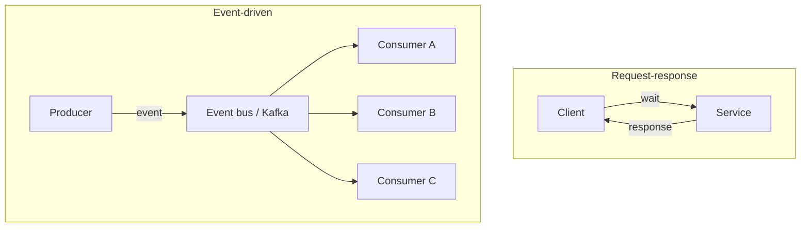
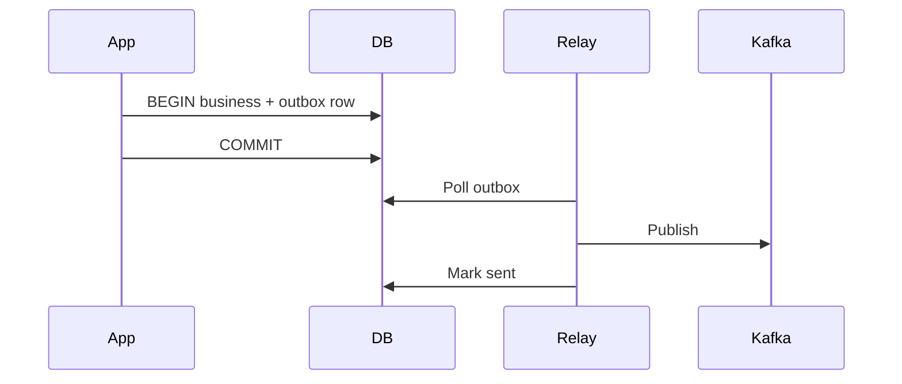
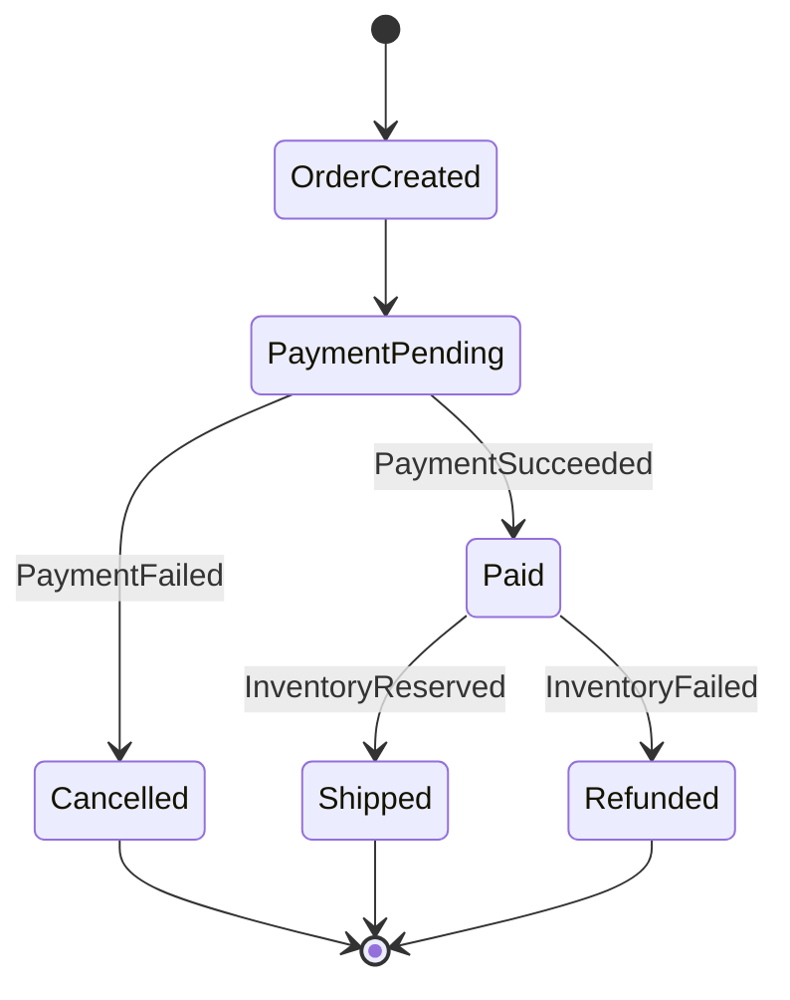
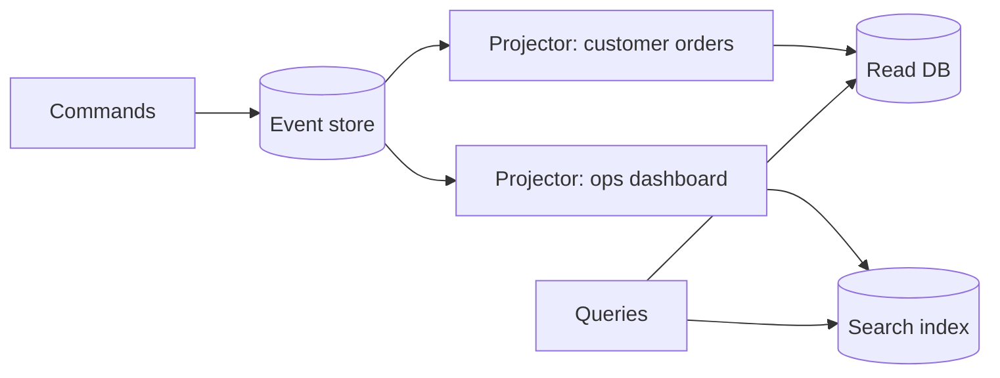
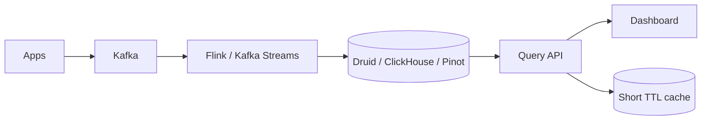
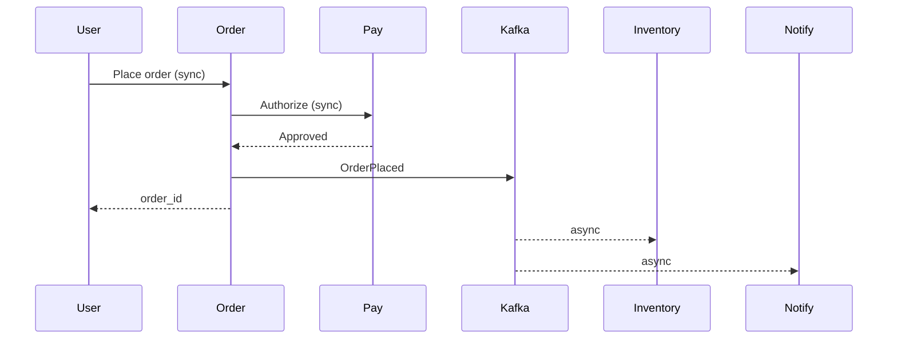
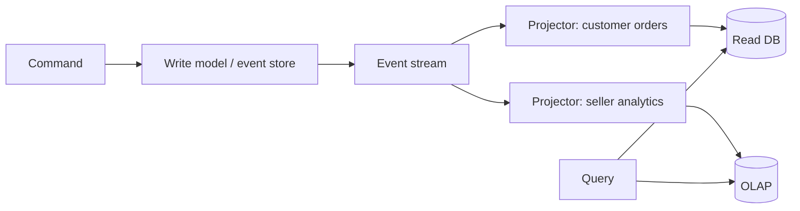
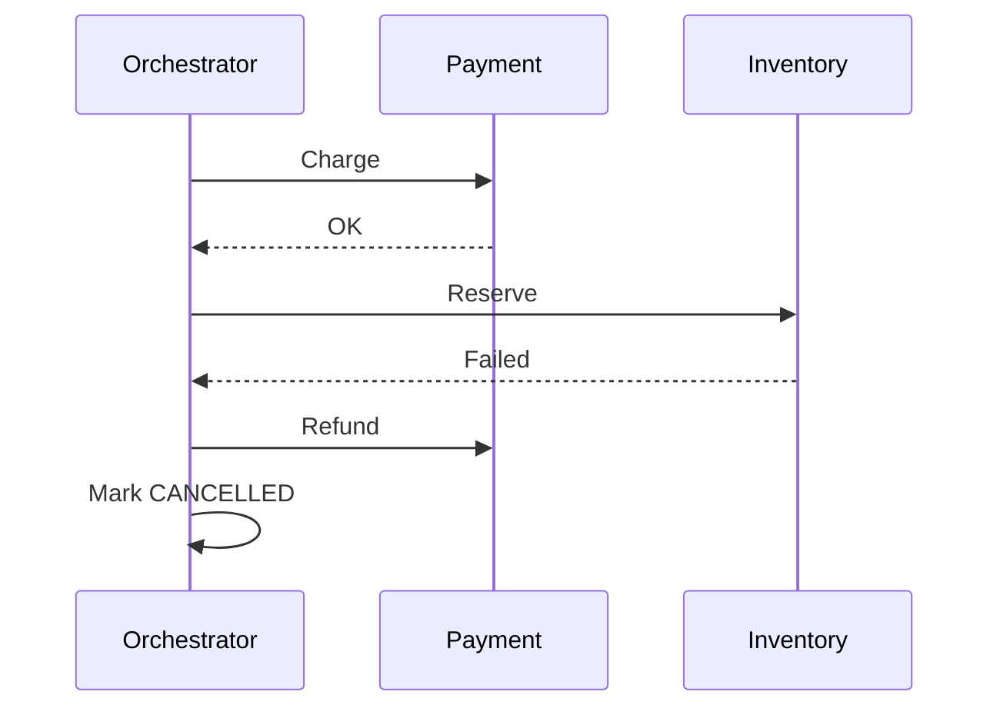
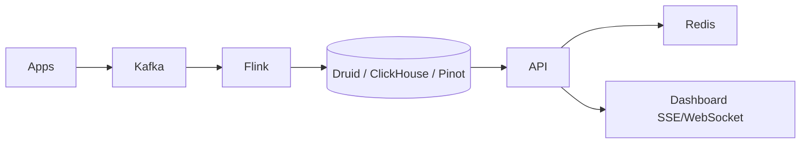
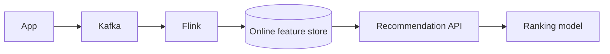

# Event-Driven Architecture & Stream Processing — Senior Interview Study Guide

> **Scope:** Event-driven design (EDA), messaging patterns, event sourcing, CQRS, sagas, and stream processing (Flink, Kafka Streams, Spark). Synthesized from Algoroq (2026) interview banks.

---

## Mental model: sync vs async



| Dimension | Request-response | Event-driven |
|-----------|------------------|--------------|
| Coupling | Caller knows callee | Producers unaware of consumers |
| Latency | End-to-end in one path | Producer returns fast; work continues async |
| Failure | Caller sees error immediately | Consumers retry / lag / DLQ |
| Consistency | Often strong in one request | Often **eventual** across services |

> **Hybrid rule (e-commerce):** Payment authorization **sync**; order placed → **async** fan-out (inventory, email, analytics).

---

## When to use events

**Good fits:**

- One trigger, many reactions (order placed → 5 services).
- Absorb spikes (buffer in Kafka vs overwhelming DB).
- Audit and **replay** (fix bug, reprocess stream).
- Temporal decoupling (consumer offline, catches up).

**Poor fits:**

- Caller must have answer now (auth, balance check).
- Simple CRUD with one database and no scale pain.
- Team cannot operate lag, DLQs, and schema evolution.

---

## Core patterns

### Event notification vs event-carried state transfer

| Style | Payload | Consumer needs |
|-------|---------|----------------|
| **Notification** | IDs + type | Callback to source (coupling) |
| **Carried state transfer** | Full data needed | Autonomous; larger messages |

Prefer **fat events** for downstream independence; version schemas carefully.

### Outbox pattern (reliable publish)



Same database transaction guarantees **no lost events** if the app crashes after commit.

### Saga (distributed workflow)

**Choreography** — services react to events (loose coupling, harder to trace).

**Orchestration** — central coordinator (Temporal/Cadence) drives steps + compensations.



Compensating events: `PaymentFailed` → release inventory, cancel order.

---

## Event sourcing

Store **events**, not only current state. State = replay (or snapshot + replay).

| Benefit | Cost |
|---------|------|
| Full audit trail | Mental model shift |
| Temporal queries | Schema evolution / upcasting |
| Replay for bug fixes | Storage growth, replay time |
| Multiple projections (CQRS) | Eventual read models |

**Good for:** ledgers, trading, compliance-heavy domains.

**Skip for:** simple profiles, passwords, tight deadlines without ES experience.

Example events:

```json
[
  { "type": "AccountOpened", "accountId": "a1", "at": "2026-01-01T00:00:00Z" },
  { "type": "Credited", "amount": 20000, "currency": "USD" },
  { "type": "Debited", "amount": 5000, "currency": "USD" }
]
```

Balance = sum of applicable events (or snapshot at version N).

---

## CQRS

**Command side** — validate rules, append events.

**Query side** — materialized views optimized per screen (SQL, Elasticsearch, Redis).



**Read-your-writes:** route user's immediate read to write model or session-sticky projection.

---

## Ordering, duplicates, and late data

### Sources of disorder

- Multiple partitions, retries, independent producers, clock skew.

### Strategies

| Strategy | Idea |
|----------|------|
| **Commutative updates** | `+$10` not `balance=150` |
| **Per-entity sequence** | Buffer until `seq` complete |
| **Watermarks (streams)** | Event-time windows; drop or side-output late events |
| **Idempotency** | `event_id` dedup table |

```python
# Per-order reorder buffer (conceptual)
buffer: dict[str, list[Event]] = {}
next_seq: dict[str, int] = {}

def handle(event: Event):
    oid = event.order_id
    if event.seq == next_seq.get(oid, 1):
        apply(event)
        next_seq[oid] = event.seq + 1
        drain_buffer(oid)
    elif event.seq > next_seq.get(oid, 1):
        buffer.setdefault(oid, []).append(event)
    # else: duplicate or old — dedup
```

---

## Kafka in EDA (ordering & EOS)

- **Ordering:** per **partition** only — key by `order_id` for order lifecycle.
- **EOS:** idempotent producer + transactions + `isolation.level=read_committed`.
- **End-to-end EOS** to Postgres: outbox or idempotent consumer (`UPSERT` by `event_id`).

---

## Stream processing fundamentals

### Event time vs processing time

| | Event time | Processing time |
|---|------------|-----------------|
| Meaning | When it happened at source | When processor saw it |
| Use for | Business metrics (revenue/hour) | Pipeline throughput metrics |

**Watermark** ≈ `max_event_time - allowed_lateness` — progress vs completeness trade-off.

### Delivery semantics (streams)

| Mode | Loss | Duplicates | Typical implementation |
|------|------|------------|------------------------|
| At-most-once | Yes | No | Commit offset before process |
| At-least-once | No | Yes | Commit after process |
| Exactly-once (effective) | No* | No* | Checkpoint + idempotent/2PC sink |

*Observable effect is once; internal retries may occur.

### Window types

| Window | Shape | Example |
|--------|-------|---------|
| **Tumbling** | Fixed, non-overlapping | Hourly revenue |
| **Sliding / hopping** | Overlap | 1h avg updated every 15m |
| **Session** | Gap-based | User session length |
| **Global** | All time | Custom triggers |

Late events: **allowed lateness**, **retracting** updates (Flink), or accept approximate dashboards.

---

## Framework comparison

| | Apache Flink | Kafka Streams | Spark Structured Streaming |
|---|--------------|---------------|----------------------------|
| Model | Native streaming | Library in app | Micro-batch (continuous mode optional) |
| Latency | ms | ms | seconds typical |
| Event time | Excellent | Good | Good with watermarks |
| State | RocksDB checkpoints | Local + changelog topics | More limited |
| Ops | Cluster to run | Scale app instances | Spark cluster |

**Choose Flink:** complex CEP, large state, strict event-time.

**Choose Kafka Streams:** Kafka-in/Kafka-out, team wants no separate cluster.

**Choose Spark:** existing Spark batch + ML; latency in seconds OK.

---

## Reference architecture: real-time analytics dashboard



1. **Ingest** — Kafka, schema registry.
2. **Process** — 1-minute tumbling aggregates by region/product.
3. **Serve** — OLAP for sub-second queries; Redis for hot tiles.
4. **Simpler path** — OLAP ingests Kafka directly for fixed dashboards.

---

## Stateful operations deep dive

### Stream-stream join

Match events on key within **time interval** (e.g. click within 1h of impression).

**Cost:** state size ≈ rate × window — use RocksDB, narrow windows, pre-filter.

### Stream-table join (dimension)

Broadcast or versioned KV store for "current product price" enriched onto click stream.

### Backpressure

| Layer | Mechanism |
|-------|-----------|
| Kafka | Consumer lag grows; disk buffers |
| Flink | Credit-based flow control upstream |
| Mitigation | Scale consumers, shed load, sample low-value events |

Monitor **consumer lag**, checkpoint duration, **watermark lag**.

---

## Complex Event Processing (CEP)

Detect patterns over ordered streams: `login_fail x3 within 5m → alert`.

Flink CEP, Esper-style engines, or explicit state machines in Kafka Streams.

---

## E-commerce EDA (design interview template)

**Domains:** Catalog, Inventory, Orders, Payments, Shipping, Notifications.

**Event envelope:**

```json
{
  "event_id": "uuid",
  "event_type": "OrderCreated",
  "timestamp": "2026-04-11T10:30:00Z",
  "correlation_id": "session-456",
  "causation_id": "cart-checkout-789",
  "data": {
    "order_id": "ord-1",
    "customer_id": "cust-1",
    "items": [{ "sku": "X", "qty": 2, "price": 29.99 }],
    "total": 59.98
  }
}
```

**SLA:** API < 200ms returns `order_id`; downstream completes in seconds.

**Failure handling:** DLQ, retry with backoff, idempotent consumers, saga timeouts.

---

## Observability for event systems

| Signal | Why |
|--------|-----|
| Consumer lag | Processing health |
| DLQ rate | Poison messages |
| End-to-end latency | event time → side effect |
| Schema compatibility errors | Deployment safety |
| Trace correlation IDs | Debug cross-service |

> **Tip:** Log `correlation_id` on every hop; without it, async debugging is painful.

---

## Interview Q&A (selected)

### 1. EDA vs request-response — when each?

Use sync when the user or caller blocks on the outcome. Use events for fan-out, buffering, replay, and decoupling. Mature systems mix both on the critical path vs background.

### 2. Event sourcing vs CRUD?

ES when audit, time travel, replay, or multiple projections justify complexity. CRUD when only current state matters and speed of delivery dominates.

### 3. CQRS overkill?

When one DB serves reads/writes fine and team cannot run projection lag monitoring — skip. Use when read/write shapes diverge sharply (100:1 read ratio, different stores).

### 4. Out-of-order events?

Commutative design, sequencing, watermarks, idempotency; define timeout for missing sequence (DLQ / alert).

### 5. Exactly-once across Kafka and database?

Transactional outbox, or at-least-once + idempotent `UPSERT` on `event_id`; acknowledge Kafka offset only after DB commit (or store offset in same TX).

### 6. How handle consumer 24h behind?

Scale consumers (≤ partitions), optimize handler, skip/backfill strategy, alert on SLO; check for poison pill stuck in retry loop.

### 7. Schema evolution?

Avro/Protobuf + registry; BACKWARD for consumer-first deploys; never break required fields without upcasters.

### 8. Migrate monolith to events incrementally?

Strangler: dual-write or CDC from monolith DB → Kafka; new services consume; retire sync calls path by path.

### 9. `count distinct users in last 7 days, updated hourly`?

Sliding window or daily buckets + rolling sum; HyperLogLog for approximate uniques at scale.

### 10. Flink checkpoint interval trade-off?

Shorter → less reprocess on failure, more overhead; tune with end-to-end latency SLO.

---

## Common mistakes

1. **Distributed monolith** — events everywhere but tight coupling via chatty sync callbacks.
2. **Missing idempotency** — at-least-once without dedup keys.
3. **Wrong partition key** — destroys ordering guarantees.
4. **No DLQ** — one bad message blocks partition forever.
5. **Ignoring event time** — mobile offline bursts break processing-time windows.

---

## More event-driven interview scenarios

### Dead letter queues (DLQ)

After N retries, move message to DLQ with original payload + error context. Operators replay after fix. Monitor DLQ depth as SLO.

### Message broker selection

| Need | Often choose |
|------|----------------|
| Replay, high throughput, log | Kafka |
| Complex routing, low latency tasks | RabbitMQ |
| Managed multi-subscriber fan-out | SNS+SQS, Pub/Sub |

### Event schema versioning

Add optional fields (backward compatible); never repurpose field meaning; use `schema_version` in envelope; upcasters on read for old events.

### Designing for debuggability

`correlation_id`, `causation_id`, structured logging at publish/consume, trace propagation (OpenTelemetry).

### Strangler fig migration

1. Extract read path to new service with sync API.
2. CDC publishes legacy DB changes.
3. New writes go to new store + events.
4. Retire monolith paths.

---

## More stream processing interview scenarios

### Side outputs (late events)

Main stream updates windows; late events routed to side output for correction jobs or billing adjustments.

### Stateful operator recovery

Flink: checkpoint barrier alignment; Kafka Streams: restore RocksDB from changelog; verify end-to-end checkpoint interval vs latency SLO.

### Testing streams

Controlled event-time test harness; inject disorder; assert window outputs with watermarks frozen in tests.

### KPI: fraud / alerting pipeline

Tumbling 1m windows, keyed by `user_id`, CEP for velocity rules, <1s processing SLA, sink to alert bus.

---

## Preparation checklist

- Draw saga for checkout with compensations.
- Explain watermark with a late mobile event example.
- Compare outbox vs dual-write vs CDC.
- Run Kafka consumer group rebalance exercise (add/remove instance, watch lag).
- Implement sliding-window rate limiter in Redis + discuss stream equivalent in Flink.

---

## Full Interview Q&A

> **Source:** Algoroq (2026) Event-Driven Architecture + Stream Processing interview banks. Numbering: **Q1–Q15** (EDA), **Q16–Q30** (stream processing).

### Q1. Explain the difference between event-driven architecture and request-response, and when to use each

**What they're really asking:** Do you understand the fundamental trade-offs, and can you make a principled decision about which paradigm to use for a given feature?

**Answer:**

**Request-response (synchronous)** couples caller and callee in **time**, **space**, and **interface**: the client blocks until a response arrives and must know who to call and whether they are up.

**Event-driven (asynchronous)** publishes **facts** about something that already happened; producers do not know consumers. Coupling is reduced: consumers can be offline and catch up, multiple consumers can react independently, and spikes can be absorbed in a log/queue.

| Concern | Request-response | Event-driven |
|---------|------------------|--------------|
| User waits for outcome | Natural fit | Requires UX patterns (polling, WebSocket, optimistic UI) |
| Fan-out (1 trigger → N reactions) | Orchestrator or N sync calls | Native pub/sub |
| Failure visibility | Immediate to caller | Lag, DLQ, reconciliation |
| Audit / replay | Harder | Log retention + replay |

**When to choose sync:** authentication before serving a page, payment authorization where the user must see success/failure, low-latency reads where staleness is unacceptable, small systems with few services.

**When to choose events:** order placed → inventory, email, analytics, recommendations; workload smoothing; regulatory audit; rebuilding projections after bugs.

**Hybrid (senior answer):** checkout authorizes payment **synchronously** (<100–200ms user path) then publishes `OrderPlaced` for everything else. Five sync hops at 50ms each = 250ms; publish + ack can be ~5ms with parallel downstream work.



**Follow-ups:**

- How do you handle the case where a user needs to see the result of an asynchronous operation?
- What monitoring challenges are unique to event-driven systems?
- How would you migrate a synchronous service to event-driven incrementally?

### Q2. How does Apache Kafka guarantee message ordering and exactly-once delivery?

**What they're really asking:** Do you understand Kafka's architecture at a level where you can reason about its guarantees, limitations, and configuration trade-offs?

**Answer:**

**Ordering is per-partition only.** Offsets within one partition are strictly monotonic; across partitions there is no global order. All events for one `order_id` should share a **partition key** so `OrderCreated → Paid → Shipped` stays ordered for that order.

**Partition count trade-off:**

| Partitions | Ordering | Parallelism |
|------------|----------|-------------|
| 1 | Global order for topic | One consumer thread |
| N | Order per key | Up to N consumers in group |

**Exactly-once semantics (EOS) inside Kafka** (since 0.11): **idempotent producer** (PID + sequence dedup on broker) + **transactions** (coordinator, two-phase commit markers) + consumers with `isolation.level=read_committed` see only committed records.

```properties
# Producer (conceptual)
enable.idempotence=true
transactional.id=my-app-1
# Consumer
isolation.level=read_committed
```

**Costs:** idempotent producers are cheap; **per-transaction commit** adds latency (often 5–20ms)—batch many records per transaction.

**Critical limitation:** EOS is **Kafka-to-Kafka** unless you add app patterns. Writing to PostgreSQL requires **outbox**, **idempotent UPSERT** on `event_id`, or storing consumer offset in the same DB transaction as the write.

**Rebalance caveat:** cooperative sticky assignors reduce stop-the-world; during rebalance, ordering per partition is preserved but processing may pause—design idempotent handlers.

**Follow-ups:**

- How would you handle reprocessing events when a consumer bug is discovered?
- What happens to ordering when a Kafka consumer group rebalances?
- How do you choose between increasing partitions and increasing consumer instances?

### Q3. What is event sourcing, and when is it the right pattern versus traditional CRUD?

**What they're really asking:** Can you explain event sourcing with precision, articulate its benefits and costs, and make a reasoned judgment about when the complexity is justified?

**Answer:**

**Event sourcing** persists every state change as an **immutable event** in an append-only log. Current state = **replay** (optionally from a **snapshot**).

| CRUD | Event sourcing |
|------|----------------|
| `UPDATE balance = 150` loses history | `Credited(200)`, `Debited(50)` → balance 150 |
| Simple mental model | Events as API contract forever |
| One row per entity | Storage grows; replay time grows |

**Benefits:** audit trail; temporal queries (“balance on March 15”); replay after logic bugs; multiple read models (CQRS); debugging by reproducing event sequences.

**Costs:** schema evolution / upcasting; eventual read models; snapshot strategy for hot aggregates; team skill curve.

**Choose ES for:** ledgers, trading, compliance, carts with multi-DC conflict resolution (Amazon cart history), Git-like domains.

**Choose CRUD for:** passwords, simple profiles, deadlines without ES experience.

```python
def balance(events):
    total = 0
    for e in events:
        if e.type == "Credited":
            total += e.amount
        elif e.type == "Debited":
            total -= e.amount
    return total
```

**Snapshots:** every N events or time window, persist aggregate state + version; replay only events after snapshot.

**Follow-ups:**

- How do you handle event schema evolution when you need to add a required field?
- What is the relationship between event sourcing and CQRS?
- How would you implement snapshotting to handle aggregates with millions of events?

### Q4. Explain CQRS and how it works with event-driven systems

**What they're really asking:** Do you understand the motivation for separating reads and writes, the implementation complexity, and when the pattern is over-engineering?

**Answer:**

**CQRS** splits **commands** (writes, validation, invariants) from **queries** (reads, denormalized views). One normalized model serving both fights indexing vs write amplification.

**With events:** command handler appends to event store → **projectors** build read models (SQL, Elasticsearch, Redis).



**E-commerce example:** `OrderPlaced` feeds (1) customer order history UI, (2) product revenue rollups, (3) ops “stuck orders” dashboard—each store tuned independently; new dashboard = new projector + historical replay.

**Consistency:** reads are **eventually** consistent (ms–s lag). **Read-your-writes:** route post-checkout read to write model or session-aware projection.

**Over-engineering when:** uniform access patterns, small data, no ops for projection lag monitoring.

**Scale:** append-only writes; read replicas per query shape; 100:1 read:write ratios common.

**Follow-ups:**

- How do you handle the case where a user creates a resource and immediately tries to read it before the read model is updated?
- What happens when a read model projection fails midway through processing an event?
- How would you version read models when the underlying event schema changes?

### Q5. How do you handle out-of-order events in a distributed system?

**What they're really asking:** Do you understand that distributed systems cannot guarantee global event ordering, and can you design robust solutions for real-world ordering challenges?

**Answer:**

Out-of-order delivery is **normal** (partitions, retries, multi-producer, network variance).

| Strategy | Mechanism | Best for |
|----------|-----------|----------|
| Commutative ops | `+$10` not `balance=150` | Counters, sets, CRDTs |
| Sequence + buffer | `expected_seq`, priority queue per entity | Order lifecycle per `order_id` |
| Event time + watermark | Flink/Kafka Streams lateness | Analytics windows |
| Version vectors | Causal readiness | Cross-entity causality |
| Idempotent dedup | `event_id` set / DB unique key | Duplicate retries |

**Buffering example:** maintain `next_seq` per order; if `PaymentReceived(4)` arrives before `ItemAdded(3)`, hold in buffer until gap fills; **timeout** (e.g. 5m) → DLQ, alert, or request redelivery.

**At scale:** prefer partition keys that localize ordering needs; avoid unbounded per-entity buffers—use time buckets and accept late corrections for analytics.

```python
# Gap timeout policy (conceptual)
if now - first_buffered_at > timedelta(minutes=5):
    emit_alert("missing_seq", order_id, expected=next_seq)
    route_to_dlq(buffered)
```

**Follow-ups:**

- How does Apache Flink's watermark mechanism handle late-arriving events?
- What is the memory cost of buffering out-of-order events, and how do you bound it?
- How would you handle a producer that resends events from 24 hours ago?

### Q6. Design an event-driven system for a large-scale e-commerce platform

**What they're really asking:** Can you apply EDA principles to a concrete business problem, identifying which interactions should be event-driven, designing the event schema, and handling failure modes?

**Answer:**

**Domains (bounded contexts):** Catalog, Inventory, Orders, Payments, Shipping, Notifications, Analytics, Recommendations—each owns data and publishes **past-tense** events.

**Core flow:**
1. **Order API (sync):** validate cart, create `PENDING` order, publish `OrderCreated`, return `order_id` <200ms.
2. **Payment consumer:** charge card → `PaymentSucceeded` / `PaymentFailed`.
3. **Inventory consumer:** reserve → `InventoryReserved` / `InventoryInsufficient` → saga compensation.
4. **Shipping:** waits for payment + inventory → `ShipmentCreated`.
5. **Notifications:** fan-out emails/SMS without blocking checkout.

**Event envelope** (fat events, schema registry):

```json
{
  "event_id": "uuid-123",
  "event_type": "OrderCreated",
  "schema_version": 1,
  "timestamp": "2026-04-11T10:30:00Z",
  "correlation_id": "session-456",
  "causation_id": "checkout-789",
  "data": { "order_id": "ord-789", "customer_id": "cust-012", "items": [], "total": 59.98 }
}
```

**Saga:** orchestrator or choreography with **timeouts** (inventory no response in 30s → cancel + refund). **Partition** by `order_id`; scale Kafka (~50 partitions ≈ high hundreds of thousands events/sec per topic—size to measured throughput).

**Failure modes:** dual-write → **outbox**; payment succeeds but publish fails → transactional outbox; notification hours behind → separate consumer group, lag SLO, scale out.

**Follow-ups:**

- How do you handle a scenario where the Payment Service succeeds but the event fails to publish?
- What happens when the Notification Service falls hours behind the event stream?
- How would you add a new consumer (say, a fraud detection service) without modifying existing producers?

### Q7. What is the outbox pattern, and why is it critical for event-driven reliability?

**What they're really asking:** Do you understand the dual-write problem, and can you implement a reliable solution for publishing events from a database transaction?

**Answer:**

**Dual-write problem:** `UPDATE orders` and `kafka.send()` are not one atomic unit—crash between them causes **ghost state** or **missing events**.

**Outbox:** in the **same DB transaction**, insert business row + outbox row (`PENDING`). **Relay** publishes to Kafka and marks `PUBLISHED`.

| Relay style | Pros | Cons |
|-------------|------|------|
| Polling | Simple | Latency + DB load |
| CDC (Debezium) | Sub-second, no poll | Extra infra |
| Log tailing | Very low latency | Vendor-specific |

```sql
BEGIN;
INSERT INTO orders (...) VALUES (...);
INSERT INTO outbox (id, payload, status) VALUES (gen_random_uuid(), $json, 'PENDING');
COMMIT;
```

**At-least-once publish** from relay → consumers **idempotent** on `event_id`. **Cleanup:** archive/delete published rows after retention window.

**Alternatives:** event sourcing (event is the write); publish-first “listen to yourself” (API cannot return write result synchronously).

**Follow-ups:**

- How do you handle outbox table growth and cleanup?
- What is the latency overhead of the outbox pattern compared to direct publishing?
- How does change data capture (CDC) improve on the basic polling relay?

### Q8. How do you handle schema evolution in an event-driven system?

**What they're really asking:** Do you understand the long-term maintenance challenges of event schemas, and can you evolve schemas without breaking consumers or losing the ability to replay old events?

**Answer:**

Events are **long-lived contracts**—especially with event sourcing. Use **Avro/Protobuf + Schema Registry**, not schemaless JSON in production.

| Compatibility | Rule of thumb |
|---------------|---------------|
| Backward | New schema reads old data (add optional fields + defaults) |
| Forward | Old schema reads new data (only remove optional fields) |
| Full | Both—safest, most restrictive |

**Practices:**
1. Add fields optional with defaults; never change field meaning.
2. New major shape → new event type (`OrderCreatedV2`) running in parallel during migration.
3. `schema_version` in payload; **upcasters** on replay transform v1→vN without rewriting history.
4. CI: compatibility checks against registry before deploy.

**Migration example:** split `address` string → structured fields: dual-write both; consumers prefer structured with fallback; deprecate old field after consumer cutover (weeks in large orgs).

**Governance:** event review = API review—document semantics, not only fields.

**Follow-ups:**

- How do you handle a breaking schema change that cannot be made backward compatible?
- What is the performance impact of schema validation on every event?
- How do you test schema compatibility in CI/CD pipelines?

### Q9. Explain the differences between Kafka, RabbitMQ, and cloud-native alternatives, and when to choose each

**What they're really asking:** Can you make an informed technology choice based on specific requirements rather than defaulting to the most popular option?

**Answer:**

| System | Model | Throughput | Retention | Typical use |
|--------|-------|------------|-----------|-------------|
| **Kafka** | Distributed commit log | Very high | Days–forever | Event bus, replay, stream processing |
| **RabbitMQ** | Broker queues (AMQP) | Moderate | Until ack | Task queues, routing, RPC |
| **SQS/SNS** | Managed queue/pub-sub | Elastic | Limited | AWS-native, ops-light |
| **EventBridge** | Event bus + rules | Moderate | Short | SaaS integration, routing |
| **GCP Pub/Sub** | Managed log-like | High | ~7 days | GCP-native streaming |

**Decision examples:**
- 500k events/sec, 30-day retention, multiple consumer groups → **Kafka** / MSK / Confluent.
- Email jobs 1k/sec, DLQ, per-message ack → **RabbitMQ** or **SQS**.
- **Hybrid:** Kafka backbone + Rabbit/SQS for operational work queues.

**Kafka vs Rabbit mental model:** Kafka consumers **pull** and **retain**; Rabbit **pushes** and **removes** on ack—replay is a Kafka superpower.

**Follow-ups:**

- How would you migrate from RabbitMQ to Kafka without downtime?
- What are the operational challenges of running Kafka at scale?
- When would you choose Pulsar over Kafka?

### Q10. How do you implement the saga pattern for distributed transactions in an event-driven system?

**What they're really asking:** Can you coordinate multi-service transactions without distributed locks, handle partial failures gracefully, and design compensating actions?

**Answer:**

**Sagas** replace 2PC with **local transactions + compensations**. Two styles:

**Choreography:** services react to events (`OrderCreated` → pay → reserve → ship). Decoupled but hard to see global flow.

**Orchestration:** durable coordinator issues commands, tracks state, runs compensations on failure.



**Implementation checklist:** persist saga state; **timeouts** per step; **idempotent** handlers; **dead saga** detector; log transitions (often events themselves).

**Guidance:** choreography for 3–4 step fan-out; orchestration for 5+ steps, branching, human tasks. Compensations may fail—retry, manual playbook, idempotent refund APIs.

**Follow-ups:**

- How do you handle the case where a compensating action itself fails?
- What is the isolation challenge with sagas (dirty reads of intermediate state)?
- How would you implement a saga that involves calling an external third-party API with no compensation endpoint?

### Q11. How do you handle consumer failures and dead letter queues in event-driven systems?

**What they're really asking:** Do you understand what happens when event processing goes wrong, and can you design robust error handling that prevents data loss while not blocking the pipeline?

**Answer:**

**Failure classes:** transient (retry + backoff + jitter), recoverable (fix + replay), permanent (malformed → DLQ).

**DLQ design:** separate topic/queue; metadata = original offset, error, retry count, first_failure_at; monitor depth; tooling to **replay** after fix.

**Kafka partition blocking:** strict order means one poison message blocks the partition—options: skip to DLQ and advance offset (breaks strict order for that key), infinite retry (bad), or **retry topic** with delay.

**Poison pill:** cap retries per `event_id` in side store; auto-DLQ after N crashes.

**Consumer lag:** scale out (≤ partitions), optimize handler, skip stale analytics, compacted “latest per key” catch-up.

**Graceful deploy:** cooperative rebalance; commit offset only after full processing + side effects strategy.

**Follow-ups:**

- How do you decide between retrying in-place versus routing to a retry topic?
- What metrics would you monitor for consumer health?
- How do you handle a DLQ that has accumulated thousands of events over a weekend?

### Q12. How do you implement event-driven communication between microservices while maintaining data consistency?

**What they're really asking:** Can you design a system where services own their data, communicate via events, and still maintain the consistency guarantees the business requires?

**Answer:**

**No shared DB** across services → **eventual consistency** between boundaries; **strong consistency** inside one aggregate/service transaction.

| Pattern | Description |
|---------|-------------|
| Event-carried state transfer | Fat events; local copies |
| Event notification + callback | Thin events; couples to producer uptime |
| Outbox | Reliable publish |
| Aggregate boundaries | One TX inside aggregate; events across |

**SLAs:** e.g. “inventory on product page within 5s”—monitor **propagation latency** P99; **consistency checkers** compare counts (`PAID` orders vs `COMPLETED` payments).

**CAP between services:** choose availability + events with explicit staleness bounds vs sync coupling.

**Joins across services:** materialized views, **anti-corruption layer** translating foreign events, or bounded synchronous fallback (circuit-broken).

**Follow-ups:**

- How do you handle the case where a consumer needs data from two events that arrive at different times?
- What is the anti-corruption layer pattern, and how does it relate to event consumption?
- How would you implement a join between data owned by two different services?

### Q13. How do you design event-driven systems for exactly-once processing semantics?

**What they're really asking:** Do you understand that exactly-once is technically impossible in distributed systems, and can you implement practical approaches that achieve effectively-once behavior?

**Answer:**

**Theory:** distributed failures ⇒ only **at-most-once** or **at-least-once**; **effectively-once** = at-least-once + **idempotence**.

**Strategy 1 — Idempotent consumer:**

```sql
BEGIN;
SELECT 1 FROM processed_events WHERE event_id = $1;
-- if missing:
INSERT INTO business_table ...;
INSERT INTO processed_events VALUES ($1);
COMMIT;
```

**Strategy 2 — Outbox + idempotent consumers** end-to-end from DB to handlers.

**Strategy 3 — Kafka transactions** for consume-transform-produce in one Kafka pipeline.

**Strategy 4 — Dedup service (Redis) with TTL for hot dedup.

**Side effects:** email/API calls duplicate on retry—use **idempotency keys** or outbox for side effects.

Acknowledge impossibility, then show **failure-mode matrix** (crash after process, before offset commit, etc.).

**Follow-ups:**

- How do you handle exactly-once when the consumer writes to an external system that does not support idempotent writes?
- What is the storage cost of maintaining the deduplication state?
- How does exactly-once semantics interact with event replay for bug fixes?

### Q14. How do you monitor, debug, and trace events across a distributed event-driven system?

**What they're really asking:** Can you operate an event-driven system in production, diagnose issues that span multiple services, and build observability into the architecture from the start?

**Answer:**

**Correlation ID** + **causation ID** on every event; propagate OpenTelemetry context in headers.

| Layer | Metrics |
|-------|---------|
| Producer | publish rate, errors, schema rejections |
| Broker | lag, disk, URP, replication lag |
| Consumer | process latency P50/P99, errors, **lag**, DLQ depth |

**Event lineage:** which upstream event caused this one—impact analysis for schema changes.

**Replay superpower:** reset offset, reprocess after bug fix (with idempotent sinks).

**Runbooks:** lag spike → scale/errors/downstream; DLQ growth → schema/deploy; missing events → retention, producer metrics.

**Chaos:** broker loss, consumer crash mid-batch, registry down—verify recovery.

**Follow-ups:**

- How do you handle the case where replay is needed but the event store has been compacted?
- What is the overhead of distributed tracing on event throughput?
- How would you debug an issue where events are being processed but the resulting state is incorrect?

### Q15. How do you design an event-driven system for high availability and disaster recovery?

**What they're really asking:** Can you ensure an event-driven system survives infrastructure failures, region outages, and data corruption while maintaining the ordering and consistency guarantees the business requires?

**Answer:**

**Kafka HA:** `replication.factor=3`, `min.insync.replicas=2`, `unclean.leader.election.enable=false`, rack/AZ-aware placement.

**DR patterns:**

| Pattern | RPO | RTO | Notes |
|---------|-----|-----|-------|
| Active-passive (MirrorMaker 2) | Seconds–minutes | Minutes | Offset mapping on failover |
| Active-active | ~0 local | Complex | Conflict resolution |
| Stretched cluster | Low | Higher write latency | Cross-region ISR |

**Consumers:** multi-AZ instances, cooperative rebalance, autoscale on lag.

**Corruption protection:** immutable log, checksums, periodic cross-cluster integrity checks.

**Recovery:** fix projector → replay from offset; **fencing** after failover to prevent split-brain writers.

**Quarterly DR drills** with measured RTO/RPO (e.g. RPO <5s, RTO <2m for mission-critical).

**Follow-ups:**

- How do you handle consumer offset translation during a cross-region failover?
- What is the impact of synchronous replication on write latency?
- How would you test your DR procedure without affecting production traffic?

### Q16. Explain the difference between event time and processing time, and why it matters

**What they're really asking:** Do you understand the fundamental time semantics problem in stream processing?

**Answer:**

**Event time** = when something happened at the source (in payload). **Processing time** = when the operator saw it. They diverge with network delay, consumer lag, offline mobile batches, or replay.

Using **processing time** for “revenue per hour” mis-attributes a burst of delayed mobile events to the wrong hour. **Event time** preserves business truth.

**Watermarks:** declaration that events with timestamp ≤ watermark are (mostly) complete: `watermark = max_event_time - allowed_lateness`.

```java
// Spark Structured Streaming (illustrative)
df.withWatermark("eventTime", "10 minutes")
  .groupBy(window("eventTime", "1 hour"), "region")
  .count();
```

| Metric type | Prefer |
|-------------|--------|
| Business KPIs | Event time |
| Pipeline throughput/lag | Processing time |

Late events: drop, side output, or update retracting results (Flink).

**Follow-ups:**

- How do you choose the appropriate watermark delay for a system processing mobile app events?
- What happens to events that arrive after the watermark has passed them?
- How would you test event-time processing logic with out-of-order test data?

### Q17. Compare exactly-once, at-least-once, and at-most-once delivery guarantees

**What they're really asking:** Do you understand the delivery semantics deeply enough to choose the right guarantee for each use case and implement it correctly?

**Answer:**

| Semantics | Loss | Duplicates | Offset commit |
|-----------|------|------------|---------------|
| At-most-once | Possible | No | Before process |
| At-least-once | No | Possible | After process |
| Exactly-once (effective) | No* | No* | Checkpoint/TX + idempotent sink |

*Observable state as if once.

**Implementations:**
- **Idempotent UPSERT** with at-least-once Kafka consumer.
- **Kafka EOS:** transactional producer wraps output + offset commit.
- **Flink:** Chandy-Lamport checkpoints + 2PC sinks.

**Caveat:** external email/API still needs idempotency keys. Choose at-least-once + dedup when EOS overhead unjustified for metrics sampling.

**Follow-ups:**

- How does Kafka's exactly-once semantics work under the hood?
- What is the performance overhead of exactly-once vs at-least-once?
- When would you choose at-least-once over exactly-once?

### Q18. Explain windowing strategies in stream processing

**What they're really asking:** Can you choose the right window type for different analytical requirements and handle edge cases like late data?

**Answer:**

| Window | Behavior | Example |
|--------|----------|---------|
| Tumbling | Fixed, disjoint | Hourly revenue |
| Sliding / hopping | Overlap | 1h average every 15m |
| Session | Gap closes window | 30m inactivity ends session |
| Global | All time | Custom triggers |
| Count-based | N events | Micro-batch every 1000 events |

**Triggers:** on watermark passing window end; **early** partial results; **late** updates.

**Accumulation:** discarding vs accumulating vs **retracting** (downstream must handle corrections).

**7-day uniques updated hourly:** maintain 7 daily buckets per key + rolling sum; or HLL sketches in Flink state with TTL.

**Follow-ups:**

- How would you implement a "count unique users in the last 7 days, updated hourly" metric?
- What is the memory impact of session windows with millions of active sessions?
- How do you handle a scenario where late events need to update already-emitted window results?

### Q19. How does Apache Flink manage distributed state, and why does it matter?

**What they're really asking:** Do you understand stateful stream processing and the challenges of maintaining consistent state in a distributed system?

**Answer:**

Stateful ops: aggregations, joins, CEP, dedup. **Keyed state** (per user ID) scales horizontally; types include `ValueState`, `ListState`, `MapState`, `ReducingState`.

**State backends:**
- `MemoryStateBackend` — tests
- `FsStateBackend` — heap + async snapshots
- **`RocksDBStateBackend`** — production large state (spills to disk)

**Checkpoints:** barrier alignment (Chandy-Lamport); snapshot state + source offsets to S3/HDFS; on failure, restore and replay.

**Savepoints:** manual, long-lived—for upgrades and rescaling.

**Ops concerns:** state TTL, unbounded growth, schema migration of state, rescaling via savepoint restore.

**Follow-ups:**

- How does Flink handle state rebalancing when you scale the job parallelism?
- What is the impact of checkpoint interval on latency and throughput?
- How would you handle state that grows unboundedly over time?

### Q20. Design a real-time analytics dashboard architecture

**What they're really asking:** Can you design an end-to-end system that delivers real-time metrics from raw events to user-facing dashboards?

**Answer:**

**Requirements:** 100k events/sec, sub-minute freshness, dimensions (region, product, channel).



1. **Ingest** — Avro/Protobuf topics with event time.
2. **Flink** — 1-minute tumbling windows; pre-aggregate hot dimension combos.
3. **Serving** — OLAP for sub-second queries; HLL for uniques; quantile sketches.
4. **API** — cache hot tiles in Redis (short TTL).
5. **Simpler path** — OLAP direct Kafka ingest for fixed dashboards.

**Dimension explosion:** limit cardinality, sample long tails, use top-K + “other” bucket. **Lag:** UI shows staleness indicator; alert on processing lag > SLO.

**Follow-ups:**

- How would you handle dimension explosion (too many dimension combinations)?
- What happens to the dashboard when the stream processing pipeline has a 5-minute lag?
- How would you support drill-down queries that weren't pre-aggregated?

### Q21. How do you implement stream-stream joins?

**What they're really asking:** Do you understand the complexity of joining two unbounded data streams and the state management implications?

**Answer:**

Join clicks to impressions where click occurs within **1 hour** of impression—both sides buffered in state until window expires.

**State size intuition:** 10k clicks/sec × 3600 sec ≈ 36M records/hour per side (before pruning)—requires **RocksDB**, narrow windows, pre-filter.

**Flink interval join (conceptual):**

```java
clicks.keyBy(Click::getAdId)
  .intervalJoin(impressions.keyBy(Impression::getAdId))
  .between(Time.minutes(-5), Time.hours(1))
  .process(new JoinFunction<>());
```

**Optimizations:** asymmetric buffering (buffer smaller stream); broadcast filter keys; reduce window if 95% joins <10m.

**Join types:** inner (drop unmatched); outer (wait until window end—more state).

**Follow-ups:**

- How would you handle a join between a stream and a slowly changing dimension table?
- What happens when one side of the join has much higher throughput than the other?
- How do you test stream-stream join logic with deterministic results?

### Q22. Compare Apache Flink, Kafka Streams, and Spark Structured Streaming

**What they're really asking:** Can you choose the right stream processing framework for specific requirements?

**Answer:**

| | Flink | Kafka Streams | Spark Structured Streaming |
|---|-------|---------------|----------------------------|
| Deployment | Cluster / managed | Library in JVM app | Spark cluster |
| Latency | ms (true streaming) | ms | seconds (micro-batch default) |
| Event time / CEP | Excellent | Good | Good with watermarks |
| State | Checkpoints + savepoints | RocksDB + changelog | More external |
| Best fit | Complex state, CEP | Kafka-centric microservices | Unified batch+ML |

**Kafka Streams in service** when topology is owned by one team and Kafka-in/Kafka-out. **Flink** for platform analytics, large joins, sessionization at scale. **Spark** when batch code reuse dominates and seconds latency OK.

**External sinks:** all need idempotent or 2PC for end-to-end exactly-once.

**Follow-ups:**

- When would you use Kafka Streams inside a microservice vs deploying a Flink job?
- What are the limitations of Spark's micro-batch model for real-time use cases?
- How do you handle exactly-once semantics when writing to external systems?

### Q23. How do you handle backpressure in stream processing systems?

**What they're really asking:** Do you understand what happens when a stream processing system cannot keep up with input throughput?

**Answer:**

**Backpressure** = ingest > process → memory growth, latency spikes, risk of OOM.

**Detection:** rising **consumer lag**, longer checkpoints, heap pressure, P99 latency trend.

| Mechanism | Where |
|-----------|-------|
| Kafka buffer | Log retains; consumer catches up |
| Flink credit-based flow control | Propagates upstream to source |
| Scale out | More partitions / parallelism |
| Shed load | Sample page views, keep purchases |
| Tune | `max.poll.records`, network buffers |

**Diagnosis:** slow **sink** (DB write) vs slow **operator** (CPU)—profile Flink metrics per operator, sink batching.

**EOS interaction:** backpressure delays checkpoints; overly long checkpoints extend vulnerability window—tune interval vs SLA.

**Follow-ups:**

- How would you diagnose whether backpressure is caused by a slow sink vs slow processing?
- What is the impact of backpressure on exactly-once processing guarantees?
- How do you auto-scale a stream processing application based on consumer lag?

### Q24. How do you implement Complex Event Processing (CEP)?

**What they're really asking:** Can you detect patterns across sequences of events in real-time?

**Answer:**

CEP matches **sequences** over time: fraud (3 failed logins → success from new IP in 5m), ops (CPU >90% for 3 readings), marketing (cart abandon after 30m).

**Flink CEP (illustrative):**

```java
Pattern<LoginEvent, ?> p = Pattern.<LoginEvent>begin("fail")
  .where(e -> e.type.equals("LOGIN_FAILED"))
  .timesOrMore(3)
  .followedBy("ok")
  .where(e -> e.type.equals("LOGIN_SUCCESS"))
  .within(Time.minutes(5));
```

**Contiguity:** strict vs relaxed (events between matches) vs non-deterministic (multiple matches).

**State:** partial matches buffered until timeout—use **TTL** and pattern bounds.

**Alternatives:** ksqlDB patterns, Esper, explicit state machines in Kafka Streams.

**Follow-ups:**

- How would you test CEP rules against historical data before deploying to production?
- What is the state cost of maintaining millions of concurrent partial pattern matches?
- How do you handle pattern updates without restarting the entire processing job?

### Q25. How do you monitor and operate streaming applications in production?

**What they're really asking:** Do you have production experience with streaming systems, or just theoretical knowledge?

**Answer:**

**24/7 metrics:** lag (primary), end-to-end latency percentiles, throughput, checkpoint duration/size, deserialization errors, CPU/memory/disk.

**Procedures:**
- Flink **savepoint** before deploy; rollback via restore.
- Canary / blue-green on subset of partitions where possible.
- Autoscale on lag derivative, not single spikes.

**Alerting:** sustained lag growth, checkpoint failures, error rate step-change—not every blip.

**Kafka unavailable:** pause processing, lag grows; on return, catch-up plan; idempotent sinks; consider multi-AZ cluster.

**Follow-ups:**

- How would you debug a streaming job that has steadily increasing latency?
- What is the rollback procedure for a failed streaming job deployment?
- How do you handle a scenario where the Kafka cluster is temporarily unavailable?

### Q26. How do you handle exactly-once delivery to external systems (sinks)?

**What they're really asking:** The hardest part of exactly-once isn't internal processing — it's writing to external systems. Do you understand this challenge?

**Answer:**

Flink checkpointing gives internal consistency; **sinks** need **TwoPhaseCommitSinkFunction**: pre-commit on checkpoint, commit on complete, abort on failure.

Works with: Kafka transactions, JDBC TX, some file systems (temp → rename).

**Idempotent sinks:** deterministic record ID → UPSERT (`ON CONFLICT`), Elasticsearch index by ID, Redis SET.

**Buffered ack pattern:** track pending writes in operator state until external ack stored in checkpoint.

**Production reality:** at-least-once + idempotent UPSERT beats fragile 2PC to arbitrary REST APIs.

**Follow-ups:**

- How does the two-phase commit protocol interact with Flink's checkpoint mechanism?
- What happens if the external system is temporarily unavailable during the commit phase?
- How do you implement exactly-once for a sink that is a REST API?

### Q27. How would you migrate a batch pipeline to streaming?

**What they're really asking:** Can you navigate the practical challenges of moving from batch to streaming, including testing, validation, and gradual rollout?

**Answer:**

**Phased migration:**
1. **Candidate selection** — latency-sensitive or naturally streaming sources.
2. **Dual run** — batch + stream from same source.
3. **Reconciliation** — automated diff with tolerances (late events, window boundaries, approx algorithms).
4. **Cutover** — consumers read stream; batch becomes audit layer.

**Challenges:** batch assumes full dataset available; streaming needs continuous state; per-event errors vs whole-job retry; nondeterministic tests → use event-time test harness.

**Lambda vs Kappa:** see Q28—many orgs keep batch for official reporting while stream drives operations.

**Follow-ups:**

- How do you handle a streaming pipeline that needs access to the full day's data for a computation?
- What is the Lambda architecture, and when is it appropriate vs a pure streaming (Kappa) architecture?
- How do you maintain data quality when transitioning from batch to streaming?

### Q28. Explain the Kappa Architecture and when you would use it

**What they're really asking:** Do you understand the architectural patterns for combining batch and stream processing?

**Answer:**

**Lambda:** batch layer (accuracy) + speed layer (latency) + serving merge—**two codepaths**.

**Kappa (Jay Kreps):** one streaming pipeline; **replay** Kafka from offset when logic changes. Requires **long retention** (tiered storage/S3).

| | Lambda | Kappa |
|---|--------|-------|
| Codepaths | 2 | 1 |
| Reprocessing | Batch job | Replay log |
| Fit | Heavy batch analytics | Event-sourced, Kafka-centric |

**Kappa weak when:** need full-table scans, ML training on historical snapshots, replay takes days for year of data.

**Hybrid:** stream for real-time; batch for monthly regulatory reports—minimize overlapping logic.

**Follow-ups:**

- How long does it take to reprocess a year of data through a Kafka-based Kappa architecture?
- How do you handle schema evolution during replay in a Kappa architecture?
- What is the cost comparison between Lambda and Kappa architectures?

### Q29. How do you handle data enrichment in stream processing?

**What they're really asking:** Can you join streaming data with reference data efficiently without introducing bottlenecks?

**Answer:**

| Reference data | Pattern |
|----------------|---------|
| Small / slow-changing | Broadcast state in Flink at startup + periodic refresh |
| Medium | Changelog topic → broadcast map in operators |
| Large / hot | Async I/O to Redis/Cassandra with local cache + TTL |

**Anti-pattern:** synchronous HTTP per event—kills throughput. **AsyncDataStream** + connection pools + bulk lookup batches.

**ML features:** online feature store (Feast/Tecton) for real-time vectors; batch features from offline store.

**Failures:** default values, retry with cap, or route to DLQ depending on business criticality.

**Follow-ups:**

- How do you handle an enrichment lookup that fails? Skip the event, use a default, or retry?
- What is the memory impact of caching millions of reference records in operator state?
- How do you test enrichment logic when reference data changes over time?

### Q30. Design a stream processing system for real-time recommendation updates

**What they're really asking:** Can you apply stream processing to a real product feature with complex requirements?

**Answer:**

**Goal:** recommendations refresh within seconds of behavior (view, click, cart, purchase).



1. Events keyed by `user_id`.
2. **Flink:** sliding category interests (30m), session signals, hourly trending (global window).
3. **Candidates:** vector index (Milvus/Pinecone) or co-occurrence counts.
4. **Ranking:** Triton/TF Serving combining online + batch features.
5. **Latency budget:** ~10ms ingest + ~50ms Flink + ~5ms feature write + ~50ms API inference ≈ **~120ms**.

**Cold start:** fallback to popular/trending; **A/B:** fork feature pipelines by experiment ID in metadata.

**Follow-ups:**

- How would you handle the cold-start problem for new users in real-time recommendations?
- What is the trade-off between recommendation freshness and quality?
- How would you A/B test different real-time recommendation strategies?

---

## Senior Pitfalls

| Mistake | Impact | Fix |
|---------|--------|-----|
| Consumers without idempotency | Duplicate side effects on redelivery | Idempotent keys, upserts, dedupe store, transactional processing |
| Unbounded topic retention | Disk full, replay storms | Tiered retention, compaction policy, archive to object store |
| Key skew on hot users/merchants | Single partition lag | Salting, parallel pipelines, re-key with downstream join |
| Missing dead-letter and poison handling | Stuck consumer groups | DLQ, quarantine, skip with metric, replay tooling |
| “Exactly once” claimed without end-to-end proof | Silent duplicates or gaps | Idempotent sinks, transactional outbox, formal semantics doc |
| Stream joins without watermarks | Wrong aggregates on late events | Event-time windows, allowed lateness, side outputs |

---

## Production-grade Practice

1. Implement a **Kafka consumer** with manual commits, poison-message DLQ, and lag dashboard; fault-inject broker restarts and measure recovery time.
2. Design **event schema** governance: compatibility mode, producer CI checks, and a breaking-change playbook with dual-write period.
3. Build a **Flink/kstreams** job with event-time windows and late-data handling; compare results to batch backfill for one day of data.
4. Capacity-plan a peak **1M events/sec** topic: partition count, broker disk IO, consumer fleet size, and replay time after 1h outage.
