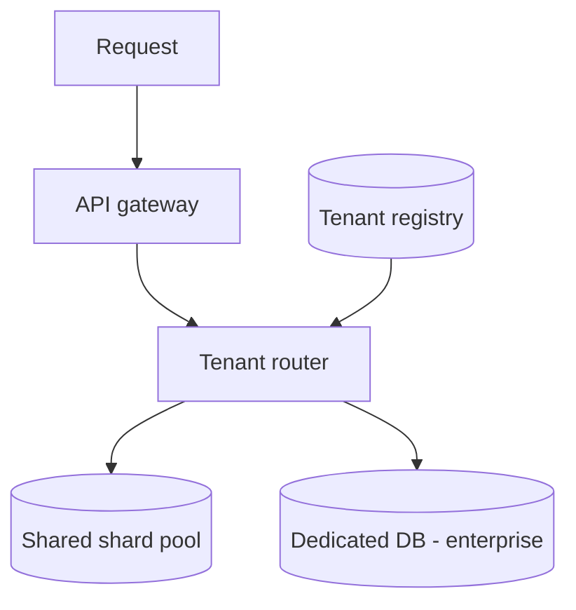
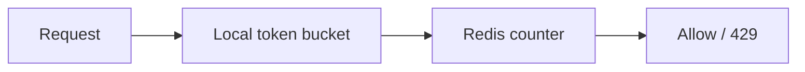
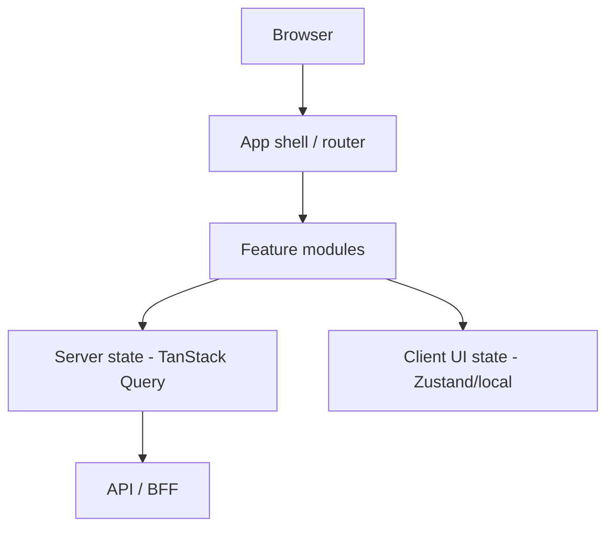
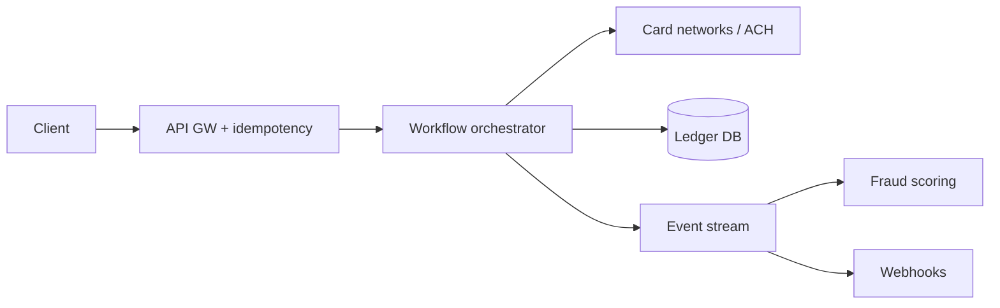
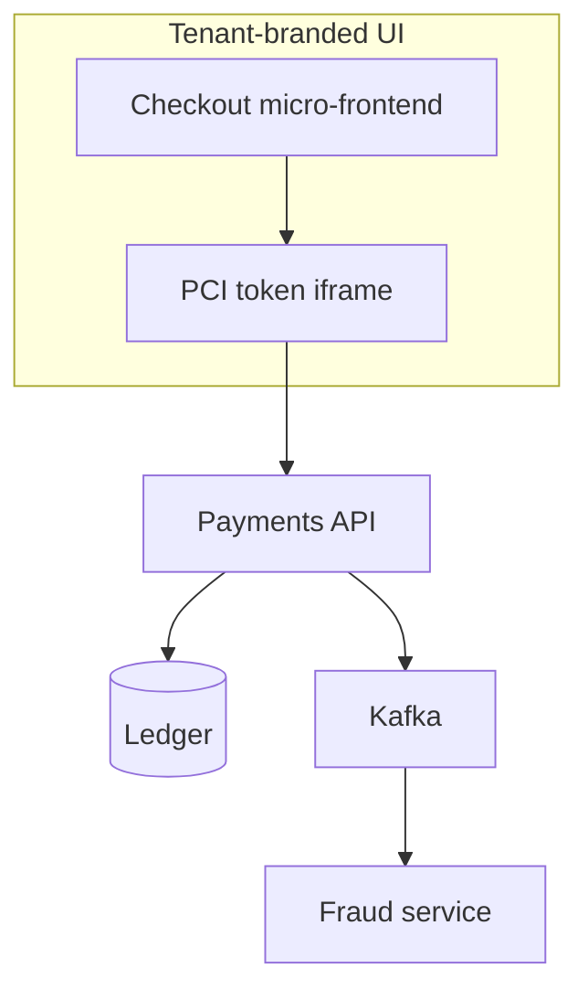
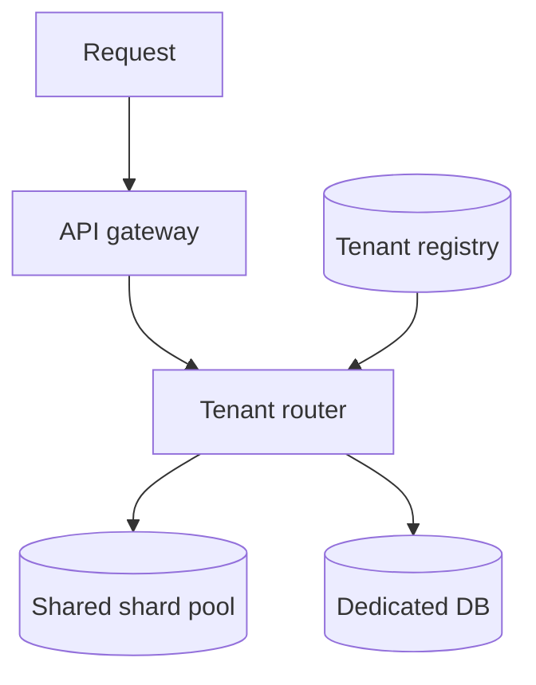
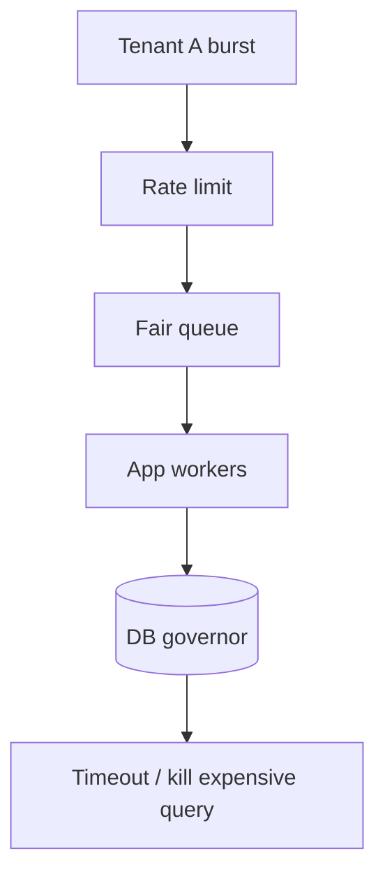
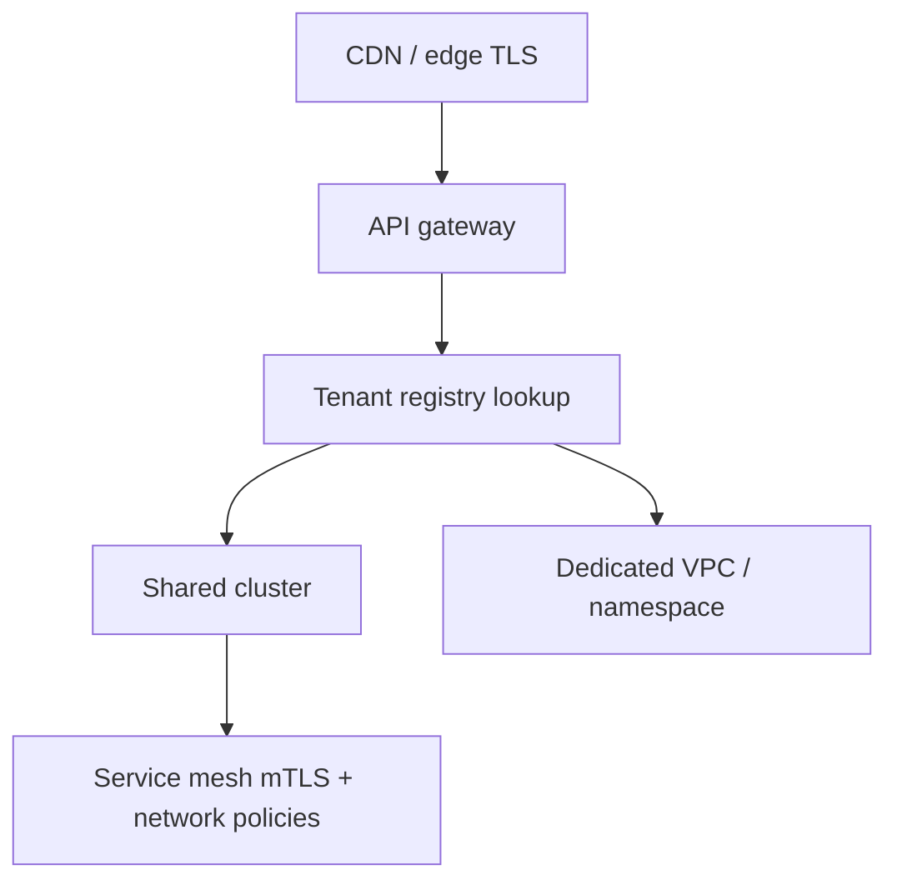
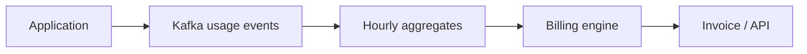
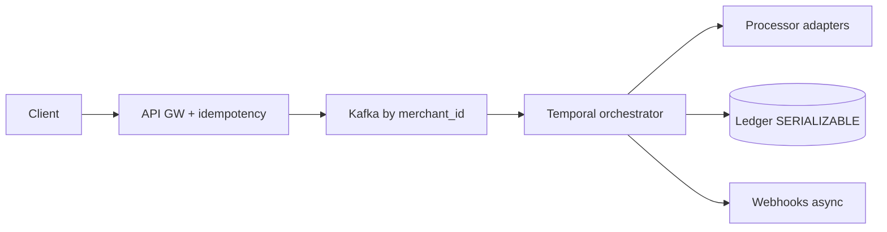

# Multi-Tenancy, Frontend System Design & FinTech — Senior Interview Study Guide

> **Scope:** SaaS multi-tenancy (isolation, quotas, compliance), frontend architecture at scale, and FinTech system design (payments, ledgers, fraud, PCI). Synthesized from Algoroq (2026) interview banks.

---

## Part A — Multi-tenancy

### Why multi-tenancy matters

One platform serves **many customers (tenants)** on shared infrastructure. Interviewers test:

- Isolation vs efficiency
- Noisy neighbor mitigation
- Compliance (SOC 2, GDPR)
- Onboarding millions of tenants



---

### Data isolation models

| Model | Isolation | Ops cost | Best for |
|-------|-----------|----------|----------|
| **Shared DB, shared schema** (`tenant_id` column) | Logical (RLS + app) | Lowest | Long tail SMB tenants |
| **Shared DB, schema per tenant** | Stronger | Medium | Mid-market |
| **DB per tenant** | Strongest | Highest | Enterprise / regulated |

**Hybrid (common):** 90% on shared pool; top enterprises on dedicated instances.

```sql
-- PostgreSQL row-level security (defense in depth)
ALTER TABLE orders ENABLE ROW LEVEL SECURITY;
CREATE POLICY tenant_isolation ON orders
  USING (tenant_id = current_setting('app.tenant_id')::uuid);
```

> **Never rely on app filter alone** — enforce at DB + audit.

### Tenant routing layer

- Map `tenant_id` → connection string / shard / region.
- **Cache** registry in Redis; warm cache on provision.
- Highly available — every request depends on it.

### Sharding multi-tenant data

Shard by **`tenant_id`** so tenant queries stay on one shard.

Use **consistent hashing** or directory shard map for rebalance when tenants grow.

### Noisy neighbor — defense in depth

| Layer | Tactic |
|-------|--------|
| Compute | K8s requests/limits, QoS classes |
| Database | Per-tenant query timeout, connection caps, `pg_stat_statements` |
| Network | API gateway rate limits per tenant / plan tier |
| App | Weighted fair queuing, backpressure |
| Ops | Per-tenant attribution metrics + alerts |

### SOC 2 + GDPR architecture

| Requirement | Technique |
|-------------|-----------|
| Logical isolation | Mandatory tenant scope in ORM; RLS |
| Encryption isolation | Per-tenant keys (envelope encryption) |
| GDPR residency | `data_region` on tenant; route storage |
| Right to erasure | Cascade delete or **crypto-shredding** backups |
| Audit | Immutable logs, minimal PII in logs |

**Cross-tenant analytics:** aggregated anonymized data only; no raw row leakage.

### Rate limits and quotas



- **Tiered:** global → per-tenant → per-endpoint.
- **Local + central:** local catches bursts; central enforces exact quota.
- **Fail open** with conservative local limits if Redis down (avoid total outage).

### Tenant lifecycle

States: `Pending → Provisioning → Active → Suspended → Deprovisioned`

| Tenant type | Provisioning |
|-------------|--------------|
| Self-serve SMB | Metadata only (seconds) |
| Enterprise | IaC (Terraform): DB, VPC, DNS (minutes–hours) |

**Progressive provisioning** — minimum viable tenant first; add resources on upgrade.

**Idempotent** provisioning steps with stored state machine.

### Tenant-aware caching

- Key prefix: `tenant:{id}:entity:{id}` — prevents leakage and pollution.
- Consider **per-tenant cache budgets** (LRU partitions) so one tenant cannot evict all.

---

### Multi-tenancy — interview Q&A

**Q: Migrate small tenant to dedicated infra?**  
Dual-write or snapshot + cutover; update routing; verify SLAs; rollback plan.

**Q: Schema migration on shared schema?**  
Expand-contract; backward compatible migrations; feature flags; online DDL where supported.

**Q: Enterprise generates 100× data?**  
Move to dedicated index/cluster; routing tier; sales-driven capacity.

---

## Part B — Frontend system design

### Frontend as a distributed system

Constraints: unknown device, network, single-threaded UI (must stay ~60fps).



### Component architecture

| Tier | Examples | Ownership |
|------|----------|-----------|
| **Primitives** | Button, Input | Design system |
| **Composite** | PaymentForm, NavBar | Shared UI |
| **Feature** | CheckoutFlow, Dashboard | Product team |

**Rules:**

- Features compose primitives/composites — not other features.
- **Co-locate** styles, tests, types with components.
- **Smart vs presentational** — container fetches; presentational is pure props/events.

```tsx
// Feature hook encapsulates server + validation logic
export function useCheckoutState(cartId: string) {
  const cart = useQuery({ queryKey: ['cart', cartId], queryFn: () => fetchCart(cartId) });
  const placeOrder = useMutation({ mutationFn: submitOrder });
  return { state: cart, actions: { placeOrder } };
}
```

### Rendering strategies

| Strategy | TTFB | TTI | SEO | Freshness |
|----------|------|-----|-----|-----------|
| **CSR** | Slow | Depends on bundle | Weak | Client fetch |
| **SSR** | Good | Hydration cost | Strong | Per request |
| **SSG** | Best | Fast | Strong | Build / ISR |
| **ISR** | Great | Fast | Strong | Revalidate interval |

**Per-route hybrid (Next.js):** marketing SSG, catalog ISR, dashboard CSR, search SSR.

### State management

| State type | Tooling |
|------------|---------|
| **Server state** | TanStack Query, SWR, Apollo — cache, dedupe, stale-while-revalidate |
| **Client UI** | `useState`, lift minimally, Zustand for global UI |
| **URL state** | Search params for shareable views |

**Anti-pattern:** stuffing API data in global Redux — duplicates cache logic.

### Performance budgets

Example budgets:

- JS **< 200KB** gzipped critical path
- **LCP < 2.5s** (mobile 4G)
- **CLS < 0.1**
- **TTI < 3.5s**

**Enforce in CI:** `size-limit`, Lighthouse CI, RUM dashboards.

Techniques: route-based code splitting, lazy below-fold, image CDN (WebP/AVIF), font subsetting.

### Micro-frontends

| Approach | Pros | Cons |
|----------|------|------|
| Build-time integration | Simple | Coupled releases |
| Module federation | Independent deploy | Version skew |
| iframe | Strong isolation | UX/perf cost |

Use when **teams** scale; avoid for small products.

### Accessibility & i18n

- Semantic HTML, focus management, ARIA where needed.
- Test with keyboard + screen reader paths in critical flows.
- Lazy-load locale bundles; RTL layout testing.

### Real-time UI

WebSocket / SSE for live dashboards; reconcile with server state on reconnect; optimistic UI with rollback on mutation failure.

---

### Frontend — interview Q&A

**Q: Architect large app component tree?**  
Three tiers, co-location, feature boundaries, cross-feature via events/state layer.

**Q: SSR vs CSR for dashboard?**  
CSR often fine (auth, no SEO); SSR if first paint or SEO matters.

**Q: Prevent unnecessary re-renders?**  
Colocate state, selectors, memoization where measured, virtualize long lists.

**Q: Offline-first?**  
Service worker cache strategy, mutation queue, conflict resolution on sync.

---

## Part C — FinTech system design

### Domain constraints

| Constraint | Implication |
|------------|-------------|
| **Correctness** | `NUMERIC` / integer cents — never `float` for money |
| **Auditability** | Append-only ledger, immutable event log |
| **Idempotency** | Every payment API accepts idempotency key |
| **Compliance** | PCI scope minimization, SOC2, regional rules |
| **Fraud** | Sub-100ms scoring path |



---

### Payment pipeline (10k TPS sketch)

1. **Ingress** — TLS, rate limit, idempotency guard (Redis).
2. **Kafka** — partition by `merchant_id` (ordering per merchant).
3. **Orchestrator** — Temporal/Cadence: authorize → capture → settle steps.
4. **Adapters** — normalize processor responses.
5. **Ledger write** — serializable transaction.
6. **Async** — webhooks, analytics.

```python
from hashlib import sha256
import json

def idempotency_fingerprint(body: dict) -> str:
    return sha256(json.dumps(body, sort_keys=True).encode()).hexdigest()

# check_or_set in Redis: same key + different body → 409 conflict
# same key + same body → return cached response
```

**Partial failure:** authorize OK, ledger fails → compensating void; saga state tracks step.

---

### Double-entry ledger

**Invariant:** debits = credits per transaction.

```sql
CREATE TABLE journal_entries (
  id BIGSERIAL PRIMARY KEY,
  transaction_id UUID NOT NULL,
  account_id UUID NOT NULL,
  entry_type TEXT NOT NULL CHECK (entry_type IN ('DEBIT', 'CREDIT')),
  amount NUMERIC(19,4) NOT NULL CHECK (amount > 0),
  currency CHAR(3) NOT NULL,
  created_at TIMESTAMPTZ NOT NULL DEFAULT now()
);

CREATE TABLE account_balances (
  account_id UUID PRIMARY KEY,
  currency CHAR(3) NOT NULL,
  balance NUMERIC(19,4) NOT NULL DEFAULT 0,
  version BIGINT NOT NULL DEFAULT 0
);
```

- **Append-only** journal; corrections = reversing entries.
- **Materialized balance** updated in same TX as entries.
- **Optimistic locking** on `version` or `SELECT FOR UPDATE`.

---

### Fraud detection (real-time)

| Stage | Function |
|-------|----------|
| Feature store | Velocity, geo, device fingerprint (Redis/DynamoDB) |
| Stream | Kafka → Flink enrichment |
| ML serve | ONNX / TF Serving risk score |
| Rules | Impossible travel, high amount CNP |
| Decision | block / challenge / allow + audit log |

```python
from math import radians, sin, cos, sqrt, atan2

def haversine_km(lat1, lon1, lat2, lon2):
    R = 6371
    dlat, dlon = radians(lat2 - lat1), radians(lon2 - lon1)
    a = sin(dlat/2)**2 + cos(radians(lat1)) * cos(radians(lat2)) * sin(dlon/2)**2
    return R * 2 * atan2(sqrt(a), sqrt(1 - a))

def impossible_travel_kmh(dist_km, hours, max_speed=900):
    if hours <= 0:
        return True
    return (dist_km / hours) > max_speed
```

Trade-off: false decline (UX) vs false approve (loss). Explainability for regulators.

---

### PCI DSS (architecture)

1. **Shrink CDE** — hosted fields / tokenization; backend never sees PAN.
2. **Network segmentation** — isolated VPC for card data path.
3. **Encryption** — TLS 1.3 in transit; AES-256 at rest; HSM for keys.
4. **Access** — least privilege, MFA, bastion, session recording.
5. **Logging** — immutable audit; SIEM alerts.
6. **Continuous** — dependency scan, quarterly ASV, annual pentest.

PCI v4.0 emphasizes **outcome-based** controls and continuous monitoring.

---

### Settlement & reconciliation

- Batch settlement files (ISO 8583) per network cutoff.
- **Three-way match:** internal ledger ↔ processor ↔ bank statement.
- Unmatched → suspense account + aging workflow.
- Orchestrate with Airflow/Temporal.

Real-time rails (FedNow, UPI) shorten windows — architecture shifts toward streaming reconciliation.

---

### Multi-currency

- Rate feed with timestamp + bid/ask.
- **Lock rate** at quote time (30s window).
- Ledger records both currencies + rate snapshot.
- **Banker's rounding** (`ROUND_HALF_EVEN`); disclose FX markup (PSD2).

```python
from decimal import Decimal, ROUND_HALF_EVEN

def convert(amount: Decimal, rate: Decimal, precision: int = 2) -> Decimal:
    q = Decimal(10) ** -precision
    return (amount * rate).quantize(q, rounding=ROUND_HALF_EVEN)
```

---

### Event-sourced transaction history

Events: `TransactionInitiated`, `AuthorizationSucceeded`, `CaptureCompleted`, `RefundIssued`.

- Fast reads via **projections** (current state table).
- Snapshots every N events for replay speed.
- Kafka or event store as append log.

---

## Cross-cutting: SaaS + Frontend + FinTech

| Concern | Multi-tenant SaaS | FinTech |
|---------|-------------------|---------|
| Isolation | `tenant_id`, RLS | Ledger per entity + PCI segmentation |
| UI | Tenant branding, feature flags | Secure payment iframe, no PAN in DOM |
| Scale | Noisy neighbor controls | Idempotent, partitioned payment stream |
| Compliance | GDPR erasure | PCI, SOX, audit trails |



---

## Common mistakes

**Multi-tenancy**

1. Missing `tenant_id` in one query path → data leak.
2. One giant shared index without routing — noisy search neighbors.
3. Hard delete without backup/crypto-shred plan.

**Frontend**

1. Global store for all server data.
2. No performance budgets in CI.
3. Hydration mismatch in SSR.

**FinTech**

1. Floating-point money.
2. No idempotency on POST /pay.
3. Storing PAN in application logs.

---

## Additional multi-tenancy topics

### Customization per tenant

Feature flags + config service; schema extension via JSON columns vs EAV; avoid per-tenant code branches.

### Billing and metering

Usage aggregates per tenant (API calls, storage GB); stream to billing pipeline; align rate limits with plan.

### Support and impersonation

Break-glass admin access with audit; time-bound impersonation tokens; never disable tenant RLS without logging.

---

## Additional frontend topics

### Design systems

Tokens (color, spacing), Storybook, visual regression tests, semver for package releases.

### Security in the browser

CSP, sanitize HTML, avoid `dangerouslySetInnerHTML`, secure cookies (`HttpOnly`, `SameSite`).

### Internationalization

ICU messages, plural rules, timezone-aware dates, CDN per locale bundle.

### BFF (backend for frontend)

Aggregate APIs per client (web vs mobile); reduce over-fetching; hide internal microservice topology.

---

## Additional FinTech topics

### Strong Customer Authentication (SCA)

3DS2 flows; step-up challenge; store authentication method in payment metadata.

### Chargebacks and disputes

Link ledger entries to network case IDs; evidence automation; feedback into fraud models.

### KYC / AML (high level)

Identity verification vendor; watchlist screening; risk-based periodic review — separate bounded context from payments core.

### Wallet / stored balance

Internal ledger accounts for user balance; separate from external settlement; invariants on non-negative available balance.

### Audit and SOX

Immutable journal; segregated duties; change management on production financial config.

---

## Interview preparation

| Track | Exercise |
|-------|----------|
| Multi-tenant | Design hybrid pool + enterprise routing; GDPR delete story |
| Frontend | Whiteboard checkout: components, SSR choice, state split |
| FinTech | 10k TPS payment + ledger + idempotency; fraud path <100ms |

> **Staff-level move:** Connect **tenant tier** (rate limits, isolation) to **frontend** (feature flags) and **FinTech** (PCI scope) in one coherent platform narrative.

---

## Full Interview Q&A — Multi-Tenancy

### Q1. How would you design the data architecture for a multi-tenant SaaS application that serves both small startups and large enterprises?

**What they're really asking:** Can you choose among isolation models, handle scale disparity between tenants, and justify a pragmatic hybrid instead of a one-size-fits-all database?

**Answer:**

The core decision is where each tenant’s data lives on the isolation spectrum:

| Model | Isolation | Ops cost | Typical segment |
|-------|-----------|----------|-----------------|
| Shared DB, shared schema (`tenant_id`) | Logical (RLS + app) | Lowest | Long-tail SMB (90%+ of customers) |
| Shared DB, schema per tenant | Stronger | Medium | Mid-market |
| DB (or cluster) per tenant | Strongest | Highest | Enterprise / regulated |

**Hybrid pattern (most real SaaS):** Pool the long tail on shared schema with mandatory `tenant_id` on every row, PostgreSQL RLS as defense in depth, and shard by `tenant_id` so tenant-scoped queries never cross shards. Route the top 1–5% (revenue, compliance, SLA) to dedicated instances via a **tenant routing layer** (registry → connection config), cached in Redis with HA.



**Sharding:** Use consistent hashing or a directory shard map so rebalance does not require full-table migration. Relational DBs fit transactional multi-tenant workloads; NoSQL can scale writes but pushes isolation to the application.

**SQL vs NoSQL:** Use SQL where strong isolation and migrations matter; use NoSQL for high-volume logs/events with strict tenant scoping in keys.

**Follow-ups:**

- How do you handle database migrations when thousands of tenants share the same schema?
- What is your strategy when a small tenant’s usage grows to the point where they need dedicated infrastructure?
- How do you prevent a query from one tenant from impacting the performance of other tenants on the same shard?

---

### Q2. Explain the noisy neighbor problem in multi-tenant systems and how you would mitigate it at multiple layers of the stack.

**What they're really asking:** Do you understand resource contention in shared infrastructure and can you design defense in depth without giving up multi-tenant economics?

**Answer:**

A **noisy neighbor** is one tenant whose consumption degrades others: heavy DB queries, burst API traffic, or storage growth on shared pools.

| Layer | Mitigation |
|-------|------------|
| **Compute** | cgroups / K8s requests & limits; QoS (Guaranteed for premium tiers) |
| **Database** | Per-tenant query timeout, concurrent query caps, `pg_stat_statements` + middleware to kill over-budget queries; per-tenant connection pool limits on replicas |
| **Network** | API gateway token bucket / sliding window per tenant and plan tier; priority queuing under congestion; CDN for read-heavy traffic |
| **Application** | Weighted fair queuing; queue rather than fail when over fair share; backpressure to slow abusive tenants |
| **Observability** | Per-tenant CPU, I/O, bytes, query time; alert on baseline deviation |



**Follow-ups:**

- How do you handle a noisy neighbor in real time when automated mitigation fails?
- What is your strategy for tenants whose legitimate workload occasionally needs burst capacity beyond their normal allocation?
- How do you communicate resource limits to customers without exposing internal architecture details?

---

### Q3. How would you implement tenant isolation for a system that must comply with both SOC 2 and GDPR requirements?

**What they're really asking:** Can you map regulations to concrete controls across storage, encryption, residency, erasure, and audit—not just “we use RLS”?

**Answer:**

**SOC 2** emphasizes logical separation, access control, and audit trails. **GDPR** adds residency, portability, erasure, and lawful processing.

1. **Logical isolation:** Mandatory tenant scope in ORM/middleware (queries without tenant context fail). RLS in PostgreSQL. APIs verify authenticated tenant matches resource tenant.
2. **Encryption isolation:** Per-tenant keys with envelope encryption; KMS policies scoped per tenant so a bug does not decrypt another tenant’s data.
3. **Geographic isolation:** `data_region` on tenant record; storage and processing enforced in-region; DR replication only within allowed geography.
4. **Right to erasure:** Cascade deletes in shared schema, or drop schema/DB for dedicated tenants. **Crypto-shredding** for backups when immutable retention conflicts with erasure.
5. **Audit:** Immutable logs with tenant_id, user, operation, timestamp; minimize PII in logs; retention meets SOC 2 and GDPR proportionality.

**Follow-ups:**

- How do you handle cross-tenant analytics or aggregated reporting without violating isolation requirements?
- What is your approach to handling a GDPR DSAR efficiently in a multi-tenant system?
- How do you validate that isolation controls are working—what does your testing strategy look like?

---

### Q4. Describe how you would design a multi-tenant rate limiting and quota management system.

**What they're really asking:** Can you build fair, accurate, low-latency limits in a distributed system—and fail safely when Redis is down?

**Answer:**

Three components: **configuration**, **enforcement**, **usage tracking**.

**Configuration hierarchy:** Global caps → per-tenant (plan) → per-endpoint → per-resource. Store in Redis/DynamoDB; support plan inheritance and enterprise overrides.

**Enforcement:** Centralized counters (accurate, +1 RTT) vs local counters with sync (fast, approximate). **Tiered approach:** local token bucket at ~120% of per-node share for instant abuse blocking; centralized limiter for exact compliance (1–5s sync window).


**Usage tracking:** 1-minute windows for enforcement; hourly/daily/monthly aggregates for billing and capacity. Shard usage writes by `tenant_id`.

**Failure mode:** **Fail open** with conservative local limits if central store is unavailable—blocking all traffic is worse than brief overage.

**Follow-ups:**

- How do you handle quotas that reset at different intervals (per-second, per-minute, per-month)?
- What is your strategy for communicating rate limit status to tenants (headers, dashboards, alerts)?
- How do you implement burst allowances that let tenants temporarily exceed their sustained rate?

---

### Q5. How would you design a tenant onboarding and provisioning system that can scale from hundreds to millions of tenants?

**What they're really asking:** Does your architecture work for tenant #1 and tenant #1,000,000—with fast time-to-value and reliable state machines?

**Answer:**

Model provisioning as an **async state machine:** `Pending → Provisioning → Active → Suspended → Deprovisioned`, with idempotent, resumable steps.

| Tenant type | Provisioning | Duration |
|-------------|--------------|----------|
| Self-serve SMB | Registry record, tenant_id, default quotas, auth credentials, seed data | Seconds |
| Enterprise | IaC (Terraform): DB, VPC, DNS, dedicated resources | Minutes–hours |

**Progressive provisioning:** Minimum viable tenant first; add capacity on upgrade or usage—avoids provisioning for the 60–80% of signups that never activate.

**Scale:** HA tenant registry; Redis cache in front; cache warm on provision; shard registry by `tenant_id` at very large scale.

**Follow-ups:**

- How do you handle tenant deprovisioning—especially data deletion for GDPR?
- What is your strategy for migrating a tenant from shared to dedicated infrastructure as they grow?
- How do you handle provisioning failures that leave a tenant in an inconsistent state?

---

### Q6. How do you implement tenant-aware caching in a multi-tenant system without cache pollution or cross-tenant data leakage?

**What they're really asking:** Can you enforce isolation in cache keys and prevent one large tenant from evicting everyone else’s hot data?

**Answer:**

**Leakage prevention:** Mandatory key prefix enforced in a cache wrapper: `{tenant_id}:{entity_type}:{entity_id}:{version}`. Wrapper throws if tenant context is missing.

**Pollution mitigation:**

- Per-tenant memory quotas (application-tracked when Redis lacks native prefix limits)
- **L1** in-process cache (short TTL) + **L2** shared Redis
- Dedicated Redis for largest enterprise tenants via routing layer

**Invalidation:** Tenant-scoped pub/sub channels; avoid blanket “invalidate all keys for tenant” without staggered re-fetch to prevent thundering herd.

**Follow-ups:**

- How do you handle cache warming for a newly provisioned tenant without impacting existing tenants’ hit rates?
- What is your strategy for caching tenant configuration that must be immediately consistent when it changes?
- How do you measure per-tenant cache hit rates to identify suboptimal configurations?

---

### Q7. How would you design a multi-tenant search system that provides isolated, customizable search experiences while sharing infrastructure?

**What they're really asking:** Do you know Elasticsearch/OpenSearch trade-offs for index-per-tenant vs shared index, and how to isolate heavy search workloads?

**Answer:**

| Strategy | Pros | Cons |
|----------|------|------|
| Shared index + `tenant_id` filter | Efficient for tiny tenants | Weak customization; noisy neighbors |
| **Index per tenant** | Custom mappings, boosting, clean delete | More indices to manage |
| Cluster per tenant | Full isolation | Highest cost |

**Default for SaaS:** Index-per-tenant for product search; shared index only for homogeneous auxiliary data (logs, audit).

**Runtime isolation:** Route heavy tenants to high-memory node pools; per-tenant query concurrency and timeouts; separate ingest nodes from query nodes so reindexing does not spike latency for others.

**Follow-ups:**

- How do you handle schema evolution when one tenant adds custom fields others do not have?
- What is your re-indexing strategy when index mapping must change for all tenants?
- How do you provide search-as-you-type autocomplete that is fast and tenant-isolated?

---

### Q8. Describe how you would implement per-tenant feature flags and configuration management in a multi-tenant system.

**What they're really asking:** Can you support sub-millisecond evaluation, hierarchical overrides, and safe rollouts without operational chaos?

**Answer:**

**Hierarchy:** Global defaults → plan-level → tenant-level → user-level; most specific wins.

**Storage:** Durable config DB + local in-memory snapshot per app instance (refresh every ~30s or push on change).

**Rollouts:** Deterministic percentage via `hash(tenant_id) % 100` so state does not flicker across instances.

**Safety:** Audit log for every change; emergency **circuit breaker** flags with &lt;30s propagation for kill switches.

**Follow-ups:**

- How do you handle feature flags that affect database schema or require data migration?
- What is your strategy for cleaning up stale flags after full rollout?
- How do you test interactions between multiple flags that might conflict?

---

### Q9. How would you design the networking and request routing layer for a multi-tenant platform?

**What they're really asking:** Can you identify tenants securely at the edge and route to shared vs dedicated backends without cross-tenant exposure?

**Answer:**

**Tenant identification:** Subdomain or custom domain (web); API key, OAuth, or signed tenant claim (API)—never trust unauthenticated `X-Tenant-Id`.



**Tiers:** Edge (DDoS, static assets, coarse rate limits) → API gateway (auth, routing) → service mesh (policies, observability). Enterprise: separate VPCs; automated TLS for custom domains at scale.

**Reliability:** Continuous **isolation canaries**—Tenant A’s token must never return Tenant B’s data.

**Follow-ups:**

- How do you handle tenant routing during rolling deployments with mixed code versions?
- What is your strategy for tenants who need static IPs for firewall allowlisting?
- How do you implement A/B testing at the tenant routing layer?

---

### Q10. How do you handle schema evolution and database migrations in a multi-tenant system with thousands of tenants?

**What they're really asking:** Can you migrate at scale without downtime and without leaving tenants on inconsistent schema versions?

**Answer:**

**Shared schema:** Expand–contract only; online DDL (`pg_repack`, gh-ost); test on production-scale staging.

**Schema-per-tenant:** Background job queue migrates each schema; track per-tenant status; app code supports N and N+1 during rollout; gate features with flags per migrated tenant.

**Verification:** Post-migration checks per tenant (columns, indexes, constraints, row counts).

**Follow-ups:**

- How do you handle a migration that fails for 5% of tenants due to data violating a new constraint?
- What is your rollback strategy for a partially applied migration?
- How do you estimate duration when tenant data volumes vary by orders of magnitude?

---

### Q11. How would you design a billing and metering system for a multi-tenant platform with usage-based pricing?

**What they're really asking:** Can you ingest millions of events/sec, dedupe correctly, and produce deterministic bills to the cent?

**Answer:**



1. **Ingestion:** Async emit `tenant_id`, `event_type`, `quantity`, `idempotency_key` to Kafka (RF=3); never block hot path.
2. **Aggregation:** Hourly buckets; grace period for late events; adjustments after period close.
3. **Billing:** Deterministic rate cards (tiered pricing, commits, custom enterprise rates); real-time usage dashboards separate from invoicing batch.

**Follow-ups:**

- How do you handle billing disputes when a tenant claims they did not generate metered usage?
- What is your strategy for plan changes mid-billing-period?
- How do you test billing accuracy at scale?

---

### Q12. How do you implement tenant-level observability and debugging in a shared multi-tenant infrastructure?

**What they're really asking:** Can you debug Tenant X without paying for dedicated monitoring per tenant or melting Prometheus cardinality?

**Answer:**

**Tiered metrics:** Platform aggregates (no tenant_id) → per-plan tier (low cardinality) → on-demand per-tenant queries in ClickHouse/Honeycomb-style stores.

**Logs:** Structured `tenant_id` on every line; partition indexes for tenant-scoped search; temporary per-tenant log level for incidents.

**Traces:** OpenTelemetry baggage with `tenant_id`; adaptive sampling (keep more traces when errors/latency spike).

**Dashboards:** Health scorecards (volume, errors, P95, quota usage) for support and optional tenant self-service.

**Follow-ups:**

- How do you handle log storage costs when a few tenants generate 90% of volume?
- What is your strategy when the issue is a subtle cross-tenant interaction?
- How do you provide self-service observability without exposing other tenants’ data?

---

### Q13. How would you design a multi-tenant system that supports tenant-specific customizations without creating a maintenance nightmare?

**What they're really asking:** Can you say yes to customers within bounded extension points instead of per-tenant forks?

**Answer:**

1. **Configuration-driven:** Themes, workflows, labels, retention—validated JSON schemas, not code branches.
2. **Extension points:** Webhooks, sandboxed scripts (V8 isolates/WASM), marketplace plugins at hooks like `before_order_created`.
3. **Schema extensibility:** JSON columns + JSON path indexes, or EAV when query patterns require it.
4. **Principle:** Customize at the **boundary**; keep core identical for all tenants.

**Follow-ups:**

- How do you handle customization requests that do not fit your extension framework?
- What is your testing strategy when the core platform updates?
- How do you migrate tenant customizations when the extension framework changes?

---

### Q14. How do you implement cross-tenant analytics and reporting without violating data isolation?

**What they're really asking:** Can you derive product and ML value from multi-tenant data with anonymization and one-way pipelines?

**Answer:**

- **Internal analytics:** Separate warehouse; pseudonymized tenant IDs; no production credentials in analytics.
- **Differential privacy** on small cohorts; minimum cohort size (e.g., 20) for benchmarks.
- **Tenant-facing benchmarks:** Percentiles by industry/size/region without revealing competitors.
- **ML:** Train on aggregated/anonymized data; consider federated learning for sensitive domains.
- **Architecture:** One-way flow production → analytics; analytics never writes back.

**Follow-ups:**

- How do you handle a tenant’s request to opt out of cross-tenant analytics?
- How do you engineer features when each tenant has different schemas?
- How do you prevent re-identification attacks on anonymized datasets?

---

### Q15. How would you design a multi-tenant system that can gracefully handle a single tenant growing from 1% to 50% of total platform usage?

**What they're really asking:** Does your design avoid a ceiling when one B2B whale dominates capacity—and can you migrate without downtime?

**Answer:**

1. **Detection:** Usage trending and capacity forecasts (“shard full in 6 weeks”).
2. **Progressive isolation:** Dedicated shard → dedicated DB → dedicated cluster/cache/replication.
3. **Online migration:** Dual-write, backfill, verify, flip reads in **tenant router** only—app code unchanged.
4. **Hot spots:** Scale hot API paths independently; per-tenant autoscaling signals.
5. **Commercial alignment:** Usage alerts before emergency infra; plan for **whale churn** and right-sizing.

**Follow-ups:**

- How do you handle a whale whose feature needs conflict with the long tail?
- What is your communication strategy during infrastructure migration?
- How do you test migration without risking production data?

---

## Full Interview Q&A — Frontend System Design

### Q1. How do you architect the component hierarchy for a large-scale frontend application?

**What they're really asking:** Do you treat components as an organizational tool that scales with teams—not just UI widgets?

**Answer:**

Use **three tiers:**

| Tier | Examples | Ownership |
|------|----------|-----------|
| Primitives | Button, Input | Design system |
| Composite | PaymentForm, NavBar | Shared UI |
| Feature | CheckoutFlow, Dashboard | Product team |

**Rules:** Features compose primitives/composites, not other features. Cross-feature communication via shared state or events. Co-locate styles, tests, types. **Smart** containers fetch and orchestrate; **presentational** components are pure props/events.

```tsx
// features/checkout/useCheckoutState.ts
export function useCheckoutState(cartId: string) {
  const cart = useQuery({ queryKey: ['cart', cartId], queryFn: () => fetchCart(cartId) });
  const placeOrder = useMutation({ mutationFn: submitOrder });
  return { state: cart, actions: { placeOrder } };
}
```

**Follow-ups:** How do you prevent circular dependencies between feature modules? How do you version shared composites? How do you enforce boundaries in CI?

---

### Q2. Compare SSR, CSR, and SSG. When would you choose each, and how do you handle hybrid approaches?

**What they're really asking:** Do you match rendering strategy to per-route requirements (SEO, freshness, interactivity)?

**Answer:**

| Strategy | TTFB | TTI | SEO | Freshness |
|----------|------|-----|-----|-----------|
| CSR | Slower first paint | Bundle-dependent | Weak | Client fetch |
| SSR | Good | Hydration cost | Strong | Per request |
| SSG/ISR | Best | Fast | Strong | Build / revalidate |

**Hybrid (Next.js-style):** Marketing → SSG; catalog → ISR; dashboard → CSR; search → SSR.

```tsx
// app/blog/[slug]/page.tsx — ISR
export const revalidate = 3600;
export default async function BlogPost({ params }: { params: { slug: string } }) {
  const post = await getBlogPost(params.slug);
  return <ArticleLayout post={post} />;
}
```

**Follow-ups:** How do you avoid hydration mismatch? When is streaming SSR worth the complexity? How do you cache personalized SSR at the edge?

---

### Q3. How do you approach state management in a complex frontend application? When do you reach for external state management versus local state?

**What they're really asking:** Do you separate **server state** from **client UI state** instead of dumping everything into Redux?

**Answer:**

- **Server state:** TanStack Query / SWR / Apollo—cache, dedupe, stale-while-revalidate, optimistic updates.
- **Client UI:** `useState` first; lift minimally; Zustand/context only for truly global UI (theme, sidebar, notifications, feature flags).
- **URL state:** Shareable filters and views in search params.

Anti-pattern: mirroring API data in a global store duplicates cache logic and causes stale UI.

**Follow-ups:** How do you sync server state across browser tabs? How do you handle optimistic updates with complex validation? When is Redux still justified?

---

### Q4. How do you implement and enforce a performance budget for a frontend application?

**What they're really asking:** Is performance a measurable CI constraint or a vague goal?

**Answer:**

Example budgets: critical JS **&lt; 75–200KB** gzip; LCP **&lt; 2.5s** (mobile 4G); CLS **&lt; 0.1**; TTI **&lt; 3.5s**.

**Enforcement:** `size-limit` / bundlesize in CI; Lighthouse CI on deploy; RUM for Core Web Vitals.

Techniques: route-based code splitting, lazy below-fold, image CDN (WebP/AVIF), font subsetting, replace heavy dependencies.

```json
[
  { "name": "Critical JS", "path": "dist/assets/index-*.js", "limit": "75 KB", "gzip": true }
]
```

**Follow-ups:** How do you allocate budget across micro-frontends? How do you regress-test third-party scripts? How do you tie budgets to business metrics (conversion)?

---

### Q5. How do you design a frontend application for accessibility? What does accessibility look like as an architectural concern rather than a checklist?

**What they're really asking:** Are a11y properties built into routing, modals, and design system APIs—not bolted on at the end?

**Answer:**

- Prefer semantic HTML (`<button>` over `div role="button"`).
- **Focus management** in modals and route changes (trap focus, restore on close, update document title on SPA navigation).
- **Live regions** for dynamic updates (errors, toasts, async search).
- CI: axe-core for ~30% of issues; manual keyboard + screen reader testing for the rest.

**Follow-ups:** How do you test focus order in virtualized lists? How do you handle accessible data tables at scale? How do design tokens enforce contrast?

---

### Q6. How do you design a frontend application to work reliably on slow or intermittent network connections?

**What they're really asking:** Do you design for offline, optimistic UI, and conflict resolution—not only fiber-connected developers?

**Answer:**

Treat connectivity as a spectrum: fast, slow, flaky, offline.

- **Optimistic updates** with rollback on failure (likes, cart, toggles).
- **Service worker** for shell + cached reads; **IndexedDB** mutation queue; **Background Sync** when available.
- **Conflicts:** last-write-wins vs user-facing merge for high-stakes data; OT/CRDTs for real-time collaboration.


**Follow-ups:** How do you prioritize queued mutations? How do you surface sync status in the UI? How do you test flaky networks in CI?

---

### Q7. How would you architect a micro-frontend system? What are the trade-offs compared to a monolithic frontend?

**What they're really asking:** Do you understand MFEs as an **organizational** scaling tool—and shared dependency pitfalls?

**Answer:**

Justified when **3–5+ teams** need independent deploy on one product—not for a single team.

| Approach | Pros | Cons |
|----------|------|------|
| Build-time (npm) | Simple | Coupled releases |
| Module Federation | Independent deploy | Version skew |
| iframe | Strong isolation | UX/perf |

Keep shared layer minimal: auth shell, routing, design system—with **singleton** shared deps (one React copy).

**Follow-ups:** How do you do cross-MFE navigation without full page reload? How do you share types safely? How do you integration-test MFE boundaries?

---

### Q8. How do you design and maintain a design system that scales across multiple teams and applications?

**What they're really asking:** Is the design system a versioned product with tokens, governance, and migration paths?

**Answer:**

Includes **design tokens** (JSON source → CSS/Tailwind/mobile), primitives, patterns, Storybook docs, semver, codemods for breaking changes, RFC process for contributions.

**Follow-ups:** How do you prevent design system becoming a bottleneck? How do you support white-label tenants? How do you measure adoption?

---

### Q9. How do you handle complex forms in a frontend application? What patterns do you use for validation, state, and error handling?

**What they're really asking:** Can you unify client/server validation and handle async and multi-step flows?

**Answer:**

- **Zod/Yup schema** shared with API validation.
- Field validation on **blur**; form-level on submit (cross-field rules).
- Debounced async checks (username availability) with loading states.
- Multi-step: persist to session storage/URL; validate per step.

Use `react-hook-form` + `zodResolver`; map server errors to fields; disable fieldset while submitting.

**Follow-ups:** How do you handle dependent fields (country → state)? How do you autosave drafts? How do you keep forms accessible during async validation?

---

### Q10. How do you approach frontend testing? What is your testing strategy for a large application?

**What they're really asking:** Do you favor integration tests from the user’s perspective over brittle implementation tests?

**Answer:**

**Testing trophy:** Integration tests (RTL: roles, labels) &gt; targeted unit tests for pure utils &gt; E2E (Playwright) for critical flows (signup, checkout).

MSW for API mocking; test behaviors (“Place order shows confirmation”), not internal state.

**Follow-ups:** How do you test visual regression? How do you parallelize E2E in CI? What is your flake policy?

---

### Q11. How do you handle real-time data updates in a frontend application? Compare WebSockets, SSE, and polling.

**What they're really asking:** Can you pick the right transport and handle reconnect + state reconciliation?

**Answer:**

| Mechanism | Direction | Best for |
|-----------|-----------|----------|
| Polling | Pull | Simple dashboards; higher latency |
| SSE | Server → client | Notifications, tickers; auto-reconnect over HTTP |
| WebSocket | Bidirectional | Chat, collaborative editing |

All need: exponential backoff reconnect, `lastEventId` / missed-event catch-up, heartbeats.

**Follow-ups:** How do you authenticate WebSockets? How do you merge SSE events with TanStack Query cache? When is long polling still appropriate?

---

### Q12. How do you handle internationalization (i18n) and localization (l10n) in a frontend application at scale?

**What they're really asking:** Do you account for plural rules, RTL, text expansion, and lazy-loaded locale bundles?

**Answer:**

Extract strings to catalogs (i18next/react-intl); translators never edit source. Load **per-route, per-locale** bundles via dynamic import. Test RTL layouts; use `Intl` for dates/numbers/currency.

**Follow-ups:** How do you handle locale fallback chains? How do you test pseudo-localization? How do you coordinate releases with translation vendors?

---

### Q13. How do you design a frontend monitoring and error tracking system? What metrics do you track and how do you prioritize issues?

**What they're really asking:** Have you operated client-side observability with browser noise and source maps?

**Answer:**

Categories: JS exceptions, network/API failures, render/hydration errors, Web Vitals regressions.

Group by stack signature; prioritize by **business flow** (checkout &gt; help page). Upload source maps per release (not served to users). Filter extension noise and known third-party errors.

**Follow-ups:** How do you correlate frontend errors with backend trace IDs? How do you sample RUM cost-effectively? How do you detect performance regressions per release?

---

### Q14. How do you handle authentication flows and secure token management in a single-page application?

**What they're really asking:** Do you understand XSS vs CSRF trade-offs for token storage?

**Answer:**

**Recommended:** OAuth2 **Authorization Code + PKCE**; short-lived access token in **memory**; refresh token in **HttpOnly, Secure, SameSite** cookie; single-flight refresh lock so parallel 401s do not stampede.

Avoid `localStorage` for bearer tokens when XSS is in scope. CSP, sanitize HTML, dependency auditing.

**Follow-ups:** How do you handle SSO across subdomains? How do you implement step-up MFA in SPA? How do you logout globally?

---

### Q15. How do you approach migrating a large legacy frontend application to a modern architecture?

**What they're really asking:** Can you migrate incrementally with the strangler fig pattern—not a big-bang rewrite?

**Answer:**

Quantify cost of staying on legacy vs migration. **Strangler fig:** route new features to new stack; mount React in legacy DOM (`createRoot`); Module Federation for page-level coexistence; public migration dashboard and phased milestones (&lt;6 month phases to avoid fatigue).

**Follow-ups:** How do you share authentication between legacy and new app? How do you rollback a bad MFE deploy? How do you train the team on the new patterns?

---

## Full Interview Q&A — FinTech

### Q1. Design a payment processing pipeline that handles 10,000 transactions per second.

**What they're really asking:** Do you understand orchestration, idempotency, partitioning, and exactly-once semantics under load?

**Answer:**



1. **Ingress:** TLS, rate limits, idempotency guard (Redis).
2. **Kafka:** Partition by `merchant_id` for per-merchant ordering.
3. **Orchestrator:** Authorize → capture → settle; each step idempotent.
4. **Ledger:** Write in same transaction as state transition when possible.
5. **Partial failure:** Auth OK, ledger fails → compensating void; saga tracks step.

```python
def idempotency_fingerprint(body: dict) -> str:
    return sha256(json.dumps(body, sort_keys=True).encode()).hexdigest()
# Same key + different body → 409; same key + same body → cached response
```

**Follow-ups:** How do you monitor p99 latency per processor? How do you drain a bad Kafka partition? How do you load-test without hitting real card networks?

---

### Q2. How would you implement a double-entry bookkeeping ledger at scale?

**What they're really asking:** Can you enforce debits = credits with append-only auditability and safe concurrency?

**Answer:**

**Invariant:** Every transaction has entries summing to zero (per currency). **Never** update/delete journal rows—reversals only.

```sql
CREATE TABLE journal_entries (
  id BIGSERIAL PRIMARY KEY,
  transaction_id UUID NOT NULL,
  account_id UUID NOT NULL,
  entry_type TEXT NOT NULL CHECK (entry_type IN ('DEBIT', 'CREDIT')),
  amount NUMERIC(19,4) NOT NULL CHECK (amount > 0),
  currency CHAR(3) NOT NULL,
  created_at TIMESTAMPTZ NOT NULL DEFAULT now()
);
```

Materialize `account_balances` in the same TX; `SELECT FOR UPDATE` or optimistic `version` to prevent double-spend. Partition journal by `account_id` for hot accounts; use integer cents or `NUMERIC`—never `float`.

**Follow-ups:** How do you reconcile materialized balances to journal replay? How do multi-currency FX entries work? How do you expose read models without blocking writes?

---

### Q3. Describe how you would build a real-time fraud detection system.

**What they're really asking:** Can you hit **&lt;100ms** decisions with features, rules, ML, and auditability?

**Answer:**

| Stage | Role |
|-------|------|
| Feature store | Velocity, geo, device fingerprint (Redis/DynamoDB) |
| Stream | Kafka → Flink enrichment |
| ML serve | ONNX / TF Serving risk score + explanations |
| Rules | Impossible travel, high-amount CNP |
| Decision | block / challenge / allow + immutable log |

```python
def impossible_travel_kmh(dist_km, hours, max_speed=900):
    if hours <= 0:
        return True
    return (dist_km / hours) > max_speed
```

Trade-off: false decline (UX) vs false approve (loss). Chargebacks feed daily retraining.

**Follow-ups:** How do you shadow-deploy new models? How do you explain decisions to regulators? How do you handle processor timeout vs fraud timeout?

---

### Q4. How do you ensure PCI DSS compliance in a payments architecture?

**What they're really asking:** Can you shrink the CDE and describe operational controls—not just “we encrypt”?

**Answer:**

1. **Minimize CDE:** Hosted fields / tokenization—backend never sees PAN.
2. **Network segmentation:** Isolated VPC for card data path.
3. **Encryption:** TLS 1.3 in transit; AES-256 at rest; HSM for keys; 90-day rotation.
4. **Access:** Least privilege, MFA, bastion, session recording.
5. **Logging:** Immutable audit; SIEM alerts.
6. **Continuous:** ASV scans, pentests, dependency scanning.

PCI v4.0 emphasizes outcome-based controls and continuous monitoring.

**Follow-ups:** What is in scope for SAQ A vs D? How do you handle PAN in logs accidentally? How do you segment CI/CD from CDE?

---

### Q5. Design the settlement and reconciliation system for a payment gateway.

**What they're really asking:** Do you understand batch settlement, three-way match, and suspense accounts?

**Answer:**

- Accumulate authorizations; submit **ISO 8583** (or network-specific) files at cutoff.
- **Three-way match:** internal ledger ↔ processor report ↔ bank statement.
- Unmatched → suspense + aging workflow; orchestrate with Airflow/Temporal.
- Real-time rails (FedNow, UPI) push toward streaming reconciliation.

```python
def reconcile(ledger_txns, processor_txns, bank_txns):
    processor_index = {t.reference_id: t for t in processor_txns}
    # match on reference_id and amount; fuzzy match amount + time window for remainder
```

**Follow-ups:** How do you handle FX settlement timing? How do you prove immutability to auditors? What happens when the bank file arrives before the processor file?

---

### Q6. How would you handle currency conversion in a multi-currency payment platform?

**What they're really asking:** Do you lock rates, record snapshots, round correctly, and disclose markup?

**Answer:**

Ingest rates with timestamp and bid/ask; **lock rate** at quote (e.g., 30s). Ledger records source amount, converted amount, rate, and source. **Banker’s rounding** (`ROUND_HALF_EVEN`); store mid-market vs applied rate for PSD2 disclosure.

```python
from decimal import Decimal, ROUND_HALF_EVEN
def convert(amount: Decimal, rate: Decimal, precision: int = 2) -> Decimal:
    q = Decimal(10) ** -precision
    return (amount * rate).quantize(q, rounding=ROUND_HALF_EVEN)
```

**Follow-ups:** How do you handle intraday rate volatility on refunds? How do you test rounding edge cases? How do multi-currency wallets affect reconciliation?

---

### Q7. Design an event-sourced transaction history system.

**What they're really asking:** Can you balance auditability with fast reads via projections and snapshots?

**Answer:**

Append-only events: `TransactionInitiated`, `AuthorizationSucceeded`, `CaptureCompleted`, `RefundIssued`. **CQRS:** event store for writes; projections for reads (balance, history, statements). Snapshot every N events per aggregate. Strict ordering per account; cross-account eventual consistency.

```python
@dataclass
class Account:
    balance: int = 0  # cents
    def apply(self, event: Event):
        if event.event_type == "DEBIT" and self.balance < event.amount:
            raise ValueError("Insufficient funds")
        # update balance; append event
```

**Follow-ups:** How do you version event schemas? How do you rebuild projections in production? How do you GDPR-delete in an event store?

---

### Q8. How would you design rate limiting and throttling for a financial API?

**What they're really asking:** Can you stop abuse without dropping legitimate high-value payments?

**Answer:**

Multi-dimensional limits (API key, merchant, IP, endpoint). **Token bucket** in Redis with Lua for atomicity. Priority tiers for strategic merchants. Return **429 + Retry-After**—never silent drops. **Circuit breaker** on slow processors to shed load.

**Follow-ups:** How do limits interact with idempotency retries? How do merchants see real-time quota usage? How do you rate-limit webhooks separately from API?

---

### Q9. Explain how you would implement a wallet system with instant transfers.

**What they're really asking:** Can you handle hot-account write contention and regulatory limits?

**Answer:**

Each wallet is a ledger account with cached balance. P2P transfer: debit + credit in **one DB transaction** if co-located; **saga + compensation** across shards. Internal transfers settle instantly; external withdrawals use holds until bank confirmation. KYC/AML, velocity limits, SAR workflows.

**Hot wallet problem:** Shard balance into sub-accounts and aggregate periodically for merchants with massive inbound volume.

**Follow-ups:** How do you prove non-negative available balance under concurrency? How do e-money licensing affect architecture? How do you handle partial batch payouts?

---

### Q10. Design a system for handling chargebacks and disputes.

**What they're really asking:** Do you know representment, provisional debits, and chargeback ratio compliance?

**Answer:**

State machine: `OPENED → EVIDENCE_REQUESTED → EVIDENCE_SUBMITTED → WON | LOST | EXPIRED`. Provisional debit on open; reverse if won. Auto-collect 3DS, AVS/CVV, delivery proof, IP geo. Alert merchants approaching **1%** network chargeback thresholds. Pre-dispute alerts (Verifi/Ethoca) reduce formal chargebacks.

**Follow-ups:** How do chargebacks feed fraud models? How do you link disputes to ledger entries? How do you handle partial chargebacks?

---

### Q11. How would you build a real-time risk scoring engine for loan applications?

**What they're really asking:** Can you blend ML accuracy with fair lending explainability and &lt;2s latency?

**Answer:**

Ingest bureau + open banking + employment data. Ensemble: interpretable logistic regression + GBM blend. **SHAP** for adverse action reasons (regulatory requirement). Fairness audits (disparate impact). Cache bureau pulls for session duration.

**Follow-ups:** How do you handle missing bureau data? How do you monitor model drift? How do you document model governance for regulators?

---

### Q12. Describe the architecture of a compliant cryptocurrency exchange.

**What they're really asking:** Do you combine matching engines, hot/cold wallets, chain listeners, and AML?

**Answer:**

- **Matching:** In-memory price-time priority; &lt;1ms target.
- **Wallets:** 2–5% hot (online), remainder cold (HSM); MPC/threshold signing.
- **Deposits:** Chain listeners; N confirmations before credit.
- **AML:** Chainalysis/Elliptic screening; travel rule &gt;$3k; SAR automation.

Discuss reorgs/forks: delay crediting until safe depth; reversal policy.

**Follow-ups:** How do you prove solvency (PoR)? How do you handle gas fee spikes? How do you list new assets safely?

---

### Q13. How do you design for high availability in a payment system where downtime directly equals lost revenue?

**What they're really asking:** Can you discuss multi-region, split-brain, and graceful degradation without hand-waving 99.99%?

**Answer:**

Active-active multi-region with health-based routing. Sync replication in-region; careful cross-region for auth path. If fraud ML is down → **rules-only** fallback tier. Chaos engineering; automated failover with human guardrails for irreversible actions. **Fencing tokens** to prevent double authorization during split-brain.

**Follow-ups:** What is your RPO/RTO for ledger? How do you drill regional failover? How do you avoid duplicating idempotent payments during failover?

---

### Q14. Explain how Open Banking APIs work and how you would design one.

**What they're really asking:** Do you know FAPI, consent, mTLS, and AISP vs PISP roles?

**Answer:**

OAuth 2.0 + **FAPI 2.0** (PAR, PKCE, JAR). Granular consent with expiry and audit. Endpoints: accounts, transactions, payment initiation. **mTLS** + request signing between TPP and bank. Rate limits and uptime SLAs must match regulatory expectations.

**Follow-ups:** How do you revoke consent and propagate to data caches? How do you handle consent for joint accounts? How do you sandbox third-party developers?

---

### Q15. How would you migrate a legacy monolithic banking system to microservices without downtime?

**What they're really asking:** Can you combine strangler fig, dual-write, CDC, and regulatory change management?

**Answer:**

1. **Strangler fig:** Route low-risk domains first (notifications, reporting).
2. **Anti-corruption layer** between monolith and services.
3. **Dual-write + continuous reconciliation** during migration.
4. **Feature flags** for traffic split; instant rollback.
5. **CDC** from monolith DB to new stores; checksum validation.
6. **Regulatory** notification/approval per phase.

```python
async def process_payment(self, payment_request):
    if self.flags.is_enabled("use_new_payment_service", context={"merchant_id": payment_request.merchant_id}):
        result = await self.new_service.process(payment_request)
        await self.legacy.shadow_write(payment_request, result)  # reconciliation window
        return result
    return await self.legacy.process(payment_request)
```

**Follow-ups:** How long do you run shadow mode? How do you migrate batch jobs vs online traffic? How do you train operations on new runbooks?

---

## Senior Pitfalls

| Mistake | Impact | Fix |
|---------|--------|-----|
| Tenant ID only in API layer | Cross-tenant data leaks | RLS in DB, signed tenant context, integration tests per tenant |
| Shared cache keys without tenant prefix | Data bleed via CDN/Redis | Namespace all keys; separate caches for regulated tenants |
| Noisy neighbor on shared compute | One tenant spikes everyone’s latency | Per-tenant rate limits, quotas, fair queuing, dedicated tiers |
| Frontend stores secrets in localStorage | XSS → account takeover | HttpOnly cookies, short-lived tokens, CSP + sanitization |
| SSRF from multi-tenant webhooks/imports | Internal network exposure | Allowlists, egress proxies, disable metadata IP ranges |
| Feature flags without tenant scoping | Wrong rollout blast radius | Targeted flags, percentage per tenant, audit flag changes |

---

## Production-grade Practice

1. Implement **Postgres RLS** for one table; prove with tests that tenant A cannot read tenant B even with a buggy repository layer.
2. Design **tenant onboarding**: provisioning DB schema, DNS/subdomain, default quotas, and a destroy/ offboarding job with data retention policy.
3. Build a **BFF** that enforces authZ and strips internal fields; load-test with mixed tenant traffic and verify isolation metrics.
4. Document **noisy neighbor** mitigation for SaaS: rate limits, bulkhead pools, and when to offer dedicated cells vs shared pool.
