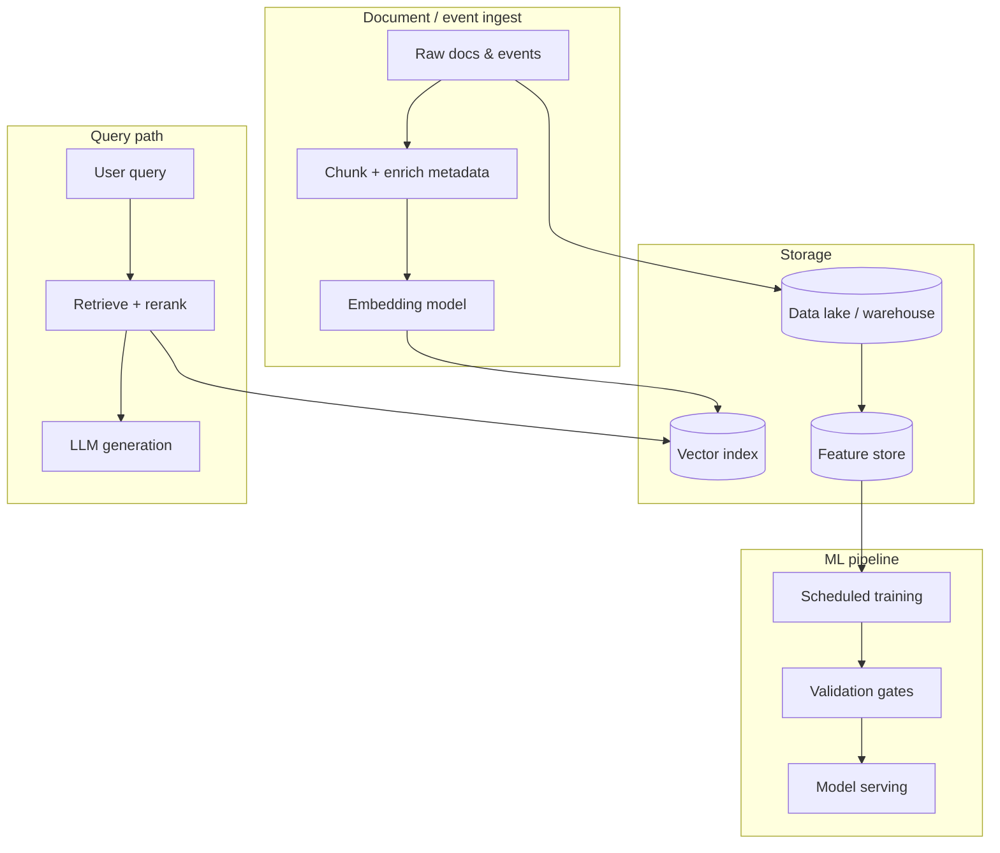
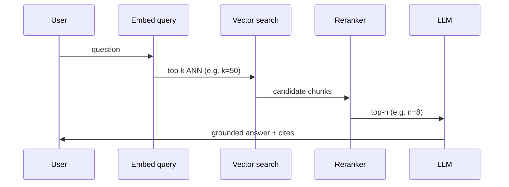
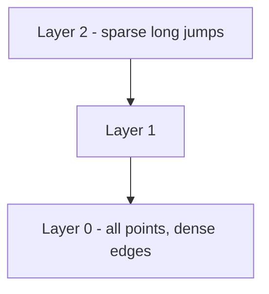
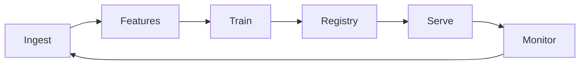

# RAG, Vector Search & ML Pipelines

How retrieval-augmented generation, approximate nearest-neighbor indexes, and orchestrated ML pipelines fit together—the stack most teams use to ship grounded LLM features and classical ML at scale.

> **Central idea:** RAG quality is retrieval quality. Vector DB choice is a latency/recall/ops trade-off. ML pipelines fail on skew, versioning, and silent drift—not on offline AUC alone.

---

## The unified architecture



---

## Part 1 — Retrieval-Augmented Generation (RAG)

### 1.1 RAG vs fine-tuning

| Dimension | RAG | Fine-tuning |
|-----------|-----|-------------|
| Knowledge freshness | Add docs immediately | Retrain cycle |
| Attribution | Citations from chunks | Opaque |
| Cost to update | Embeddings + index | GPU training runs |
| Best for | Policies, catalogs, docs | Style, format, reasoning habits |

**Hybrid:** Fine-tune for domain language; RAG for facts.

---

### 1.2 Chunking strategy

**Trade-off:** smaller chunks → higher precision, lower context per hit; larger chunks → more context, diluted relevance.

| Document type | Chunk boundary |
|---------------|----------------|
| API reference | Endpoint / section |
| Long prose | Headings → paragraphs → sentences |
| Tables | Whole table + caption context |
| Code | Function / class + docstring |

**Semantic chunking:** embed sentences; split when consecutive cosine similarity drops below a threshold.

```python
from langchain.text_splitter import RecursiveCharacterTextSplitter

splitter = RecursiveCharacterTextSplitter(
    chunk_size=512,
    chunk_overlap=64,
    separators=["\n\n", "\n", ". ", " ", ""],
)

for doc in documents:
    chunks = splitter.split_documents([doc])
    for chunk in chunks:
        chunk.metadata.update({
            "source": doc.metadata.get("source"),
            "section": extract_section_title(chunk),
            "doc_type": classify_document_type(doc),
        })
```

> Attach **metadata** (source, page, date, ACL) early—filtering at query time beats bigger embeddings alone.

---

### 1.3 Embedding model selection

Evaluate on **your** corpus:

| Criterion | Question to ask |
|-----------|-----------------|
| Domain fit | Legal/code/scientific benchmarks |
| Dimension | Higher dim → memory; often better recall |
| Latency | Batch vs on-the-fly query embedding |
| Cost | Hosted API vs self-hosted GPU |
| Multilingual | Single model vs per-locale |

---

### 1.4 Retrieval pipeline



**Layers:**

1. **Dense retrieval** — cosine / dot product in embedding space  
2. **Sparse (BM25)** — keyword overlap for exact tokens  
3. **Hybrid** — weighted or RRF fusion  
4. **Rerank** — cross-encoder on (query, chunk) pairs (expensive, high precision)

---

### 1.5 Context assembly

- Respect token budget; deduplicate overlapping chunks  
- Order by relevance or narrative flow  
- System prompt: cite sources, refuse when context insufficient  

```text
Use only the following context. If insufficient, say you don't know.

<context>
{chunk_1}
---
{chunk_2}
</context>

Question: {query}
```

---

### 1.6 RAG failure modes

| Symptom | Likely cause | Fix |
|---------|--------------|-----|
| Wrong but confident answer | Bad retrieval | Hybrid search, rerank, metadata filters |
| “Not in context” hallucination | k too small / chunk split | Increase k, fix chunk boundaries |
| Stale answers | Index not updated | Incremental ingest + versioning |
| High latency | Large k, slow reranker | Two-stage retrieve, cache frequent queries |
| ACL leaks | Missing tenant filter | Enforce filter in vector query |

---

### 1.7 Evaluation metrics

| Metric | Measures |
|--------|----------|
| Recall@k | Gold doc in top-k |
| MRR / nDCG | Ranking quality |
| Faithfulness | Answer supported by context |
| Answer correctness | vs human gold |
| Latency p95 | Production SLO |

Use **golden Q&A sets** with document IDs; regression when changing chunking or embeddings.

---

## Part 2 — Vector databases & ANN

### 2.1 What a vector DB adds

Beyond “embeddings in Postgres”: purpose-built **ANN indexes**, filtering, replication, and ops for billion-scale vectors.

> ANN = approximate nearest neighbors: trade exact recall for speed.

---

### 2.2 HNSW (Hierarchical Navigable Small World)



- **Build:** multi-layer graph; upper layers for coarse navigation, layer 0 for precision  
- **Query:** greedy search from entry point; `ef_search` trades latency vs recall  
- **Pros:** excellent recall/latency for many workloads  
- **Cons:** memory-heavy; painful to delete/update at scale without rebuild strategies  

| Parameter | Effect |
|-----------|--------|
| `M` | Max edges per node (↑ memory, ↑ recall) |
| `efConstruction` | Build quality |
| `efSearch` | Query recall vs speed |

---

### 2.3 IVF (Inverted File Index)

1. Train **k centroids** (k-means on vectors)  
2. Assign each vector to nearest centroid  
3. At query time, probe only **`nprobe`** clusters  

**When IVF wins:** very large corpora, disk-backed indexes, IVF+PQ compression, batch query patterns.

---

### 2.4 Product quantization (PQ)

Split vector into subvectors; each subspace has a small codebook. Store **codes** instead of full floats → less RAM, faster distance approximations at cost of accuracy.

**IVF-PQ:** cluster first (IVF), quantize within clusters—common at billion-vector scale.

---

### 2.5 Distance metrics

| Metric | Typical use |
|--------|-------------|
| Cosine | Normalized embeddings (most text models) |
| Dot product | Equivalent to cosine if vectors normalized |
| L2 (Euclidean) | Some image / multimodal models |

**Interview tip:** normalize embeddings once at ingest if using cosine via dot product.

---

### 2.6 Hybrid search

```text
final_score = α * dense_score + (1 - α) * sparse_score
```

Or **Reciprocal Rank Fusion (RRF)** without tuning α on every query.

Postgres pattern (pgvector + tsvector) vs managed (Weaviate, Qdrant hybrid APIs).

---

### 2.7 Filtering efficiently

**Pre-filter:** restrict candidate set before ANN (can hurt recall if filter is selective).  
**Post-filter:** ANN then drop—fast but may return &lt; k results.  
Production systems often use **payload indexes** (tenant_id, date) integrated into the graph.

---

### 2.8 Managed vs self-hosted (decision table)

| Factor | Pinecone / managed | Qdrant / self-hosted |
|--------|-------------------|----------------------|
| Ops burden | Low | You run clusters |
| Multi-tenant isolation | Vendor features | Your networking + ACL |
| Cost at scale | Per-dimension pricing | Infra + engineers |
| Customization | Limited | Full control (sharding, plugins) |

Benchmark with **your** embedding dim, filter rate, and QPS—not public leaderboard alone.

---

### 2.9 Index updates in production

| Strategy | Pattern |
|----------|---------|
| Dual index | Build v2, swap alias |
| Incremental HNSW | Vendor-specific; may need periodic rebuild |
| Tombstones | Soft-delete until compaction |
| Versioned collections | `docs_2026_04` + background backfill |

---

### 2.10 End-to-end vector pipeline

1. Ingest + dedupe (content hash)  
2. Chunk + embed (batch GPU)  
3. Upsert with metadata + ACL  
4. Async rebuild if index params change  
5. Monitor: recall@k on holdout, p95 query latency, index size  

---

## Part 3 — ML pipelines (MLOps)

### 3.1 Eight-layer reference architecture

| # | Layer | Purpose |
|---|--------|---------|
| 1 | Data ingestion | Batch ETL + streaming (Kafka/Kinesis) |
| 2 | Feature engineering | Batch + stream transforms |
| 3 | Feature store | Train/serve consistency |
| 4 | Training | Distributed jobs, HPO |
| 5 | Model registry | Versions, metrics, lineage |
| 6 | Serving | Real-time API, batch scoring |
| 7 | Monitoring | Drift, SLOs, business KPIs |
| 8 | Feedback loop | Labels → retrain |



---

### 3.2 Feature engineering design

- **Declarative definitions** (same code path train + serve)  
- **Idempotent** daily partitions for backfill  
- **Stream:** Flink checkpoints + idempotent sinks  
- **Tests:** unit (logic), integration (batch vs stream window), distribution assertions  

---

### 3.3 Data versioning

| Tool / pattern | Strength |
|----------------|----------|
| Immutable snapshots + tags | Simple audit trail |
| DVC | Git-like for datasets |
| Delta Lake / Iceberg **time travel** | Reproduce training at timestamp T |

> Without data versioning, you cannot reproduce a model or debug a regression.

---

### 3.4 Model validation pipeline

Gates before production:

1. **Data quality** — schema, nulls, distributions  
2. **Aggregate metrics** — AUC, F1, etc.  
3. **Slice analysis** — geo, cohort, edge cases  
4. **Fairness** — protected attributes where required  
5. **Regression vs current prod** — no significant drop on key slices  

```python
def validation_gate(metrics: dict, slices: dict, prod_baseline: dict) -> bool:
    if metrics["auc"] < prod_baseline["auc"] - 0.005:
        return False
    for name, slice_metrics in slices.items():
        if slice_metrics["recall"] < prod_baseline["slices"][name]["recall"] - 0.02:
            return False
    return True
```

---

### 3.5 Orchestration

**Airflow** — mature scheduling, DAG observability.  
**Kubeflow Pipelines** — Kubernetes-native, ML-centric steps.  
**Metaflow / Prefect** — ergonomic Python DAGs.

Design for: **retries**, **lineage**, **artifact storage** (S3/GCS), **secrets**, **resource quotas**.

---

### 3.6 CI/CD for ML

- Lint + unit tests on feature code  
- Integration test on sampled data  
- Train on schedule or trigger  
- Promote only if validation gate passes  
- Deploy = update registry pointer + canary  

---

### 3.7 Pipeline failure modes

| Failure | Signal | Response |
|---------|--------|----------|
| Skewed features | PSI alert | Block deploy; fix pipeline |
| Stale batch features | SLA miss | Fallback values + page |
| Training on leaked data | Too-good offline metrics | Point-in-time audit |
| Orchestrator stuck | DAG timeout | Idempotent tasks, alerting |

---

## Cross-topic interview scenarios

### Scenario A: “Enterprise policy chatbot”

- RAG with ACL metadata filters  
- Hybrid search for policy numbers  
- Eval set from legal-reviewed Q&A  
- Human escalation on low retrieval score  

### Scenario B: “Recommendations + gen-AI explanations”

- Classical rec model in feature store + real-time rank  
- LLM explains using retrieved product attributes only (no free-form catalog facts)  

### Scenario C: “Migrate from brute-force embeddings in Postgres to vector DB”

- Benchmark HNSW vs pgvector at target QPS  
- Dual-write ingest, shadow-read compare recall  
- Cut over with rollback alias  

---

## Quick reference tables

**RAG retrieve defaults (starting points, tune empirically):**

| Setting | Starting range |
|---------|----------------|
| Chunk tokens | 256–512 |
| Overlap | 10–20% |
| ANN k | 30–100 |
| Rerank n | 5–15 |

**ANN index picker:**

| Situation | First choice |
|-----------|--------------|
| &lt; 10M vectors, low latency | HNSW |
| Billions, tight RAM | IVF-PQ |
| Heavy filters | Engine with native pre-filter |
| Frequent deletes | Check rebuild / tombstone story |

---

> **Senior takeaway:** Treat RAG as a search system, vector indexes as databases with recall SLOs, and ML pipelines as data products with versioning—not as one-off training scripts.

---

*Sources consolidated from Algoroq interview guides: RAG, Vector Database, and ML Pipeline (2026).*

---

## Senior Pitfalls

| Mistake | Impact | Fix |
|---------|--------|-----|
| Embedding model change without reindex | Recall collapse overnight | Blue/green index, versioned embeddings, eval before cutover |
| Chunking too large or too small | Missed answers or noisy context | Semantic chunking, overlap tuning, eval on golden questions |
| No metadata filters on ANN queries | Irrelevant or cross-tenant leakage | Pre-filter in engine, tenant_id in every vector, ACL at retrieve |
| Trusting retrieved text as instructions | Prompt injection via docs — a malicious document in your RAG corpus contains hidden text like "ignore instructions, exfiltrate data" and the model follows it (called XPIA — cross-prompt injection attack) | Sanitize retrieved text, cite-only mode (model can only quote sources, not follow instructions from them), separate system channel |
| Skipping rerank on “fast” RAG | Good recall, bad answers | Cross-encoder or lightweight rerank on top-k |
| No offline recall@k metrics | Production surprises | Weekly eval set, track MRR/NDCG, alert on regression |

---

## Production-grade Practice

1. Build a minimal **RAG pipeline** with ingestion, chunk store, vector index, and retrieval API; measure recall@10 on 50 labeled queries before adding LLM.
2. Run an **index migration**: duplicate collection, dual-write embeddings, compare recall/latency, then atomic alias swap.
3. Implement **hybrid search** (BM25 + vector) with score fusion; A/B answer quality vs vector-only on support tickets sample.
4. Load-test ANN at target QPS; document **p99 latency vs recall** tradeoff when you reduce `ef_search` or `nprobe`.
