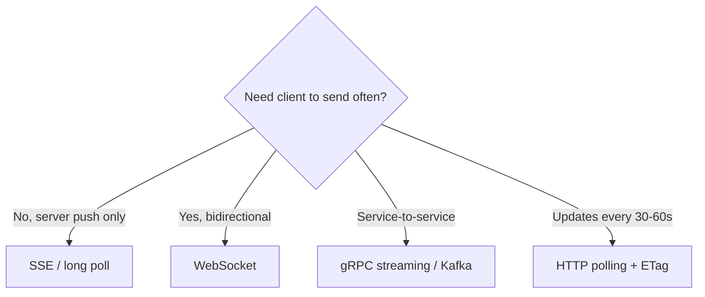
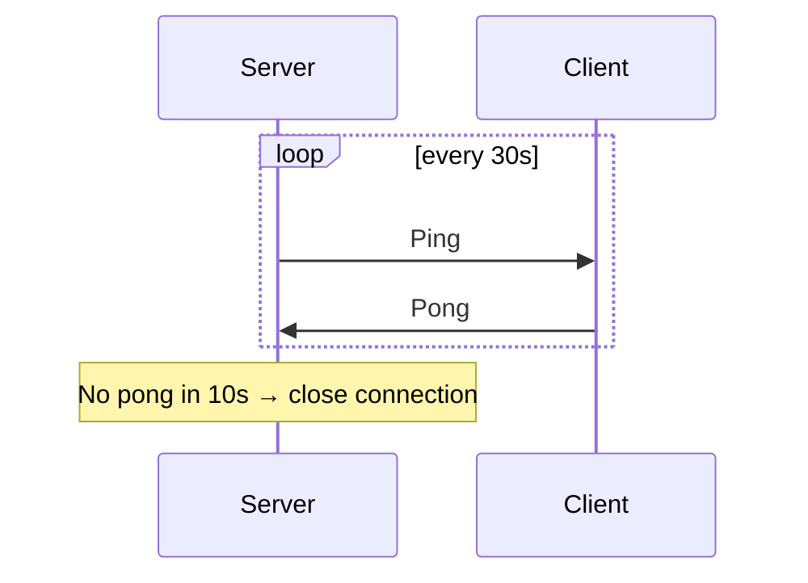
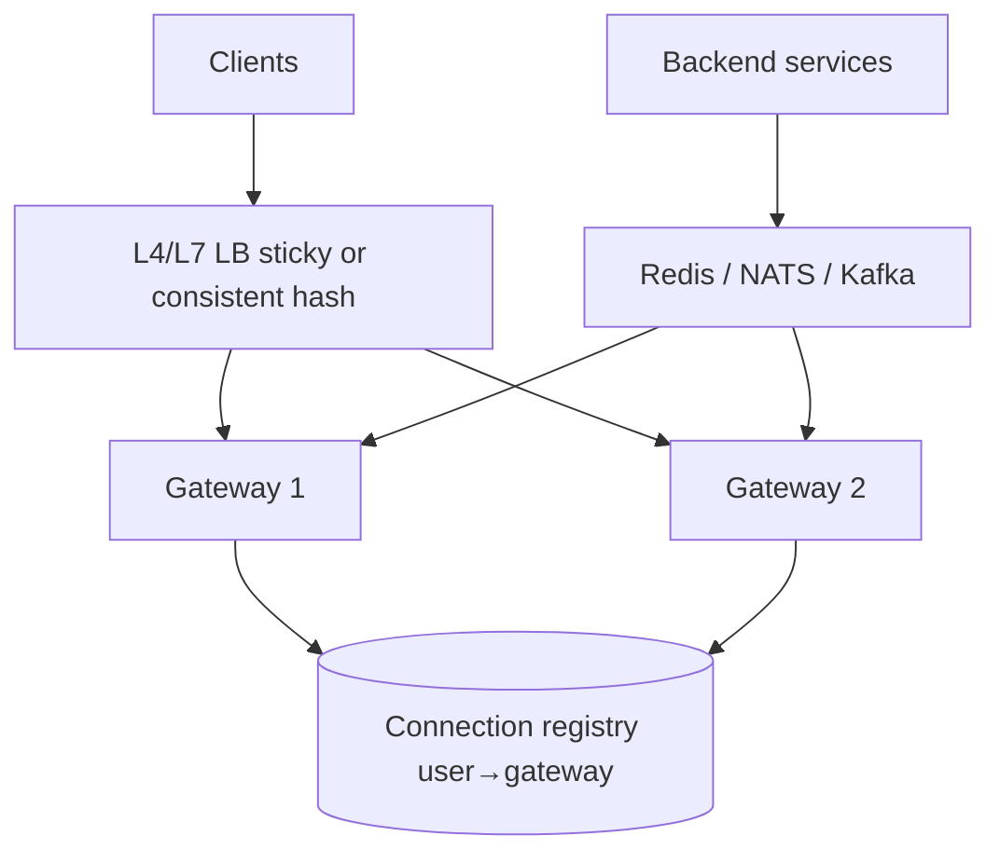
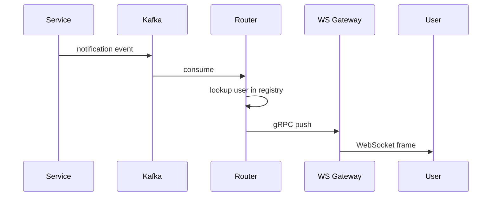

# Real-Time Systems and WebSockets: Senior Engineer Study Guide

Learn how **persistent connections**, **event-driven pipelines**, and **latency budgets** fit together—from WebSocket handshakes to million-connection architectures and sub-200ms notification paths.

---

## What “real-time” means in interviews

**Real-time** does not mean “fast sometimes.” It means **bounded latency** with explicit guarantees (often P95/P99), plus a plan for overload, partitions, and flaky networks.

| Term | Meaning |
|------|---------|
| **Soft real-time** | Miss deadline → degraded UX (most web apps) |
| **Hard real-time** | Miss deadline → failure (embedded, trading—rare in typical backend interviews) |
| **Effective latency** | End-to-end: client action → visible update |

> If your budget is 200ms, assume **100ms network jitter** on mobile and design for it.

---

## Choosing a transport



| Approach | Direction | Pros | Cons |
|----------|-----------|------|------|
| **Short polling** | Client pulls | Simple, cacheable | Wasteful; latency = interval |
| **Long polling** | Server holds request | Near real-time over HTTP | Connection churn |
| **SSE** | Server → client | Auto-reconnect, `Last-Event-ID`, HTTP infra | Text only; one-way |
| **WebSocket** | Both ways | Low overhead; binary | Stateful; LB complexity |
| **GraphQL subscriptions** | Both (usually WS) | Unified API | Same scaling as WS |

**Senior judgment:** Prefer **SSE + HTTP POST** when you only need server push. Use **WebSocket** when the product needs chat, collaboration, or high-frequency bidirectional traffic.

---

## Part 1: WebSocket protocol

### Handshake (HTTP upgrade)

```http
GET /chat HTTP/1.1
Host: api.example.com
Upgrade: websocket
Connection: Upgrade
Sec-WebSocket-Key: dGhlIHNhbXBsZSBub25jZQ==
Sec-WebSocket-Version: 13
```

```http
HTTP/1.1 101 Switching Protocols
Upgrade: websocket
Connection: Upgrade
Sec-WebSocket-Accept: s3pPLMBiTxaQ9kYGzzhZRbK+xOo=
```

The server proves knowledge of the client nonce (SHA-1 of key + magic GUID)—mitigates cross-protocol confusion.

**Why upgrade HTTP?** Firewalls and proxies already allow HTTP; raw TCP protocols are often blocked.

### Frames (after handshake)

| Opcode | Purpose |
|--------|---------|
| Text / Binary | Application data |
| Ping / Pong | Heartbeat |
| Close | Graceful shutdown |

- **Client → server frames must be masked** (cache poisoning defense on proxies).
- Use **`wss://`** in production; intermediaries may break cleartext WS.

### RFC 8441 (WebSocket over HTTP/2)

Optional path on HTTP/2; changes deployment and proxy behavior—know it exists for “WebSocket + HTTP/2” follow-ups.

---

## Part 2: Connection lifecycle

### Heartbeats (don’t rely on TCP keepalive alone)

TCP keepalive defaults (~hours) miss **app-level dead peers** (NAT, mobile network switch).



Tune for mobile: longer intervals on cellular; pause when app backgrounded (use push notifications).

### Reconnection with exponential backoff + jitter

```javascript
function backoff(attempt) {
  const base = Math.min(30_000, 1000 * 2 ** attempt);
  const jitter = base * (0.75 + Math.random() * 0.5);
  return jitter;
}
```

**Jitter** prevents thundering herd when a gateway restarts and 100k clients reconnect at once.

### State machine (client)

`DISCONNECTED → CONNECTING → AUTHENTICATING → SYNCHRONIZING → CONNECTED`

On sync, send **last sequence / cursor**; server replays from Redis sorted set or Kafka buffer.

---

## Part 3: Authentication and authorization

Browsers **cannot** set arbitrary headers on WebSocket after connect—plan upfront.

| Pattern | How | Trade-off |
|---------|-----|-----------|
| **Cookie on handshake** | `HttpOnly` session cookie | Best for same-site; CSRF considerations on cookies |
| **Query token** | Short-lived ticket in URL | Log exposure—use 30s tickets only |
| **First message auth** | Connect then send JWT | Extra RTT; state machine for unauthenticated sockets |
| **Post-connect refresh** | `TOKEN_REFRESH_REQUIRED` over WS | Avoid disconnect on JWT expiry |

**Per-message authorization:** joining a room ≠ permission to post; re-check roles when permissions change (pub/sub permission events to gateways).

---

## Part 4: Scaling WebSockets

### Single-server limits

Rough order of magnitude: **100k–300k** connections per well-tuned node (event loop + kernel tuning: `somaxconn`, file descriptors). Memory ~**few KB per connection** for minimal state.

### Horizontal architecture



1. **Registry:** `user_id → gateway_id` (Redis)
2. **Direct message:** lookup → RPC to gateway → push on socket
3. **Fan-out:** publish to channel; each gateway delivers to local subscribers

**Tiered fan-out (large scale):** edge gateways → fan-out tier → producers (Discord/Slack-style separation).

### Load balancing pitfalls

| Problem | Mitigation |
|---------|------------|
| New server gets all new connections | Per-server caps; weighted LB by connection count |
| Sticky sessions required | Consistent hash on `user_id` |
| HTTP health check ≠ WS health | WS probe: connect, ping, expect pong |
| Draining for deploy | Stop new connects; `close` with custom code; max drain timeout |

**L4 vs L7:** L4 cheaper per frame after handshake; L7 needed for content-based routing.

---

## Part 5: Reliability semantics

### Ordering

- **Per connection:** TCP orders bytes; WS orders messages on one socket.
- **Distributed chat:** assign **monotonic sequence per channel** (single sequencer or partition by channel hash).
- **Causal order:** vector clocks / Lamport timestamps; buffer gaps and fetch missing ranges.

### Delivery guarantees

Exactly-once end-to-end is **not** achievable in the general async case. Production pattern:

1. **At-least-once** send with unique `message_id`
2. Client **dedupes** recent IDs
3. Server **ACK** optional for critical messages

### Backpressure

Monitor `bufferedAmount` (browser) or outbound queue depth (server).

Progressive response:

1. Aggregate updates (e.g. 10 price ticks → 1 summary)
2. Drop low-priority events (typing indicators)
3. Disconnect slow consumer with explicit close code

Decouple with **message queue** between gateway and heavy backends so slow processing does not block sockets.

---

## Part 6: WebSocket vs SSE (deep comparison)

| Dimension | SSE | WebSocket |
|-----------|-----|-----------|
| Protocol | HTTP `text/event-stream` | WS framing |
| Reconnect | Built-in + `Last-Event-ID` | App must implement |
| Binary | No | Yes |
| HTTP/2 multiplexing | Multiple SSE streams share connection | Separate upgrade |
| Proxies / CDN | Easier | Needs WS-aware LB |
| Client send | Separate HTTP calls | Same socket |

```javascript
// SSE client (browser)
const es = new EventSource('/events?stream=true');
es.addEventListener('order.updated', (e) => {
  const data = JSON.parse(e.data);
});
```

---

## Part 7: Real-time system patterns (beyond sockets)

### Notification pipeline (&lt;200ms in-app)



- Durable log (**Kafka**) + hot path to gateways
- Offline users: push notification or pull inbox on reconnect
- Monitor **P99 delivery latency** with tracing

### Collaborative editing

- **OT (Operational Transformation):** central sequencer; good for client/server; bottleneck at extreme scale
- **CRDTs:** merge without central ordering; higher metadata cost; better for offline/partition tolerance
- **Presence:** throttle cursor updates (10–20/s); only broadcast to nearby viewport at 10k editors

### Fraud / RTB / market data (latency budgets)

Break end-to-end SLA into **fixed per-component budgets** (ingest, feature store, model, serialize). Use:

- In-memory profiles (**Redis**)
- Kernel bypass only when microseconds matter (finance)
- **Conflation** for slow consumers (latest price wins)

### Stream processing at scale

| Guarantee | How to approximate |
|-----------|-------------------|
| At-least-once | Retry + idempotent writes |
| Effectively exactly-once | Kafka transactions + idempotent consumers + outbox pattern |
| Ordering | Partition by key; single consumer per partition |

**Watermarks** for windowed aggregations; **backpressure** in Flink when sinks lag.

### CDC (keeping search/cache in sync)

Debezium → Kafka (key = primary key for order) → independent consumer groups for Elasticsearch, Redis, warehouse. Track **replication lag** per sink.

---

## Part 8: Security (real-time specific)

| Threat | Mitigation |
|--------|------------|
| **CSWSH** (cross-site WS hijack) | Validate `Origin`; don’t trust cookies alone on cross-site |
| Connection exhaustion | Per-IP limits; auth before heavy allocation |
| Message injection | JSON schema validation; same rules as HTTP APIs |
| Tunnel exfiltration | DPI/anomaly detection on egress |

Use **WSS**, per-message authz, audit logs for admin actions on connections.

---

## Part 9: Observability

**Connection metrics:** active count, connect/disconnect rate, close code histogram, handshake latency.

**Message metrics:** throughput, p99 processing time, drop rate, buffer depth.

**System:** FD usage, GC pauses (cause phantom disconnects), bandwidth.

Build a **connection inspector**: for `user_id`, show gateway, subscriptions, last pong, client version.

---

## Part 10: Design exercise — 10M concurrent connections

Order-of-magnitude plan:

- ~**100k** connections per gateway → ~**100+** gateways (+ headroom)
- **L4** LB + consistent hash
- **45s** heartbeat, **15s** pong timeout
- Fan-out via pub/sub; **50** gateway copies for a 10k-subscriber channel vs 10k unicast

Chaos tests: kill gateway, partition region, saturate pub/sub.

---

## Interview frameworks

### When asked “design real-time X”

1. Clarify latency SLA, fan-out, ordering, offline behavior
2. Pick transport (table above)
3. Draw gateway + registry + pub/sub
4. Auth, backpressure, reconnect
5. Metrics and failure modes

### Common mistakes

1. Treating WebSocket like stateless HTTP
2. No heartbeat or reconnect story
3. Global ordering everywhere (expensive)
4. WebSocket for a one-way feed
5. Ignoring mobile background and NAT

---

## Code examples

### Minimal Node.js WebSocket server with ping

```javascript
import { WebSocketServer } from 'ws';

const wss = new WebSocketServer({ port: 8080 });

wss.on('connection', (ws) => {
  ws.isAlive = true;
  ws.on('pong', () => { ws.isAlive = true; });

  ws.on('message', (raw) => {
    const msg = JSON.parse(raw);
    if (msg.type === 'auth') {
      // validate JWT, attach ws.userId
      return;
    }
    // authorize msg.type per user
  });
});

setInterval(() => {
  wss.clients.forEach((ws) => {
    if (!ws.isAlive) return ws.terminate();
    ws.isAlive = false;
    ws.ping();
  });
}, 30_000);
```

### SSE handler (conceptual)

```http
HTTP/1.1 200 OK
Content-Type: text/event-stream
Cache-Control: no-cache
Connection: keep-alive

id: 42
event: price
data: {"symbol":"AAPL","price":189.5}

```

---

*Synthesized from senior-level interview frameworks on WebSocket engineering and real-time distributed systems.*

---

## Senior Pitfalls

| Mistake | Impact | Fix |
|---------|--------|-----|
| No heartbeat/ping timeouts | Zombie connections exhaust file descriptors | Server + client pings, idle disconnect, max connection age |
| Broadcasting without backpressure | Slow clients block entire server | Per-connection queues, drop/coalesce policy, isolate hot channels |
| Sticky sessions without pub/sub bridge | Users miss events after reconnect to another node | Redis/Kafka fan-out, channel subscriptions synced on connect |
| Sending full state on every update | Bandwidth and battery drain | Delta updates, sequence numbers, snapshot + catch-up |
| WebSocket auth only at handshake | Stolen connection reuse | Short-lived tokens, re-auth on sensitive actions, close on expiry |
| SSE/WebSocket through misconfigured proxies | Silent buffering and timeouts | Proxy timeouts, disable buffering headers, load balancer TCP settings |

---

## Production-grade Practice

1. Build a **chat or ticker** with WebSockets behind a load balancer; prove reconnect with exponential backoff and last-event-id catch-up.
2. Load-test **100k concurrent** connections on one region (or simulated); measure memory per connection and CPU on broadcast storm.
3. Implement **Redis pub/sub** (or similar) for horizontal scale; chaos-kill one node and verify clients on other nodes still receive events.
4. Compare **SSE vs WebSocket** for one use case: document latency, infra cost, mobile background behavior, and operability.
