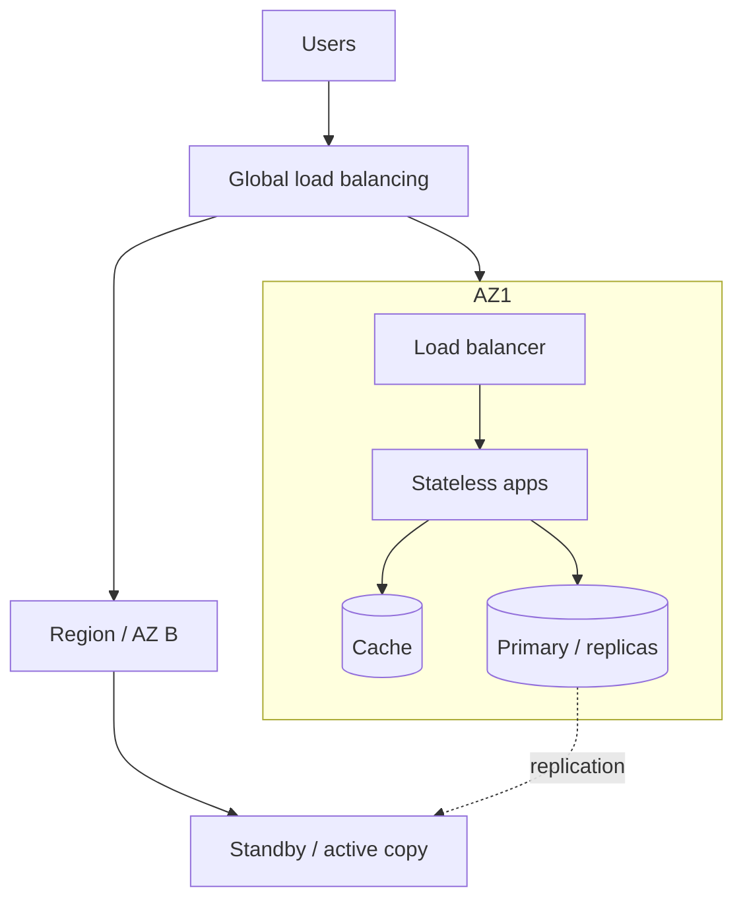
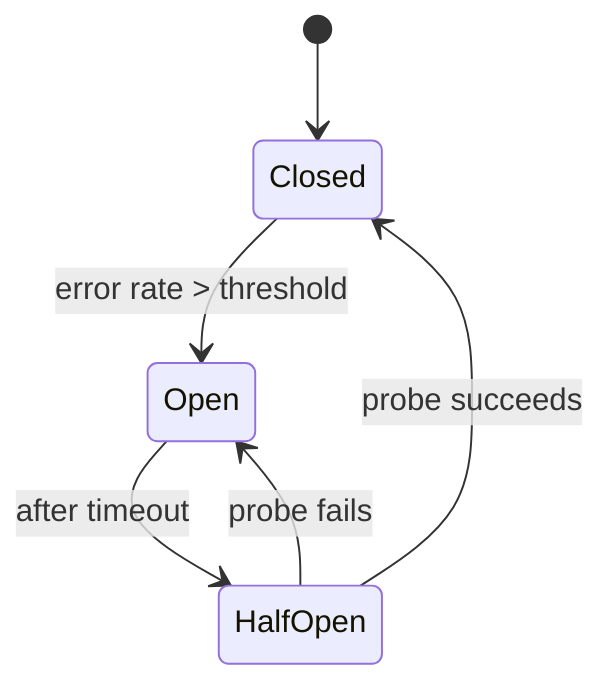
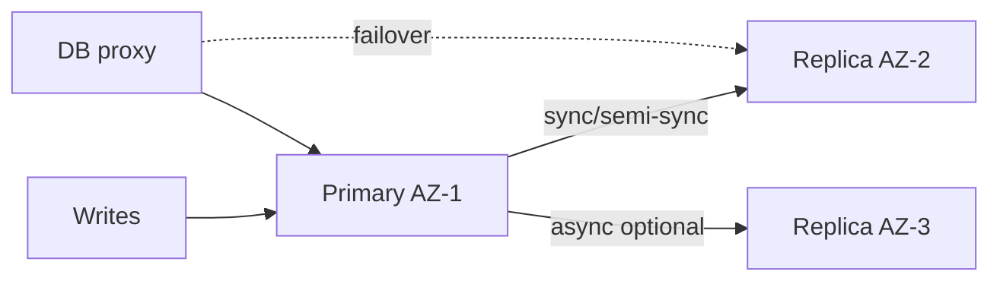
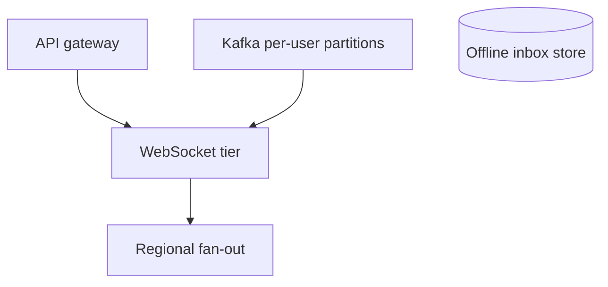
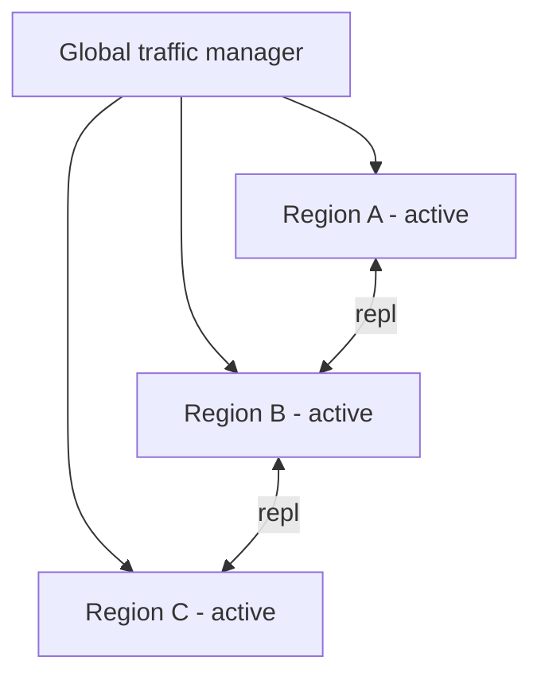
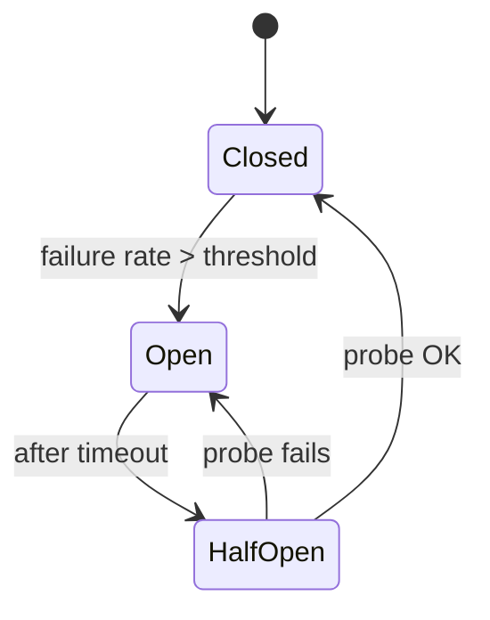
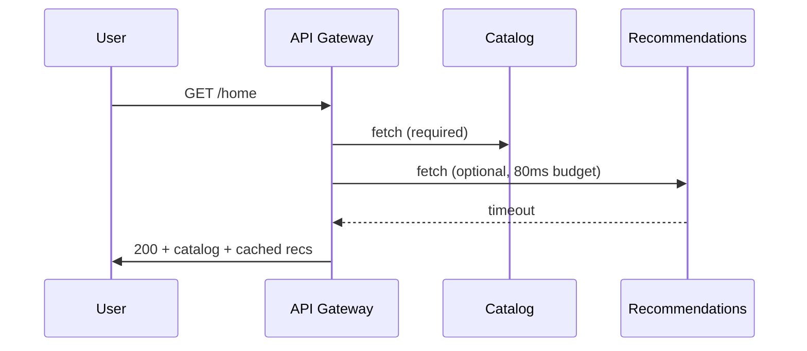
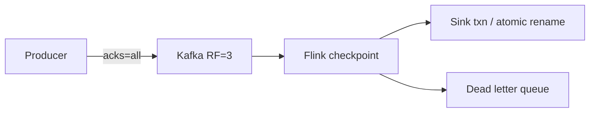
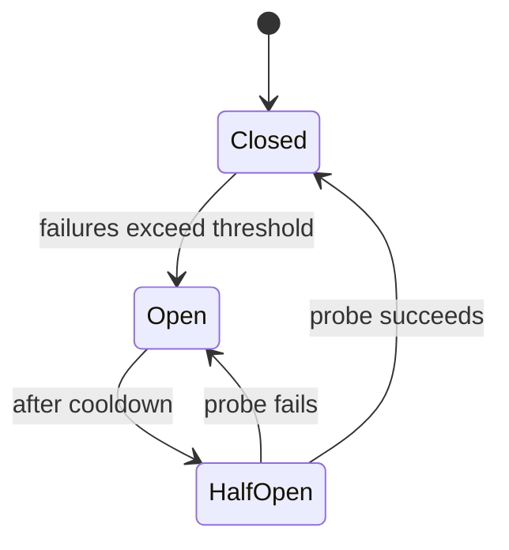
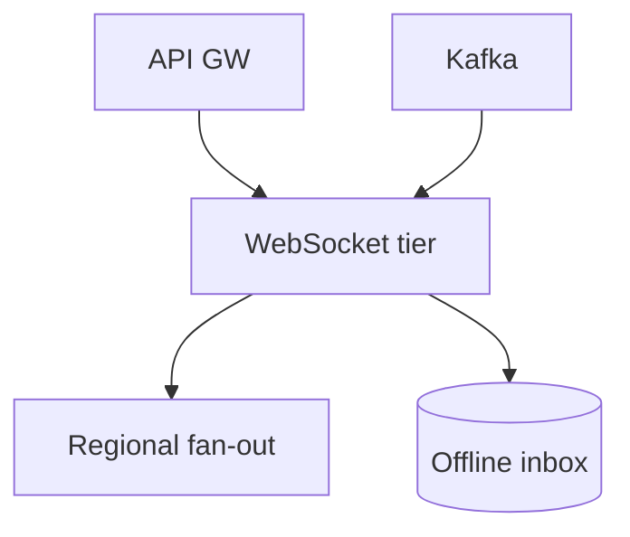

# Reliability & Scalability — Senior Interview Study Guide

> **Scope:** Fault tolerance, high availability (HA), disaster recovery (DR), and scalability patterns for production distributed systems. Synthesized from Algoroq (2026) interview banks.

---

## One picture: reliability vs scale



| Concern | Question it answers |
|---------|---------------------|
| **Fault tolerance** | What happens when a component fails? |
| **High availability** | How much downtime per year is acceptable? |
| **Disaster recovery** | What if a region or DC is lost? |
| **Scalability** | How do we grow 10× without rewriting? |

---

## Availability math

### The nines

| Availability | Downtime / year | Downtime / month |
|--------------|-----------------|------------------|
| 99.9% (3 nines) | ~8.76 h | ~43.8 min |
| 99.99% (4 nines) | ~52.6 min | ~4.38 min |
| 99.999% (5 nines) | ~5.26 min | ~26 s |

### Serial vs parallel

**Series** (all must work): `A_total = A1 × A2 × …` — microservice chains hurt.

**Parallel** (redundant): `A = 1 - (1-A1)(1-A2)` — two 99% nodes → 99.99%.

```python
def series(*availabilities: float) -> float:
    p = 1.0
    for a in availabilities:
        p *= a
    return p

def parallel(*availabilities: float) -> float:
    p_fail = 1.0
    for a in availabilities:
        p_fail *= (1 - a)
    return 1 - p_fail

# Example: 10 serial services at 99.99% each
print(series(*[0.9999] * 10))  # ~0.999 — lost a nine
```

> **Interview tip:** Tie nines to **cost** and **architecture** (4 nines needs automation, redundancy, tested failover).

---

## Fault tolerance

### Failure domains and blast radius

Isolate by: AZ, region, cell, shard, bulkhead (separate pools for critical vs batch).

### Circuit breaker



Pair with **fallbacks** (cache, defaults, queue for later). Prefer mesh-level breakers (Istio/Linkerd) at scale.

### Graceful degradation

| Tier | Example features |
|------|------------------|
| 0 — Core | Login, checkout, read catalog |
| 1 — Important | Recommendations, reviews |
| 2 — Nice | Social proof, analytics beacons |

Use **feature flags**, **timeout budgets**, **priority shedding** (drop tier 2 first).

### Health checks (avoid false positives)

| Layer | Checks |
|-------|--------|
| Liveness | Process up, port open |
| Readiness | DB/cache reachable, synthetic transaction |
| Deep / business | Output quality, SLO metrics |

**Graduated response:** suspect → reduce weight → remove from LB → page ops.

**Gray failures:** node passes ping but slow — use latency-aware load balancing.

### Byzantine vs crash-stop

Most clouds assume **crash-stop** (node dies). **BFT** (3f+1 nodes) for blockchains / adversarial settings. Production often uses **checksums + audit** instead of full PBFT.

### Exactly-once processing (effectively)

At-least-once delivery + **idempotency key** in same DB transaction as business write.

```sql
-- Idempotency + business update atomically
BEGIN;
INSERT INTO idempotency_keys (key, response_hash)
  VALUES ($1, $2)
  ON CONFLICT DO NOTHING;
-- if 0 rows inserted, return cached response
UPDATE accounts SET balance = balance - $3 WHERE id = $4;
COMMIT;
```

### Data corruption

**Prevent:** checksums, ECC RAM, TLS.

**Detect:** invariant checks, replica comparison, background audits.

**Recover:** PITR, delayed replica (hours behind), immutable backups, **crypto-shredding** for GDPR in backups.

---

## High availability

### Multi-AZ database



- **Sync replication** — RPO ≈ 0, higher write latency.
- **Consensus failover** — avoid split-brain (quorum of observers).
- **Stale primary** — fencing or `STONITH` when old primary returns.

### Active-active vs active-passive

| | Active-passive | Active-active |
|---|----------------|---------------|
| Utilization | Standby idle | All nodes serve |
| Failover | Detection + promotion | Absorb load |
| Writes | Single leader typical | Partition or conflict resolution |
| Best for | Strong consistency writers | Stateless tiers, read scale-out |

**Hybrid:** active-active apps + single write leader for DB.

### Load under stress

Avoid **retry storms** — exponential backoff + jitter, limit max retries.

**Bulkheads** — separate thread pools per dependency.

**Deadline propagation** — drop work that cannot meet client timeout.

### CAP during partition

During AZ/region partition: choose **CP** (refuse writes) vs **AP** (accept + reconcile) per domain. Payments → CP; social feed → AP.

---

## Disaster recovery

### RTO and RPO

| Term | Meaning |
|------|---------|
| **RPO** | Max acceptable **data loss** (time of data) |
| **RTO** | Max acceptable **downtime** to restore service |

| Tier | Example RTO | Example RPO | Pattern |
|------|-------------|-------------|---------|
| 1 — Critical | < 1 min | 0 | Active-active, sync repl |
| 2 — Important | 5–15 min | minutes | Async repl, warm standby |
| 3 — Internal | hours | hours | Backups, cold standby |

### Global e-commerce DR sketch

- **3+ regions**, global traffic manager (health-based DNS/anycast).
- **Payments** — sync or consensus (Spanner/Cockroach) where RPO=0 required.
- **Catalog** — async replication, eventual reads OK.
- **CDN** for static assets.
- **Quarterly game days** — region failure simulation.

### Replication sync vs async

| | Sync | Async |
|---|------|-------|
| RPO | ~0 | >0 |
| Latency | Cross-DC RTT on writes | Lower |
| Use | Money, inventory authority | Analytics, notifications |

### Backup at petabyte scale

- **Tier data:** hot (sync replica) → warm (async) → cold (object storage).
- **Parallel restore** per shard.
- **Incremental + WAL** replay for PITR.
- **Test restores monthly** — measure against RTO.

### Chaos engineering program

| Phase | Activity |
|-------|----------|
| 1 | Tabletop exercises, document gaps |
| 2 | Staging faults (kill pod, latency) |
| 3 | Prod with guardrails (single instance, business hours) |
| 4 | Multi-node, partition, region drills |

Hypothesis: *"Killing one pod keeps error rate < 5%."* Abort if SLO breached.

### OLTP + OLAP failover

Never let OLAP failover **overload OLTP primary**. CDC to warehouse; OLAP queues and retries.

---

## Scalability

### Horizontal vs vertical

| | Vertical | Horizontal |
|---|----------|----------|
| Pros | Simple, no distributed queries | Linear cost, redundancy |
| Cons | Ceiling, SPOF | Sharding, ops complexity |
| DB 10B rows | Big iron + tuning | Shard by access pattern |

**Hybrid:** right-size nodes (32–64 cores) + add nodes.

### Caching at scale

| Pattern | Consistency |
|---------|-------------|
| Cache-aside | Eventual |
| Write-through | Stronger |
| Write-behind | Fast writes; loss risk |
| Tiered | Catalog CDN vs exact inventory |

**Stampede:** single-flight, early expiration, pre-warm.

### Write path when DB saturates

1. Fix locks, indexes, pool sizing (often the real issue).
2. Vertical scale primary.
3. Batch/async non-critical writes.
4. **Functional partition** (split DB by domain).
5. **Shard** write-heavy tables.
6. Move append-only workloads to **Cassandra / ClickHouse / Kafka**.

### Auto-scaling microservices

- Scale on **right metric** per service (CPU vs queue depth vs custom).
- **Predictive scaling** for known events (Black Friday).
- Cooldown + min instances to avoid flapping.
- Dependency-aware: scale consumer when **lag** grows, not only CPU.

### Real-time notifications (1M → 100M users)



- **50k–100k** connections per server (tuned).
- **Hierarchical fan-out** for broadcast (news alert).
- **Kafka** for offline queue; geohash routing for location apps (Uber-style).

### Database sharding recap

| Strategy | Hot spot risk |
|----------|---------------|
| Hash | Low if key well chosen |
| Range | High at range end |
| Directory | Flexible, metadata service |

**Resharding:** consistent hashing, dual-write migration, or expand shard map.

---

## Cross-topic comparison table

| Pattern | Fault tolerance | HA | DR | Scale |
|---------|-----------------|----|----|-------|
| Circuit breaker | ✓ | ✓ | — | — |
| Multi-AZ replicas | ✓ | ✓ | partial | read scale |
| Multi-region active-active | ✓ | ✓ | ✓ | ✓ |
| Idempotent consumers | ✓ | — | — | — |
| CDN + edge cache | — | ✓ | ✓ | ✓ |
| Sharding | — | — | — | ✓ |
| Chaos engineering | ✓ | ✓ | ✓ | — |

---

## Interview Q&A (selected)

### Fault tolerance

**Q: Design for full data center loss.**  
Active-active or hot standby in another region; sync vs async per RPO; global traffic shift; tested runbooks; CAP choice during partition.

**Q: Circuit breaker pitfalls.**  
Distinguish network vs service failure; flapping — adjust thresholds/half-open probes; critical deps need different policy.

**Q: Graceful degradation without ugly UX.**  
Feature flags, cached fallbacks, hide widgets not errors; Netflix CDN precomputed lists example.

### High availability

**Q: Compound availability of 10 microservices?**  
Multiply serial availabilities — motivates high per-hop nines or parallelization.

**Q: Split-brain after failover?**  
Quorum, fencing, STONITH, don't let old primary accept writes.

**Q: Health check false positives?**  
Multi-source checks, consecutive failure threshold, latency scoring.

### Disaster recovery

**Q: Set RTO/RPO for tiers.**  
Business impact analysis; document cost trade-offs; per-domain (billing vs history).

**Q: Petabyte restore in RTO.**  
Progressive recovery (hot first), parallel shards, pre-provisioned compute in DR region.

**Q: Chaos ROI?**  
Fewer incidents, faster MTTR, experiment log of fixes.

### Scalability

**Q: Scale notifications to 100M.**  
Connection math, fan-out tree, Kafka persistence, regional routing, thundering herd on reconnect.

**Q: Shard key for social posts.**  
`user_id` or `post_id` based on query pattern; avoid celebrity hot shard — salting or dedicated shard.

**Q: Auto-scaling pitfalls.**  
Lag-based scaling, cold start, cascading scale-out, cost caps.

---

## Common mistakes

1. **No tested failover** — DR docs untested = no DR.
2. **Retry storms** without backoff during outages.
3. **Sync chains** of 8+ services for user-facing latency.
4. **Caching inventory** like catalog — correctness bug.
5. **Sharding too early** — optimize queries first.

---

## Additional fault tolerance topics

### Bulkhead pattern

Separate thread pools / connection pools per dependency so one slow service cannot exhaust all workers.

### Timeout and retry policy

| Setting | Guidance |
|---------|----------|
| Client timeout | Slightly less than server deadline |
| Retries | Only on idempotent ops |
| Jitter | Prevent synchronized retry spikes |
| Max attempts | Cap total latency |

### Split-brain in DR

Require quorum to declare primary; fencing token on storage; avoid two writable primaries.

### Immutable infrastructure

Replace servers instead of repair; golden AMIs; config in git.

---

## Additional HA topics

### DNS failover vs anycast

DNS TTL caching delays failover; anycast IP faster but harder to debug. Layer 7 health checks at GSLB.

### Connection pool behavior on failover

Pools hold stale connections — validate on borrow, shorten idle timeout, drain pool on primary change event.

### SLO / SLI / error budgets

Define SLIs (availability, latency p99). Error budget policy: when exhausted, freeze features, focus reliability.

---

## Additional DR topics

### Runbook essentials

Detection, declaration, failover steps, verification, comms, rollback criteria, post-incident review.

### Multi-cloud DR

Avoid single vendor lock-in for catastrophic cloud failure; replicate backups cross-cloud; higher cost.

### Regulatory retention vs erasure

Legal hold overrides delete; document conflict resolution for GDPR requests.

---

## Additional scalability topics

### Consistent hashing

Virtual nodes smooth distribution; minimal key movement on node add/remove.

### Read replicas and staleness

Route analytics to replicas; user-facing "my data" to primary or session stickiness.

### Cost-aware scaling

Spot/preemptible for batch; reserved for baseline; autoscale max caps per environment.

### API rate limiting at scale

Token bucket at edge; global Redis; per-API-key and per-IP dimensions.

---

## Study plan

| Week | Lab |
|------|-----|
| 1 | Calculate nines for a 6-service chain; design multi-AZ DB failover |
| 2 | Implement circuit breaker + fallback; load test |
| 3 | Tabletop region loss; write RTO/RPO table for fake product |
| 4 | Shard a dataset on paper; design cache + invalidation for e-commerce |

> Senior candidates narrate **trade-offs** (cost, latency, consistency) with numbers — not only pattern names.

---

## Full Interview Q&A — Fault Tolerance

### Q1. How would you design a system that remains available during a complete data center failure?

**What they're really asking:** Assess multi-datacenter architecture, replication trade-offs, and availability vs consistency during regional failures.

**Answer:**
Design so **no single physical site** is required for core user journeys. Typical pattern:



**Active-active:** all regions serve traffic; route users to nearest healthy region (DNS health checks, anycast, or GSLB). Each region runs full app tier + data replicas.

**Replication (the hard part):**

| Mode | RPO | Write latency | When to use |
|------|-----|---------------|-------------|
| Sync cross-DC | ~0 | +50–150 ms RTT | Payments, inventory authority |
| Async cross-DC | >0 (lag window) | Low | Preferences, analytics |
| Session state | Best-effort async | Low | Accept re-auth after failover |

During a full DC loss, remaining regions look like a **network partition** — CAP applies: most user-facing systems choose **availability** + conflict resolution; financial domains often choose **consistency** (reject writes that cannot be durably replicated).

**Detection:** independent health paths from multiple vantage points; **consensus** among monitors before declaring DC dead (false positive failover is often worse than brief delay). **Drills:** quarterly region evacuation; treat drill gaps as P0 bugs.

**Recovery:** runbook for divergent data when failed DC returns — either block old DC (fencing) or merge with version vectors / business merge rules.

**Follow-ups:**
- How do you handle split-brain when both DCs believe the other failed?
- Recovery when failed DC returns with divergent data?
- How do you test DC failover without losing a DC?

### Q2. Explain the circuit breaker pattern and how you would implement it in a microservices architecture.

**What they're really asking:** Test cascading-failure prevention and practical resilience in distributed systems.

**Answer:**
A **circuit breaker** stops calling a failing dependency so threads, connections, and latency budget are not exhausted upstream.



**States:** *Closed* — traffic flows, failures counted in a sliding window (e.g. 50% errors over last 20 calls). *Open* — fail fast (no downstream call) for 30–60s. *Half-open* — one or few probe requests; success closes, failure re-opens.

**Always pair with a fallback:** cache, default payload, omit non-critical fields, or async queue.

**Per-dependency tuning:** auth/payment — higher trip threshold (fallback is costly); recommendations — trip faster.

**At fleet scale:** implement in **service mesh** (Istio/Linkerd) for consistent policy and metrics.

```python
# Illustrative sliding-window breaker (application layer)
class Breaker:
    def __init__(self, window=20, fail_ratio=0.5, open_seconds=45):
        self.window, self.fail_ratio, self.open_seconds = window, fail_ratio, open_seconds
        self.outcomes = []
        self.state = "closed"
        self.open_until = 0

    def allow(self, now):
        if self.state == "open" and now < self.open_until:
            return False
        if self.state == "open":
            self.state = "half_open"
        return True
```

**Ops:** alert on open transitions; fleet-wide dashboard of breaker states.

**Follow-ups:**
- Network issue vs downstream failure — how to tell?
- Critical dependency with no fallback?
- Prevent flapping during intermittent failures?

### Q3. How would you design a distributed system to handle Byzantine failures?

**What they're really asking:** Know when full BFT is required vs overkill, and pragmatic production mitigations.

**Answer:**
**Byzantine** nodes keep running but behave incorrectly: lie to different peers, pass health checks while corrupting data, or drop selected messages.

**Most datacenter systems assume crash-stop** (fail-stop). Full **BFT** is for blockchains, safety-critical, or adversarial multi-party settings.

**PBFT (classic):** needs **3f+1** nodes to tolerate **f** Byzantine faults; phases pre-prepare / prepare / commit; **O(n²)** messages per round — practical groups are often 4–7 nodes.

**Pragmatic production stack:**
- **TLS + checksums** on all messages and storage blocks
- **Deterministic execution** + golden tests to catch divergent logic
- **Dual execution** or audit compares for high-risk paths
- **Immutable audit logs** for post-hoc detection

| Failure flavor | Often looks Byzantine | Mitigation |
|----------------|----------------------|------------|
| Disk bit rot | Bad reads | ZFS/checksums, scrubbing |
| Buggy deploy | Divergent state | Canary, feature flags |
| Corrupt packet | Rare | TLS |

When corruption is detected: **isolate** node, rebuild from quorum, do not run full PBFT for bulk OLTP.

**Follow-ups:**
- How do Tendermint/HotStuff improve on PBFT?
- Non-malicious Byzantine-like failure in production?
- More than f of 3f+1 nodes Byzantine?

### Q4. Design a health checking system that minimizes both false positives and false negatives.

**What they're really asking:** Failure detection trade-offs; FLP limits; practical layered checks.

**Answer:**
Perfect failure detection is **impossible** in async distributed systems (FLP). Optimize cost of wrong decisions:

| Error | Effect |
|-------|--------|
| False positive | Shed capacity, unnecessary failover |
| False negative | Traffic to broken instance |

**Layers:**
1. **Liveness** — TCP/process (1–2s)
2. **Readiness** — DB/cache + synthetic transaction
3. **Deep / business** — output quality, SLO burn

**Multi-source:** N independent monitors; declare unhealthy only on **majority** agreement (avoids monitor↔node network blips).

**Adaptive thresholds:** flag latency **3σ above peer baseline**, not fixed counts only.

**Graduated response:** suspect → reduce weight → drain → remove → page.

**Gray failures:** latency-aware LB; penalize slow nodes without binary flip.

```yaml
# Example k8s-style probes
livenessProbe:
  httpGet: { path: /live, port: 8080 }
  periodSeconds: 2
readinessProbe:
  httpGet: { path: /ready, port: 8080 }  # includes DB ping
  failureThreshold: 3
```

**Follow-ups:**
- Partial failure — health OK but subset of requests fail?
- GC pauses vs probe reliability on JVM?
- Detect disk full / pool exhaustion early?

### Q5. How would you implement graceful degradation in a system with multiple dependent services?

**What they're really asking:** Partial functionality during partial outages; UX and architecture alignment.

**Answer:**
Classify features and dependencies:

| Tier | Examples | Policy on outage |
|------|----------|------------------|
| 0 Core | Browse, cart, pay | Must work |
| 1 Important | Recs, reviews | Hide or cache |
| 2 Nice | Social proof, loyalty | Drop first |

**Mechanisms:**
- **Feature flags** auto-disable tier 2 widgets
- **Timeout budgets** — e.g. 500ms total; skip late non-critical calls
- **Stale cache fallbacks** for recs; **conservative defaults** for price/stock (never blank error pages)
- **Partial JSON** responses — frontend renders without missing blocks



**Org requirement:** each team documents degraded mode + tests it in game days.

**Follow-ups:**
- Test degradation in prod safely?
- Metrics for degradation impact?
- Multiple deps fail — conflicting degraded UX?

### Q6. Describe how you would implement exactly-once message processing in a distributed system.

**What they're really asking:** Acknowledge impossibility of true exactly-once; demonstrate effective patterns.

**Answer:**
True exactly-once delivery across arbitrary failures is **not achievable**; implement **effectively-once**: **at-least-once** transport + **idempotent** handlers.

**At-least-once:** broker redelivers if ack lost or consumer dies after processing.

**Idempotency key** per message; store outcome before side effects complete:

```sql
BEGIN;
INSERT INTO idempotency (key, response) VALUES ($1, $2)
  ON CONFLICT (key) DO NOTHING;
-- if 0 rows inserted, return stored response
UPDATE accounts SET balance = balance - $3 WHERE id = $4;
COMMIT;
```

**Kafka:** transactional producer + consume-transform-produce in one transaction commits offsets with outputs.

**Scale idempotency store:** partition by key, TTL if retry window bounded, Bloom filter pre-check.

Interview line: *"We guarantee business invariants, not mythical network semantics."*

**Follow-ups:**
- Idempotency across DB + API + publish?
- Performance of idempotency at high QPS?
- Non-deterministic results (timestamps)?

### Q7. How would you design a system that can recover from data corruption without data loss?

**What they're really asking:** Prevention, detection, recovery; delayed replica pattern.

**Answer:**
Corruption propagates through sync replicas — design **detect early, recover from clean history**.

**Prevent:** block checksums (ZFS/Btrfs), ECC RAM, TLS end-to-end.

**Detect:** continuous invariant checks, replica compare, Merkle audits — target **minutes** not days.

**Recover tiers:**

| Tier | RPO for corruption | Mechanism |
|------|-------------------|-----------|
| Hot | Seconds | PITR from WAL |
| Warm | Minutes | Delayed replica (hours behind) |
| Cold | Days | Immutable snapshots |

**Delayed replica:** promote clean copy; replay WAL **skipping** known-bad txn IDs.

**Append-only models** + hash chains make tampering obvious.

**GDPR:** crypto-shredding keys in backups for erasure requests.

**Follow-ups:**
- Corruption after delayed replica also bad?
- Prove backups restorable?
- Prioritize multi-dataset corruption?

### Q8. Explain how you would implement leader election in a distributed system and handle split-brain scenarios.

**What they're really asking:** Consensus, quorum, fencing, leases.

**Answer:**
Use **Raft/Paxos** or **etcd/ZooKeeper/Consul** when a single coordinator orders writes or work assignment.

**Raft:** leader elected by **majority**; heartbeats maintain authority; followers timeout → election.

**Split-brain:** partition into 3 vs 2 on 5 nodes — only **3-node side** has quorum.

**Fencing tokens / epochs:** storage rejects writes with stale generation.

```text
Leader epoch=7 writes include epoch
Storage: max_seen_epoch=7 → accept
Stale leader epoch=6 → reject (even if still running)
```

**Leases:** short TTL = fast failover but GC-sensitive; long TTL = slower failover.

**Graceful transfer:** `TransferLeader()` in Raft before maintenance.

**Follow-ups:**
- Leader alive but long GC loses lease?
- Leader election across regions?
- Graceful handoff without outage?

### Q9. How would you design retry logic that prevents cascading failures?

**What they're really asking:** Retry storms, backoff, budgets, hedging vs breakers.

**Answer:**
Naive retries multiply load on a struggling service → **retry storm**.

**Foundation:** exponential backoff + **full jitter**:

```python
import random
def backoff(attempt, base=0.1, cap=30.0):
    exp = min(cap, base * (2 ** attempt))
    return random.uniform(0, exp)
```

**Retry budget:** cap retries to e.g. 20% extra load — beyond that, fail fast.

**Classify errors:** retry 5xx/timeout; do **not** retry most 4xx.

**Hedging (tail latency):** after P95 delay, duplicate to another backend; take first response — doubles load, use sparingly.

**With circuit breaker:** when open, **no retries**; half-open probes are controlled retries.

Propagate **deadlines** across hops so deep stacks do not retry expired work.

**Follow-ups:**
- Retries on streaming connections?
- Client retries vs server LB interaction?
- Retry budgets across microservice chains?

### Q10. Design a chaos engineering program for a large-scale distributed system.

**What they're really asking:** Hypothesis-driven failure injection and organizational maturity.

**Answer:**
Four phases: **hypothesis → experiment → execute → learn**.

| Phase | Activity |
|-------|----------|
| 1 | Steady-state metrics (success %, p99) |
| 2 | Narrow blast radius + abort criteria |
| 3 | Run during staffed hours |
| 4 | File tickets; re-run to verify fix |

**Progression:** kill pod → AZ latency → dependency fault → AZ loss → region drill.

**Tools:** Gremlin, Litmus, AWS FIS — integrate with incident tracker.

**Safety:** automatic abort if SLO breached; kill switch.

Example hypothesis: *"Losing one AZ keeps error rate < 5% and p99 < 500ms within 30s."*

**Follow-ups:**
- Organizational buy-in for prod chaos?
- Minimum maturity before chaos helps?
- ROI metrics for chaos program?

### Q11. How would you design a distributed system that handles clock skew between nodes?

**What they're really asking:** Physical vs logical time; HLC, TrueTime, lease safety.

**Answer:**
NTP skew breaks **last-write-wins**, TTL, and snapshot isolation.

| Approach | Pros | Cons |
|----------|------|------|
| Lamport clock | Causal order | Cannot infer concurrency |
| Vector clock | Detect concurrent ops | O(n) size |
| HLC | Causal + wall-ish time | Used in CockroachDB |
| TrueTime (Spanner) | External consistency | Special hardware |

**HLC idea:** combine physical ms + logical counter for tie-break.

**Leases:** use **fencing** + conservative TTL; do not assume perfect clock sync.

**NTP step backward:** treat as anomaly; pause writes or bump logical epoch.

**Follow-ups:**
- Clock jump backward?
- Skew vs isolation levels?
- Lease safety under skew?

### Q12. Explain how you would implement bulkhead isolation in a service-oriented architecture.

**What they're really asking:** Blast radius containment via resource pools.

**Answer:**
Like ship bulkheads — failure in one compartment must not sink the ship.

| Bulkhead type | Example |
|---------------|---------|
| Thread pools | 50 threads for SvcB, 50 for SvcC |
| DB pools | 20 OLTP conns, 10 analytics |
| K8s limits | CPU/mem per pod |
| Tenant quotas | Per-tenant rate + compute |

**Trade-off:** fine bulkheads waste idle capacity; coarse bulkheads less isolation.

**Alert at 80% pool utilization**; pair with breaker when saturated (shed, don't infinite queue).

**Follow-ups:**
- Sizing bulkheads?
- Pool exhausted — queue vs shed?
- Dynamic bulkhead resize?

### Q13. How would you design a system to detect and recover from partial network failures?

**What they're really asking:** Gray failures: asymmetric paths, packet loss, split connectivity.

**Answer:**
Partial failures are worse than total failure — health checks may pass while user traffic fails.

**Detection:**
- Peer connectivity matrix (who sees whom)
- **Per-edge** success rates in tracing (A→B 50% fail, C→B 100% OK → path issue)

**Recovery:**
- Path diversity / relay via intermediate
- Mesh traffic policies shift away from bad edges
- DB primary must hold **quorum**; demote if majority unreachable

Do not always remove "sick" node — may still serve some clients; degrade routing instead.

**Follow-ups:**
- Partial network vs overload?
- Timeout tuning?
- Split-brain under asymmetric partition?

### Q14. Design a fault-tolerant data pipeline that guarantees zero data loss.

**What they're really asking:** End-to-end durability: ingest, process, output.

**Answer:**
**Zero loss** = durable ack to producer + replay on failure at every stage.



- **Ingest:** Kafka `acks=all`, RF≥3
- **Process:** checkpoint offsets + state; at-least-once + idempotent sinks
- **Output:** DB txn or write-temp-then-rename
- **DLQ** for poison pills — never drop
- **Retention** > max recovery time (e.g. 72h if 24h recovery)

Cross-region MirrorMaker for regional DR.

**Follow-ups:**
- Downstream down — buffer full?
- Schema evolution on old messages?
- Audit end-to-end losslessness?

### Q15. How would you design a multi-region active-active system that handles conflicting writes?

**What they're really asking:** Conflict detection, CRDTs, replication topology.

**Answer:**
Active-active ⇒ concurrent writes ⇒ **conflicts**.

**Detect** with version vectors / parent version on each write.

**Resolve strategies:**

| Strategy | Fit |
|----------|-----|
| LWW | Low-stakes prefs (clock risk) |
| App merge | Cart union, OR-set |
| CRDT | Counters, sets with math convergence |
| Human | CouchDB-style conflict UI |

**Topology:** full mesh (fast convergence, bandwidth) vs hub-spoke vs ring.

Strong consistency domains: **single home region per record** for inventory/money; AP elsewhere.

**Follow-ups:**
- Multi-record distributed conflicts?
- Monitor conflict rates?
- Test conflict resolution edge cases?


## Full Interview Q&A — High Availability

### Q1. Explain the relationship between availability percentages and actual downtime. How do you calculate compound system availability?

**What they're really asking:** Quantitative HA reasoning; serial vs parallel availability.

**Answer:**
| Availability | Downtime / year | Downtime / month |
|--------------|-----------------|------------------|
| 99.9% (3 nines) | ~8.76 h | ~43.8 min |
| 99.99% (4 nines) | ~52.6 min | ~4.38 min |
| 99.999% (5 nines) | ~5.26 min | ~26 s |

**Series (all must work):** `A_total = A1 × A2 × …` — 10 microservices at 99.99% each → `0.9999^10 ≈ 99.9%` (lost a nine).

**Parallel (redundant):** `A = 1 - ∏(1 - Ai)` — two 99% nodes → 99.99%.

```python
def series(*a):
    p = 1.0
    for x in a:
        p *= x
    return p

def parallel(*a):
    fail = 1.0
    for x in a:
        fail *= (1 - x)
    return 1 - fail
```

**Example:** redundant LB pair + 3 app servers (any one) + DB pair → multiply parallel groups in series.

**Business:** each extra nine is ~10× cost; define SLIs (success + latency threshold). Separate planned vs unplanned downtime in SLAs.

**Follow-ups:**
- CAP vs availability targets during partition?
- Availability vs durability?
- Targets for a new service with no history?

### Q2. Design a highly available database system that can survive the loss of an entire availability zone.

**What they're really asking:** Multi-AZ replication, failover, consistency trade-offs.

**Answer:**


- **Sync / semi-sync** across AZs → RPO≈0, +1–3 ms write latency in-region
- **Consensus failover** (observers agree) avoids split-brain
- **Proxy** (PgBouncer, ProxySQL) redirects on promotion; DNS failover works but clients cache TTL
- **Stale primary:** fence or STONITH when old primary returns
- During election window: **writes unavailable** (CP choice)

**Follow-ups:**
- Old primary returns after promotion?
- Sync replication under cross-AZ degradation?
- Extend to full region failure?

### Q3. How do you design a system that degrades gracefully under load rather than failing catastrophically?

**What they're really asking:** Load shedding, death spirals, degradation levels.

**Answer:**
Death spiral: latency ↑ → retries ↑ → load ↑ → collapse.

**Degradation levels:**

| Level | Actions |
|-------|---------|
| 0 Normal | Full features |
| 1 Elevated | Drop recs, analytics beacons |
| 2 High | Cached/simplified responses |
| 3 Critical | Auth + core reads/writes only |

**Triggers:** CPU, queue depth, p99, error rate; **hysteresis** on de-escalation.

**Load shedding:** reject lowest-priority work first; **deadline-aware queues** drop stale work.

Pair with **circuit breakers** on dependencies. Product must pre-approve flags per tier.

**Follow-ups:**
- Test without prod impact?
- Degradation vs bulkhead?
- Different customer tiers under SLA?

### Q4. Explain the differences between active-active and active-passive high availability configurations. When would you use each?

**What they're really asking:** HA topology selection.

**Answer:**
| | Active-passive | Active-active |
|---|----------------|---------------|
| Traffic | Standby idle | All nodes serve |
| Failover | Detect + promote | Absorb load |
| Writes | Single leader typical | Partition / merge |
| Cost | Idle capacity | Better utilization |

**Passive:** ACID DB primary, global license server.

**Active:** Stateless web tier, read replicas, CDN edges.

**Hybrid:** active-active apps + single write leader for authoritative data.

Mitigate passive waste: reads on standby, batch jobs on standby.

**Follow-ups:**
- Split-brain in active-passive?
- Operational complexity difference?
- Impact on DR strategy?

### Q5. How would you design a health checking and failure detection system for a microservices architecture?

**What they're really asking:** Fast detection vs false positives; phi accrual; dependency-aware health.

**Answer:**
Layers: infra (port) → app (`/health` + deps) → business metrics.

**Pull + push** health reporting.

**Thresholds:** N consecutive failures before LB removal; higher N before restart/page.

**Phi accrual** (Akka/Cassandra style): statistical suspicion vs fixed thresholds.

**Multi-observer consensus** before failover.

**Dependency-aware:** distinguish *service broken* vs *dependency down* — different remediation.

**Follow-ups:**
- Health OK but real traffic errors?
- Optimal probe interval?
- Long-running requests block probes?

### Q6. Design a system that can perform zero-downtime deployments while maintaining high availability.

**What they're really asking:** Rolling, blue-green, canary; schema expand-contract.

**Answer:**
Deployments cause many outages — treat deploy safety as HA.

| Strategy | Idea |
|----------|------|
| Rolling | Batch instance updates; drain connections |
| Blue-green | Switch LB/DNS between full stacks |
| Canary | 1–5% traffic, auto rollback on error budget burn |

**Schema:** expand → migrate → contract (never breaking change in one step).

**Stateful:** externalize sessions; drain in-memory state.

**Deployment circuit breaker:** halt rollout if error rate jumps X%.

**Follow-ups:**
- Incompatible API changes?
- Safe rolling batch size?
- Zero-downtime DB deploy?

### Q7. What is the split-brain problem and how do you prevent it in a highly available system?

**What they're really asking:** Quorum, fencing, epochs, witness.

**Answer:**
Partition → two primaries → divergent writes.

**Prevent:**
1. **Quorum** — only majority side elects leader
2. **Fencing / STONITH** — revoke old primary I/O
3. **Epoch / generation** on writes — storage rejects stale leader
4. **Witness** in third AZ for 2+2 splits

CP during partition: minority partition unavailable but consistent.

**Follow-ups:**
- Fencing bug lets old primary write?
- Split-brain on stateless services?
- More than two partitions?

### Q8. How do you design a globally distributed system that maintains high availability across multiple regions?

**What they're really asking:** Multi-region active-active, replication lag, traffic shift.

**Answer:**
≥2–3 full stacks; critical path avoids cross-region sync calls.

**Data:** async cross-region replication (50–200 ms RTT makes sync writes painful). **Home region** per record for authoritative writes; local reads may be stale.

**GSLB / anycast** with health checks; **50%+ headroom** per region to absorb failover load.

**Weekly region evacuation** drills (Netflix-style).

Cold caches and queue replay on failover — plan for in-flight messages.

**Follow-ups:**
- Cross-region write conflicts?
- Minimum region count and why?
- Test failover without customer pain?

### Q9. Describe how you would implement a circuit breaker pattern and explain its role in maintaining system availability.

**What they're really asking:** Cascade prevention; tuning; fallbacks.

**Answer:**
Circuit breakers protect **overall availability** by stopping calls to a dependency that is failing or slow, so threads, connection pools, and user-facing latency are not consumed waiting on a lost cause.



**HA-focused tuning:** trip on **5xx, timeouts, and slow responses** (above P99); do **not** count most 4xx. Keep client timeouts **shorter** than upstream deadlines; cap retries at 1–2 with jittered backoff — the breaker handles sustained failure.

**Fallbacks** (cache, defaults, queued work) keep the service **available in degraded mode** while the dependency recovers.

**Operations:** page when a breaker opens; dashboard % time in OPEN per dependency; correlate with dependency SLO burn.

**Follow-ups:**
- Optimal failure threshold?
- Breaker vs bulkhead?
- Breaker for async messaging?

### Q10. How do you design an SLA and SLO framework for a complex distributed system with multiple dependencies?

**What they're really asking:** SLA vs SLO vs SLI; error budgets; burn alerts.

**Answer:**
- **SLA** — customer contract + penalties
- **SLO** — internal target (tighter than SLA)
- **SLI** — measured signal (availability, latency, correctness)

Derive system SLO from **serial/parallel** component SLOs.

**Error budget:** 99.95% monthly ≈ 21.6 min downtime budget — exhaust → freeze features.

**Multi-window burn alerts** (fast burn pages, slow burn tickets).

Per-tenant SLOs for enterprise tiers.

**Follow-ups:**
- Third-party with no SLA?
- SLO vs velocity conflict?
- SLOs for eventual consistency?

### Q11. Explain how consensus algorithms contribute to high availability and what are the trade-offs.

**What they're really asking:** Raft/Paxos; quorum; leader bottleneck.

**Answer:**
Replicated state machines: same ordered log → identical state after failover.

**Raft:** leader + majority ack for commit; tolerates `(N-1)/2` failures.

**Cost:** election unavailability ~150–300 ms; write latency = RTT to quorum; leader throughput ceiling.

**5 nodes across 3 AZs (2-2-1)** survives one AZ loss with quorum.

Use consensus for **metadata/coordination**, not bulk data.

**Follow-ups:**
- Half nodes on each side of partition?
- Multi-Raft sharding?
- Operating consensus in prod?

### Q12. How do you implement effective chaos engineering to validate high availability claims?

**What they're really asking:** Hypothesis, steady state, progressive blast radius.

**Answer:**
Workflow: hypothesis → steady state → inject → observe → fix → re-run.

Levels: instance → AZ → latency → region.

Abort if SLO violated; start in staging; graduate to prod business hours.

Every redundancy claim needs a matching experiment monthly.

**Follow-ups:**
- Stakeholder buy-in?
- Chaos vs traditional DR testing?
- Chaos on financial workloads?

### Q13. Design a highly available message queue that guarantees at-least-once delivery.

**What they're really asking:** Kafka-style log, offsets, DLQ.

**Answer:**
Producer: durable replicate before ack (`acks=all`, RF=3).

Broker: partition leader + ISR; leader election picks caught-up follower.

Consumer: **process then commit offset** (never commit before process).

fsync trade-off: periodic fsync + replication for throughput.

**DLQ** for poison messages; idempotent consumers for effective exactly-once.

**Follow-ups:**
- Ordering during failover?
- Max throughput with durability?
- Priority queues?

### Q14. How would you design a system to handle a sudden 100x traffic spike without downtime?

**What they're really asking:** Edge absorption, rate limits, autoscale limits, degradation.

**Answer:**
Layers: CDN cache → rate limit / admission queue → aggressive autoscale (3–5 min lag) → degradation → DB protection (pool caps, read replicas, cache).

**Cold cache** after spike: stampede prevention, pre-warm for known events.

100× sustained capacity is uneconomical — design **progressive defenses**.

**Follow-ups:**
- Max pure autoscale factor?
- DB connection exhaustion?
- Predictable vs viral spike?

### Q15. How do you design a disaster recovery strategy with defined RPO and RTO targets?

**What they're really asking:** Map objectives to architecture tiers.

**Answer:**
| RPO | Typical mechanism |
|-----|-------------------|
| 0 | Sync repl / active-active |
| <1 min | Async + frequent checkpoints |
| Hours | Backups |

| RTO | Typical mechanism |
|-----|-------------------|
| <1 min | Active-active traffic shift |
| 1–15 min | Warm standby automation |
| Hours | Cold standby + restore |

Document detect → declare → execute → verify → failback. **Quarterly drills** measuring actual RTO.

**Follow-ups:**
- Primary + DR site both fail?
- RPO vs sync replication cost?
- Cross-service DR dependencies?


## Full Interview Q&A — Disaster Recovery

### Q1. How would you design a disaster recovery strategy for a globally distributed e-commerce platform?

**What they're really asking:** Multi-region DR, tiered RTO/RPO, business impact.

**Answer:**
Tier services: checkout/pay **RTO<30s, RPO=0**; catalog **eventual OK**.

**Active-active** ≥3 regions; GTM health checks ~10s.

**Data:** Spanner/Cockroach or sync for money; async catalog; CDN for static assets.

**Circuit breakers** at boundaries; quarterly region failure game days.

**Follow-ups:**
- Split-brain across regions?
- Replay in-flight transactions?
- Validate integrity post-recovery?

### Q2. Explain the difference between RTO and RPO and how you would determine appropriate values for different system tiers.

**What they're really asking:** Business impact analysis; cost trade-offs.

**Answer:**
**RPO** — max acceptable **data loss** (time). **RTO** — max acceptable **downtime**.

| Tier | Example RTO | Example RPO |
|------|-------------|-------------|
| 1 Critical | <1 min | 0 |
| 2 Important | 5–15 min | minutes |
| 3 Internal | hours | hours |

Document in SLA; review quarterly. Netflix: billing RPO=0, history higher RPO.

**Follow-ups:**
- Measure actual vs stated RTO/RPO?
- Cost prohibitive — negotiate how?
- Regulatory influence (GDPR, SOX)?

### Q3. How would you implement a failover strategy for a database system that handles both OLTP and OLAP workloads?

**What they're really asking:** Separate failover paths; never overload OLTP.

**Answer:**
OLTP: sync local standby + async cross-region; auto leader election; proxy redirect.

OLAP: dedicated replicas; on failure **queue** analytics — never fail OLAP onto OLTP primary.

**CDC** (Debezium) decouples OLAP from OLTP failover. Monthly failover drills.

**Follow-ups:**
- Long OLAP queries mid-failover?
- Rebuild old primary as replica?
- Replication lag vs stale reads?

### Q4. Describe how you would design a chaos engineering program for an organization that has never practiced it before.

**What they're really asking:** Phased adoption; game days to prod.

**Answer:**
Phase 1: tabletop game days. Phase 2: staging faults. Phase 3: prod single-instance with abort thresholds. Phase 4: AZ/region scenarios.

Experiment log → institutional memory; tie to incident system.

**Follow-ups:**
- Convince skeptical leadership?
- ROI metrics?
- Experiment causes customer outage?

### Q5. How would you design a backup and restore system that can recover petabytes of data within your RTO constraints?

**What they're really asking:** Progressive recovery; parallel shard restore.

**Answer:**
Physics: 1 PB cannot move in minutes on one link.

**Progressive:** restore **hot** 1–5% first → serve 80% traffic while cold tier restores.

**Parallel:** 1000 shards × 1000 nodes restore concurrently.

**PITR:** base snapshot + WAL incrementals. Monthly restore drills as SLI.

**Follow-ups:**
- Verify backup integrity proactively?
- Schema migration vs old backups?
- Cost of hot standby?

### Q6. What is the role of data replication in disaster recovery, and how do you choose between synchronous and asynchronous replication?

**What they're really asking:** CAP-linked RPO/latency trade-off.

**Answer:**
Sync: RPO≈0, latency=RTT to replica, write blocks if replica down.

Async: better latency/availability, RPO=max lag at failure.

**Semi-sync:** one local ack — zero RPO for rack/AZ, possible loss on region loss.

Typical: **sync in-region, async cross-region**.

**Follow-ups:**
- Monitor replication lag?
- Promote async replica — in-flight txns?
- Multi-master conflicts?

### Q7. How would you handle a disaster recovery scenario where your primary cloud provider experiences a complete outage?

**What they're really asking:** Pragmatic multi-cloud; portability.

**Answer:**
Full active-active multi-cloud is rare (cost/complexity).

1. **Portable IaC** + containers; avoid proprietary critical path where possible
2. **Warm/cold standby** top 3–5 revenue services in second provider
3. **Independent CDN/DNS** (Cloudflare/Fastly)

Honest target: critical **4–8h** recovery; non-critical **24–48h**.

**Follow-ups:**
- Keep secondary provider current?
- Storage format portability?
- Secrets across providers?

### Q8. Describe how you would implement automated failover detection and triggering without causing false positives.

**What they're really asking:** Quorum observers; graduated escalation; fencing.

**Answer:**
Multi-layer health + **3-of-5 observers** agree for **30s sustained** unhealthy before failover.

Progressive: retry → circuit break → service failover → region failover last.

Fencing lock via etcd/ZK before promotion.

**Follow-ups:**
- Partition — both sides primary?
- Automatic failback?
- Test automation safely?

### Q9. How do you design disaster recovery for stateful services like databases differently than stateless services?

**What they're really asking:** Durability, ordering, recovery DAG.

**Answer:**
Stateless: multi-AZ replicas + autoscale — RTO seconds.

Stateful: replication + leader election + **recovery order DAG** (foreign keys → restore B before A).

Strong consistency → Raft; eventual → async + merge.

**Follow-ups:**
- Partially stateful (local cache)?
- Message queue without loss/dup?
- Test ordered recovery?

### Q10. What strategies would you use to ensure data consistency across microservices after a disaster recovery event?

**What they're really asking:** Event replay, sagas, reconciliation.

**Answer:**
1. **Event log replay** to common offset (Kafka MM2)
2. **Saga compensation** for in-flight distributed txns
3. **Reconciliation jobs** checking cross-service invariants
4. **Materialized views** + degraded mode with stale reads

Document guaranteed vs eventual invariants.

**Follow-ups:**
- Idempotent replay?
- Failed event bus?
- Recovery prioritization?

### Q11. How would you design a disaster recovery plan that accounts for data corruption rather than infrastructure failure?

**What they're really asking:** PITR, delayed replica, immutable audit.

**Answer:**
Replication spreads corruption — need **time travel**.

PITR 30+ days; **delayed replica** 24–48h; immutable WORM audit log; continuous invariant scanners.

Write-path validation stops obvious bad commits.

**Follow-ups:**
- Corruption beyond retention?
- Partial surgical restore?
- Malicious insider?

### Q12. Explain how you would conduct a disaster recovery drill for a production system without impacting users.

**What they're really asking:** Traffic shift drills; planned DB failover.

**Answer:**
Prereqs: runbook, abort criteria, staffed war room.

DB: **planned failover** in low traffic (20–60s write pause).

Region: **gradual traffic evacuation** before stopping region.

Retrospective feeds next drill.

**Follow-ups:**
- Drill frequency vs fatigue?
- Monitoring down during drill?
- Regulated industry constraints?

### Q13. How do you design disaster recovery for systems that depend on third-party APIs and services you do not control?

**What they're really asking:** Bulkheads, cache, multi-provider.

**Answer:**
Circuit breakers + queues; **local cache** with staleness bounds; **multi-provider** for payments/SMS; vendor SLA + status page integration.

Document degraded behavior per vendor.

**Follow-ups:**
- Vendor shutdown notice?
- Test third-party failure safely?
- Credential rotation during DR?

### Q14. What is the role of observability in disaster recovery, and how would you design a monitoring system that remains operational during disasters?

**What they're really asking:** Independent observability stack.

**Answer:**
Monitoring in **separate region/account**; external heartbeat on observability; PagerDuty independent of primary cloud.

Pre-built **DR dashboards**; offline PDF runbooks when Confluence is down.

**Follow-ups:**
- Alert storms?
- Metrics during active recovery?
- Observability under partition?

### Q15. How would you design a disaster recovery architecture that meets compliance requirements (SOC 2, HIPAA, PCI-DSS) while remaining operationally practical?

**What they're really asking:** Encryption, break-glass, audit, residency.

**Answer:**
Encrypt backups/replicas; **KMS** independent of primary; **break-glass** audited access; data residency on DR region; drill artifacts for auditors (7y retention for finance).

Build working DR first, layer compliance controls — not vice versa.

**Follow-ups:**
- Failover crosses jurisdictions?
- Post-incident compliance docs?
- Speed vs access controls?


## Full Interview Q&A — Scalability

### Q1. How would you scale a real-time notification system from 1 million to 100 million users?

**What they're really asking:** Connections, fan-out, persistence, geography.

**Answer:**
~50k–100k WebSockets/server → **1k–2k** connection servers at 100M users.

**Hierarchical fan-out** for broadcast alerts.

**Kafka** partitions by `user_id`; inbox store for offline users.

**Regional** connection tiers + global routing.



**Follow-ups:**
- Thundering herd on reconnect?
- Scaling bottleneck metrics?
- Priority notifications?

### Q2. Explain the trade-offs between vertical and horizontal scaling for a database serving 10 billion rows.

**What they're really asking:** When to shard vs scale up.

**Answer:**
Vertical: simple queries, no distributed joins; SPOF and hardware ceiling.

Horizontal: hash/range/directory sharding; cross-shard joins expensive.

**Hybrid:** 32–64 core nodes + many shards. Choose shard key from access pattern (social: `user_id` vs `post_id`).

**Follow-ups:**
- Shard key for posts?
- Hot shard remediation?
- Schema migration on shards?

### Q3. Design a caching strategy for a system where cache invalidation correctness is critical.

**What they're really asking:** Strong vs eventual; tiered cache.

**Answer:**
| Pattern | Consistency |
|---------|-------------|
| Write-through + lock | Strong |
| Event invalidation | Bounded eventual |
| Tiered | Catalog CDN vs exact inventory |

Stampede: single-flight, early expiration, pre-warm.

**Follow-ups:**
- Multi-region invalidation latency?
- Cache-aside vs read/write-through?
- Test invalidation correctness?

### Q4. How would you design the backend for a service like Uber that must handle 1 million location updates per second?

**What they're really asking:** Geospatial ingestion and indexing.

**Answer:**
Kafka partitioned by **geo region**; consumers maintain **geohash** cells in-memory (R-tree/S2); ~400MB for 4M drivers @100B each.

Soft boundaries at cell handoff. Cold path to data lake for analytics/surge.

**Follow-ups:**
- Node failure — unserved cells?
- GPS inaccuracy?
- Surge pricing from stream?

### Q5. What strategies would you use to scale a relational database that has hit its write throughput ceiling?

**What they're really asking:** Eliminate false bottlenecks then scale out.

**Answer:**
1. Fix locks/indexes/pools
2. Vertical scale primary
3. Batch/async non-critical writes
4. Functional partition (split DBs by domain)
5. Shard write-heavy tables
6. Move append-only to Cassandra/ClickHouse/Kafka

**Follow-ups:**
- Distributed txns across shards?
- Sequential IDs after sharding?
- Zero-downtime shard migration?

### Q6. How would you design auto-scaling for a microservices architecture with varying traffic patterns?

**What they're really asking:** Metrics per service; predictive scale; cascade awareness.

**Answer:**
Scale on CPU vs **queue depth** vs custom SLIs; PID-like control; scale down slowly.

Predictive scale before known events; **dependency-aware** scale-out; warm pools for JVM cold start; max instance caps against bill shock.

**Follow-ups:**
- Stateful service autoscale?
- Poorly tuned autoscale signals?
- Test autoscale without waiting?

### Q7. Explain how you would implement rate limiting at scale across a distributed system.

**What they're really asking:** Local vs central; token bucket; sliding window.

**Answer:**
Local limiters: fast, imprecise. Redis central: exact, hot spot.

**Hierarchical:** edge generous limit + regional aggregator adjusts quotas.

**Token bucket** allows bursts; **sliding window log** fixes fixed-window doubling.

**Follow-ups:**
- Per-endpoint / tier limits?
- Partition accuracy?
- Adaptive limits under load?

### Q8. How would you design a system to handle a flash sale where traffic increases 100x in seconds?

**What they're really asking:** Waiting room, reservations, inventory sharding.

**Answer:**
CDN static waiting room; Redis queue admits at sustainable rate; **time-limited inventory reservations**; sharded counters (100 shards × 100 units); degrade non-critical features; async post-sale fulfillment.

**Follow-ups:**
- Bot traffic?
- Payment provider limits?
- Fair lottery at 1000× demand?

### Q9. Describe how you would scale a search system from millions to billions of documents.

**What they're really asking:** Sharding coordinators; lambda index architecture.

**Answer:**
Document-based shards + query coordinator scatter-gather; replicas for QPS; **lambda**: batch index + speed layer for recent docs; early termination and tiered hot indexes.

**Follow-ups:**
- Rebalance shards live?
- Update vs insert cost?
- Personalized ranking at scale?

### Q10. How would you design a globally distributed database with sub-100ms read latency?

**What they're really asking:** Local reads, eventual consistency, home region writes.

**Answer:**
Reads local; writes async replicated; **home region** per key for strong paths; CRDT/LWW for conflicts.

Spanner/TrueTime or Cockroach/Yugabyte for stronger global semantics at higher write cost.

**Follow-ups:**
- Region isolated from all others?
- Replication lag monitoring?
- Migrate single-region to global?

### Q11. How do you scale a message queue to handle 10 million messages per second?

**What they're really asking:** Kafka partitions and producer batching.

**Answer:**
~20–50 brokers; **1000+ partitions**; partition by entity for ordering; producer batching + compression; consumer count ≤ partition count; NVMe sequential write throughput.

**Follow-ups:**
- Consumer lag?
- Add partitions rebalancing?
- Exactly-once at 10M/s?

### Q12. Design a scalable architecture for processing 1 petabyte of data daily.

**What they're really asking:** Ingestion, object storage, Spark/Flink.

**Answer:**
~11.5 GB/s → Kafka landing → S3 Parquet partitions; 30-day retention ≈ 30 PB storage cost planning.

Spark/Flink batch on 1000s of nodes; lambda vs kappa cost trade-off; schema registry + DLQ for quality.

**Follow-ups:**
- Schema evolution?
- Backfill after bug?
- Storage cost vs query speed?

### Q13. How would you scale a recommendation engine that must serve personalized results in under 50ms?

**What they're really asking:** Offline train, online ANN serve.

**Answer:**
Feature store (Redis/Feast) 1–2ms; **ANN** (HNSW/ScaNN) 5–10ms; lightweight rerank; replicate serving nodes with ~10GB embedding index in RAM.

**Follow-ups:**
- Cold-start users?
- Near-real-time updates?
- A/B test without UX harm?

### Q14. Explain how you would scale a CI/CD pipeline that serves 5,000 engineers.

**What they're really asking:** Ephemeral agents, remote cache, test parallelization.

**Answer:**
10k–50k builds/day; warm agent pool; Bazel/Gradle remote cache 70–90% hit; test impact analysis; artifact lifecycle to cold storage.

**Follow-ups:**
- Flaky tests?
- Secrets across builds?
- Canary via same pipeline?

### Q15. How would you design a scalable real-time analytics system that handles both writes and complex queries simultaneously?

**What they're really asking:** Dual-write real-time + columnar; Druid/ClickHouse/Pinot.

**Answer:**
Ingest to real-time row layer; compact to columnar segments; pre-aggregated rollups; tenant isolation and query governors; Flink pre-aggregation before store.

**Follow-ups:**
- Late-arriving data?
- Schema change under continuous ingest?
- Exactly-once aggregation counters?

---

## Senior Pitfalls

| Mistake | Impact | Fix |
|---------|--------|-----|
| No SLOs, only uptime pings | Users hurt while dashboards look green | User-journey SLOs, error budgets, SLI from real traffic |
| Retries without timeouts | Retry storms and pile-ups | Client/server timeouts, retry budgets, jittered backoff |
| Horizontal scale without data layer plan | App scales, DB dies | Read replicas, sharding, caching, async denormalization |
| Cache stampede on hot keys | Thundering herd after TTL | Probabilistic early refresh, request coalescing, singleflight |
| Load tests on synthetic traffic only | Misses prod skew and payload size | Production trace replay, gradual ramp, soak tests |
| Missing runbooks and ownership | MTTR measured in hours | Service catalog, on-call playbooks, blameless postmortems |

---

## Production-grade Practice

1. Define **SLI/SLO** for one API (availability + latency); implement error-budget policy that blocks risky deploys when budget is low.
2. Run a **load test** to 2× expected peak; identify first bottleneck (CPU, DB, lock, queue) and document scaling knob and cost.
3. Execute a **failure injection** (kill pod, AZ loss simulation); measure detection time, customer impact, and fix gaps in alerts/runbooks.
4. Build a **capacity model** spreadsheet: RPS → instances → DB connections → cache memory; validate with one week of prod metrics.
