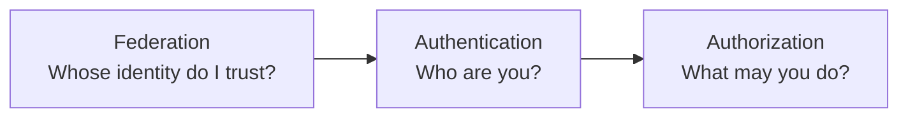
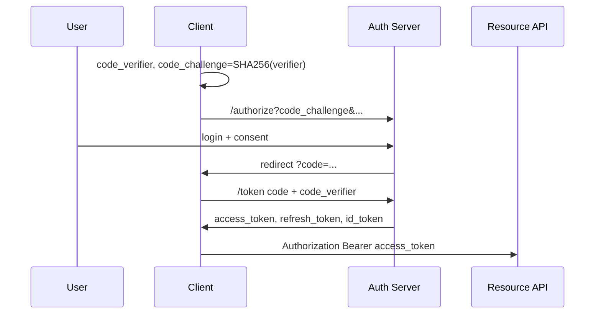
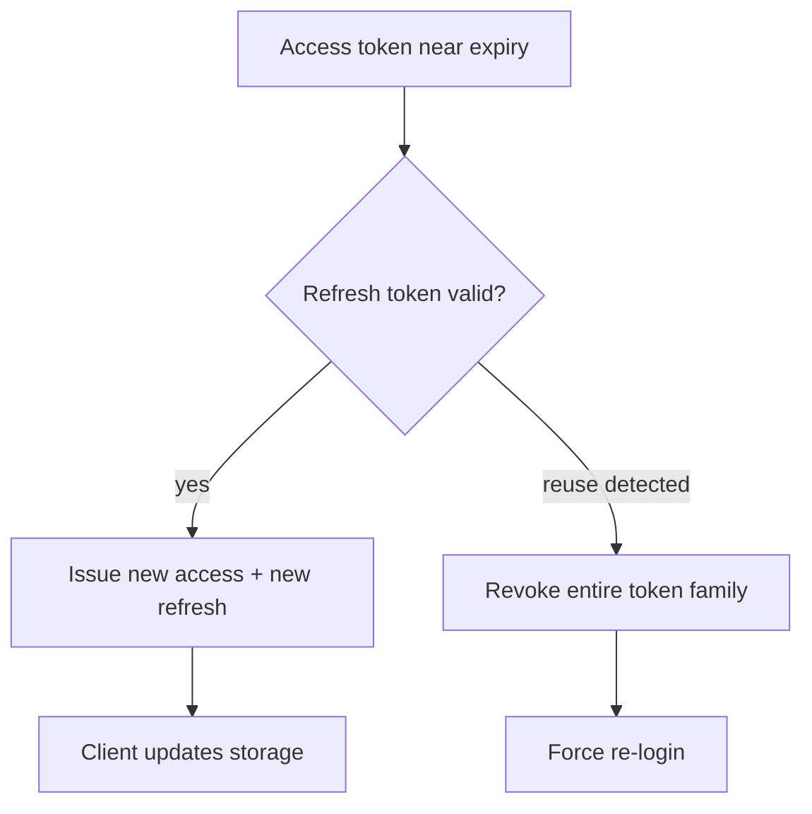
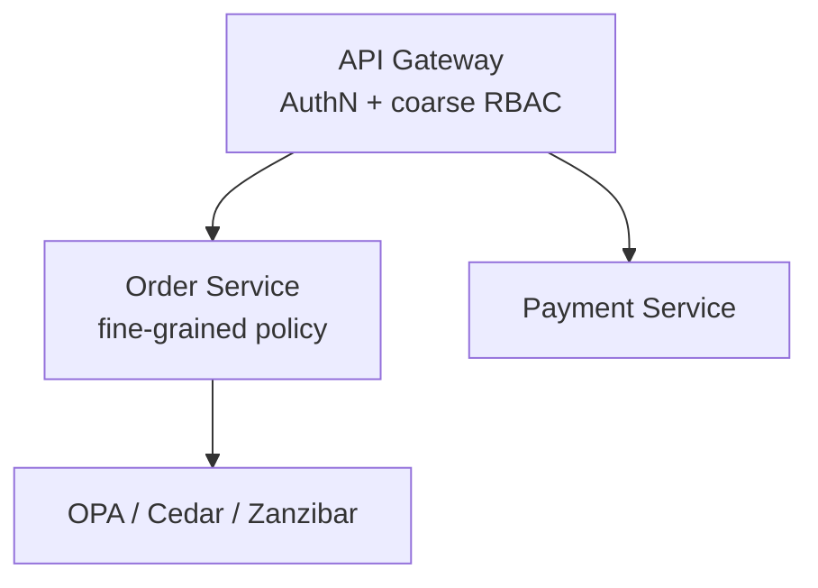

# Security and Authentication: Senior Engineer Study Guide

A teaching guide to **OAuth 2.0**, **OpenID Connect**, **JWTs**, **SSO**, **authorization models**, and **application security**—how they work together and how to build systems that fail safely under attack.

---

## Mental model: three different questions



| Concept | Protocol / tool | Common mistake |
|---------|-----------------|----------------|
| **Authentication** | OIDC, passwords, WebAuthn | Confusing with OAuth alone |
| **Authorization** | OAuth scopes, RBAC, ABAC, ReBAC | Only checking at the gateway |
| **Federation** | SAML, OIDC with external IdP | Misconfigured trust metadata |

> **OAuth 2.0 is authorization** (access to resources). **OpenID Connect adds authentication** (ID token with identity claims).

---

## Part 1: OAuth 2.0 and OIDC

### Roles

| Role | Example |
|------|---------|
| **Resource owner** | User |
| **Client** | Web app, mobile app, service |
| **Authorization server** | Issues tokens |
| **Resource server** | API that accepts access tokens |

### Authorization Code + PKCE (default for all clients)



**Why PKCE replaced Implicit flow**

| Implicit flow problem | PKCE fix |
|----------------------|----------|
| Token in URL fragment (#) | Code exchanged server-side or in secure client |
| No refresh token story | Refresh tokens with rotation |
| Code interception on mobile | Verifier secret never sent in authorize step |

Always use **`code_challenge_method=S256`**, never `plain`.

### Token types

| Token | Lifetime | Used for |
|-------|----------|----------|
| **Access token** | 15–60 min | Call APIs |
| **Refresh token** | Days–weeks | Get new access tokens (server-stored, rotatable) |
| **ID token** (OIDC) | Short | **Client only**—proves who logged in; not for API auth |

### Security checklist

- Validate **`state`** (CSRF on OAuth redirect)
- **Exact match** `redirect_uri` (no wildcards)
- Short-lived **authorization codes** (&lt;60s), single use
- **Refresh token rotation** + reuse detection → revoke token family
- JWT: verify **alg** (reject `none`), **iss**, **aud**, **exp**; prefer **RS256/ES256**

```python
# Conceptual JWT validation (always pin allowed algorithms)
import jwt

payload = jwt.decode(
    token,
    public_key,
    algorithms=["RS256"],  # never from header alone
    audience="api.example.com",
    issuer="https://auth.example.com",
)
```

---

## Part 2: JWT storage and session design

### Where to store tokens (web)

| Storage | XSS risk | CSRF risk | Notes |
|---------|----------|-----------|-------|
| **localStorage** | High | Low | Avoid for long-lived tokens |
| **HttpOnly cookie** | Low | Mitigate SameSite + CSRF token | Recommended for sessions |
| **In-memory only** | Lowest | Low | Best security; UX cost on refresh |

### Stateless JWT vs server session

| Approach | Revocation | Scale |
|----------|------------|-------|
| **JWT access only** | Hard—short TTL + blocklist for emergencies | Excellent |
| **Server session (Redis)** | Instant | Shared session store |
| **Hybrid** | Short JWT + server refresh token | Common in production |

**Algorithm confusion attack:** attacker sets `alg: HS256` and signs with public RSA key as HMAC secret. **Fix:** allowlist algorithms in code, ignore header `alg` for trust decisions.

---

## Part 3: Token refresh strategy



- **Proactive refresh** before API calls (e.g. if exp &lt; 60s)
- **Mutex** across tabs for one refresh in flight
- **Step-up auth** for sensitive actions (password/MFA again)

---

## Part 4: SSO and enterprise identity

### OIDC SSO flow (two session layers)

1. **IdP session** — cookie at `auth.company.com`
2. **App sessions** — each SP issues its own session after code exchange

**Logout problem:** logging out of IdP does not automatically kill app sessions.

| Logout style | Mechanism |
|--------------|-----------|
| **Back-channel** | IdP POSTs to each SP logout endpoint |
| **Front-channel** | Hidden iframes to each SP (less reliable) |

**SCIM:** provision/deprovision users; on deactivate → revoke tokens + sessions.

### SAML vs OIDC (interview sound bite)

| | SAML | OIDC |
|---|------|------|
| Format | XML | JSON/JWT |
| Era | Enterprise legacy | Modern apps |
| Built on | XML signatures | OAuth 2.0 |

---

## Part 5: Authorization in microservices

### Layered model



| Model | Fits when |
|-------|-----------|
| **RBAC** | Few roles, coarse permissions |
| **ABAC** | Policies on user + resource + environment attributes |
| **ReBAC** (Zanzibar) | Sharing graphs, folders, docs |

Cache authz decisions **30–60s**; invalidate on permission-change events.

### Service-to-service auth

| Method | Properties |
|--------|------------|
| **mTLS** | Mutual identity via certs; mesh automates rotation |
| **Service JWT** | From central token service; good with existing OAuth |
| **User + service context** | Forward user JWT; each hop validates service identity too |

---

## Part 6: Multi-tenant authentication

- Resolve **tenant** from subdomain, JWT claim, or email domain
- **Row-level security** + mandatory `tenant_id` on every query
- Per-tenant IdP (SAML/OIDC), MFA policy, branding (sanitize custom HTML—XSS)
- Per-tenant rate limits; isolate noisy tenants

---

## Part 7: Passwordless and MFA

### Passwordless options (strongest first)

1. **WebAuthn / passkeys** — phishing-resistant (origin-bound)
2. **TOTP** — strong; not phishing-proof
3. **Push MFA** — convenient; **number matching** against MFA fatigue
4. **SMS OTP** — weakest (SIM swap)

### Password storage (if you still have passwords)

```text
hash = Argon2id(password, unique_salt, memory_cost, time_cost)
```

Never MD5/SHA1 alone; unique salt per user; tune cost ~250ms.

### MFA recovery

- One-time **backup codes** (hashed at rest)
- Admin-assisted recovery for enterprise
- No guessable security questions

---

## Part 8: Account takeover (ATO) defense

| Layer | Control |
|-------|---------|
| **Prevention** | Breached-password check (HIBP k-anonymity), WebAuthn |
| **Detection** | Risk score: new device, geo, impossible travel, velocity |
| **Response** | Step-up MFA, session revoke, notify user |

Rate limiting auth endpoints:

- Per-IP: ~20/min
- Per-account: progressive delay (avoid permanent lockout DoS)
- Global anomaly → CAPTCHA for all logins

---

## Part 9: WebSocket and real-time auth

| Pattern | Use |
|---------|-----|
| **Session cookie on handshake** | Same-site web |
| **Short-lived ticket** | `GET /ws-ticket` then `wss://...?ticket=` |
| **Refresh over socket** | Before JWT expiry |

On permission change: gateway subscribes to events → close connection or shrink subscriptions.

---

## Part 10: Application security essentials

### STRIDE threat modeling

| Letter | Threat | Example control |
|--------|--------|-----------------|
| **S** | Spoofing | Strong auth, mTLS |
| **T** | Tampering | TLS, signatures |
| **R** | Repudiation | Audit logs |
| **I** | Information disclosure | Encryption, least privilege |
| **D** | Denial of service | Rate limits, CDN |
| **E** | Elevation | AuthZ tests, input validation |

Draw **data flow diagrams** with trust boundaries; prioritize with likelihood × impact.

### XSS (defense in depth)

1. **Contextual output encoding**
2. **CSP** with nonces: `script-src 'self' 'nonce-...'`
3. **DOMPurify** for rich text (whitelist)
4. Serve untrusted content from **separate origin**

### CSRF

- **`SameSite=Lax` or `Strict`** on session cookies
- Synchronizer token for cookie-based forms
- Bearer tokens in `Authorization` header (SPAs)—not auto-sent by browser

### SQL injection

**Parameterized queries only**; whitelist dynamic sort columns; least-privilege DB user; detect via error spikes.

### Zero trust (BeyondCorp sketch)

- No “inside the VPN = trusted”
- **mTLS** service mesh, identity-aware proxy for users
- Micro-segmentation; log every allow/deny

### Secrets management

- **Vault / cloud secret manager**; no secrets in git
- **Envelope encryption**; automated rotation
- CI: **OIDC federation** to cloud roles—not long-lived keys

### Supply chain (CI/CD)

- Branch protection, signed commits, dependency pinning + scanning
- **SLSA** / signed images (Cosign)
- Admission controller: reject unsigned or critical CVE images

### Privacy (GDPR-style)

- Data inventory, consent records, **erasure pipeline** across DB/cache/search/backups
- Retention automation; pseudonymization where possible

### Incident response

Prepare → detect (SIEM) → contain → eradicate → recover → blameless postmortem within 72h.

---

## Part 11: Building an OAuth authorization server (sketch)

| Endpoint | Purpose |
|----------|---------|
| `/authorize` | User login + consent → code |
| `/token` | Code exchange, refresh |
| `/revoke` | Token revocation |
| `/introspect` | Opaque token validation |
| `/.well-known/openid-configuration` | Discovery |
| `/.well-known/jwks.json` | Public keys |

Store auth codes in **Redis** (10 min TTL, single use). Support **client credentials** for M2M with scoped access.

---

## Comparison tables for interviews

### AuthN mechanisms

| Mechanism | M2M | User browsers | Revocation |
|-----------|-----|---------------|------------|
| API key | Yes | Rare | Rotate key |
| OAuth + JWT | Yes | Yes | Short TTL + refresh revoke |
| mTLS | Yes | Unusual | Cert rotation |
| Session cookie | Server apps | Yes | Server-side session delete |

### OAuth flows (when to mention)

| Flow | Use today |
|------|-----------|
| **Auth code + PKCE** | SPAs, mobile, most clients |
| **Client credentials** | Service accounts |
| **Device code** | TV, CLI, IoT |
| **Implicit** | **Deprecated** |
| **Resource owner password** | **Avoid** |

---

## Code: OAuth token refresh (client pattern)

```typescript
let refreshPromise: Promise<TokenPair> | null = null;

async function getAccessToken(): Promise<string> {
  if (tokenExpiresSoon(accessToken)) {
    refreshPromise ??= refreshTokens(refreshToken).finally(() => {
      refreshPromise = null;
    });
    ({ accessToken, refreshToken } = await refreshPromise);
  }
  return accessToken;
}
```

---

## Interview mistakes to avoid

1. Saying OAuth **is** login (without OIDC / ID token)
2. **localStorage** + long-lived JWT as default
3. No answer for **JWT revocation**
4. Authorization only at gateway for resource-level APIs
5. Security only as “we’ll add a WAF”

---

## Study plan (4 weeks)

| Week | Focus |
|------|--------|
| 1 | Read RFC 6749 + OAuth BCP; implement auth code + PKCE toy server |
| 2 | JWT, sessions, refresh rotation, WebAuthn demo |
| 3 | OWASP Top Ten + STRIDE on one system design |
| 4 | mTLS/mesh concepts; read breach postmortems (Equifax, Capital One, SolarWinds) |

> Strong senior answers name **trade-offs**: security vs UX, consistency vs latency for session stores, centralized vs distributed authz.

---

*Synthesized from senior-level interview frameworks on OAuth, authentication, and application security.*

---

## Senior Pitfalls

| Mistake | Impact | Fix |
|---------|--------|-----|
| Long-lived access tokens in SPAs | XSS steals bearer tokens | BFF + HttpOnly cookies, or PKCE with rotation and short TTL |
| OAuth `state` omitted or not validated | CSRF on authorization callback | Cryptographic `state`, bind to session, one-time use |
| JWT “authz” without audience/issuer checks | Token replay across services | Strict validation, mTLS, centralized authZ (OPA/Cedar) |
| Storing refresh tokens without binding | Stolen refresh → persistent access | Rotation, reuse detection, device binding, revoke on anomaly |
| Secrets in repos or env without rotation | Breach becomes total compromise | Secret manager, dynamic creds, automated rotation drills |
| RBAC only, no resource-level checks | IDOR on object APIs | ReBAC/ABAC, owner checks on every mutation |

---

## Production-grade Practice

1. Implement **OAuth 2.1 auth code + PKCE** for a web app; document threat model for XSS, CSRF, and token storage choices.
2. Add **refresh token rotation** with reuse detection; simulate theft and verify all sessions revoke.
3. Run **OWASP ZAP** or guided pentest on one API; triage findings into P0/P1 with fix timelines.
4. Design **break-glass** access for production: MFA, time-bound roles, session recording, and audit log alerts.
