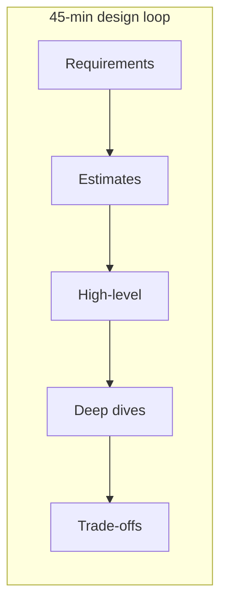
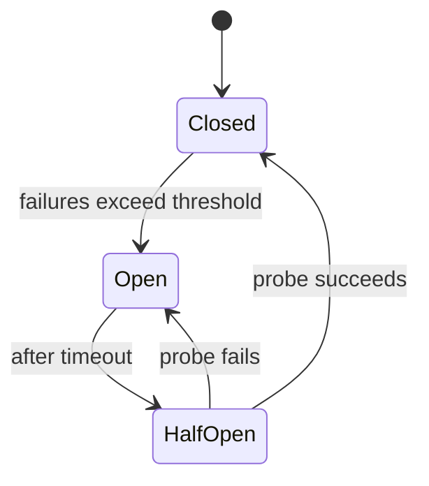

# System Design Fundamentals — Senior Interview Study Guide

> **Scope:** System design classics, microservices architecture, design patterns for distributed systems, and backend engineering craft. Synthesized from Algoroq (2026) interview question banks.

---

## How to use this guide

Senior system design interviews reward **structured thinking under ambiguity**, not memorized diagrams. Use this pattern every time:

1. **Clarify** — users, scale, latency, consistency, read/write ratio, failure tolerance.
2. **Estimate** — QPS, storage, bandwidth (back-of-envelope).
3. **API & data model** — nouns, key access patterns, indexes.
4. **High-level design** — boxes and arrows; justify each component.
5. **Deep dives** — bottlenecks, hot keys, fan-out, caching, sharding.
6. **Trade-offs** — what you would do at 10× scale; what breaks first.



---

## Core concepts cheat sheet

### Scalability patterns

| Pattern | When to use | Watch out for |
|--------|-------------|----------------|
| **Vertical scale** | Early stage, simple ops | Hard ceiling, blast radius |
| **Read replicas** | Read-heavy, eventual OK | Replication lag |
| **Sharding** | Write/ storage limits | Cross-shard queries, hot shards |
| **Caching** | Hot reads, immutable data | Stampede, invalidation |
| **Async + queue** | Spiky load, decouple | Backpressure, ordering |
| **CDN** | Static/geo-distributed assets | Stale content, purge |

### Caching strategies (code mental model)

```python
# Cache-aside (most common)
def get_user(user_id: str) -> User:
    cached = redis.get(f"user:{user_id}")
    if cached:
        return User.from_json(cached)
    user = db.query("SELECT * FROM users WHERE id = ?", user_id)
    redis.setex(f"user:{user_id}", 3600, user.to_json())
    return user

# Stampede guard: single-flight lock
def get_with_lock(key: str):
    if val := redis.get(key):
        return val
    if redis.set(f"lock:{key}", "1", nx=True, ex=5):
        val = expensive_fetch(key)
        redis.setex(key, 300, val)
        redis.delete(f"lock:{key}")
        return val
    time.sleep(0.05)
    return get_with_lock(key)
```

### Microservices vs monolith (decision table)

| Signal | Favor monolith / modular monolith | Favor microservices |
|--------|-----------------------------------|---------------------|
| Team size | &lt; 10 engineers | Multiple autonomous teams |
| Domain clarity | Still discovering boundaries | Stable bounded contexts |
| Deploy cadence | One release train | Independent deploy per service |
| Scaling profile | Uniform | Extreme skew (GPU, batch, ML) |
| Ops maturity | Limited tracing/mesh | Mature platform (K8s, mesh, SLOs) |

### Resilience patterns



**Circuit breaker**, **bulkhead**, **retry with jitter**, and **idempotency keys** belong in every senior backend answer when talking about external dependencies.

---

## System Design

*Source: Algoroq senior interview guide — 15 core questions.*

### 1. How would you design a URL shortening service like Bitly?

> **What they're really asking:** Can you handle a deceptively simple problem with depth, touching on hashing, storage, caching, analytics, and scale estimation?

**Deep answer:**

Start by clarifying requirements: read-heavy vs write-heavy ratio (typically 100:1), URL
expiration policies, custom aliases, and analytics needs. Estimate scale: if the service handles
100M new URLs per month, that is roughly 40 URLs per second for writes and 4,000 per second
for reads.
For the core shortening mechanism, discuss two approaches. First, a counter-based approach
using a distributed ID generator like Snowflake IDs that converts the numeric ID to base62.
Second, a hash-based approach using MD5 or SHA-256 of the long URL, taking the first 7
characters. Explain why the counter approach avoids collisions entirely while the hash approach
requires collision detection.
For storage, a simple key-value store works well. Discuss database design choices: a relational
database like PostgreSQL for ACID guarantees or a NoSQL store like DynamoDB for horizontal
scalability. Partition by the short URL hash for even distribution.
Add a caching layer using Redis or Memcached in front of the database. Since URLs are
immutable once created, cache hit rates will be extremely high (above 90 percent). Use an LRU
eviction policy.
For analytics, log every redirect event to Kafka and process with a stream processing
framework for real-time click counts, geographic data, and referrer tracking.

**Follow-up questions:**
- How would you handle URL expiration at scale?
- What happens if your ID generator becomes a single point of failure?
- How would you design the analytics pipeline to handle 100x traffic spikes?

> **Common mistakes:** jumping into the solution without clarifying requirements, ignoring the read- heavy nature of the system, and not discussing how to handle custom aliases that might collide with generated short codes.

---

### 2. Design a distributed cache system

> **What they're really asking:** Do you understand caching at a systems level, not just adding Redis but the actual mechanics of distributed caching, consistency, and eviction?

**Deep answer:**

Begin with requirements: expected cache size, read/write ratio, latency requirements (sub-
millisecond reads), consistency needs (eventual vs strong), and fault tolerance requirements.
For data partitioning, explain consistent hashing in detail. A naive modulo-based approach
breaks when nodes are added or removed because most keys get remapped. Consistent hashing
limits remapping to K/N keys on average. Add virtual nodes (100-200 per physical node) to
ensure even distribution.
Discuss eviction policies with specifics: LRU is the most common but has lock contention issues in
concurrent environments. Approximate LRU (like Redis uses with random sampling of 5 keys)
reduces contention. LFU works better for workloads with stable hot keys. TTL-based expiration
handles temporal data.
For replication, discuss leader-follower replication for read scaling. The leader handles writes,
followers handle reads. This introduces a consistency window. Discuss how CAP theorem applies
here. For write-heavy workloads, consider sharding over replication.
Address cache stampede (thundering herd): when a popular key expires, hundreds of requests
simultaneously hit the database. Solutions include mutex locks (only one request fetches, others
wait), probabilistic early expiration (refresh before TTL), and background refresh for hot keys.
Discuss cache-aside vs write-through vs write-behind patterns. Cache-aside is the most flexible
(application manages cache), write-through ensures consistency (every write goes to cache and
DB), write-behind improves write performance (async DB writes) but risks data loss.

**Follow-up questions:**
- How do you handle hot keys that overwhelm a single cache node?
- What happens during a network partition between cache nodes?
- How would you implement cache warming for a new deployment?

---

### 3. Design a news feed system like Facebook or Twitter

> **What they're really asking:** Can you reason about fan-out strategies, understand the trade-offs between push and pull models, and handle the complexity of ranked feeds?

**Deep answer:**

Clarify the type of feed: chronological (simpler) vs ranked (complex, ML-driven). Discuss the two
fundamental approaches to feed generation.
Fan-out on write (push model): when a user publishes a post, immediately write it to all followers'
feed caches. This gives fast reads (O(1) feed retrieval) but expensive writes. For a user with 10M
followers, one post triggers 10M writes. This is how early Twitter worked.
Fan-out on read (pull model): when a user opens their feed, fetch posts from all users they
follow, merge, and rank in real-time. This gives fast writes but slow reads, especially for users
following thousands of accounts.
The optimal approach is a hybrid, as described in our news feed system design. Use fan-out on
write for normal users (pre-compute feeds) and fan-out on read for celebrity users (millions of
followers). This is the approach Twitter and Instagram adopted.
For storage, use Redis sorted sets for feed caches (score equals timestamp or ranking score,
member equals post ID). Store the actual post content in a separate database and fetch by ID
when rendering.
For ranking, discuss feature extraction (post age, engagement signals, author relationship,
content type) and a lightweight ML model that scores each candidate post. The ranking service
sits between the feed cache and the API response.
Address scalability concerns: feed caches consume massive memory. Limit stored feeds to the
most recent 500-1000 posts per user. For older content, fall back to the pull model.

**Follow-up questions:**
- How would you handle a celebrity with 100M followers posting frequently?
- How do you ensure a newly published post appears immediately in the author's own feed?
- How would you implement seen tracking to avoid showing duplicate content?

---

### 4. Design a real-time messaging system like Slack

> **What they're really asking:** Do you understand persistent connections, presence systems, message ordering, and the unique challenges of real-time communication at scale?

**Deep answer:**

Start with requirements: real-time message delivery (under 200ms), support for channels
with thousands of members, message history search, file sharing, typing indicators, and
online/offline presence.
For real-time communication, explain why WebSockets are preferred over HTTP polling. Each
client maintains a persistent WebSocket connection to a gateway server. Use a connection
registry (Redis) that maps user IDs to gateway server addresses so any service can route
messages to the correct gateway.
For message ordering, discuss the challenge: in a distributed system, wall-clock timestamps are
unreliable. Use Lamport timestamps or hybrid logical clocks for causal ordering within a
channel. For total ordering, use a single-leader approach per channel where one server
sequences all messages.
For channel message delivery, when a message arrives: (1) persist to the message store, (2) look
up all channel members, (3) for each online member, find their gateway server and push the
message, (4) for offline members, increment their unread counter and queue push notifications.
For presence (online/offline status), use a heartbeat mechanism. Clients send heartbeats every
30 seconds. If no heartbeat is received within 90 seconds, mark the user offline. Store presence
state in Redis with TTL-based expiration.
For search, index messages in Elasticsearch asynchronously. Partition the search index by
workspace to limit search scope and improve query performance.
Discuss message queues for decoupling: use Kafka to buffer messages between the API layer
and downstream consumers (notification service, search indexer, analytics).

**Follow-up questions:**
- How do you handle message delivery when a user switches from offline to online?
- What happens when a gateway server crashes and how do clients reconnect?
- How would you implement end-to-end encryption for direct messages?

---

### 5. Design a distributed task scheduler like cron at scale

> **What they're really asking:** Can you design a reliable system that handles time-based triggers, exactly-once execution, and failure recovery in a distributed environment?

**Deep answer:**

Clarify requirements: support one-time and recurring tasks, handle millions of scheduled tasks,
guarantee at-least-once execution, support task priorities, and provide visibility into task status.
For task storage, use a database with a scheduled execution time index. Partition tasks by their
next execution time bucket (per-minute buckets). This allows efficient range queries to find tasks
due for execution.
For the scheduling architecture, use a two-tier approach. A set of scheduler nodes continuously
poll for tasks due in the next time window. When tasks are found, they are claimed (using
optimistic locking or distributed locks via Redis) and dispatched to a pool of worker nodes via a
message queue.
Exactly-once execution is the hardest challenge. Discuss the impossibility of true exactly-once in
distributed systems, then explain practical approaches: use a distributed lock with a lease
timeout so that if a worker crashes, the lock expires and another worker picks up the task. Use
idempotency keys so that duplicate executions produce the same result.
For recurring tasks, after successful execution, compute the next execution time from the cron
expression and insert a new task record. Handle clock skew across nodes using NTP
synchronization and building tolerance into the scheduling window.
Discuss fault tolerance: what happens when a scheduler node crashes? Other scheduler nodes
pick up its work since they all poll the same database. What about worker crashes? The lease on
claimed tasks expires, and they return to the ready queue.
For observability, track task execution latency, success/failure rates, queue depth, and
scheduling delay (difference between scheduled time and actual execution time).

**Follow-up questions:**
- How would you handle a task that needs to run at exactly midnight across multiple time zones?
- What if a recurring task's execution takes longer than the recurrence interval?
- How would you implement task dependencies where task B runs only after task A completes?

---

### 6. Design a content delivery network (CDN)

> **What they're really asking:** Do you understand how CDNs actually work: PoP architecture, cache hierarchies, origin shielding, and cache invalidation strategies?

**Deep answer:**

Start with the core problem: serving static and dynamic content to globally distributed users with
minimal latency. A CDN places copies of content at edge locations close to users.
For architecture, describe a three-tier hierarchy: edge PoPs (Points of Presence) closest to users,
regional mid-tier caches, and the origin server. When a user requests content, DNS resolution
directs them to the nearest edge PoP. If the edge has the content (cache hit), it serves
immediately. On a cache miss, the edge requests from the mid-tier cache (origin shielding
reduces origin load), which in turn fetches from the origin if needed.
Discuss DNS-based routing: use GeoDNS or Anycast to route users to the nearest PoP. GeoDNS
maps client IP to geographic location and returns the IP of the closest PoP. Anycast uses BGP
routing to naturally direct packets to the nearest PoP.
For cache invalidation, discuss the fundamental challenge: cache invalidation is one of the two
hard problems in computer science. Approaches include TTL-based expiration (simple but stale
content during TTL), purge APIs (immediate but requires explicit calls), and versioned URLs
(append hash to filename, guarantees freshness, no invalidation needed).
Discuss cache key design: the URL alone is often insufficient. Include headers like Accept-
Encoding and Accept-Language. Use Vary headers to indicate which request headers affect the
response. Be careful with over-specific cache keys that reduce hit rates.
Address dynamic content acceleration: persistent connections between PoPs and origin, TCP
optimization (larger initial congestion windows), TLS session resumption, and HTTP/2
multiplexing. Discuss load balancing across origin servers.
For security, discuss DDoS mitigation at the edge (rate limiting, IP reputation), WAF integration,
and TLS termination at the edge vs end-to-end encryption.

**Follow-up questions:**
- How do you handle cache consistency when the origin updates content?
- How would you design the CDN to handle a flash crowd with a sudden 100x traffic spike?
- What metrics would you use to evaluate CDN performance?

---

### 7. Design a distributed search engine

> **What they're really asking:** Do you understand inverted indexes, query processing, ranking algorithms, and the distributed systems challenges of search at scale?

**Deep answer:**

Break the problem into three phases: indexing, query processing, and ranking.
For indexing, explain the inverted index data structure: a mapping from each term to a sorted
list of document IDs containing that term, along with metadata like term frequency and
positions. The indexing pipeline: crawl or ingest documents, tokenize, normalize (lowercase,
stemming), build inverted index. For scale, partition the index by document ID (document-based
partitioning) or by term (term-based partitioning). Document-based is more common because it
allows independent indexing and simplifies rebalancing.
For query processing, describe the query flow: parse query, expand terms (synonyms, spell
correction), look up each term in the inverted index, intersect posting lists for AND queries,
merge for OR queries. For phrase queries, use positional indexes. For distributed query
execution, broadcast the query to all index shards, each shard returns its top-K results, and a
coordinator merges results.
For ranking, discuss TF-IDF as the baseline: terms that appear frequently in a document (TF) but
rarely across documents (IDF) are strong relevance signals. Then discuss modern ranking: BM25
as an improved TF-IDF, learning-to-rank models that combine hundreds of features (text
relevance, document quality, freshness, user engagement), and two-phase ranking (cheap
model for initial filtering, expensive model for top candidates).
Discuss scalability: each index shard should fit in memory for fast query processing. As the
corpus grows, add more shards. Use replication for read scaling where each shard has multiple
replicas, and queries are load-balanced across replicas.
Discuss index updates: real-time indexing vs batch indexing. Real-time uses a small in-memory
buffer that is periodically merged with the main index. This ensures new documents are
searchable within seconds.

**Follow-up questions:**
- How would you handle queries in multiple languages?
- How do you prevent one slow shard from slowing down every query?
- How would you implement autocomplete and typeahead suggestions?

---

### 8. Design a payment processing system

> **What they're really asking:** Can you build a system where correctness and reliability are paramount, handling distributed transactions, idempotency, and regulatory compliance?

**Deep answer:**

Start with the unique constraints of payment systems: money cannot be created or destroyed
(conservation), every transaction must be traceable (auditability), and failures must be handled
gracefully (no double charges, no lost payments).
For the core flow: user initiates payment, payment service validates the request, creates a
payment record with PENDING status, calls the payment gateway (Stripe, Adyen), receives
result, updates status to SUCCEEDED or FAILED, notifies the user. Each step must be
idempotent. Use client-generated idempotency keys so that retrying a request produces the
same result.
Discuss the database design for the ledger: use double-entry bookkeeping where every
transaction has a debit and a credit entry that must sum to zero. This is the foundation of
financial data integrity. Use a relational database with ACID transactions for the ledger since
this is one case where eventual consistency is not acceptable.
For fault tolerance, discuss the saga pattern for multi-step transactions. Example: an e-
commerce purchase involves reserving inventory, charging the card, and creating the order. If
the card charge fails after inventory is reserved, a compensating transaction releases the
inventory. Use an orchestrator service that tracks the saga state.
Discuss reconciliation: periodically compare internal records with payment gateway records and
bank statements. Flag discrepancies for manual review. This catches bugs, fraud, and edge
cases that automated systems miss.
For security: PCI DSS compliance (never store raw card numbers, use tokenization), encryption
at rest and in transit, fraud detection ML models that score transactions in real-time, and
velocity checks (flag unusual spending patterns).
Address rate limiting and abuse prevention: limit payment attempts per user, implement
CAPTCHA for repeated failures, and use device fingerprinting.

**Follow-up questions:**
- How do you handle a payment that succeeds at the gateway but your system crashes before
- recording the result?
- How would you design a refund system?
- How do you handle currency conversion in a multi-currency system?

---

### 9. Design a ride-sharing service like Uber

> **What they're really asking:** Can you handle geospatial data, real-time matching, dynamic pricing, and the operational complexity of a marketplace?

**Deep answer:**

Identify the core services: rider app, driver app, matching service, pricing service, trip
service, and payment service. Focus on the matching and geospatial components as the most
technically interesting.
For geospatial indexing, discuss how to efficiently find nearby drivers. Options include
geohashing (divide the world into grid cells, encode each cell as a string where nearby locations
share prefixes), quadtrees (recursively subdivide space, efficient for non-uniform distribution),
and S2 geometry (used by Google, maps the sphere to a Hilbert curve for efficient range
queries). Store driver locations in an in-memory spatial index that updates every 3-4 seconds as
drivers send GPS pings.
For the matching algorithm: when a rider requests a ride, query the spatial index for available
drivers within a radius (start with 1km, expand if too few). Rank candidates by ETA (not straight-
line distance, use a routing service for actual drive time), driver rating, and acceptance
probability. Send the request to the best candidate with a 15-second timeout. If declined, try the
next candidate.
For dynamic pricing (surge), monitor supply and demand per geographic zone. When demand
exceeds supply by a threshold, apply a multiplier. Use a smoothing function to prevent price
oscillation. Publish surge maps so riders can see pricing before requesting.
For the trip lifecycle: request, match, driver en route, pickup, in progress, dropoff, payment,
rating. Store trip state in a database and publish state transitions to a message queue for
downstream consumers (ETA service, analytics, notifications).
Discuss high availability: the matching service must be available 24/7. Use multiple availability
zones, circuit breakers for downstream services, and graceful degradation (if the pricing service
is down, use a default price rather than failing the request).

**Follow-up questions:**
- How would you handle ride matching in a city with complex road networks?
- How do you prevent fraud such as fake rides and GPS spoofing?
- How would you design the system to support ride pooling with shared rides?

---

### 10. Design an online collaborative editor like Google Docs

> **What they're really asking:** Do you understand conflict resolution in real-time collaborative systems, specifically OT or CRDTs, and can you handle the networking and UX challenges?

**Deep answer:**

The core challenge is concurrent editing: when two users type at the same position
simultaneously, how do you ensure both see a consistent document? This is a fundamental
problem in distributed systems.
Discuss two approaches to conflict resolution. Operational Transformation (OT): each edit is an
operation (insert character at position X, delete character at position Y). When concurrent
operations arrive, transform them against each other so the result is the same regardless of
application order. Google Docs uses OT. The complexity is in the transformation functions, which
must handle all combinations of insert/insert, insert/delete, delete/delete.
CRDTs (Conflict-free Replicated Data Types): design the data structure so that concurrent
operations commute automatically with no transformation needed. For text, use a sequence
CRDT like YATA or RGA that assigns each character a unique, ordered ID. CRDTs are simpler to
reason about and work in peer-to-peer settings, but use more memory. Figma uses CRDTs.
For architecture, use WebSockets for real-time bidirectional communication. A document server
maintains the authoritative document state. Clients send operations to the server, which
transforms and validates them and broadcasts to all connected clients. For scalability, partition
by document so each document is assigned to one server instance that holds its state in memory.
For persistence, periodically snapshot the document to a database. Also store the
operation log for undo/redo and version history. Compress old operations by periodically
creating checkpoints.
For presence features (cursors, selections), broadcast cursor positions to all users in the
document using the same WebSocket channel. Throttle cursor updates to 10-20 per second to
reduce network traffic.

Discuss offline editing: queue operations locally and sync when reconnection occurs. CRDTs
handle this more naturally than OT.

**Follow-up questions:**
- How do you handle a document with 1,000 simultaneous editors?
- How would you implement commenting and suggestion mode?
- How do you handle large documents efficiently?

---

### 11. Design a monitoring and alerting system like Datadog

> **What they're really asking:** Can you handle high-volume time-series data ingestion, efficient storage and querying, and build a reliable alerting pipeline?

**Deep answer:**

Break the system into three components: data ingestion, storage and querying, and alerting.
For data ingestion, agents on each host collect metrics (CPU, memory, disk, custom application
metrics) and send them to a collection service. Use UDP for high-frequency metrics where
occasional loss is acceptable, and TCP for critical metrics. The collection service buffers metrics
and writes in batches. At scale (millions of hosts, each reporting hundreds of metrics per minute),
the ingestion rate is billions of data points per minute. Use Kafka as a buffer between collection
and storage.
For storage, discuss time-series database design. Data points are (metric_name, tags,
timestamp, value). Use time-based partitioning where recent data goes in hot storage (SSD) and
older data in cold storage (HDD/S3) with downsampled resolution. Compression techniques:
delta encoding for timestamps (most metrics arrive at regular intervals), gorilla encoding for
floating-point values (XOR with previous value). These achieve 12:1 compression ratios.
For querying, support aggregations over time ranges: avg, sum, max, min, percentiles. Pre-
compute rollups at multiple resolutions (1 second, 1 minute, 1 hour, 1 day) to speed up queries over
long time ranges. Use tag-based indexing for fast filtering.
For alerting, define alert rules as queries with thresholds (for example, average CPU above 90
percent for 5 minutes). The alert evaluation engine continuously runs queries against recent
data. Use a state machine per alert: OK to PENDING to FIRING to RESOLVED. Require the
condition to persist for a configurable duration before firing to prevent flapping.

Discuss fault tolerance for the alerting pipeline: alerting must be the most reliable component.
Replicate alert evaluation across multiple nodes. Use consensus to prevent duplicate alerts.

**Follow-up questions:**
- How do you handle a noisy alert that fires and resolves repeatedly?
- How would you implement anomaly detection without predefined thresholds?
- How do you ensure alerts are delivered even when the monitoring system itself is under heavy
- load?

---

### 12. Design a recommendation engine

> **What they're really asking:** Do you understand recommendation algorithms, feature engineering, and the system architecture needed to serve recommendations at scale with low latency?

**Deep answer:**

Discuss the two fundamental approaches. Collaborative filtering: find users similar to the current
user and recommend items they liked. Item-based CF is more common in practice because item
similarity is more stable than user similarity. Use matrix factorization to decompose the user-
item interaction matrix into latent factor vectors.
Content-based filtering: recommend items with attributes similar to items the user has liked.
Build item feature vectors from metadata (genre, tags, description) and user profile vectors
from their interaction history. Compute similarity using cosine distance.
Modern systems use a hybrid approach with a multi-stage pipeline. Candidate generation (fast,
broad): use multiple generators including collaborative filtering, content-based, trending items,
and geographic relevance. Each generates hundreds of candidates. Scoring and ranking (slower,
precise): a neural network model scores each candidate using hundreds of features. Serving:
rank by score, apply business rules (diversity, freshness, ads), and return the top N.
For the training pipeline, discuss event-driven architecture: log user interactions to Kafka, batch
processing builds training datasets, model training on GPUs, model validation, model
deployment to serving infrastructure.
For real-time personalization, maintain user feature vectors in a cache that updates in near-
real-time as users interact. This allows the scoring model to use the latest signals.

Address the cold start problem: for new users, use popularity-based recommendations, ask
onboarding preference questions, or use demographic-based recommendations. For new items,
use content-based features until enough interaction data accumulates.

**Follow-up questions:**
- How do you handle the filter bubble problem?
- How would you A/B test recommendation algorithm changes?
- How do you balance relevance with business objectives?

---

### 13. Design a global-scale configuration management system

> **What they're really asking:** Can you build a system that reliably distributes configuration to thousands of services with low latency, handles rollbacks, and prevents bad configs from causing outages?

**Deep answer:**

Requirements: store configuration key-value pairs per service and environment, propagate
changes to all instances within seconds, support rollback, provide audit logging, and prevent bad
configurations from causing outages.
For storage, use a strongly consistent data store like etcd or ZooKeeper. Configuration data is
small but critical. Strong consistency prevents split-brain scenarios where different instances run
with different configs. Store configs as versioned documents: each update creates a new version,
enabling instant rollback to any previous version.
For distribution, discuss push vs pull. Push (using watches/subscriptions): clients register interest
in specific config keys and receive updates immediately when values change. Low latency but
requires persistent connections. Pull (polling): clients periodically fetch their config. Simpler but
introduces latency equal to the polling interval. The optimal approach: use push for real-time
updates with pull as a fallback safety net.
For safety mechanisms, implement canary deployments for config changes: first apply the
change to 1 percent of instances, monitor error rates for 5 minutes, then gradually roll out to 100
percent. Implement config validation: define schemas and validation rules per config key, reject
changes that fail validation. Implement kill switches: the ability to instantly revert a config
change across all instances.

Discuss fault tolerance: what happens when the config service is unavailable? Clients must cache
the last known good configuration locally. On startup, if the config service is unreachable, use the
local cache. Include a TTL on the local cache.
Address multi-region concerns: replicate configuration across regions using consensus
algorithms. Handle the trade-off between consistency and availability.

**Follow-up questions:**
- How do you prevent a bad configuration change from taking down the entire fleet?
- How would you handle feature flags as a special case of configuration?
- How do you test configuration changes before deploying them?

---

### 14. Design an e-commerce inventory management system

> **What they're really asking:** Can you handle the consistency challenges of inventory, preventing overselling while maintaining high throughput during flash sales?

**Deep answer:**

The core challenge is preventing overselling: if 100 units remain and 200 orders come in
simultaneously, exactly 100 should succeed and 100 should fail. This requires careful database
design and concurrency control.
For the basic approach, use a database row per SKU with an available_quantity column. On
purchase: UPDATE inventory SET available_quantity = available_quantity - 1 WHERE sku = ?
AND available_quantity > 0. The WHERE clause provides atomic check-and-decrement. This
works but creates a hot row bottleneck during flash sales.
For high-throughput scenarios, discuss inventory segmentation: split 10,000 units across 100
virtual buckets (100 units each). Each purchase request is routed to a random bucket, reducing
contention by 100x. When a bucket runs out, requests are redirected to other buckets.
Discuss reservation patterns: when a user adds an item to cart, create a soft reservation with a
TTL (10 minutes). This prevents the item from being sold while the user completes checkout, but
releases it if abandoned. Implement with Redis using key expiration.
For multi-warehouse fulfillment, the system must decide which warehouse fulfills each order
based on proximity to the shipping address, warehouse stock levels, and shipping cost.

Address event-driven architecture: publish inventory change events to Kafka for downstream
consumers including search index updates, recommendation engine, analytics, and
replenishment alerts.
For the caching layer, cache approximate inventory counts for product display pages. Accept
slight staleness for display but enforce exact counts at checkout.

**Follow-up questions:**
- How would you handle a flash sale where 1M users try to buy 1,000 units simultaneously?
- How do you reconcile inventory across online and physical store channels?
- What happens if a payment fails after inventory has been decremented?

---

### 15. Design a distributed file storage system like Google Drive

> **What they're really asking:** Do you understand chunked storage, metadata management, sync protocols, and the consistency challenges of file systems?

**Deep answer:**

Break the system into metadata management and file storage. The metadata service stores the
file hierarchy (folders, files, permissions, sharing) in a relational database. The file storage
service handles actual file bytes.
For file storage, split files into fixed-size chunks (for example, 4MB). Each chunk is identified by
its content hash (SHA-256). This enables deduplication where identical chunks across different
files or users are stored only once. Store chunks in a distributed blob store with 3x replication
across different failure domains.
For the sync protocol, discuss the challenge of keeping files consistent across multiple devices.
Use a sync engine on each client that maintains a local database of file metadata. On a sync
cycle: compare local metadata with server metadata, identify files that changed locally (upload)
or remotely (download), detect conflicts (file changed on both sides since last sync).
For conflict resolution, save both versions and let the user choose (like Dropbox). For
collaborative editing scenarios, integrate with an OT/CRDT system as discussed in the
collaborative editor design.
For scalability, the metadata service is the bottleneck since every operation touches it. Use
caching aggressively since file metadata changes infrequently. Shard by user ID.

Discuss bandwidth optimization: delta sync (only upload changed bytes within a chunk),
compression before upload, and bandwidth throttling.

**Follow-up questions:**
- How would you handle a user uploading a 100GB file?
- How do you ensure consistency when the same file is edited on two offline devices?
- How would you implement version history and restore?

---

## Microservices Architecture

*Source: Algoroq senior interview guide — 15 core questions.*

### 1. When should you use microservices versus a monolith?

> **What they're really asking:** Can you make a pragmatic architectural decision instead of blindly following trends?

**Deep answer:**

Start with the controversial but correct take: most projects should start as a monolith. The
monolith-first approach, advocated by Martin Fowler and practiced by companies like Shopify
and Basecamp, lets you discover the right service boundaries through experience rather than
guessing upfront.
Choose a monolith when: the team is small (under 10 engineers), the domain is not well
understood (you do not know where the boundaries should be), you are optimizing for
development speed (one deploy, one database, simple debugging), or the system does not need
independent scaling of components.
Choose microservices when: you have multiple teams that need to deploy independently
(organizational scaling), different components have fundamentally different scaling
requirements (the video transcoding service needs GPUs, the user service needs memory), you
need technology diversity (one service needs real-time processing in Go, another needs ML in
Python), or you have a well-understood domain with clear bounded contexts.
The costs of microservices that are often underestimated: network latency replaces function
calls (microseconds become milliseconds), data consistency across services is fundamentally
harder than within a single database, debugging distributed systems requires sophisticated
observability (distributed tracing, structured logging, metrics), deployment complexity increases
dramatically (CI/CD for each service, environment management), and testing is harder
(integration tests require running multiple services).
Discuss the modular monolith as a middle ground: a monolith with well-defined module
boundaries, enforced through the build system (separate packages or modules). Each module
has its own data access layer and clear APIs. This gives you the organizational benefits of clear
boundaries without the operational complexity of distributed systems. When a module needs to
become a service, the boundary is already defined.
Reference real-world examples: Amazon evolved from a monolith to microservices as they
scaled. But Shopify runs one of the largest e-commerce platforms as a modular monolith.
Netflix went all-in on microservices but has hundreds of engineers dedicated to platform tooling.

**Follow-up questions:**
- How would you decompose a monolith into microservices?
- What is the right size for a microservice?
- How do you handle shared libraries and code reuse across microservices?

---

### 2. How do you determine service

> **What they're really asking:** Do you understand Domain-Driven Design and can you apply it to find natural service boundaries?

**Deep answer:**

The most common mistake is decomposing by technical layer (a service for the database layer, a
service for the API layer) instead of by business capability (a service for orders, a service for
payments, a service for inventory).
Use Domain-Driven Design (DDD) bounded contexts: identify the core domains of the business.
Each bounded context has its own ubiquitous language (the same term might mean different
things in different contexts: "order" means something different in the ordering context vs the
shipping context). Each bounded context is a strong candidate for a service.
Evaluate coupling and cohesion: services should be loosely coupled (changing one service rarely
requires changing others) and highly cohesive (everything within a service is closely related). If
two services always deploy together, they should probably be one service. If a service handles
too many unrelated responsibilities, it should probably be split.
Consider the team structure (Conway's Law): services should align with team boundaries. A
service owned by a single team (two-pizza team, 5-8 engineers) can move at its own pace. If a
service requires coordination between multiple teams for every change, the boundary is wrong.
Practical signals for splitting a service: deploys are slow because unrelated changes are bundled,
different parts of the service have very different scaling needs, one part of the service changes
rapidly while another is stable, or the codebase is so large that new engineers take months to
become productive.
Anti-patterns in service decomposition: distributed monolith (services that are tightly coupled
and must deploy in lockstep), nano-services (services so small that the overhead of inter-service
communication outweighs the benefits), and shared database (multiple services reading from
and writing to the same database tables, creating hidden coupling).

Discuss database design implications: each service should own its data. If service A needs data
from service B, it should call service B's API, not read from service B's database. This ensures
encapsulation and allows each service to evolve its data model independently.

**Follow-up questions:**
- How do you handle entities that span multiple bounded contexts?
- What do you do when you realize a service boundary is wrong?
- How does the strangler fig pattern help with monolith decomposition?

---

### 3. How do microservices communicate, and how

> **What they're really asking:** Do you understand the trade-offs between synchronous and asynchronous communication and can you choose the right pattern for each interaction?

**Deep answer:**

Synchronous communication (request-response): HTTP/REST for simplicity and interoperability,
gRPC for performance and type safety. Use when the caller needs an immediate response (user-
facing request that must return data), the operation is short-lived (under 1 second), or the
services are in the same data center (low network latency).
Asynchronous communication (event-driven): publish events to a message queue like Kafka or
RabbitMQ. Use when the caller does not need an immediate response (order placed →  send
confirmation email), you need to decouple services (the publisher does not know or care who
consumes the event), the operation is long-running (video transcoding), or you need to handle
traffic spikes (the queue buffers load).
Event patterns: event notification (thin events that signal something happened, consumers call
back for details if needed), event-carried state transfer (fat events that contain all the data
consumers need, reducing coupling but increasing message size), and event sourcing (store the
event as the source of truth, derive state from the event stream).
Service mesh for communication management: use a sidecar proxy (Envoy in Istio) to handle
cross-cutting communication concerns: mutual TLS (encryption between services), retries with
exponential backoff, circuit breaking (stop calling a failing service), load balancing (distribute
requests across service instances), and observability (automatic metrics and tracing).

Discuss the API gateway pattern: external clients communicate with a single API gateway that
routes requests to the appropriate internal services. This handles authentication, rate limiting,
protocol translation, and response aggregation.
Common mistake: using synchronous communication for everything. This creates a chain of
dependencies where one slow or failing service cascades failures through the entire system. Use
async communication for anything that does not need an immediate response.

**Follow-up questions:**
- How do you handle timeouts and retries in synchronous communication?
- How do you ensure message ordering in asynchronous communication?
- When would you choose gRPC over REST for inter-service communication?

---

### 4. How do you handle distributed transactions across microservices?

> **What they're really asking:** Do you understand the data consistency challenge and the practical patterns for solving it?

**Deep answer:**

The fundamental problem: in a monolith, a single database transaction can atomically update
multiple tables. In microservices, each service has its own database, and distributed transactions
(2PC) are impractical at scale due to blocking, latency, and availability concerns.
The saga pattern is the standard solution. Decompose the distributed transaction into a
sequence of local transactions, each within a single service. If any step fails, execute
compensating transactions to undo previous steps.
Choreography-based sagas: each service publishes events after its local transaction. Other
services react to events and perform their step. No central coordinator. Advantage: simple,
decoupled. Disadvantage: hard to trace the overall flow, difficult to add new steps, circular
dependencies can emerge.
Orchestration-based sagas: a central orchestrator service defines the transaction flow. It tells
each service what to do and handles failures. Advantage: clear flow definition, easy to
understand and modify. Disadvantage: the orchestrator is a single point of logic (not a single
point of failure if properly designed).

Designing compensating transactions: not all operations can be perfectly reversed. You cannot
unsend an email or unchip a physical item. In these cases, use compensating business operations:
send a cancellation email, issue a return label. Design your services with compensability in mind
from the start.
The outbox pattern (critical for reliability): when a service needs to update its database AND
publish an event, both must succeed or both must fail. Writing to the database and publishing to
Kafka are two separate operations that cannot be wrapped in a single transaction. Solution:
write the event to an outbox table in the same database transaction as the business data. A
separate process (CDC with Debezium, or polling) reads the outbox and publishes to the
message queue.
Discuss event-driven architecture as the foundation for sagas. Events are the communication
mechanism between saga participants. The event store provides durability and replayability.

**Follow-up questions:**
- How do you handle sagas that involve external systems (payment gateways, shipping
- providers)?
- How do you debug a saga that failed halfway through?
- What is the difference between semantic lock and compensating transaction approaches?

---

### 5. How do you handle service discovery in a microservices environment?

> **What they're really asking:** Do you understand how services find each other in a dynamic environment where instances come and go?

**Deep answer:**

The problem: in a microservices environment, services are deployed across multiple instances
that are created, destroyed, and moved dynamically (auto-scaling, rolling deploys, failure
recovery). Hardcoding IP addresses is not viable.
Client-side discovery: services query a service registry (Consul, etcd, ZooKeeper) to find
available instances of the target service. The client chooses which instance to call (load
balancing on the client side). Netflix Eureka is a well-known example. Advantage: no additional
proxy hop. Disadvantage: each client must implement discovery and load balancing logic.
Server-side discovery: services call a load balancer or API gateway that queries the registry and
routes the request to an available instance. AWS ELB, Kubernetes Services, and API gateways

work this way. Advantage: clients are simple (just call a single address). Disadvantage:
additional network hop and a potential single point of failure.
Kubernetes-native discovery: Kubernetes Services provide a virtual IP (ClusterIP) that routes to
healthy pods. DNS-based discovery (service.namespace.svc.cluster.local) lets services find each
other by name. The kube-proxy handles load balancing. This is the most common approach in
modern deployments.
Service mesh discovery: Istio and Linkerd use sidecar proxies that intercept all network traffic.
The control plane maintains a service registry and distributes configuration to sidecars. This
provides discovery, load balancing, retries, circuit breaking, and mTLS without changing
application code.
Health checking: the service registry must know which instances are healthy. Services register
with a health check endpoint. The registry periodically probes this endpoint and removes
unhealthy instances. Discuss the difference between liveness checks (is the process running?) and
readiness checks (is the service ready to accept traffic?).
Discuss fault tolerance: what happens when the service registry itself is unavailable? Clients
should cache the last known instance list. Registries should be highly available (replicated
using consensus).

**Follow-up questions:**
- How does service discovery work across multiple regions or data centers?
- What is the difference between DNS-based and API-based service discovery?
- How do you handle service discovery for non-Kubernetes workloads?

---

### 6. What is the circuit breaker pattern and when should you use it?

> **What they're really asking:** Do you understand cascading failure prevention, one of the most critical patterns in microservices?

**Deep answer:**

The problem: in a chain of microservices (A calls B, B calls C), if service C is slow or failing, service
B's threads are blocked waiting for C. B's resources are exhausted, and it becomes slow or fails.
Service A, waiting for B, also fails. One failing service cascades through the entire system.

The circuit breaker pattern prevents this cascading failure by wrapping calls to external services
in a circuit breaker object that monitors failures.
Three states: Closed (normal operation, requests pass through, failures are counted), Open (the
circuit is tripped after a failure threshold, all requests immediately fail without calling the
downstream service, returning a fallback response or error), and Half-Open (after a timeout,
the circuit allows a limited number of test requests through. If they succeed, the circuit closes. If
they fail, it reopens).
Configuration parameters: failure threshold (e.g., 50% of requests in the last 10 seconds),
timeout duration (e.g., 30 seconds in open state before transitioning to half-open), and test
request count (e.g., allow 3 requests in half-open state).
Fallback strategies when the circuit is open: return cached data (stale but available), return a
default response (e.g., a generic product recommendation instead of personalized), degrade
gracefully (show a simplified UI without the failing feature), or return an error with a clear
message (preferable to hanging indefinitely).
Implementation: use libraries like Resilience4j (Java), Polly (.NET), or implement in the service
mesh (Istio circuit breaker configuration). In a service mesh, circuit breaking is configured per-
route and handled by the sidecar proxy, no application code changes needed.
Combine with other resilience patterns: retries with exponential backoff (retry transient failures
before tripping the circuit), timeouts (do not wait indefinitely for a response, a prerequisite for
circuit breaking), bulkheads (isolate failure domains so that a failing dependency only affects the
features that use it, not the entire service), and rate limiting (protect downstream services from
being overwhelmed).
Discuss fault tolerance design: circuit breakers are reactive (they respond to failures). Proactive
measures include load shedding (reject requests before the system is overwhelmed), health
checks (detect problems before they cause failures), and capacity planning (ensure sufficient
resources for expected load).

**Follow-up questions:**
- How do you test circuit breaker behavior in a staging environment?
- How do you set appropriate thresholds when the failure rate varies?
- How does the circuit breaker pattern interact with retry logic?

---

### 7. How do you implement distributed tracing across microservices?

> **What they're really asking:** Do you understand observability in a microservices architecture and how to debug problems that span multiple services?

**Deep answer:**

Distributed tracing tracks a request as it flows through multiple services, creating a trace that
shows the full journey. Each service adds a span to the trace with timing information, metadata,
and any errors.
Core concepts: a trace is an end-to-end journey of a request, a span is a unit of work within a
service (HTTP request, database query, cache lookup), trace context (trace ID, span ID, parent
span ID) is propagated through request headers (W3C Trace Context standard), and sampling
determines which requests are traced (trace all errors, sample 1% of successful requests to
manage volume).
Instrumentation approaches: manual (add tracing code around each operation, most control but
most effort), auto-instrumentation (libraries automatically instrument HTTP clients, database
drivers, and framework handlers), and service mesh (the sidecar proxy captures network-level
spans automatically, no code changes needed).
The OpenTelemetry standard: the convergence of OpenTracing and OpenCensus into a single
vendor-neutral standard. Use OTel SDKs for instrumentation, OTel Collector for data processing
and routing, and any compatible backend for storage and visualization (Jaeger, Zipkin, Grafana
Tempo, Datadog).
Practical usage: identify slow services in the request path, find the root cause of errors (which
service returned the error?), understand service dependencies (build a service dependency
graph from trace data), and detect performance regressions (compare trace durations
across deployments).
Discuss the cost of tracing: traces consume storage (each span is a data point), network
bandwidth (propagating context and sending spans), and processing (the collector pipeline).
Sampling strategies manage this: head-based sampling (decide at the start of the trace, simple
but misses important traces), tail-based sampling (decide at the end, can keep all error traces
and slow traces, but requires buffering), and adaptive sampling (adjust sampling rate based on
traffic volume).

Combine with metrics and logs (the three pillars of observability): correlate traces with metrics
(identify which traced requests are causing metric anomalies) and logs (include the trace ID in
every log entry so you can jump from a trace span to the relevant logs).

**Follow-up questions:**
- How do you handle trace context propagation across asynchronous messaging?
- How do you implement tail-based sampling?
- What is the storage cost of distributed tracing at scale?

---

### 8. How do you handle configuration management across microservices?

> **What they're really asking:** Can you manage the operational complexity of configuring dozens or hundreds of services consistently?

**Deep answer:**

The challenge: each microservice needs configuration (database URLs, feature flags, API keys,
timeouts, retry policies). With dozens of services across multiple environments (dev, staging,
production), configuration management becomes a significant operational concern.
Configuration sources (in priority order): environment-specific overrides, central configuration
service, environment variables, configuration files, and hardcoded defaults. Higher
priority sources override lower ones. This allows a base configuration with environment-
specific adjustments.
Centralized configuration services: Consul, Spring Cloud Config, AWS AppConfig, or a custom
service backed by etcd or ZooKeeper. Centralized configuration enables dynamic updates
without redeployment, audit logging of all changes, access control (who can change production
config), and consistency across all instances of a service.
Dynamic configuration (feature flags and runtime tuning): some configuration should be
changeable without redeployment. Feature flags (enable/disable features for specific users or
percentages), rate limits, timeout values, and log levels are common examples. Use a push model
(service subscribes to changes) for low-latency updates. Cache configuration locally with a
reasonable TTL as a fallback.
Secrets management: API keys, database passwords, and certificates must be stored securely,
not in configuration files or environment variables. Use a secrets manager (HashiCorp Vault,

AWS Secrets Manager, Kubernetes Secrets encrypted at rest). Rotate secrets automatically.
Inject secrets at runtime, never bake them into container images.
Configuration validation: validate configuration at startup. If a required config value is missing or
invalid, the service should fail to start with a clear error message (fail fast). Implement
configuration schemas that define types, ranges, and required fields. Run validation in CI/CD to
catch configuration errors before deployment.
Discuss fault tolerance: what happens when the configuration service is unavailable? Services
should cache their last known good configuration. If a service starts without reaching the
configuration service, it should use the cached config or fail to start (depending on the criticality
of the config).

**Follow-up questions:**
- How do you handle configuration for canary deployments?
- How do you roll back a bad configuration change across all services?
- How do you manage configuration for multi-region deployments?

---

### 9. How do you handle API versioning and

> **What they're really asking:** Can you manage the contract evolution between services without causing coordination nightmares?

**Deep answer:**

The core principle: each service must be deployable independently. This means that a change to
service A's API should not require simultaneous deployment of all services that depend on A.
Backward-compatible changes (safe to deploy without coordinating with consumers): adding
new fields to responses, adding new optional request fields, adding new endpoints, and adding
new event types. Design all changes to be additive.
Breaking changes (require coordination): removing fields, changing field types, changing URL
paths, changing event schemas, and changing error formats. Avoid breaking changes. When
unavoidable, use a two-phase approach.
For synchronous APIs (REST, gRPC): use semantic versioning for service APIs. Support the
current and previous version simultaneously. Give consumers a migration window (typically one

sprint or one month for internal services). Use header-based versioning (Accept:
application/vnd.service.v2+json) to keep URLs stable.
For gRPC specifically: Protocol Buffers has built-in backward compatibility. Never reuse field
numbers. Mark removed fields as reserved. New fields are optional by default. This makes
additive changes safe. For breaking changes, create a new service definition (v2.proto).
For asynchronous events: use a schema registry (Confluent Schema Registry for Kafka). Define
schemas in Avro, Protobuf, or JSON Schema. The registry enforces compatibility rules
(backward, forward, or full). Producers cannot publish events that break compatibility with
registered consumers.
Contract testing: use Pact or similar tools to define consumer-driven contracts. Each consumer
specifies what it expects from a provider. The provider runs these contracts in CI/CD to ensure
changes do not break any consumer. This catches incompatibilities before deployment.
Discuss the expand/contract pattern for database schema changes within a microservices
context: apply the same principles to inter-service API evolution. Expand the API (add new
fields/endpoints), migrate consumers, contract the API (remove old fields/endpoints).

**Follow-up questions:**
- How do you handle versioning for event-driven communication?
- What is the difference between provider-driven and consumer-driven contracts?
- How do you manage a breaking change that affects 20 downstream services?

---

### 10. How do you implement the strangler

> **What they're really asking:** Can you plan a realistic, incremental migration from a monolith to microservices?

**Deep answer:**

The strangler fig pattern (named after the strangler fig tree that grows around a host tree,
eventually replacing it) is an incremental migration strategy. Instead of a risky big-bang rewrite,
you gradually extract functionality from the monolith into microservices while the monolith
continues to serve traffic.

Phase 1 - Intercept: place a routing layer (API gateway or reverse proxy) in front of the monolith.
All traffic flows through this layer. Initially, it forwards everything to the monolith. This is a zero-
functional-change deployment that establishes the infrastructure for incremental migration.
Phase 2 - Extract: identify a bounded context to extract first. Choose one that is (a) well-defined
with clear boundaries, (b) has minimal data sharing with the rest of the monolith, (c) would
benefit from independent deployment or scaling, and (d) is low risk (not the most critical revenue
path). Build the new microservice and its own database.
Phase 3 - Route: update the routing layer to send requests for the extracted functionality to the
new microservice. Keep the monolith's implementation intact as a fallback. Use feature flags to
gradually shift traffic (1%, 10%, 50%, 100%). Compare responses from both systems (shadow
testing) to verify correctness.
Phase 4 - Iterate: repeat Phases 2 and 3 for additional bounded contexts. Each iteration teaches
you more about service boundaries, data migration, and operational requirements.
Data migration considerations: the new service needs its own database. Initially, it might share
the monolith's database (pragmatic but creates coupling). The end goal is full data ownership.
Use the CDC pattern to sync data from the monolith's database to the new service's database.
See our database design guide for migration strategies.
Common pitfalls: trying to extract too much at once (start small), not investing in observability
(you need to compare behavior between monolith and microservice), ignoring organizational
changes (the team structure needs to evolve alongside the architecture), and not setting clear
success criteria (how do you know the extraction is complete?).
Discuss event-driven architecture as an enabler: the monolith publishes events for its domain
operations. New microservices can subscribe to these events to build their own data stores. This
reduces the need for direct data migration.

**Follow-up questions:**
- How do you handle database references between extracted services and the remaining
- monolith?
- What is the typical timeline for a monolith-to-microservices migration?
- How do you handle shared authentication between the monolith and new microservices?

---

### 11. How do you implement the sidecar pattern in microservices?

> **What they're really asking:** Do you understand the operational patterns that make microservices manageable at scale?

**Deep answer:**

The sidecar pattern deploys a helper process alongside each service instance. The sidecar
handles cross-cutting concerns (networking, observability, security) so the service can focus on
business logic.
In Kubernetes, the sidecar runs as a container in the same pod as the main container. They share
the network namespace (communicate via localhost) and can share volumes. The sidecar starts
before the main container and stops after it.
Common sidecar use cases: service mesh proxy (Envoy in Istio, handles mTLS, retries, circuit
breaking, load balancing), logging agent (Fluentd or Filebeat that ships logs to a central system),
metrics collector (Prometheus sidecar that scrapes metrics and forwards them), and
configuration agent (watches a config service and updates local config files).
Service mesh deep dive: the data plane consists of sidecar proxies deployed with each service.
The control plane (Istiod) configures all sidecars with routing rules, retry policies, and certificates.
The sidecar intercepts all inbound and outbound network traffic, providing: automatic mTLS
(encryption without code changes), traffic management (canary deployments, blue-green, A/B
testing), resilience (retries, timeouts, circuit breakers), and observability (distributed traces,
metrics, access logs).
Trade-offs of the sidecar pattern: added latency (each request passes through the sidecar
proxy, adding 1-2ms), resource overhead (each sidecar consumes CPU and memory, multiplied
by the number of instances), operational complexity (managing the sidecar lifecycle alongside
the main service), and debugging difficulty (the sidecar adds a layer of indirection).
Alternatives to sidecars: shared libraries (the cross-cutting logic is compiled into the service, no
network hop but requires the same language and coordinated library updates), proxyless
service mesh (gRPC's xDS API allows the service to participate in the mesh without a sidecar),
and ambient mesh (Istio Ambient uses per-node proxies instead of per-pod sidecars,
reducing overhead).
Discuss when the sidecar pattern is worth the overhead: at scale (dozens of services), in polyglot
environments (services in different languages), and when you need to enforce policies
consistently across all services without trusting each service to implement them correctly.

**Follow-up questions:**
- What is the latency overhead of a service mesh sidecar?
- How does the sidecar handle failures and restarts?
- When would you choose a shared library approach over a sidecar?

---

### 12. How do you handle testing in a microservices architecture?

> **What they're really asking:** Do you understand the testing pyramid in a distributed system and the unique challenges of testing across service boundaries?

**Deep answer:**

The testing pyramid for microservices (bottom to top):
Unit tests: test business logic within a single service in isolation. Mock external dependencies
(databases, other services). Fast, reliable, catch most bugs. These should constitute the majority
of your tests.
Integration tests: test a single service with its real dependencies (database, cache). Use
testcontainers to spin up real databases and caches in Docker containers. These catch issues
with database queries, serialization, and schema mismatches.
Contract tests: verify that the interface between two services is compatible. Consumer-driven
contracts (Pact): each consumer defines what it expects from a provider. The provider runs
these contracts in its CI/CD pipeline. This catches breaking API changes without running the
full system.
Component tests: test a single service end-to-end with mocked external services. Send HTTP
requests and verify responses. Use WireMock or similar tools to simulate dependent services.
These test the service's behavior as a black box.
End-to-end tests: test the full system with all services running. Expensive to set up, slow to run,
and brittle (any service failure breaks the test). Minimize these. Focus on critical business flows
(user registration, order placement, payment processing).
Additional testing strategies for microservices: chaos testing (inject failures, latency, and
partitions to test resilience, tools like Chaos Monkey, Gremlin, Litmus), shadow testing (send
production traffic to a new version alongside the current version, compare responses without
affecting users), canary testing (deploy the new version to a small percentage of traffic, monitor

metrics, gradually increase), and load testing (test individual services and the full system under
expected and peak load).
Discuss the testing anti-pattern: trying to test everything with end-to-end tests. This creates a
slow, brittle test suite that nobody trusts. Invest in contract tests instead, which provide
confidence in inter-service compatibility without the overhead of running the full system.

**Follow-up questions:**
- How do you manage test data across multiple services?
- How do you test eventual consistency scenarios?
- What is the role of feature flags in testing?

---

### 13. How do you handle observability across microservices?

> **What they're really asking:** Do you understand the three pillars of observability and how they work together in a distributed system?

**Deep answer:**

Observability is the ability to understand the internal state of a system from its external outputs.
In microservices, this is critical because no single service's logs tell the full story.
The three pillars:
Metrics: numerical measurements over time. Use RED metrics for services (Rate of requests,
Error rate, Duration of requests) and USE metrics for infrastructure (Utilization, Saturation,
Errors). Collect with Prometheus, store in a TSDB, visualize with Grafana. Metrics tell you WHAT
is happening.
Logs: structured event records from each service. Use structured logging (JSON) with
consistent fields across all services: timestamp, service name, trace ID, log level, message,
and context-specific fields. Ship to a centralized system (ELK stack, Loki). Logs tell you WHY
something happened.
Traces: the path of a request through multiple services. Each service adds a span with timing and
metadata. Use OpenTelemetry for instrumentation, Jaeger or Tempo for storage and
visualization. Traces tell you WHERE time is spent and WHERE errors occur.
Correlation: the real power of observability is connecting the three pillars. Include trace IDs in
logs so you can jump from a trace to the relevant logs. Link traces to dashboards so you can

jump from a metric anomaly to example traces. Create alerts based on metrics that include links
to relevant dashboards and runbooks.
Service Level Objectives (SLOs): define measurable reliability targets. Example: 99.9% of
requests complete in under 200ms. Measure SLIs (Service Level Indicators) continuously.
Calculate error budgets (if your SLO is 99.9%, your error budget is 0.1% of requests). Use error
budgets to balance reliability with development velocity.
Discuss the cost of observability: metrics, logs, and traces generate significant data. For a
system processing 100K requests per second, storing all logs and traces is expensive. Use log
levels (debug off in production), sampling (trace 1% of requests, 100% of errors), and retention
policies (keep detailed data for 7 days, aggregated data for 90 days).

**Follow-up questions:**
- How do you implement alerting that avoids alert fatigue?
- How do you handle observability for async operations (event consumers, batch jobs)?
- What is the cost of running an observability platform at scale?

---

### 14. How do you handle deployment strategies in microservices?

> **What they're really asking:** Can you deploy changes safely in a system where one bad deploy can cascade across services?

**Deep answer:**

Deployment strategies from simplest to most sophisticated:
Rolling update: replace old instances with new ones, one at a time. No downtime if at least one
instance is always running. Default in Kubernetes. Risk: during the rollout, both old and new
versions are serving traffic. The new version must be backward compatible with the old version's
data and APIs.
Blue-green: run two identical environments (blue = current, green = new). Deploy the new version
to green. Switch traffic from blue to green. If issues occur, switch back to blue. Advantage:
instant rollback. Disadvantage: requires double the infrastructure (temporarily).
Canary: deploy the new version to a small subset of instances (e.g., 5%). Route a small
percentage of traffic to canary instances. Monitor error rates, latency, and business metrics. If

healthy, gradually increase traffic. If unhealthy, roll back immediately. This is the safest strategy
for high-risk changes.
Feature flags: deploy the new code to all instances but hide it behind a feature flag. Enable the
flag for internal users first, then 1% of users, then 10%, then 100%. This separates deployment
(code is on servers) from release (feature is enabled for users). If the feature causes issues,
disable the flag without redeploying.
Progressive delivery: combine canary deploys with automated analysis. Deploy canary,
automatically compare canary metrics with baseline, and automatically promote or roll back
based on metric thresholds. Tools like Argo Rollouts and Flagger implement this. This removes
human judgment from the deployment decision for well-defined metrics.
GitOps: define the desired state of each service in a Git repository (Kubernetes manifests, Helm
charts). A controller (ArgoCD, Flux) continuously reconciles the cluster state with the Git state.
Changes are made through Git pull requests, which provide audit trails, reviews, and easy
rollback (revert the commit).
Discuss high availability during deployments: ensure health checks are configured correctly
(readiness probes that verify the service can handle traffic), use pod disruption budgets (never
drain more than N instances simultaneously), and implement graceful shutdown (drain in-flight
requests before terminating).

**Follow-up questions:**
- How do you handle database schema changes during a rolling deployment?
- How do you implement automated rollback based on metrics?
- How do you handle deployment dependencies between services?

---

### 15. What is the CQRS pattern and when should you use it?

> **What they're really asking:** Do you understand advanced data management patterns and can you identify when the additional complexity is justified?

**Deep answer:**

CQRS (Command Query Responsibility Segregation) separates the write model (commands:
create, update, delete) from the read model (queries: fetch data). Each has its own data store
optimized for its specific purpose.

The write store is optimized for transactional integrity: normalized relational schema, ACID
transactions, strong consistency. The read store is optimized for query performance:
denormalized, pre-joined, indexed for specific query patterns. Could be a different database
entirely (write to PostgreSQL, read from Elasticsearch or a materialized view in Redis).
Synchronization: when a command modifies the write store, an event is published. Event
handlers update the read store(s). This introduces eventual consistency between writes
and reads.
When CQRS is appropriate: read and write workloads have very different scaling requirements
(read-heavy system where the write model is a bottleneck for reads), read queries are complex
and do not map well to the write model (many joins, aggregations, full-text search), different
consumers need different views of the same data, or you are already using event-driven
architecture and event sourcing.
When CQRS is overkill: simple CRUD applications, systems with low read complexity (the
write model is fine for reads), or teams unfamiliar with eventual consistency and event-
driven patterns.
Combine with event sourcing: instead of storing current state, store events. The write side
appends events to an event store. The read side builds materialized views by replaying events.
This gives you a complete audit trail, time-travel queries, and the ability to build new read
models by replaying the event history.
Discuss the consistency challenge: after a user creates a record, they might immediately query
for it. If the read model has not been updated yet, the user sees stale data. Solutions: read-your-
own-writes consistency (after a write, the next read for that user goes to the write store),
optimistic UI (show the local change immediately before the server confirms), or use a
synchronous read model update for critical paths.

**Follow-up questions:**
- How do you handle the eventual consistency gap in a user-facing application?
- How do you rebuild a read model when the schema changes?
- What is the relationship between CQRS and the event sourcing pattern?

---

## Design Patterns

*Source: Algoroq senior interview guide — 15 core questions.*

### 1. When would you use the Strategy pattern, and how

> **What they're really asking:** Can you distinguish between composition-based and inheritance-based approaches to achieving the same goal? Do you understand when each is appropriate?

**Deep answer:**

Both Strategy and Template Method solve the same problem: defining a family of algorithms
and making them interchangeable. The difference is in how they achieve it.
Strategy pattern (composition): Define an interface for the algorithm. Implement each
algorithm as a separate class. The client holds a reference to the strategy interface and
delegates to it. Algorithms can be swapped at runtime.
Example: a payment processing system with PaymentStrategy  interface and implementations
for CreditCardPayment , PayPalPayment , CryptoPayment . The OrderService  holds a
PaymentStrategy  reference and delegates processPayment()  to it.
Template Method (inheritance): Define the skeleton of an algorithm in a base class with abstract
methods for the variable parts. Subclasses override the abstract methods to provide specific
behavior. The algorithm structure is fixed; only specific steps vary.
Example: a data import pipeline with an abstract DataImporter  base class defining
readSource()  →  transform()  →  loadTarget() . Subclasses like CsvImporter
and ApiImporter  override readSource()  and transform()  but share the same
pipeline structure.
When to choose Strategy: the algorithm varies independently of the client, you need to swap
algorithms at runtime, or you want to test algorithms in isolation. Strategy favors composition
over inheritance (generally preferred in modern software design).
When to choose Template Method: the overall algorithm structure is fixed and you only need to
vary specific steps, the steps have a defined order, or subclasses need to share common
behavior defined in the base class.
A senior insight: in many modern codebases, Strategy with first-class functions replaces
both patterns. Instead of defining an interface and implementation classes, pass a function:
processPayment(order, paymentFn) . This is common in Go, JavaScript/TypeScript,
and Kotlin.
See our SOLID principles guide and backend development crash course.

**Follow-up questions:**
- How does the Strategy pattern relate to the Open/Closed Principle?
- When does the Template Method pattern violate the Liskov Substitution Principle?
- How would you refactor a large switch statement using the Strategy pattern?

---

### 2. Explain the Observer pattern and its role in event-driven architectures.

> **What they're really asking:** Do you understand the publish-subscribe model that underlies much of modern software architecture?

**Deep answer:**

The Observer pattern establishes a one-to-many dependency between objects.
When the subject (publisher) changes state, all registered observers (subscribers) are
notified automatically.
Classic implementation: the Subject  maintains a list of Observer  references. When state
changes, it iterates through the list and calls update()  on each observer. Observers can
register and unregister dynamically.
This pattern is the foundation of:
Event-driven UI frameworks: React's state management (when state changes, all
subscribed components re-render), DOM event listeners ( addEventListener ), and Vue's
reactivity system.
Message queuing systems: Kafka topics are subjects, consumer groups are observers. The
decoupling enables independent scaling of producers and consumers.
Microservice event systems: Domain events (OrderPlaced, PaymentProcessed) are published
to an event bus. Multiple services subscribe independently. This is the backbone of event-
driven architectures.
Database triggers and change streams: MongoDB Change Streams and PostgreSQL
LISTEN/NOTIFY implement the observer pattern at the database level.
Important considerations:

Memory leaks: Observers that register but never unregister keep the subject alive (and vice
versa in languages with GC). Always provide unsubscribe mechanisms.
Ordering: In basic implementations, notification order is undefined. If order matters, use a
priority mechanism.
Error handling: If one observer throws an exception, should it prevent other observers from
being notified? Typically no — isolate each observer's execution.
Synchronous vs asynchronous: Synchronous notification blocks the subject until all observers
complete. Asynchronous notification (using message queues or event loops) decouples execution
timing.
See our how Kafka works, system design interview guide, and distributed systems guide.

**Follow-up questions:**
- What is the difference between the Observer pattern and the Mediator pattern?
- How does reactive programming (RxJava, RxJS) extend the Observer pattern?
- How would you implement the Observer pattern in a distributed system?

---

### 3. When is the Singleton pattern

> **What they're really asking:** Do you understand why Singletons are controversial and can you discuss alternatives? This is a seniority signal.

**Deep answer:**

The Singleton pattern ensures only one instance of a class exists and provides global access to it.
While simple, it has significant downsides that senior engineers must understand.
Problems with Singleton:
Testing difficulty: Singletons carry state between tests. Mocking a Singleton requires special
techniques (service locator pattern, reflection, or framework support). Each test might see state
from previous tests.
Hidden dependencies: Code that calls Database.getInstance()  has a hidden dependency
that doesn't appear in its constructor or method signature. This makes the code harder to
understand and reason about.
Concurrency issues: Lazy initialization of Singletons in multi-threaded environments requires
synchronization (double-checked locking, which is tricky to implement correctly).

Violates Single Responsibility Principle: The class manages its own lifecycle in addition to its
actual responsibility.
Alternatives:
Dependency injection: Pass dependencies through constructors. A DI framework (Spring, Guice,
or manual DI) creates and manages the single instance. The class itself doesn't know or care that
it's a singleton.
Module-level instance: In languages with module systems (Go, Python, TypeScript), create a
single instance at the module level and export it. No special pattern needed.
Service locator: A registry that provides access to shared services. Better than direct Singleton
access because the locator can be replaced in tests.
When Singleton is genuinely appropriate: logger configuration (truly global, stateless after
initialization), hardware device managers (physical constraint of one device), and application-
wide configuration loaded once at startup.
A senior answer: "I rarely use the Singleton pattern directly. Instead, I use dependency injection
to manage the lifecycle of shared objects. The DI container ensures only one instance exists
(singleton scope) while keeping the class testable and its dependencies explicit."
See our SOLID principles guide and backend development crash course.

**Follow-up questions:**
- How does dependency injection solve the testing problem with Singletons?
- What is double-checked locking, and why is it error-prone?
- How do Go and Rust handle the Singleton pattern differently from Java?

---

### 4. How do you apply the Factory pattern

> **What they're really asking:** Can you use creational patterns for real architectural problems, not just textbook examples?

**Deep answer:**

The Factory pattern family (Simple Factory, Factory Method, Abstract Factory) creates
objects without specifying their exact class. This enables extensibility and decouples creation
from usage.

Factory Method in microservices: A service that processes different message types
(OrderEvent, PaymentEvent, ShipmentEvent) uses a factory to create the appropriate handler.
The factory maps message types to handler classes. Adding a new message type only requires
creating a new handler class and registering it with the factory — no modification of existing
code (Open/Closed Principle).
Abstract Factory in plugin architectures: A data pipeline tool supports multiple cloud providers
(AWS, GCP, Azure). An Abstract Factory creates provider-specific implementations:
CloudFactory.createStorage() , CloudFactory.createQueue() ,
CloudFactory.createCompute() . The AwsFactory  creates S3Storage, SQSQueue,
EC2Compute. The GcpFactory  creates GCSStorage, PubSubQueue, GCECompute.
Application code depends only on the abstract interfaces.
Registry pattern (extension of Factory): Factories can be static (hardcoded mapping) or
dynamic (runtime registration). A dynamic registry lets plugins register their handlers at startup:
handlerRegistry.register("ORDER_EVENT", OrderEventHandler.class) . This is how
frameworks like Spring Boot auto-discover and register components.
Practical implementations:
Java: Spring's BeanFactory  and ApplicationContext  are sophisticated factories managed
by the DI container.
Go: Constructor functions ( NewOrderService() ) serve as simple factories. Interface-based
polymorphism replaces class hierarchies.
TypeScript: Factory functions returning objects conforming to interfaces.
Avoid over-engineering: a simple switch  statement that creates objects is fine if there are only
3-4 cases and they rarely change. Introduce a Factory when the number of types grows, when
creation logic is complex, or when you need runtime extensibility.
See our backend development crash course and system design interview guide.

**Follow-up questions:**
- What is the difference between Factory Method and Abstract Factory?
- How does the Factory pattern relate to the Dependency Inversion Principle?
- How would you implement a plugin system using factories in Go or TypeScript?

---

### 5. Explain the Circuit Breaker pattern and its implementation.

> **What they're really asking:** Do you know resilience patterns for distributed systems? This bridges design patterns and system design.

**Deep answer:**

The Circuit Breaker pattern prevents cascading failures in distributed systems by detecting when
a downstream service is failing and short-circuiting requests instead of waiting for timeouts.
Three states:
Closed (normal operation): Requests pass through to the downstream service. The circuit
breaker monitors failure rates. If failures exceed a threshold (e.g., 50% of requests in the last 10
seconds), the circuit "opens."
Open (failing fast): Requests are immediately rejected without calling the downstream service.
This prevents overwhelming a struggling service and reduces latency for the caller (fail fast vs
wait for timeout). After a configured timeout (e.g., 30 seconds), the circuit enters half-open.
Half-open (testing recovery): A limited number of requests are allowed through. If they succeed,
the circuit closes (service recovered). If they fail, the circuit opens again.
Implementation details:
Failure counting: Use a sliding window (time-based or count-based) to track recent failures. A
rolling window avoids counting old failures.
Threshold configuration: Set thresholds based on the service's normal error rate. A service with
a 1% baseline error rate should have a circuit breaker threshold higher than 1%.
Fallback behavior: When the circuit is open, return a cached response, default value, or
degraded functionality instead of an error. Example: show cached product recommendations
when the recommendation service is down.
Monitoring: Expose circuit breaker state as a metric. Alert when a circuit opens — it indicates a
downstream problem that needs investigation.
Libraries: Hystrix (Netflix, now in maintenance mode), Resilience4j (Java, recommended
replacement), Polly (.NET), and sony/gobreaker  (Go). In Kubernetes, service meshes like Istio
implement circuit breaking at the infrastructure level.
The Circuit Breaker is often combined with Retry (retry transient failures) and Bulkhead (isolate
resources per dependency) patterns. The order matters: Retry inside Circuit Breaker — if retries
consistently fail, the circuit breaker opens to prevent retry storms.

See our distributed systems guide, system design interview guide, and microservices concepts.

**Follow-up questions:**
- How does the Circuit Breaker pattern interact with retry logic?
- What is the Bulkhead pattern, and how does it complement the Circuit Breaker?
- How would you configure circuit breaker thresholds for a service with variable latency?

---

### 6. How do you implement the Repository pattern for data access?

> **What they're really asking:** Do you separate business logic from data access concerns? Can you design for testability?

**Deep answer:**

The Repository pattern abstracts data access behind a collection-like interface. Business logic
interacts with the repository interface, not directly with the database. This provides a clean
separation of concerns and enables testing business logic without a database.
Interface definition:
interface OrderRepository {
    findById(id: string): Order | null
    findByCustomer(customerId: string): Order[]
    save(order: Order): void
    delete(id: string): void
}
Implementations:
PostgresOrderRepository : Uses SQL queries with a connection pool
MongoOrderRepository : Uses the MongoDB driver
InMemoryOrderRepository : Uses a Map for unit testing
Benefits:
Testability: Unit tests use InMemoryOrderRepository  — no database setup, instant execution
Database migration: Switching from PostgreSQL to MongoDB requires only a new repository
implementation, not changing business logic

Query encapsulation: Complex queries are encapsulated in repository methods, not scattered
through business logic
Common anti-patterns:
Leaky abstraction: Repository methods that expose database-specific concepts (SQL, cursors,
connections). The interface should speak the domain language.
Generic repository: Repository<T>  with only CRUD methods. This ignores the fact that
different entities have different query patterns. A UserRepository  needs findByEmail() ,
which a generic repository doesn't provide.
Over-abstraction: For simple CRUD applications, a repository layer may add unnecessary
indirection. Use it when business logic is complex enough to benefit from the separation.
Related patterns: Unit of Work tracks changes to multiple entities and commits them
as a single transaction. Combined with Repository, it provides transactional data
access: 
 unitOfWork.orders.save(order); unitOfWork.payments.save(payment);
unitOfWork.commit(); .
See our backend development crash course and SOLID principles guide.

**Follow-up questions:**
- How do you handle complex queries that span multiple entities in the Repository pattern?
- What is the difference between the Repository pattern and the Active Record pattern?
- How does the Repository pattern work with ORMs like Hibernate or Prisma?

---

### 7. Explain the Decorator pattern and how it's used in middleware chains.

> **What they're really asking:** Do you understand how to compose behavior without modifying existing code? This is one of the most practically useful patterns.

**Deep answer:**

The Decorator pattern wraps an object with additional behavior while maintaining the same
interface. Decorators can be stacked to compose multiple behaviors.
Classic example: a DataSource  interface with a read()  method. FileDataSource  reads
raw data. CompressionDecorator  wraps any DataSource  and adds
compression/decompression. EncryptionDecorator  wraps any DataSource  and adds
encryption/decryption. You can compose: 
 new EncryptionDecorator(new

CompressionDecorator(new FileDataSource("file.dat")))  — reads are decrypted then
decompressed, writes are compressed then encrypted.
Middleware chains are the Decorator pattern applied to request processing:
HTTP middleware (Express.js, Go's http.Handler ): Each middleware wraps the next handler,
adding cross-cutting concerns. A request passes through: 
 LoggingMiddleware →
AuthMiddleware →  RateLimitMiddleware →  ActualHandler . Each middleware can modify
the request, modify the response, short-circuit the chain (return early for unauthorized
requests), or measure timing.
gRPC interceptors: Same concept for gRPC — unary and streaming interceptors wrap handlers
with logging, tracing, authentication, and error handling.
Go's idiomatic decorator:
go
func LoggingMiddleware(next http.Handler) http.Handler {
    return http.HandlerFunc(func(w http.ResponseWriter, r *http.Request) {
        start := time.Now()
        next.ServeHTTP(w, r)
        log.Printf("%s %s %v", r.Method, r.URL, time.Since(start))
    })
}
Java's InputStream  hierarchy is a classic Decorator example: 
 BufferedInputStream(new
GZIPInputStream(new FileInputStream("file.gz")))  — each stream wraps the previous
one, adding buffering and decompression.
Decorator vs Inheritance: Decorator adds behavior at runtime and can be combined flexibly.
Inheritance adds behavior at compile time and creates a rigid class hierarchy. Decorators are
preferred when you need to mix-and-match capabilities.
See our backend development crash course and system design interview guide.

**Follow-up questions:**
- How does the Decorator pattern differ from the Proxy pattern?
- What is the disadvantage of deeply nested decorators?
- How would you implement middleware ordering and dependency management?

---

### 8. How does the Event Sourcing pattern work, and when should you use it?

> **What they're really asking:** Do you understand this advanced architectural pattern that's increasingly common in distributed systems?

**Deep answer:**

Event Sourcing stores the state of an entity as a sequence of events (facts about what
happened) rather than the current state. The current state is derived by replaying all events
from the beginning.
Traditional approach: account.balance = 500  (store current state). Event Sourcing
approach: 
 [AccountCreated(0), Deposited(1000), Withdrawn(300), Deposited(200),
Withdrawn(400)]  →  replay gives balance = 500.
Benefits:
Complete audit trail: Every change is recorded as an immutable event. Perfect for financial
systems, healthcare, and compliance-heavy domains.
Temporal queries: "What was the account balance on March 15?" — replay events up to March

---

### 9. Explain the Adapter and Facade patterns and when you would use each.

> **What they're really asking:** Can you manage complexity by providing clean interfaces to messy subsystems?

**Deep answer:**

Adapter pattern: Converts the interface of one class into another interface that the client
expects. It allows incompatible interfaces to work together. The adapter wraps the adaptee and
translates calls.
Use case: integrating a third-party payment API whose interface doesn't match your
application's PaymentGateway  interface. The adapter wraps the third-party SDK and
translates method calls, parameter types, and error formats to match your interface. When you
switch payment providers, you write a new adapter without changing your application code.
Another common use case: legacy system integration. Your new microservice expects JSON
over HTTP; the legacy system speaks XML over SOAP. An adapter translates between the
two protocols.
Facade pattern: Provides a simplified interface to a complex subsystem. The facade doesn't
wrap a single object — it orchestrates multiple subsystem components behind a simple API.
Use case: a video conversion system involves codecs, compression, audio mixing, and metadata
handling — each with complex APIs. A VideoConverter  facade provides a single method:

convert(input, outputFormat) . It internally orchestrates the subsystem components.
Another use case: an e-commerce checkout facade that orchestrates inventory checking,
payment processing, order creation, notification sending, and analytics tracking behind a single
checkout(cart, paymentInfo)  method.
Key differences:
Adapter: makes one interface compatible with another (1:1 wrapping)
Facade: simplifies a complex subsystem (1:many orchestration)
Adapter is structural (interface compatibility); Facade is about simplification and hiding
complexity
See our backend development crash course and system design interview guide.

**Follow-up questions:**
- How does the Adapter pattern relate to the Dependency Inversion Principle?
- When does a Facade become a God Object anti-pattern?
- How would you design an adapter layer for a multi-cloud application?

---

### 10. How do you apply the Builder pattern for complex object construction?

> **What they're really asking:** Can you handle construction of objects with many optional parameters cleanly?

**Deep answer:**

The Builder pattern separates the construction of a complex object from its representation. It's
essential when objects have many optional parameters, when the construction process involves
multiple steps, or when you want to create immutable objects.
The telescoping constructor anti-pattern: 
 new Order(id, customerId, null, null,
"express", null, true, null, items, null)  — numerous null parameters, unclear which
parameter is which, error-prone.
Builder solution:
java

Order order = Order.builder()
    .customerId(customerId)
    .shippingMethod("express")
    .giftWrap(true)
    .items(items)
    .build();
Benefits: readable construction, validated construction (the build()  method validates
required fields and combinations), immutable objects (all fields set during construction, no
setters), and fluent API that guides the user.
Step Builder (typed builder): Forces a specific construction order using the type system.
Order.builder().withCustomer(cust).withItems(items).withPayment(pay).build()  —
each step returns a different type that only exposes the next valid step. Prevents invalid
intermediate states at compile time.
Real-world examples:
Java's StringBuilder  for efficient string construction
OkHttp's Request.Builder  for HTTP request construction
Protobuf message builders
Kubernetes client libraries for constructing resource definitions
Test data builders ("Object Mother" pattern) for creating test fixtures
In languages with named parameters and default values (Kotlin, Python, TypeScript), the Builder
pattern is less necessary — the language provides similar functionality natively. Use Builder when
the construction logic is complex or when you need validation.
See our backend development crash course and SOLID principles guide.

**Follow-up questions:**
- How does the Builder pattern differ from the Factory pattern?
- When would you use a Builder vs a constructor with named parameters?
- How do you implement the Builder pattern for immutable objects in Java?

---

### 11. Explain the Proxy pattern and its

> **What they're really asking:** Do you understand how proxies are used in real systems for lazy loading, access control, and remote communication?

**Deep answer:**

The Proxy pattern provides a surrogate or placeholder for another object, controlling access to
it. The proxy has the same interface as the real object, making it transparent to the client.
Virtual proxy (lazy initialization): Defers creation of an expensive object until it's actually needed.
Example: an image viewer where ImageProxy  stores the file path and only loads the full image
data (potentially megabytes) when display()  is called. Before display, the proxy shows a
placeholder. This is how ORMs implement lazy loading — related entities are loaded from the
database only when accessed.
Protection proxy (access control): Controls access to the real object based on permissions.
Example: a DocumentProxy  checks the user's role before allowing read() , write() , or
delete()  operations. If unauthorized, the proxy throws an exception without forwarding
to the real document. This pattern is used in Spring Security's method-level security
annotations ( @PreAuthorize ).
Remote proxy: Represents an object in a different address space (another server). The proxy
handles serialization, network communication, and deserialization. gRPC stubs, RMI stubs, and
REST client wrappers are all remote proxies. The client calls methods on the proxy as if the
object were local; the proxy handles the network details.
Caching proxy: Wraps an object and caches results of expensive operations. If the same request
comes in, returns the cached result. This is a combination of Proxy and Decorator patterns.
Logging proxy: Wraps an object and logs all method calls (parameters, return values,
exceptions, timing). AOP (Aspect-Oriented Programming) frameworks like AspectJ use dynamic
proxies for cross-cutting concerns.
Java dynamic proxies ( java.lang.reflect.Proxy ) and Go's interface-based design make it
easy to create proxies at runtime. Python's __getattr__  enables transparent proxying.
See our backend development crash course and distributed systems guide.

**Follow-up questions:**
- How does the Proxy pattern differ from the Decorator pattern?
- How are dynamic proxies implemented in Java?
- How does gRPC use the remote proxy pattern?

---

### 12. How do you use the Command pattern for undo/redo and task queuing?

> **What they're really asking:** Can you apply behavioral patterns to real system features?

**Deep answer:**

The Command pattern encapsulates a request as an object, allowing you to parameterize clients
with different requests, queue or log requests, and support undoable operations.
Each command object contains: the action to execute, all necessary parameters, the receiver
(the object that performs the actual work), and optionally, how to undo the action.
Undo/Redo implementation: Maintain a stack of executed commands. Each command
implements execute()  and undo() . Executing a command pushes it onto the undo stack.
Undoing pops the last command and calls its undo()  method, pushing it onto the redo stack.
This is how text editors, graphic design tools, and IDEs implement undo.
Task queuing: Commands are serialized and placed in a queue (Kafka, SQS, database table).
Workers dequeue and execute commands. This decouples request submission from execution
and enables: retry (re-execute the command), scheduling (execute at a future time), and audit
(log all commands).
CQRS (Command Query Responsibility Segregation): Commands (writes) and queries (reads)
are handled by separate models. Commands modify state through command handlers.
Queries read from optimized read models. This separates write-optimized and read-optimized
data structures.
Real-world examples:
Database transaction logs (each SQL statement is a command with undo via ROLLBACK)
GUI frameworks (menu items, toolbar buttons, keyboard shortcuts all trigger command objects)
Job queues (Sidekiq, Celery — each job is a serialized command)
Event sourcing (events are essentially commands that have been validated and applied)
See our how Kafka works, distributed systems guide, and system design interview guide.

**Follow-up questions:**
- How does the Command pattern relate to Event Sourcing?
- How do you handle commands that can't be undone (e.g., sending an email)?
- How would you implement command batching for performance optimization?

---

### 13. When and how do you refactor code to introduce design patterns?

> **What they're really asking:** Do you apply patterns pragmatically based on emerging needs, or do you force patterns prematurely?

**Deep answer:**

Design patterns should emerge from refactoring, not be applied speculatively. The principle:
write simple code first, refactor to patterns when complexity demands it.
Refactoring signals that indicate a pattern is needed:
Growing switch/if-else chains →  Strategy or Factory pattern. When a new type requires
modifying multiple switch statements, extract each case into a strategy class.
Duplicated code with slight variations →  Template Method or Strategy. Extract the common
structure and parameterize the varying parts.
Complex object construction →  Builder pattern. When constructors have more than 4-5
parameters or many optional parameters.
Tight coupling to specific implementations →  Dependency Injection + Interface extraction.
When you can't test a class because it directly instantiates its dependencies.
Cascading failures in service calls →  Circuit Breaker pattern. When a failing downstream
service causes your service to hang.
Inconsistent state management →  State Machine pattern. When an object's behavior depends
on its state and the state transitions are getting complex.
Refactoring approach:

---

### 14. Explain the Saga pattern for managing distributed transactions.

> **What they're really asking:** Do you understand how to maintain consistency across microservices without distributed transactions?

**Deep answer:**

The Saga pattern manages data consistency across microservices by breaking a distributed
transaction into a sequence of local transactions. Each service executes its local transaction and
publishes an event. If any step fails, compensating transactions are executed to undo the
previous steps.
Two coordination approaches:
Choreography (event-driven): Each service listens for events and decides what to do next. Order
Service creates order →  publishes OrderCreated →  Payment Service processes payment →
publishes PaymentProcessed →  Inventory Service reserves stock →  publishes StockReserved →
Shipping Service schedules delivery.
If Payment Service fails, it publishes PaymentFailed. Order Service listens for this event and
cancels the order (compensating transaction).

Pros: decentralized, no single point of failure, services are independent. Cons: harder to
understand the overall flow, difficult to debug, risk of cyclic dependencies.
Orchestration (centralized coordinator): A Saga Orchestrator defines the sequence of steps and
manages the flow. The orchestrator sends commands to each service and handles responses. If
a step fails, the orchestrator triggers compensating transactions in reverse order.
Pros: clear flow definition, easier to debug and monitor, centralized error handling. Cons: single
point of failure (the orchestrator), additional service to maintain.
Compensating transactions must be idempotent (safe to retry if the compensation message is
delivered twice). They should undo the business effect, not necessarily the technical operation.
Example: compensation for "reserve inventory" is "release inventory," not "delete the
reservation record."
Real-world example: an e-commerce order saga — Create Order →  Reserve Inventory →
Process Payment →  Schedule Shipping. If Payment fails: Release Inventory →  Cancel Order.
Each step has a corresponding compensation.
See our distributed systems guide, how Kafka works, and microservices concepts.

**Follow-up questions:**
- How do you handle a compensation that fails?
- When would you choose choreography over orchestration?
- How does the Saga pattern compare to two-phase commit?

---

### 15. How do you apply the Strangler Fig

> **What they're really asking:** Can you apply patterns at the architectural level, not just the code level? This is a senior/staff-level concern.

**Deep answer:**

The Strangler Fig pattern (named after strangler fig trees that gradually envelop and replace
their host tree) incrementally replaces a legacy system by routing functionality to a new system
piece by piece, until the legacy system can be decommissioned.
Implementation:

---

## Backend Development

*Source: Algoroq senior interview guide — 15 core questions.*

### 1. How do you decide between a monolithic

> **What they're really asking:** They want to see that you do not reflexively choose microservices because they are trendy. They are testing whether you understand the operational cost of distributed systems and can match architecture to team size, domain complexity, and growth trajectory.

**Deep answer:**

Start by establishing that this is a context-dependent decision, not a binary choice. A monolith is
the right starting point for most new systems because it minimizes operational complexity,
simplifies debugging, and allows rapid iteration when the domain model is still being discovered.
Explain the specific inflection points where microservices become justified: when independent
teams need to deploy at different cadences, when specific components have dramatically
different scaling requirements, or when a bounded context has stabilized enough that the service
boundary is unlikely to shift. Reference the distributed systems principle that network boundaries
introduce failure modes that do not exist in a monolith.
Describe the middle ground. A well-structured monolith with clear module boundaries
(sometimes called a "modular monolith") gives you most of the organizational benefits of
microservices without the operational overhead. You can extract services later when you have
concrete evidence that extraction will solve a real problem.
Address the operational requirements that microservices demand: service discovery, distributed
tracing, circuit breakers, contract testing between services, and a deployment pipeline mature
enough to handle dozens of independent deployments per day. If the team does not have these
capabilities, microservices will slow them down rather than speed them up.

```

# Example: Modular monolith structure that enables future extraction
# Each module has a clear public interface and private internals
# payments/public.py - The only file other modules import from
from payments.service import PaymentService
class PaymentsModule:
    """Public interface for the payments domain.
    Other modules interact only through this class."""
    def __init__(self, db_session, event_bus):
        self._service = PaymentService(db_session, event_bus)
    def process_payment(self, order_id: str, amount: Decimal, method: str) _> Pay
        return self._service.process(order_id, amount, method)
    def get_payment_status(self, payment_id: str) _> PaymentStatus:
        return self._service.get_status(payment_id)
    def refund(self, payment_id: str, reason: str) _> RefundResult:
        return self._service.refund(payment_id, reason)
# This module communicates with the rest of the system through events,
# making future extraction to a separate service straightforward.

---

### 2. Walk me through how you design a RESTful API

> **What they're really asking:** They are testing your understanding of API design as a long-term contract. They want to hear about versioning strategy, resource modeling, error responses, and how you balance REST purity with practical developer experience.

**Deep answer:**

Begin with resource identification. Good API design starts by modeling the domain as resources,
not by mirroring database tables or backend procedures. Explain that you work with domain
experts to identify the nouns that external consumers care about, which often differ from
internal data models.
Cover URL structure and naming conventions. Resources should be plural nouns. Relationships
should be expressed through nesting only when there is a strong parent-child relationship. Avoid
deeply nested URLs (more than two levels) because they create rigid coupling.

Discuss versioning strategy. Explain the trade-offs between URL versioning ( /v2/users ),
header versioning ( Accept: application/vnd.api+json;version=2 ), and query parameter
versioning. URL versioning is the most explicit and works best when breaking changes are
infrequent. Header versioning is cleaner but harder to test in a browser.
Address error handling. A well-designed API returns consistent error responses with machine-
readable error codes, human-readable messages, and enough context for the client to recover.
Reference how this connects to broader error handling patterns.

```
_/ Consistent error response structure
{
  "error": {
    "code": "PAYMENT_INSUFFICIENT_FUNDS",
    "message": "The payment method has insufficient funds for this transaction.",
    "details": {
      "required_amount": 149.99,
      "available_amount": 42.50,
      "currency": "USD"
    },
    "request_id": "req_8f3a2b1c",
    "documentation_url": "https:_/api.example.com/docs/errors#insufficient-funds"
  }
}
Finish with pagination, filtering, and rate limiting. Cursor-based pagination is more reliable than
offset-based for large datasets. Filtering should use query parameters with clear naming
conventions. Rate limiting should return 429  status codes with Retry-After  headers.
For deeper patterns, see the API design comparison guide.

---

### 3. How do you handle database connection

> **What they're really asking:** They are testing whether you understand the resource constraints that databases impose, how connection management affects latency and throughput, and whether you have dealt with connection exhaustion in production.

**Deep answer:**

Start by explaining why connection pooling matters. Database connections are expensive to
establish (TCP handshake, TLS negotiation, authentication). Without pooling, a service handling
1,000 concurrent requests would need 1,000 database connections, which exceeds the limits of
most database servers.
Describe pool sizing. The optimal pool size is not "as large as possible." It is constrained by the
database server's capacity, the query execution time, and the number of application instances.
A common formula is: pool_size = (core_count * 2) + effective_spindle_count  for
CPU-bound workloads, but you should always benchmark with realistic traffic patterns.*
Discuss connection lifecycle management: validation on checkout (is the connection still alive?),
maximum lifetime (connections should be recycled periodically to handle DNS changes and
server-side timeouts), and idle timeout (release connections that have not been used recently).
Address what happens when the pool is exhausted. The application should not block indefinitely
waiting for a connection. Set a checkout timeout and return a clear error to the caller.
Instrument the pool so you can monitor checkout wait times, active connections, and pool
exhaustion events.

```
# Production-grade connection pool configuration
import sqlalchemy
from sqlalchemy import create_engine, event
import logging
logger = logging.getLogger(__name__)
def create_db_engine(database_url: str, app_instances: int = 4):
    # Calculate pool size based on database capacity
    # If the database supports 100 connections and we run 4 instances,
    # each instance gets at most 25 connections
    max_connections_per_instance = 100 _/ app_instances
    engine = create_engine(
        database_url,
        pool_size=max_connections_per_instance - 5,  # Leave headroom
        max_overflow=5,                               # Burst capacity
        pool_timeout=3,                               # Fail fast on exhaustion
        pool_recycle=1800,                            # Recycle every 30 minutes
        pool_pre_ping=True,                           # Validate before checkout
    )
    # Monitor pool events
    @event.listens_for(engine, "checkout")
    def on_checkout(dbapi_conn, connection_rec, connection_proxy):
        logger.debug("Connection checked out from pool",

                     extra={"pool_size": engine.pool.size(),
                            "checked_out": engine.pool.checkedout()})
    @event.listens_for(engine, "checkin")
    def on_checkin(dbapi_conn, connection_rec):
        logger.debug("Connection returned to pool")
    return engine

---

### 4. Explain your approach to caching

> **What they're really asking:** Caching is deceptively simple to implement and notoriously difficult to get right. They want to see that you understand cache invalidation as the hard problem, not the cache hit path.

**Deep answer:**

Establish the caching hierarchy. Backend caching operates at multiple levels: application-level
in-memory caches (fastest, limited by process memory), distributed caches like Redis or
Memcached (shared across instances, adds network latency), CDN caches (for static and semi-
static content), and database query caches (generally a last resort). Each level has different
consistency and latency characteristics.
Explain when caching is appropriate. Cache data that is read frequently, expensive to compute,
and tolerant of staleness. Data that is written as often as it is read, or data that must always be
perfectly fresh, is a poor caching candidate.
Discuss invalidation strategies in depth. Time-based expiration (TTL) is the simplest and works
well for data where a few seconds or minutes of staleness is acceptable. Write-through caching
updates the cache on every write, giving strong consistency but adding write latency. Event-
driven invalidation uses change events from the database or a message queue to invalidate
cache entries when the underlying data changes. This is the most complex but gives the best
balance of freshness and performance.
Address cache stampede. When a popular cache entry expires, hundreds of requests may
simultaneously hit the database to rebuild it. Solutions include probabilistic early expiration, lock-
based rebuilding (only one request rebuilds while others wait), and background refresh.


```
# Cache-aside pattern with stampede protection
import redis
import hashlib
import json
import time
import random
class CacheAside:
    def __init__(self, redis_client: redis.Redis, default_ttl: int = 300):
        self.redis = redis_client
        self.default_ttl = default_ttl
    def get_or_compute(self, key: str, compute_fn, ttl: int = None, 
                       stale_ttl: int = 30):
        """Fetch from cache or compute with stampede protection.
        Uses probabilistic early expiration: as the TTL approaches zero,
        there is an increasing probability that a request will recompute
        the value, preventing a thundering herd at exact expiration.
        """
        ttl = ttl or self.default_ttl
        cached = self.redis.get(key)
        if cached:
            data = json.loads(cached)
            remaining_ttl = self.redis.ttl(key)
            # Probabilistic early recomputation
            # As TTL approaches 0, probability of recomputing increases
            if remaining_ttl > stale_ttl or random.random() > (stale_ttl / max(re
                return data
        # Acquire lock to prevent stampede
        lock_key = f"lock:{key}"
        if self.redis.set(lock_key, "1", nx=True, ex=10):
            try:
                result = compute_fn()
                self.redis.setex(key, ttl, json.dumps(result))
                return result
            finally:
                self.redis.delete(lock_key)
        else:
            # Another process is recomputing; serve stale if available
            if cached:
                return json.loads(cached)
            # No stale data; wait briefly and retry
            time.sleep(0.1)
            return self.get_or_compute(key, compute_fn, ttl, stale_ttl)
For a detailed comparison of caching technologies, see Redis vs Memcached.

---

### 5. How do you handle concurrency in

> **What they're really asking:** They want to know if you understand the fundamental differences between threads, processes, async I/O, and actor models, and whether you can match the right concurrency model to the workload characteristics.

**Deep answer:**

Start by distinguishing CPU-bound and I/O-bound workloads, because the optimal concurrency
model differs dramatically between them.
For I/O-bound workloads (most web services), async I/O is typically the best fit. A single thread
can handle thousands of concurrent connections because most of the time is spent waiting for
network responses, database queries, or file reads. Explain the event loop model used by
Node.js, Python's asyncio, and Go's goroutines (which abstract over OS threads with a
cooperative scheduler).
For CPU-bound workloads (data processing, image manipulation, ML inference), multi-
processing or threading with native threads is necessary because async I/O does not help when
the bottleneck is CPU computation. In languages with a GIL like Python, multi-processing is
required for true parallelism.
Discuss the actor model (Erlang/Elixir, Akka) as a concurrency abstraction that eliminates
shared mutable state. Each actor has its own state and communicates through message passing.
This model is excellent for systems with many independent entities that occasionally interact, like
chat servers or IoT device management.
Address thread safety and shared state. When multiple threads or coroutines access shared
data, you need synchronization primitives. Cover mutexes, read-write locks, and lock-free data
structures. Emphasize that the best solution is usually to avoid shared mutable state entirely
through immutable data structures or message passing.
go
_/ Go example: bounded concurrency with worker pool pattern
package main
import (
    "context"

    "fmt"
    "sync"
)
type Job struct {
    ID      int
    Payload string
}
type Result struct {
    JobID  int
    Output string
    Err    error
}
_/ WorkerPool processes jobs with bounded concurrency.
_/ This prevents resource exhaustion when handling bursts of work.
func WorkerPool(ctx context.Context, jobs _-chan Job, maxWorkers int) _-chan Resu
    results _= make(chan Result, maxWorkers)
    var wg sync.WaitGroup
    _/ Launch exactly maxWorkers goroutines
    for i _= 0; i < maxWorkers; i_+ {
        wg.Add(1)
        go func(workerID int) {
            defer wg.Done()
            for job _= range jobs {
                select {
                case _-ctx.Done():
                    return
                default:
                    result _= processJob(job)
                    results _- result
                }
            }
        }(i)
    }
    _/ Close results channel when all workers finish
    go func() {
        wg.Wait()
        close(results)
    }()
    return results
}
func processJob(job Job) Result {
    _/ Simulate processing
    return Result{JobID: job.ID, Output: fmt.Sprintf("processed: %s", job.Payload
}
See also: concurrency patterns and Go vs Rust for backend services.

---

### 6. Describe how you would design a robust error

> **What they're really asking:** They are testing whether you think about errors as a first- class architectural concern rather than an afterthought. They want to see that you understand the difference between transient and permanent failures, and how error handling interacts with observability.

**Deep answer:**

Start with error classification. Not all errors are equal, and your handling strategy should differ
based on the type. Transient errors (network timeouts, temporary unavailability) should be
retried. Permanent errors (invalid input, resource not found) should be reported immediately.
Partial failures (some items in a batch succeeded, others failed) need the most careful handling.
Discuss retry strategies. Exponential backoff with jitter is the standard approach for transient
errors. Explain why jitter matters: without it, all clients retry at the same time, creating a
synchronized thundering herd. Set maximum retry counts and total timeout budgets to prevent a
single slow dependency from consuming all your resources.
Cover circuit breaker patterns. When a downstream service is consistently failing, continuing to
send requests wastes resources and can cascade the failure. A circuit breaker tracks failure rates
and "opens" when they exceed a threshold, failing fast for subsequent requests. After a
cooldown period, it allows a few probe requests through to test if the service has recovered.
Address error propagation across service boundaries. Each service should translate internal
errors into meaningful responses for its callers. A database constraint violation should not
bubble up as a raw SQL error to an API consumer. Map internal errors to domain-specific
error codes.

```
# Circuit breaker implementation
import time
import functools
from enum import Enum
from collections import deque
import threading
class CircuitState(Enum):
    CLOSED = "closed"         # Normal operation
    OPEN = "open"             # Failing fast
    HALF_OPEN = "half_open"   # Testing recovery

class CircuitBreaker:
    def __init__(self, failure_threshold: int = 5, 
                 recovery_timeout: float = 30.0,
                 success_threshold: int = 3):
        self.failure_threshold = failure_threshold
        self.recovery_timeout = recovery_timeout
        self.success_threshold = success_threshold
        self.state = CircuitState.CLOSED
        self.failures = 0
        self.successes = 0
        self.last_failure_time = 0
        self._lock = threading.Lock()
    def call(self, func, *args, **kwargs):
        with self._lock:
            if self.state _= CircuitState.OPEN:
                if time.time() - self.last_failure_time > self.recovery_timeout:
                    self.state = CircuitState.HALF_OPEN
                    self.successes = 0
                else:
                    raise CircuitOpenError(
                        f"Circuit is open. Retry after {self.recovery_timeout}s"
                    )
        try:
            result = func(*args, **kwargs)
            self._on_success()
            return result
        except Exception as e:
            self._on_failure()
            raise
    def _on_success(self):
        with self._lock:
            if self.state _= CircuitState.HALF_OPEN:
                self.successes += 1
                if self.successes _= self.success_threshold:
                    self.state = CircuitState.CLOSED
                    self.failures = 0
            else:
                self.failures = 0
    def _on_failure(self):
        with self._lock:
            self.failures += 1
            self.last_failure_time = time.time()
            if self.failures _= self.failure_threshold:
                self.state = CircuitState.OPEN
class CircuitOpenError(Exception):
    pass
Related reading: distributed systems error handling and the system design interview guide.

---

### 7. How do you approach database schema design

> **What they're really asking:** They want to know if you can design schemas that support backward-compatible migrations, whether you understand the operational challenges of running migrations on large tables, and how you handle schema changes in a zero-downtime deployment environment.

**Deep answer:**

Start with the principle of evolutionary design. The schema you launch with will not be the
schema you have in a year. Every design decision should be evaluated not just for current
requirements but for how easily it can be changed.
Discuss migration strategies for large tables. Adding a column to a table with a billion rows can
lock the table for hours on some databases. Explain online DDL tools like 
 pt-online-schema-
change  for MySQL or pg_repack  for PostgreSQL. Describe the expand-contract pattern: first
add the new column (expand), deploy code that writes to both old and new columns, backfill
existing data, then remove the old column (contract).
Address backward compatibility. In a zero-downtime deployment, old and new versions of your
application run simultaneously during rollout. Schema changes must be compatible with both
versions. This means you never rename or remove a column in the same deployment that
changes the code using it. These must be separate, sequential deployments.
Cover indexing strategy. Explain that indexes should be driven by query patterns, not added
speculatively. Every index speeds up reads but slows down writes. Composite indexes should be
ordered by selectivity (most selective column first for equality comparisons, range columns last).
Partial indexes and expression indexes can be powerful tools for specific query patterns.

```
_- Expand-contract migration example
_- Step 1: Expand - add new column (backward compatible)
ALTER TABLE users ADD COLUMN email_normalized VARCHAR(255);
CREATE INDEX CONCURRENTLY idx_users_email_normalized ON users(email_normalized);
_- Step 2: Deploy code that writes to both columns
_- Application code writes to both email and email_normalized
_- Step 3: Backfill existing data
UPDATE users SET email_normalized = LOWER(TRIM(email))
WHERE email_normalized IS NULL

LIMIT 10000; _- Process in batches to avoid lock contention
_- Step 4: Contract - remove old column (after all code uses new column)
_- ALTER TABLE users DROP COLUMN email; _- separate deployment

---

### 8. How do you design backend

> **What they're really asking:** They are testing whether you have built systems where a single API call depends on multiple downstream services, and whether you know how to provide a useful response when some of those services fail.

**Deep answer:**

Define what partial failure means in practice. A product detail page might need data from the
catalog service, pricing service, recommendations service, and reviews service. If the
recommendations service is down, you should still return the product page with catalog, pricing,
and review data, not a 500 error.
Discuss the response envelope pattern. Design your API responses so that each section of data
includes its own status indicator. The client can then decide how to handle missing sections
rather than treating the entire response as failed.
Cover fallback strategies. When a non-critical dependency fails, you can return cached data
(possibly stale), default values, or omit that section entirely. The key is classifying dependencies
as critical (the request cannot succeed without them) versus degraded (the request can succeed
with reduced functionality).
Address timeout budgets. When an API call fans out to multiple services, you need a total
timeout budget that is divided among the calls. If the first call takes 80% of the budget, the
remaining calls get shorter timeouts. This prevents a single slow service from causing the entire
request to timeout.

```
# Partial failure handling with dependency classification
import asyncio
from dataclasses import dataclass, field
from typing import Optional, Any
from enum import Enum

class DependencyType(Enum):
    CRITICAL = "critical"     # Request fails without this
    DEGRADED = "degraded"     # Request succeeds with fallback
@dataclass
class DependencyResult:
    data: Optional[Any] = None
    error: Optional[str] = None
    is_fallback: bool = False
    latency_ms: float = 0
async def fetch_product_page(product_id: str) _> dict:
    """Fetch product page data with partial failure resilience."""
    timeout_budget = 2.0  # Total timeout for all dependencies
    dependencies = {
        "catalog": {"type": DependencyType.CRITICAL, "timeout": 1.0},
        "pricing": {"type": DependencyType.CRITICAL, "timeout": 0.5},
        "reviews": {"type": DependencyType.DEGRADED, "timeout": 0.8},
        "recommendations": {"type": DependencyType.DEGRADED, "timeout": 0.5},
    }
    # Fan out all requests concurrently
    tasks = {
        name: asyncio.create_task(
            fetch_with_fallback(name, product_id, config["timeout"])
        )
        for name, config in dependencies.items()
    }
    results = {}
    for name, task in tasks.items():
        try:
            results[name] = await asyncio.wait_for(task, timeout=timeout_budget)
        except asyncio.TimeoutError:
            results[name] = DependencyResult(error="timeout")
    # Check critical dependencies
    for name, config in dependencies.items():
        if config["type"] _= DependencyType.CRITICAL and results[name].error:
            raise ServiceUnavailableError(
                f"Critical dependency '{name}' failed: {results[name].error}"
            )
    return {
        "product": results["catalog"].data,
        "pricing": results["pricing"].data,
        "reviews": results["reviews"].data if not results["reviews"].error else [
        "recommendations": results["recommendations"].data or [],
        "_metadata": {
            "degraded": [
                name for name, r in results.items()
                if r.error or r.is_fallback
            ]
        }
    }

---

### 9. How would you implement rate limiting for

> **What they're really asking:** They are testing whether you understand rate limiting beyond a simple counter. They want to hear about different algorithms, distributed rate limiting challenges, and how you balance protection with user experience.

**Deep answer:**

Start with why rate limiting matters: protecting backend resources from abuse, ensuring fair
usage across clients, and preventing cascade failures during traffic spikes.
Compare the major algorithms. Fixed window counting is simple but has the burst problem at
window boundaries (a client can make 2x the limit by timing requests across the boundary).
Sliding window log is precise but memory-intensive because it stores every request timestamp.
Sliding window counter approximates the sliding window with much less memory by weighting
the current and previous windows. Token bucket allows controlled bursting while maintaining a
long-term rate limit, and is the most commonly used in production.
Discuss distributed rate limiting. When your API runs on multiple instances, each instance cannot
maintain its own counter. You need a shared store like Redis. Explain the trade-off between
accuracy and latency: checking Redis on every request adds latency, but local counters with
periodic sync to Redis can allow brief overages.
Cover client identification. Rate limits can be applied per API key, per IP address, per user, or per
endpoint. Different endpoints may need different limits (a search endpoint might allow 10
requests per second while a data export endpoint might allow 1 per minute).

```
# Token bucket rate limiter using Redis
import time
import redis
class TokenBucketRateLimiter:
    """
    Distributed token bucket rate limiter backed by Redis.
    Allows controlled bursting while enforcing long-term rate limits.
    """

    def __init__(self, redis_client: redis.Redis, 
                 max_tokens: int, refill_rate: float):
        self.redis = redis_client
        self.max_tokens = max_tokens       # Maximum burst size
        self.refill_rate = refill_rate     # Tokens added per second
    def allow_request(self, key: str, tokens_required: int = 1) _> dict:
        """Check if request is allowed and consume tokens."""
        now = time.time()
        pipe = self.redis.pipeline()
        bucket_key = f"ratelimit:{key}"
        # Atomic token bucket operation using Lua script
        lua_script = """
        local bucket_key = KEYS[1]
        local max_tokens = tonumber(ARGV[1])
        local refill_rate = tonumber(ARGV[2])
        local now = tonumber(ARGV[3])
        local requested = tonumber(ARGV[4])
        local bucket = redis.call('HMGET', bucket_key, 'tokens', 'last_refill')
        local tokens = tonumber(bucket[1]) or max_tokens
        local last_refill = tonumber(bucket[2]) or now
        _- Refill tokens based on elapsed time
        local elapsed = now - last_refill
        tokens = math.min(max_tokens, tokens + (elapsed * refill_rate))
        local allowed = tokens _= requested
        if allowed then
            tokens = tokens - requested
        end
        redis.call('HMSET', bucket_key, 'tokens', tokens, 'last_refill', now)
        redis.call('EXPIRE', bucket_key, math.ceil(max_tokens / refill_rate) * 2)
        return {allowed and 1 or 0, tostring(tokens), tostring(max_tokens)}
        """
        result = self.redis.eval(lua_script, 1, bucket_key,
                                 self.max_tokens, self.refill_rate,
                                 now, tokens_required)
        allowed = result[0] _= 1
        remaining = float(result[1])
        return {
            "allowed": allowed,
            "remaining": int(remaining),
            "limit": self.max_tokens,
            "retry_after": None if allowed else (tokens_required - remaining) / s
        }
For more on protecting backend systems, see rate limiting strategies and the API
gateway comparison.

---

### 10. How do you approach performance optimization

> **What they're really asking:** They want to see a systematic approach to performance work, not ad hoc guessing. They are testing whether you measure before optimizing, whether you understand where bottlenecks typically occur, and whether you consider the trade-offs of optimization.

**Deep answer:**

Start with measurement. The cardinal rule of performance optimization is to measure first.
Profile the system under realistic load to identify actual bottlenecks. The bottleneck is almost
never where you think it is. Tools include application performance monitoring (APM) like
Datadog or New Relic, profilers (cProfile, pprof, async-profiler), and distributed tracing.
Describe the optimization hierarchy. In order of typical impact: algorithm and data structure
improvements (O(n) vs O(n^2)), I/O reduction (fewer database queries, batching, caching),
concurrency improvements (parallel execution of independent I/O), and finally micro-
optimizations (which rarely matter in backend systems).
Discuss the N+1 query problem as the single most common backend performance issue. When
fetching a list of items and then making a separate database query for each item's related data,
the number of queries grows linearly with the result set. The fix is eager loading or batching
related data queries.
Cover load testing. Performance optimization is meaningless without load testing to validate
the improvement. Explain how you use tools like k6, Locust, or Gatling to simulate realistic
traffic patterns, and how you establish performance budgets (p50 latency under 100ms, p99
under 500ms).

```
# N+1 query problem and solution
# BAD: N+1 queries (1 query for orders + N queries for order items)
async def get_orders_slow(user_id: str):
    orders = await db.fetch_all(
        "SELECT * FROM orders WHERE user_id = $1", user_id
    )
    for order in orders:
        # This executes once per order - N additional queries!
        order["items"] = await db.fetch_all(
            "SELECT * FROM order_items WHERE order_id = $1", order["id"]
        )

    return orders
# GOOD: 2 queries regardless of result set size
async def get_orders_fast(user_id: str):
    orders = await db.fetch_all(
        "SELECT * FROM orders WHERE user_id = $1", user_id
    )
    if not orders:
        return []
    order_ids = [o["id"] for o in orders]
    items = await db.fetch_all(
        "SELECT * FROM order_items WHERE order_id = ANY($1)", order_ids
    )
    # Group items by order_id
    items_by_order = {}
    for item in items:
        items_by_order.setdefault(item["order_id"], []).append(item)
    for order in orders:
        order["items"] = items_by_order.get(order["id"], [])
    return orders

---

### 11. How do you design a backend

> **What they're really asking:** They are testing whether you understand that in distributed systems, exactly-once delivery is practically impossible, and that idempotency is the pragmatic solution. They want to see that you have dealt with duplicate requests, retries, and at- least-once delivery semantics.

**Deep answer:**

Define idempotency clearly. An idempotent operation produces the same result whether it is
executed once or multiple times. GET, PUT, and DELETE are naturally idempotent in REST
semantics. POST is not, which is why payment processing and order creation need explicit
idempotency mechanisms.
Explain why idempotency matters in practice. Network failures, client retries, message queue
redelivery, and load balancer retries all create scenarios where the same request is processed
multiple times. Without idempotency, this leads to duplicate charges, duplicate orders, or
inconsistent state.

Describe the idempotency key pattern. The client generates a unique key (typically a UUID)
for each logical operation and includes it in the request header. The server stores the result
associated with that key and returns the stored result for any subsequent requests with the
same key.
Discuss implementation details: where to store idempotency keys (database with TTL, Redis),
how long to retain them, race conditions when two identical requests arrive simultaneously (use
database constraints or distributed locks), and what to return for in-progress operations.

```
# Idempotent payment processing
from contextlib import contextmanager
import uuid
class IdempotentPaymentProcessor:
    def __init__(self, db, payment_gateway):
        self.db = db
        self.payment_gateway = payment_gateway
    async def process_payment(self, idempotency_key: str, 
                               payment_request: dict) _> dict:
        # Step 1: Check if this operation was already processed
        existing = await self.db.fetch_one(
            """SELECT status, response FROM idempotency_keys 
               WHERE key = $1 AND endpoint = 'process_payment'""",
            idempotency_key
        )
        if existing:
            if existing["status"] _= "processing":
                # Request is still being processed (concurrent duplicate)
                raise ConflictError("Request is currently being processed")
            # Return the stored response
            return existing["response"]
        # Step 2: Claim the idempotency key
        try:
            await self.db.execute(
                """INSERT INTO idempotency_keys (key, endpoint, status, created_a
                   VALUES ($1, 'process_payment', 'processing', NOW())""",
                idempotency_key
            )
        except UniqueViolationError:
            # Another request claimed it between our check and insert
            return await self.process_payment(idempotency_key, payment_request)
        # Step 3: Process the payment
        try:
            result = await self.payment_gateway.charge(
                amount=payment_request["amount"],
                currency=payment_request["currency"],

                source=payment_request["payment_method"]
            )
            # Step 4: Store the result
            response = {"payment_id": result.id, "status": "succeeded"}
            await self.db.execute(
                """UPDATE idempotency_keys 
                   SET status = 'completed', response = $2 
                   WHERE key = $1""",
                idempotency_key, response
            )
            return response
        except Exception as e:
            await self.db.execute(
                """UPDATE idempotency_keys 
                   SET status = 'failed', response = $2 
                   WHERE key = $1""",
                idempotency_key, {"error": str(e)}
            )
            raise
Related: idempotency in distributed systems and payment system design.

---

### 12. How do you implement authentication

> **What they're really asking:** They are testing whether you understand the difference between authentication (who are you) and authorization (what can you do), and whether you can design a system that is both secure and performant.

**Deep answer:**

Start by clearly separating authentication from authorization. Authentication verifies identity.
Authorization determines permissions. Many systems conflate these, leading to security gaps
and inflexible permission models.
Compare authentication approaches. Session-based authentication stores state on the server
and is simpler to revoke but harder to scale across multiple services. JWT (JSON Web Tokens)
are stateless and work well in microservice architectures but cannot be revoked without
additional infrastructure (blacklists or short expiration with refresh tokens). OAuth 2.0
with OpenID Connect is the standard for third-party authentication and provides a battle-
tested framework.

Discuss authorization models. Role-based access control (RBAC) assigns permissions to roles,
and users are assigned roles. This is simple but becomes unwieldy with complex permission
requirements. Attribute-based access control (ABAC) makes decisions based on attributes of the
user, resource, and environment, offering fine-grained control at the cost of complexity.
Relationship-based access control (ReBAC), as implemented by Google's Zanzibar, models
permissions as relationships between entities and is excellent for systems where permissions are
derived from data ownership.
Address security considerations: token storage (HttpOnly cookies for web, secure storage for
mobile), refresh token rotation, CSRF protection, and rate limiting on authentication endpoints
to prevent brute force attacks.

---

### 13. How do you design a backend system

> **What they're really asking:** They want to see that you understand the challenges of asynchronous processing: at-least-once delivery, job deduplication, priority handling, dead letter queues, and monitoring.

**Deep answer:**

Explain when to use background jobs versus synchronous processing. Any operation that takes
more than a few hundred milliseconds, is not needed for the immediate response, or can fail
independently should be a background job. Examples: sending emails, generating reports,
processing uploaded files, syncing data with external systems.
Discuss queue selection. Redis-backed queues (Sidekiq, Bull, Celery with Redis) are fast and
simple but can lose data if Redis is not configured for persistence. Dedicated message brokers
(RabbitMQ, Kafka, SQS) provide stronger durability guarantees. Kafka is ideal when you need to
replay events or when multiple consumers need to process the same events independently.
Cover reliability patterns. Jobs must be idempotent because at-least-once delivery means they
may execute more than once. Implement dead letter queues for jobs that fail repeatedly so they
can be investigated without blocking other jobs. Use job-specific timeouts to prevent stuck jobs
from consuming workers indefinitely.
Address monitoring and observability. Track queue depth (growing queues indicate processing is
falling behind), job latency (time from enqueue to completion), failure rates, and retry rates. Set

alerts on queue depth thresholds to catch problems before they become user-visible.

```
# Robust background job with retry, timeout, and dead letter handling
import functools
import signal
import logging
from datetime import datetime, timedelta
logger = logging.getLogger(__name__)
def background_job(max_retries=3, timeout_seconds=300, 
                   retry_backoff="exponential"):
    """Decorator for reliable background job execution."""
    def decorator(func):
        @functools.wraps(func)
        async def wrapper(job_context, *args, **kwargs):
            job_id = job_context.job_id
            attempt = job_context.attempt_number
            logger.info(f"Starting job {job_id}, attempt {attempt}/{max_retries}"
                       extra={"job_id": job_id, "job_type": func.__name__})
            # Set execution timeout
            start_time = datetime.utcnow()
            deadline = start_time + timedelta(seconds=timeout_seconds)
            try:
                result = await asyncio.wait_for(
                    func(job_context, *args, **kwargs),
                    timeout=timeout_seconds
                )
                elapsed = (datetime.utcnow() - start_time).total_seconds()
                logger.info(f"Job {job_id} completed in {elapsed:.2f}s",
                           extra={"job_id": job_id, "duration": elapsed})
                return result
            except asyncio.TimeoutError:
                logger.error(f"Job {job_id} timed out after {timeout_seconds}s")
                if attempt _= max_retries:
                    await move_to_dead_letter(job_context)
                raise
            except Exception as e:
                logger.error(f"Job {job_id} failed: {e}", exc_info=True)
                if attempt _= max_retries:
                    await move_to_dead_letter(job_context)
                    logger.error(f"Job {job_id} moved to dead letter queue")
                else:
                    delay = calculate_backoff(attempt, retry_backoff)
                    await job_context.retry(delay_seconds=delay)
                raise

        return wrapper
    return decorator
def calculate_backoff(attempt: int, strategy: str) _> float:
    if strategy _= "exponential":
        return min(2 ** attempt * 10, 3600)  # Cap at 1 hour
    return 30  # Fixed 30-second delay
See message queue comparisons and event-driven architecture.

---

### 14. How do you handle data consistency in a

> **What they're really asking:** This is a deeper version of the caching question. They want to hear about specific consistency patterns, the consequences of getting them wrong, and how you detect and recover from inconsistencies.

**Deep answer:**

Frame the fundamental tension. A cache is a copy of data. Any time you have two copies of
data, they can diverge. The question is not whether they will diverge but how you minimize the
window of inconsistency and what happens when it occurs.
Compare the three main patterns. Cache-aside (lazy loading) is the most common: the
application checks the cache first, falls back to the database, and populates the cache on miss.
Write-through updates the cache synchronously on every write, providing strong consistency at
the cost of write latency. Write-behind (write-back) buffers writes in the cache and flushes to the
database asynchronously, providing the best write performance but risking data loss if the cache
fails before flushing.
Discuss the double-write problem. When your code updates the database and then invalidates
the cache, there is a window between these two operations where another request could read
stale data from the cache or repopulate the cache with stale data from a replica that has not yet
received the write. Solutions include using database change data capture (CDC) to drive cache
invalidation, or accepting brief inconsistency with short TTLs.
Address cache warming. When deploying a new version of your application or after a cache
failure, the cache is cold and every request hits the database. This can overwhelm the
database. Strategies include gradual rollout, pre-warming the cache from a database

snapshot, and request coalescing (multiple requests for the same key are collapsed into a single
database query).

---

### 15. How do you structure logging, metrics, and

> **What they're really asking:** They are testing whether you treat observability as an architectural concern that is designed into the system from the start, not bolted on after something breaks in production.

**Deep answer:**

Define the three pillars of observability. Logs provide detailed records of discrete events. Metrics
provide aggregate measurements over time (request rate, error rate, latency distributions).
Traces show the path of a single request across multiple services. Each pillar answers different
questions, and you need all three for effective debugging.
Discuss structured logging. Unstructured log messages ( logger.info("User logged in") )
are nearly useless at scale because they cannot be queried or aggregated. Structured logs
(
 logger.info("user.login", extra={"user_id": "123", "method": "oauth", "ip":
"..."}) ) can be indexed and queried in tools like Elasticsearch or Loki.
Cover the RED method for service metrics: Rate (requests per second), Errors (error rate as
a percentage), and Duration (latency distribution). Every service should expose these three
metrics as a minimum. Use histograms rather than averages for latency because averages
hide outliers.
Explain distributed tracing. In a microservice architecture, a single user request might touch ten
services. Without tracing, debugging a slow request requires correlating logs across all ten
services manually. Distributed tracing (OpenTelemetry, Jaeger, Zipkin) assigns a trace ID
to each request and propagates it across service boundaries, allowing you to see the entire
request timeline.

```
# Structured logging and request context propagation
import logging
import uuid
import time

from contextvars import ContextVar
from functools import wraps
# Request context propagated through async call chain
request_id_var: ContextVar[str] = ContextVar('request_id', default='')
trace_id_var: ContextVar[str] = ContextVar('trace_id', default='')
class StructuredLogger:
    def __init__(self, name: str):
        self.logger = logging.getLogger(name)
    def _enrich(self, extra: dict) _> dict:
        """Add request context to every log entry."""
        return {
            "request_id": request_id_var.get(''),
            "trace_id": trace_id_var.get(''),
            "service": "order-service",
            "timestamp": time.time(),
            **extra
        }
    def info(self, event: str, **kwargs):
        self.logger.info(event, extra=self._enrich(kwargs))
    def error(self, event: str, **kwargs):
        self.logger.error(event, extra=self._enrich(kwargs))
def track_endpoint(endpoint_name: str):
    """Decorator that tracks RED metrics for an endpoint."""
    def decorator(func):
        @wraps(func)
        async def wrapper(*args, **kwargs):
            request_id_var.set(str(uuid.uuid4()))
            start = time.monotonic()
            status = "success"
            try:
                result = await func(*args, **kwargs)
                return result
            except Exception:
                status = "error"
                ERRORS_COUNTER.labels(endpoint=endpoint_name).inc()
                raise
            finally:
                duration = time.monotonic() - start
                REQUEST_COUNTER.labels(endpoint=endpoint_name).inc()
                LATENCY_HISTOGRAM.labels(endpoint=endpoint_name).observe(duration
        return wrapper
    return decorator
For more on observability, see monitoring and alerting and the system design interview guide.

---


## Quick revision checklist

- [ ] Can you run the 45-minute design loop without skipping estimates?
- [ ] Can you name CAP/PACELC trade-offs for each component you draw?
- [ ] Can you explain idempotency, backpressure, and fencing tokens in your own words?
- [ ] Can you whiteboard Raft leader election in under 3 minutes?

*Compiled from Algoroq senior engineer interview PDFs (2026). 60 formatted questions across this guide.*

---

## Senior Pitfalls

| Mistake | Impact | Fix |
|---------|--------|-----|
| Jumping to microservices on day one | Ops tax without scale benefits | Modular monolith first; extract when boundaries are clear |
| No back-of-envelope capacity math | Design fails at 10× traffic | QPS, storage growth, bandwidth, fan-out per request |
| Single giant database on the diagram | Hidden bottleneck and blast radius | Split read/write paths, async pipelines, bounded contexts |
| Ignoring failure modes in interview | “It won’t happen” loses credibility | Name timeouts, partial outages, degradation paths |
| Caching as afterthought | DB overload at launch | Cache strategy with invalidation and stampede control |
| No API/versioning story | Client breakage on iteration | Versioning, idempotency, compatibility contracts |

---

## Production-grade Practice

1. Time yourself on a **45-minute design**: requirements, estimates, diagram, deep dive, tradeoffs—record and review gaps.
2. For one past design, write **non-functional requirements**: p99 latency, RPO/RTO, cost ceiling, compliance—map each to a component.
3. Produce a **one-page ADR** for a major choice (SQL vs NoSQL, sync vs async) with alternatives rejected and metrics to revisit.
4. Run **estimation sanity check** against a week of real metrics from a similar system; adjust shard/replica counts.
