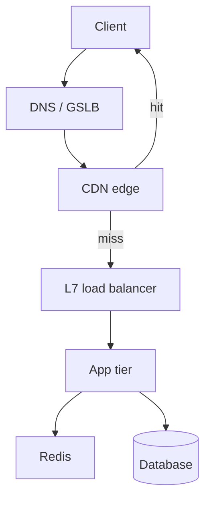

# Load Balancing, CDN & Caching

> Edge-to-origin path, cache hierarchies, and reliability under load
>
> Teaching-style study guide from Algoroq senior interview PDFs. Practice each answer aloud with a diagram and one production anecdote.

---

## Why this matters

Users experience your system through **DNS → load balancer → cache → origin**. Senior engineers reason about health checks, connection draining, cache keys, TTL vs invalidation, and origin protection.



## Reference patterns

```nginx
upstream api {
    least_conn;
    server 10.0.1.11:8080 max_fails=3 fail_timeout=30s;
    server 10.0.1.12:8080 max_fails=3 fail_timeout=30s;
}
location /api/ {
    proxy_pass http://api;
    proxy_http_version 1.1;
    proxy_set_header Connection "";
}
```

```http
Cache-Control: public, max-age=300, stale-while-revalidate=60, stale-if-error=86400
Surrogate-Key: product-42
Vary: Accept-Encoding
```

| Pattern | Read | Write | Main risk |
|---------|------|-------|-----------|
| Cache-aside | App → cache → DB on miss | DB then invalidate | Stale reads |
| Read-through | Cache loads on miss | Same | Cold-start hot keys |
| Write-through | Fresh after write | Through cache + DB | Write latency |

---

## Interview Q&A

## Load balancing

*15 questions from the Algoroq guide.*

### Q1. Explain the difference between Layer 4 and Layer 7 load balancing. When would you choose one over the other?

> **What they're really asking:** Do you understand the OSI model deeply enough to reason about performance, functionality, and cost trade-offs between transport-level and application- level load balancing?

**Answer framework**

Layer 4 (L4) load balancers operate at the transport layer, making routing decisions based on IP addresses, TCP/UDP ports, and connection metadata without inspecting the actual payload. They forward raw TCP or UDP packets. Layer 7 (L7) load balancers operate at the application layer, inspecting HTTP headers, cookies, URL paths, and even request bodies to make intelligent routing decisions.

L4 load balancers are significantly faster because they do minimal processing per packet. They can handle millions of concurrent connections with low CPU overhead. AWS Network Load Balancer, for example, can handle over 1 million new connections per second with sub- microsecond added latency. They are ideal for non-HTTP protocols, TCP passthrough scenarios, and extremely high-throughput workloads where you do not need content-based routing.

L7 load balancers add latency (typically 1-5ms) because they must fully parse the HTTP request. However, they enable powerful features: path-based routing (send /api/* to backend services, /static/* to a CDN origin), header-based routing (route by API version or tenant ID), cookie- based session affinity, request/response transformation, and SSL termination with HTTP/2 multiplexing.

AWS Application Load Balancer and NGINX operate at this layer. In practice, most modern architectures use both. L4 at the edge for raw throughput and DDoS mitigation, L7 internally for intelligent routing between microservices. At Netflix, Zuul operates as an L7 gateway while lower-level load balancing happens at L4. At Google, Maglev provides L4 load balancing at the network edge, while Envoy sidecars handle L7 routing within the service mesh.

A common mistake is defaulting to L7 for everything. If you have a gRPC service doing inter- service communication at 100K requests per second, L4 with client-side load balancing might be more efficient than routing through an L7 proxy. Another mistake is forgetting that L4 cannot do SSL termination in the traditional sense since it forwards encrypted packets directly.

### Q2. Compare round-robin, least-connections, and weighted load balancing algorithms. What are the failure modes of each?

> **What they're really asking:** Can you reason about algorithm behavior under real- world conditions like heterogeneous servers, slow requests, and varying payload sizes?

**Answer framework**

Round-robin distributes requests sequentially across servers. It is dead simple and works well when all servers are identical and all requests take roughly the same time. The failure mode appears when requests have vastly different processing times. If one in ten requests takes 30 seconds (a report generation query, for example), round-robin can accidentally stack several slow requests on the same server, causing it to become overloaded while other servers sit idle.

This is the "unlucky server" problem. Least-connections routes each new request to the server with the fewest active connections. This naturally adapts to heterogeneous workloads because a slow server accumulates connections and stops receiving new ones. However, it has its own failure mode: during a rolling deployment, a freshly restarted server has zero connections and gets flooded with requests before it is fully warmed up (JVM class loading, cache population, connection pool initialization).

This can cause the new instance to crash, triggering a cascading restart cycle. Weighted algorithms (weighted round-robin or weighted least-connections) assign a weight to each server reflecting its capacity. A server with weight 3 gets three times the traffic of a server with weight 1. This handles heterogeneous hardware well. The failure mode is stale weights: if a server's capacity degrades (memory leak, noisy neighbor on shared infrastructure) but its weight remains static, it receives more traffic than it can handle.

This is why dynamic weight adjustment based on real-time metrics is critical in production. More advanced algorithms exist. Power-of-two-random-choices (P2C) picks two random servers and sends the request to the one with fewer active connections. This achieves near- optimal distribution with O(1) decision time and avoids the synchronization overhead of true least-connections in distributed load balancer deployments.

This is what Uber and many gRPC implementations use. Peak EWMA (Exponentially Weighted Moving Average) tracks the latency of each server and favors faster ones, accounting for both load and inherent server speed differences. At Amazon, internal load balancers use a combination of least-outstanding-requests with health-adjusted weights, where a server's weight is dynamically reduced if its error rate increases or latency spikes.

Understanding these real-world adaptations demonstrates senior- level depth.

### Q3. How do you design health checks for a load balancer? What is the difference between active and passive health checks?

> **What they're really asking:** Do you understand the nuances of failure detection, the trade-offs between speed and accuracy, and how health checks interact with deployments and cascading failures?

**Answer framework**

Active health checks are periodic probes sent by the load balancer to each backend server. A typical configuration pings a /healthz endpoint every 10 seconds with a 5-second timeout. After 3 consecutive failures, the server is marked unhealthy and removed from the rotation. After 2 consecutive successes, it is restored. This is the most common approach used by AWS ALB, NGINX, and HAProxy.

The critical design decision is what the health check endpoint actually validates. A shallow health check (returning 200 OK immediately) only confirms the process is running. A deep health check verifies database connectivity, cache connectivity, and downstream dependency availability. The trade-off: deep checks catch more failure modes but can cause a healthy server to be marked unhealthy because an unrelated dependency is slow.

This is especially dangerous when combined with the CAP theorem implications of network partitions. Passive health checks (also called outlier detection) monitor actual traffic to detect failures. If a server returns 5 consecutive 5xx errors or exceeds a latency threshold on real requests, it is ejected. Envoy's outlier detection uses this approach. The advantage is zero additional network traffic and detection of failures that synthetic health checks miss (for example, a server that responds to health checks but returns errors for certain query patterns).

The disadvantage is that real users experience the failures before detection kicks in. The best production systems use both. Active health checks as a baseline with a 10-30 second interval, and passive health checks for rapid detection of runtime failures. Configure aggressive passive detection (eject after 3 consecutive 5xx errors) with conservative active restoration (require 5 consecutive successes before re-adding).

Critical pitfalls: setting health check intervals too aggressively (every 1 second across 1000 backends means 1000 health check requests per second from the load balancer alone). Forgetting to implement graceful shutdown where a server returns unhealthy from its health check before it stops accepting connections, allowing in-flight requests to complete. Not implementing circuit breaking when too many backends are unhealthy, which can cause cascading failures as surviving servers get overwhelmed.

For related patterns, see how consistent hashing helps redistribute load during partial failures.

### Q4. Explain consistent hashing and its role in load balancing. How does it handle node failures?

> **What they're really asking:** Can you explain this fundamental distributed systems concept clearly, discuss virtual nodes, and articulate why consistent hashing matters for stateful services?

**Answer framework**

Consistent hashing arranges both servers and request keys on a circular hash ring (0 to 2^32 - 1). Each request key is hashed and assigned to the first server encountered clockwise on the ring. When a server is removed, only the keys that mapped to that server are redistributed to the next server on the ring. With N servers, only K/N keys are remapped on average (where K is the total number of keys), compared to traditional modulo hashing where nearly all keys are remapped.

The naive implementation has a serious problem: with only a few physical servers, the hash space is divided unevenly, leading to hot spots. The solution is virtual nodes (vnodes). Each physical server is mapped to 100-200 points on the ring. This provides a statistically even distribution. Amazon DynamoDB uses 150 virtual nodes per physical node. The trade-off is increased memory for the ring metadata and slightly slower lookups, but this is negligible in practice.

Consistent hashing is essential for stateful load balancing scenarios: session affinity (route a user to the same backend to use in-memory session state), distributed caches (ensure requests for the same cache key always hit the same cache node to maximize hit rates), and sharded databases (route queries for a given shard key to the correct database instance). When a node fails, its keys smoothly migrate to adjacent nodes on the ring.

When a new node is added, it takes a proportional share of keys from its neighbors. This minimal disruption is critical for systems like distributed caches where remapping keys causes cache misses that can cascade into database overload (a thundering herd or cold cache storm). For systems with heterogeneous server capacities, assign more virtual nodes to more powerful servers. A server with 2x the memory gets 2x the virtual nodes and therefore handles 2x the traffic.

This integrates naturally with weighted load balancing. At Google, consistent hashing is used in the Maglev load balancer with a custom hash table that provides both consistent hashing properties and connection-tracking. Understanding this level of implementation detail demonstrates real production experience.

### Q5. How does a global load balancer (GSLB) work? Describe the architecture for routing traffic across multiple data centers.

> **What they're really asking:** Do you understand GeoDNS, anycast, BGP, and the latency/availability trade-offs of multi-region architectures?

**Answer framework**

Global Server Load Balancing distributes traffic across geographically dispersed data centers. There are three primary mechanisms. DNS-based GSLB (GeoDNS): the authoritative DNS server examines the client's resolver IP address, maps it to a geographic region using a GeoIP database, and returns the IP address of the nearest data center. The client then connects directly to that data center.

The advantage is simplicity and wide compatibility. The disadvantages are DNS caching (clients and resolvers cache DNS responses, so failover is slow, typically 30-300 seconds depending on TTL), resolver location may not match user location (corporate proxies, public resolvers like Google's 8.8.8.8), and coarse-grained routing (per data center, not per server). AWS Route 53, Cloudflare, and Akamai all provide GeoDNS.

Anycast routing: the same IP address is announced via BGP from multiple data center locations. The internet's routing infrastructure naturally directs packets to the nearest announcement point. This provides instant failover (BGP reconverges in seconds when a location goes down), works for UDP naturally, and is the foundation of most CDN architectures. The challenge is TCP: if a BGP route changes mid-connection, packets may be routed to a different data center that has no knowledge of the TCP state, causing the connection to break.

Solutions include ECMP (Equal-Cost Multi-Path) pinning and connection tracking. Cloudflare serves all traffic via anycast. Application-level GSLB: a centralized controller monitors all data centers and directs traffic based on real-time metrics (server health, current load, estimated latency). This provides the most intelligent routing but adds a dependency on the controller's availability.

Often combined with DNS-based GSLB where the controller updates DNS records dynamically. For multi-region architecture, design for active-active (all regions serve traffic simultaneously) rather than active-passive (one region serves, others are standby). Active-active provides better latency and resource utilization. The challenge is data consistency across regions, which connects to eventual consistency and the CAP theorem.

For Netflix's architecture, active-active across three AWS regions ensures any single region can fail without user impact. A common interview mistake is ignoring the data layer. GSLB routes requests to the nearest data center, but if the data center does not have the user's data (because the user's primary region is elsewhere), the request must be proxied or redirected, adding latency.

This is why data locality and user-region affinity are critical.

### Q6. What is connection draining and why is it critical during deployments?

> **What they're really asking:** Do you think about the operational details that prevent user-facing errors during routine maintenance and deployments?

**Answer framework**

Connection draining (also called graceful shutdown or deregistration delay) is the process of allowing existing in-flight requests to complete while stopping the assignment of new requests to a server that is being removed from the pool. Without connection draining, removing a server causes all active requests on that server to fail immediately, resulting in user-visible errors.

The implementation works in phases. First, the server signals it is shutting down (via health check returning unhealthy, or explicit API call to the load balancer). Second, the load balancer stops sending new requests to that server. Third, existing connections are allowed to continue until they complete or a configurable timeout expires (typically 30-300 seconds). Fourth, after the timeout, any remaining connections are forcibly terminated.

This is critical for several deployment scenarios. During rolling deployments, you are replacing instances one by one. Without draining, each replacement causes a burst of errors for users whose requests were on the old instance. For long-lived connections like WebSockets (used in real-time chat or live dashboards), abrupt termination disconnects users and forces re- establishment.

For database connections, abruptly killing a connection during a transaction can leave the database in an inconsistent state. The draining timeout must be tuned carefully. Too short (5 seconds) and long-running requests like file uploads or report generation are terminated. Too long (10 minutes) and deployments take forever across a fleet of hundreds of servers (if you have 200 servers and drain for 5 minutes each with 10 servers draining in parallel, that is 100 minutes for a deployment).

At Amazon, most services use a 30-second drain timeout with special handling for known long- running operations. Advanced considerations: during connection draining, the server should stop initiating new outbound work (background jobs, async processing) while completing in-flight work. Kubernetes implements this via the preStop hook and terminationGracePeriodSeconds. In AWS, target group deregistration delay controls the drain timeout.

Common mistake: not testing your draining behavior under load. Many teams discover their drain timeout is too short only during peak traffic when requests take longer than usual. Related: learn about how load balancing works in production environments.

### Q7. How would you implement session affinity (sticky sessions)? What are the trade-offs?

> **What they're really asking:** Do you understand why sticky sessions are often an anti- pattern, and can you articulate when they are genuinely necessary versus when they indicate a design flaw?

**Answer framework**

Session affinity ensures that all requests from a given user are routed to the same backend server. Implementation approaches include cookie-based affinity (the load balancer sets a cookie like SERVERID=backend-3, and subsequent requests include this cookie), IP-based affinity (hash the client IP to a consistent server), and header-based affinity (route based on a custom header like X-Session-ID).

Cookie-based is the most reliable because IP-based breaks when users are behind NAT (all users from a corporate network share one IP) or change networks (mobile users switching from WiFi to cellular). Consistent hashing on session ID provides the best balance of stickiness and even distribution. The trade-offs are significant. First, uneven load distribution: some users generate far more traffic than others.

A sticky session means a heavy user is always on the same server, potentially overloading it while others are idle. Second, reduced availability: if a server goes down, all users stuck to it must re-establish their sessions elsewhere, causing a burst of session re-creation. Third, deployment complications: during rolling deployments, you cannot drain users off a server quickly because their sessions are pinned to it.

Fourth, horizontal scaling becomes harder because you cannot freely redistribute users. The senior-level insight is that session affinity is often a code smell. It usually means the application stores session state in server memory instead of an external store like Redis or a database. The better architecture is stateless servers with externalized session state. This lets the load balancer freely distribute requests, simplifies scaling, and eliminates the session-loss problem on server failure.

However, there are legitimate uses. WebSocket connections are inherently stateful and must maintain affinity for the connection duration. Some workloads benefit from local caching where routing the same user to the same server improves cache hit rates (for example, a user's recently accessed data is in the server's local cache). In-memory computation like real-time analytics aggregation sometimes requires affinity.

At Google, the Maglev load balancer maintains connection affinity while supporting consistent hashing, allowing backend changes without disrupting existing connections. For further reading, see the distributed systems guide.

### Q8. Describe how you would handle a cascading failure caused by a load balancer misconfiguration.

> **What they're really asking:** Have you experienced real production incidents? Can you reason about failure modes, circuit breaking, and graceful degradation?

**Answer framework**

A classic cascading failure scenario: your service has 10 backends, each handling 1,000 QPS (10,000 QPS total, at 70% capacity). One server fails a health check and is removed. The remaining 9 servers now receive 1,111 QPS each, pushing them to 78% capacity. Under higher load, response times increase, causing more health check timeouts. Two more servers are removed. The remaining 7 now receive 1,428 QPS each, approaching 100% capacity.

They start failing. Within minutes, all servers are marked unhealthy and the service is down. The root causes: health check thresholds were too aggressive (removing servers too quickly), there was no load shedding mechanism (servers accepted all traffic until they crashed), and no minimum healthy threshold (the load balancer happily routed all traffic to fewer and fewer servers).

Prevention strategies. First, configure a panic threshold: if more than 50% of backends are unhealthy, route traffic to all backends including unhealthy ones. This is better than concentrating load on the few remaining healthy servers. Envoy implements this as the panic threshold in outlier detection. Second, implement load shedding at the server level: when CPU exceeds 85% or the request queue depth exceeds a threshold, start rejecting new requests with 503 status codes.

This prevents a server from being crushed by traffic it cannot handle. Third, use circuit breakers between services: if a downstream dependency is failing, fail fast instead of tying up connections waiting for timeouts. This prevents slow dependencies from consuming your connection pool and causing your service to become unavailable. Fourth, implement retry budgets rather than fixed retry counts.

If 20% of requests to a backend are retries, stop retrying. Without this, retries amplify load during failures. Each failed request generates 3 retries, tripling the load on an already struggling service. Fifth, pre-provision headroom: run at 50-60% capacity so you can absorb the load from failed instances without cascading. This costs more but is essential for critical services.

At Amazon, the 2020 Kinesis outage was partly caused by cascading failures in front-end fleet load balancing. Post-mortem action items included adding panic thresholds and reducing blast radius through cell-based architecture. Understanding real incidents like this demonstrates senior-level experience.

### Q9. How does load balancing work in a microservices architecture with service meshes?

> **What they're really asking:** Do you understand modern infrastructure patterns like sidecar proxies, client-side load balancing, and service discovery?

**Answer framework**

In a microservices architecture, load balancing shifts from centralized hardware/software load balancers to distributed, client-side load balancing. There are three common patterns. Client-side load balancing: the calling service discovers available instances via a service registry (Consul, etcd, Kubernetes DNS) and makes the routing decision locally. gRPC's built-in load balancing uses this approach.

The advantage is eliminating a network hop through a central load balancer. The disadvantage is that load balancing logic is embedded in every service, making updates difficult. Service mesh with sidecar proxies: each service instance has a sidecar proxy (Envoy in Istio, Linkerd's proxy) that intercepts all network traffic. The sidecar handles load balancing, retries, circuit breaking, mTLS, and observability transparently.

The application code is unaware of these concerns. At Google, most services run with Envoy sidecars. The advantages are language-agnostic load balancing (the same proxy handles Go, Java, Python services), centralized policy management, and consistent observability. The disadvantage is added latency (each hop adds ~1ms) and operational complexity of managing the mesh. Server-side load balancing with a central proxy: traditional approach where all traffic routes through a central load balancer like NGINX, HAProxy, or a cloud load balancer.

Simpler to operate but creates a potential bottleneck and single point of failure. In a service mesh, load balancing algorithms are configured per-service. Critical services might use P2C with real-time latency tracking, while batch processing services use simple round- robin. The control plane (Istio's istiod, for example) pushes load balancing configuration to all sidecar proxies.

Service discovery is the foundation of all these patterns. In Kubernetes, services are discovered via DNS (service-name.namespace.svc.cluster.local) or the Kubernetes API. The load balancer or sidecar watches for endpoint changes and updates its routing table in real-time. For Kafka- based event-driven architectures, load balancing happens through consumer groups and partition assignment rather than traditional request routing.

See Kafka vs RabbitMQ for more on message-based load distribution.

### Q10. How would you load balance gRPC traffic differently from HTTP/1.1 traffic?

> **What they're really asking:** Do you understand HTTP/2 multiplexing and why traditional load balancing breaks with persistent multiplexed connections?

**Answer framework**

HTTP/1.1 typically uses one request per connection (or a small number with keep-alive pipelining). A standard L4 load balancer distributes connections across backends, and since each connection carries roughly one request at a time, load is distributed evenly. gRPC uses HTTP/2, which multiplexes many concurrent requests over a single long-lived TCP connection. If an L4 load balancer distributes TCP connections, and a client opens one connection to a backend, all of that client's requests go to the same backend regardless of load.

With 10 backends and 10 client connections, you might have all connections to 3 backends and 7 backends sitting idle. There are several solutions. L7 load balancing: an L7 load balancer (Envoy, NGINX with gRPC module) that understands HTTP/2 can distribute individual gRPC requests across backends even within a single client connection. The load balancer terminates the client's HTTP/2 connection and opens separate connections to backends.

This is the most transparent solution but adds latency. Client-side load balancing: gRPC has built-in support for client-side load balancing. The client resolves the service name to multiple backend addresses (via DNS, service registry, or a custom resolver), opens connections to multiple backends, and distributes requests across them. gRPC supports round-robin and pick-first (failover) policies out of the box, and custom policies like weighted round-robin or P2C can be implemented.

Lookaside load balancing (external load balancer): the client queries an external load balancing service (like Google's gRPC-LB or Envoy's xDS API) for backend assignments. The external service has a global view of backend health and load, providing better decisions than the client can make alone. This is used at Google internally for most gRPC services. The headless service pattern in Kubernetes is common for gRPC: instead of using a ClusterIP service (which creates a single virtual IP that acts as an L4 load balancer), use a headless service that returns all pod IPs via DNS.

The gRPC client then opens connections to all pods and performs client-side load balancing. Common mistake: using a standard Kubernetes Service (ClusterIP) with gRPC and wondering why load is uneven. The ClusterIP is an L4 construct that distributes connections, not requests. You need either headless services with client-side LB or an L7 load balancer like Istio/Envoy.

### Q11. What is the difference between a reverse proxy and a load balancer? When do you need both?

> **What they're really asking:** Can you distinguish between related but distinct concepts, and do you understand the security and caching roles that a reverse proxy provides beyond load balancing?

**Answer framework**

A reverse proxy sits in front of backend servers and forwards client requests to them. A load balancer distributes traffic across multiple backend servers. In practice, most reverse proxies include load balancing capabilities, and most load balancers act as reverse proxies, which is why the concepts are often confused. The key distinction is in their primary purpose. A reverse proxy's primary functions include: hiding backend server topology from clients (clients only see the proxy's IP), SSL/TLS termination, response caching, request/response compression, rate limiting, and Web Application Firewall (WAF) integration.

A load balancer's primary function is distributing traffic for scalability and availability. You need both (or a single component that performs both roles) in most production architectures. NGINX, HAProxy, and Envoy all serve as both reverse proxy and load balancer. Cloud services often separate them: AWS has CloudFront (reverse proxy/CDN) in front of ALB (load balancer) in front of target groups.

A common architecture at scale: client requests hit a CDN edge (reverse proxy with caching), then a global load balancer (GSLB) routes to the nearest regional data center, then a regional reverse proxy handles SSL termination and rate limiting, then a local load balancer distributes to backend servers. Each layer serves a distinct purpose. In a microservices architecture, an API gateway (like Kong, Ambassador, or AWS API Gateway) combines reverse proxy and load balancing with API-specific features: authentication, request transformation, rate limiting per API key, and request routing based on path or headers.

For REST vs GraphQL architectures, the API gateway plays different roles in routing and aggregating requests. The senior-level nuance is understanding when to collapse these layers and when to keep them separate. For a small service with 5 backends, a single NGINX instance handling both reverse proxy and load balancing is appropriate. For a global service like Netflix with millions of concurrent users, each layer is a separate specialized system.

### Q12. How do you load balance database traffic? What are the challenges compared to stateless application servers?

> **What they're really asking:** Do you understand the fundamental difference between load balancing stateless compute and stateful storage, and can you handle read replicas, write routing, and connection pooling?

**Answer framework**

Database load balancing is fundamentally different from application load balancing because databases are stateful. You cannot simply round-robin queries to any database server. You must distinguish between reads and writes, handle replication lag, and manage connection limits. For read/write splitting, the most common pattern is to route all writes to the primary database and distribute reads across read replicas.

This requires query classification at the proxy layer. Tools like ProxySQL (for MySQL) and PgBouncer (for PostgreSQL) provide this capability. The challenge is replication lag: after a write to the primary, the data might not be available on replicas for milliseconds to seconds. If a user writes and then immediately reads (read-your- writes consistency), routing the read to a replica might return stale data.

Solutions include: route reads to the primary for a short window after a write (1-2 seconds), use semi-synchronous replication (primary waits for at least one replica to confirm the write), or track the replication position and route reads to replicas that have caught up. Connection pooling is critical because database connections are expensive (PostgreSQL forks a process per connection, MySQL creates a thread).

Application servers might have 100 instances, each wanting 10 connections, requiring 1,000 database connections. A connection pooler like PgBouncer can multiplex 1,000 application connections onto 100 database connections. At the load balancer level, ensure connection limits per backend to prevent a traffic surge from overwhelming the database. For sharded databases, load balancing is really routing: the load balancer must inspect the query (or a routing key in the request) to determine which shard holds the data.

This is typically application-level routing using consistent hashing rather than traditional load balancing. At Amazon, Aurora uses a custom proxy that provides automatic read/write splitting, connection pooling, and failover. Understanding these managed service implementations shows you can leverage existing solutions rather than building from scratch. For context on data consistency challenges, see the CAP theorem.

### Q13. Explain the concept of load shedding. How do you implement it without degrading user experience?

> **What they're really asking:** Can you design systems that fail gracefully under extreme load, prioritizing important traffic over less critical work?

**Answer framework**

Load shedding is the practice of intentionally dropping requests when a system is overloaded, rather than attempting to process all requests and failing at all of them due to resource exhaustion. The analogy is from power grids: during peak demand, utilities intentionally cut power to less critical areas to prevent a total grid failure. Implementation approaches. First, queue-based shedding: set a maximum request queue depth.

When the queue is full, reject new requests immediately with a 503 status code and a Retry-After header. This prevents requests from waiting in queue for so long that the client has already timed out, wasting server resources processing a request that nobody is waiting for. Second, priority-based shedding: classify requests by priority. Payment processing is critical (never shed), search queries are important (shed under extreme load), recommendation refreshes are optional (shed early).

Use request headers or API key metadata to assign priority. When load exceeds capacity, start shedding from the lowest priority up. Third, adaptive shedding based on latency: monitor the server's P99 latency in real-time. When P99 exceeds an SLO threshold (say, 500ms), start rejecting a percentage of requests. Increase the rejection rate as latency rises. This creates a feedback loop that stabilizes latency at the target.

Google's CoDel (Controlled Delay) algorithm uses this approach. Fourth, client-cooperative shedding: the server returns a 503 with Retry-After header, and well- behaved clients implement exponential backoff with jitter. The load balancer can assist by returning 503 responses at the proxy layer before requests even reach the backend, reducing backend load. The key to maintaining user experience during shedding is graceful degradation: instead of returning errors, return degraded responses.

A product page could show cached prices instead of real-time prices, skip the personalized recommendation section, and use a cached product description. The user sees a slightly stale page instead of an error. This approach is used extensively at Netflix and Amazon, as described in the distributed systems guide. Common mistake: implementing load shedding without observability. You must have dashboards and alerts showing shed rates by priority, so you can detect when shedding is occurring and diagnose the root cause.

### Q14. How do you test a load balancer configuration before deploying to production?

> **What they're really asking:** Do you follow rigorous operational practices, including testing infrastructure changes with the same discipline as code changes?

**Answer framework**

Load balancer misconfigurations are one of the most common causes of production outages. Testing must be systematic and multi-layered. First, configuration validation and linting: before any deployment, validate the configuration syntax. NGINX has nginx -t, HAProxy has haproxy -c, and infrastructure-as-code tools like Terraform have terraform plan. For cloud load balancers, use IaC with plan/preview stages.

Integrate this into CI/CD so invalid configurations never reach production. Second, integration testing in a staging environment: deploy the configuration to a staging environment that mirrors production topology. Run synthetic traffic that exercises all routing rules: different URL paths (for path-based routing), different headers (for header-based routing), different client IPs (for geo-routing).

Verify that requests land on the correct backend groups. Check that health check endpoints are accessible and return the expected status codes. Third, load testing: use tools like k6, Locust, or Gatling to generate realistic traffic patterns at production-like volumes. Measure the load balancer's impact on latency (P50, P99, P99.9), verify even distribution across backends, test behavior when backends are slower than normal, and verify connection draining during simulated deployments.

Fourth, chaos testing: intentionally fail backends and verify the load balancer routes around them correctly. Kill a backend and measure time-to-detection (how long until the health check marks it unhealthy) and time-to-recovery (how long until the load balancer detects the backend is back). Test what happens when more than half the backends fail simultaneously (panic threshold behavior).

Fifth, canary deployment of the configuration: apply the new configuration to a small percentage of traffic (1-5%) using a separate load balancer or traffic splitting. Compare error rates and latency between the canary and the existing configuration. Promote to full traffic only if metrics are within acceptable bounds. Sixth, automated rollback: if post-deployment metrics (error rate, latency, request volume) deviate beyond thresholds within the first 15 minutes, automatically roll back to the previous configuration.

This requires versioned configurations and automated deployment tooling. At Amazon, load balancer configuration changes go through the same review and deployment pipeline as code changes, including mandatory testing in a gamma (pre- production) environment.

### Q15. Design a load balancing solution for a globally distributed API serving 10 million requests per second.

> **What they're really asking:** Can you synthesize all load balancing concepts into a coherent, production-grade architecture at extreme scale?

**Answer framework**

At 10M RPS globally, you need a multi-tier architecture with redundancy at every layer. Tier 1: DNS and Anycast. Use anycast to advertise the same IP addresses from PoPs in all major regions (North America, Europe, Asia-Pacific, South America). Anycast provides automatic geo- routing via BGP and DDoS resilience since attack traffic is distributed across all PoPs. Complement with GeoDNS for clients that need region-specific responses (data residency requirements).

Set DNS TTL to 60 seconds for reasonable failover speed. Tier 2: Edge PoPs with L4 load balancing. At each PoP, deploy L4 load balancers (DPDK-based software load balancers or dedicated hardware) using Direct Server Return (DSR) for maximum throughput. DSR means return traffic goes directly from the backend to the client, bypassing the load balancer. This is critical at 10M RPS because the load balancer only handles incoming packets, not response traffic (which is 10-100x larger by bytes).

Use ECMP (Equal-Cost Multi- Path) across multiple L4 instances for horizontal scaling. Maglev-style consistent hashing ensures connection affinity across the ECMP group. Tier 3: L7 load balancing and API gateway. Behind the L4 tier, deploy L7 proxies (Envoy) that handle TLS termination, HTTP/2, authentication, rate limiting, and path-based routing. Scale to hundreds of instances per PoP.

Use P2C or weighted least-connections for backend selection. Tier 4: Backend service clusters. Deploy backend services across multiple availability zones within each region. Use service mesh (Istio/Envoy sidecars) for inter-service load balancing with locality-aware routing (prefer same-zone backends, fall back to cross-zone). For stateful services, use consistent hashing to minimize redistribution during scaling events.

Cross-cutting concerns: centralized observability with per-tier metrics (connections, RPS, latency histograms, error rates), automated failover where if a PoP's error rate exceeds 5%, shift traffic to adjacent PoPs via DNS weight adjustment, and capacity planning based on per-PoP headroom targeting 60% utilization to absorb regional failover traffic. The cost architecture matters at this scale.

10M RPS through a cloud load balancer like AWS ALB at approximately $0.008 per LCU-hour would cost hundreds of thousands per month. At this scale, software load balancers on bare metal or reserved instances are significantly cheaper. Companies like Netflix, Google, and Amazon all run custom load balancing infrastructure at this scale. For more on these architectures, see the system design interview guide and pricing considerations.

## CDN

*15 questions from the Algoroq guide.*

### Q1. Explain how a CDN works and why it improves performance.

> **What they're really asking:** Can you explain CDN architecture beyond "it caches content closer to users"?

**Answer framework**

A CDN is a geographically distributed network of proxy servers (edge servers or Points of Presence — PoPs) that cache and serve content from locations close to end users. How it works: 1. DNS routing: When a user requests static.example.com , DNS resolves to the CDN's nameservers. The CDN's DNS uses the client's resolver IP (or EDNS Client Subnet) to determine the nearest PoP and returns its IP.

2. Cache check: The edge server checks if the requested content is in its local cache. Cache keys typically include the URL, query parameters, and relevant headers (Vary header). 3. Cache hit: If cached and not expired (based on TTL from Cache-Control or Expires headers), the edge server responds directly. Latency is minimal — just the user-to-edge RTT. 4. Cache miss: If not cached, the edge server fetches from the origin server (or a mid-tier cache/shield).

The response is cached for future requests and returned to the user. Why it improves performance: Reduced latency: Content served from a server 50ms away instead of 200ms away. For a page with 50 resources, this saves 7.5 seconds of cumulative latency. Reduced origin load: Popular content is served from edge caches, reducing origin server traffic by 80-95%. TCP optimization: CDN edges terminate TLS close to users (1-RTT TLS 1.3 handshake at 20ms vs 200ms to origin).

Many CDNs maintain persistent, optimized TCP connections to origins. Protocol optimization: CDNs implement HTTP/2, HTTP/3 (QUIC), Brotli compression, and image optimization at the edge. DDoS absorption: Distributed edge capacity absorbs volumetric attacks before they reach origin infrastructure. Architecture layers: Edge PoPs: Closest to users. Cache the most popular content. Hundreds of locations globally.

Regional shields: Mid-tier caches that aggregate cache misses from multiple edge PoPs. Reduces origin load and improves cache hit ratio. Origin: The source of truth. Only receives cache misses that pass through shield. For a deeper understanding of CDN architecture, see how CDNs work.

### Q2. What are the different cache invalidation strategies, and what are their trade-offs?

> **What they're really asking:** Do you understand the hardest problem in CDN management — keeping cached content fresh?

**Answer framework**

Cache invalidation is famously one of the two hard problems in computer science. For CDNs, it is especially challenging because invalidation must propagate to hundreds of edge locations worldwide. Strategies: 1. TTL-based expiration: Set Cache-Control: max-age=3600 . Content automatically expires after the TTL. Simple but imprecise — content may be stale for up to TTL duration, or you may re-fetch content that has not changed.

2. Purge/Invalidation API: Explicitly invalidate specific URLs or URL patterns. Most CDNs support instant purge (Cloudflare: <1 second global, Fastly: ~150ms). Use for: critical updates (pricing changes, security patches), content corrections. 3. Cache busting with versioned URLs: Embed a version or hash in the URL: /app.a1b2c3d4.js . Change the reference when content changes. The old version remains cached (harmless) and the new version is a guaranteed cache miss.

Best for static assets in build pipelines. 4. Stale-while-revalidate: Cache-Control: max-age=60, stale-while-revalidate=300 . Serve stale content immediately while asynchronously revalidating with origin. Provides instant response times while keeping content relatively fresh. 5. Conditional requests (ETag/Last-Modified): Cache sends If-None-Match  or   If-Modified- Since  to origin.

Origin responds with 304 Not Modified (no body) if unchanged. Reduces bandwidth but still requires an origin round trip. 6. Surrogate keys/tags: Assign tags to cached objects. Purge by tag to invalidate all related content at once. For example, tag all product page assets with product-123  and purge when the product updates. Supported by Fastly (Surrogate-Key) and Cloudflare (Cache-Tag).

Trade-offs: TTL too short: more origin load, higher latency for cache misses. TTL too long: users see stale content. Purge APIs: operational complexity, potential for accidental mass purges. Versioned URLs: requires build system integration, does not work for HTML pages (since the HTML references must also change). The best approach combines versioned URLs for static assets (JS, CSS, images) with short TTLs + stale-while-revalidate for HTML pages + surrogate key purging for content changes.

### Q3. How do CDNs handle dynamic content and personalized responses?

> **What they're really asking:** Do you know CDNs beyond static file serving?

**Answer framework**

Modern CDNs do far more than cache static files. They handle dynamic content through several techniques: Edge computing: Cloudflare Workers, AWS Lambda@Edge, Fastly Compute@Edge allow running custom code at edge locations. Use cases: A/B testing (route users to different variants), authentication (validate JWTs at the edge), personalization (modify responses based on geolocation or cookies), API gateway logic.

Code runs in lightweight isolates (V8 isolates for Cloudflare Workers) with sub-millisecond cold start. Dynamic content caching strategies: 1. Vary header: Cache different versions based on headers. Vary: Accept-Encoding  caches gzip and brotli versions separately. Vary: Accept-Language  caches per language. Danger: Vary: Cookie  creates a cache entry per unique cookie value, effectively defeating caching.

2. Edge Side Includes (ESI): The page is split into fragments. Static fragments (header, footer) are cached. Dynamic fragments (user name, cart count) are fetched from origin and assembled at the edge. Reduces origin load while maintaining personalization. 3. Cache key customization: Include specific cookie values or headers in the cache key. Cache the page per country or per logged-in/logged-out state rather than per user.

4. Stale content + client-side hydration: Serve a cached generic page, then use JavaScript to fetch personalized content from an API. Best time-to-first-byte with progressive enhancement. Dynamic content acceleration (without caching): Persistent origin connections: CDN maintains warm TCP/TLS connections to origin, eliminating handshake latency. Route optimization: CDN uses its private backbone network instead of public Internet routing.

Cloudflare Argo and AWS Global Accelerator reduce latency by 30-40%. Protocol optimization: HTTP/2 multiplexing between edge and origin, connection coalescing. Request collapsing: Multiple simultaneous cache misses for the same URL are collapsed into a single origin request. For designing systems that leverage CDN capabilities, see our system design interview guide and cloud architecture questions.

### Q4. What is cache stampede (thundering herd) and how do you prevent it?

> **What they're really asking:** Have you dealt with cache-related production issues at scale?

**Answer framework**

A cache stampede occurs when a cached entry expires and multiple concurrent requests simultaneously experience a cache miss, all hitting the origin server at once. For popular content, this can mean thousands of origin requests in milliseconds. Why it is dangerous: A single URL receiving 10K requests/second with a 1-second cache gap means 10K simultaneous origin requests. Origin server may become overloaded, causing cascading failures.

Worse during cold starts: new CDN PoPs or after mass invalidation have empty caches. Prevention strategies: 1. Request collapsing (coalescing): When a cache miss occurs, the first request fetches from origin. Subsequent requests for the same URL wait for the first request's response rather than making additional origin requests. Most CDNs support this natively. 2. Stale-while-revalidate: Serve the stale cached version immediately while one background request updates the cache.

Users get instant responses with slightly stale data. Cache- Control: max-age=60, stale-while-revalidate=3600 . 3. Probabilistic early expiration: Each request has a small random probability of triggering a cache refresh before actual expiration. The probability increases as the TTL approaches zero. This spreads refresh load over time. 4. Cache locking: Only one request per cache key can fetch from origin at a time.

Others wait or receive stale content. Nginx's proxy_cache_lock  implements this. 5. Background refresh: A separate process refreshes popular cache entries before they expire, ensuring they are never truly cold. Works well for known popular content but not for long-tail. 6. Stale-if-error: Cache-Control: stale-if-error=86400 . If the origin is down, serve stale content (up to 24 hours old) instead of an error.

Acts as a safety net during origin outages. The best production approach combines request collapsing + stale-while-revalidate + stale-if- error for maximum resilience.

### Q5. How do you design a multi-CDN strategy and when is it appropriate?

> **What they're really asking:** Can you think about CDN architecture at a strategic level, not just as a configuration?

**Answer framework**

A multi-CDN strategy uses two or more CDN providers simultaneously to improve reliability, performance, and cost. When it is appropriate: Traffic exceeding 10+ Gbps where a single provider's capacity is a risk. Global presence where different CDNs have stronger coverage in different regions. High availability requirements where a single CDN outage is unacceptable. Cost optimization through competitive pricing and traffic steering.

Regulatory requirements for data sovereignty in specific regions. Architecture patterns: 1. Active-active with DNS steering: Use a traffic management DNS service (NS1, Cloudflare Load Balancing, Route 53) to distribute traffic across CDNs based on performance, geography, or cost. Real-time performance monitoring (RUM data, synthetic tests) informs routing decisions. 2. Active-passive failover: Primary CDN serves all traffic.

Health checks detect failures and automatically switch DNS to the secondary CDN. Simpler but the secondary CDN cache is cold during failover. 3. Geographic split: CDN A for North America and Europe, CDN B for Asia-Pacific. Each CDN covers the regions where it has the strongest PoP density. 4. Content-type split: CDN A for static assets (optimized for caching), CDN B for video streaming (optimized for large file delivery), edge computing platform for dynamic content.

Challenges: Cache consistency: Purge requests must go to all CDN providers. Different purge APIs, different propagation times. Configuration drift: Maintaining identical caching rules, security policies, and edge logic across providers. Observability: Aggregating logs and metrics from multiple providers into a unified view. SSL certificate management: Each CDN needs valid TLS certificates for your domains.

Cost complexity: Different pricing models (bandwidth tiers, request pricing, commit discounts) make cost comparison difficult. Decision framework: If uptime SLA > 99.99%: multi-CDN is likely necessary. If traffic > 50 Gbps: multi-CDN provides cost leverage and capacity safety. If global audience: geographic CDN split often provides better performance than any single provider. If traffic < 5 Gbps and availability requirements < 99.9%: single CDN is simpler and often sufficient.

For more on designing high-availability architectures, see our cloud architecture interview questions and distributed systems guide.

### Q6. Explain CDN cache key design and its impact on cache hit ratio.

> **What they're really asking:** Do you understand the nuances of caching beyond simple URL matching?

**Answer framework**

The cache key determines which cached response serves a particular request. A poorly designed cache key either serves wrong content (key too broad) or defeats caching entirely (key too specific). Default cache key components: Scheme (http/https) Host header URL path Query string (all parameters) Cache key optimization strategies: 1. Query parameter filtering: Only include relevant query parameters in the cache key.

If utm_source  and fbclid  are tracking parameters that don't affect content, exclude them. This can dramatically improve hit ratio — a single page with 50 different tracking parameters would otherwise create 50 separate cache entries. 2. Query parameter ordering: Normalize parameter order so ?a=1&b=2  and ?b=2&a=1  are the same cache key. 3. Device-based keys: Include a device class (mobile/desktop/tablet) rather than the full User-Agent string.

Vary: User-Agent  would create thousands of cache entries for the same content. 4. Geographic keys: Include country or region when content varies by location (pricing, language). Keep granularity appropriate — per-country is usually sufficient, per-city defeats caching. 5. Cookie-based keys: Include specific cookie values, not the entire Cookie header. Cache per session type (logged-in vs anonymous) rather than per session ID.

6. Accept-Encoding: Always include to serve correct compressed variants. Most CDNs handle this automatically. Measuring cache hit ratio: Target: 80-95% for static assets, 50-80% for semi-dynamic content. Analyze cache status headers (CF-Cache-Status, X-Cache) in access logs. Identify top cache misses and investigate — often caused by unnecessary cache key variation. Common mistakes: Including session cookies in cache keys (creates per-user caching — essentially no caching).

Not normalizing URLs (trailing slashes, case sensitivity). Caching error responses (5xx) with normal TTLs. Using Vary: *  which disables caching entirely.*

### Q7. How does CDN security work, including DDoS protection and WAF?

> **What they're really asking:** Do you understand CDNs as security infrastructure, not just performance infrastructure?

**Answer framework**

Modern CDNs are as much about security as performance. They sit in front of origin servers, creating a natural chokepoint for security enforcement. DDoS protection layers: 1. Network-layer (L3/L4): Anycast routing distributes volumetric attacks across hundreds of PoPs. Each PoP absorbs a fraction of the total traffic. Major CDNs can absorb attacks exceeding 10 Tbps. BGP-based scrubbing centers filter malicious traffic patterns.

2. Transport-layer: SYN flood protection using SYN cookies (respond without allocating state until the handshake completes). Connection rate limiting per source IP. 3. Application-layer (L7): HTTP flood detection using behavioral analysis, JavaScript challenges (proof-of-work), CAPTCHA challenges, and machine learning models that distinguish bots from humans based on request patterns, TLS fingerprints, and browser capabilities.

Web Application Firewall (WAF): Rule-based filtering: OWASP Core Rule Set blocks common attacks (SQL injection, XSS, command injection, path traversal). Custom rules: Block specific patterns relevant to your application. Rate limiting: Limit requests per source IP/session/API key per time window. Bot management: Distinguish between good bots (search engines), bad bots (scrapers, credential stuffers), and humans.

Managed rules: CDN provider maintains rules for zero-day vulnerabilities (e.g., Log4Shell rules deployed within hours of disclosure). Origin protection: Origin IP hiding: CDN proxies all traffic; origin IP is never exposed. Origin authentication: CDN adds a secret header or uses mutual TLS to verify requests came through the CDN, not directly to origin. IP allowlisting: Origin firewall only accepts connections from CDN IP ranges.

SSL/TLS security: Free automated certificate management (Let's Encrypt integration). TLS 1.3 enforcement at the edge. HSTS, OCSP stapling, certificate transparency monitoring. For more on application security, see our security interview questions and OAuth/authentication questions.

### Q8. Explain the concept of edge computing and how it differs from traditional CDN caching.

> **What they're really asking:** Do you understand where CDN technology is heading and how it changes application architecture?

**Answer framework**

Traditional CDN caching stores and serves pre-computed content. Edge computing allows running custom application logic at CDN edge locations, moving computation closer to users. Traditional CDN caching: Content is generated at origin and cached at edges. Edge servers are passive — they store and forward bytes. Logic is limited to cache rules, URL rewrites, and header manipulation.

Content is either cached or fetched from origin. Edge computing: Custom code runs at edge locations (often on the same servers as the CDN cache). Edge functions can generate responses entirely, modify cached responses, make subrequests, and interact with edge key-value stores. Sub-millisecond cold starts (V8 isolates for Workers, firecracker VMs for Lambda@Edge). Access to edge-native storage: KV stores (Cloudflare KV, Durable Objects), edge databases (D1, Turso).

Use cases where edge computing excels: 1. Authentication and authorization: Validate JWTs, check API keys, enforce rate limits at the edge. Invalid requests never reach origin. 2. A/B testing: Route users to variants based on cookies or random assignment without origin involvement. 3. Geolocation-based responses: Return different content based on user location (pricing, language, compliance).

4. API response transformation: Convert between formats (XML to JSON), filter fields, merge responses from multiple origins. 5. Image optimization: Resize, format-convert (WebP, AVIF), and quality-adjust images on-the-fly at the edge. 6. Bot management: Complex bot detection logic that requires more than simple rules. Limitations: Limited CPU time per request (typically 10-50ms for free tiers, more for paid).

Limited memory (128MB typical). No access to traditional databases without network calls (edge databases are emerging). Cold start considerations for infrequently accessed regions. Debugging and observability challenges compared to centralized servers. Edge computing is relevant for serverless architecture discussions and cloud architecture design.

### Q9. How do CDNs handle video streaming at scale?

> **What they're really asking:** Can you explain CDN behavior for the most bandwidth- intensive use case?

**Answer framework**

Video streaming is the dominant use case for CDN bandwidth — Netflix alone accounts for roughly 15% of global Internet traffic. CDN architecture for video differs significantly from static asset caching. Streaming protocols: HLS (HTTP Live Streaming): Apple's protocol. Video is split into small segments (2-10 seconds each) with a manifest file (.m3u8) listing available quality levels and segment URLs.

Most widely supported. DASH (Dynamic Adaptive Streaming over HTTP): MPEG standard. Similar to HLS with segments and a manifest (.mpd). More flexible codec support. Both use standard HTTP, making them CDN-friendly — each segment is a regular HTTP resource that can be cached. Adaptive Bitrate Streaming (ABR): Video is encoded at multiple quality levels (360p, 720p, 1080p, 4K). The player monitors available bandwidth and buffer level.

It switches quality levels mid-stream by requesting segments from different quality playlists. The CDN serves whatever quality the client requests — quality decisions are client-side. CDN optimization for video: 1. Segment caching: Each segment is cached independently. Popular content (live events, trending shows) achieves very high cache hit ratios. Long-tail content (old shows) may have lower hit ratios.

2. Predictive pre-fetching: CDN edges pre-fetch the next few segments from origin before clients request them, reducing latency for sequential playback. 3. Origin shielding: Critical for video. Without a shield tier, 200 edge PoPs with a cache miss each would send 200 requests to origin for the same segment. A shield tier reduces this to 1. 4. Byte-range request handling: Players may request partial segments using HTTP Range headers (seeking).

CDNs must handle these efficiently without fetching the full segment from origin. 5. Live streaming: Segments are generated in real-time. TTLs must be very short (segment duration). CDN edges must fetch new segments as soon as they are available. Latency target: 2- 10 seconds for standard live, <1 second for ultra-low-latency. Scale considerations: A single 4K stream at 25 Mbps means 10,000 concurrent viewers = 250 Gbps.

For a major live event with 10M viewers, you need 250 Tbps of edge capacity. Storage: A 2-hour movie at 5 quality levels ≈  15GB. A catalog of 10,000 titles = 150TB. For system design practice, see our video streaming system design guide.

### Q10. What metrics do you use to evaluate CDN performance?

> **What they're really asking:** Can you measure CDN effectiveness quantitatively and identify optimization opportunities?

**Answer framework**

Cache performance metrics: Cache hit ratio (CHR): Percentage of requests served from cache. Target: 85-95% for static, 50- 80% for mixed. Measure at both edge and shield tiers. Byte hit ratio: Similar but weighted by response size. More representative of bandwidth savings. Origin offload: Percentage reduction in origin requests and bandwidth compared to no CDN. Latency metrics: Time to First Byte (TTFB): Time from request to first byte of response.

Should be under 50ms for cache hits at nearby edges. Cache hit TTFB vs cache miss TTFB: The difference reveals CDN value. A 10x difference is common. DNS resolution time: CDN DNS should resolve in under 20ms for most users. TLS handshake time: With TLS 1.3, under 30ms to nearby edges. Availability metrics: Edge availability: Percentage of requests that receive a non-error response from the edge (regardless of origin health).

Origin shield effectiveness: How often the shield satisfies edge requests without going to origin. Error rate by type: 5xx from origin vs 5xx from CDN vs 4xx from client. Real User Monitoring (RUM): Largest Contentful Paint (LCP): Core Web Vital that CDN directly impacts. First Contentful Paint (FCP): How quickly the first content renders. Cumulative Layout Shift (CLS): Can be affected by image dimension handling.

Operational metrics: Purge propagation time: How quickly invalidation reaches all edges. Origin request rate: Trend over time — should decrease as CHR improves. Bandwidth cost per GB: Varies by region and CDN provider.

### Q11. How do CDNs handle HTTPS and TLS termination?

> **What they're really asking:** Do you understand the security model of CDN TLS and its implications?

**Answer framework**

TLS termination at the CDN edge means the CDN decrypts HTTPS traffic, inspects/caches/modifies it, and optionally re-encrypts for the origin connection. TLS modes: 1. Full (strict): Edge terminates client TLS, re-encrypts to origin with certificate validation. Most secure. The origin must have a valid, trusted certificate. 2. Full (flexible): Edge terminates client TLS, re-encrypts to origin without certificate validation.

Origin can use a self-signed certificate. Less secure — vulnerable to MITM between CDN and origin. 3. Flexible: Client-to-edge is HTTPS, edge-to-origin is HTTP (unencrypted). Content travels unencrypted between CDN and origin. Only appropriate if origin is on the same physical network. 4. End-to-end with client certificates: CDN passes client TLS certificates to origin for mutual TLS authentication.

Certificate management: CDN-managed certificates: CDN provisions and renews certificates automatically (using Let's Encrypt or their own CA). Simplest option. Custom certificates: Upload your own certificate and private key to the CDN. Required for EV certificates or specific organizational requirements. Keyless SSL: CDN never has your private key. The TLS handshake is split — the CDN handles the bulk of TLS but delegates the private key operation to a key server you control.

Used by organizations with strict key management policies. Performance optimization: OCSP stapling at the edge eliminates client-side certificate revocation checks. Session resumption and TLS 1.3 0-RTT reduce subsequent connection setup. HTTP/3 (QUIC) at the edge combines transport and TLS handshake. Security considerations: The CDN can see all decrypted traffic. This is a trust and compliance consideration.

For PCI-DSS or HIPAA data, ensure the CDN provider is certified. Certificate transparency logs make all CDN-issued certificates publicly visible.

### Q12. Explain how anycast routing works and why CDNs use it.

> **What they're really asking:** Do you understand the network-layer mechanism that makes CDNs work globally?

**Answer framework**

Anycast is a network addressing method where the same IP address is announced from multiple locations. Routers direct traffic to the nearest (topologically closest) instance based on BGP routing. How it works: Multiple CDN PoPs announce the same IP address via BGP. Internet routers see multiple paths to the same IP and select the shortest (fewest AS hops, lowest latency). Users are automatically routed to their nearest PoP without any application-layer logic.

Why CDNs use anycast: 1. Automatic geographic routing: No DNS-based routing logic needed. The network itself routes users to the nearest server. 2. DDoS resilience: Attack traffic is distributed across all PoPs announcing the address. No single location receives the full attack volume. 3. Simple DNS: Return a single IP address in DNS. No complex geo-DNS configuration. 4. Failover: If a PoP goes down, it withdraws its BGP announcement.

Traffic automatically reroutes to the next nearest PoP within minutes (BGP convergence time). Anycast vs unicast DNS-based routing: Anycast: routing at the network layer, automatic, ~1 minute failover (BGP convergence), works for both TCP and UDP. DNS-based: routing at the application layer, requires DNS infrastructure, TTL-dependent failover (seconds to minutes), more control over routing decisions.

Most CDNs use both: anycast for DNS queries (DNS servers are anycast) and DNS-based routing for content (returning different unicast IPs per region). Anycast challenges: BGP convergence during failover can cause brief connection resets for established TCP connections. In-flight TCP connections may be routed to a different PoP during route changes, causing connection resets. Anycast granularity is at the BGP routing level, which may not align with actual geographic proximity.

### Q13. How would you design a CDN from scratch for a global e-commerce platform?

> **What they're really asking:** Can you make CDN architecture decisions for a specific business context?

**Answer framework**

Requirements analysis: Product pages with images (cacheable but frequently updated) User sessions and personalized recommendations (dynamic) Checkout flow (cannot cache, must be secure) Global audience with traffic spikes (flash sales, holidays) Sub-second page loads for conversion optimization Architecture decisions: 1. Static assets strategy: Version all JS, CSS, and product images with content hashes.

Set   Cache- Control: public, max-age=31536000, immutable . These never need invalidation — new versions get new URLs. Use Brotli compression at the edge. 2. Product page strategy: Cache the HTML shell with   max-age=60, stale-while- revalidate=300 . Use surrogate keys ( Product-ID: 12345 ) for instant purge when product data changes. Personalized elements (recommendations, cart count) loaded via client-side API calls.

3. API caching: Cache product catalog API responses with short TTLs (30-60s). Cache search results by normalized query. Never cache cart, checkout, or user account APIs. 4. Image optimization: Use CDN image transformation to serve WebP/AVIF with appropriate dimensions per device. Lazy-load below-fold images. Pre-cache hero images for top products. 5. Geographic considerations: Origin servers in US-East and EU-West.

CDN shield in each origin region. Edge PoPs worldwide. Price localization served via edge function using geo-IP. 6. Flash sale preparation: Pre-warm CDN caches for sale products. Increase origin capacity. Use waiting room (Cloudflare Waiting Room) to queue excess traffic during spikes. 7. Security: WAF rules for bot protection (inventory scrapers), rate limiting on checkout APIs, DDoS protection at the edge, origin IP hiding.

Monitoring: Cache hit ratio per content type (target: 95% static, 70% pages, 0% checkout) TTFB by region (target: <100ms cache hit, <500ms cache miss) Core Web Vitals (LCP <2.5s) Origin load and error rate For more on system design, see our system design interview guide and e-commerce system design.

### Q14. What is origin shielding and when should you use it?

> **What they're really asking:** Do you understand multi-tier CDN caching architecture?

**Answer framework**

Origin shielding adds a mid-tier cache layer between CDN edge PoPs and the origin server. Without shielding, each of the CDN's hundreds of edge PoPs independently fetches from origin on a cache miss. With shielding, edge misses go to a single shield PoP, which fetches from origin only if the shield also has a miss. Benefits: 1. Reduced origin load: Without shield, N edge PoPs × M concurrent cache misses = N×M origin requests.

With shield, it reduces to approximately M origin requests (assuming shield has a warm cache). 2. Higher effective cache hit ratio: Shield aggregates cache demand from all edges, increasing the popularity (and thus cache lifetime) of every object. 3. Connection efficiency: Instead of hundreds of edge-to-origin connections, you have a few shield-to-origin connections. Enables persistent, optimized connections.

4. Reduced bandwidth cost: Origin egress is reduced by shield hit ratio (often 60-80%). When to use it: Origin has limited capacity or is expensive to scale. Content catalog is large (many unique URLs) and edge cache hit ratio is low. Origin is far from most users — shield should be close to origin for fast misses. You want to protect origin during traffic spikes or cache invalidation events.

When NOT to use it: Content is real-time and stale data is unacceptable (the shield adds one more cache layer and potential staleness). You have very few edge PoPs (the benefit scales with PoP count). Origin is extremely fast and cheap — the added latency of the shield hop may not be worthwhile. Shield placement: Place the shield PoP close to the origin server to minimize shield-to-origin latency.

For multi-region origins, use one shield per origin region. Some CDNs offer multi-tier shields (edge →  regional shield →  origin shield →  origin). For more on caching architectures, see our how caching works guide and Redis interview questions.

### Q15. How do you handle cache warming and pre-fetching strategies?

> **What they're really asking:** Can you proactively manage CDN performance rather than just reacting to cache misses?

**Answer framework**

Cache warming is the proactive population of CDN caches before user requests arrive. Pre- fetching is the speculative loading of content that users are likely to request next. Cache warming strategies: 1. Synthetic requests: Script that sends requests to every edge PoP for critical content. Can target specific PoPs using CDN-specific headers or by connecting to specific PoP IP addresses.

Best for: after deployments, before marketing campaigns, before flash sales. 2. Origin push: Push content to CDN edges proactively rather than waiting for pull on cache miss. Limited CDN support — more common with push CDNs or custom CDN infrastructure. 3. Crawl-based warming: Run a web crawler that follows links on your site through the CDN. Populates caches for discoverable content.

Simple but does not warm API endpoints. 4. Traffic replay: Capture a sample of production request logs and replay them against the CDN after a cache clear or PoP addition. Ensures the new cache is warm with actual traffic patterns. Pre-fetching strategies: 1. HTTP Link preload headers: Link: </next-page.js>; rel=preload . CDN can push or prioritize these resources. 2. Predictive pre-fetching: Based on user navigation patterns, pre-fetch likely next pages.

For example, if 70% of users viewing product A also view product B, pre-fetch B's assets. 3. Manifest-based pre-fetching: Application provides a manifest of related resources. CDN or service worker pre-fetches them during idle time. 4. Edge-side pre-fetching: CDN edge parses HTML responses and pre-fetches referenced resources from origin, warming the cache before the browser requests them.

Considerations: Pre-fetching increases origin load and bandwidth costs for content that may never be viewed. Over-aggressive pre-fetching can pollute the cache, evicting popular content for speculative content. Measure pre-fetch hit ratio — if pre-fetched content is rarely subsequently requested, reduce pre-fetching.

## Caching

*15 questions from the Algoroq guide.*

### Q1. Explain the different caching strategies and when to use each

> **What they're really asking:** Do you understand the architectural implications of each caching pattern, not just how they work?

**Answer framework**

Cache-aside (lazy loading): the application checks the cache first. On a cache miss, it reads from the database, writes to the cache, and returns. The application manages all cache interactions. Most common pattern. Advantages: only requested data is cached, cache failure does not prevent reads. Disadvantages: cache miss penalty (three network trips: cache, database, cache write), stale data until TTL expires or explicit invalidation.

Read-through: the cache sits between the application and the database. On a miss, the cache itself fetches from the database. The application only talks to the cache. Advantage: simpler application code. Disadvantage: the cache must know how to fetch from the database (coupling). Used by Hibernate's second-level cache and CDNs. Write-through: every write goes to the cache and the database synchronously.

The cache is always consistent with the database. Advantage: reads never get stale data. Disadvantage: higher write latency (two writes per operation), cache may contain data that is never read (wastes cache space). Write-behind (write-back): writes go to the cache immediately, and the cache asynchronously writes to the database. Advantage: very fast writes, the cache absorbs write spikes.

Disadvantage: data loss risk if the cache crashes before flushing to the database, complexity of ensuring writes eventually reach the database. Used by operating system page caches and some database storage engines. Write-around: writes go directly to the database, bypassing the cache. The cache is only populated on reads. Advantage: avoids polluting the cache with data that might not be read.

Disadvantage: cache miss on the first read after every write. Choosing the right strategy depends on your workload: read-heavy with infrequent updates (cache-aside with TTL), read-heavy with frequent updates (write-through), write-heavy (write- behind if you can tolerate potential data loss), and write-once-read-many (cache-aside or read-through).

### Q2. How does cache invalidation work in a distributed system?

> **What they're really asking:** Can you handle the hardest problem in caching without introducing subtle bugs?

**Answer framework**

The core challenge: when the source data changes, the cached copy must be updated or removed. In a distributed system with multiple cache nodes and multiple application instances, this coordination is non-trivial. TTL-based expiration: the simplest approach. Each cache entry has a time-to-live. After expiration, the next read triggers a cache miss and fresh data is loaded. Trade-off: during the TTL window, stale data is served.

Short TTLs reduce staleness but increase cache miss rates and database load. Long TTLs improve hit rates but increase staleness. Explicit invalidation: when data changes, the application explicitly deletes or updates the cache entry. More precise than TTL but requires discipline: every write path must include cache invalidation. A single missed invalidation causes persistent stale data.

In microservices, the service that updates the database might not own the cache, requiring inter-service communication for invalidation. Event-based invalidation: publish data change events to a message queue like Kafka. Cache invalidation consumers subscribe to these events and update or remove the affected cache entries. Advantage: decouples the write path from cache management.

Disadvantage: eventual consistency (there is a window between the database write and the cache invalidation). The race condition problem: consider this sequence: (1) cache entry expires, (2) thread A reads from database (gets value V1), (3) another process updates database to V2, (4) the update process invalidates the cache, (5) thread A writes V1 to cache. Now the cache has stale data V1 even though the database has V2.

Solutions: use a versioned cache (include a version number and only accept writes with a version >= current), or use cache leasing (Facebook's approach in Memcache: the cache returns a lease token on a miss, the write must include the lease token, and the token is invalidated on cache invalidation). For distributed caching: use a pub/sub mechanism to broadcast invalidation messages to all cache nodes.

Redis Pub/Sub or dedicated invalidation channels in Kafka work well. Each node that holds a copy of the invalidated key removes it.

### Q3. How do you choose the right eviction policy for your cache?

> **What they're really asking:** Do you understand the trade-offs between eviction algorithms and can you match them to workload characteristics?

**Answer framework**

Eviction policies determine which entries to remove when the cache is full. The right choice depends on your access pattern. LRU (Least Recently Used): evict the entry that was accessed least recently. Works well for workloads with temporal locality (recently accessed items are likely to be accessed again). Most common default. Implementation: a doubly linked list plus a hash map gives O(1) operations.

Redis uses approximate LRU (sampling 5 random keys and evicting the least recently used among them) to avoid the memory overhead of exact LRU. LFU (Least Frequently Used): evict the entry that was accessed least often. Works well for workloads with stable hot keys (some keys are consistently popular). Better than LRU when popular items are not always recently accessed. Implementation challenge: frequency counters grow unboundedly.

Use count-min sketch for approximate frequency tracking, or periodically halve all counters (aging). FIFO (First In, First Out): evict the oldest entry. Simple but ignores access patterns entirely. Can work for time-series data where older data is naturally less relevant. TTL-based: entries expire after a set duration regardless of access frequency. Not really an eviction policy but often used alongside one.

Useful for data that becomes stale after a known duration (session tokens, OAuth tokens, temporary computations). Random: evict a random entry. Surprisingly effective for uniform access patterns and very cheap to implement. Used as a baseline for comparison. Advanced policies: W-TinyLFU (used by Caffeine, the best-performing Java cache): a combination of a small admission window (LRU) and a large main space (segmented LRU).

New entries go into the window. Only entries that are accessed frequently enough (tracked by a count-min sketch) are promoted to the main space. This protects against cache pollution from one-time scans while keeping frequently accessed items. Choosing: if your access pattern has clear temporal locality (most web applications), use LRU. If you have a stable set of hot items (popular products, trending content), use LFU.

If you want the best general-purpose performance, use W-TinyLFU (Caffeine). Profile your actual access patterns with cache hit rate monitoring before optimizing.

### Q4. How do you design a multi-layer caching architecture?

> **What they're really asking:** Can you design a caching system that balances latency, cost, and consistency across multiple tiers?

**Answer framework**

A multi-layer cache places faster, smaller caches close to the client and larger, slower caches closer to the data source. Each layer absorbs misses from the layer above it. Layer 1 - Browser/client cache: HTTP cache headers (Cache-Control, ETag, Last-Modified). Zero network latency. Capacity limited by client device. Best for static assets (CSS, JS, images) and API responses that change infrequently.

Use Cache-Control: max-age=3600, immutable for versioned assets. Layer 2 - CDN cache: Content delivery network caches at edge locations worldwide. Sub-10ms latency for cached content. Massive capacity. Best for static content, media, and public API responses. Use Vary headers to ensure correct cache key construction. Layer 3 - Application-level in-process cache: an in-memory cache within the application process (Caffeine for Java, lru-cache for Node.js).

Sub-microsecond latency (no network hop). Limited by application memory. Best for hot data that is read on every request (configuration, feature flags, frequently accessed database objects). Challenge: each application instance has its own cache, so consistency across instances requires coordination. Layer 4 - Distributed cache (Redis, Memcached): shared cache accessible by all application instances.

Sub-millisecond latency over the network. Large capacity (hundreds of GB). Best for session data, computed results, database query results. This is the most important caching layer for most applications. Layer 5 - Database cache: the database's own buffer pool (PostgreSQL shared_buffers, MySQL InnoDB buffer pool). Caches data and index pages in memory. Managed by the database engine.

Ensure the buffer pool is large enough to hold the working set. Consistency across layers: invalidation must propagate through all layers. When data changes: invalidate the distributed cache, CDN (purge API), and application-level cache. Client caches rely on TTL or ETag revalidation. Using short TTLs for the upper layers and event-based invalidation for the lower layers balances consistency with performance.

Sizing each layer: use the Pareto principle as a starting point. If 20% of your data serves 80% of requests, the application cache should hold the top 1-5% (extremely hot data), the distributed cache should hold the top 20-30%, and the CDN handles static content. Monitor hit rates per layer and adjust.

### Q5. How does consistent hashing work in distributed caches?

> **What they're really asking:** Do you understand the data distribution mechanism that makes distributed caches scalable?

**Answer framework**

The problem: distributing cache keys across N nodes. Naive approach: hash(key) mod N. This works until you add or remove a node: when N changes, most keys map to a different node, causing a massive cache miss storm (all keys rehash simultaneously). Consistent hashing solves this: map both keys and nodes onto a circular hash space (ring). Each key is assigned to the first node encountered clockwise on the ring.

When a node is added, only keys between the new node and the previous node (counterclockwise) move. When a node is removed, only its keys move to the next node clockwise. On average, only K/N keys are remapped (K = total keys, N = total nodes). Virtual nodes: with only N physical nodes on the ring, the distribution can be uneven (one node might own a larger arc of the ring). Virtual nodes solve this: each physical node maps to 100-200 virtual nodes distributed around the ring.

This ensures even key distribution. It also allows heterogeneous nodes: a more powerful machine can have more virtual nodes. Implementation in Redis Cluster: Redis uses a hash slot approach (16384 slots). Each key hashes to a slot. Slots are assigned to nodes. When adding a node, some slots are migrated. This is consistent hashing with a fixed number of virtual nodes (slots). The cluster handles slot migration transparently.

Implementation in Memcached: the client library implements consistent hashing (ketama algorithm). The client hashes the key, finds the responsible node, and connects directly. No coordination between Memcached nodes (they are unaware of each other). Replication in consistent hashing: for fault tolerance, each key is replicated to the next N-1 nodes clockwise on the ring (where N is the replication factor).

If a node fails, replicas serve the keys. This is how DynamoDB and Cassandra implement their storage.

### Q6. How do you handle the thundering herd problem?

> **What they're really asking:** Do you understand this critical cache failure mode and the various mitigation strategies?

**Answer framework**

The thundering herd (also called cache stampede): when a popular cache entry expires, hundreds or thousands of requests simultaneously miss the cache and hit the database. This can overwhelm the database, causing a cascading failure. Mutex/lock approach: when a cache miss occurs, the first request acquires a lock (using Redis SETNX or a similar mechanism), fetches from the database, populates the cache, and releases the lock.

Subsequent requests see the lock, wait briefly, and then read from the (now populated) cache. Trade-off: adds latency for the waiting requests and introduces lock management complexity. Probabilistic early expiration: instead of all entries expiring at exactly the same time, add random jitter to the TTL. An entry with a base TTL of 60 seconds might actually expire at 55-65 seconds.

This spreads out the cache misses over time. Additionally, proactively refresh entries before they expire: if the remaining TTL is less than a threshold, the request triggers an async background refresh while still serving the stale value. Stale-while-revalidate: continue serving the stale cached value while asynchronously refreshing it. The first request after TTL triggers the background refresh.

All subsequent requests get the stale value until the refresh completes. This eliminates the thundering herd entirely because the cache never truly empties. HTTP supports this natively with Cache-Control: stale- while-revalidate. Pre-computed cache warming: for predictable high-traffic events (product launches, marketing campaigns), proactively populate the cache before the traffic hits.

A background job periodically refreshes hot keys before they expire. Request coalescing: at the load balancer or proxy level, detect multiple identical requests and send only one to the backend. The response is shared with all waiting requests. This works well for CDNs and API gateways. For distributed caching specifically: the lock must be distributed (not local), adding latency.

Consider the tradeoff between lock-based approaches (add latency for some requests but prevent all database hits) and probabilistic approaches (simpler but less precise).

### Q7. How do you cache effectively in a microservices architecture?

> **What they're really asking:** Do you understand the unique caching challenges that arise when data is distributed across multiple services?

**Answer framework**

The ownership challenge: in microservices, each service owns its data. When Service A caches data from Service B, who is responsible for invalidating A's cache when B's data changes? If B does not know that A is caching its data, A's cache can become stale indefinitely. Event-driven cache invalidation: Service B publishes data change events to Kafka. Service A subscribes and invalidates or updates its local cache.

This is the cleanest approach: B does not need to know about A's cache, and A is responsible for its own cache freshness. The trade-off is the latency of event propagation (typically seconds). Cache at the API gateway: the API gateway caches responses from backend services. This is transparent to the services and works well for read-heavy, infrequently changing data. Use HTTP cache headers (Cache-Control, ETag) so services control their own cacheability.

The gateway respects these headers without needing service-specific logic. Embedded caching (in-process): each service instance caches hot data in memory. Fastest access (no network hop) but limited capacity and potential for inconsistency across instances. Use for: configuration data, reference data (country codes, currency rates), and frequently read data with tolerance for staleness.

Shared distributed cache: a centralized Redis cluster that all services use. Clear ownership: each service uses a namespace or prefix for its keys. Advantages: shared infrastructure, large capacity, consistent view across service instances. Disadvantages: the cache becomes a shared dependency (its failure affects all services), network latency on every cache access. Hybrid approach (recommended): use in-process cache for extremely hot, small, read-mostly data (seconds TTL).

Use distributed cache for larger, shared data (minutes TTL). Use event- driven invalidation for data that must be consistent across services. This layered approach balances performance, consistency, and operational complexity. Discuss cache-related failure modes: if the distributed cache fails, all services suddenly hit their databases simultaneously, potentially causing a cascading failure.

Implement circuit breakers around cache calls: if the cache is unreliable, degrade to direct database access with rate limiting to protect the database.

### Q8. How do you decide what to cache and what not to cache?

> **What they're really asking:** Can you apply caching strategically rather than indiscriminately?

**Answer framework**

Good candidates for caching: data that is read much more often than written (high read:write ratio), data that is expensive to compute or fetch (complex queries, aggregations, external API calls), data that does not change frequently (user profiles, product catalogs, configuration), data that does not need to be perfectly consistent (a few seconds of staleness is acceptable), and data with predictable access patterns (a small set of hot items serves most requests).

Poor candidates for caching: data that changes with every access (nonces, one-time passwords), data that requires real-time consistency (account balances during a transaction, inventory during checkout), data with a very long tail distribution (every key is accessed equally rarely, so the cache hit rate is low regardless of size), write-heavy data where cache invalidation cost exceeds the read benefit, and data with security implications (caching can leak data across users or tenants).

Quantitative analysis: before caching, measure. What is the current latency of the uncached path? What is the expected cache hit rate? What is the cost of staleness? A cache that has a 10% hit rate is not worth the complexity. A cache that reduces p99 latency from 500ms to 5ms at a 95% hit rate is transformative. Cache sizing: use the working set principle. If 20% of your data serves 80% of requests, your cache needs to hold that 20%.

Monitor the cache hit rate as you adjust size: a hit rate below 80% suggests the cache is too small or the access pattern is not cache-friendly. Cost analysis: caching is not free. Redis costs money (memory is expensive). Cache infrastructure needs monitoring, alerting, and operational support. Stale data causes bugs. The benefit of caching must outweigh these costs. Discuss database design alternatives: sometimes optimizing the database query is better than caching the result.

Adding an index, denormalizing a table, or using a materialized view can eliminate the need for an application-level cache entirely.

### Q9. Explain how Redis works and its role in caching architectures

> **What they're really asking:** Do you have practical experience with the most popular caching technology and understand its architecture?

**Answer framework**

Redis is an in-memory data structure server. It stores data in memory for fast access and optionally persists to disk. Single-threaded event loop (no context switching, no locks) achieves 100K+ operations per second. Data structures beyond simple key-value: Strings (basic caching, counters with INCR), Hashes (object-like structures, partial updates), Lists (queues, recent items), Sets (unique collections, set operations), Sorted Sets (leaderboards, priority queues, time-series), Streams (event log, similar to Kafka topics), and HyperLogLog (approximate cardinality counting with minimal memory).

Persistence options: RDB (point-in-time snapshots at intervals, fast restart but data loss window), AOF (append-only file logging every write, less data loss but slower restart), and both (use AOF for durability, RDB for fast restart fallback). For pure caching, persistence can be disabled entirely. Redis Cluster: distributes data across multiple nodes using hash slots (16384 slots).

Each key maps to a slot, and slots are assigned to nodes. Provides horizontal scaling for both memory and throughput. Automatic failover: each master has one or more replicas. If a master fails, a replica is promoted. Supports multi-key operations only when all keys are on the same slot (use hash tags to co-locate related keys). Redis Sentinel: provides high availability for non-clustered Redis.

Monitors the master, detects failure, and promotes a replica to master. Handles notification of clients about the new master address. Common Redis pitfalls: memory fragmentation (Redis allocates and frees memory frequently, leading to fragmentation. Use jemalloc and monitor memory usage vs allocated bytes), hot keys (a single key accessed by millions of requests per second can overwhelm a single Redis node.

Solutions: replicate hot keys across replicas, or use a local cache in front of Redis), and blocking operations (KEYS command scans the entire keyspace, blocking all other operations. Use SCAN instead). Redis vs Memcached: Redis is richer (more data structures, persistence, clustering, pub/sub). Memcached is simpler and slightly faster for basic key-value caching. For most applications, Redis is the better choice.

Memcached is preferred for very simple caching where the additional features of Redis are not needed.

### Q10. How do you implement cache warming and pre-loading?

> **What they're really asking:** Do you think about the cache lifecycle holistically, including the cold start problem?

**Answer framework**

The cold cache problem: when a cache is empty (after a restart, deployment, or new instance scaling up), all requests miss the cache and hit the database. This sudden load can overwhelm the database and cause slow responses for users. Proactive warming strategies: On-deployment warming: before routing traffic to a new instance, run a warming script that loads hot data into the cache.

Identify hot keys from analytics (most accessed keys in the last hour or day). Load them from the database into the cache. Only route traffic to the instance after warming completes. Shadow traffic warming: for new cache instances, replay a sample of production traffic without serving the responses. The cache populates naturally from the replayed requests. Used by CDNs and cache tiers.

Peer warming: when a new cache node joins a distributed cache, it can copy data from existing nodes rather than loading everything from the database. Redis Cluster does this automatically during slot migration. Predictive warming: for predictable traffic patterns (daily peaks, scheduled promotions, sports events), pre-load relevant data before the traffic arrives. A batch job runs before the expected peak and populates the cache with data that will be needed.

Gradual traffic shifting: instead of sending full traffic to a cold cache immediately, ramp up traffic gradually (1%, 10%, 50%, 100%). The cache warms naturally under controlled load. This is similar to canary deployment but for cache state. Reactive strategies (for when you cannot warm proactively): Request coalescing: when multiple requests miss the cache for the same key, only one request fetches from the database.

Others wait for the result. Prevents the thundering herd during cache warming. Database connection limiting: limit the number of concurrent database queries during cache misses. Queue excess requests and serve them as the cache fills. This protects the database at the cost of higher latency during warming. Monitoring during warming: track cache hit rate, database QPS, and response latency during warming.

Alert if the database load exceeds safe thresholds. Have a runbook for slowing or pausing warming if the database is struggling.

### Q11. How do you handle caching for write-heavy workloads?

> **What they're really asking:** Can you apply caching in scenarios beyond the typical read-heavy use case?

**Answer framework**

Write-heavy workloads seem like poor candidates for caching because the cache is constantly invalidated. But there are effective strategies. Write-behind buffering: absorb bursts of writes in the cache and flush to the database asynchronously. The cache acts as a write buffer. This smooths out write spikes and reduces database IOPS. Redis with AOF persistence can serve this role.

Risk: data loss if the cache crashes before flushing. Mitigate with replication and appropriate persistence settings. Coalescing writes: if the same key is written multiple times in quick succession, the cache can coalesce them into a single database write. Example: a counter incremented 1000 times per second. Instead of 1000 database writes, the cache accumulates increments and flushes the total periodically (every second or every 1000 increments).

Use Redis INCR for atomic in- memory increments. Write-through with batch flushing: writes go to the cache immediately (for fast reads) and are batched for database writes (every 100ms or every 100 entries). This gives the read performance of write-through with reduced database write load. Sharded counters: for high-contention counters (view counts, like counts), split the counter across multiple cache keys (counter:1, counter:2, ..., counter:N).

Each write goes to a random shard. Reads sum all shards. This reduces contention on any single key. Event aggregation: instead of caching individual writes, cache aggregated results. Example: instead of caching each page view event, maintain a running count in the cache. Flush the count to the analytics database periodically. Discuss the consistency trade-off: all write-caching strategies introduce a window where the database does not have the latest data.

If the cache fails during this window, data is lost. The trade-off between write performance and durability must align with business requirements. Use replication and persistence to minimize the risk.

### Q12. How do you monitor and troubleshoot cache performance?

> **What they're really asking:** Do you have operational experience with caches in production?

**Answer framework**

Key metrics to monitor: Hit rate: the most important cache metric. (hits / (hits + misses)) * 100. A healthy cache hit rate is above 90% for most applications. Below 80% suggests the cache is too small, the TTL is too short, or the access pattern is not cache-friendly. Track per cache instance and per key prefix.* Latency: p50, p95, p99 for both cache hits and cache misses. A cache hit should be under 1ms for network cache, under 100 microseconds for in-process cache.

Cache miss latency includes the database fetch time. Monitor for latency degradation that might indicate network issues or cache contention. Memory usage: current memory vs maximum memory. Eviction rate (entries evicted per second). If evictions are high, the cache is under-provisioned. If memory usage is low, the cache might be over-provisioned (wasting resources). Connection count: current connections vs maximum connections.

Connection churn rate. High churn suggests connection pooling issues in the application. Key metrics for Redis specifically: info memory (fragmentation ratio, used memory vs RSS), info stats (keyspace hits, keyspace misses, evicted keys), info clients (connected clients, blocked clients), and slowlog (commands that took longer than a threshold). Troubleshooting common issues: Low hit rate: analyze access patterns.

Are you caching the right data? Is the TTL too short? Is the cache too small? Use Redis key analysis tools (redis-cli --bigkeys, redis-cli --memkeys) to understand what is in the cache. High latency: check network latency between application and cache. Check if slow commands are blocking (use slowlog). Check if the cache is swapping to disk (memory pressure). Hot keys: a single key receiving disproportionate traffic.

Identify with MONITOR command (use briefly, it is expensive) or client-side tracking. Solutions: replicate hot keys to read replicas, use local in-process cache for hot keys, or split the hot key into multiple keys. Memory fragmentation: the ratio of RSS to used memory. If greater than 1.5, Redis is using significantly more memory than needed for the data. Restart Redis to defragment, or enable active defragmentation (CONFIG SET activedefrag yes in Redis 4+).

### Q13. How do you handle caching for personalized content?

> **What they're really asking:** Can you apply caching to the hardest caching use case, where every user sees different content?

**Answer framework**

Personalized content (news feeds, product recommendations, dynamic pricing) is the hardest to cache because each user has a unique view. Naive approaches (cache per user) often have low hit rates and high memory usage. Decomposition strategy: break the page into cacheable and non-cacheable components. Static content (header, footer, navigation, CSS, images) is cached at the CDN.

Shared dynamic content (trending topics, popular products, editorial content) is cached in the distributed cache. Personalized content (recommendations, feed, notifications) is either served fresh or cached per user. Per-user caching: cache the personalized result with a key that includes the user ID (user:123:recommendations). This works when: the number of active users is manageable (millions, not billions), personalized data changes infrequently (recommendations update every few hours), and the personalized data is expensive to compute.

Pre-compute recommendations in batch and cache the results. Segment-based caching: instead of caching per user, cache per user segment. Users with similar profiles see the same cached result. Example: cache recommendations by (age group, location, interest category) rather than by individual user. This dramatically reduces the number of cache entries while providing "good enough" personalization.

Used by many e-commerce platforms. Edge-side includes (ESI): the CDN assembles pages from multiple fragments. Static fragments are cached at the edge. Dynamic fragments are fetched from the origin. The CDN combines them into the final response. This moves composition logic to the CDN, reducing origin load. Client-side personalization: serve a generic cached page and personalize on the client using JavaScript.

The generic page is highly cacheable (CDN, browser). The personalization data is fetched via a separate API call (small payload, per-user cache). This maximizes cacheability while still providing personalization. Trade-off: slower personalization (requires JS execution and an API call). For scalability: combine segment caching (for the majority of users) with per-user caching (for high-value users or recently active users).

This optimizes memory usage while providing the best experience for the most important users.

### Q14. How do you design a cache for high availability?

> **What they're really asking:** Can you design a caching system that survives failures without causing cascading problems?

**Answer framework**

Cache replication: Redis supports master-replica replication. The master handles writes, replicas handle reads. If the master fails, a replica is promoted. Use Redis Sentinel or Redis Cluster for automatic failover. Configure at least one replica per master. Redis Cluster for high availability: distributes data across multiple masters, each with one or more replicas. If a master fails, its replica takes over.

The cluster continues operating as long as a majority of masters are available and each failed master has at least one surviving replica. Multi-region caching: for global applications, deploy cache clusters in each region. Options: independent caches per region (each region warms independently, no cross-region latency, but data might differ between regions) or replicated caches (one primary region writes, other regions have replicas.

Cross-region replication lag means non-primary regions might serve slightly stale data). Graceful degradation: when the cache is unavailable, the system must continue functioning (slower, but functional). Implement circuit breakers around cache calls. If the cache is down, fall back to the database. But protect the database from the sudden load: use connection limiting, request queuing, and rate limiting.

Consider serving stale cached data from a local in-process cache as a last resort. Split cache approach: do not put all data in one cache cluster. Split by domain (user cache, product cache, session cache). This limits the blast radius of a cache failure: if the product cache fails, user sessions and authentication still work. Persistence for recovery: enable Redis persistence (RDB + AOF) so that a restarted cache instance does not start cold.

The restart loads data from disk, providing immediate cache hits. This significantly reduces recovery time after a failure. Discuss the anti-pattern: treating the cache as a primary data store. If losing the cache means losing data, you have a durability problem, not a caching problem. The cache should always be rebuildable from the source of truth.

### Q15. How do you implement cache-aside with strong consistency guarantees?

> **What they're really asking:** Can you solve the most common caching consistency problem in real systems?

**Answer framework**

The standard cache-aside pattern has a consistency gap: between the database write and the cache invalidation, stale data can be served. For most applications, this is acceptable. For some (inventory, account balances), it is not. The classic race condition: Thread A reads from cache (miss), reads from DB (value V1). Meanwhile, Thread B updates DB to V2 and deletes cache. Thread A writes V1 to cache.

Now the cache has V1, but the DB has V2. The cache is stale and will remain stale until TTL expires. Solution 1 - Delete, never update: instead of updating the cache on writes, always delete the cache entry. The next read will miss and load the fresh value. This avoids the race where an update writes a stale value. But the race described above (read-miss coinciding with a write) can still occur.

Solution 2 - Versioned cache entries: include a version number (or timestamp) with each cache entry. When writing to the cache, use a compare-and-set (CAS) operation that only writes if the version is newer than what is currently cached. Redis supports this with WATCH/MULTI/EXEC or Lua scripts. Solution 3 - Facebook's lease approach: when a cache miss occurs, the cache server issues a lease token.

The reader uses this token when setting the value. If the entry was invalidated between the miss and the set (because a write occurred), the lease token is invalidated, and the set is rejected. This prevents the stale write from succeeding. Solution 4 - Write-through with locks: on a write, lock the cache key, update the database, update the cache, unlock. On a read miss, lock the cache key, read from the database, update the cache, unlock.

The lock prevents concurrent reads and writes from conflicting. Trade-off: lock contention adds latency. Solution 5 - Change data capture: use database CDC (Debezium) to capture all changes from the database's transaction log. A consumer process updates the cache based on the CDC stream. This ensures the cache reflects every database change and handles the ordering correctly (CDC preserves the transaction log order).

See our event-driven architecture guide for implementation details. Practical recommendation: for most systems, use delete-on-write with short TTL. For systems requiring strong consistency, use CDC-based cache updates. The CDC approach is the most reliable because it is driven by the database's own transaction log, eliminating application-level race conditions.


## Common interview mistakes

- How does CDN security work, including DDoS protection and WAF? What the interviewer is really asking: Do you understand CDNs as security infrastructure, not just performance infrastructure? Answer framework: Modern CDNs are as much about security as performance. They sit in front of origin servers, creating a natural chokepoint for security enforcement. DDoS protection layers:
- Network-layer (L3/L4): Anycast routing distributes volumetric attacks across hundreds of PoPs. Each PoP absorbs a fraction of the total traffic. Major CDNs can absorb attacks exceeding 10 Tbps. BGP-based scrubbing centers filter malicious traffic patterns.
- Transport-layer: SYN flood protection using SYN cookies (respond without allocating state until the handshake completes). Connection rate limiting per source IP.
- Application-layer (L7): HTTP flood detection using behavioral analysis, JavaScript challenges (proof-of-work), CAPTCHA challenges, and machine learning models that distinguish bots from humans based on request patterns, TLS fingerprints, and browser capabilities. Web Application Firewall (WAF): Rule-based filtering: OWASP Core Rule Set blocks common attacks (SQL injection, XSS, command injection, path traversal). Custom rules: Block specific patterns relevant to your application. Rate limiting: Limit requests per source IP/session/API key per time window. Bot management: Distinguish between good bots (search engines), bad bots (scrapers, credential stuffers), and humans. Managed rules: CDN provider maintains rules for zero-day vulnerabilities (e.g., Log4Shell rules deployed within hours of disclosure). Origin protection: Origin IP hiding: CDN proxies all traffic; origin IP is never exposed. Origin authentication: CDN adds a secret header or uses mutual TLS to verify requests came through the CDN, not directly to origin. IP allowlisting: Origin firewall only accepts connections from CDN IP ranges. SSL/TLS security: Free automated certificate management (Let's Encrypt integration). TLS 1.3 enforcement at the edge. HSTS, OCSP stapling, certificate transparency monitoring. For more on application security, see our security interview questions and OAuth/authentication questions. Follow-up questions: How would you protect against a sophisticated L7 DDoS that mimics legitimate traffic? What is the trade-off between WAF strictness and false positives? How do you handle a situation where the CDN itself is rate-limiting legitimate traffic?
- Explain the concept of edge computing and how it differs from traditional CDN caching. What the interviewer is really asking: Do you understand where CDN technology is heading and how it changes application architecture? Answer framework: Traditional CDN caching stores and serves pre-computed content. Edge computing allows running custom application logic at CDN edge locations, moving computation closer to users. Traditional CDN caching: Content is generated at origin and cached at edges. Edge servers are passive — they store and forward bytes. Logic is limited to cache rules, URL rewrites, and header manipulation. Content is either cached or fetched from origin. Edge computing: Custom code runs at edge locations (often on the same servers as the CDN cache). Edge functions can generate responses entirely, modify cached responses, make subrequests, and interact with edge key-value stores. Sub-millisecond cold starts (V8 isolates for Workers, firecracker VMs for Lambda@Edge). Access to edge-native storage: KV stores (Cloudflare KV, Durable Objects), edge databases (D1, Turso). Use cases where edge computing excels:
- Authentication and authorization: Validate JWTs, check API keys, enforce rate limits at the edge. Invalid requests never reach origin.

---

## Practice loop

1. One question per day — 8 minutes, no notes.
2. Redraw the mermaid from memory.
3. End with **metrics** that prove health or failure.
4. Keep one war story per section (incident, migration, or perf win).

*Sources: Algoroq interview PDFs (2026). 45 questions in this guide.*

---

## Senior Pitfalls

| Mistake | Impact | Fix |
|---------|--------|-----|
| Round-robin to unhealthy backends | Flapping errors during deploys | Health checks, outlier detection, passive LB ejection |
| Sticky sessions without failover plan | Users stuck on dead node | Shared session store or stateless JWT; short stickiness TTL |
| CDN cache of personalized HTML | Wrong user data at edge | `Cache-Control: private`, vary headers, edge auth at origin |
| TLS terminated only at edge, plain internally | Lateral movement risk | mTLS service mesh or at least TLS to origin |
| Rate limits per IP only behind NAT | One bad client blocks many users | API keys, user/tenant buckets, behavioral scoring |
| Global DNS failover without low TTL | Long outage during region failure | Health-checked DNS, active-active or warm standby, runbooks |

---

## Production-grade Practice

1. Configure **active health checks** and rolling deploy on a multi-instance service; measure error rate during rollout with and without connection draining.
2. Design **geo routing** for one API: primary region + failover, document RTO and data consistency implications for writes.
3. Implement **WAF + rate limit** at edge for a public endpoint; tune false positives using sampled blocked request review.
4. Build a **traffic shadow/mirror** setup for a canary service; compare latency and error diff before promoting traffic.
