# Capacity Planning and Estimation

> Capacity planning turns product assumptions into CPU, memory, storage, and network budgets before you run out of money—or run out of servers at 2 a.m.

---

## Why Estimation Matters Before You Build

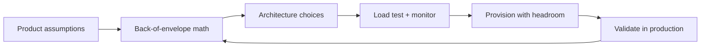

At Google, Search teams size index shards and query nodes from **QPS and p99 latency** targets. Netflix sizes API clusters from **peak concurrent streams** and regional failover. Amazon sizes checkout from **transaction rate** and **payment dependency SLAs**. The pattern is the same: estimate, build, measure, adjust.

If you skip estimation, you either **over-provision** (waste) or **under-provision** (outages). FAANG engineers are expected to do both napkin math in interviews and **ongoing** capacity reviews in production.

---

## Back-of-the-Envelope Estimation Framework

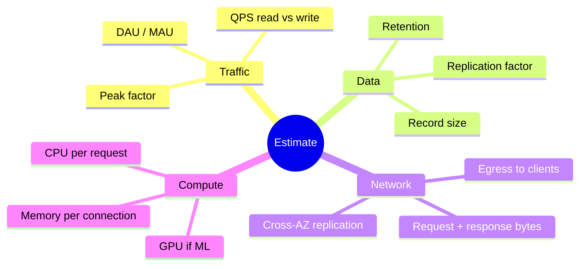

### The Four-Question Checklist

| Step | Question | Typical mistake |
|------|----------|-----------------|
| 1 | Who uses it and how often? | Using average instead of peak |
| 2 | What is one request worth in bytes and CPU? | Ignoring serialization overhead |
| 3 | How long do we keep data? | Forgetting indexes and backups |
| 4 | What happens when a region fails? | Planning 1x instead of failover load |

### Worked Template (fill in numbers)

```
Peak QPS        = DAU × actions_per_user_per_day / 86400 × peak_factor
Storage/year    = records_per_day × bytes_per_record × retention_days × replication
Egress Gbps     = peak_QPS × (request_bytes + response_bytes) × 8 / 1e9
App servers     = peak_QPS / (single_host_QPS × target_utilization)
```

State assumptions explicitly—clarity beats precision in RFCs and interviews.

---

## QPS: From DAU to Peak Queries Per Second

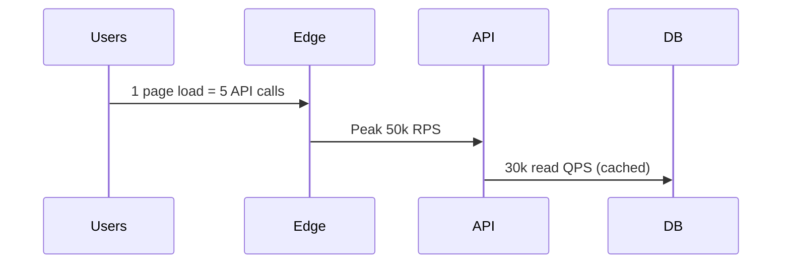

### Core formula

For a single API:

\[
\text{QPS}_{\text{avg}} = \frac{\text{DAU} \times \text{requests per user per day}}{86{,}400}
\]

\[
\text{QPS}_{\text{peak}} = \text{QPS}_{\text{avg}} \times \text{peak factor}
\]

| Scenario | Peak factor | Why |
|----------|-------------|-----|
| Global consumer app | 3–5× | Time zones + evening spikes |
| US-only B2B | 2–3× | Business hours |
| Live event (sports, drop) | 10–50× | Viral moment |
| Batch / cron | 1× (scheduled) | You control the spike |

### Example: Twitter-like timeline read

- DAU: 200M (Meta-scale social is larger; this is illustrative)
- Each user refreshes feed 20×/day → 4B feed reads/day
- Each feed read = 1 timeline API call (CDN handles media)

```
QPS_avg = 4e9 / 86400 ≈ 46,300
Peak (5×) ≈ 231,500 QPS for timeline service
```

**Fan-out:** If home timeline is precomputed (push model), **write QPS** on post = followers × post rate matters more than read QPS. Twitter historically blended push/pull; Meta uses aggressive ranking caches.

---

## Storage Estimation

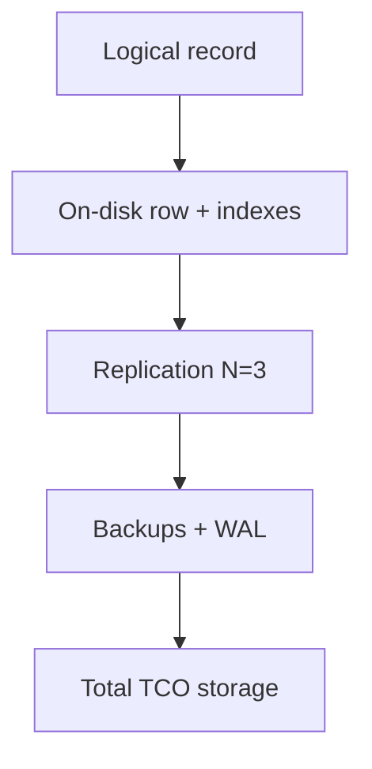

### Formula

\[
\text{Storage} = \text{records} \times \text{bytes per record} \times (1 + \text{index overhead}) \times \text{replication} \times \text{retention factor}
\]

| Component | Overhead hint |
|-----------|----------------|
| B-tree indexes | 20–100% of row data |
| JSON in Postgres | Higher than normalized rows |
| S3 + metadata | Small objects hurt (listing cost) |
| Kafka | Retention × partition replicas |

### Example: Video upload metadata

- 10M uploads/day
- Metadata row: 2 KB (user id, video id, status, codecs, regions)
- 7-year retention for compliance → records ≈ 10M × 365 × 7 ≈ 25.5B rows (upper bound if never deleted; usually TTL applies)

Practical: **1 year** hot in DB, cold in object store:

```
Daily new data = 10M × 2 KB = 20 GB/day
Year 1 DB ≈ 7.3 TB raw; ×3 replicas ≈ 22 TB
Video bytes in S3 separate (see bandwidth)
```

---

## Bandwidth Estimation

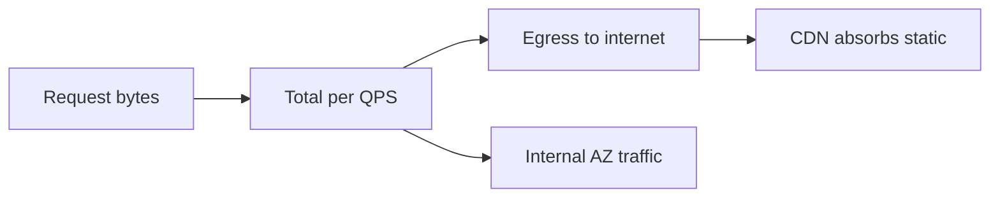

\[
\text{Bandwidth (bits/s)} = \text{QPS}_{\text{peak}} \times (\text{req bytes} + \text{resp bytes}) \times 8
\]

| Service type | Dominant cost |
|--------------|----------------|
| JSON API | Response size × QPS |
| Video upload | Ingress to storage; multipart |
| Video playback | CDN egress (Netflix Open Connect) |
| Chat | Small messages; connection count |

### Example: Video upload service

- Peak 5k concurrent uploads
- Average 5 Mbps ingress per stream (consumer uplink limited)

```
Ingress ≈ 5000 × 5 Mbps = 25 Gbps peak (region)
```

Control plane API separate: 500 QPS × 4 KB response ≈ 16 Mbps—negligible vs video.

### Cross-AZ and replication

AWS charges for **data transfer between AZs**. If each write is replicated 2× across AZs, multiply internal bandwidth. Google and Meta run custom networks; the **math still applies** for design reviews.

---

## Powers of Two (Every Engineer Should Know)

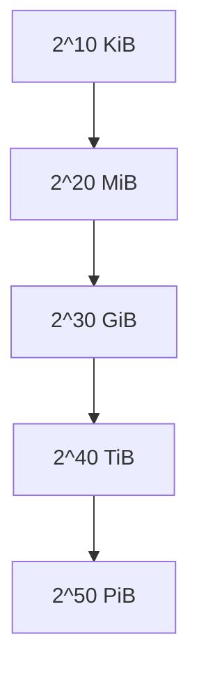

| Power | Exact bytes | Approx decimal | Mnemonic |
|-------|-------------|----------------|----------|
| 2^10 | 1,024 | ~10^3 | 1 KB (KiB) |
| 2^20 | 1,048,576 | ~10^6 | 1 MB (MiB) |
| 2^30 | 1,073,741,824 | ~10^9 | 1 GB (GiB) |
| 2^40 | ~1.1×10^12 | ~10^12 | 1 TB (TiB) |
| 2^50 | ~1.1×10^15 | ~10^15 | 1 PB (PiB) |

**Interview tip:** Use **powers of two** for memory and **powers of ten** for disk marketing labels—but know both. A “1 TB” SSD is often 10^12 bytes; RAM is 2^40.

1 billion requests/day ≈ **11,574 average QPS**.

---

## Latency Numbers Every Engineer Should Know

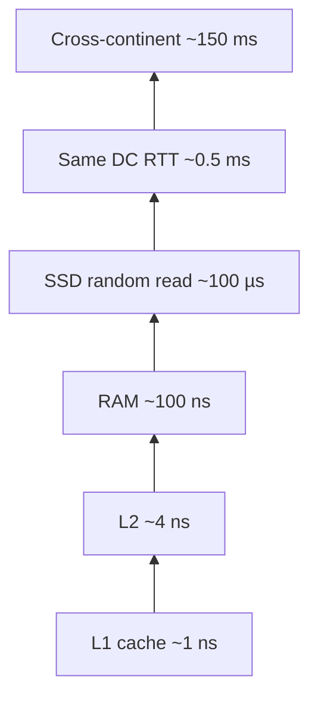

| Operation | Order of magnitude | Implication |
|-----------|-------------------|-------------|
| L1 cache reference | 1 ns | CPU-bound tight loops matter |
| DRAM reference | 100 ns | In-memory caches win |
| SSD random read | 100 µs | Local SSD ≠ RAM |
| Round trip same datacenter | 0.5 ms | Chatty RPC hurts |
| Redis/Memcached RTT | 0.5–1 ms | One cache hop per request budget |
| Cross-region RTT | 50–150 ms | Put data near users |
| Read 1 MB from memory | 3 µs | Bandwidth is huge in-process |
| Read 1 MB over 1 Gbps network | 10 ms | Payload size matters |

**Google SRE culture:** p50 is vanity; **p99 and p999** drive capacity. If p99 doubles, you may need **2× nodes** for the same SLA if you're near CPU limits.

**Little's Law:** \(L = \lambda W\) — rising latency under fixed arrival rate means growing queues; cap concurrency and set timeouts.

---

## Capacity Planning Process: Forecast, Provision, Validate

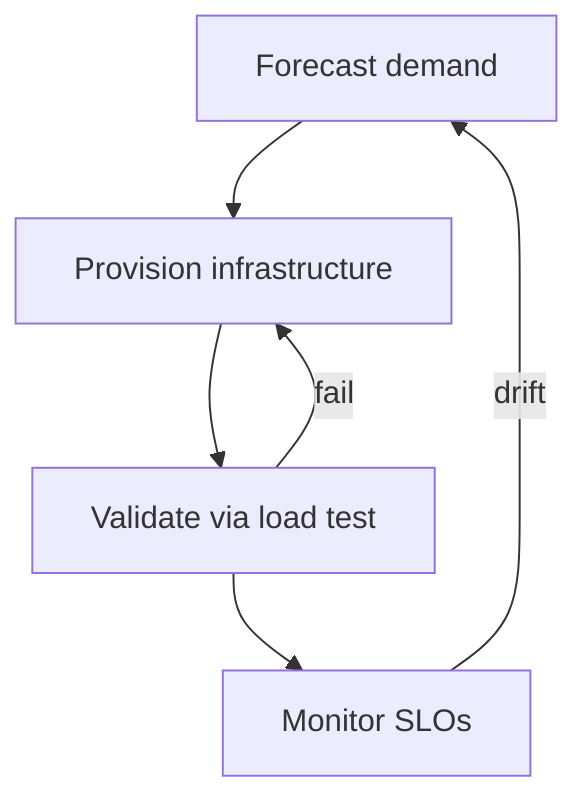

| Phase | Activities | FAANG example |
|-------|------------|---------------|
| Forecast | Growth model, launches, seasonality | Amazon peak retail forecasting |
| Provision | Autoscale bounds, reserved capacity, quotas | Google Borg cell allocation |
| Validate | Load test, game days, chaos | Netflix Simian Army heritage |
| Operate | Dashboards, alerts, weekly capacity review | Meta “who owns the hot shard” |

### Forecast inputs

- Product roadmap (new country, new feature with 10× payload)
- Marketing events
- Efficiency projects (30% CPU drop → defer hardware)

### Provision outputs

- Min/max instance counts
- Database IOPS and connection pools
- Kafka partition count (cannot shrink easily)

### Validate gates

- **Soak test:** 24–72 hours at 80% peak
- **Spike test:** 0 → peak in minutes
- **Failover test:** region down at peak load

---

## Headroom and Burst: Why 3× Not 1×

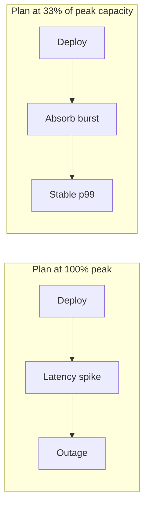

| Reason for headroom | Explanation |
|---------------------|-------------|
| Deployments | Rolling restart removes capacity temporarily |
| Noisy neighbor | VMs share hosts; spikes happen |
| Cache cold start | New pods = empty local cache |
| Failover | Lose a zone → rest absorbs 2× local load |
| Attack / viral | Unexpected traffic |

**Target utilization:** Many teams aim for **40–60% CPU** at peak on stateless tiers so autoscale has time to react. Data stores target **70% disk** max with compaction headroom.

**Burst vs sustained:** Autoscale handles minutes; **provisioned capacity** handles hours. Netflix pre-positions capacity for global launch windows.

---

## Auto-Scaling Policies

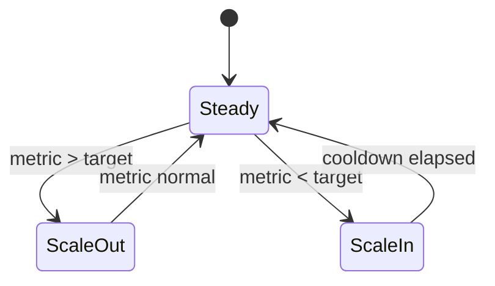

| Policy type | How it works | Best for |
|-------------|--------------|----------|
| Target tracking | Keep CPU/RPS at set point | Stateless APIs |
| Step scaling | +N instances per threshold breach | Batch workers |
| Predictive | ML on historical curves | Daily predictable peaks |
| Scheduled | Scale before known event | Black Friday, stream finale |

**Caution:** Scale **out** fast, scale **in** slow. Databases are usually scaled manually.

### Kubernetes HPA (concept)

Set `minReplicas`/`maxReplicas`, target **~55% CPU**, fast scale-up and **5+ minute** scale-down stabilization so new pods warm caches before traffic shifts away.

---

## Real-World Sizing Examples

### Twitter-like feed (read-heavy)

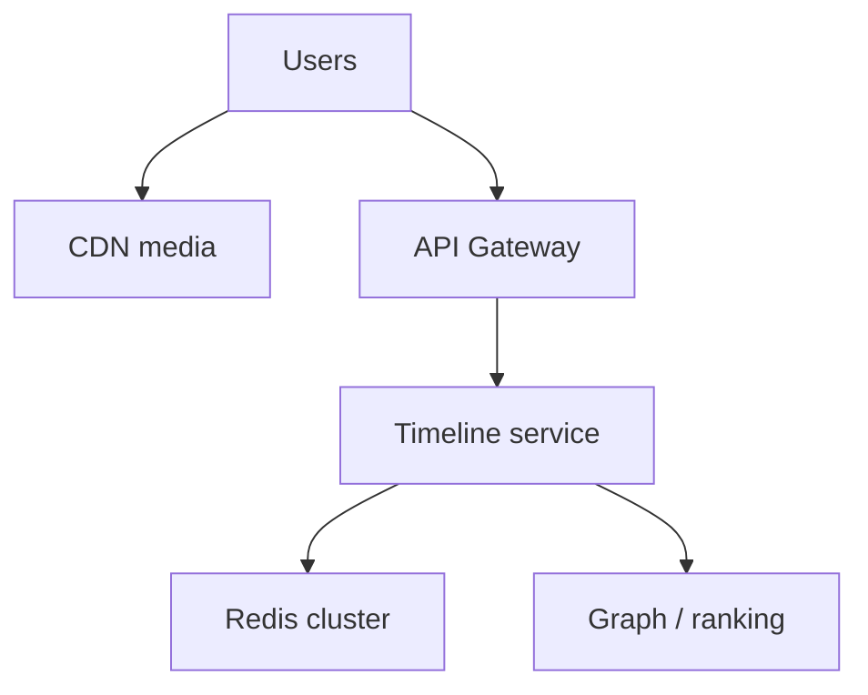

| Assumption | Value |
|------------|-------|
| Peak timeline QPS | 250k |
| Cache hit rate | 90% |
| Backend miss QPS | 25k |
| p99 latency budget | 200 ms |

Sizing: 250k / 2k RPS per core-efficient pod ≈ **125 pods** at 80% util → plan **~190 pods** with headroom. Cache: working set of hot users—if 500M users × 2 KB hot metadata impossible; **shard by user id** and accept miss to origin.

### Video upload (write-heavy, large payloads)

- Ingress-bound; use **direct-to-S3** presigned URLs so API only signs URLs
- API: 10k sign QPS small; workers for transcode bounded by **GPU/CPU farm** queue depth
- Meta and YouTube use **async pipelines**; capacity = queue drain rate

### Chat system (5M concurrent sockets)

Size **connection memory** first (often 10–50 KB per socket), then message QPS on a partitioned log (conversation id). Meta/WhatsApp-style systems bound fan-out per device mailbox.

---

## Tools: Load Testing and Monitoring

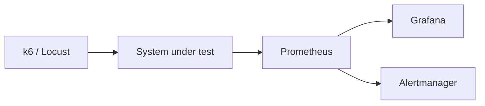

Use **k6** or **Locust** for scripted load; **Prometheus** histograms (not averages) for SLO-aligned latency.

```promql
histogram_quantile(0.99, sum(rate(http_request_duration_seconds_bucket[5m])) by (le, service))
```

---

## Python: Capacity Calculator

```python
#!/usr/bin/env python3
"""Back-of-envelope capacity calculator for interviews and RFC drafts."""

from dataclasses import dataclass


@dataclass
class TrafficProfile:
    dau: int
    requests_per_user_per_day: float
    peak_factor: float = 5.0

    @property
    def avg_qps(self) -> float:
        return self.dau * self.requests_per_user_per_day / 86_400

    @property
    def peak_qps(self) -> float:
        return self.avg_qps * self.peak_factor


@dataclass
class StorageProfile:
    records_per_day: int
    bytes_per_record: int
    retention_days: int
    replication: int = 3
    index_overhead: float = 0.3

    def total_bytes(self) -> int:
        raw = self.records_per_day * self.retention_days * self.bytes_per_record
        with_indexes = int(raw * (1 + self.index_overhead))
        return with_indexes * self.replication

    def human(self) -> str:
        b = self.total_bytes()
        for unit in ("B", "KB", "MB", "GB", "TB", "PB"):
            if b < 1024:
                return f"{b:.2f} {unit}"
            b /= 1024
        return f"{b:.2f} EB"


@dataclass
class BandwidthProfile:
    peak_qps: float
    request_bytes: int
    response_bytes: int

    def egress_gbps(self) -> float:
        bytes_per_sec = self.peak_qps * (self.request_bytes + self.response_bytes)
        return bytes_per_sec * 8 / 1e9


def servers_needed(peak_qps: float, rps_per_host: float, utilization: float = 0.6) -> int:
    import math
    return math.ceil(peak_qps / (rps_per_host * utilization))


if __name__ == "__main__":
    traffic = TrafficProfile(dau=200_000_000, requests_per_user_per_day=20, peak_factor=5)
    print(f"Peak QPS: {traffic.peak_qps:,.0f}")

    storage = StorageProfile(
        records_per_day=10_000_000,
        bytes_per_record=2048,
        retention_days=365,
    )
    print(f"Storage (approx): {storage.human()}")

    bw = BandwidthProfile(peak_qps=traffic.peak_qps, request_bytes=500, response_bytes=8000)
    print(f"Egress: {bw.egress_gbps():.2f} Gbps")

    hosts = servers_needed(traffic.peak_qps, rps_per_host=2000, utilization=0.55)
    print(f"App servers (est): {hosts}")
```

---

## k6 Load Test Script

```javascript
// save as timeline_load.js — run: k6 run --vus 100 --duration 5m timeline_load.js
import http from 'k6/http';
import { check, sleep } from 'k6';
import { Rate, Trend } from 'k6/metrics';

const errorRate = new Rate('errors');
const timelineLatency = new Trend('timeline_latency');

export const options = {
  stages: [
    { duration: '2m', target: 500 },
    { duration: '5m', target: 500 },
    { duration: '2m', target: 0 },
  ],
  thresholds: {
    http_req_duration: ['p(99)<300'],
    errors: ['rate<0.01'],
  },
};

const BASE_URL = __ENV.BASE_URL || 'https://api.example.com';

export default function () {
  const userId = `user-${__VU}`;
  const res = http.get(`${BASE_URL}/v1/timeline/${userId}`, {
    headers: { Authorization: `Bearer ${__ENV.TOKEN || 'test-token'}` },
    tags: { name: 'timeline' },
  });
  timelineLatency.add(res.timings.duration);
  errorRate.add(res.status !== 200);
  check(res, { 'status is 200': (r) => r.status === 200 });
  sleep(0.5);
}
```

---

## Key Takeaways

1. Always separate **average QPS** from **peak QPS** using an explicit peak factor.
2. Storage math must include **indexes, replication, backups**, and retention—not just row size.
3. Bandwidth dominates for **media**; CPU dominates for **JSON aggregation** at scale.
4. Know **latency orders of magnitude** so you do not put cross-region calls in the critical path.
5. Capacity is a loop: **forecast → provision → validate → monitor**, not a one-time spreadsheet.
6. Plan **headroom** for deploys, failovers, and viral spikes—target utilization below 100%.
7. Autoscale fixes **minutes** of mismatch; **provisioned** capacity fixes **hours** and failover.
8. Load test with **SLO thresholds** (p99, error rate); Prometheus histograms match those gates.

---

## FAANG Interview Questions

1. **Estimate QPS and storage** for Instagram Stories: 500M DAU, 30% post a story daily, 5 MB average video, 24-hour retention. Walk through assumptions and where CDN vs origin applies.

2. **Why would a service at 50% average CPU still outage during a launch?** Discuss headroom, cold caches, retry storms, and autoscale lag.

3. **Design a capacity review process** for a tier-1 payment API at Amazon: what metrics, what load tests, and how do you handle regional failover doubling load?

---

## Exercise

### Part A: Napkin math

A new notification service targets **80M DAU**. Each user receives **40 notifications/day** (fan-out reads). Peak factor **4×**. Each fetch returns **1.5 KB**.

1. Compute average and peak QPS.
2. Estimate egress Gbps at peak.
3. If one Redis node handles **80k read QPS** at p99 &lt; 2 ms with **70% CPU**, how many shards do you need at **50% CPU** target?

### Part B

Extend the Python calculator for WebSocket concurrency; run k6 to your computed peak QPS and capture p99.

### Part C

Draft one-page RFC: capacity assumptions, headroom, load test gates, rollback if p99 doubles.

*Module 01 — Large-Scale Best Practices*
