# Traffic Management at Scale

> When demand exceeds capacity, the goal is not to serve every request—it is to protect the system, shed low-value work, and recover without cascading failure.

---

## The Traffic Control Stack

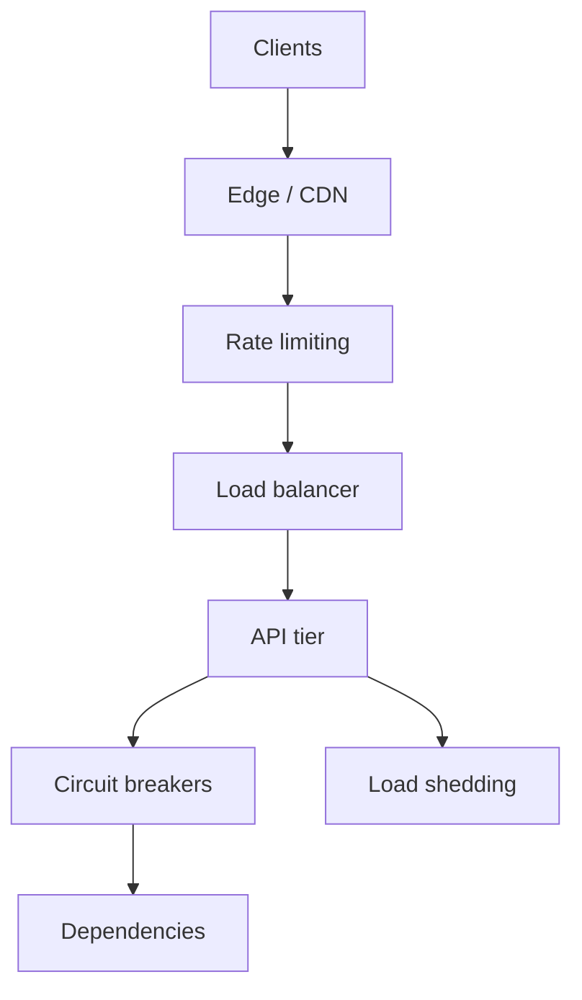

Netflix serves **250M+ subscribers** by combining **edge caching**, **regional isolation**, and **aggressive degradation** (lower bitrate before hard failure). Google Search absorbs spikes with **global load balancing**, **query shedding** for non-critical paths, and **per-tenant quotas** internally. Amazon retail protects checkout with **token buckets** and **bulkheads** around payment dependencies.

This module is about **controls** you add before the database catches fire.

---

## Load Shedding: Drop Low-Priority Work First

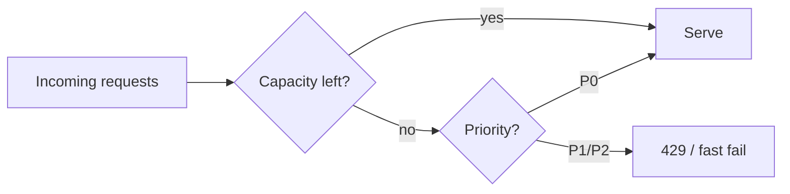

**Load shedding** rejects or short-circuits traffic when utilization crosses a threshold—unlike rate limiting, which is often per-client and proactive.

| Signal to shed | Typical threshold |
|----------------|-------------------|
| CPU / event loop lag | > 80% for 30s |
| Thread pool queue depth | > N waiting |
| Dependency error rate | Circuit open |
| Latency SLO burn | p99 > 2× budget |

### What to drop first

| Priority | Examples | User impact |
|----------|----------|-------------|
| P2 | Recommendations, “who viewed” | Invisible or delayed |
| P1 | Non-critical search facets | Partial page |
| P0 | Login, payment, message send | Must succeed or clear error |

**Meta** feed ranking may skip expensive ML stages under load; **Twitter** historically showed “fail whale” when core timeline path saturated.

### HTTP patterns

```python
# Fast reject with Retry-After (copy-paste pattern)
from fastapi import Response

def shed_response(retry_after_sec: int = 5) -> Response:
    return Response(
        status_code=503,
        headers={"Retry-After": str(retry_after_sec)},
        content='{"error":"overloaded","retryable":true}',
        media_type="application/json",
    )
```

---

## Backpressure: Slow Producers When Consumers Lag

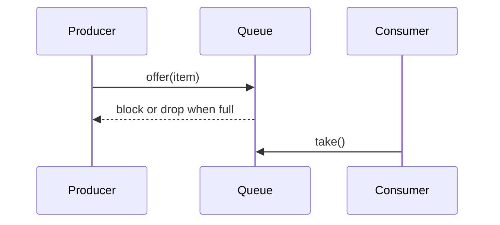

**Backpressure** propagates “slow down” upstream. Without it, unbounded queues hide overload until **GC pauses** or **OOM kills** the process.

| Mechanism | Where used |
|-----------|------------|
| Bounded channel | In-process pipelines |
| `max.inflight.requests` | Kafka consumers |
| HTTP 503 + client backoff | Sync APIs |
| gRPC flow control | Streaming RPC |

**Google** data pipelines use bounded buffers between stages; **Netflix** streaming encoders throttle ingest when transcode queues grow.

---

## Adaptive Rate Limiting

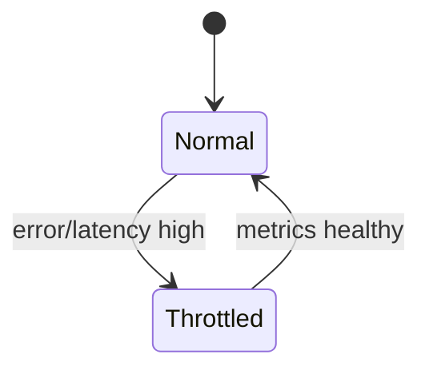

### Algorithms compared

| Algorithm | Behavior | Pros | Cons |
|-----------|----------|------|------|
| Token bucket | Steady refill; allow bursts | Smooth UX | Burst can still spike backend |
| Sliding window | Count requests in rolling window | Fair over time | More memory per key |
| Fixed window | Reset counter each minute | Simple | Boundary spikes (“double traffic”) |
| Leaky bucket | Constant drain rate | Smooth output | Less common at edge |

### Per-user quotas

- **Free tier:** 100 req/min
- **Paid API:** 10k req/min + burst bucket
- **Internal service accounts:** higher limits with audit

**Amazon API Gateway** and **Google Cloud Armor** expose token-bucket style limits; product teams map SKUs to quota tables.

### Token bucket (local, single host)

```python
import time
from dataclasses import dataclass

@dataclass
class TokenBucket:
    capacity: float
    refill_per_sec: float
    tokens: float
    last_refill: float

    def __init__(self, capacity: float, refill_per_sec: float):
        self.capacity = capacity
        self.refill_per_sec = refill_per_sec
        self.tokens = capacity
        self.last_refill = time.monotonic()

    def _refill(self) -> None:
        now = time.monotonic()
        elapsed = now - self.last_refill
        self.tokens = min(self.capacity, self.tokens + elapsed * self.refill_per_sec)
        self.last_refill = now

    def allow(self, cost: float = 1.0) -> bool:
        self._refill()
        if self.tokens >= cost:
            self.tokens -= cost
            return True
        return False
```

---

## Circuit Breakers: Open, Half-Open, Closed

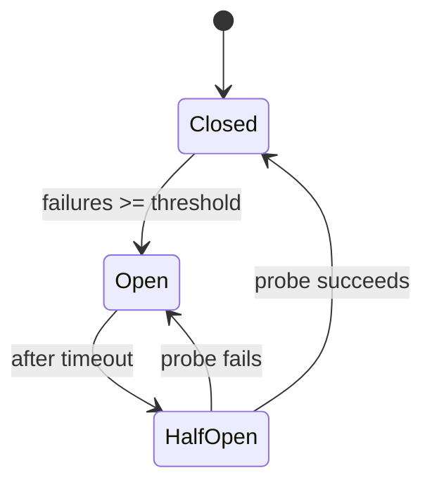

| State | Behavior |
|-------|----------|
| Closed | Normal calls; count failures |
| Open | Fail fast; no calls to sick dependency |
| Half-open | One or few probe calls |

**Netflix Hystrix** (legacy) popularized the pattern; modern stacks use **resilience4j**, **Envoy outlier detection**, or **custom breakers** in service mesh.

### Python circuit breaker

```python
import time
import threading
from enum import Enum
from typing import Callable, TypeVar

T = TypeVar("T")


class State(Enum):
    CLOSED = "closed"
    OPEN = "open"
    HALF_OPEN = "half_open"


class CircuitBreaker:
    def __init__(
        self,
        failure_threshold: int = 5,
        recovery_timeout_sec: float = 30.0,
        half_open_max_calls: int = 1,
    ):
        self.failure_threshold = failure_threshold
        self.recovery_timeout_sec = recovery_timeout_sec
        self.half_open_max_calls = half_open_max_calls
        self._state = State.CLOSED
        self._failures = 0
        self._opened_at = 0.0
        self._half_open_calls = 0
        self._lock = threading.Lock()

    @property
    def state(self) -> State:
        with self._lock:
            if self._state == State.OPEN:
                if time.monotonic() - self._opened_at >= self.recovery_timeout_sec:
                    self._state = State.HALF_OPEN
                    self._half_open_calls = 0
            return self._state

    def call(self, fn: Callable[[], T]) -> T:
        st = self.state
        if st == State.OPEN:
            raise RuntimeError("circuit open")
        if st == State.HALF_OPEN:
            with self._lock:
                if self._half_open_calls >= self.half_open_max_calls:
                    raise RuntimeError("circuit half-open saturated")
                self._half_open_calls += 1
        try:
            result = fn()
        except Exception:
            self._record_failure()
            raise
        self._record_success()
        return result

    def _record_failure(self) -> None:
        with self._lock:
            self._failures += 1
            if self._failures >= self.failure_threshold:
                self._state = State.OPEN
                self._opened_at = time.monotonic()

    def _record_success(self) -> None:
        with self._lock:
            self._failures = 0
            if self._state == State.HALF_OPEN:
                self._state = State.CLOSED
```

---

## Bulkhead Pattern: Isolate Failure Domains

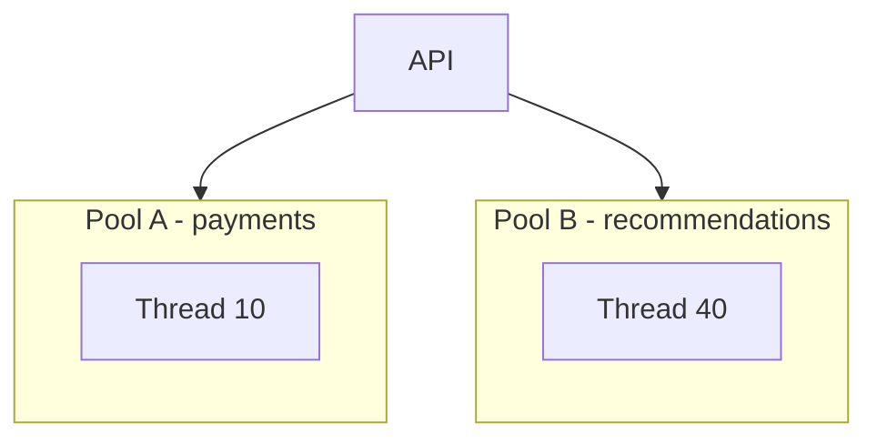

If recommendations hang, **payment threads stay free**. Implement with:

- Separate connection pools per dependency
- Kubernetes **resource quotas** per namespace
- **Cell-based architecture** (Meta/Amazon): shard users into isolated stacks

| Without bulkhead | With bulkhead |
|------------------|---------------|
| One slow DB stalls all handlers | Only checkout pool stalls |
| Retry storm hits shared pool | Retries capped per bulkhead |

---

## Graceful Degradation

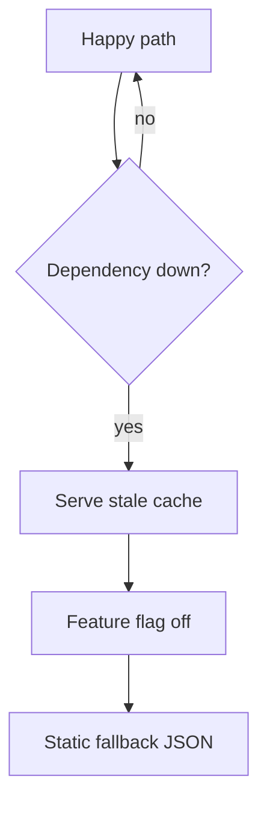

| Technique | Example |
|-----------|---------|
| Stale-while-revalidate | CDN serves 5-minute-old feed |
| Feature flags | Disable “trending topics” widget |
| Fallback responses | Default avatar, generic ranking |
| Reduced precision | Lower video bitrate (Netflix) |

**Google** may simplify result snippets under extreme load; **Meta** can disable non-essential notifications during incidents.

### Feature flag stub (SQL-backed config)

```sql
CREATE TABLE feature_flags (
    flag_name   TEXT PRIMARY KEY,
    enabled     BOOLEAN NOT NULL DEFAULT false,
    updated_at  TIMESTAMPTZ NOT NULL DEFAULT now()
);

-- Degrade recommendations under incident
UPDATE feature_flags SET enabled = false WHERE flag_name = 'home_recommendations_v2';
```

---

## Priority Queues: P0 vs P1 vs P2

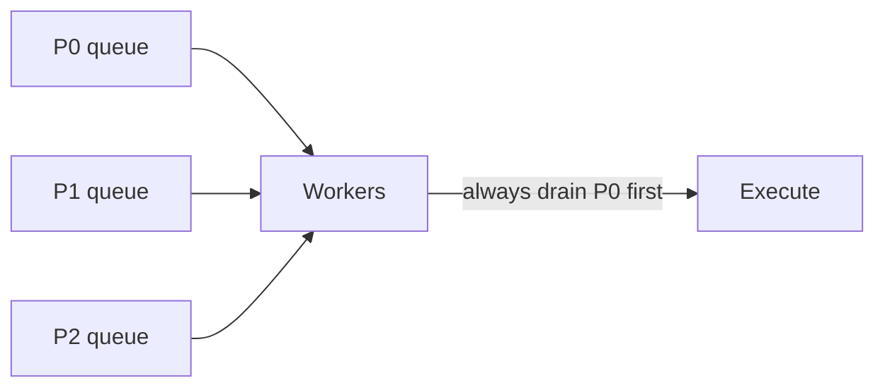

| Class | SLA hint | Scheduling |
|-------|----------|------------|
| P0 | User-blocking | Weighted fair queueing, strict precedence |
| P1 | Seconds delay OK | Served when P0 empty |
| P2 | Best effort | Drop under load |

**AWS** internal tiers use **multi-queue schedulers**; **Uber** dispatch separates safety-critical from analytics.

---

## Global Rate Limiting with Redis

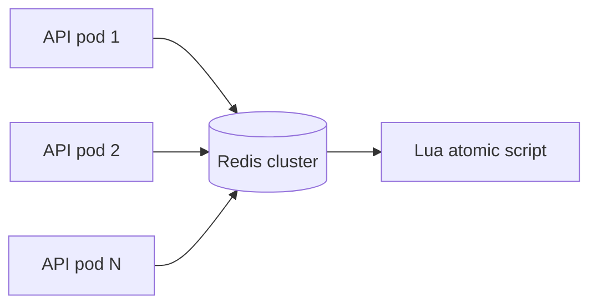

Local token buckets are wrong at scale—each pod over-admits. **Centralize** counters in Redis (or dedicated rate-limit service).

### Distributed token bucket (Lua + Redis)

```lua
-- KEYS[1] = bucket key, ARGV[1]=now_ms, ARGV[2]=capacity, ARGV[3]=refill_per_ms, ARGV[4]=cost
local data = redis.call('HMGET', KEYS[1], 'tokens', 'ts')
local tokens = tonumber(data[1]) or tonumber(ARGV[2])
local ts = tonumber(data[2]) or tonumber(ARGV[1])
local capacity = tonumber(ARGV[2])
local refill = tonumber(ARGV[3])
local now = tonumber(ARGV[1])
local cost = tonumber(ARGV[4])

tokens = math.min(capacity, tokens + (now - ts) * refill)
if tokens < cost then
  return 0
end
tokens = tokens - cost
redis.call('HMSET', KEYS[1], 'tokens', tokens, 'ts', now)
redis.call('EXPIRE', KEYS[1], 120)
return 1
```

### Python caller

```python
import redis

r = redis.Redis(host="localhost", port=6379, decode_responses=True)
SCRIPT = r.register_script(open("token_bucket.lua").read())

def allow_request(user_id: str, cost: float = 1.0) -> bool:
    key = f"rl:{user_id}"
    now_ms = int(__import__("time").time() * 1000)
    capacity = 100
    refill_per_ms = 100 / 60_000  # 100 tokens per minute
    return bool(SCRIPT(keys=[key], args=[now_ms, capacity, refill_per_ms, cost]))
```

**Google** Front Ends use global quota systems; Redis is the interview-friendly version.

---

## Retry Storms: Jitter and Exponential Backoff

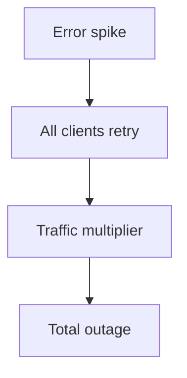

Without backoff, **503 → retry → 3× traffic** collapses recovering services. **Amazon** and **Google** client libraries embed retry policies by default—misconfigured clients cause incidents.

| Anti-pattern | Fix |
|--------------|-----|
| Immediate retry | Exponential backoff |
| Synchronized retry | **Full jitter**: `sleep = random(0, min(cap, base*2**attempt))` |
| Unlimited retries | Max attempts + circuit breaker |
| Retry on 429 ignoring `Retry-After` | Honor header |

```python
import random
import time

def backoff_sleep(attempt: int, base: float = 0.1, cap: float = 30.0) -> None:
    exp = min(cap, base * (2 ** attempt))
    time.sleep(random.uniform(0, exp))
```

**Idempotency keys** (Stripe/Amazon Pay style) let safe retries on POST without double charge.

---

## Real-World: Netflix at 250M+ Users

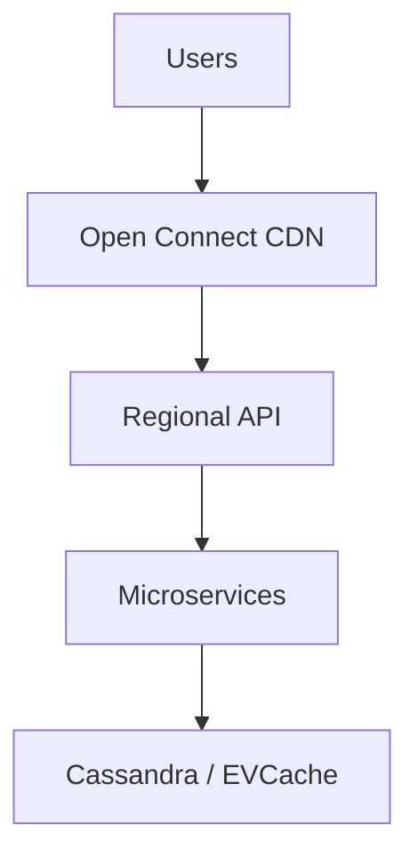

- **Regional blast radius:** failures contained per AWS region
- **EVCache** reduces hot key pressure on origin
- **Adaptive streaming** degrades quality before dropping playback
- **Hystrix-style isolation** between dependency pools (historical; patterns remain)

Chaos tooling (Simian Army heritage) validates shedding and failover before peak events.

---

## Real-World: Google Search Spikes

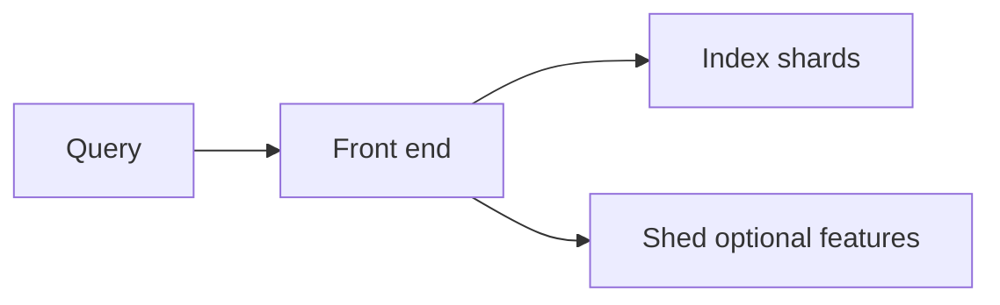

- **Query prioritization** and **timeout budgets** per stage
- **Global load balancing** steers around hot cells
- **Caching** of frequent queries reduces index QPS during news events
- Internal **quota** on expensive subsystems (freshness, deep crawl)

Search treats **tail latency** as a product metric—shedding beats slow universal failure.

---

## Backpressure with asyncio

```python
import asyncio
from asyncio import Queue

async def producer(q: Queue, n: int) -> None:
    for i in range(n):
        await q.put(i)  # blocks when queue full → backpressure
        await asyncio.sleep(0.01)

async def consumer(q: Queue) -> None:
    while True:
        item = await q.get()
        await asyncio.sleep(0.05)  # slow consumer
        q.task_done()

async def main() -> None:
    q: Queue = Queue(maxsize=50)
    prod = asyncio.create_task(producer(q, 500))
    cons = asyncio.create_task(consumer(q))
    await prod
    await q.join()
    cons.cancel()

if __name__ == "__main__":
    asyncio.run(main())
```

`maxsize` on `Queue` is the simplest in-process backpressure primitive.

---

## Traffic Patterns Comparison Table

| Pattern | Protects | User sees |
|---------|----------|-----------|
| Rate limit | Fairness, abuse | 429 + retry later |
| Load shed | Core SLO | 503 on low-priority |
| Circuit breaker | Dependency | Fast error, fallback |
| Bulkhead | Neighbor failures | Partial feature loss |
| Degradation | Latency | Stale/simpler content |
| Backpressure | Memory | Slower ingest |

---

## Key Takeaways

1. **Shed** low-priority traffic before your P0 path times out.
2. **Backpressure** must be explicit—unbounded queues only delay outages.
3. Combine **token bucket** (burst) with **sliding window** (fairness) for public APIs.
4. **Circuit breakers** fail fast; pair with **half-open probes** to recover safely.
5. **Bulkheads** stop one dependency from starving the rest of the fleet.
6. **Degrade** with stale cache and feature flags before hard failure.
7. **Global limits** need shared state (Redis)—per-pod limits multiply by replica count.
8. Retries require **jitter**, caps, and **idempotency**—otherwise you amplify incidents.

---

## FAANG Interview Questions

1. Design **global rate limiting** for a public GraphQL API at Meta scale: per-user, per-app, and burst handling. Where do counters live? What fails open vs closed?

2. A dependency latency doubles and error rate hits 5%. Walk through **circuit breaker**, **bulkhead**, and **retry** settings you would change—and what you would *not* change.

3. Explain how **Netflix** would protect playback during a regional API degradation. Which controls are automatic vs operator-driven?

---

## Exercise

### Part A: Design

For a chat service with **send (P0)** and **read receipts (P2)**, document shedding order, queue depths, and HTTP status codes.

### Part B: Code

1. Wire the `CircuitBreaker` around a flaky HTTP client; log state transitions.
2. Implement Redis Lua limiter; prove with 100 parallel workers that global cap holds.

### Part C: Incident

Write a short postmortem outline for a **retry storm** after a 30s database failover—root cause, mitigations, prevention.

*Module 02 — Large-Scale Best Practices*
