# Deployment Strategies at Scale

> Shipping code to billions of users means assuming every release can fail—and designing switches, rollouts, and rollbacks so failure is boring, fast, and reversible.

---

## Deployment Strategy Landscape

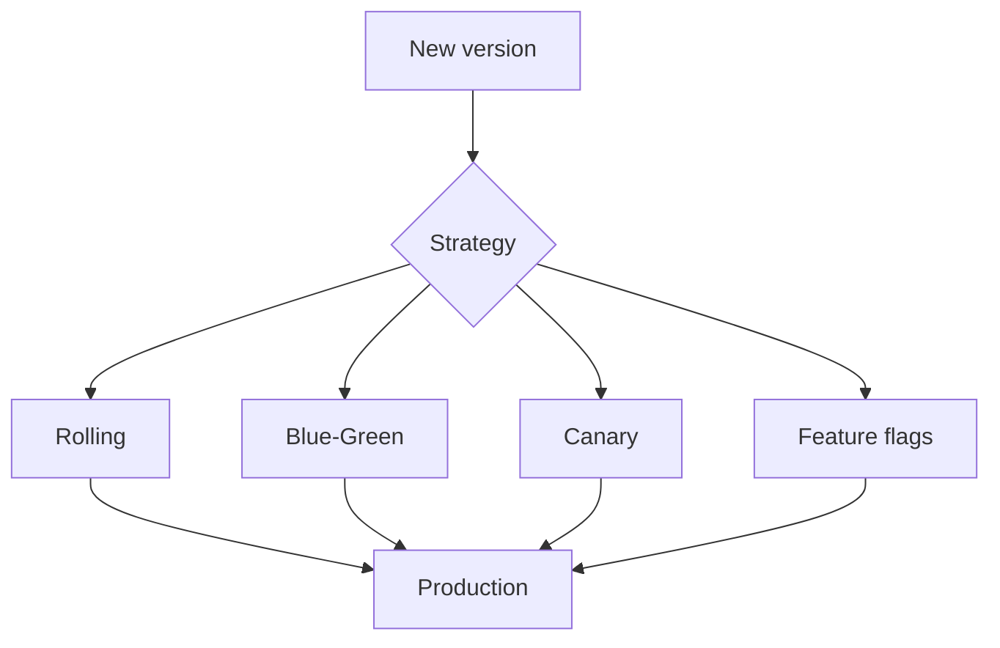

**Meta** deploys continuously to massive fleets with **gradual rollouts** and **automated health gates**. **Google** emphasizes **hermetic builds**, **canarying**, and **rapid rollback** on SLO regression. **Amazon** ties deployments to **pipeline stages** and **manual approval** for tier-1 services.

---

## Blue-Green Deployment

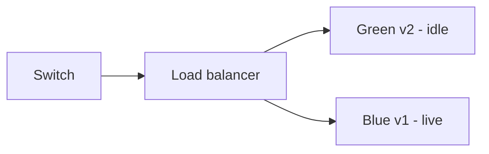

| Step | Action |
|------|--------|
| 1 | Deploy v2 to **green** environment (no user traffic) |
| 2 | Smoke test green (synthetic + internal dogfood) |
| 3 | Flip load balancer / DNS to green |
| 4 | Keep blue warm for **instant rollback** |

| Pros | Cons |
|------|------|
| Instant rollback (flip back) | **2× infrastructure** cost during cutover |
| Clear cutover moment | DB schema must work for both (or migrate first) |
| Simple mental model | Stateful sessions need sticky strategy |

**Netflix** uses blue-green style for some regional stacks; **Kubernetes** often approximates with two Deployments + Service selector switch.

---

## Canary Deployment: 1% → 5% → 25% → 100%

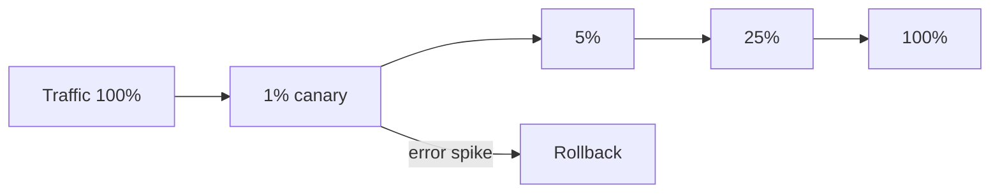

| Stage | Bake time (example) | Watch |
|-------|---------------------|-------|
| 1% | 15–30 min | Error rate, p99, business KPI |
| 5% | 30–60 min | Saturation, memory leaks |
| 25% | 1–2 h | Cache warm behavior |
| 100% | — | Continue SLO monitoring |

**Google** production changes often start with **canary cells**; **Meta** uses **gradual push** with automated abort.

### Automated rollback trigger

```yaml
# Pseudologic for release controller
rollback_when:
  - metric: http_errors_rate
    window: 5m
    threshold: "> 2x baseline"
  - metric: checkout_success_rate
    window: 10m
    threshold: "< 99.5%"
```

---

## Rolling Deployment: Pod by Pod

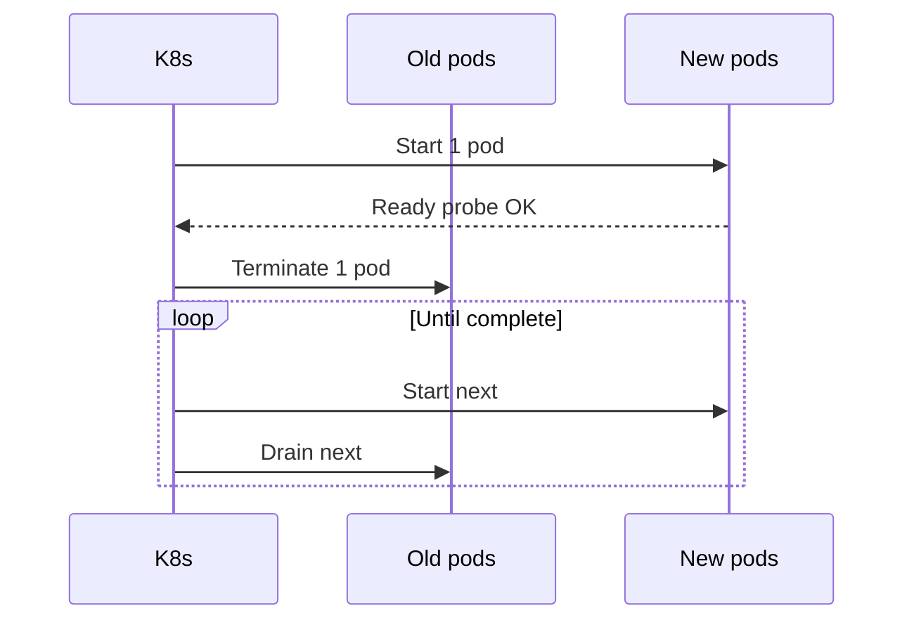

Kubernetes default **RollingUpdate**:

| Parameter | Purpose |
|-----------|---------|
| `maxSurge` | Extra pods during rollout |
| `maxUnavailable` | How many can be down |
| `readinessProbe` | Traffic only when healthy |
| `preStop` hook | Graceful connection drain |

**Risk:** Long rollouts expose **two versions** simultaneously—ensure **API compatibility** backward for at least one release.

---

## Feature Flags and Trunk-Based Development

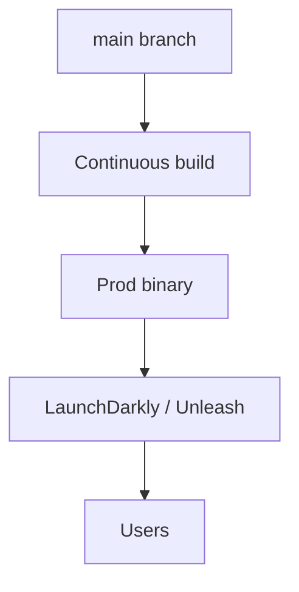

| Pattern | Benefit |
|---------|---------|
| Trunk-based dev | Small diffs; less merge hell |
| Flags in prod | Decouple **deploy** from **release** |
| Kill switch | Incident = flip flag, not emergency deploy |

**LaunchDarkly / Unleash** patterns: targeting rules (% rollout, attributes), audit log, SDK caching with local fallback.

### Python feature flag implementation

```python
import os
import hashlib
from dataclasses import dataclass
from typing import Optional

@dataclass
class FlagContext:
    user_id: str
    country: Optional[str] = None


class FeatureFlags:
    def __init__(self, env_prefix: str = "FF_"):
        self._env_prefix = env_prefix

    def is_enabled(self, flag: str, ctx: FlagContext, rollout_pct: int = 0) -> bool:
        env_key = f"{self._env_prefix}{flag.upper()}"
        if os.getenv(env_key) == "1":
            return True
        if rollout_pct <= 0:
            return False
        bucket = int(hashlib.sha256(f"{flag}:{ctx.user_id}".encode()).hexdigest(), 16) % 100
        return bucket < rollout_pct


flags = FeatureFlags()
if flags.is_enabled("new_ranking", FlagContext(user_id="u42"), rollout_pct=5):
    rank = new_ranking()
else:
    rank = legacy_ranking()
```

---

## Dark Launches and Shadow Traffic

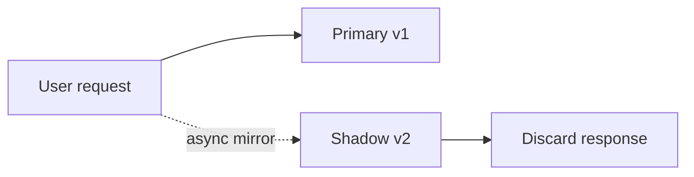

**Dark launch:** new code processes **copy** of traffic; user still sees v1 response. Catches perf bugs and logic errors without user impact.

| Use case | Caution |
|----------|---------|
| New search ranker | Shadow writes must not hit production DB |
| Payment refactor | **Never** shadow real charges without isolation |
| ML model | Compare offline metrics on shadow scores |

**Google** has used shadow indexing; **Meta** tests ranking in **holdout** pipelines.

---

## Rollback Strategies

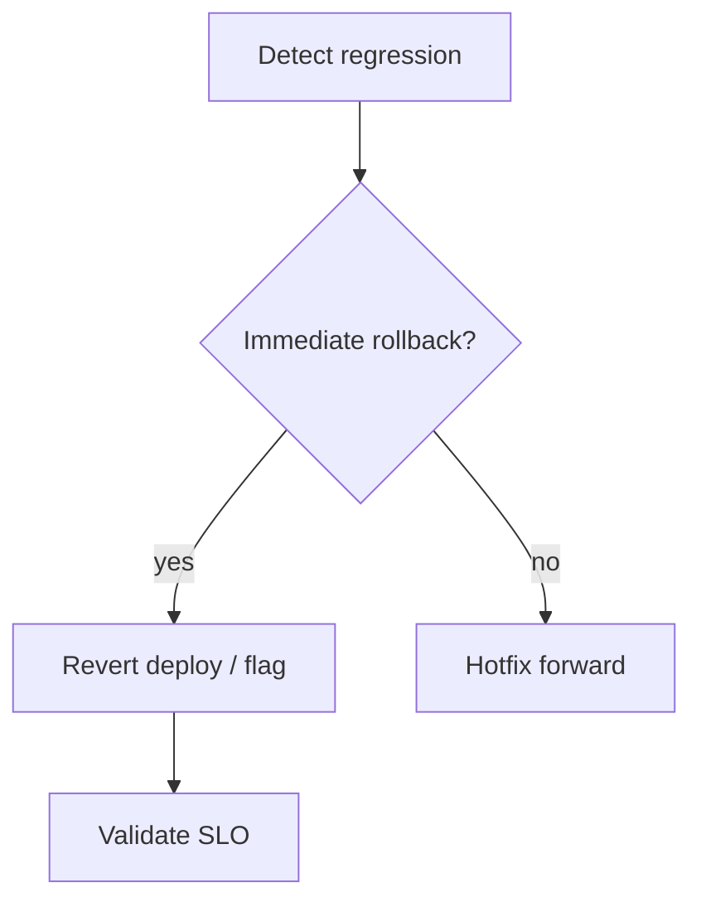

| Rollback type | Speed | Risk |
|---------------|-------|------|
| LB flip (blue-green) | Seconds | Wrong DB schema |
| K8s rollout undo | Minutes | Image still in registry |
| Feature flag off | Seconds | Code path still deployed |
| Forward fix | Hours | Pressure under incident |

### Database migration rollback challenges

- **Expand-contract** (see below) avoids destructive DDL in same release as code
- **Alembic/Flyway down** scripts often untested—treat as last resort
- **Amazon** tier-1: prefer **forward-compatible** schema + flag

---

## GitOps: Argo CD and Flux

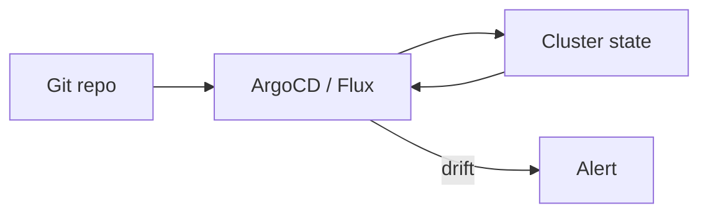

| Principle | Meaning |
|-----------|---------|
| Declarative | Desired state in Git |
| Reconciled | Controller applies diff |
| Auditable | PR = deployment record |

```yaml
# argocd Application sketch
apiVersion: argoproj.io/v1alpha1
kind: Application
metadata:
  name: checkout-api
spec:
  project: default
  source:
    repoURL: https://github.com/example/platform-gitops.git
    path: apps/checkout-api
    targetRevision: main
  destination:
    server: https://kubernetes.default.svc
    namespace: production
  syncPolicy:
    automated:
      prune: true
      selfHeal: true
```

**Google** internal CI/CD differs but same idea: **versioned config**, automated promotion.

---

## Kubernetes Deployment Strategies

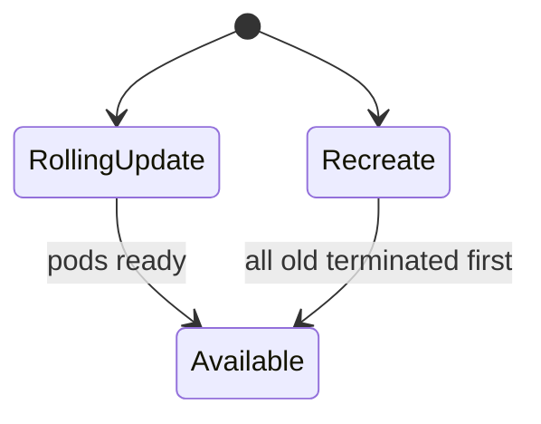

| `strategy.type` | When |
|-----------------|------|
| `RollingUpdate` | Stateless HTTP (default) |
| `Recreate` | Single-replica or incompatible versions |

### Deployment YAML

```yaml
apiVersion: apps/v1
kind: Deployment
metadata:
  name: checkout-api
  labels:
    app: checkout-api
spec:
  replicas: 20
  strategy:
    type: RollingUpdate
    rollingUpdate:
      maxSurge: 25%
      maxUnavailable: 0
  selector:
    matchLabels:
      app: checkout-api
  template:
    metadata:
      labels:
        app: checkout-api
        version: v2.4.1
    spec:
      terminationGracePeriodSeconds: 60
      containers:
        - name: api
          image: registry.example.com/checkout-api:2.4.1
          ports:
            - containerPort: 8080
          readinessProbe:
            httpGet:
              path: /health/ready
              port: 8080
            initialDelaySeconds: 5
            periodSeconds: 5
          livenessProbe:
            httpGet:
              path: /health/live
              port: 8080
            periodSeconds: 10
          lifecycle:
            preStop:
              exec:
                command: ["/bin/sh", "-c", "sleep 15"]
```

`maxUnavailable: 0` keeps capacity during rollout—common for revenue paths.

---

## Database Schema Migrations: Expand-Contract


| Phase | Code | Schema |
|-------|------|--------|
| Expand | Write old + new | Add nullable column |
| Migrate | Read new, backfill | Fill data |
| Contract | Read/write new only | Drop old column |

**Never** drop column same release users still read—**Meta** and **Google** enforce multi-phase migrations for large tables.

```sql
-- Phase 1: expand
ALTER TABLE orders ADD COLUMN total_cents BIGINT;

-- Phase 2: backfill (batched)
UPDATE orders SET total_cents = ROUND(total_dollars * 100)
WHERE total_cents IS NULL AND id BETWEEN :lo AND :hi;

-- Phase 3: contract (later release)
ALTER TABLE orders DROP COLUMN total_dollars;
```

---

## Deployment Safety: Bake Time and Error Gates

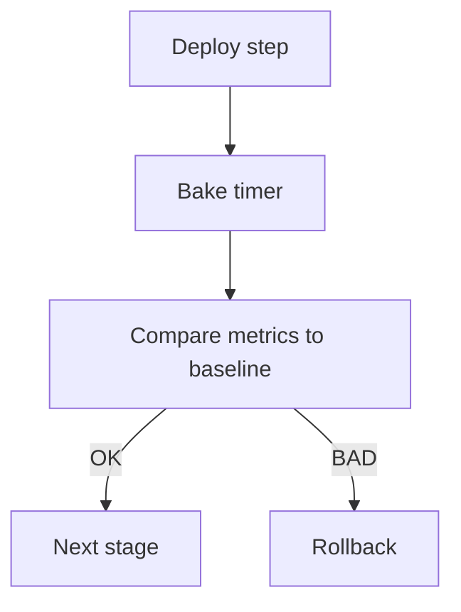

| Gate | Example |
|------|---------|
| Synthetic checks | Login, checkout happy path |
| Error rate | < 0.1% above 24h baseline |
| Latency | p99 not +20% |
| Business | Conversion within confidence interval |

**Google** “release tooling” blocks promotion on **red builds**; **Amazon** pipelines require **manual approval** for prod after automated gates.

---

## Real-World: Meta Deploys to Billions

- **High frequency** pushes to monorepo-built artifacts
- **Gradual exposure** by machine class / region / cohort
- **Feature flags** decouple risky UI from binary rollout
- **Automated revert** when guardrail metrics move
- **Deltoid**-style schedulers balance velocity vs stability (internal evolution)

Lesson: velocity comes from **automation + small batches**, not bigger bang releases.

---

## Real-World: Google Zero-Downtime Releases

- **Borg / Borgmon** heritage: health checks, task replacement
- **Canary** at cluster and request level
- **SLO-based** rollback policies
- **Binary + config** separation; config flags for risky behavior

Search and Ads cannot afford minute-long hard cuts—**progressive** replacement is mandatory.

---

## Canary with Istio

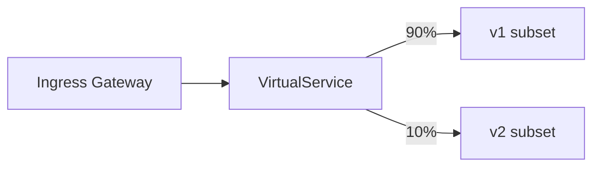

```yaml
apiVersion: networking.istio.io/v1beta1
kind: VirtualService
metadata:
  name: checkout-api
spec:
  hosts:
    - checkout-api.production.svc.cluster.local
  http:
    - route:
        - destination:
            host: checkout-api
            subset: v1
          weight: 90
        - destination:
            host: checkout-api
            subset: v2
          weight: 10
---
apiVersion: networking.istio.io/v1beta1
kind: DestinationRule
metadata:
  name: checkout-api
spec:
  host: checkout-api
  subsets:
    - name: v1
      labels:
        version: v1
    - name: v2
      labels:
        version: v2
```

Adjust weights in GitOps PRs; pair with **Flagger** for automated promotion.

---

## Strategy Comparison Table

| Strategy | Downtime | Cost | Rollback speed | Two-version window |
|----------|----------|------|----------------|--------------------|
| Recreate | Brief | Low | Redeploy old | No |
| Rolling | None | Low | Undo rollout | Yes |
| Blue-green | None | High (2 stacks) | Seconds | Optional |
| Canary | None | Medium | Shift weight | Yes |
| Flags only | None | Low | Instant | Code always multi-path |

---

## Shell: kubectl rollout inspection

```bash
#!/usr/bin/env bash
set -euo pipefail
DEPLOY="${1:-checkout-api}"
kubectl rollout status "deployment/${DEPLOY}" --timeout=300s
kubectl get pods -l "app=${DEPLOY}" -o wide
# Rollback if needed:
# kubectl rollout undo "deployment/${DEPLOY}"
```

---

## Key Takeaways

1. **Blue-green** trades cost for the fastest rollback switch.
2. **Canary** with bake time and metric gates is the default for large user bases.
3. **Rolling** needs `maxUnavailable` tuned for capacity and **readiness probes** that reflect real dependencies.
4. **Feature flags** separate deploy from release; keep kill switches for incidents.
5. **Dark launches** validate new paths without user-visible risk—isolate side effects.
6. **DB migrations** use expand-contract; never tie destructive DDL to a single code version.
7. **GitOps** makes cluster state reviewable like application code.
8. Automate **rollback on error-rate spikes**—humans are too slow at 3 a.m.

---

## FAANG Interview Questions

1. Compare **rolling**, **blue-green**, and **canary** for Amazon checkout during Prime Day. Which do you combine?

2. How would you roll out a **renamed JSON field** in a mobile API used by 2B devices? Describe expand-contract across app versions.

3. Design **Istio canary + feature flag** interaction so you can roll back UX in seconds but keep infra at 100% new binary.

---

## Exercise

### Part A: Runbook

Write a one-page rollout runbook for a **5% → 25% → 100%** canary including metrics, bake times, and rollback commands.

### Part B: Manifests

1. Extend the Deployment YAML with **PodDisruptionBudget** and **topology spread**.
2. Add Istio weights for 1% canary; document GitOps PR workflow.

### Part C: Migration

Plan three-release **expand-contract** for splitting `users.full_name` into `first_name` / `last_name` without downtime.

*Module 03 — Large-Scale Best Practices*
