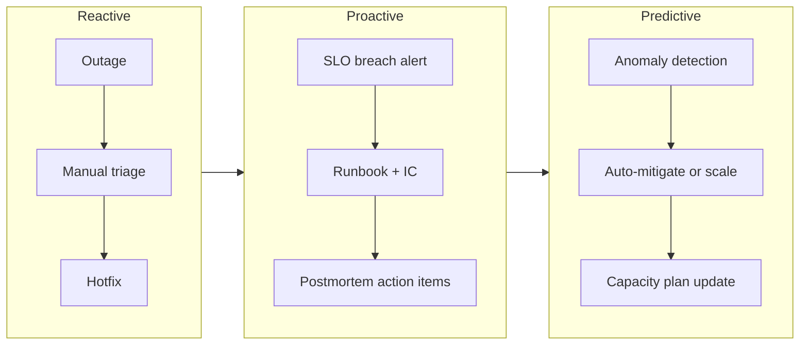
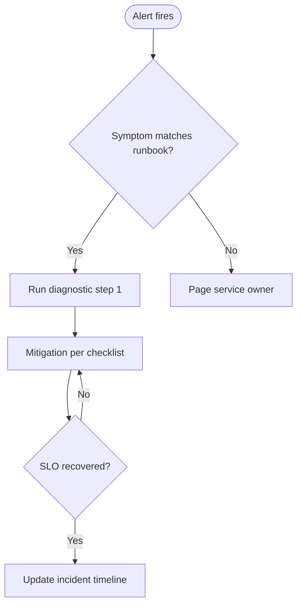
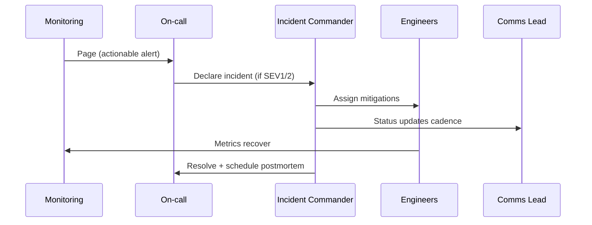
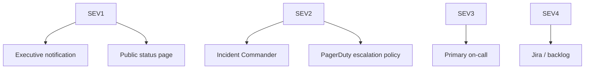
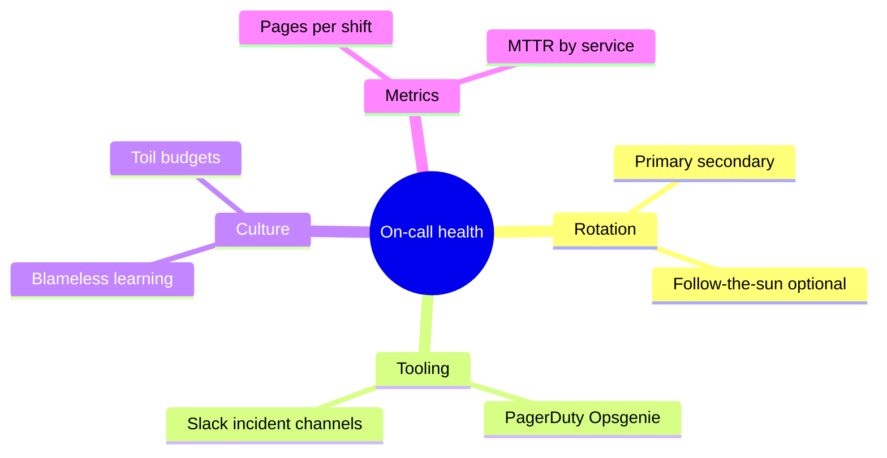
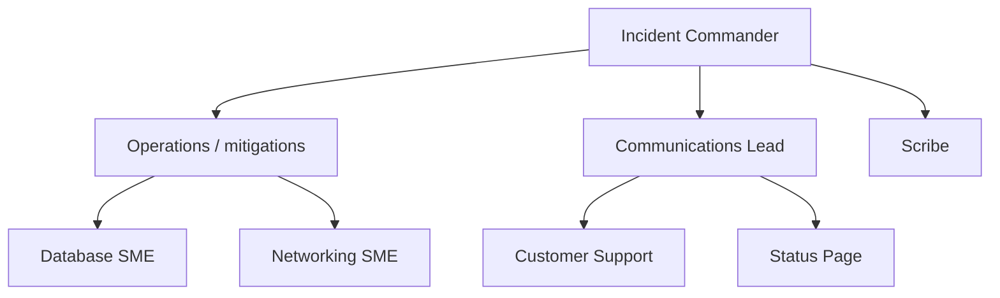
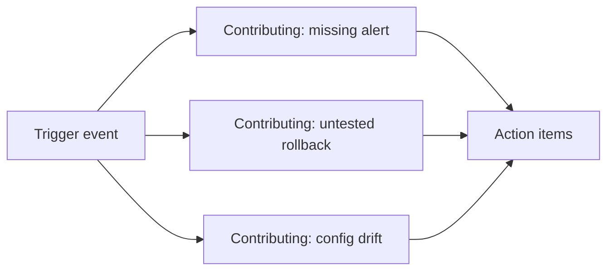
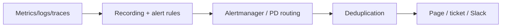
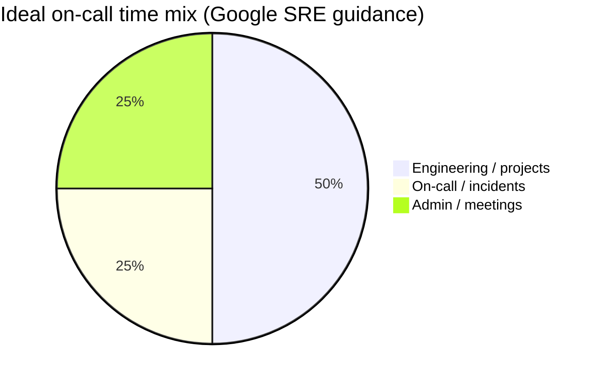

# Operational Excellence and Incident Management

> Reliable systems are built not by avoiding failure, but by detecting it fast, responding with discipline, and learning blamelessly so the same class of outage rarely happens twice.

Operational excellence at FAANG scale means treating production like a product: measurable reliability goals, rehearsed incident response, and continuous reduction of manual toil. This guide walks from reactive firefighting to predictive operations—the same vocabulary Google SRE, PagerDuty, and Cloudflare use in public postmortems and runbooks.

---

## Operational Maturity Model

Organizations move through three broad phases. Maturity is not a badge; it is observable in mean time to detect (MTTD), mean time to recover (MTTR), and how often incidents repeat.

| Phase | Focus | Typical signals | FAANG-aligned example |
|-------|--------|-----------------|------------------------|
| **Reactive** | Fix when users complain | Long MTTD, heroics, tribal knowledge | Early startup on-call via SMS |
| **Proactive** | Prevent known failures | SLOs, runbooks, game days, error budgets | Google SRE error-budget policy blocks risky launches |
| **Predictive** | Anticipate failure modes | ML on metrics, capacity forecasting, chaos in CI | Netflix runs failure injection before peak events |



**Google SRE** publishes that roughly 50% of engineering time should go to reducing toil and improving systems—not endless ticket queues. **Amazon** ties operational reviews to service ownership: every team owns its on-call rotation and postmortem backlog.

---

## Runbook Design: Structured, Executable, Version-Controlled

A runbook is not a wiki essay. It is an executable checklist an tired on-call engineer can follow at 3 a.m.

### Anatomy of a strong runbook

| Section | Purpose |
|---------|---------|
| **Metadata** | Service, owner, last reviewed, linked dashboards |
| **Symptoms** | What alerts or user reports trigger this runbook |
| **Impact** | SEV mapping, blast radius, dependencies |
| **Diagnosis** | Ordered steps with expected outputs |
| **Mitigation** | Safe changes (rollback, drain, feature flag) |
| **Escalation** | Who to page, when to declare incident |
| **Verification** | How to confirm recovery |



Runbooks live in **git** (Markdown or templated YAML) so changes go through review—same as code. **Meta** and **Google** both emphasize that runbooks are tested during game days; an untested runbook is documentation theater.

### Runbook template (copy-paste)

```yaml
# runbooks/payment-api-high-latency.yaml
apiVersion: sre.example/v1
kind: Runbook
metadata:
  name: payment-api-high-latency
  service: payment-api
  owners:
    - team: payments-platform
  last_reviewed: "2026-10-01"
  severity_hint: SEV2
symptoms:
  alerts:
    - name: PaymentAPIP99LatencyHigh
  user_reports:
    - Checkout timeouts > 5s
impact:
  slos:
    - checkout_success_rate
  blast_radius: All regions using payment-api v2
diagnosis:
  - step: 1
    action: Open Grafana dashboard payment-api / RED metrics
    expect: Elevated p99 on /charge
  - step: 2
    action: Check dependency health (fraud-scorer, ledger-db)
    command: |
      kubectl get pods -n payments -l app=payment-api
      curl -s https://internal/status/fraud-scorer | jq .
mitigation:
  - step: 1
    action: Roll back last deployment if correlated with deploy time
    command: |
      argo rollouts undo payment-api -n payments
  - step: 2
    action: Enable circuit breaker flag payments.circuit_breaker_charge
escalation:
  - after_minutes: 15
    contact: pagerduty-service-payments-primary
verification:
  - metric: checkout_success_rate
    threshold: ">= 99.5% for 10m"
post_incident:
  - Link postmortem template in docs/postmortem/
```

---

## Incident Management Lifecycle

The lifecycle is linear in theory and messy in practice—but roles and phases keep chaos bounded.



| Phase | Goal | Outputs |
|-------|------|---------|
| **Detect** | Know before social media | Alert → ticket/incident record |
| **Triage** | Severity, scope, owner | SEV level, IC assigned |
| **Mitigate** | Restore service or contain | Rollback, failover, rate limit |
| **Resolve** | Root fix or stable workaround | Deploy, config change |
| **Postmortem** | Organizational learning | Timeline, action items, follow-up |

**PagerDuty** incident workflow: alert → dedupe → escalate policy → incident channel → resolution → retrospective integration. **Cloudflare** publishes detailed public postmortems after major outages (e.g., configuration pushes, BGP issues)—a model for transparent customer trust.

---

## Severity Levels and Escalation

Consistent severity language prevents both under-response and panic.

| Level | Definition | Response target | Escalation |
|-------|------------|-----------------|------------|
| **SEV1** | Complete outage or data loss risk | Immediate, all-hands | VP Eng, exec comms, status page |
| **SEV2** | Major degradation, no workaround | < 15 min IC engaged | Service director, customer comms |
| **SEV3** | Partial impact, workaround exists | Business hours / best effort | Team lead |
| **SEV4** | Minor, internal or cosmetic | Backlog | None |



**Amazon** popularized "COE" (Correction of Error) documents for SEV1/2—cousin to blameless postmortems. **Google** uses an incident commander structure documented in the *Site Reliability Engineering* book: one person coordinates, others execute.

### Escalation path example

```text
L1: Primary on-call (15 min)
L2: Secondary + engineering manager (15 min)
L3: Incident Commander pool + SRE liaison
L4: Product VP + customer support lead (SEV1 only)
```

---

## On-Call Best Practices

On-call is a production job, not a side quest.

| Practice | Why it matters | Example |
|----------|----------------|---------|
| **Fair rotation** | Burnout kills reliability | 1 week on, 4–6 off; no "permanent on-call" |
| **Compensation** | Time and stress are real | Extra pay or time off (common at Google, Meta) |
| **Handoff docs** | Context survives shift change | "Open incidents, risky deploys, known flakes" |
| **Alert hygiene** | Fatigue → ignored pages | SLO-based alerts, not CPU > 80% |
| **Runbook links in alerts** | MTTR drops | PagerDuty deep links to git runbook |



**Netflix** ties resilience culture to freedom and responsibility: teams own their alerts and chaos experiments. Reduce pages per person per week; if the number climbs, fix the system—not the on-call engineer.

---

## Incident Command System (ICS)

Borrowed from emergency response, adapted for software.

| Role | Responsibility |
|------|----------------|
| **Incident Commander (IC)** | Single decision maker; scope, priorities, "stop the bleeding" |
| **Communications Lead** | Internal updates, status page, support scripts |
| **Scribe** | Timestamped timeline in incident doc |
| **Subject Matter Experts** | Execute mitigations; do not all talk to executives |



**Google SRE** incident drills assign IC explicitly so no mitigation happens without coordination. Rule of thumb: **one throat to choke** for decisions; **many hands** for execution.

---

## Postmortem Culture

Blameless does not mean "no accountability." It means fixing systems and processes instead of punishing humans for triggers.

### Blameless postmortem sections

1. Summary (customer impact, duration)
2. Timeline (UTC, minute granularity)
3. Root cause vs **contributing factors** (often multiple)
4. What went well / what went poorly
5. Action items (owner, due date, tracked)

### Five Whys (use carefully)

```text
Why did checkout fail? → Payment DB connection pool exhausted.
Why? → Traffic doubled during sale.
Why? → Autoscaling lagged.
Why? → HPA max replicas too low.
Why? → Capacity review not tied to marketing calendar.  ← fix the process
```



**Cloudflare** postmortems often include technical depth (WAF rules, KV propagation) and customer-facing summaries—gold standard for transparency. Repeat incidents without completed action items are a leadership signal, not an engineer failure.

---

## Alert Design

Bad alerts train humans to ignore pages.

| Principle | Good | Bad |
|-----------|------|-----|
| **Actionable** | "SLO burn rate 14x for checkout" | "Disk 72% on prod-17" |
| **Routing** | Service-owned PagerDuty service | One mega-queue for all teams |
| **Suppression** | Maintenance windows, deploy silencing | Permanent mute on noisy check |
| **Correlation** | Group by cluster + alertname | 200 pages for one BGP flap |



**Google** monitoring philosophy: alert on **symptoms** (latency, errors, saturation) aligned to user experience, not every possible cause.

### Example Prometheus alert (actionable)

```yaml
groups:
  - name: checkout-slo
    rules:
      - alert: CheckoutErrorBudgetBurnFast
        expr: |
          (
            sum(rate(http_requests_total{service="checkout",code=~"5.."}[5m]))
            /
            sum(rate(http_requests_total{service="checkout"}[5m]))
          ) > (1 - 0.995) * 14
        for: 5m
        labels:
          severity: critical
          team: checkout
        annotations:
          summary: "Checkout error budget burning 14x — page on-call"
          runbook_url: "https://git.example.com/runbooks/checkout-error-budget.md"
```

---

## Status Pages and Customer Communication

During SEV1/2, customers need honesty, cadence, and absence of speculation.

| Audience | Channel | Cadence |
|----------|---------|---------|
| External | status.company.com | Every 30–60 min until stable |
| Support | Pre-approved templates | Real-time with IC |
| Internal | Slack #incident-* | Continuous, scribe-owned |

**Amazon** AWS Service Health Dashboard and **Cloudflare** status blog set expectations: what broke, what we did, what we will do next. Avoid "we are investigating" loops without new information.

---

## Toil Reduction and the SRE Approach

**Toil** is manual, repetitive, automatable work that scales with service growth.



| Toil example | Automation direction |
|--------------|----------------------|
| Restart stuck pods | Self-healing + proper probes |
| Manual failover | Automated health-based routing |
| Copy-paste scaling | HPA + capacity pipelines |
| Ticket-driven cert renew | cert-manager |

Track **toil percentage** per team; cap it (often cited ~50% max toil in SRE literature). **Google IMAG** (Incident Management at Google) pairs IC roles with error-budget gates and production reviews; **PagerDuty**-style automation should open channels and bridges at declaration time.

---

## Code: PagerDuty Webhook Handler

Receives `incident.triggered`, opens a Slack channel, and pins runbook links.

```python
#!/usr/bin/env python3
"""PagerDuty v3 webhook → Slack incident channel."""
import hashlib
import hmac
import json
import os
from http.server import BaseHTTPRequestHandler, HTTPServer

import requests

PD_SIGNING_SECRET = os.environ["PAGERDUTY_WEBHOOK_SECRET"]
SLACK_BOT_TOKEN = os.environ["SLACK_BOT_TOKEN"]
RUNBOOK_BASE = "https://git.example.com/runbooks"


def verify_signature(body: bytes, signature: str) -> bool:
    expected = hmac.new(
        PD_SIGNING_SECRET.encode(), body, hashlib.sha256
    ).hexdigest()
    return hmac.compare_digest(f"v1={expected}", signature or "")


def slack_channel_for_incident(incident_id: str) -> str:
    resp = requests.post(
        "https://slack.com/api/conversations.create",
        headers={"Authorization": f"Bearer {SLACK_BOT_TOKEN}"},
        json={"name": f"inc-{incident_id[:8]}", "is_private": False},
        timeout=10,
    )
    resp.raise_for_status()
    return resp.json()["channel"]["id"]


def post_message(channel_id: str, text: str) -> None:
    requests.post(
        "https://slack.com/api/chat.postMessage",
        headers={"Authorization": f"Bearer {SLACK_BOT_TOKEN}"},
        json={"channel": channel_id, "text": text},
        timeout=10,
    ).raise_for_status()


class Handler(BaseHTTPRequestHandler):
    def do_POST(self):
        length = int(self.headers.get("Content-Length", 0))
        body = self.rfile.read(length)
        if not verify_signature(body, self.headers.get("X-PagerDuty-Signature")):
            self.send_response(401)
            self.end_headers()
            return

        payload = json.loads(body)
        event = payload.get("event", {})
        if event.get("event_type") != "incident.triggered":
            self.send_response(200)
            self.end_headers()
            self.wfile.write(b"ignored")
            return

        inc = event["data"]["incident"]
        service = inc["service"]["summary"]
        inc_id = inc["id"]
        runbook = f"{RUNBOOK_BASE}/{service.lower().replace(' ', '-')}.md"

        channel = slack_channel_for_incident(inc_id)
        post_message(
            channel,
            f"*Incident*: {inc['title']}\n"
            f"*Service*: {service}\n"
            f"*Severity*: {inc.get('urgency', 'unknown')}\n"
            f"*Runbook*: {runbook}\n"
            f"*PagerDuty*: https://example.pagerduty.com/incidents/{inc_id}",
        )
        self.send_response(200)
        self.end_headers()
        self.wfile.write(b"ok")


if __name__ == "__main__":
    HTTPServer(("0.0.0.0", 8080), Handler).serve_forever()
```

---

## Code: Slack Incident Bot (slash command skeleton)

```python
"""Slack Bolt app: /incident declare SEV2 checkout latency."""
import os
from slack_bolt import App
from slack_bolt.adapter.socket_mode import SocketModeHandler

app = App(token=os.environ["SLACK_BOT_TOKEN"])


@app.command("/incident")
def open_incident(ack, body, client, respond):
    ack()
    text = body.get("text", "").strip().split()
    if len(text) < 2:
        respond("Usage: /incident declare SEV2 short description")
        return

    action, severity, *rest = text
    title = " ".join(rest) or "Untitled incident"
    channel_name = f"inc-{severity.lower()}-{body['user_id'][:6]}"

    channel = client.conversations_create(name=channel_name)["channel"]["id"]
    client.conversations_invite(channel=channel, users=body["user_id"])

    client.chat_postMessage(
        channel=channel,
        text=(
            f"*New incident*\n"
            f"*Severity*: {severity}\n"
            f"*Title*: {title}\n"
            f"*IC*: <@{body['user_id']}>\n"
            f"Roles: IC | Comms | Scribe — assign in thread."
        ),
    )
    respond(f"Opened <#{channel}> — assign Comms and Scribe.")


if __name__ == "__main__":
    SocketModeHandler(app, os.environ["SLACK_APP_TOKEN"]).start()
```

---

## SQL: MTTR by service (last 30 days)

```sql
SELECT
  service_name,
  COUNT(*) AS incident_count,
  AVG(EXTRACT(EPOCH FROM (resolved_at - declared_at)) / 60.0) AS avg_mttr_minutes,
  PERCENTILE_CONT(0.95) WITHIN GROUP (
    ORDER BY EXTRACT(EPOCH FROM (resolved_at - declared_at)) / 60.0
  ) AS p95_mttr_minutes
FROM incidents
WHERE declared_at >= NOW() - INTERVAL '30 days'
  AND resolved_at IS NOT NULL
GROUP BY service_name
ORDER BY avg_mttr_minutes DESC;
```

---

## Key Takeaways

1. Maturity progresses from reactive firefighting to proactive SLO-driven ops and predictive capacity and chaos practices.
2. Runbooks must be short, tested, and version-controlled—with symptoms, mitigation, and verification—not orphan wiki pages.
3. The incident lifecycle (detect → triage → mitigate → resolve → postmortem) needs clear roles, especially an Incident Commander for SEV1/2.
4. SEV1–SEV4 definitions and escalation paths must be shared company-wide so response matches impact.
5. On-call sustainability requires fair rotations, compensation, handoffs, and ruthless alert hygiene.
6. Blameless postmortems focus on contributing factors and tracked action items; Five Whys stops at process fixes.
7. Alerts should be actionable, routed to owners, deduplicated, and correlated—symptom-based where possible.
8. Customer communication during major incidents needs cadence and honesty; status pages build trust.
9. SRE toil reduction frees engineers to automate repeat manual work and improve MTTR structurally.
10. Automate incident declaration (webhooks, Slack bots) so timelines start accurately and runbooks are one click away.

---

## FAANG Interview Questions

1. **How would you design severity levels and escalation for a global API with 99.99% availability target? What metrics trigger SEV1 vs SEV2?**
2. **Explain blameless postmortems. How do you prevent the same incident class from recurring when root cause spans multiple teams?**
3. **Your team receives 40 pages per on-call shift. Walk through how you would reduce alert fatigue without hiding real outages.**

---

## Exercises

### Exercise 1: Runbook from scratch

Pick a fictional service `inventory-api`. Write a YAML runbook for alert `InventoryAPIHighErrorRate` including diagnosis commands, rollback steps, and verification metrics. Peer-review for ambiguity ("check database" → which dashboard?).

### Exercise 2: Tabletop incident

Run a 45-minute tabletop: SEV2 payment latency. Assign IC, Comms, Scribe. Produce a UTC timeline and three action items with owners.

### Exercise 3: Webhook integration

Deploy the PagerDuty webhook handler locally with `ngrok`, send a test payload, and document the Slack channel naming convention your org would adopt.

### Exercise 4: Postmortem draft

Read a public **Cloudflare** postmortem blog post. Draft a one-page internal version with contributing factors and measurable action items (due dates, success criteria). Bonus: refactor ten legacy CPU/memory alerts into symptom-based pages and estimate page-volume delta.
