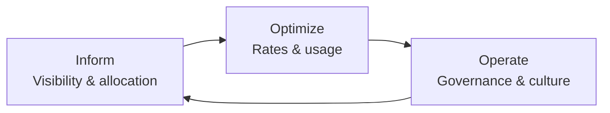
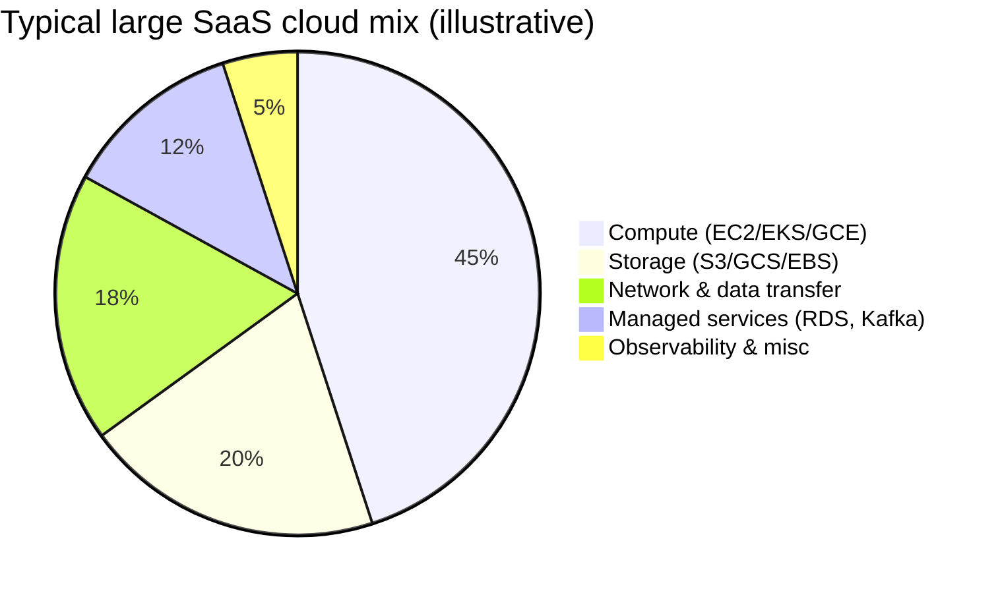
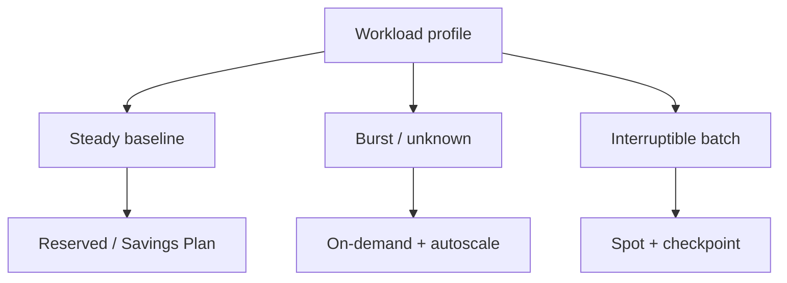
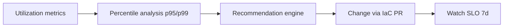
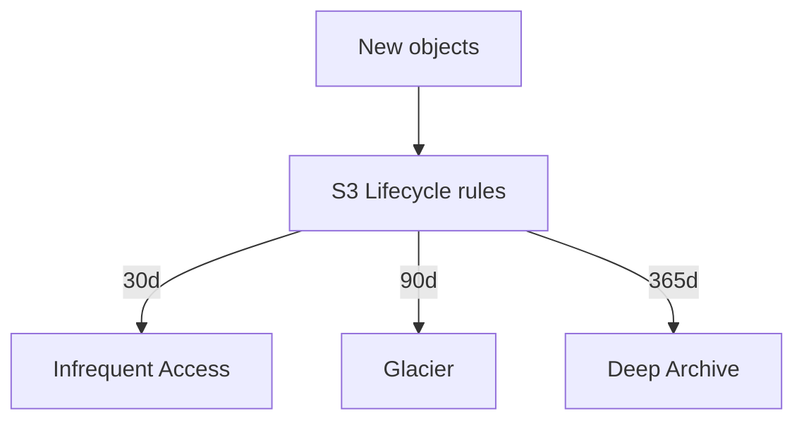
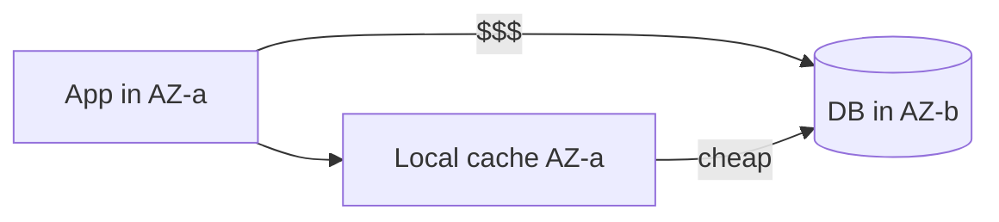
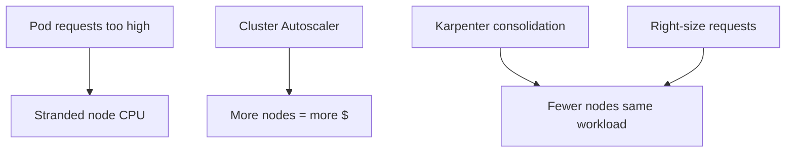
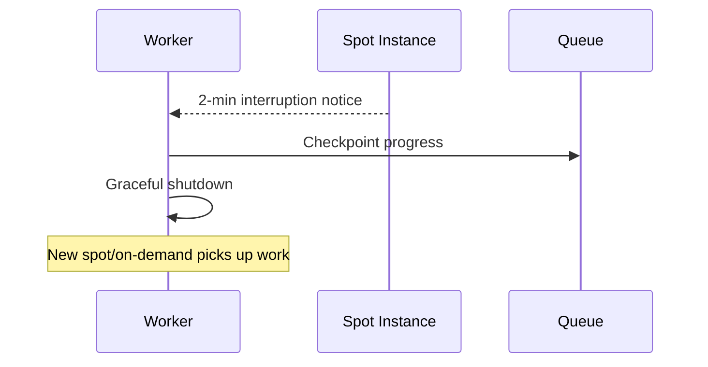
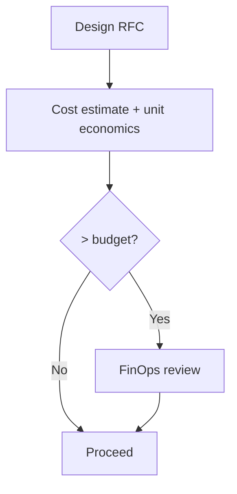

# Cost Engineering and FinOps

> Cloud bills scale faster than revenue unless engineering treats cost as a first-class metric—measured per unit of value, optimized continuously, and owned by the teams who provision resources.

FinOps is the operating model for cloud financial management: finance, engineering, and product share visibility and accountability. At Netflix-scale spend ($1B+ annually on AWS in public reporting eras) and Spotify's engineer-driven cost culture, optimization is not a quarterly spreadsheet—it is daily design review.

---

## FinOps Framework: Inform → Optimize → Operate



| Phase | Activities | Outcomes |
|-------|------------|----------|
| **Inform** | Tagging, dashboards, anomaly detection | Everyone sees who spends what |
| **Optimize** | Right-sizing, RIs, spot, tiering | Lower unit cost |
| **Operate** | Policies, budgets, FinOps rituals | Sustainable discipline |

**Amazon** built much of the cloud cost model; **Netflix** famously optimizes through custom tooling, autoscaling, and regional efficiency. **Spotify** engineers get cost feedback in deployment paths—closer to "you built it, you pay attention to its bill."

---

## Cloud Cost Anatomy

Understanding the bill prevents optimizing the wrong line item.



| Category | What drives cost | Hidden gotchas |
|----------|------------------|----------------|
| **Compute** | Instance hours, vCPU/RAM | Over-provisioned K8s requests |
| **Storage** | GB-months, API operations | Small object churn, LIST costs |
| **Network** | Egress, cross-AZ, cross-region | Replica sync across regions |
| **Data transfer** | Internet egress, NAT gateway | Logging pipelines leaving VPC |

---

## Reserved Instances vs On-Demand vs Spot

| Model | Commitment | Typical savings vs on-demand | Best for |
|-------|------------|-------------------------------|----------|
| **On-demand** | None | 0% (baseline) | Spiky, unknown workloads |
| **Reserved (1yr/3yr)** | Capacity + term | 30–72% | Steady baseline (DB, core API) |
| **Savings Plans** | $/hour commit | Similar to RI, flexible family | Mixed instance types |
| **Spot / preemptible** | None (can lose capacity) | 60–90% | Fault-tolerant batch, workers |



**Google** Committed Use Discounts and **AWS** Savings Plans mirror the same economics: pay for predictability, use spot for elasticity at the margin.

---

## Right-Sizing: Finding Over-Provisioned Resources

Right-sizing matches capacity to actual utilization (CPU, memory, IOPS, network)—not peak load from 2019.

| Signal | Tooling examples | Action |
|--------|------------------|--------|
| CPU < 20% p95 for 14d | AWS Compute Optimizer, Kubecost | Downsize instance type |
| Memory headroom > 50% | Container metrics | Lower K8s requests |
| Disk IOPS unused | CloudWatch / PD metrics | gp3 tuning, smaller volume |



**Meta** infrastructure teams historically emphasized efficiency at massive scale—custom schedulers and bin-packing reduce stranded capacity. Start with top 20 cost resources by tag.

---

## Auto-Scaling Cost Optimization

Scaling policies should add capacity late enough to save money and early enough to protect SLOs.

| Policy pattern | Cost effect | Risk |
|----------------|-------------|------|
| Target tracking CPU 70% | Balanced | Lag on sudden spikes |
| Step scaling on queue depth | Good for workers | Needs good backlog metric |
| Schedule scale-down nights | High savings for dev | Forgotten Monday traffic |
| Predictive scaling (ML) | Lower buffer capacity | Model wrong on launches |

```yaml
# Example: AWS Application Auto Scaling — scale on custom metric (queue depth)
Resources:
  WorkerAutoScalingTarget:
    Type: AWS::ApplicationAutoScaling::ScalableTarget
    Properties:
      MaxCapacity: 50
      MinCapacity: 2
      ResourceId: !Sub "service/${Cluster}/${Service}"
      ScalableDimension: ecs:service:DesiredCount
      ServiceNamespace: ecs
  WorkerScalingPolicy:
    Type: AWS::ApplicationAutoScaling::ScalingPolicy
    Properties:
      PolicyType: TargetTrackingScaling
      TargetTrackingScalingPolicyConfiguration:
        TargetValue: 1000
        PredefinedMetricSpecification:
          PredefinedMetricType: ALBRequestCountPerTarget
        ScaleInCooldown: 300
        ScaleOutCooldown: 60
```

Scale-in cooldowns prevent flapping (which costs money and destabilizes). **Netflix** aligns scaling with viewing patterns—predictable peaks, aggressive scale-in in troughs.

---

## Storage Tiering: Hot, Warm, Cold, Archive

| Tier (AWS S3 example) | Access pattern | Cost (relative) | Retrieval |
|----------------------|----------------|-----------------|-----------|
| **S3 Standard** | Frequent | $$$ | Instant |
| **S3 Intelligent-Tiering** | Unknown | $$ | Auto-moves |
| **S3 Standard-IA** | Monthly | $$ | Per-GB fee |
| **S3 Glacier Instant** | Rare, ms access | $ | Low |
| **S3 Glacier Deep Archive** | Years | ¢ | Hours |

**GCS** analog: Standard → Nearline → Coldline → Archive.



Lifecycle policies must be IaC-reviewed—accidental Glacier on hot logs is a common incident.

---

## Data Transfer: The Hidden Killer

| Path | Often expensive because... | Mitigation |
|------|---------------------------|------------|
| **Cross-AZ** | Charged per GB in many clouds | Zone-aware clients, local caches |
| **Cross-region** | Replication + egress | Single primary region for writes |
| **Internet egress** | Highest $/GB | CDN, compress, edge caching |
| **NAT Gateway** | Per-GB processing | VPC endpoints for S3/DynamoDB |



**Amazon** documents data transfer pricing explicitly—FinOps teams build "egress budgets" per product line.

---

## Kubernetes Cost Optimization

| Lever | Detail |
|-------|--------|
| **Requests vs limits** | Requests drive scheduling & cluster size; limits cap bursts |
| **Cluster Autoscaler** | Adds nodes when pods pending; remove idle nodes |
| **Karpenter** | Fast node provisioning, consolidation, diverse instance types |
| **Namespaces + quotas** | Prevent one team from starving cluster |
| **HPA + VPA** | Horizontal/vertical pod autoscaling |



**Spotify** and **Datadog-scale** adopters use Kubecost or cloud-native cost views per deployment. Rule: **bill on requests**, tune limits for safety only.

---

## Cost Allocation: Tagging and Showback/Chargeback

| Strategy | Behavior | Culture impact |
|----------|----------|----------------|
| **Showback** | Teams see costs, no invoice | Awareness |
| **Chargeback** | Costs hit P&L | Strong optimization incentive |
| **Shared cost split** | Platform tax allocated by % | Fairness debates |

Required tags (example policy):

```text
cost_center, product, environment, owner_email, service
```

```sql
-- Monthly spend by product (CUR-style table)
SELECT
  DATE_TRUNC('month', line_item_usage_start_date) AS month,
  resource_tags['product'] AS product,
  SUM(line_item_unblended_cost) AS total_usd
FROM aws_cur_detailed
WHERE line_item_usage_start_date >= DATE '2026-01-01'
GROUP BY 1, 2
ORDER BY 3 DESC;
```

**Netflix** attributes spend to teams building features; untagged resources get escalated.

---

## Spot Instance Patterns

Spot works when interruptions are expected and handled.



| Pattern | Description |
|---------|-------------|
| **Replica pools** | Mix on-demand base + spot burst |
| **Checkpointing** | Save state every N minutes |
| **Idempotent tasks** | SQS visibility timeout redelivery |
| **Karpenter spot** | Replace interrupted nodes automatically |

---

## Unit Economics

Executives care about **cost per unit of value**, not total AWS line items.

| Metric | Formula | Use |
|--------|---------|-----|
| Cost per request | Monthly compute / RPS × seconds | API efficiency |
| Cost per user | Infra / MAU | Consumer apps |
| Cost per GB stored | Storage bill / TB | Media platforms |
| Cost per stream | CDN + origin / plays | Netflix-like |

```python
def unit_cost_per_million_requests(monthly_compute_usd: float, avg_rps: float) -> float:
    seconds_per_month = 30 * 24 * 3600
    requests = avg_rps * seconds_per_month
    return (monthly_compute_usd / requests) * 1_000_000
```

Track unit economics after major architecture changes—serverless migrations, DB splits, etc.

---

## How Netflix Optimizes Massive Cloud Spend (Public Themes)

Reported patterns and engineering talks emphasize:

- Custom **autoscaling** tied to demand signals
- **Regional** efficiency and workload placement
- **Reserved capacity** for baseline, **spot** for elastic transcoding/batch
- Engineer ownership: if your service costs 3× peers, that is a design review topic

Not a single FinOps tool—a **cost-aware engineering culture**.

---

## Spotify's Cost Culture

Spotify engineering blogs and conference talks highlight:

- Making cost visible in **deployment** and **dashboards**
- Teams empowered to trade features for efficiency
- Platform squads own shared services with clear allocation

---

## Code: AWS Cost Explorer Script

```python
#!/usr/bin/env python3
"""Summarize AWS costs by service for the last 30 days."""
import boto3
from datetime import date, timedelta
from collections import defaultdict

client = boto3.client("ce", region_name="us-east-1")

end = date.today()
start = end - timedelta(days=30)

resp = client.get_cost_and_usage(
    TimePeriod={"Start": start.isoformat(), "End": end.isoformat()},
    Granularity="MONTHLY",
    Metrics=["UnblendedCost"],
    GroupBy=[{"Type": "DIMENSION", "Key": "SERVICE"}],
)

totals = defaultdict(float)
for result in resp["ResultsByTime"]:
    for group in result["Groups"]:
        service = group["Keys"][0]
        amount = float(group["Metrics"]["UnblendedCost"]["Amount"])
        totals[service] += amount

for service, usd in sorted(totals.items(), key=lambda x: -x[1])[:15]:
    print(f"{service:40s} ${usd:,.2f}")
```

```bash
# Run with credentials
export AWS_PROFILE=finops-readonly
python3 aws_cost_by_service.py
```

---

## Code: Kubernetes Resource Recommendations

Uses metrics-server style data (illustrative with kubectl + python).

```python
#!/usr/bin/env python3
"""Suggest CPU/memory request changes from kubectl top pods."""
import json
import subprocess

def top_pods(namespace: str) -> list[dict]:
    raw = subprocess.check_output(
        ["kubectl", "top", "pods", "-n", namespace, "--no-headers"],
        text=True,
    )
    rows = []
    for line in raw.strip().splitlines():
        name, cpu, mem = line.split()[:3]
        rows.append({"pod": name, "cpu": cpu, "memory": mem})
    return rows

def get_requests(namespace: str, pod: str) -> dict:
    spec = json.loads(
        subprocess.check_output(
            [
                "kubectl",
                "get",
                "pod",
                pod,
                "-n",
                namespace,
                "-o",
                "jsonpath={.spec.containers[0].resources.requests}",
            ],
            text=True,
        )
        or "{}"
    )
    return spec

def main():
    ns = "production"
    for row in top_pods(ns):
        req = get_requests(ns, row["pod"])
        print(
            f"{row['pod']}: using cpu={row['cpu']} mem={row['memory']} "
            f"requests={req}  # compare p95 over 7d before lowering"
        )

if __name__ == "__main__":
    main()
```

Production teams pair this with Prometheus `container_cpu_usage_seconds_total` p95.

---

## Code: Spot Interruption Handler (EC2)

```python
#!/usr/bin/env python3
"""Poll IMDS for spot interruption notice and drain work."""
import json
import time
import urllib.request

IMDS = "http://169.254.169.254/latest/meta-data/spot/instance-action"


def spot_action_pending() -> dict | None:
    try:
        with urllib.request.urlopen(IMDS, timeout=1) as resp:
            return json.loads(resp.read())
    except Exception:
        return None


def drain():
    # Flush buffers, complete in-flight tasks, deregister from LB
    print("Draining workload before spot termination...")
    time.sleep(5)


def main():
    while True:
        action = spot_action_pending()
        if action:
            print("Spot interruption:", action)
            drain()
            break
        time.sleep(5)


if __name__ == "__main__":
    main()
```

On Kubernetes, use the **AWS Node Termination Handler** or equivalent—same signal, pod eviction flow.

---

## FinOps Operating Rituals

| Ritual | Frequency | Participants |
|--------|-----------|--------------|
| Cost review | Weekly | Eng leads + FinOps |
| Anomaly triage | Daily | Automated + owner |
| Tag compliance audit | Monthly | Platform |
| Architecture cost gate | Per major RFC | Staff engineer |



---

## Comparing Cost Tools

| Tool | Focus |
|------|-------|
| **AWS Cost Explorer / CUR** | Source of truth AWS |
| **Kubecost / OpenCost** | Kubernetes allocation |
| **CloudHealth / Apptio** | Enterprise FinOps |
| **Infracost** | IaC PR cost diffs |

**Google** Cloud Billing export to BigQuery enables SQL like the CUR example above.

---

## Key Takeaways

1. FinOps cycles Inform → Optimize → Operate; visibility without optimization is reporting theater.
2. Compute, storage, network, and data transfer each need different levers—egress often surprises teams.
3. Reserved/Savings Plans win on baseline; spot wins on interruptible work; on-demand covers uncertainty.
4. Right-sizing and Kubernetes request tuning directly shrink cluster node counts.
5. Autoscaling policies need cooldowns and the right metric (queue depth, RPS), not CPU alone.
6. Storage lifecycle rules move cold data to cheaper tiers automatically—with review to avoid latency incidents.
7. Tagging enables showback/chargeback; untagged spend is unowned spend.
8. Spot requires checkpointing, idempotency, and a stable on-demand floor for critical paths.
9. Unit economics (cost per request/user/GB) align engineering with finance.
10. Netflix and Spotify treat cost as an engineering quality attribute, not only a finance quarterly.

---

## FAANG Interview Questions

1. **A microservice's cloud cost doubled after a migration to Kubernetes. How do you diagnose whether the issue is requests/limits, data transfer, or logging?**
2. **When would you choose Savings Plans over RIs, and how do you size the commitment without stranding capacity?**
3. **Design a spot-based batch pipeline for video transcoding that survives 2-minute interruption notices without duplicate customer-visible output.**

---

## Exercises

### Exercise 1: Unit economics spreadsheet

Given 10M MAU, $400k/month infra, 2B API requests/month, compute cost per user and per million requests. Propose one architectural change and re-estimate.

### Exercise 2: Lifecycle policy

Write an S3 lifecycle JSON/IaC rule moving `logs/` to IA at 30 days and Glacier at 90. Document rollback if analytics queries need 60-day hot access.

### Exercise 3: Tag policy

Define five mandatory tags and a SQL query flagging resources missing `product` in the last month.

### Exercise 4: Karpenter vs Cluster Autoscaler

Tabletop: 30% spot, p99 latency SLO. When does Karpenter consolidation help vs hurt?

### Exercise 5: PR cost diff

Run Infracost (or mock a diff) on a Terraform change adding a cross-region RDS read replica—enumerate new cost lines (compute, storage, transfer).

---

*Next in series: testing at scale—from pyramid strategy to chaos and canary analysis.*
