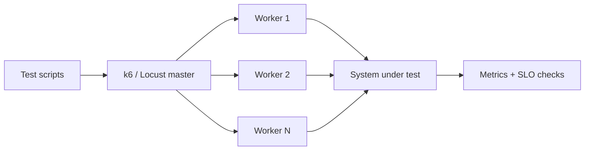
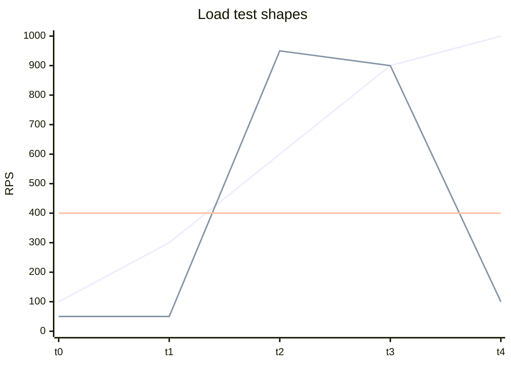
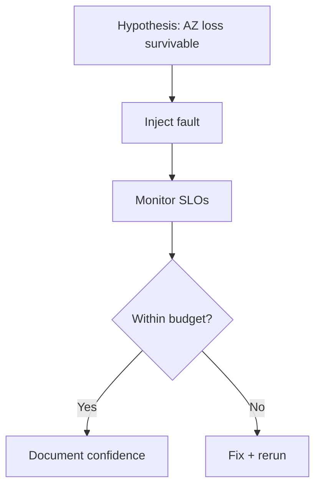
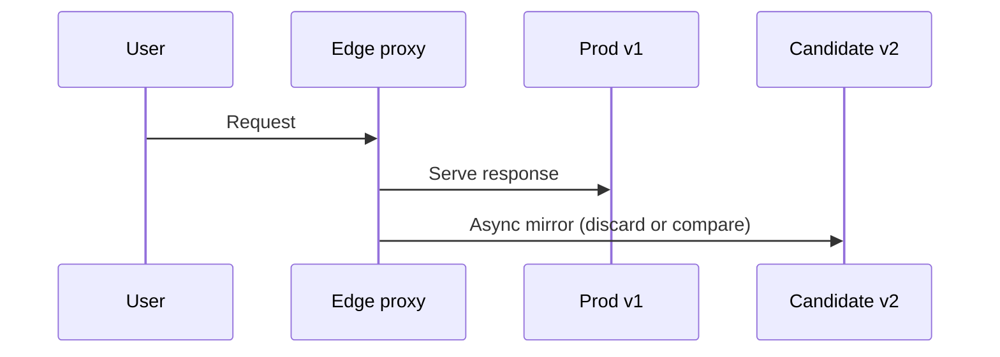
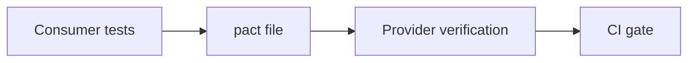
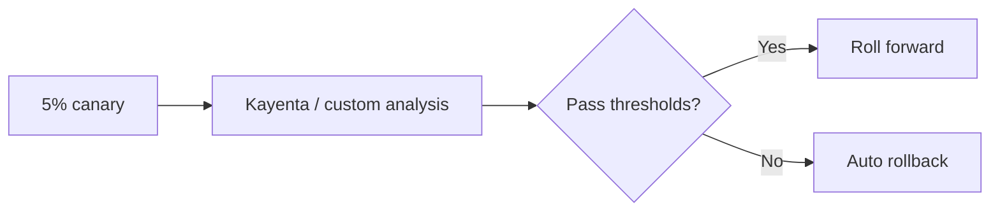
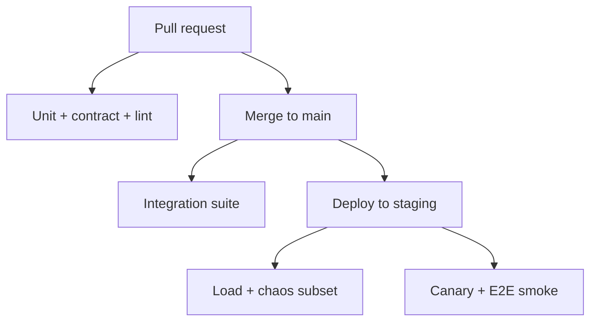
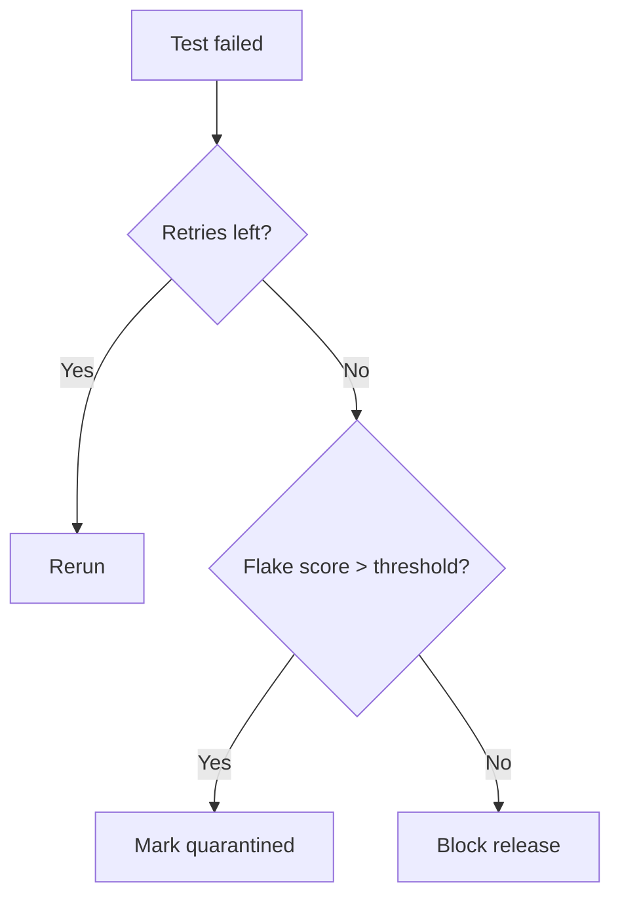

# Testing at Scale

> Shipping fast at FAANG scale depends on a test strategy that catches regressions in minutes, validates behavior under real load, and proves resilience by breaking production-like systems on purpose.

Testing at scale is not "more JUnit tests." It is a portfolio: fast unit tests by the thousands, contract tests at service boundaries, load tests that mirror traffic shape, and chaos experiments that validate assumptions Netflix and Google bake into culture.

---

## Testing Pyramid at Scale

```mermaid
pyramid
  title Testing pyramid (volume vs cost)
  "E2E / chaos" : 5
  "Contract / integration" : 15
  "Unit" : 80
```

| Layer | Scope | Speed | Where it runs |
|-------|-------|-------|---------------|
| **Unit** | Function/class | ms | Every PR |
| **Integration** | DB, queue, in-process | seconds | PR + main |
| **Contract** | API promises between services | seconds | PR on consumers/providers |
| **E2E** | User journeys | minutes | Nightly / pre-release |
| **Chaos / fault** | Resilience under failure | minutes–hours | Staging / controlled prod |

**Google TAP** (Test Automation Platform) runs enormous parallel test suites—hermetic tests, sharding, and flaky test quarantine at infra level. **Meta** test infrastructure emphasizes fast feedback and statistical signals on canaries.

---

## Load Testing: k6, Locust, Gatling

| Tool | Language | Strength |
|------|----------|----------|
| **k6** | JavaScript | Dev-friendly, Grafana cloud, CI hooks |
| **Locust** | Python | Custom user models, distributed workers |
| **Gatling** | Scala DSL | JVM shops, detailed reports |



### k6 load test (copy-paste)

```javascript
// checkout-load.js — run: k6 run checkout-load.js
import http from "k6/http";
import { check, sleep } from "k6";

export const options = {
  stages: [
    { duration: "2m", target: 100 },
    { duration: "5m", target: 500 },
    { duration: "2m", target: 0 },
  ],
  thresholds: {
    http_req_duration: ["p(95)<500"],
    http_req_failed: ["rate<0.01"],
  },
};

const BASE = __ENV.BASE_URL || "https://staging.api.example.com";

export default function () {
  const res = http.post(
    `${BASE}/v1/checkout`,
    JSON.stringify({ cart_id: "test-cart", payment_method: "card" }),
    { headers: { "Content-Type": "application/json" } },
  );
  check(res, { "status 200": (r) => r.status === 200 });
  sleep(1);
}
```

```bash
k6 run -e BASE_URL=https://staging.api.example.com checkout-load.js
```

### Locust snippet

```python
from locust import HttpUser, task, between


class CheckoutUser(HttpUser):
    wait_time = between(0.5, 2)

    @task
    def checkout(self):
        self.client.post(
            "/v1/checkout",
            json={"cart_id": "load-test", "payment_method": "card"},
        )
```

**Netflix** load tests critical paths before major releases; traffic models reflect regional peaks.

---

## Stress vs Soak vs Spike Testing

| Type | Goal | Profile | Failure mode exposed |
|------|------|---------|----------------------|
| **Stress** | Find breaking point | Ramp until errors | Thread pools, DB locks |
| **Soak** | Memory leaks, drift | Steady load 24–72h | GC, connection leaks |
| **Spike** | Sudden burst | 0 → max in seconds | Autoscale lag, queues |



Run spike tests after changing HPA/Karpenter policies—**Amazon** peak events (Prime Day) are organizational stress tests.

---

## Chaos Engineering

Chaos asks: "What happens when this fails?" before customers discover the answer.

| Tool | Origin / style | Target |
|------|----------------|--------|
| **Chaos Monkey** | Netflix (random instance terminate) | VMs / instances |
| **Gremlin** | SaaS fault platform | Broad fault catalog |
| **Litmus** | CNCF, Kubernetes-native | Pod/network chaos |



**Netflix Simian Army** (Chaos Monkey, Latency Monkey, etc.) popularized running experiments in production with guardrails. Start in staging; expand with blast radius controls.

---

## Fault Injection

| Fault | Implementation sketch | What you learn |
|-------|----------------------|----------------|
| Network delay | tc / toxiproxy | Timeout cascades |
| Packet loss | iptables / service mesh | Retry storms |
| Disk full | fill volume in test | Logging behavior |
| Process kill | SIGKILL pod | Restart policy, PDB |

```yaml
# LitmusChaos example: pod delete
apiVersion: litmuschaos.io/v1alpha1
kind: ChaosEngine
metadata:
  name: payment-pod-delete
spec:
  appinfo:
    appns: payments
    applabel: "app=payment-api"
    appkind: deployment
  chaosServiceAccount: litmus-admin
  experiments:
    - name: pod-delete
      spec:
        components:
          env:
            - name: TOTAL_CHAOS_DURATION
              value: "60"
            - name: CHAOS_INTERVAL
              value: "10"
            - name: FORCE
              value: "true"
```

---

## Shadow Traffic Testing

Replay or duplicate production traffic to a new version without serving responses to users.



| Approach | Pros | Cons |
|----------|------|------|
| **Async mirror** | No user risk | Hard for stateful writes |
| **Recorded replay** | Deterministic | Stale traffic shape |
| **Sampling** | Lower cost | Misses rare paths |

**Google** and large ads/search stacks have long used shadow indexing and query duplication; compare latency and result parity metrics.

---

## Contract Testing with Pact

Consumer-driven contracts prevent "we deployed a breaking JSON field Friday night."



### Consumer test (Python, pact-python)

```python
import pytest
from pact import Consumer, Provider

PACT_DIR = "./pacts"


@pytest.fixture(scope="module")
def pact():
    pact = Consumer("checkout-bff").has_pact_with(
        Provider("inventory-api"), pact_dir=PACT_DIR
    )
    pact.start_service()
    yield pact
    pact.stop_service()


def test_get_stock(pact):
    (
        pact.given("SKU ABC in stock")
        .upon_receiving("a request for SKU ABC")
        .with_request("GET", "/v1/stock/ABC")
        .will_respond_with(200, body={"sku": "ABC", "qty": 42})
    )
    with pact:
        import requests

        resp = requests.get(f"{pact.uri}/v1/stock/ABC")
        assert resp.json()["qty"] == 42
```

Provider side runs verification against the generated JSON pact in CI—**Spotify** and many microservice shops standardize on Pact or similar.

---

## Canary Analysis: Kayenta

Automated canary compares control vs candidate metrics statistically (not "eyeball Grafana").

| Signal | Example metric |
|--------|----------------|
| Latency | p99 HTTP |
| Errors | 5xx rate |
| Business | checkout success |



**Netflix** open-sourced **Kayenta** with Spinnaker; **Google** uses automated rollout analysis in internal delivery pipelines. Minimum effect size and trial duration matter—avoid 5-minute canaries on noisy metrics.

---

## Test Data Management

| Source | Use case | Risk |
|--------|----------|------|
| **Synthetic** | Load, unit, most CI | Unrealistic edge cases |
| **Anonymized prod** | Integration realism | Re-identification if done poorly |
| **Subset copy** | Staging refresh | Schema drift |

```python
"""Synthetic user generator — no PII."""
import random
import string


def synthetic_email() -> str:
    suffix = "".join(random.choices(string.ascii_lowercase, k=8))
    return f"loadtest_{suffix}@example.invalid"
```

**Meta** and **Google** enforce strict data handling policies; prefer synthetic unless legal approves anonymization pipelines.

---

## CI/CD Test Strategies: When Tests Run



| Stage | Tests | Budget |
|-------|-------|--------|
| **PR** | Unit, contract, static analysis | < 10 min target |
| **Main** | Integration, larger parallel | < 30 min |
| **Pre-prod** | Load, soak subsets | Scheduled |
| **Prod** | Synthetic monitors, canary | Continuous |

**Google TAP** shards tests across thousands of workers; failing fast on critical paths is a design requirement.

---

## Flaky Test Management

Flakes erode trust—teams ignore red CI.

| Tactic | When |
|--------|------|
| **Quarantine** | Flaky test blocks nobody; fix in backlog |
| **Retry (limited)** | Known external dependency flakes |
| **Root cause** | Timing, shared state, port collisions |
| **Deflake dashboard** | Track flake rate per test |



**Meta** has published approaches to flaky test detection at scale; treat flake rate as a quality metric owned by the team that wrote the test.

---

## How Google Tests at Scale (TAP Themes)

Public descriptions of TAP highlight:

- **Hermetic** tests with declared dependencies
- Massive **parallelism** and caching
- **Test size** classifications (small/medium/large) mapped to resources
- Integration with **presubmit** and **postsubmit** workflows

Goal: developers run the same tests locally (subset) and at scale in CI.

---

## Netflix Chaos Practices (Summary)

- Chaos Monkey terminates instances in **prod** (with exclusions)
- Experiments tied to **blast radius** and business hours initially
- Game days validate failover before peak streaming events
- Culture: resilience is everyone's job, not a central "chaos team only"

---

## Meta Test Infrastructure (Themes)

- Heavy investment in **internal CI** and test selection
- **Predictive test selection** (run tests likely affected by diff)
- Focus on keeping **master green** for thousands of commits/day

---

## Code: Chaos Monkey-Style Pod Killer

```python
#!/usr/bin/env python3
"""Randomly delete one pod from a deployment (staging only)."""
import os
import random
import sys
import subprocess
import json

NAMESPACE = os.environ.get("NAMESPACE", "staging")
LABEL = os.environ.get("APP_LABEL", "app=payment-api")
CONFIRM = os.environ.get("ALLOW_CHAOS", "")


def main():
    if CONFIRM != "yes-staging-only":
        print("Set ALLOW_CHAOS=yes-staging-only to run", file=sys.stderr)
        sys.exit(1)

    pods = json.loads(
        subprocess.check_output(
            [
                "kubectl",
                "get",
                "pods",
                "-n",
                NAMESPACE,
                "-l",
                LABEL,
                "-o",
                "json",
            ],
            text=True,
        )
    )["items"]
    if not pods:
        print("No pods found")
        return
    victim = random.choice(pods)["metadata"]["name"]
    print(f"Deleting pod {victim}")
    subprocess.check_call(["kubectl", "delete", "pod", victim, "-n", NAMESPACE])


if __name__ == "__main__":
    main()
```

Schedule via CronJob in staging after confirming PodDisruptionBudgets allow it.

---

## Shell: CI gate for k6 thresholds

```bash
#!/usr/bin/env bash
set -euo pipefail
k6 run --out json=results.json checkout-load.js
python3 - <<'PY'
import json, sys
data = json.load(open("results.json"))
# Simplified: fail if any threshold breached in k6 summary export
metrics = data.get("metrics", {})
failed = metrics.get("http_req_failed", {}).get("values", {}).get("rate", 0)
if failed > 0.01:
    sys.exit("Error rate threshold exceeded")
PY
```

---

## Gatling Scala skeleton (JVM teams)

```scala
import io.gatling.core.Predef._
import io.gatling.http.Predef._
import scala.concurrent.duration._

class CheckoutSimulation extends Simulation {
  val httpProtocol = http.baseUrl("https://staging.api.example.com")
  val scn = scenario("Checkout")
    .exec(http("checkout").post("/v1/checkout").body(StringBody("""{"cart_id":"g"}""")).asJson)

  setUp(scn.inject(rampUsers(500).during(5.minutes)).protocols(httpProtocol))
}
```

---

## Comparing Test Types for Microservices

| Concern | Best layer |
|---------|------------|
| Business rule correctness | Unit |
| SQL migration safety | Integration |
| Breaking API change | Contract |
| Checkout journey | E2E (few) |
| Regional failover | Chaos + load |

---

## Key Takeaways

1. The pyramid still holds at scale: many fast unit tests, fewer expensive E2E and chaos experiments.
2. Load tools (k6, Locust, Gatling) need realistic stages and SLO thresholds in CI—not just "500 users."
3. Stress, soak, and spike tests answer different questions; run all three for critical services over a release cycle.
4. Chaos engineering validates hypotheses with controlled blast radius; start in staging, automate guardrails.
5. Shadow traffic catches parity issues between versions before full cutover.
6. Pact-style contracts catch cross-team API breaks at PR time.
7. Kayenta-style canary analysis automates promote/rollback decisions with statistics, not gut feel.
8. Test data should default to synthetic; anonymized production data only with rigorous policy.
9. CI pipelines tier tests by stage (PR vs main vs deploy) to balance speed and confidence.
10. Flaky tests get quarantined and fixed with ownership—never infinite retries on main.

---

## FAANG Interview Questions

1. **How would you design a CI pipeline for 500 microservices so PR feedback stays under 10 minutes without skipping contract tests?**
2. **Explain when shadow traffic is unsafe for write-heavy paths and what mitigations you would use.**
3. **Your canary shows +2% latency but -0.1% errors—how do you decide promote vs rollback using automated analysis?**

---

## Exercises

### Exercise 1: k6 stages

Modify the checkout k6 script to model a **spike** test (100 → 2000 RPS in 30s). Define thresholds that fail the run if p99 > 800ms.

### Exercise 2: Pact round-trip

Write consumer and provider verification jobs in GitHub Actions (pseudo-YAML) that publish pact artifacts between repos.

### Exercise 3: Chaos game day

Plan a 1-hour game day: kill one AZ networking in staging, assign roles, define success as checkout SLO maintained.

### Exercise 4: Flake budget

Given a test that fails 3% of runs, design quarantine rules and a two-week deflake plan (root cause categories).

### Exercise 5: Canary metrics

Pick five metrics for a search API canary; justify which are leading vs lagging and minimum experiment duration.

---

*Series tie-in: operational excellence keeps production healthy; cost engineering keeps tests affordable at scale; testing proves both work under load and failure.*
