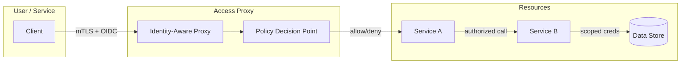
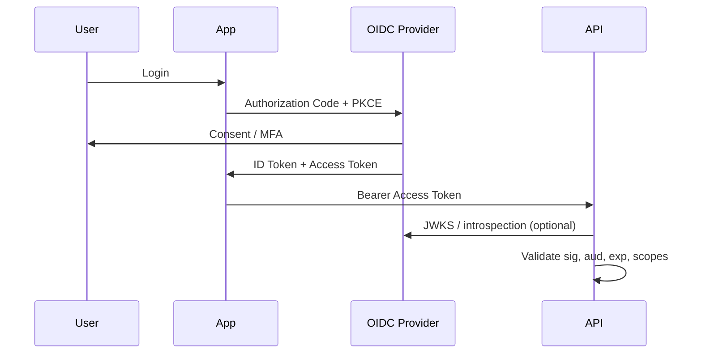
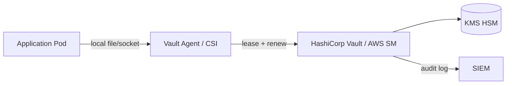
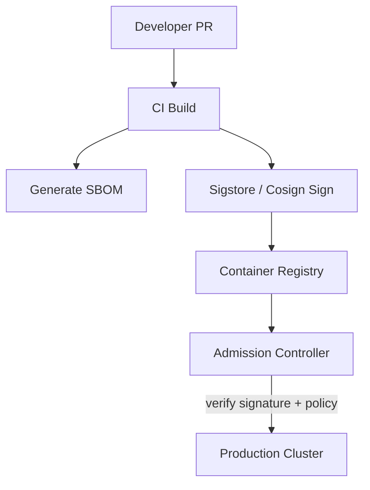
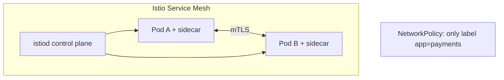
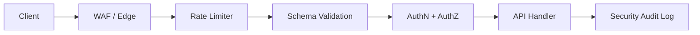
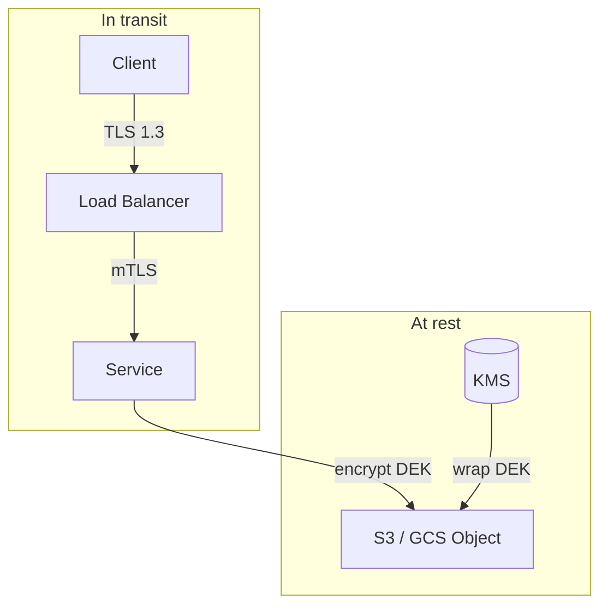
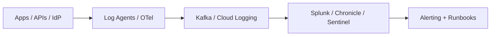
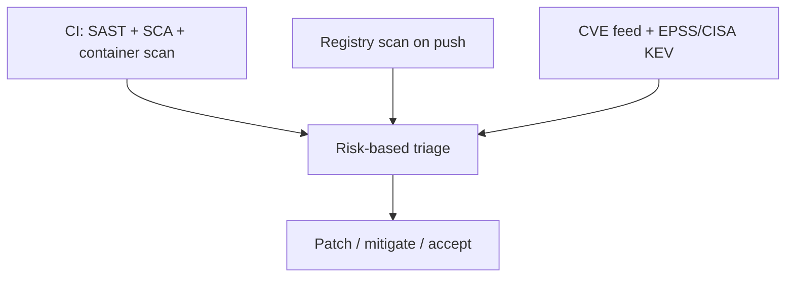
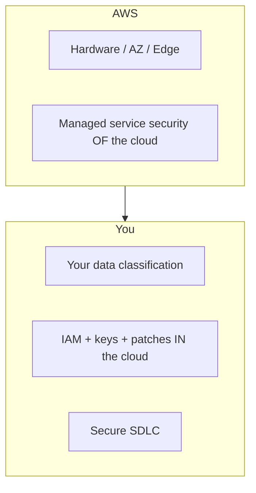

# Security Best Practices at Scale

> At hyperscale, security is not a perimeter around the data center—it is continuous verification of identity, least privilege, encrypted channels, and observable trust across every request and artifact.

---

## Why Security Breaks at Scale

When you move from a single VPC and a handful of services to thousands of microservices and millions of users, classic “castle and moat” security fails. Insider threats, compromised dependencies, and lateral movement after one breach become the norm. FAANG-scale organizations assume **breach is possible** and design so that one weak link does not collapse the whole estate.

| Era | Model | Failure mode at scale |
|-----|--------|------------------------|
| Perimeter | VPN + firewall | Stolen laptop = full internal access |
| Network zones | DMZ + trust tiers | East-west traffic unencrypted; blast radius huge |
| Zero Trust | Verify every request | Higher operational cost; pays off in containment |

This guide walks through the patterns teams at Google, Netflix, Amazon, and Meta use to ship fast without treating security as a gate at the end.

---

## Zero Trust Architecture

**Never trust, always verify.** Zero Trust means no implicit trust based on network location (corporate Wi‑Fi, “internal” IP range). Every access decision uses strong identity, device posture, policy, and context.



### Google BeyondCorp (real-world)

Google’s **BeyondCorp** uses an access proxy, device certs, MFA, and policy—not VPN trust. Cloud-native shops extend the same model to **service-to-service** calls with mesh identity and short-lived credentials. Verify every request, least privilege with TTL, assume breach, no long-lived secrets in repos.

---

## Authentication at Scale

Authentication answers: *Who is this caller?* At scale you standardize on **OAuth 2.0** (authorization framework), **OpenID Connect (OIDC)** (identity layer on OAuth), and **JWTs** (signed claims for stateless verification—with caveats).



| Mechanism | Best for | Watch out for |
|-----------|----------|----------------|
| OAuth2 Authorization Code + PKCE | User-facing web/mobile | Storing refresh tokens insecurely |
| Client credentials | Service-to-service | Token theft = full client power |
| JWT access tokens | High QPS APIs | Revocation lag; keep TTL short |
| mTLS + SPIFFE IDs | Mesh / internal RPC | Cert rotation and trust bundle ops |

### Token rotation and session hygiene

- **Access tokens**: minutes to ~15 minutes for APIs.
- **Refresh tokens**: rotate on use; bind to device or session; detect reuse (Meta/Google patterns).
- **JWT validation**: verify `iss`, `aud`, `exp`, `nbf`; use JWKS with cache and key rollover; never trust unsigned `alg=none`.

### Amazon-scale pattern

AWS **IAM Roles for Service Accounts (IRSA)** and **instance/workload identity** avoid embedding static keys in EC2/EKS tasks. Applications receive short-lived credentials from the control plane—same idea as GCP Workload Identity and Azure Managed Identity.

---

## Authorization Patterns: RBAC, ABAC, ReBAC

Authentication ≠ authorization. Authorization answers: *Is this identity allowed to perform this action on this resource?*

```mermaid
flowchart TB
  subgraph RBAC["RBAC"]
    R1[Role: editor]
    R1 --> P1[perm: write doc]
  end
  subgraph ABAC["ABAC"]
    A1[subject.dept = eng]
    A2[resource.class = internal]
    A1 --> POL{Policy engine}
    A2 --> POL
  end
  subgraph ReBAC["ReBAC (Zanzibar)"]
    T1[user:alice#viewer@doc:123]
    T2[group:eng#member@folder:reports]
    T1 --> Z[Tuple store + zookies]
    T2 --> Z
  end
```

| Model | Expressiveness | Ops complexity | Example use |
|-------|----------------|----------------|-------------|
| RBAC | Roles → permissions | Low | Admin consoles, coarse API scopes |
| ABAC | Attributes + policies | Medium | Data classification, region rules |
| ReBAC | Relationship tuples | High (worth it) | Google Drive, social graphs, multi-tenant SaaS |

### Google Zanzibar and SpiceDB

**Zanzibar** is Google’s global authorization system (trillions of checks/sec). It stores relations like `document:123#viewer@user:alice` and evaluates checks with consistency tokens (“zookies”). Open-source **SpiceDB** (Authzed) brings a similar ReBAC model to your stack—ideal when “user X can edit doc Y because they’re in group Z inherited from folder W.”

### RBAC implementation sketch (Python)

```python
from dataclasses import dataclass
from enum import Enum
from functools import wraps
from typing import Callable, Set

class Permission(str, Enum):
    READ = "read"
    WRITE = "write"
    DELETE = "delete"

@dataclass(frozen=True)
class Role:
    name: str
    permissions: Set[Permission]

ROLES: dict[str, Role] = {
    "viewer": Role("viewer", {Permission.READ}),
    "editor": Role("editor", {Permission.READ, Permission.WRITE}),
    "admin": Role("admin", {Permission.READ, Permission.WRITE, Permission.DELETE}),
}

def user_has_permission(user_roles: Set[str], needed: Permission) -> bool:
    for role_name in user_roles:
        role = ROLES.get(role_name)
        if role and needed in role.permissions:
            return True
    return False

def require_permission(perm: Permission) -> Callable:
    def decorator(fn: Callable) -> Callable:
        @wraps(fn)
        def wrapper(*args, **kwargs):
            user = kwargs.get("current_user") or args[0]
            roles = set(user.get("roles", []))
            if not user_has_permission(roles, perm):
                raise PermissionError(f"missing {perm}")
            return fn(*args, **kwargs)
        return wrapper
    return decorator
```

---

## Secrets Management

Secrets (DB passwords, API keys, signing keys) must not live in Git, CI logs, or container layers. Central **secrets managers** provide encryption, access policies, audit logs, and **rotation**.



| Product | Strengths | Typical FAANG-adjacent use |
|---------|-----------|----------------------------|
| HashiCorp Vault | Dynamic DB creds, PKI, many plugins | Multi-cloud, custom rotation |
| AWS Secrets Manager | Native AWS IAM, RDS integration | EKS/Lambda-first shops |
| GCP Secret Manager | IAM + CMEK | GKE workloads |
| Azure Key Vault | HSM-backed keys | Enterprise AD integration |

### Rotation policies

- **Automatic rotation** on a schedule (e.g., 30–90 days) or on compromise.
- **Dual-credential window**: new secret active while old still accepted briefly.
- **Break-glass** accounts: heavily audited, time-bound, MFA.

### Vault secret retrieval (Python)

```python
import os
import hvac

def fetch_database_url() -> str:
    client = hvac.Client(
        url=os.environ["VAULT_ADDR"],
        namespace=os.environ.get("VAULT_NAMESPACE"),
    )
    # Prefer Kubernetes auth or workload identity in production
    client.auth.kubernetes.login(
        role=os.environ["VAULT_ROLE"],
        jwt=open("/var/run/secrets/kubernetes.io/serviceaccount/token").read(),
    )
    secret = client.secrets.kv.v2.read_secret_version(
        path="prod/app/database",
        mount_point="kv",
    )
    data = secret["data"]["data"]
    return (
        f"postgresql://{data['username']}:{data['password']}"
        f"@{data['host']}:{data['port']}/{data['database']}"
    )
```

---

## Supply Chain Security

Attackers increasingly target **build pipelines and dependencies** (SolarWinds-style, malicious npm/PyPI packages). Defense in depth: know what you ship (**SBOM**), sign artifacts, verify before deploy.



| Control | Purpose |
|---------|---------|
| SBOM (CycloneDX/SPDX) | Inventory of components for CVE response |
| Sigstore / Cosign | Keyless or OIDC-bound signing of images |
| SLSA levels | Provenance guarantees for build integrity |
| Dependency pinning + Renovate | Reduce surprise upgrades |

**Netflix** and other mature shops gate production deploys on vulnerability thresholds, signed images, and provenance attestations—not just “image exists.”

### Container image signing (shell)

```bash
#!/usr/bin/env bash
set -euo pipefail
IMAGE="ghcr.io/myorg/payments-api:${GIT_SHA}"
cosign sign --yes "${IMAGE}"
cosign verify "${IMAGE}" \
  --certificate-identity-regexp="https://github.com/myorg/payments-api/.*" \
  --certificate-oidc-issuer="https://token.actions.githubusercontent.com"
```

---

## Network Security: mTLS, Service Mesh, Network Policies

Encrypt **east-west** traffic. A service mesh (e.g., **Istio**) issues identities, enforces mTLS, and centralizes policy. **Kubernetes NetworkPolicies** restrict which pods can talk to which ports—defense in depth, not a substitute for authZ.



### mTLS between services

- Each workload has a **SPIFFE ID** (e.g., `spiffe://cluster/ns/sa/payments`).
- Proxies terminate TLS and forward identity headers (carefully—only from mesh).
- **Netflix** historically invested in TLS everywhere internally; meshes reduce bespoke cert plumbing.

### Kubernetes NetworkPolicy (YAML)

```yaml
apiVersion: networking.k8s.io/v1
kind: NetworkPolicy
metadata:
  name: payments-api-ingress
  namespace: payments
spec:
  podSelector:
    matchLabels:
      app: payments-api
  policyTypes:
    - Ingress
  ingress:
    - from:
        - namespaceSelector:
            matchLabels:
              kubernetes.io/metadata.name: edge-gateway
        - podSelector:
            matchLabels:
              app: payments-worker
      ports:
        - protocol: TCP
          port: 8080
```

---

## API Security

Public and partner APIs are abuse magnets. Combine **rate limiting**, strict **input validation**, authN/Z, and OWASP-aware design.



### OWASP API Security Top 10 (selected)

| Risk | Mitigation at scale |
|------|---------------------|
| Broken authentication | Short-lived tokens, MFA, anomaly detection |
| Broken object level authZ | ReBAC/check per resource ID |
| Unrestricted resource consumption | Rate limits, quotas, pagination caps |
| Injection | Parameterized queries, allowlists, WAF |
| Security misconfiguration | IaC guardrails, policy-as-code |

### JWT validation middleware (Python / FastAPI-style)

```python
import time
from typing import Any

import httpx
from jose import jwt
from jose.exceptions import JWTError

JWKS_URL = "https://login.example.com/oauth2/v1/keys"
ISSUER = "https://login.example.com/"
AUDIENCE = "api://payments"

_jwks_cache: dict[str, Any] | None = None
_jwks_fetched_at: float = 0.0

def get_jwks() -> dict[str, Any]:
    global _jwks_cache, _jwks_fetched_at
    if _jwks_cache is None or time.time() - _jwks_fetched_at > 300:
        resp = httpx.get(JWKS_URL, timeout=5.0)
        resp.raise_for_status()
        _jwks_cache = resp.json()
        _jwks_fetched_at = time.time()
    return _jwks_cache

def validate_access_token(token: str) -> dict[str, Any]:
    try:
        header = jwt.get_unverified_header(token)
        kid = header.get("kid")
        key = next(k for k in get_jwks()["keys"] if k["kid"] == kid)
        claims = jwt.decode(
            token,
            key,
            algorithms=[header["alg"]],
            audience=AUDIENCE,
            issuer=ISSUER,
            options={"require_exp": True, "require_sub": True},
        )
    except (JWTError, StopIteration) as exc:
        raise ValueError("invalid token") from exc
    if claims.get("exp", 0) < time.time():
        raise ValueError("token expired")
    return claims
```

---

## Encryption: At Rest, In Transit, End-to-End

| Layer | Standard practice | Notes |
|-------|-------------------|--------|
| At rest | AES-256-GCM via KMS-managed DEKs | Envelope encryption for large objects |
| In transit | TLS 1.3, strong cipher suites | Disable TLS 1.0/1.1 |
| End-to-end | Client-held keys (E2EE messaging) | Server never sees plaintext |



**Apple** markets E2EE for iMessage/FaceTime; **WhatsApp (Meta)** uses Signal protocol—server stores ciphertext only. Most internal microservices aim for **TLS + at-rest KMS** rather than full E2EE unless product requirements demand it.

---

## Security Logging and SIEM

You cannot investigate breaches without **audit trails**: who authenticated, which admin changed IAM, which service account accessed PII.



### What to log (security-focused)

- Auth success/failure (no passwords in logs).
- AuthZ denials with resource, action, subject ID.
- Admin/config changes (GitOps audit, Terraform Cloud).
- Secrets access (Vault audit device).

Netflix and peers use behavioral baselines (impossible travel, `403` spikes) plus rules and, where volume warrants, ML on structured logs.

---

## Vulnerability Management

Scale means **thousands of images and repos**. Automate discovery, prioritize by exploitability, patch on cadence.



| Signal | Use |
|--------|-----|
| CVSS | Severity baseline |
| EPSS | Exploit probability |
| CISA KEV | Known exploited—patch first |
| Reachability | Is vuln code actually called? |

Target critical CVEs in production paths within days; Google (OSS-Fuzz) and Meta-scale monorepos automate much of discovery and triage.

---

## AWS Shared Responsibility Model

Security is split between cloud provider and customer—interviewers love this framing.

| AWS responsibility | Customer responsibility |
|--------------------|-------------------------|
| Physical data centers, hypervisor | IAM policies, encryption config |
| Managed service patching (e.g., RDS engine) | Network ACLs, security groups |
| Global infrastructure resilience | Application code, WAF rules, data classification |



---

## Netflix Security Architecture (high level)

Netflix pairs **zero-trust-leaning** access (JIT production elevation, centralized identity) with **automated compliance in deploy paths** and detection on anomalous access—security controls must scale like deployments.

---

## Key Takeaways

1. **Zero Trust** removes implicit network trust; verify every human and workload request with identity and policy.
2. Use **OAuth2/OIDC** for users and **short-lived tokens** or **workload identity** for services; validate JWTs strictly and rotate refresh tokens.
3. Pick **RBAC** for simplicity, **ABAC** for attribute rules, **ReBAC** (Zanzibar/SpiceDB) for relationship-heavy authorization.
4. Store secrets in **Vault or cloud secret managers**, rotate automatically, and never commit credentials.
5. Defend the **supply chain** with SBOMs, signed container images (Sigstore/Cosign), and admission policies.
6. Encrypt **in transit** (TLS 1.3, mTLS in mesh) and **at rest** (KMS envelope encryption).
7. Lock down APIs with **rate limits**, schema validation, and per-resource authorization aligned with OWASP API risks.
8. Ship **audit logs** to a SIEM and prioritize vulnerabilities with **exploitability**, not CVSS alone.
9. Understand **shared responsibility** on AWS/GCP/Azure—you own identity, data, and app security.
10. Study **BeyondCorp** and **Netflix-style automation** as reference architectures for scale.

---

## FAANG Interview Questions

1. **Design the authentication and authorization flow for a multi-tenant document API** where users can share folders with groups and inherit permissions. When would you choose ReBAC over RBAC?

2. **An engineer committed an AWS root access key to a public GitHub repo.** Walk through your incident response in the first hour and the structural controls that prevent recurrence.

3. **Explain how you would roll out mTLS across 2,000 microservices** without a multi-week outage. What role does a service mesh play, and what breaks if you only encrypt north-south traffic?

---

## Exercises

### Exercise 1: Threat model a payment API

Draw a data-flow diagram for a checkout API (browser → gateway → payments service → processor). List trust boundaries, top five threats, and one control per threat using Zero Trust language.

### Exercise 2: Implement policy checks

Extend the RBAC snippet with a second dimension: `tenant_id` on the user and resource. Add a function `can_read(user, resource)` that enforces tenant isolation even if roles match.

### Exercise 3: Kubernetes hardening

Write a `NetworkPolicy` that allows ingress only from an ingress controller namespace and egress only to DNS and your Postgres service on port 5432. Document what an attacker with shell in an unrelated pod can still do.

### Exercise 4: JWT failure modes

List five JWT failure modes in production and the log or metric that would expose each.

---

*Next module: [08 — Data Governance and Compliance](./08-data-governance-and-compliance.md)*
