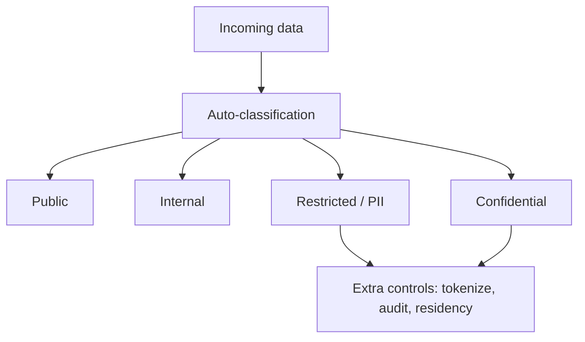
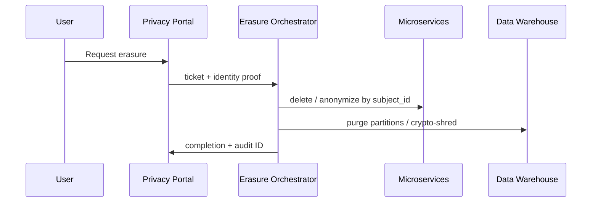
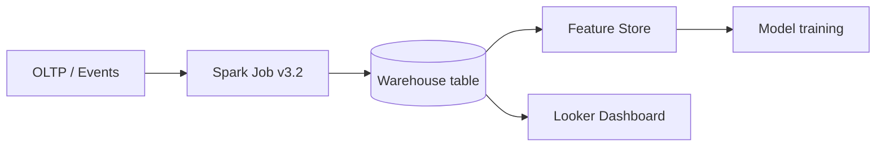
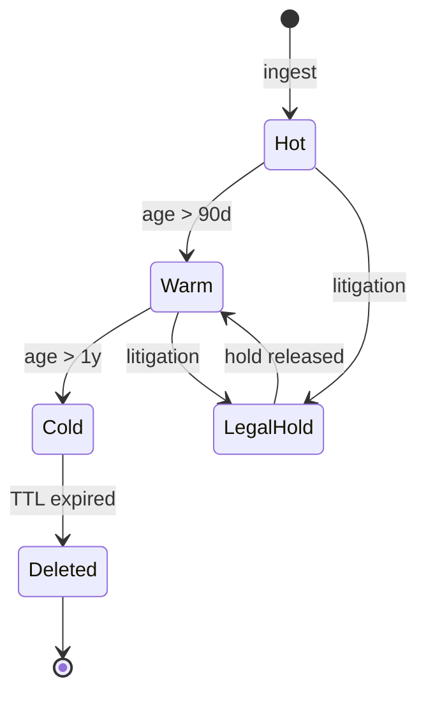
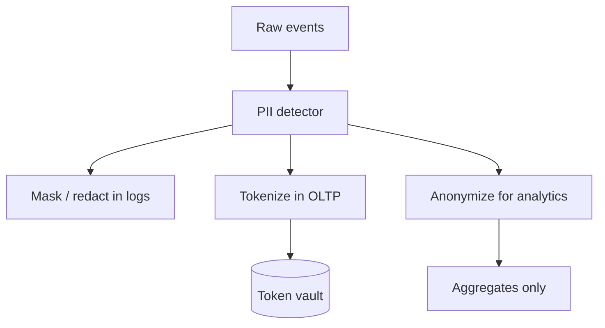
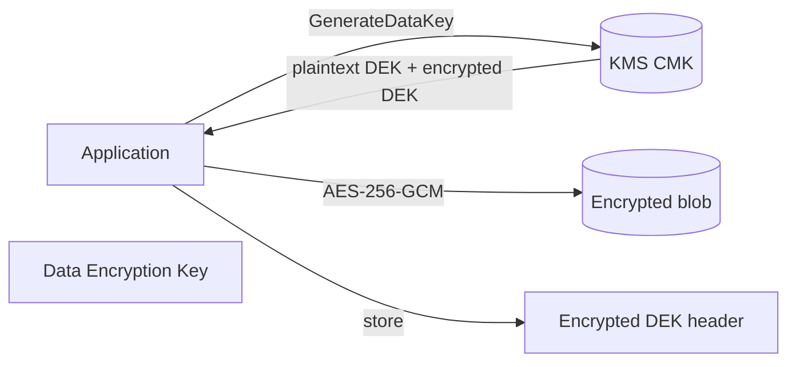
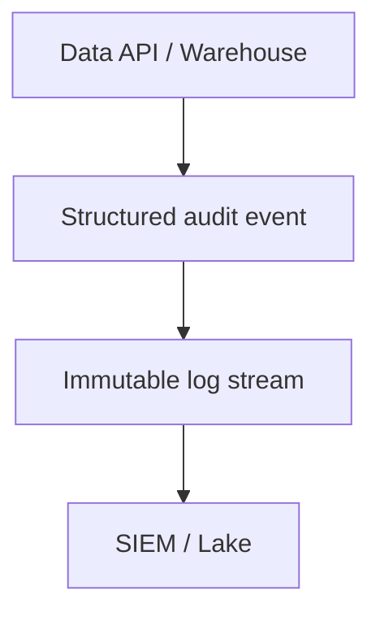
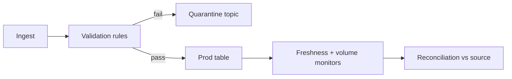
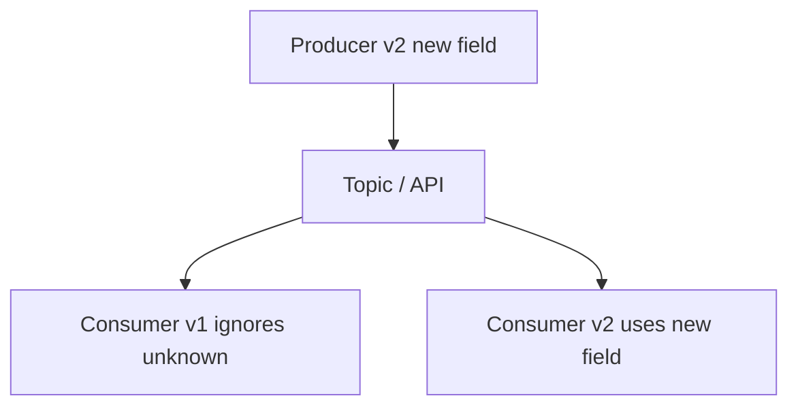
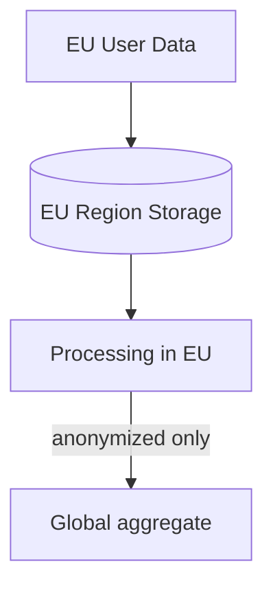

# Data Governance and Compliance

> Governance at scale means every dataset has a classification, a lineage, a retention rule, and an auditable trail—so privacy law and business trust hold up when petabytes move through thousands of pipelines.

---

## Why Governance Is a Scaling Problem

A ten-person startup can “know” where customer email lives. At FAANG scale, **the same PII is copied** into warehouses, feature stores, logs, backups, analytics sandboxes, and vendor SaaS tools—often without the team that collected it knowing. Regulators (GDPR, CCPA, etc.) and users care about **lawful basis**, **minimization**, and **rights** (access, erasure, portability).

| Without governance | With governance |
|--------------------|-----------------|
| Unknown copies of PII | Catalog + lineage + retention |
| Manual GDPR tickets | Automated erasure workflows |
| Schema breaks consumers | Contract-tested evolution |
| Silent data quality decay | Monitored SLAs on datasets |

This module ties legal requirements to engineering patterns Meta, Google, and Apple use in production.

---

## Data Classification

Classify data by **sensitivity** and **handling rules**. Labels drive encryption, access, masking, and residency.



| Tier | Examples | Typical controls |
|------|----------|------------------|
| Public | Marketing copy, open APIs | Integrity checks |
| Internal | Roadmaps, aggregate metrics | SSO, no external share |
| Confidential | Unreleased financials | RBAC, DLP |
| Restricted | SSN, health, precise location | Tokenization, encryption, strict audit |

**Google** uses data classification tiers tied to **BeyondCorp** access and logging. **Amazon** classifies data for PCI and HIPAA workloads with separate accounts and KMS keys.

### Policy-as-code hook

Store classification on the **catalog asset** (table/column/topic). Downstream jobs inherit labels; deny writes of `restricted` to non-compliant buckets.

---

## GDPR Compliance

The **General Data Protection Regulation** applies to EU residents’ personal data regardless of where your company is headquartered. Core themes: lawful basis, purpose limitation, data minimization, and **individual rights**.



### Key rights (engineering view)

| Right | Implementation sketch |
|-------|------------------------|
| Erasure (“right to be forgotten”) | Subject ID map; async purge across systems |
| Portability | Export API in machine-readable JSON |
| Access | Aggregated report from catalog-linked stores |
| Consent | Consent store with version + timestamp; gate processing |

### Consent management

- Record **what** was consented to, **when**, and **which policy version**.
- Propagate consent flags to event streams (`marketing_opt_in=false` must be honored in all consumers).
- **Meta** operates large-scale privacy tooling for ads and social products; erasure propagates through graph and ad identity graphs with strict SLAs for regulatory deadlines.

---

## Data Lineage

**Lineage** answers: where did this column come from, and what breaks if I change it? At scale, automate capture from schedulers (Airflow, Dagster), warehouses (BigQuery, Snowflake), and stream processors (Flink, Spark).



| Tool class | Examples |
|------------|----------|
| Open lineage | OpenLineage, Marquez |
| Commercial | Collibra, Alation, DataHub |
| Cloud-native | BigQuery/Databricks lineage APIs |

**Google** emphasizes lineage in **Dataplex** and internal catalogs so engineers see downstream impact before deprecating a field.

### Lineage metadata (YAML example)

```yaml
dataset:
  name: analytics.user_daily_activity
  classification: confidential
  owner_team: growth-analytics
  lineage:
    upstream:
      - urn:li:dataset:(urn:li:dataPlatform:kafka,events.page_views,PROD)
      - job: spark://jobs/user_daily_activity_v12
    downstream:
      - urn:li:dataset:(urn:li:dataPlatform:bigquery,ml.features_user,PROD)
  sla:
    freshness_hours: 6
    quality_checks:
      - row_count_delta_pct_max: 15
```

---

## Data Retention Policies

Retention balances **cost**, **utility**, and **legal** obligations. Define **TTL** per classification; use **archival** (cheaper storage) and **legal holds** that pause deletion.



| Data type | Example TTL | Notes |
|-----------|-------------|--------|
| Web server logs | 30–90 days | Security vs. cost |
| Transaction records | 7+ years | Tax/regulatory |
| Marketing events | 13 months | Consent + minimization |
| Backups | Match prod TTL + overlap | Erasure must include backups |

### Legal holds

When legal requests a hold, tag affected `subject_id` or `account_id` buckets so automated janitors **skip** those objects until counsel releases.

---

## PII Handling

**Personally identifiable information** must be detected, minimized, and protected in logs, warehouses, and ML features.



| Technique | Reversible? | Use case |
|-----------|-------------|----------|
| Masking | No (display) | Support UI, logs (`***-**-1234`) |
| Tokenization | Yes (vault) | Payments, cross-system join |
| Pseudonymization | Limited | Analytics with key separation |
| Anonymization | No | Public datasets, k-anonymity |

**Apple** minimizes collection (“privacy by design”) and uses on-device processing where possible; **Amazon** tokenizes payment data for PCI scope reduction.

### PII detection script (Python)

```python
import re
from dataclasses import dataclass
from typing import Iterable

EMAIL_RE = re.compile(r"\b[A-Za-z0-9._%+-]+@[A-Za-z0-9.-]+\.[A-Z|a-z]{2,}\b")
PHONE_RE = re.compile(r"\b(?:\+?1[-.]?)?\(?\d{3}\)?[-.]?\d{3}[-.]?\d{4}\b")
SSN_RE = re.compile(r"\b\d{3}-\d{2}-\d{4}\b")

@dataclass(frozen=True)
class Finding:
    kind: str
    start: int
    end: int
    snippet: str

def scan_text(text: str) -> list[Finding]:
    findings: list[Finding] = []
    for kind, pattern in (
        ("email", EMAIL_RE),
        ("phone", PHONE_RE),
        ("ssn", SSN_RE),
    ):
        for match in pattern.finditer(text):
            findings.append(
                Finding(
                    kind=kind,
                    start=match.start(),
                    end=match.end(),
                    snippet=match.group(0)[:4] + "…",
                )
            )
    return findings

def redact_text(text: str, findings: Iterable[Finding]) -> str:
    out = text
    for f in sorted(findings, key=lambda x: x.start, reverse=True):
        out = out[: f.start] + f"[REDACTED_{f.kind}]" + out[f.end :]
    return out

if __name__ == "__main__":
    sample = "Contact alice@example.com or 555-123-4567 for billing."
    hits = scan_text(sample)
    print(redact_text(sample, hits))
```

Production adds NER, column profilers (Great Expectations, Deequ), and catalog tags.

---

## Encryption Key Management

Use **KMS** (AWS KMS, GCP Cloud KMS, Azure Key Vault) for **envelope encryption**: a data encryption key (DEK) encrypts bulk data; KMS wraps the DEK.



| Practice | Why |
|----------|-----|
| CMK per env / tenant | Blast radius |
| Automatic key rotation | Annual CMK rotation in AWS KMS |
| Separate keys per classification | Restricted data on HSM-backed keys |
| Crypto-shredding | Delete DEK = data unrecoverable for erasure |

### Key rotation without re-reading all data

For large objects, **re-wrap** encrypted DEKs with a new CMK version rather than decrypting entire datasets when possible.

---

## Audit Logging

Prove **who accessed what, when, from where**—required for SOC2, HIPAA, GDPR accountability, and insider investigations.



### Audit log schema (JSON / SQL-friendly)

```sql
CREATE TABLE audit.data_access (
  event_id          UUID PRIMARY KEY,
  event_time        TIMESTAMPTZ NOT NULL,
  actor_type        TEXT NOT NULL,  -- user | service_account | admin
  actor_id          TEXT NOT NULL,
  action            TEXT NOT NULL,  -- read | export | delete | schema_change
  resource_type     TEXT NOT NULL,  -- table | bucket | topic
  resource_fqn        TEXT NOT NULL,
  classification    TEXT NOT NULL,
  client_ip         INET,
  user_agent        TEXT,
  request_id        TEXT,
  outcome           TEXT NOT NULL,  -- success | denied
  policy_version    TEXT,
  extra             JSONB
);

CREATE INDEX ON audit.data_access (resource_fqn, event_time DESC);
CREATE INDEX ON audit.data_access (actor_id, event_time DESC);
```

Log **denied** access attempts—they often precede exfiltration. **Meta** and **Google** operate centralized audit pipelines with retention aligned to policy.

---

## Data Quality at Scale

Bad data at scale becomes bad decisions and broken models. Treat datasets like **products** with SLAs.



| Layer | Examples |
|-------|----------|
| Schema | Required fields, types, enums |
| Semantic | `revenue >= 0`, country in ISO list |
| Statistical | Null rate, cardinality drift |
| Reconciliation | Sum(orders) matches OLTP snapshot |

Tools: **Great Expectations**, **Deequ**, **dbt tests**, **Monte Carlo**. Netflix and Amazon run data quality gates before promoting tables to “gold” tiers.

---

## Schema Evolution and Compatibility

Event streams and APIs outlive individual services. Plan **backward** and **forward** compatibility.



| Change | Backward compatible? | Forward compatible? |
|--------|----------------------|---------------------|
| Add optional field | Yes | Yes if old readers ignore unknown |
| Remove field | No | Risky |
| Rename field | No | Use dual-write period |
| Tighten type | No | Validate in shadow mode first |

**Confluent/Avro** and **Protobuf** with explicit schemas are standard at Google and LinkedIn-scale event buses. Use a **schema registry** and CI checks that fail breaking changes.

---

## Cross-Border Data Transfer

**Data residency** and **sovereignty** laws require knowing which region stores and processes data (EU, UK, India, etc.).



| Mechanism | Notes |
|-----------|--------|
| Region-scoped accounts/projects | Hard boundary |
| SCCs / DPF | Legal transfer mechanisms (consult legal) |
| Geo-routing | DNS + config routes EU tenants to EU cells |
| Data localization | Some countries require in-country copy |

Engineering implements **tenant → region** mapping; legal owns SCCs/DPF and vendor contracts.

---

## Meta and GDPR at Scale (pattern)

While exact internals are proprietary, public engineering themes include:

- **Central privacy request pipeline** fanning out to dozens of storage systems by identity keys.
- **Idempotent deletion jobs** with retries and verification reports.
- **Separation** of ad identity vs. social identity for consent boundaries.
- **Heavy investment** in tooling so product teams cannot “forget” to register a new datastore.

The lesson: **erasure is a distributed workflow**, not a `DELETE FROM users` in one database.

---

## Google Data Governance (pattern)

Google Cloud customers see **Dataplex**, **DLP API**, and **VPC Service Controls**. Internally, Google stresses:

- **Catalog-first** discovery of datasets and owners.
- **Policy tags** on columns (similar to classification).
- **Access transparency** logs for admin reads of customer data (workspace/cloud).

Align your org chart: **data owners** approve access; **stewards** define standards; **platform** enforces technically.

---

## Apple Privacy Architecture (pattern)

Apple’s public stance emphasizes **on-device processing**, **minimal data collection**, and **user-visible controls**. Engineering takeaways:

- Default to **not collecting** fields you do not need.
- Use **differential privacy** for aggregate telemetry where collection is necessary.
- **App Tracking Transparency** models explicit opt-in for cross-app tracking—consent as a first-class API.

---

## GDPR Erasure Handler (Python sketch)

```python
from dataclasses import dataclass
from datetime import datetime, timezone
import uuid

@dataclass
class ErasureRequest:
    subject_id: str
    requested_at: datetime
    request_id: str

class ErasureOrchestrator:
    def __init__(self, stores: list):
        self.stores = stores  # each implements purge_subject(subject_id) -> PurgeResult

    def handle(self, subject_id: str) -> dict:
        req = ErasureRequest(
            subject_id=subject_id,
            requested_at=datetime.now(timezone.utc),
            request_id=str(uuid.uuid4()),
        )
        results = []
        for store in self.stores:
            results.append(store.purge_subject(req.subject_id))
        failed = [r for r in results if not r.success]
        if failed:
            raise RuntimeError(f"erasure incomplete: {failed}")
        self._write_audit(req, results)
        return {"request_id": req.request_id, "status": "completed"}

    def _write_audit(self, req: ErasureRequest, results: list) -> None:
        # append-only audit table / stream
        pass
```

Pair with a **registry of data stores** per product—onboarding a new DB without registering it is a compliance incident.

---

## Data Retention Cleanup Job (Python + SQL)

```python
import os
from datetime import datetime, timedelta, timezone

import psycopg

RETENTION_DAYS = int(os.environ.get("RETENTION_DAYS", "90"))
BATCH_SIZE = 5000

def delete_expired_rows(conn: psycopg.Connection) -> int:
    cutoff = datetime.now(timezone.utc) - timedelta(days=RETENTION_DAYS)
    total = 0
    while True:
        with conn.cursor() as cur:
            cur.execute(
                """
                DELETE FROM app.events
                WHERE ctid IN (
                  SELECT ctid FROM app.events
                  WHERE event_time < %s
                    AND legal_hold = FALSE
                  LIMIT %s
                )
                RETURNING event_id
                """,
                (cutoff, BATCH_SIZE),
            )
            deleted = cur.rowcount
            conn.commit()
        total += deleted
        if deleted < BATCH_SIZE:
            break
    return total

if __name__ == "__main__":
    with psycopg.connect(os.environ["DATABASE_URL"]) as conn:
        n = delete_expired_rows(conn)
        print(f"deleted {n} rows older than {RETENTION_DAYS} days")
```

Run as a scheduled job; metric `rows_deleted` and alert if janitor stops.

---

## Key Takeaways

1. **Classify** all data (public → restricted) and enforce controls automatically via catalog and policy tags.
2. **GDPR rights** need orchestrated workflows—especially erasure and portability—not one-off SQL.
3. **Lineage** and ownership metadata are mandatory for safe schema changes and incident response.
4. **Retention TTLs** and **legal holds** must be encoded in janitor jobs and backup policies.
5. **PII** should be detected, masked in logs, tokenized where joins are needed, and anonymized for analytics.
6. Use **KMS envelope encryption** and **key rotation**; crypto-shred DEKs when erasure requires it.
7. **Audit logs** must capture successful and denied data access with actor, resource, and classification.
8. **Data quality** gates and reconciliation protect downstream ML and finance at scale.
9. **Schema evolution** requires compatibility rules and registry-backed contracts.
10. **Cross-border** design starts with tenant→region mapping and legal review of transfer tools—not after launch.

---

## FAANG Interview Questions

1. **A user requests GDPR erasure.** Your user graph spans Postgres, Kafka, S3 parquet, Redis cache, and a third-party email vendor. Design the orchestration, verification, and SLA metrics.

2. **How would you implement column-level classification** in a warehouse with 50,000 tables and prevent analysts from exporting `restricted` fields to a personal laptop?

3. **Your team wants to add a new optional field to a high-QPS event stream.** Walk through backward/forward compatibility, consumer rollout, and how lineage tools help.

---

## Exercises

### Exercise 1: Classification matrix

For a ride-sharing app, list ten fields (rider name, GPS trace, fare, driver rating, etc.) and assign classification tiers with one control per restricted field.

### Exercise 2: Retention design

Propose TTLs for app logs, trip history, invoices, and ML training snapshots. Explain how legal hold changes your janitor job.

### Exercise 3: Audit query

Using the audit schema above, write SQL to find the top ten `service_account` actors that read `restricted` tables in the last 24 hours.

### Exercise 4: Erasure gap analysis

Draw a system diagram for a fictional social app with five stores. Identify which stores are hardest to erase and why (eventual consistency, backups, derived aggregates).

### Exercise 5: Quality contract

Define five dbt or Great Expectations tests for a `daily_revenue` table and specify alert thresholds that would block a downstream executive dashboard.

*Previous module: [07 — Security Best Practices at Scale](./07-security-best-practices-at-scale.md)*
