# Team Topologies and Platform Engineering

> How you organize engineers shapes the systems you build—and deliberate org design is one of the highest-leverage tools for shipping reliable software at scale.

---

## Why This Matters at FAANG Scale

At 10 engineers, you can fix misalignment with hallway conversations. At 1,000+, **structure becomes architecture**. Amazon’s two-pizza teams, Spotify’s squads, Google’s SRE pairing, and Netflix’s “freedom and responsibility” are not HR branding—they are **coordination strategies** that reduce cognitive load, clarify ownership, and make dependencies explicit.

This guide connects **Team Topologies** (Matthew Skelton & Manuel Pais) with **platform engineering** and **developer experience (DevEx)** so you can reason about org design in system-design and leadership interviews.

---

## Conway’s Law

**Conway’s Law (1968):** Organizations design systems that mirror their communication structures.

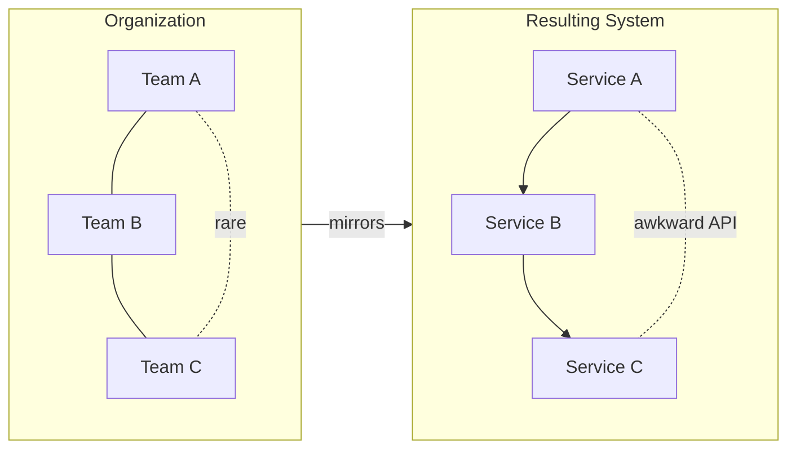

| Symptom in production | Likely org cause |
|----------------------|------------------|
| Three services to complete one user journey | Three teams, weak product ownership |
| Duplicate auth libraries | No platform team; every squad reinvents |
| “We need a meeting to deploy” | Ops silo + dev silo (pre-DevOps) |
| Inconsistent APIs across products | No API guild / platform standards |

**Google example:** Search, Ads, and Cloud evolved as **semi-independent product areas** with strong internal platform layers (Borg/GKE, Spanner, internal CI). Cross-cutting concerns (security, SRE) are **enabling** or **platform** functions—not afterthoughts bolted onto stream teams.

**Meta example:** Product teams own features end-to-end, but **shared infrastructure** (TAO, Memcached clusters, data centers) is operated by specialist groups—classic **complicated-subsystem** + **platform** split.

---

## Inverse Conway Maneuver

Instead of accepting Conway’s Law as fate, **design the org you need for the architecture you want**.

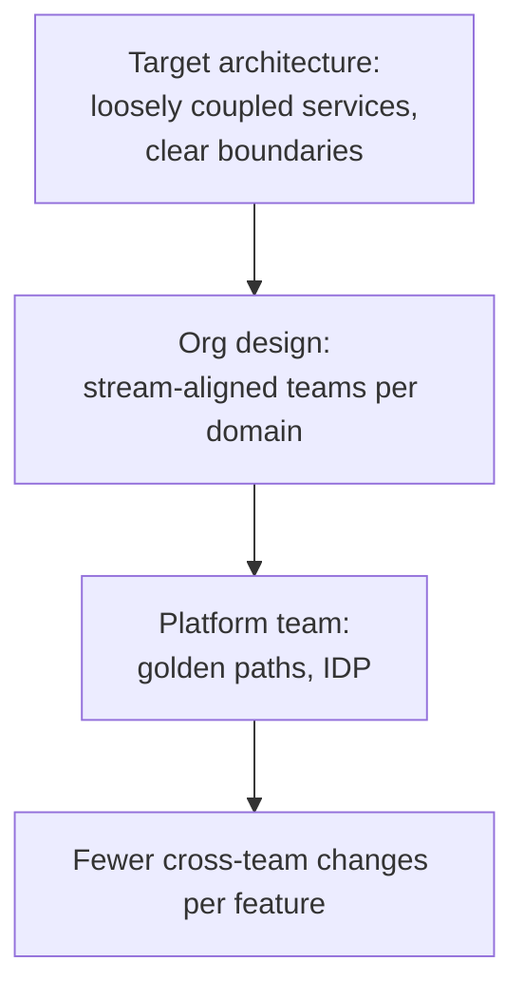

| Step | Action |
|------|--------|
| 1 | Draw **desired** bounded contexts (DDD) or service map |
| 2 | Assign **one stream-aligned team per context** where possible |
| 3 | Extract **platform** capabilities (CI, K8s, observability, identity) |
| 4 | Use **enabling** teams temporarily to upskill stream teams |
| 5 | Measure **team cognitive load** and dependency wait time |

**Netflix example:** Microservice ownership pushed **full lifecycle responsibility** to small teams (build, run, operate). Platform teams provide **Paved Road** tooling so stream teams don’t each operate bespoke deployment stacks.

---

## Four Team Types (Team Topologies)

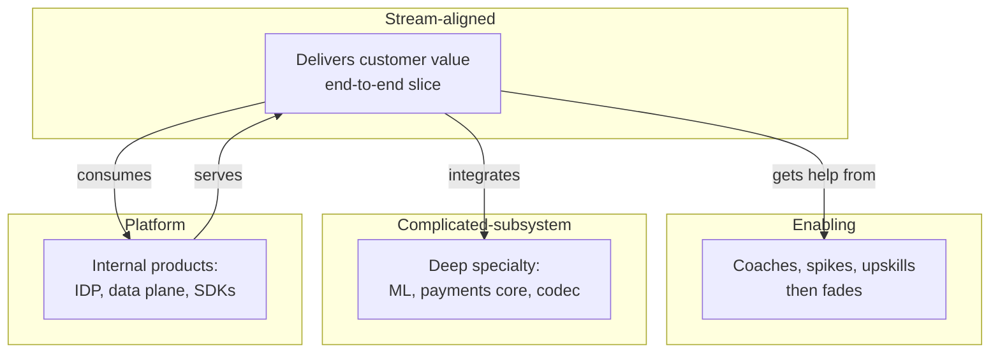

| Team type | Purpose | Typical size | Anti-pattern |
|-----------|---------|--------------|--------------|
| **Stream-aligned** | Flow of value (feature, product line) | 5–9 | Becoming a “mini-platform” for everything |
| **Enabling** | Close skill gaps across streams | Small, rotating | Permanent dependency (“enabling forever”) |
| **Complicated-subsystem** | One hard domain, many consumers | Specialists | Hiding behind tickets with no API |
| **Platform** | Reduce cognitive load via self-service | Product-minded engineers | “Ops team with a Kubernetes badge” |

**Amazon mapping:** Two-pizza **feature teams** are stream-aligned; **AWS service teams** often blend platform (external product) with deep subsystem expertise (DynamoDB storage engine).

---

## Three Interaction Modes

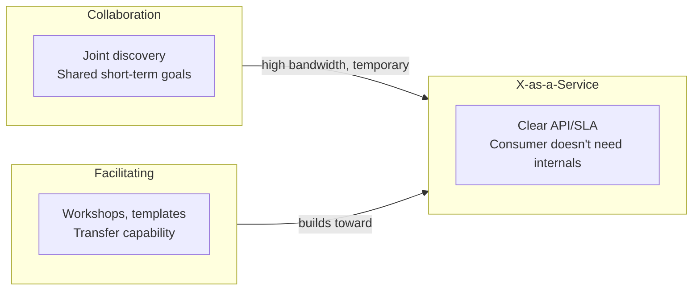

| Mode | When to use | Cost | FAANG-style example |
|------|-------------|------|---------------------|
| **Collaboration** | New domain, unknown boundaries | Highest coordination tax | Early mobile + backend pairing at Meta |
| **X-as-a-Service** | Mature interfaces, stable SLOs | Low ongoing tax | S3/DynamoDB/Lambda as internal “products” |
| **Facilitating** | Skill or practice gap | Medium, should decay | Google SRE embeds then hands runbooks to dev |

**Rule of thumb:** Default to **X-as-a-Service** for platform boundaries; use **collaboration** only with a **time box** and exit criteria.

---

## Platform Engineering and the Internal Developer Platform (IDP)

**Platform engineering** treats internal tooling as a **product** with users (application engineers), roadmap, and SLOs.

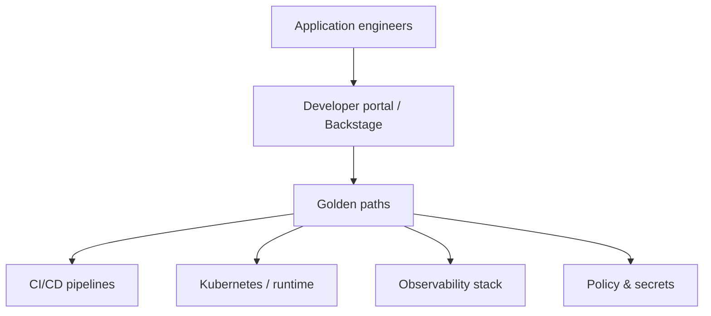

| IDP component | What “good” looks like |
|---------------|------------------------|
| **Service catalog** | Every service has owner, tier, runbooks |
| **Golden path** | New service in &lt;1 day with security baked in |
| **Environment management** | Ephemeral preview envs per PR |
| **Standards** | Linting, SBOM, approved base images |
| **Cost visibility** | Team-level cloud spend dashboards |

**Golden path (YAML sketch—Backstage-style template)**

```yaml
apiVersion: scaffolder.backstage.io/v1beta3
kind: Template
metadata:
  name: golden-path-service
  title: HTTP API on Kubernetes (Golden Path)
spec:
  parameters:
    - title: Service
      required: [name, owner]
      properties:
        name: { type: string }
        owner: { type: string, description: "github team or group" }
  steps:
    - id: register
      action: catalog:register
    - id: create-repo
      action: publish:github
    - id: provision
      action: run:terraform
      input:
        module: platform/modules/k8s-service
        vars:
          replicas: 2
          autoscaling: true
          otel: true
```

**Spotify / Backstage:** Originated as an **IDP** pattern—catalog + templates + docs in one place. Many FAANG-adjacent companies adopt similar portals even if not using Backstage itself.

---

## Developer Experience (DevEx)

DevEx is the **felt** speed and clarity of building software: fewer clicks, faster feedback, obvious next steps.

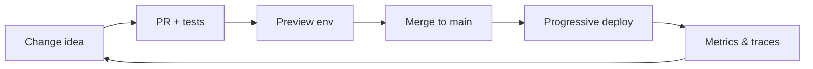

| DevEx metric | What it captures | Example target |
|--------------|------------------|----------------|
| **Lead time** | Commit → production | Hours, not weeks |
| **Deployment frequency** | Releases per team per week | Daily+ for tier-1 services |
| **Change failure rate** | % deploys causing incident | &lt;5% for mature teams |
| **MTTR** | Time to restore | Minutes with good observability |
| **Time to first PR** | New hire productivity | &lt;1 week with golden path |

**Python: local feedback loop (contract test against platform mock)**

```python
"""Run in CI and locally—same command, fast feedback."""
import httpx
import pytest

PLATFORM_URL = "http://localhost:8080"  # tilt/skaffold dev stack

@pytest.mark.asyncio
async def test_identity_token_exchange():
    async with httpx.AsyncClient(base_url=PLATFORM_URL, timeout=2.0) as client:
        r = await client.post(
            "/v1/token",
            json={"client_id": "demo", "grant_type": "client_credentials"},
        )
    assert r.status_code == 200
    assert "access_token" in r.json()
```

**Netflix:** Culture of **freedom and responsibility** assumes engineers have **sharp tools** (Spinnaker, internal observability) so teams can move fast without central approval for every change—paired with strong **blameless** incident learning.

---

## API-First Team Boundaries

Teams should own **services end-to-end**: schema, SLA, on-call, cost, and deprecation—not just “the Java repo.”

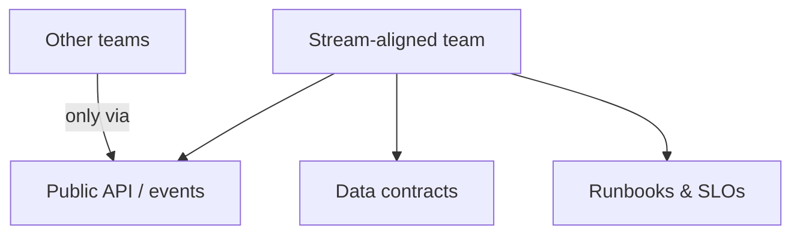

| Principle | Implementation |
|-----------|----------------|
| **Stable contracts** | Versioned REST/gRPC; consumer-driven contract tests |
| **No shared DB** | Integrate via APIs or events—not cross-team SQL |
| **Ownership** | CODEOWNERS + service catalog entry |
| **Deprecation policy** | Sunset headers, migration windows |

**OpenAPI fragment (team-owned boundary)**

```yaml
openapi: 3.1.0
info:
  title: Orders API
  version: 2.1.0
  x-team: checkout-stream
  x-tier: critical
paths:
  /v2/orders/{orderId}:
    get:
      operationId: getOrder
      responses:
        "200":
          description: Order snapshot
        "404":
          description: Unknown order
```

**Stripe-style lesson (boundary discipline):** Public API versioning and **idempotency** are team boundaries exposed to the world—internal teams benefit from the same rigor.

---

## Two-Pizza Teams (Amazon) and Squad Model (Spotify)

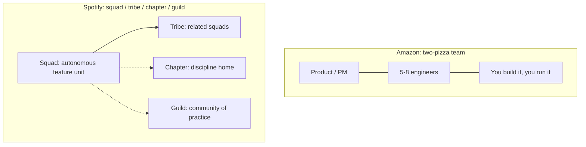

| Model | Strength | Risk |
|-------|----------|------|
| **Two-pizza** | Clear ownership, fast decisions | Duplication without platform |
| **Squad** | Autonomy + alignment via tribe | “Matrix confusion” if chapters weak |
| **Functional chapters** | Career growth, standards | Can slow delivery if gatekeeping |

**Amazon:** Teams small enough to feed with two pizzas; **service-oriented architecture** aligned with **API ownership**. AWS itself is the ultimate **platform** business unit.

**Spotify:** Squads own features; **platform squads** provide infrastructure; **guilds** spread practices (e.g., agile, backend)—enabling mode at org scale.

---

## Technical Debt Ownership

```mermaid
flowchart LR
  Stream[Stream team ships feature]
  Debt[Debt incurred]
  Stream --> Debt
  Debt --> Q{Who pays?}
  Q -->|Default wrong| Nobody
  Q -->|Healthy| Stream budget + platform leverage
  Platform[Platform fixes root cause once]
  Stream -->|20% capacity rule| Paydown
  Platform --> Paydown
```

| Debt type | Owner | Platform role |
|-----------|-------|----------------|
| **Local refactor** | Stream team | Provide codemods, linters |
| **Cross-cutting library upgrade** | Platform + migration program | Ship compatible SDK |
| **Infra EOL (K8s version)** | Platform | Automated upgrades, policy |
| **Data model sprawl** | Domain team + data platform | Golden path schemas |

**Google SRE model:** Production excellence is **shared**: dev teams own code; SRE **enables** reliability practices and may **share on-call** for critical services—with explicit **error budgets** linking velocity and stability.

**SQL: track debt like incidents (illustrative schema)**

```sql
CREATE TABLE tech_debt_items (
  id            UUID PRIMARY KEY,
  owning_team   TEXT NOT NULL,
  service       TEXT NOT NULL,
  severity      SMALLINT CHECK (severity BETWEEN 1 AND 5),
  customer_impact TEXT,
  created_at    TIMESTAMPTZ DEFAULT now(),
  target_quarter TEXT
);

-- Staffing review: debt per engineer by team
SELECT owning_team,
       COUNT(*) AS open_items,
       AVG(severity) AS avg_severity
FROM tech_debt_items
WHERE target_quarter = '2026-Q4'
GROUP BY owning_team
ORDER BY avg_severity DESC;
```

---

## Communication Patterns: Sync Standups vs Async RFC

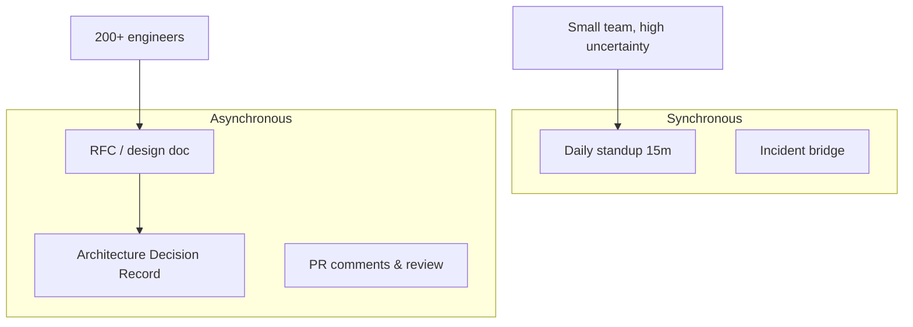

| Pattern | Best for | FAANG habit |
|---------|----------|-------------|
| **Standup** | Coordination within one stream team | Keep &lt;15 min, parking lot |
| **RFC / design doc** | Cross-team or irreversible decisions | Google/Meta/Amazon doc culture |
| **Office hours** | Platform support without tickets | Office hours for internal APIs |
| **Slack/Chat** | Quick clarifications | Not for architectural truth |

**RFC template (markdown)**

```markdown
# RFC: Move checkout to event-driven sagas

## Status
Proposed | Author: @team-checkout | Reviewers: @payments, @platform

## Summary
One paragraph.

## Goals / Non-goals

## Design
Diagram link, API changes, failure modes.

## Rollout
Feature flags, metrics, rollback.

## Open questions
```

**Rule:** If a decision affects **more than two teams** or lasts **&gt;1 quarter**, it belongs in an **RFC**, not a meeting recap.

---

## Scaling Engineering Organizations

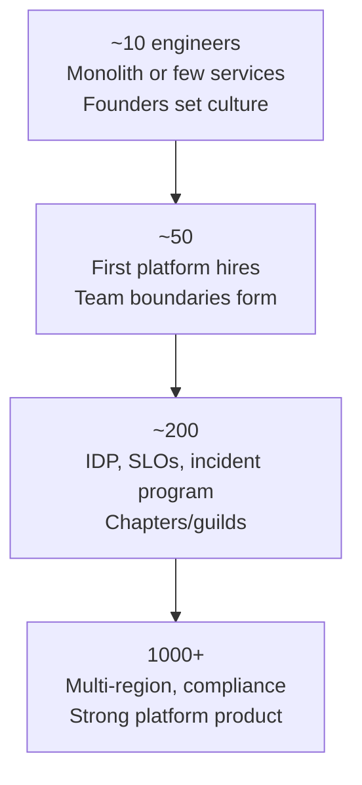

| Scale | Org shape | Architecture pressure | Platform focus |
|-------|-----------|----------------------|----------------|
| **10** | One or two teams | Monolith OK | CI, basic observability |
| **50** | Stream teams emerge | Service extraction begins | K8s, shared logging |
| **200** | Platform team mandatory | Dependency graphs hurt | Golden paths, catalog |
| **1000+** | Multi-product divisions | Data mesh, federation | Policy-as-code, cost platform |

**Communication overhead** grows roughly with **n²** if everyone talks to everyone—topology reduces effective **n** per team.

---

## Real-World Patterns (Quick Reference)

| Company | Org / platform pattern | Lesson |
|---------|------------------------|--------|
| **Amazon** | Two-pizza, APIs, AWS as platform | Make interfaces stable; eat your own cooking |
| **Spotify** | Squads/tribes + platform squads | Autonomy needs paved roads |
| **Google** | SRE, error budgets, prod ownership | Reliability is a joint product |
| **Netflix** | Freedom & responsibility, Spinnaker | Empower teams with guardrails, not gates |
| **Meta** | Product + infra split | Complicated subsystems at planetary scale |

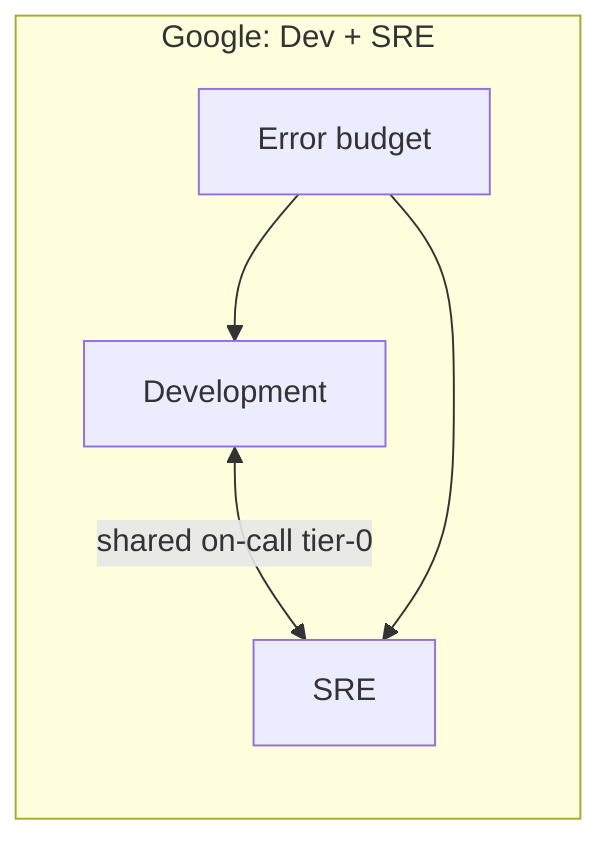

---

## Platform Architecture (End-to-End)

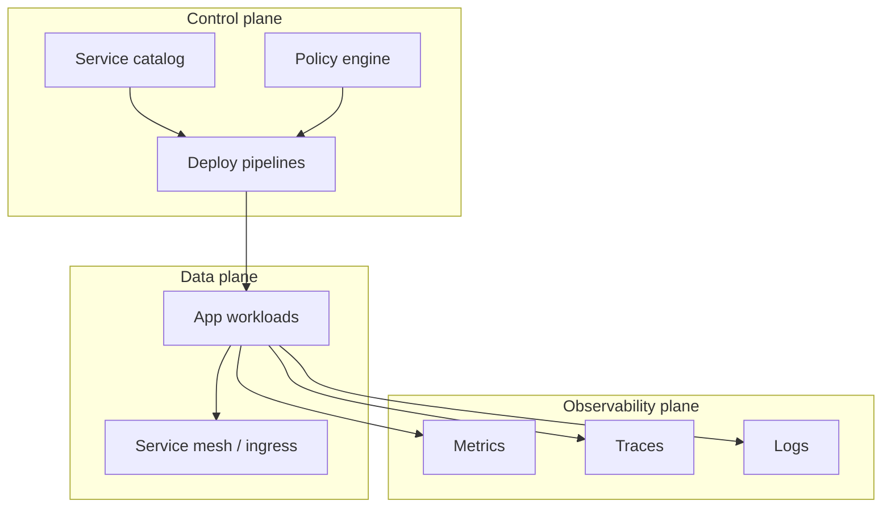

---

## Key Takeaways

1. **Conway’s Law is real**—if your architecture fights your org chart, change the chart (Inverse Conway) or accept perpetual integration tax.
2. **Four team types** (stream, enabling, complicated-subsystem, platform) clarify who owns customer flow vs deep specialty vs internal products.
3. **Prefer X-as-a-Service** between mature teams; time-box collaboration; use facilitating to **exit**, not to stay.
4. **Platform engineering is product work**—golden paths, IDP, and SLOs reduce stream-team cognitive load.
5. **DevEx metrics** (lead time, deploy frequency, MTTR) are leading indicators of whether topology is working.
6. **API-first boundaries** mean owning contracts, operations, and deprecation—not shared databases across teams.
7. **Debt must have an owner and budget**—platform fixes systemic causes; stream teams pay local debt continuously.
8. **Async RFCs scale**; sync standups coordinate within a team—not across the company.
9. **At 200+ engineers**, a dedicated platform function is not optional—it is how you avoid 50 forks of Kubernetes YAML.
10. **FAANG models differ**, but all invest in **self-service**, **clear ownership**, and **observable** production systems.

---

## FAANG Interview Questions

1. **Your org has 40 stream teams and deployment takes three weeks because of shared infrastructure tickets. How would you apply Team Topologies and platform engineering to fix lead time without centralizing all decisions?**
2. **Explain Conway’s Law and the Inverse Conway Maneuver. Give an example where a bad org structure produced a bad architecture—and how you would reorganize.**
3. **How do Google-style error budgets interact with stream-aligned team autonomy? When should an enabling team stay vs hand off?**

---

## Exercises

### Exercise 1: Map your topology

Draw your current org (or a hypothetical 80-person product engineering org) as boxes and arrows. Label each box with one of the four team types. Mark interaction modes (collaboration / X-as-a-Service / facilitating). Identify one **collaboration** that should become **X-as-a-Service** within two quarters.

### Exercise 2: Design a golden path

Write a one-page golden path for a new **Tier-1 HTTP service**: repo template, CI stages, observability defaults, security controls, and how a stream team registers the service in a catalog. Include a sample `openapi` path and a rollback strategy.

### Exercise 3: RFC practice

Draft a short RFC (≤2 pages) for splitting a monolith `checkout` module into `orders` and `payments` services. List teams affected, API boundaries, data migration risks, and the first metric you would watch after launch.

### Exercise 4: Debt ledger

Using the SQL schema in this guide (or your own), define five realistic debt items for a growing e-commerce company. Assign owners, severity, and target quarter. Propose one **platform** initiative that retires more than one item.

---

*Next in series: real-world large-scale architectures at Netflix, Google, Meta, Amazon, and more.*
