# Real-World Large-Scale Architectures

> The systems behind Netflix, Google, Meta, Amazon, and peers are textbooks in distributed design—same patterns recur, but each company pays a unique tax at planetary scale.

---

## How to Read This Guide

Each section covers **problem → architecture → tradeoffs → lesson**. Diagrams are simplified; production stacks have hundreds of services. Focus on **patterns** you can reuse in interviews and design reviews.

| Company | Primary scale challenge | Signature building blocks |
|---------|----------------------|---------------------------|
| Netflix | Global streaming, personalization | Zuul, Eureka, EVCache, Chaos Monkey |
| Google | Planet-scale batch + serving | Borg/K8s, Spanner, Bigtable, SRE |
| Meta | Social graph + feed at billions | TAO, Memcached, Haystack |
| Amazon | Commerce + AWS primitives | DynamoDB, S3, Lambda, two-pizza teams |
| Twitter/X | Real-time timelines | Fanout write/read, Snowflake IDs |
| Uber | Geospatial + dispatch | H3, real-time matching |
| Stripe | Money movement correctness | Idempotency, API versioning |
| Discord | Trillions of messages | Cassandra→Scylla, Rust hot paths |

---

## Netflix: Microservices at 250M+ Subscribers

Netflix moved from datacenter monolith to **AWS microservices** (~2008–2016), optimizing for **availability** and **innovation velocity** over strong consistency everywhere.

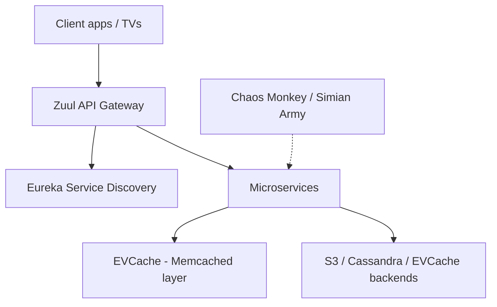

| Component | Role |
|-----------|------|
| **Zuul** | Edge routing, auth, rate limits, dynamic filters |
| **Eureka** | AP-style registry; instances self-register |
| **EVCache** | Multi-region cache wrapper over Memcached/Redis patterns |
| **Hystrix** (legacy) | Bulkheads / circuit breaking (patterns live on in resilience libs) |
| **Chaos Monkey** | Random instance termination—proves fault tolerance |

**Culture:** **Freedom and responsibility**—teams own services end-to-end; **Chaos Engineering** institutionalizes failure injection.

**Python: client-side retry with jitter (edge-friendly)**

```python
import random
import time
import httpx

def get_with_backoff(url: str, max_attempts: int = 5) -> httpx.Response:
    delay = 0.1
    for attempt in range(1, max_attempts + 1):
        r = httpx.get(url, timeout=2.0)
        if r.status_code < 500:
            return r
        time.sleep(delay + random.uniform(0, delay))
        delay = min(delay * 2, 2.0)
    return r
```

**Lesson:** At streaming scale, **cache miss storms** and **cascading failures** hurt more than occasional stale recommendations—design for **degradation**, not perfect graphs.

---

## Google: Borg, Kubernetes, Spanner, and SRE

Google’s internal history shaped the industry: **MapReduce** (batch), **Bigtable** (wide-column), **Borg** (cluster scheduler) → **Kubernetes** (portable orchestration), **Spanner** (globally consistent SQL).

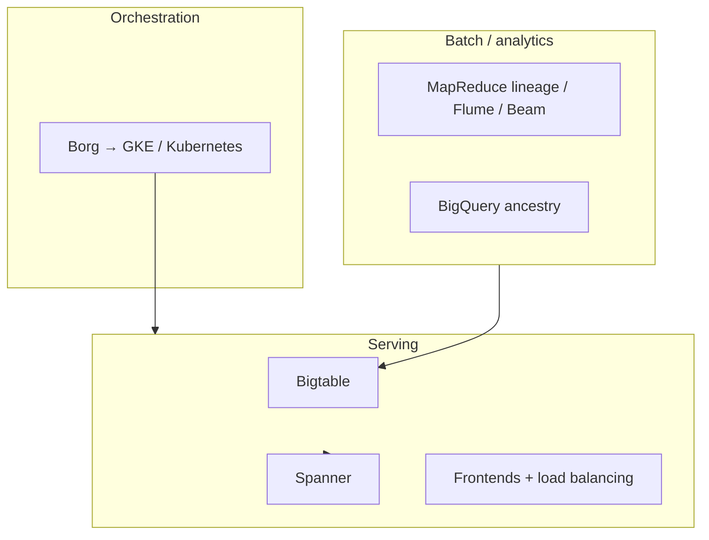

| System | Consistency / scale | Use case |
|--------|---------------------|----------|
| **Bigtable** | Eventually consistent rows | Massive KV / wide-column |
| **Spanner** | TrueTime + external consistency | Global SQL, financial adjacency |
| **Borg/K8s** | Bin-packing workloads | Standard unit of deployment |

**SRE culture:** **Error budgets** tie feature velocity to reliability; **toil** is automated; **blameless postmortems** are mandatory learning.

**SQL: Spanner-style application pattern (portable SQL)**

```sql
-- Logical schema: interleaved parent/child for locality
CREATE TABLE Users (
  UserId   INT64 NOT NULL,
  Handle   STRING(64),
) PRIMARY KEY (UserId);

CREATE TABLE Posts (
  UserId   INT64 NOT NULL,
  PostId   INT64 NOT NULL,
  Body     STRING(MAX),
  Created  TIMESTAMP NOT NULL OPTIONS (allow_commit_timestamp=true),
) PRIMARY KEY (UserId, PostId),
  INTERLEAVE IN PARENT Users ON DELETE CASCADE;

-- Read-your-writes: use transaction or staleness bound in client
```

**Lesson:** Google invests in **shared platforms** early; product teams consume **paved roads** (Borg, internal CI, observability).

---

## Meta (Facebook): Graph, Cache, and Photos

Meta’s stack optimizes **read-heavy social graph** access and **massive photo** delivery.

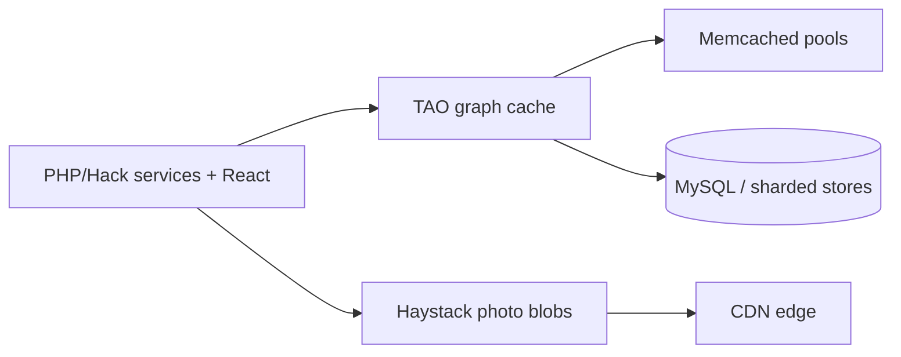

| Layer | Purpose |
|-------|------|
| **TAO** | Objects + associations; cache-aside for graph queries |
| **Memcached** | Multi-layer, **thousands** of instances; invalidation is the hard part |
| **React** | Component model for web; server-driven hydration patterns evolved over time |
| **Haystack** | Custom object store for photos—fewer metadata ops per read |

**Lesson:** **Fanout on read** for celebrity accounts and **aggressive caching** dominate; **cache invalidation** and **hot keys** are existential risks.

---

## Amazon: DynamoDB, S3, Lambda, and Org Model

Amazon pairs **organizational** two-pizza teams with **data plane** services built for extreme scale.

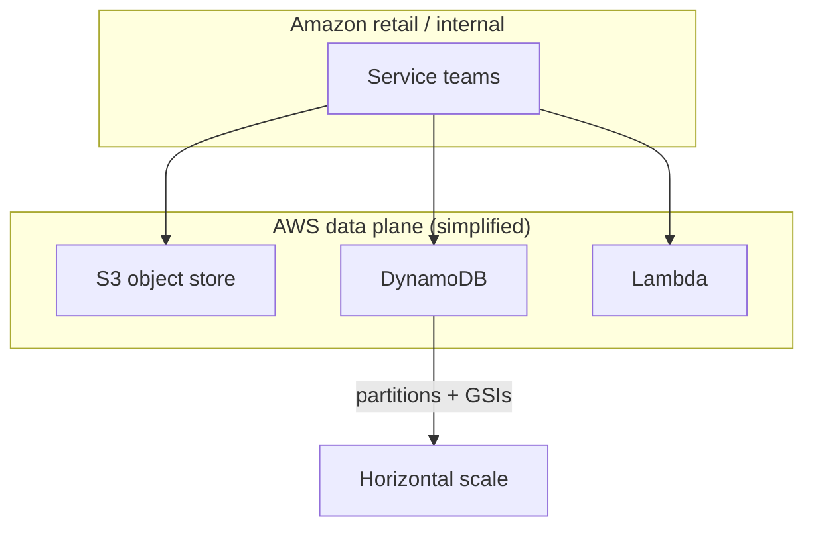

| Service | Guarantee / pattern |
|---------|---------------------|
| **DynamoDB** | Single-digit ms at scale; partition key design is destiny |
| **S3** | 11 nines durability; eventual consistency model (now strong-read options) |
| **Lambda** | Event-driven scale; cold starts + concurrency limits matter |

**DynamoDB access pattern (Python boto3)**

```python
import boto3
from boto3.dynamodb.conditions import Key

ddb = boto3.resource("dynamodb")
table = ddb.Table("Orders")

def orders_for_user(user_id: str, limit: int = 20):
    # Partition key = user_id; sort key = order_id for range queries
    return table.query(
        KeyConditionExpression=Key("user_id").eq(user_id),
        ScanIndexForward=False,
        Limit=limit,
    )
```

**Lesson:** **Cell-based** and **shuffle-sharding** thinking appears throughout AWS—avoid coordinated single points of scale.

---

## Twitter / X: Timelines and Snowflake IDs

The core tension: **fanout-on-write** (precompute timelines) vs **fanout-on-read** (assemble at read time).

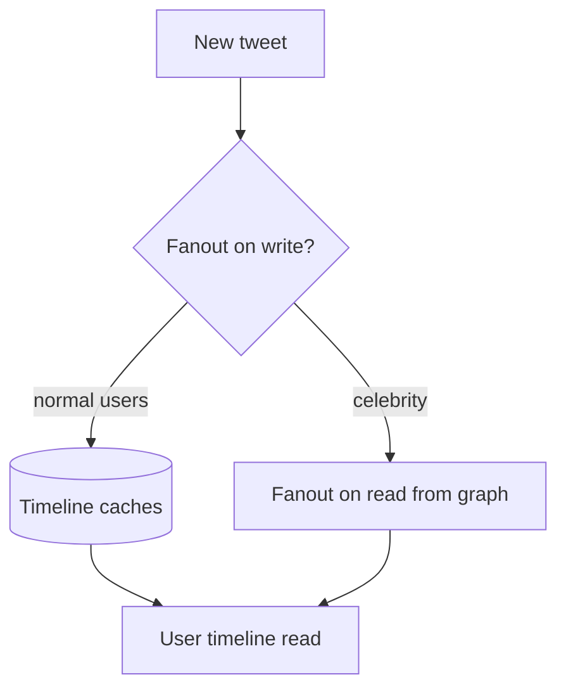

| Approach | Pros | Cons |
|----------|------|------|
| **Fanout on write** | Fast reads | Write amplification for followers |
| **Fanout on read** | Cheap writes for celebrities | Slow reads, complex merging |
| **Hybrid** | Production norm | Two code paths to test |

**Snowflake IDs:** 64-bit roughly time-ordered unique IDs (timestamp + machine + sequence)—good for **sharded** storage without coordination per insert.

**Python: snowflake-style ID layout (educational, not Twitter’s exact spec)**

```python
import time

EPOCH_MS = 1288834974657  # example epoch
seq = 0
machine_id = 42

def next_id() -> int:
    global seq
    ts = int(time.time() * 1000) - EPOCH_MS
    seq = (seq + 1) & 0xFFF
    return (ts << 22) | (machine_id << 12) | seq
```

**Lesson:** **Hybrid fanout** is the interview answer; measure **p99 read** vs **write amplification** for your follower distribution.

---

## Uber: H3, Dispatch, and Surge

Uber combines **geospatial indexing** with **real-time matching** and **market pricing**.

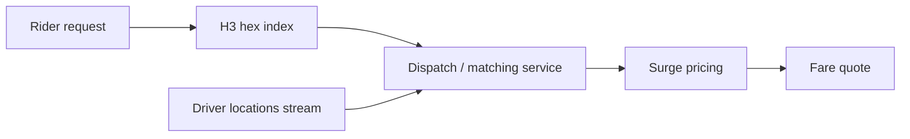

| Concept | Role |
|---------|------|
| **H3** | Hierarchical hex cells—aggregate supply/demand locally |
| **Dispatch** | Sub-second matching under load; fairness + ETA models |
| **Surge** | Price signal to balance supply; must be **consistent enough** to avoid user outrage |

**SQL: supply snapshot by H3 cell (illustrative)**

```sql
SELECT h3_cell,
       COUNT(*) FILTER (WHERE status = 'available') AS supply,
       COUNT(*) FILTER (WHERE status = 'on_trip') AS busy
FROM driver_locations
WHERE updated_at > now() - interval '30 seconds'
GROUP BY h3_cell;
```

**Lesson:** **Location streams** are Kafka-scale; **correctness** lives in idempotent state machines for trips.

---

## Stripe: Payments Reliability and API Design

Stripe’s architecture is a masterclass in **correctness**, **idempotency**, and **long-lived public APIs**.

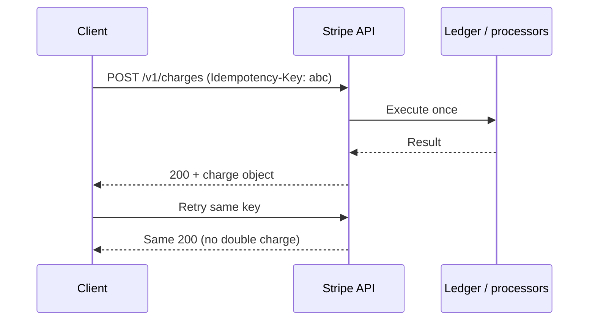

| Practice | Why |
|----------|-----|
| **Idempotency keys** | Safe retries on flaky networks |
| **Versioned API** | `/v1` stable; expand-contract migrations |
| **Webhooks + signing** | Async truth delivery to merchants |

**Python: idempotent charge request**

```python
import uuid
import httpx

def create_charge(amount_cents: int, customer: str, idempotency_key: str | None = None):
    key = idempotency_key or str(uuid.uuid4())
    return httpx.post(
        "https://api.stripe.com/v1/charges",
        headers={"Idempotency-Key": key},
        auth=("sk_test_xxx", ""),
        data={"amount": amount_cents, "currency": "usd", "customer": customer},
        timeout=10.0,
    )
```

**Lesson:** For money, **at-least-once delivery** is assumed—**exactly-once effect** is achieved in application semantics.

---

## Discord: Trillions of Messages and Rust Migration

Discord evolved storage for **message throughput** and **historical search**, moving hot paths to **Rust** and databases toward **ScyllaDB** (Cassandra-compatible).

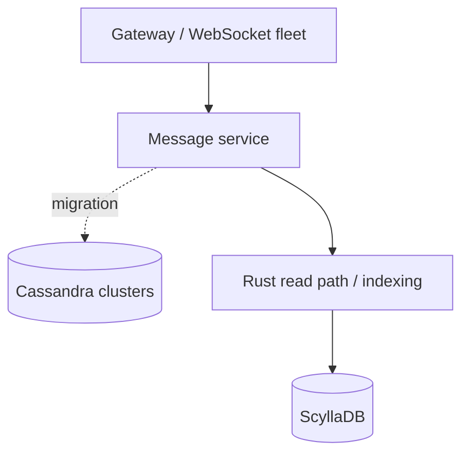

| Phase | Decision |
|-------|----------|
| Early growth | Cassandra wide partitions by channel |
| Pain | GC pauses, compaction, hot partitions |
| Response | Scylla + rewrite hot services in Rust |

**YAML: Kubernetes rollout with progressive delivery**

```yaml
apiVersion: argoproj.io/v1alpha1
kind: Rollout
metadata:
  name: message-read
spec:
  replicas: 50
  strategy:
    canary:
      steps:
        - setWeight: 5
        - pause: { duration: 10m }
        - setWeight: 25
        - pause: { duration: 10m }
        - setWeight: 50
  selector:
    matchLabels:
      app: message-read
```

**Lesson:** **Data store migration** at chat scale is a **multi-year** program—dual-write/dual-read phases are unavoidable.

---

## Common Patterns Across FAANG-Scale Systems

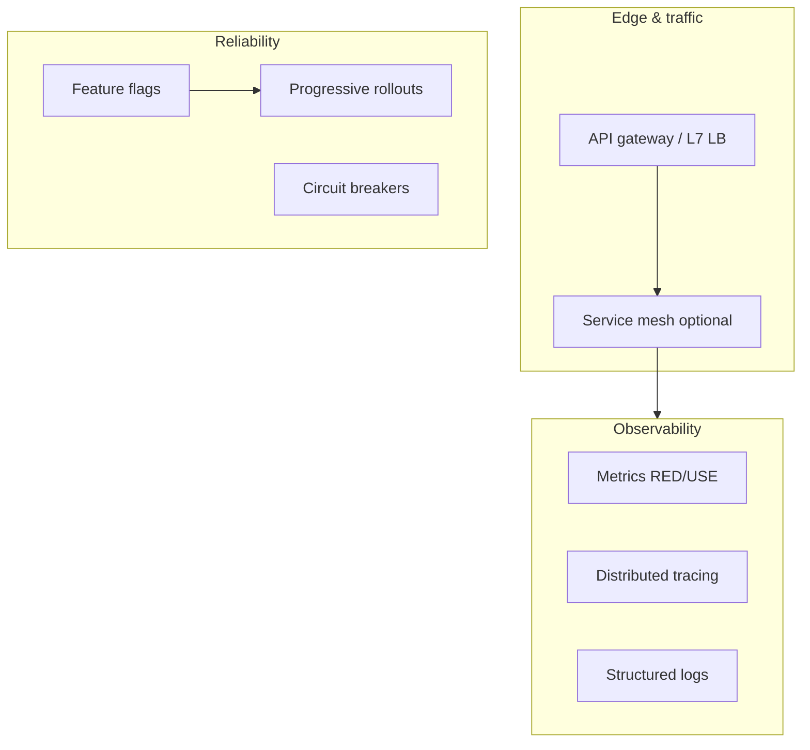

| Pattern | What it solves | Examples |
|---------|----------------|----------|
| **Service mesh** | mTLS, retries, traffic split | Envoy, Linkerd at many shops |
| **Observability** | Debug unknown unknowns | Google Dapper lineage, OpenTelemetry |
| **Feature flags** | Blast-radius control | LaunchDarkly, internal flag systems |
| **Progressive rollouts** | Canary by % or cohort | Spinnaker, Argo Rollouts |

**Python: feature flag guard**

```python
def new_ranker_enabled(user_id: str, flags: dict[str, float]) -> bool:
    import hashlib
    bucket = int(hashlib.sha256(user_id.encode()).hexdigest(), 16) % 10_000
    return bucket < int(flags.get("new_ranker_pct", 0.0) * 10_000)
```

---

## What Breaks at Scale (Lessons Learned)

| Failure mode | Early symptom | Mitigation |
|--------------|---------------|------------|
| **Hot partitions** | One Dynamo/Cassandra node melts | Shuffle keys, write sharding |
| **Cache stampede** | DB overload on TTL expiry | Jitter, request coalescing |
| **Thundering herd deploy** | Cold caches after release | Warmups, gradual rollouts |
| **Metastable failures** | Recovery slower than arrival rate | Admission control, load shedding |
| **Coordination overhead** | 50 teams on one deploy train | Team topologies + platform IDP |

**Anti-patterns**

- **Distributed monolith:** many services, one shared database schema.
- **Chatty sync chains:** 12 RPCs per user click without parallelization.
- **Flag day migrations:** big-bang cutovers without reversible steps.
- **Observability as afterthought:** logs you cannot correlate across services.

**What senior engineers wish they knew earlier**

1. **Data model and partition key** outlive every framework fashion cycle.
2. **Operability** (dashboards, runbooks, SLOs) is a feature, not overhead.
3. **Defaults matter**—retry storms from naive clients can take down healthy servers.
4. **Explicit capacity planning** beats heroic on-call firefighting.
5. **Simple hybrid designs** (fanout, cache tiers) beat pure theoretical elegance.

---

## Cross-Company Comparison Table

| Dimension | Netflix | Google | Meta | Amazon |
|-----------|---------|--------|------|--------|
| **Unit of deploy** | Microservice | Job / pod | Service | Service + cell |
| **Consistency default** | Eventual + caches | Strong where paid for (Spanner) | Eventual + TAO | Per-product |
| **Failure testing** | Chaos Monkey | DiRT exercises | Red team + drills | GameDays |
| **Edge** | Zuul | Google Front End | CDN + proxies | CloudFront / ALB |

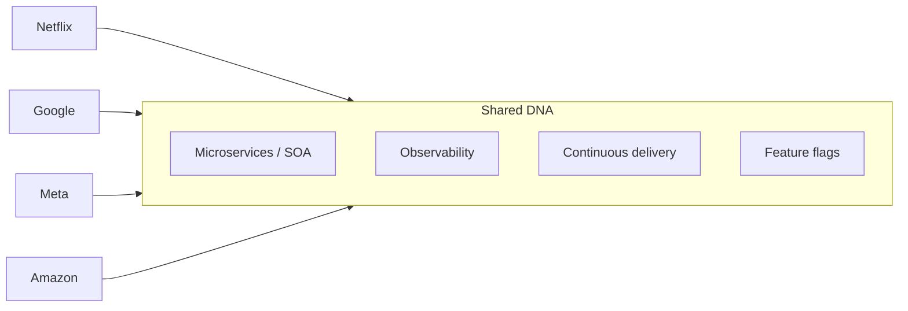

---

## Reference Architecture: Request Path (Generic FAANG Style)

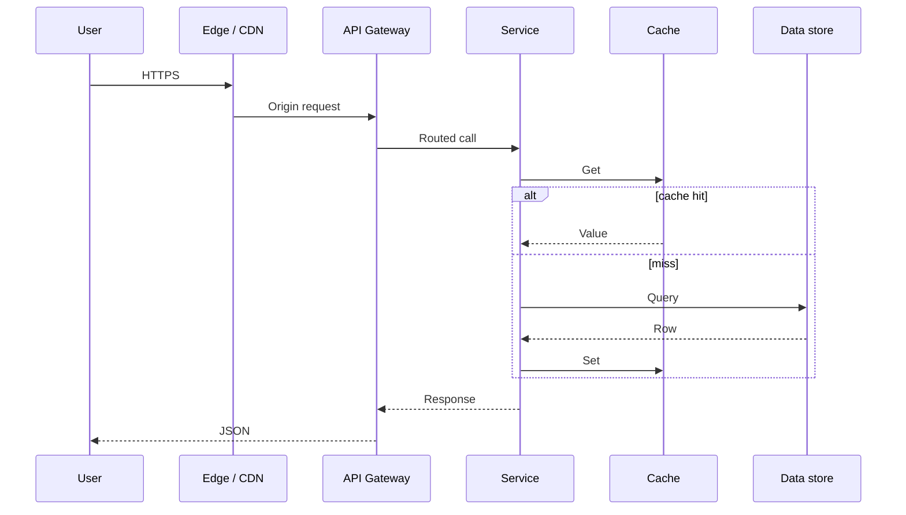

## Key Takeaways

1. **Netflix** proves **chaos + microservices + caching** beats fragile monoliths for global streaming.
2. **Google** shows **platform depth** (Borg, Spanner, SRE) amortized across thousands of teams.
3. **Meta** demonstrates **graph + cache** specialization beats generic RDBMS for social reads.
4. **Amazon** encodes scale in **managed primitives** (DynamoDB, S3, Lambda) and small owning teams.
5. **Twitter/X** timelines are the canonical **fanout hybrid** interview problem.
6. **Uber** ties **H3 + streaming location** to market dynamics (surge).
7. **Stripe** teaches **idempotency and API longevity** for correctness under retries.
8. **Discord** shows when to **change datastore and language** for tail latency.
9. **Service mesh, observability, flags, and canaries** are the modern **operating system** of large fleets.
10. **Scale failures are economic**—hot keys, metastability, and coordination tax dominate—not CPU MHz.

---

## FAANG Interview Questions

1. **Design a home timeline for a social network with celebrities having 100M followers. Compare fanout-on-write vs fanout-on-read and justify a hybrid.**
2. **Why did Discord move message storage toward ScyllaDB and Rust? What metrics would you watch during a Cassandra-to-Scylla migration?**
3. **Explain how Stripe-style idempotency keys interact with at-least-once message delivery from a payment webhook worker.**

---

## Exercises

### Exercise 1: Netflix resilience

Sketch a deployment where **Chaos Monkey** kills 10% of instances during peak. List three services that must degrade gracefully (not hard-fail), and specify **fallback behavior** for each (e.g., stale cache, reduced bitrate).

### Exercise 2: Partition keys

You store **orders** on DynamoDB and **rides** on a Cassandra-compatible store. Propose partition keys for each and one access pattern that would create a **hot partition**—then fix it.

### Exercise 3: Stripe retry storm

A merchant retries failed charges without idempotency keys. Write a short incident report outline: detection signals, customer impact, immediate mitigation, and permanent fix (API + docs + SDK).

### Exercise 4: Observability blueprint

For a new **Uber-like dispatch** service, define **three golden signals**, **two SLIs**, one **SLO**, and an example **trace span** breakdown for `MatchRider`.

---

*Previous: team topologies and platform engineering—how org design enables these architectures.*
