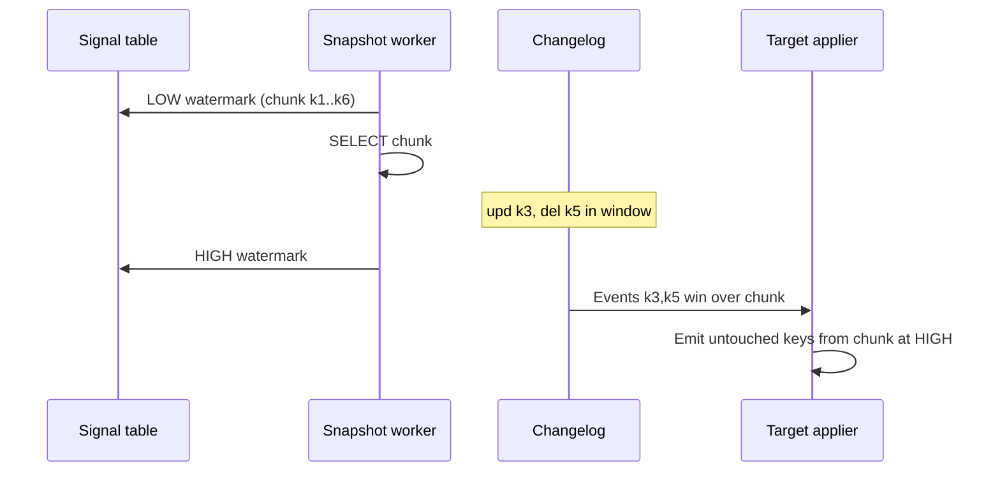
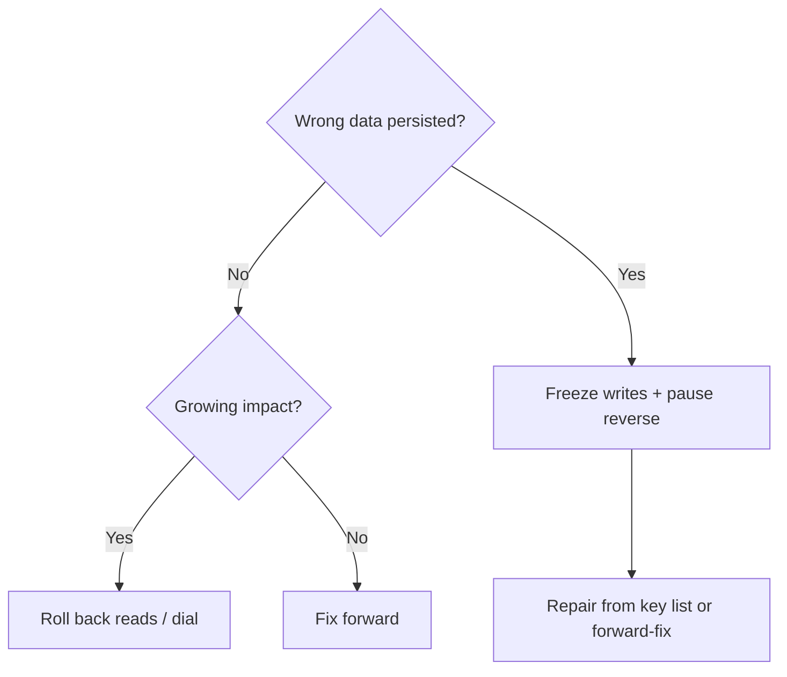
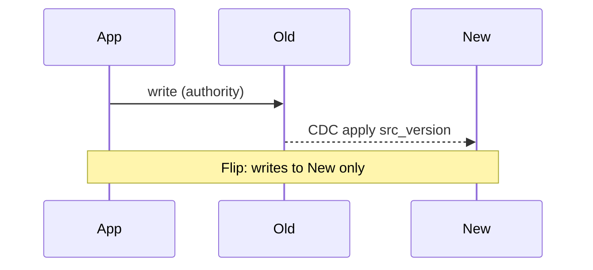

# Migration Cutover: Dual Writes, CDC, Shadow Traffic, and Rollback

> The middle of every live migration: two copies of truth. This guide covers **keeping them honest**, **moving authority once**, **proving behavior with shadow traffic**, and **cutting over without fiction in the rollback plan**.

---

## Table of Contents

1. [Why naive dual writes diverge](#why-naive-dual-writes-diverge)
2. [Making replication converge](#making-replication-converge)
3. [CDC mechanics](#cdc-mechanics)
4. [CDC semantic gaps](#cdc-semantic-gaps)
5. [Shadow traffic and diffing](#shadow-traffic-and-diffing)
6. [Order of operations (authority)](#order-of-operations-authority)
7. [Traffic shifting and ramps](#traffic-shifting-and-ramps)
8. [Drain, PONR, and rollback](#drain-ponr-and-rollback)
9. [Cutover runbook shape](#cutover-runbook-shape)

---

## Why naive dual writes diverge

```typescript
// Looks fine in tests; fails in production
async function saveOrder(order: Order) {
  await oldDb.insert(order);
  await newDb.insert(order); // timeout ≠ failure
}
```

| Failure mode | Error logged? |
|--------------|---------------|
| Partial failure (old OK, new timeout) | Maybe |
| Reordering (A stalls, B passes, A finishes) | **No** |
| Divergent generated IDs / `now()` | No |
| Unknown writers (cron, admin SQL) | No |

**Reordering:** old ends A→B, new ends B→A—both returned 200.

**Never hold row lock in store A while waiting on store B**—p99 remote latency dominates contended row throughput (~1/hold_time commits/s).

---

## Making replication converge

Goal: not atomic cross-store commit—**eventual consistency with one authority** and commutative applies.

### Three rules

1. **One authority per key** at any instant—never “both authoritative.”
2. **Full-state upsert + monotonic `src_version`** (LSN, GTID, row version)—not deltas.
3. **Versioned tombstones**—GC only after max rewind horizon of the pipeline.

```sql
INSERT INTO orders_new AS t (id, plan, src_version, deleted_at)
VALUES ($1, $2, $3, NULL)
ON CONFLICT (id) DO UPDATE SET
  plan = EXCLUDED.plan,
  src_version = EXCLUDED.src_version,
  deleted_at = EXCLUDED.deleted_at
WHERE t.src_version < EXCLUDED.src_version
   OR (t.deleted_at IS NOT NULL AND EXCLUDED.src_version > t.deleted_at_version);
```

### Transport choice

| Approach | Partial failure | Unknown writers | Rollback |
|----------|-----------------|-----------------|----------|
| Naive dual write | Breaks | Breaks | Partial |
| Versioned dual + repair | Partial | Breaks | Partial |
| Transactional outbox | Handles | Breaks | Partial |
| **CDC from authority log** | Handles | **Handles** | Partial |
| Log-first (both consume) | Handles | Partial | Handles |

> **Prefer CDC** when you cannot prove every writer is in your code path. **Prefer outbox** when translation needs domain logic not in the row.

---

## CDC mechanics

### Snapshot without global lock (watermarks)



Chunks are **resumable**—reconciliation can re-emit a bad range through the same pipe.

### Slot retention (Postgres)

Stalled consumer → WAL grows (~50 MB/s → 180 GB/h illustrative). Set **`max_slot_wal_keep_size`**—invalidate slot vs fill primary disk.

- Heartbeat into captured DB if quiet DB on busy cluster (neighbour WAL pins slot).
- **Apply headroom ~2× peak**—1.2× headroom turns 1h stall into 5h lag.
- Parallel apply by key hash **requires** version-conditional upserts; coalesce per-key in batch.

### MySQL

No slot pin—consumer falls off **binlog retention**. Set `binlog_expire_logs_seconds` / RDS retention **before** migration.

---

## CDC semantic gaps

CDC ships **rows**, not **intent**.

| Gap | Mitigation |
|-----|------------|
| Transaction boundaries lost | Buffer to txn end (cap size); or accept eventual invariants |
| Partial row images (TOAST, `binlog_row_image=MINIMAL`) | `REPLICA IDENTITY FULL` or merge “unchanged” placeholders |
| Source DDL mid-migration | Contract + expand/contract on source |
| ID remap | Deterministic map before child events |
| **Echo loops** (bidirectional) | Origin tag; filter replication user's changes |

---

## Shadow traffic and diffing

Shadow = execute read (or write) against new **without serving** result to user; compare to old.

| Use | Detects |
|-----|---------|
| Error-rate SLI on canary dial | Crashes, latency, capacity |
| **Per-request shadow diff** | Silent wrong field (200 OK) |
| At-rest reconciliation | Rows never read on hot path |

Aggregate error SLI is **blind** to 1-in-10⁶ wrong bodies—hold dial for **calendar cycles** (month-end, weekly batch), not “extra week at 5%” for correctness.

```typescript
async function handleGetOrder(req: Request) {
  const fromOld = await oldStore.get(req.id);
  const response = fromOld;

  if (shouldShadow(req)) {
    const fromNew = await newStore.get(req.id);
    diffAndRecord(req.id, canonicalize(fromOld), canonicalize(fromNew));
  }
  return response;
}
```

Stratify shadow by **cohort** (legacy encoding, pre-2015 accounts)—rare bugs need diverse cohorts, not only random traffic.

---

## Order of operations (authority)

Stripe-style ladder (per slice):


**Reads before writes.** Reverse sync **verified** before flip. After flip, old is derived from new for rollback window.

---

## Traffic shifting and ramps

### Per-request % is wrong for state

At dial *p* = 1%, a user with *k* = 50 requests has **~39%** chance any request hit new—and **bounces** between stores.

**Fix:** sticky cohort `hash(tenant_id) % 10000 < dial` decided **once at edge**, propagated (header/baggage).

| Unit | Tradeoff |
|------|----------|
| Tenant | Clean blast radius; uneven load |
| Entity closure | Order + payments + shipment same cohort |

First cohort: **hand-picked** diverse internal + odd legacy tenants—not random whales.

### Ramp speed

Detection floor for extra error rate scales ~1/Δ² with volume at dial. **Silent bugs need comparison**, not longer dwell at 5%.

Last steps: **50 → 65 → 80 → 90 → 100** through daily peak—new at 90% util has ~11× queue delay vs 45% (M/M/1 sketch).

---

## Drain, PONR, and rollback

### Drain

Cutover completes when **old-side requests per caller = 0**—not when flag flips.

| Holder | Tail |
|--------|------|
| Config poll | Poll interval |
| DNS | TTL + caches |
| Connection pools | max lifetime |
| Batch jobs | Job runtime |
| Mobile / partners | Weeks |

After drain window: **server-side close** (GOAWAY, revoke DB grant)—stagger reconnect to avoid thundering herd.

Version cache keys by **phase** or ensure payload compatibility for max TTL (CDN, mobile).

### Point of no return (effective)

| Door | Default close | Mitigation |
|------|---------------|------------|
| IDs emailed / webhook fired | Seconds | Outbox delay &gt; decision window |
| Downstream committed new-shaped events | Minutes | Compatibility projector on old topics |
| New-only states | Days | Phase-gated features |
| Reverse sync stopped | Declared PONR | — |

List doors **before** flip; earliest unmitigated door = real PONR.

### Rollback decision matrix

**First question:** *Has new persisted anything wrong?*

| | Impact growing | Impact stable |
|--|----------------|---------------|
| **No bad writes** | Route reads back now | Hold dial; fix forward |
| **Bad writes** | Freeze slice + pause reverse sync | Stop writer; repair by key list |

Reverse CDC at seconds lag **copies corruption to old**. Consider **delayed reverse apply** ≥ p90 detect time + freeze time so old stays clean quarantine.

Automate only **read route-back** on availability signals—not write authority.



**Key list query** needs phase tag + build id on every new write.

---

## Cutover runbook shape

Built around **abort deadline**, not hopeful timeline.

| Section | Content |
|---------|---------|
| Preconditions | Verify green, reverse sync lag, pool budget on new, cohort list |
| Flip steps | Fence → drain CDC → phase enum increment |
| Observe | SLIs + shadow diff rate + reconciliation |
| Abort by T+X | Explicit criteria + who calls it |
| Roll forward | Repair playbook, comms |
| Roll back | Only if matrix top-left; warm old capacity |

**Practice:** game-day roll forward + back on one slice.

---

## Code: transactional outbox (dual-write alternative)

```sql
CREATE TABLE outbox (
  id         bigserial PRIMARY KEY,
  aggregate_id uuid NOT NULL,
  payload    jsonb NOT NULL,
  created_at timestamptz NOT NULL DEFAULT now()
);

-- In same transaction as business write
BEGIN;
  INSERT INTO orders (...) VALUES (...);
  INSERT INTO outbox (aggregate_id, payload)
    VALUES ($id, jsonb_build_object('type', 'OrderCreated', ...));
COMMIT;
```

Relay (poller or Debezium on `outbox`) publishes to target with same idempotent apply rules.

---

## Key takeaways

1. **Naive dual write** fails silently—use CDC or outbox + versioned upserts.
2. **Slots and binlog retention** are production risks—cap, alert, rehearse re-snapshot.
3. **Shadow + reconciliation** find correctness; **dial** finds capacity and gross errors.
4. **Sticky cohorts** and **reads-before-writes** limit data risk.
5. **Rollback** is a data decision—freeze and pause reverse before routing traffic back.
6. Migration ends when **old is gone**—not when the flag flips.

---

## Senior Pitfalls

| Mistake | Impact | Fix |
|---------|--------|-----|
| Cutover during peak without rehearsed freeze window | User-visible errors exceed error budget in minutes | Practice in staging at peak shape; choose low-traffic window; pre-scale new stack |
| DNS/TTL cutover as the only lever with 24h TTL | Rollback takes a day; partial client populations | Lower TTL weeks ahead; use weighted routing or config service, not DNS alone |
| “Big bang” flip without write fence | Split-brain writes to two systems | Short maintenance window or strong fence (stop writers, drain queues, verify lag) |
| Forgotten batch jobs still writing to old DB after cutover | Silent data loss in new system of record | Job inventory checklist; disable cron with automation; alert on old-DB write rate |
| Communication plan omits support and sales | Ticket tsunami misattributes root cause | Pre-written status page, support macros, executive briefing before flip |
| Rollback untested because “we won’t need it” | Forward-only failure becomes hours-long incident | Mandatory rollback drill in staging; time RTO including data reconcile |

---

## Production-grade Practice

1. **Cutover timeline simulation:** Minute-by-minute runbook for a 30-minute window: who runs fence, who validates metrics, who calls rollback. Dry-run with timers; assign backups for each role.
2. **Client population map:** Measure traffic by SDK version, region, and cache layer. Estimate how long until 99% of clients see new endpoints after cutover levers.
3. **Rollback drill:** Execute full rollback in staging after simulated failed validation at T+15; record data reconcile steps and maximum acceptable data loss (RPO).
4. **Post-cutover burn dashboard:** Pre-build dashboards for error rate, latency, and business KPI (orders/min) with 5-minute granularity and multi-window burn alerts for first 48 hours.

---

## FAANG Interview Deep Dive

### Real-world examples

**GitHub Vitess cutover**  
Authority moved **per shard** with **read-your-writes** tests, **traffic ramps**, and **months** of **reverse replication** readiness. **Sticky cohorts** (internal staff → 1% → 10% → 100%) limited **PONR** exposure. Decommission only after **30+ days** zero traffic and **frozen compare** sign-off.

**Stripe payment path dual-write**  
Money paths avoid **naive dual write**—**outbox**, **idempotent APIs**, **single authority per payment intent**. Partial failure (**old OK, new timeout**) without **reconciliation** creates **double charge or lost payment**—staff interviews focus on **versioned upsert + monotonic LSN**.

**Netflix Cassandra region moves**  
Region evacuations use **quorum tuning**, **write CL changes**, and **hours-long drains**—analogous to **GSLB + data authority** flip. **Rollback** is a **data decision**: freeze writes, **pause reverse sync**, route traffic back before **compaction** erases rewind window.

```typescript
// Anti-pattern: dual write without reconciliation
await oldDb.insert(order);
await newDb.insert(order); // timeout ≠ rollback of old
```

### Interview Q&A

### Q: Why do naive dual writes always diverge?
**A:** **Partial failure**, **reordering**, **different generated IDs**, **clock skew**, **unknown writers** (cron, admin SQL). Without **one authority** and **versioned merge**, you get **silent drift**—CDC/outbox fixes **ordering** and **single local transaction**.

### Q: CDC vs transactional outbox?
**A:** **CDC (Debezium)**: captures **all** DB changes, ops-heavy (**slots**, **retention**). **Outbox**: explicit events, **same transaction** as write—no missed app events. Hybrid: outbox for **domain events**, CDC for **analytics parity**.

### Q: Shadow traffic—what does it prove?
**A:** **Behavioral equivalence** under **real load shape**—catches **N+1**, **latency**, **semantic** bugs before authority flip. Does **not** replace **data reconciliation**—shadow reads can diverge on **stale replication**.

### Q: Order of operations for authority flip?
**A:** Typical: **stop unknown writers** to old → **drain in-flight** → **verify lag < SLO** → **flip read path** → **flip write path** → **enable reverse sync** for rollback window → **ramp traffic**. **Reads before writes** reduces **split-brain** user experience.

### Q: When is rollback impossible?
**A:** After **PONR**: **destructive transforms**, **TTL GC** on tombstones, **new format-only** writes on new store without reverse path. Document **PONR timestamp** in runbook—exec approval to proceed.

### Common mistakes candidates make

- **Row lock in A** while waiting on **remote B**—throughput collapses to **1/p99_latency**.
- **Dual write** without **`src_version`**—last writer wins randomly.
- **Shadow only on happy path**—no **error injection** or **slow dependency** tests.
- Flipping **100% traffic** without **sticky cohorts** or **dial** ramp.
- Declaring victory at **flag flip** while **batch jobs** still write old DB.

### Decision framework

| Mechanism | Consistency | Ops burden |
|-----------|-------------|------------|
| Naive dual write | Poor | Low (deceptively) |
| Outbox + relay | Strong per service | Medium |
| CDC | Eventual, complete log | High |
| Single-writer + async copy | Clear authority | Medium |

**Lag budget:** If cutover requires **lag < 1s** and peak **50k writes/s**, reverse pipeline must sustain **50k applies/s** with **headroom 2×** for catch-up after pause.



### Traffic ramp template

| Day | Cohort | Writes to new | Rollback |
|-----|--------|---------------|----------|
| 1 | Internal | 0% (shadow) | Instant |
| 3 | 1% sticky tenants | 0% | Instant |
| 7 | 10% | 10% read, 0% write | < 1h |
| 14 | 50% | 50% write | Data freeze |
| 21 | 100% | 100% | PONR review |

```bash
# Runbook gate (pseudo)
./verify_lag.sh --max-bytes 1048576
./compare_ranges.sh --sample 0.01
./flip_writes.sh --cohort "$COHORT"
```

**Staff signal:** Outbox vs dual-write—draw **one transaction boundary** on the whiteboard; payment teams reject anything that cannot **prove** single-writer authority per `payment_intent_id`.
