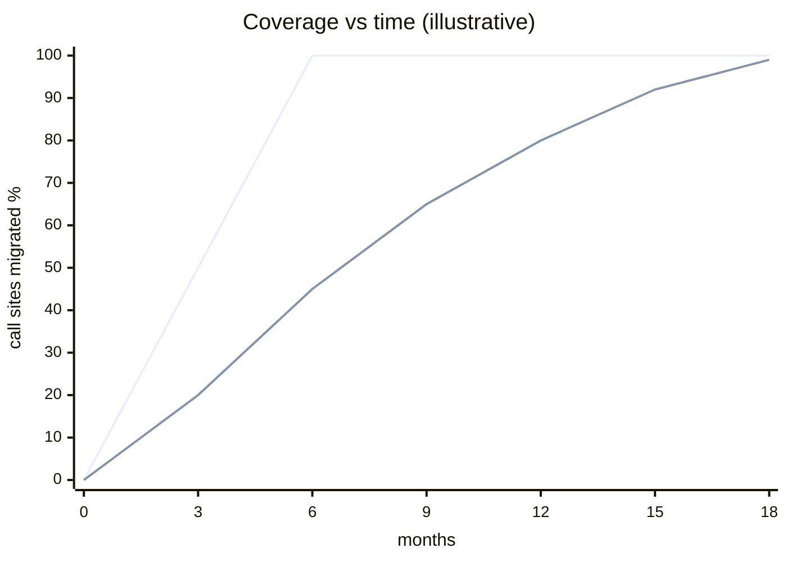
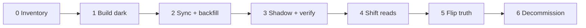
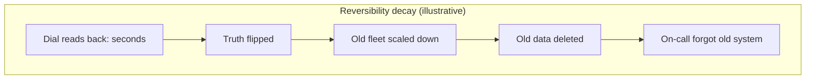
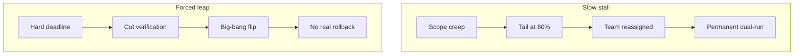
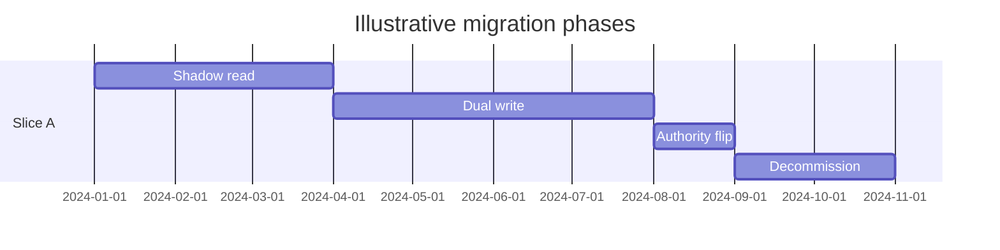

# Large-Scale Migration Planning

> Migrations that look like “two quarters” often take three years. That overrun is usually **structural**, not bad luck: effort is heavy-tailed, reversibility decays on a schedule, and the best decision is often **what you refuse to migrate**.

This guide combines **program shape** (phases, slices, reversibility, scope) with **multi-team execution** (incentives, tooling, metrics, finishing). Use it before the first line of migration code.

---

## Table of Contents

1. [Why estimates fail](#why-estimates-fail)
2. [The phase ladder](#the-phase-ladder)
3. [Reversibility windows](#reversibility-windows)
4. [Stable intermediate states](#stable-intermediate-states)
5. [What not to migrate](#what-not-to-migrate)
6. [Economics and kill criteria](#economics-and-kill-criteria)
7. [Running the program across teams](#running-the-program-across-teams)
8. [One-page charter checklist](#one-page-charter-checklist)

---

## Why estimates fail

### Median-based plans miss the tail

Typical planning: inventory 200 services, migrate a few “representative” items, multiply by count.

Per-consumer effort is often **log-normal**. Mean exceeds median by \(e^{\sigma^2/2}\):

| σ (spread) | Mean / median |
|------------|---------------|
| 1.0 | ~1.65× |
| 1.5 | ~3.1× |

At σ = 1.5, **~74% of effort** can sit in the top 20% of consumers, and **~44%** in the top 5%.



**Three effects make the tail worse:**

1. **Easy consumers go first** — “80% done” by count can be ~25% done by effort.
2. **Inventory is incomplete** — missing callers surface at ~95% when you try to turn off writes.
3. **The target moves** — net progress is \(v - c\) (migration rate minus new legacy usage). Freeze legacy growth with CI ratchets on call-site count.

> **Architect's note:** Size the program from **tracer migrations** through the nastiest consumers (stored procedures, bespoke semantics, partners)—not from the three easiest wins.

### Report the right metrics

| Metric | What it optimizes | Trap |
|--------|-------------------|------|
| Traffic share on new | Fast headline | Concentrates in few large callers |
| Caller count | Fair progress | Hides tail effort |
| Tracer-weighted effort | True calendar | Harder to compute |
| **Decommission possible?** | Economics | Binary until last caller is gone |

Publish **coverage and remaining effort separately**, or leadership will plan the next project on your tail.

---

## The phase ladder

Every successful live migration walks the same ladder **per slice** (tenant, shard, table set, region—not “the whole company at once”).



| Phase | Writes | Reads | Source of truth | Rollback |
|-------|--------|-------|-----------------|----------|
| 0–4 | Mostly old → new async | Old, then % new | **Old** | Config dial back |
| 5 | New authoritative | New | **New** | Reverse sync + flip |
| 6 | New only | New | New | Data repair, not config |

**Rules that matter more than the diagram:**

- **Reads before writes** — wrong reads are visible and fixable; wrong writes in the authority are silent.
- **One hinge: truth flip** — after it, rollback needs reverse replication verified like forward path.
- **Slice boundary** — queries must not cross the slice; replay query fingerprints for a week before choosing dimension.

### Choosing a slice dimension

| Slice by | Crosses boundary | Rollback unit | Typical trap |
|----------|------------------|---------------|--------------|
| Tenant | Cross-tenant reports | One customer | Whale tenant = 30% load |
| Key range | Range scans, secondary lookups | Hash range | Hot keys |
| Table / domain | FKs, multi-table txns | Table set | One txn spans two stores |
| Region | Global IDs, travel | Geography | Users across regions |
| Endpoint | Shared rows | API route | Writes from many routes |

### Waves and soak time

Calendar is set by **soak**, not engineering throughput. Prefer **geometric wave growth** (e.g. 1 → 4 → 20 → 100 → 275 tenants) over linear batches—same risk per tenant, fewer serial soak periods.

Cap the largest wave by **rollback capacity**: if rolling back wave *k* takes longer than the incident you are rolling back from, the wave is too big.

### Phase 0: inventory by instrumentation

Phase 0 is not a survey spreadsheet. Tag every connection with **caller identity** (`application_name`, service account, client name) for at least one full business cycle (include quarter-end if finance touches the data).

---

## Reversibility windows

Rollback cost climbs in **steps** (truth flip, delete old data, decommission) and **slopes** (new-only features, expired certs, atrophied on-call, unverified reverse sync).



| Silent closer | Mitigation |
|---------------|------------|
| New enum / field old schema cannot represent | Reversibility policy: every new field maps back until window closes |
| IDs minted in new format sent externally | Mint in old format or disjoint range until window closes |
| Old fleet downsized | Keep warm capacity through window |
| Reverse sync never compared | Same verification as forward path |

> **Choose window length from the slowest failure you must catch** (month-end billing, quarterly close)—not from how uncomfortable dual-running feels.

**Exercise rollback:** for one slice, roll forward past truth-flip, roll back, roll forward again in production. A path you have not exercised is a hypothesis.

### Fenced truth flip

Independent boolean flags (`dual_write`, `read_from_new`, `new_is_truth`, …) create **64 combinations**; many are dangerous. Prefer a **single ordered phase enum** per slice, moved one step at a time.

At truth-flip, config propagation lag can let **both stores accept authoritative writes**. Use a **FENCING** phase: stamp writes with epoch, reject stale epochs at the store, wait for all instances to ack, drain CDC, then flip.

---

## Stable intermediate states

Ask of each state: *If the program pauses here for six months, is the system correct and operable?*

| State | Verdict |
|-------|---------|
| Dual-write + reconciliation | OK for bounded time |
| Writes new, reads old | **Not** a resting state (breaks read-your-writes) |
| Dual-write, no reconciliation | Incident after a quarter |

### Compatibility band (expand/contract at system level)

During rolling deploy, **adjacent code versions** must tolerate adjacent data states—same idea as column expand/contract, but for whole systems. Slowest clients (mobile, batch jobs, partners) **widen the band for months**.

---

## What not to migrate

> The cheapest byte to migrate is the one you **delete**.

| Access | Transactional need | Queryable read-only | Archive / legal hold |
|--------|--------------------|---------------------|----------------------|
| Hot (daily) | Migrate live | Migrate live | Migrate live |
| Warm (monthly) | Migrate live | Lazy + sweeper | Export to archive |
| Cold (yearly) | Lazy + sweeper | Archive + query engine | Export / delete per policy |
| Never read | Question the flag | Archive | Delete |

**Lazy migration** needs a **sweeper with a deadline**—otherwise unmigrated rows live forever and every “not found” hits both stores.

**Do not remodel during the move.** Identity mapping verifies with checksums; arbitrary transforms need an equivalence function that is itself new code—every diff has two culprits. Remodel before or after, not during.

**Hyrum's law:** inventory quirks (collation, datetime precision, `ORDER BY` stability) and decide: preserve, announce fix, or break on purpose.

---

## Economics and kill criteria

While dual-running you pay roughly **2× infra**, **2× cross-cutting change cost**, and a team that ships **no product features**. Savings arrive at **decommission**, not at 90% migrated.

| Outcome | Shape |
|---------|--------|
| Finish + decommission | Break-even eventually |
| Stall at 90% | Often **never** breaks even—worse than not starting |
| Scope cut (archive cold data) | Earlier break-even despite “unfinished” work |

**Fund the tail before you start.** Rank work by what moves the **decommission date**, not coverage %.

**Kill criteria on day one** (example): tracer estimate exceeds N engineer-months; reverse sync cannot verify; new system misses read SLO at 100% for K weeks.

### Two ways migrations die



Work **backwards from hard dates**: subtract reversibility window, shadow period for slowest failure class, build estimate at **P80**—that gives latest safe start date.

---

## Running the program across teams

### Economics of asking

For each consumer team, migrating **this quarter** often has **negative EV** on their scorecard; decommission benefits the platform, not them. Rational deferral × 100 teams → stalled 90%.

**Levers (in order):**

1. **Reduce cost** — shims, codemods, platform does the work (Google “churn rule”)
2. **Raise cost of staying** — ratchet, show-back, brownouts
3. **Mandate with date** — only credible after (1)

> Ask for a **bounded budget** (N engineer-days per team by date), not “P0 for everyone.”

Watch **migration collision**: five programs each asking “only 10 days” can exceed team slack; only a **portfolio calendar** fixes this.

### Operating models

| Model | Best when |
|-------|-----------|
| Central (we change your code) | Mechanical changes, monorepo, 300+ consumers |
| Federated (you change it) | Domain semantics, polyrepo |
| Embedded squad | Hard tail, &lt;20 high-variance consumers |

Sequence: **central for head → federated for routine → embedded for tail**.

### Tooling as a product

Break-even: \(N^* = B / (a \cdot (m - t))\) where B = build cost, m/t = manual vs tool time per consumer, a = automatable fraction.

**Velocity cliff:** tooling clears the easy 70%; what remains is the expensive 30%. Staff **embedded engineers before the cliff**, not after.

Own the funnel metric: **deployed with zero old calls in 35-day window**—not “PRs opened.”

**Highest-leverage tool:** dual-speaking client library + platform proxy (phase-aware routing, caller identity on every call).

### Progress metrics (from the old system)

| “Done” per caller | Requirement |
|-------------------|-------------|
| Runtime | Zero calls in trailing window ≥ longest business cycle (e.g. 35d) |
| Build | Old dependency removed |
| Credentials | Revoked |

Headline metric: **decommission-blocking set** (name, owner, class, date)—reviewed weekly.

### Enforcement ladder

| Rung | Mechanism |
|------|-----------|
| 1 | Announce |
| 2 | Runtime signal routed to owner (Deprecation/Sunset headers) |
| 3 | CI ratchet on allowlist growth |
| 4 | Show-back cost to budget owner |
| 5 | Brownout (call-count-based, non-retryable 410) |
| 6 | Degrade (read-only, quotas) |
| 7 | Revoke |

**Brownouts:** clock-based windows miss monthly jobs; use **first call per caller per day fails** with permanent error code.

### Tail triage

Decommission date = **max** of blocker finish dates (critical path by **lead time**, not effort).

| Class | Tactic |
|-------|--------|
| Ownerless | Adopt-or-delete in 30 days |
| Deprioritized | Bounded ask + director escalation |
| Capability gap | Build if ≥3 needers; else change consumer |
| External | Start first (notice periods) |
| Zombie | Prove zero downstream reads of output, delete caller |
| Regulated | Book change window now |

**Exception register:** every entry has **expiry**; renewal needs sponsor sign-off.

### Finishing: turning it off

Blocking set = 0 starts **decommission staircase**: block writes → revoke creds → stop compute → snapshot → cut hidden dependents (DNS, DR, backups) → delete data.

> “Read-only just in case” has **no exit criterion**—use archive + query path instead.

---

## One-page charter checklist

Before migration code, one page answering:

- [ ] Goal metric: what turns off, when
- [ ] Explicit non-scope (archive, delete, deprecate)
- [ ] Slice dimension + measured cross-boundary query %
- [ ] One-way doors dated and separated
- [ ] Reversibility window sized to slowest failure class
- [ ] Exit criteria per phase as **measurements**, not dates
- [ ] Tail budget from tracers (P80), not median
- [ ] Kill criteria

---

## Key takeaways

1. Plan for the **tail**—mean effort, not median × count.
2. Walk the **phase ladder per slice**; reads before writes; fence the truth flip.
3. **Reversibility** is designed week one and tested in production.
4. **Shrink scope** to pull decommission forward—carrying cost is all-or-nothing.
5. Multi-team success is a **coordination system**: bounded asks, tooling, honest metrics, enforcement ladder, tail triage, and actually **turning the old system off**.

---

## Senior Pitfalls

| Mistake | Impact | Fix |
|---------|--------|-----|
| Migration scope = “move everything” with no slice boundaries | Multi-year program with no decommission | Vertical slices with independent rollback; define “done” as traffic + data off old system |
| Effort estimated from happy-path LOC, not tail integrations | 3× overrun on edge cases (batch, admin, reports) | Inventory all readers/writers; classify by risk; budget explicit tail work |
| No written reversibility before write path migration | Stuck forward on bad deploy | Feature flags, dual-read validation, documented rollback within RTO |
| Parallel teams without shared contract tests | Incompatible payloads at cutover | Consumer-driven contracts; golden fixtures in CI |
| Compliance/legal sign-off after engineering start | Blocked launch or retroactive data handling | Engage legal/DPO in phase 0; data residency map per store |
| Success metrics = “new system works” not “old system off” | Permanent dual-run cost and drift | Carrying-cost dashboard; decommission gate in program OKRs |

---

## Production-grade Practice

1. **Dependency graph:** For one bounded slice, build a directed graph of all systems touching the data (read/write/batch). Identify the longest critical path and single points with no rollback.
2. **Reversibility test plan:** Write a one-page rollback for slice N including DNS, flags, data reconciliation, and comms; get sign-off from on-call lead before execution phase starts.
3. **Tail inventory workshop:** Facilitate a 90-minute session listing “weird” jobs (cron, CSV exports, support tools). Prioritize by revenue/compliance; assign owners and dates.
4. **Capacity model for dual-run:** Estimate extra DB, queue, and human on-call load during overlap months; present leadership with cost vs accelerated cutover tradeoff.

---

## FAANG Interview Deep Dive

### Real-world examples

**Stripe Ruby monolith → Java services**  
Stripe’s multi-year move from **Ruby** to **Java/Kotlin** for **payment hot paths** used **strangler fig**: new **RPC boundaries**, **dual running**, and **per-domain cutovers**—not big-bang rewrite. Interview signal: **reversibility windows** closed per slice; **tail consumers** (legacy webhooks, partner quirks) dominated calendar.

**GitHub MySQL → Vitess (planning phase)**  
Planning emphasized **shard key stability**, **application inventory** of **every query shape**, and **tracer migrations** through worst **JOIN** patterns. **Years** of effort—estimates failed when **σ≈1.5** log-normal tail applied (mean **~3× median** effort).

**Amazon internal service migrations**  
Amazon culture: **two-pizza teams** migrate **their** callers; platform provides **codemods, linters, CI ratchets** on forbidden imports. **Kill criteria** when **<20% traffic** moved after **N quarters**—prevents zombie dual stacks.



### Interview Q&A

### Q: Why do migrations take 3× the estimate?
**A:** **Log-normal tail**: hardest **5% of call sites** (stored procs, batch jobs, partner SLAs) consume **~40%+ effort**. **Inventory incomplete** until **write-off** attempt. **Legacy growth** if CI doesn’t **ratchet** new usage to zero.

### Q: What belongs in a one-page migration charter?
**A:** **Goal metric** (traffic % on new), **explicit non-scope**, **slice dimension**, **reversibility end date**, **kill criteria**, **tracer-weighted** timeline—not date-only Gantt.

### Q: Strangler vs big-bang—when is big-bang ever OK?
**A:** **Small blast radius**, **short reversibility**, **complete inventory**, **low coupling**—rare at FAANG scale. Big-bang **DB cutover** happens only with **rehearsed rollback** and **hours-long** maintenance window + **error budget** spend approved.

### Q: How do you align 50 teams?
**A:** **Bounded asks** (one migration API), **shared tooling**, **traffic-weighted metrics** not raw service count, **enforcement ladder** (warn → block merge → exec escalation). **Finishing** requires **decommission date** on old system—else **net velocity → 0**.

### Q: What should you refuse to migrate?
**A:** **Low-value legacy**, **archive-only** data, **replace with delete** paths. Carrying cost is **all-or-nothing**—shrinking scope pulls **decommission** forward.

### Common mistakes candidates make

- **Linear estimate** = count × median effort.
- **“80% services migrated”** while **90% traffic** still on old path.
- No **freeze** on new legacy dependencies during program.
- **Reversibility** designed but **never tested** in prod.
- Missing **executive kill criteria**—zombie program for years.

### Decision framework

| Phase | Reversibility | Exit measurement |
|-------|---------------|------------------|
| Shadow read | Full | Diff rate < threshold |
| Dual write | Time-boxed | Divergence alerts green |
| Authority flip | PONR soon | Write % on new > 99.9% |
| Decommission | None | Zero prod traffic 30d |

**Tail budget:** If tracer migrations show **P80 effort = 3× median**, plan calendar with **Σ(tracer efforts)** not **count × median**.

### CI ratchet example

```yaml
# Block new imports of legacy client (illustrative)
forbidden_imports:
  - legacy_payments_client
ratchet:
  max_call_sites: 412  # decreases weekly
  enforce_on: main
```

| Program metric | Good | Misleading |
|----------------|------|------------|
| Traffic on new | 85% | — |
| Services “done” | 120/200 | Hides tail |
| Tracer-weighted weeks left | 18 | Honest |

**Staff signal:** Stripe/GitHub narratives—name **strangler** explicitly and **decommission date**; migrations fail when old stack stays **free to use** indefinitely.
