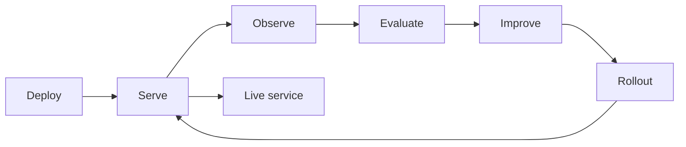
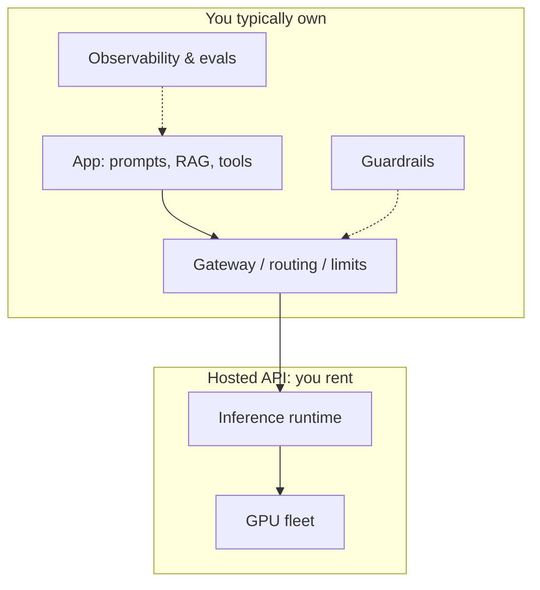
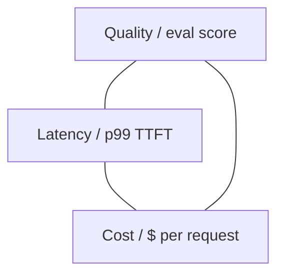
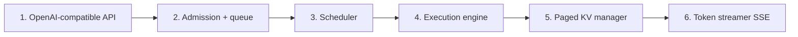
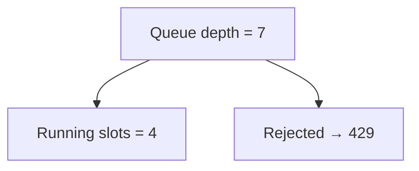
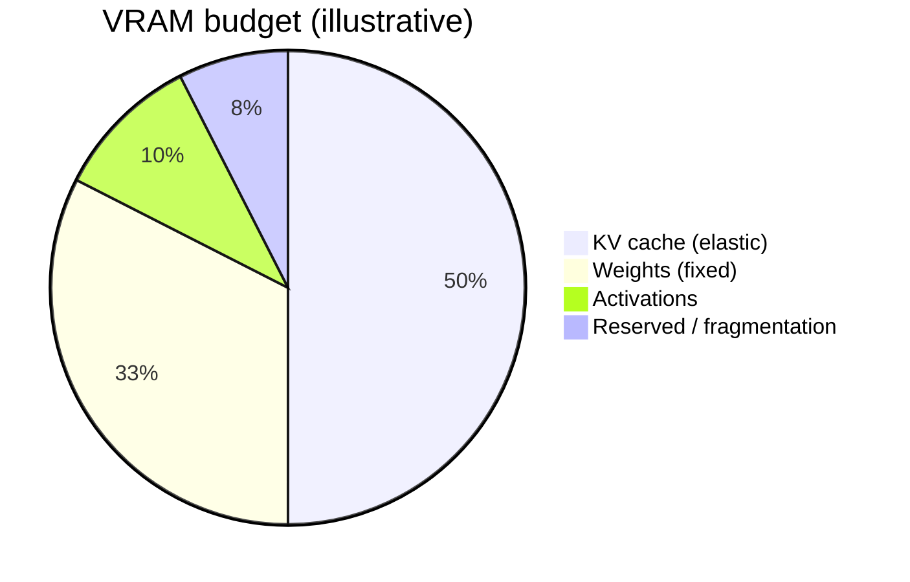
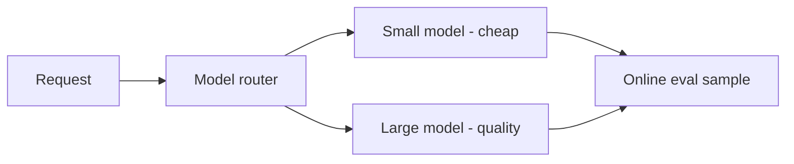

# LLM Ops Fundamentals

> A notebook demo and a production service at 10,000 requests/second with 99.9% availability are separated by a whole discipline. **LLM Ops** is how you run a probabilistic, expensive, GPU-bound model **reliably, affordably, and safely** after the screenshot stops impressing people.

This guide combines three pillars: **what LLM Ops is**, **serving at scale**, and **GPU infrastructure**. Sources: Algoroq LLM Ops track (Chapters 1–3).

---

## Glossary — terms used throughout (for SWEs new to AI)

> **Read this first.** These terms appear throughout both `llm-ops-fundamentals.md` and `llm-ops-production.md`. If you already know them, skip ahead.

### Model & inference terms

| Term | What it is (plain English) | SWE parallel |
|------|---------------------------|-------------|
| **Token** | The smallest unit the model reads/writes — roughly ¾ of a word. "Hello world" ≈ 2 tokens. You pay per token. | Like characters in a byte stream, but coarser |
| **Prompt** | The full text sent to the model (system instructions + user message + context). | Like an HTTP request body |
| **Completion / response** | The text the model generates back. | Like an HTTP response body |
| **Context window** | Max tokens the model can handle in one call (prompt + response). GPT-4o: 128k. Claude: 200k. | Like a max request size limit |
| **TTFT (Time to First Token)** | How long until the first token of the response starts streaming to the user. The main UX metric — users perceive "speed" from TTFT, not total generation time. | Like Time to First Byte (TTFB) in HTTP |
| **ITL (Inter-Token Latency)** | Time between consecutive tokens during streaming. Affects perceived fluency. | Like frame interval in video streaming |
| **Prefill** | The phase where the model processes your entire prompt before generating any output. Long prompts = slow prefill = high TTFT. | Like parsing a big request before responding |
| **Decode** | The phase where the model generates tokens one at a time after prefill. | Like streaming a response chunk by chunk |
| **KV cache** | Key-Value cache — the model stores intermediate computations from the prompt so it doesn't reprocess the entire context for each new token. Grows with `sequence_length × batch_size`. This is what limits how many concurrent users one GPU can serve. | Like a session cache per request — but it lives in GPU VRAM |
| **Continuous batching** | Instead of waiting for a batch to finish, the server rebuilds the batch every GPU iteration — finished sequences leave, new ones enter. This is how production servers (vLLM, TGI) achieve high throughput. | Like connection multiplexing in a web server vs one-thread-per-request |
| **Quantization** | Reducing model weight precision (FP16 → INT8 → INT4) to use less VRAM and compute faster, with minimal quality loss. | Like image compression — lossy but usually good enough |
| **VRAM** | GPU memory (Video RAM). The scarce resource — model weights, KV cache, and activations must all fit. | Like heap memory, but on the GPU |

### Adaptation & quality terms

| Term | What it is (plain English) | SWE parallel |
|------|---------------------------|-------------|
| **RAG (Retrieval-Augmented Generation)** | Instead of relying on the model's training data, you **retrieve** relevant documents from a database and paste them into the prompt as context. The model answers based on those docs. This is how you give an LLM access to your company's data without retraining it. | Like a search → template → render pipeline |
| **Embeddings** | A vector (array of numbers, e.g. 1536 floats) that represents the "meaning" of a piece of text. Similar texts have similar vectors. Used to find relevant documents for RAG. | Like a hash, but semantic — similar inputs produce similar outputs |
| **Vector database** | A database optimized for storing embeddings and finding similar ones fast (approximate nearest neighbor search). Examples: Pinecone, Weaviate, pgvector, Qdrant. | Like a specialized index (think: GIN index for full-text search, but for meaning) |
| **Chunking** | Splitting long documents into smaller pieces before embedding them. Chunk size affects retrieval quality — too large = noise, too small = lost context. | Like pagination for search indexing |
| **Reranker** | After retrieving candidate chunks, a second model re-scores them by relevance. Improves precision of what actually gets stuffed into the prompt. | Like a second-pass sort after a database query |
| **Fine-tuning** | Training the model further on your own data to change its **behavior** (style, format, tool use). Does NOT reliably teach new facts — use RAG for that. | Like customizing a framework's defaults for your use case |
| **LoRA (Low-Rank Adaptation)** | A lightweight fine-tuning method that trains small adapter matrices instead of all model weights. Uses much less VRAM. Multiple LoRAs can share one base model. | Like a plugin/middleware that modifies behavior without forking the framework |
| **RLHF (Reinforcement Learning from Human Feedback)** | Training technique where humans rank model outputs, and the model learns to prefer better-ranked ones. Used to make models more helpful and safe. | Like A/B testing but the model learns from the results |
| **Few-shot** | Including a few input→output examples in the prompt so the model learns the pattern. No training needed — just prompt engineering. | Like providing sample data with an API request |
| **Zero-shot** | Asking the model to do a task with no examples — just instructions. Works when the model already understands the task type. | Like calling an API with just a description of what you want |
| **CoT (Chain of Thought)** | Prompting the model to "think step by step" before answering. Improves accuracy on reasoning tasks. | Like asking a dev to show their work instead of just the answer |

### Evaluation terms

| Term | What it is (plain English) | SWE parallel |
|------|---------------------------|-------------|
| **Eval** | Testing the model's output quality. Unlike unit tests (pass/fail), evals produce **scores** (0-1) on dimensions like faithfulness, relevance, toxicity. | Like integration tests + quality metrics |
| **Golden set** | A curated test dataset with known correct answers. Run evals against this on every prompt/model change. | Like a regression test suite |
| **LLM-as-judge** | Using a second (usually stronger) model to score the first model's outputs. Cheaper than human eval, correlates ~80-90% with human judgment. | Like automated code review |
| **Faithfulness** | Does the model's answer only contain claims supported by the provided context? Low faithfulness = hallucination. Same concept as **grounding**. | Like checking a report cites its sources correctly |
| **Hallucination** | The model generates information that sounds confident but is factually wrong or not in the source documents. | Like a function returning plausible-looking but incorrect data |

---

## Part 1 — What LLM Ops Is

### 1.1 The discipline in one sentence

The moment a model sits on a path real users depend on, you inherit a service with three uncomfortable properties **at once**:

| Property | What it means in production |
|----------|------------------------------|
| **Probabilistic** | Same input can yield different output |
| **Expensive** | Metered per token, on the hot path, forever |
| **GPU-bound** | Throughput and cost follow scarce VRAM and bandwidth |

**LLM Ops** is the engineering discipline of holding that service to production standards anyway: explicit **SLOs** (p99 time-to-first-token, end-to-end latency, availability) plus the machinery to defend them—batching, caching, routing, guardrails, evals, and **cost attribution**.



> **Mental shift:** From “it works once” to “it keeps working, for everyone, within budget, under load, when the provider has a bad day.”

### 1.2 The 200-OK regression

Traditional monitoring assumes a wrong answer and a failed request are the same event. For LLMs they are **orthogonal**.

- HTTP 2xx, latency, and availability SLOs can stay **green**.
- Task success (quality) can drop for **days** until humans notice tickets.

```mermaid
gantt
    title Illustrative quality incident (no infra alerts)
    dateFormat X
    axisFormat %d

    section Signals
    HTTP 2xx flat           :0, 14
    Latency flat            :0, 14
    Online eval would page  :2, 12

    section Reality
    Quality −8 pts          :2, 14
    First tickets           :6, 8
    Human root-cause        :11, 3
```



**Two operational consequences:**

1. **A prompt is a deploy.** Anything that changes model input or identity—prompt templates, retrieval config, tool schemas, pinned model version, sampling params—needs change management and a **rollback path**. Prompts in a CMS “so PMs can iterate” are often an unaudited production deploy channel.

2. **Add a quality SLI** next to availability and latency: sampled online evals, structured-output parse rate, refusal rate, etc. Without it, your error budget describes **transport**, not **product**.

### 1.3 Quality SLIs are statistical tests

Availability is measured on every request and costs nothing extra. Quality is estimated from a **judged sample**—a statistical test with a detection floor and a **price per judgment**.

| Baseline → drop | Approx. judged samples per arm (α=0.05, power 0.8) | Illustrative judge cost @ $0.01 |
|-----------------|-----------------------------------------------------|----------------------------------|
| 80% → 70% (−10 pts) | ~290 | ~$3 |
| 80% → 75% (−5 pts) | ~1,090 | ~$11 |
| 80% → 78% (−2 pts) | ~6,500 | ~$65 |
| 80% → 79% (−1 pt) | ~25,550 | ~$256 |

Halving the detectable drop roughly **quadruples** sample size. A feature with 20k requests/day and 5% judged gets ~1k judgments/day—it may see a 5-point drop in ~1 day but needs ~1 week for a 2-point drop unless you judge more or accept more false pages.

**Extra wrinkles:**

- **Noisy judges** need more samples; judges can be biased (e.g. favor longer answers after a prompt edit).
- **Temperature 0 is not deterministic** in batched production kernels—golden string diffs false-alarm. Compare **distributions** of scores with enough repeats.

### 1.4 LLM Ops vs MLOps

| | **MLOps** | **LLM Ops** |
|---|-----------|-------------|
| **Central asset** | Model you trained on your data | Model someone else trained—you operate it |
| **Core activity** | Training, features, versioning | Inference: serving, routing, context, guardrails |
| **Pipeline** | Data → features → train → validate → deploy | Prompt → retrieve → call → validate → stream |
| **Cost driver** | Training GPU spikes | **Every request**, forever |
| **Correctness** | Held-out metrics (accuracy, AUC) | Evals: LLM-as-judge, groundedness, task success |
| **Failure modes** | Data drift, serving skew | **200-OK regressions**, jailbreaks, runaway agents |
| **Hardware** | Batch GPUs for training | **Always-on inference** GPUs or API bills |

The hard work moved **online**: “prompt to answer” runs on **every** request.

### 1.5 LLM Ops vs AI-native design

| Lens | Question it answers |
|------|---------------------|
| **AI-native design** | What should the product do with models? (UX, agents, tools) |
| **LLM Ops** | How do you **run** that design under SLOs and budget? |

Design choices (long context, multi-step agents) directly change **KV footprint** and **token economics**. Example: context length drives KV per sequence—capacity is not “one model size,” it’s “how many concurrent sequences at this context length.”

### 1.6 The LLM Ops stack



| Layer | Responsibility |
|-------|----------------|
| **Gateway** | Auth, routing, rate limits, failover, prompt/version pins |
| **App** | Prompt assembly, retrieval, tool orchestration |
| **Inference** | Batching, KV cache, streaming |
| **Hardware** | GPUs, memory, interconnect |
| **Observability** | Traces with semantic payload, cost, quality scores |

**Self-hosting myth:** “GPUs are cheaper than APIs at scale” ignores **utilization**, **ops headcount**, and **stranded capacity**. The honest comparison is **$/token at your traffic shape and SLO**, including engineering.

**Streaming gotcha:** A load balancer idle timeout tuned for REST (e.g. 60s) may kill **long-lived SSE streams** while the model is still generating—tune LB, gateway, and client timeouts together.

### 1.7 The core trade-off triangle

Nearly every LLM Ops decision trades three forces:



You cannot max all three. Examples:

- **Retries** improve success rate but **amplify load** during incidents (1.9× offered load at 50% failure with naive retries).
- **Fallback to another provider** trades success during outage for cost and possibly quality drift.

### 1.8 Who owns what

At scale, LLM Ops is **organizational**:

| Role | Typical ownership |
|------|-------------------|
| **Platform / ML infra** | Serving, GPUs, routing, base observability |
| **Product / app teams** | Prompts, RAG, tools, feature-level evals |
| **Safety / compliance** | Guardrails policy (input/output checks — see `llm-ops-production.md` Part 1 for full code examples), PII handling (detecting & redacting personal data), audit |
| **FinOps / leadership** | Budgets, chargeback, model tier choices |

---

## Part 2 — Serving at Scale

> Your job is not one fast forward pass—it is keeping **expensive GPUs full**, **requests moving**, and an **SLO holding** while traffic swings 10× across the day.

### 2.1 Inside an inference server (vLLM / TGI style)

A production server is a **small distributed system** behind one HTTP endpoint:



| Step | Role |
|------|------|
| API | Auth, validate, tokenize |
| Admission | Backpressure, `max-num-seqs`, reject when full |
| Scheduler | Re-picks batch **every iteration** |
| Engine | Batched GPU forward pass |
| KV | **PagedAttention**—fixed blocks, tight packing |
| Streamer | First token out, then rest |

**Hot loop:** steps 3–5 run thousands of times per second.

**CPU-side failures (often blamed on GPU):**

- Tokenizing 30k-token RAG prompts + SSE at high concurrency contends with the scheduler (GIL in Python engines). Symptom: **inter-token latency up, GPU utilization down**. Fix: more API worker processes or newer engine layout—not “add GPUs.”

**Abandoned work:** User closes tab; gateway times out; client retries. If disconnect does not **abort** the sequence, GPU keeps decoding to `max_tokens` for nobody. Metric: **aborted-sequence tokens / generated tokens**. If > few % at peak, timeouts are shorter than generations they wait on.

### 2.2 Queue and admission control

Two ceilings (do not conflate them):

1. **`max-num-seqs`** — configured cap on running slots  
2. **Free KV blocks right now** — real ceiling moves with sequence lengths  

Effective concurrency = **min**(both). Requests **wait in queue** before the model touches them—often **invisible** in per-token latency metrics.



| Signal | Why it matters |
|--------|----------------|
| **Queue depth** | Rises **before** p99 latency |
| **Time in queue** | Best autoscale / alert leading indicator |
| **Head-of-line blocking** | One long generation starves short interactive traffic |
| **Unbounded queue** | Latency grows without limit—use **429 shed** past depth |

**Little’s law (first cut):**  
`resident_sequences ≈ arrival_rate × time_per_sequence_resident`

Illustrative: 20 req/s, ~500 output tokens at 40 tok/s → ~12.5s resident → **~250 sequences** in flight before KV math.

**Shed on predicted wait:** Compare queued prefill tokens / measured prefill rate to client deadline; return **429** early instead of serving doomed work.

**Retries:** Three immediate retries on a shedding fleet turns 10% shed into **~1.3× offered load**. Use retry budgets, `Retry-After`, different replica/region.

**Traffic classes:** Do not put nightly batch eval and interactive chat in one FIFO—priority admission and **caps on batch share of KV**.

### 2.3 Continuous batching and chunked prefill

The batch is **rebuilt every GPU iteration**: finished sequences leave; waiting ones fill slots; one combined forward pass.

**Chunked prefill:** Split long prompts across iterations interleaved with decodes so one 8k prompt does not freeze everyone’s streaming.

| `max-num-batched-tokens` (illustrative 8k prompt) | Step time (others’ inter-token gap) | Steps | Long prompt TTFT |
|---------------------------------------------------|-------------------------------------|-------|------------------|
| 512 | ~46 ms | 16 | ~0.74 s |
| 2048 | ~153 ms | 4 | ~0.61 s |
| 8192 (unchunked) | ~583 ms | 1 | ~0.58 s |

Long prompt TTFT moves little; **everyone else’s ITL** moves by an order of magnitude. Set budget from **ITL SLO**, not throughput benchmarks alone.

**Disaggregated prefill/decode:** Separate pools; ship KV between them—cost ~320 KB/token × context for a 70B-class model. Worth it when prompts are long vs outputs and ITL SLO is strict.

**Speculative decoding:** Great at **low batch** (idle compute); can **hurt aggregate throughput** at high batch when drafts reject often.

### 2.4 GPU utilization: tokens per GPU-second

| Metric | When to use |
|--------|-------------|
| **MFU** (FLOPs vs peak) | Training; misleading for decode-heavy serving |
| **MBU** (HBM bandwidth) | Decode—often bandwidth-bound |
| **Tokens / GPU-second** | Cost and capacity planning |

Decode streams full weights each step → batching **amortizes** weight reads; it does not make one user faster until compute-bound at large batch.

**Levers:** continuous batching, prefix caching, FP8 weights/KV, right model tier, **cache-aware routing** (same prefix → same replica).

### 2.5 Multi-model hosting and autoscaling

- **Autoscale on queue depth / time-in-queue**, not CPU.
- **Cold start** and **model load** dominate scale-up—keep warm pools or over-provision for spikes.
- **Routing:** cost/latency/quality tiers; fallbacks when primary sheds or errors.

### 2.6 Example gateway config (conceptual)

```python
# Illustrative admission: shed when predicted wait exceeds budget
def admit(request, queue, replica_stats) -> bool:
    predicted_wait_s = queue.prefill_tokens_ahead / replica_stats.prefill_tok_per_s
    if predicted_wait_s > request.deadline_remaining_s:
        return False  # 429 + Retry-After
    return True
```

```yaml
# Kubernetes HPA hint: scale on custom metric, not CPU
metrics:
  - type: External
    external:
      metric:
        name: inference_queue_time_p99_seconds
      target:
        type: Value
        value: "2"
```

---

## Part 3 — GPU Infrastructure & Scheduling

> Once you run your own models, the abstraction ends. Almost every cost decision traces to **how you fill VRAM** and **keep it busy**.

### 3.1 VRAM anatomy

On one 80 GB GPU (illustrative 13B FP16):



| Segment | Behavior |
|---------|----------|
| **Weights** | Fixed toll: params × bytes/param |
| **KV cache** | Grows with `seq_len × batch`—sets concurrency |
| **Activations** | Per forward pass |
| **Reserved** | CUDA context, fragmentation—leave real slack |

**KV bytes per token** (do the math, do not trust param count alone):

```text
KV_per_token = 2 × layers × kv_heads × head_dim × bytes
```

Example: Llama-2-13B ≈ **0.8 MB/token**; with ~40 GB for KV → on the order of **12 concurrent 4k** conversations—not “infinite users per GPU.”

**GQA:** Llama-3-70B has fewer KV heads than 13B—can be **cheaper per token** in KV than smaller models. **Architecture beats headline size** for concurrency.

**Production failure:** Fleet sized on median context; one tenant sends 30k-token RAG. Paged KV **preempts** instead of OOM—dashboard throughput flat, **p99 TTFT** climbs. Alert on **preemption rate** and **KV block utilization**, not “GPU memory %.”

| Lever | Effect | Cost |
|-------|--------|------|
| **FP8 weights** | Fits bigger models; faster decode | Quality drift on tail tasks—gate on **your** evals |
| **FP8 KV** | ~2× resident tokens | Usually safer than weight quant |
| **Prefix sharing** | One copy of shared system prompt | Needs **cache-aware routing** to same replica |
| **High mem util (0.95+)** | More KV until… | Hard OOM kills entire process |

### 3.2 Picking silicon

| GPU | VRAM | Bandwidth | Best fit |
|-----|------|-----------|----------|
| H200 SXM | 141 GB HBM3e | ~4.8 TB/s | Long context + large models |
| H100 SXM | 80 GB | ~3.4 TB/s | High-throughput serving |
| A100 80GB | 80 GB | ~2.0 TB/s | Workhorse, **MIG** |
| L40S | 48 GB | ~0.86 TB/s | Mid-model serving |
| L4 | 24 GB | ~0.30 TB/s | Small/quantized, embeddings |

> **Fit first, price second.** An L4 is cheap per hour but cannot hold a 70B model. **Decode is bandwidth-bound**—bandwidth beats FLOPs on paper for serving.

### 3.3 Multi-GPU and tensor parallel

Large models need **tensor parallelism (TP)** across GPUs with fast **NVLink**. PCIe-only cards shard poorly for latency-sensitive decode.

### 3.4 MIG and scheduling

**MIG** slices an A100 into isolated instances—good for **small models / embeddings** on one card. Wrong for one huge model needing all VRAM.

**Kubernetes / Slurm schedulers** must account for:

- GPU memory **fragmentation**
- **Gang scheduling** for TP jobs
- **Preemption** policies (training vs serving)

### 3.5 Spot vs on-demand

| | **Spot** | **On-demand** |
|---|----------|----------------|
| Cost | Lower | Higher |
| Risk | Interruption | Stable |
| LLM serving | Often batch/offline | Interactive SLO paths |

Mitigate spot with checkpointed batch jobs, redundant replicas, and **not** putting sole copy of state on preemptible nodes.

### 3.6 Cost per token (illustrative)

```text
cost_per_token ≈ (GPU $/hour) / (tokens_per_second × 3600 × utilization)
```

Track **GPU-seconds per request** by route (chat vs RAG vs agent). Compare to hosted API **$/1M tokens** including ops labor.

### 3.7 Multi-tenancy

Shared fleet needs **fairness**: per-tenant KV caps, queue priorities, and chargeback from traced token usage—otherwise one tenant’s 128k prompts evict everyone else.

---

## Quick reference checklist

- [ ] SLOs include **quality**, not just 2xx and latency  
- [ ] Prompts and retrieval versions are **deployed and rollbackable**  
- [ ] Alerts on **queue depth**, preemption, aborted tokens  
- [ ] Client **deadlines**, retry budgets, traffic classes  
- [ ] VRAM sized for **p95/p99 context**, not median  
- [ ] **$/token** and GPU-second attribution per feature  

---

## Further reading (topics in the LLM Ops track)

- Guardrails, observability, fine-tuning, reliability → see `llm-ops-production.md`

*Based on Algoroq LLM Ops chapters: What LLM Ops Is, Serving at Scale, GPU Infrastructure & Scheduling.*

---

## Senior Pitfalls

| Mistake | Impact | Fix |
|---------|--------|-----|
| Serving one request per GPU at a time | 10x lower throughput than continuous batching | Enable vLLM / TGI continuous batching from day one |
| Skipping quantization "because quality" | Cannot fit model in available VRAM; latency too high | Benchmark INT8/INT4 vs FP16 on your eval set — quality loss is often < 1% |
| No KV-cache eviction policy | OOM crashes under concurrent long-context sessions | Set `max_model_len` and monitor `gpu_kv_cache_usage` |
| Prefill and decode on same pool | Long-prompt prefill blocks short-response decode | Disaggregate prefill / decode or use priority queues |
| Hard-coding batch size | Under-utilization at low traffic; OOM at peak | Dynamic / continuous batching with max-batch-tokens limit |

---

## Production-grade Practice

1. **Benchmark throughput** — serve the same model with and without continuous batching; measure tokens/sec at 50 concurrent requests.
2. **Quantize and evaluate** — convert a model to INT8; run your eval set; compare faithfulness score vs FP16 baseline.
3. **KV-cache OOM drill** — set `max_model_len` too low; observe request failures; tune and add a monitoring alert on `gpu_kv_cache_usage > 90%`.
4. **Capacity plan** — calculate how many concurrent sessions your GPU can handle using the KV-cache formula from this module; validate with a load test.

---

## FAANG Interview Deep Dive

### Real-world examples

**OpenAI / Azure OpenAI production SLOs**  
Hosted LLM APIs publish **latency and availability** tiers; customers architect **fallback models** (GPT-4 → GPT-4o-mini) when **TPM/RPM limits** or **regional degradation** hit. A **1%** availability miss on **10k RPS** chat = **8.6M failed requests/day**—infra SLOs must pair with **quality SLIs** (task success rate).

**Meta LLaMA serving (internal patterns)**  
Large fleets use **continuous batching** and **KV-cache-aware scheduling** to raise **tokens/s/GPU** from tens to **hundreds+** on A100/H100 class hardware. **VRAM** bounds concurrent **128k-context** sessions—one bad prompt class can evict **thousands** of short chats without **per-tenant KV caps**.

**GitHub Copilot-scale routing**  
Copilot-class products route by **model size**, **latency SLO**, and **cost per accepted suggestion**—not raw tokens. Interview signal: **p99 time-to-first-token (TTFT)** often dominates UX more than total generation time for streaming UIs.



### Interview Q&A

### Q: Why is HTTP 200 a misleading SLI for LLM services?
**A:** Model can return **200 with wrong JSON**, hallucinated tool args, or empty completion. Define **quality SLI**: schema parse rate, groundedness score, human thumbs-down rate. **200-OK regression** can last days while dashboards stay green.

### Q: How do you capacity-plan GPU inference at 10k RPS?
**A:** Estimate **tokens in + out** per request, **model FLOPs/token**, batching efficiency. Rough check: if mean **2k input + 500 output tokens** at **10k RPS** → **25M tokens/s** aggregate—requires **large multi-GPU fleet** or aggressive **caching/distillation**. Size for **p99 context**, not median.

### Q: Prompt change vs model deploy—same rigor?
**A:** Yes—**prompt is a deploy**. Version prompts in git, **canary** by cohort, **rollback** in one click. PM-editable CMS without audit trail is a **production incident waiting**.

### Q: When is continuous batching worth complexity?
**A:** When **concurrency > ~10** and sequences vary in length—throughput gains **2–10×** vs static batching. Less valuable for **single-tenant dedicated** endpoints with uniform length.

### Q: Multi-tenant fairness on one GPU fleet?
**A:** **Per-tenant queues**, **max concurrent KV**, **priority classes** (paid vs free). Without fairness, one **128k** user causes **preemption** or OOM for everyone—classic noisy neighbor on **VRAM**, not CPU.

### Common mistakes candidates make

- SLOs on **availability only**, ignoring **quality and cost per successful task**.
- **No deadline** on client—unbounded waits clog batch queues.
- Sizing VRAM for **median** context when **p99 is 32k+** tokens.
- Treating **temperature** changes as non-deploys.
- **No attribution** of $/request by product route—cannot optimize spend.

### Decision framework

| Signal | Hosted API | Self-hosted GPUs |
|--------|------------|------------------|
| Steady high volume | $/token may exceed ops | CapEx + utilization target > 60% |
| Burst / prototype | Fast | Cold start + queue risk |
| Strict data residency | Regional endpoint | Own fleet |
| Quality-critical | Multi-provider fallback | Fine-tune + router |

**Cost sketch:** `monthly ≈ (tokens_in × price_in + tokens_out × price_out) × 1.3_ops_margin` — compare to `GPU_hours × $/hr / tokens_per_hour` at **your** batching efficiency.

### Serving SLO template

| SLI | Example target | Why it matters |
|-----|----------------|----------------|
| TTFT p99 | < 800 ms | Perceived snappiness |
| E2E p99 | < 8 s @ 500 out tokens | User wait |
| Availability | 99.9% | Platform contract |
| Parse / schema rate | > 99.5% | Agent reliability |
| Quality (sampled) | > baseline − 2 pts | 200-OK regression |

```python
# VRAM rough bound: concurrent sessions × KV per token × context
kv_bytes_per_token = 2 * num_layers * hidden * 2  # fp16 sketch
sessions_max = gpu_vram_gb * 1e9 / (kv_bytes_per_token * context_tokens)
```

**Staff signal:** Separate **prefill** vs **decode** bottlenecks—long prompts saturate compute before tokens/s; interviewers probe **continuous batching** and **KV eviction** policies.
