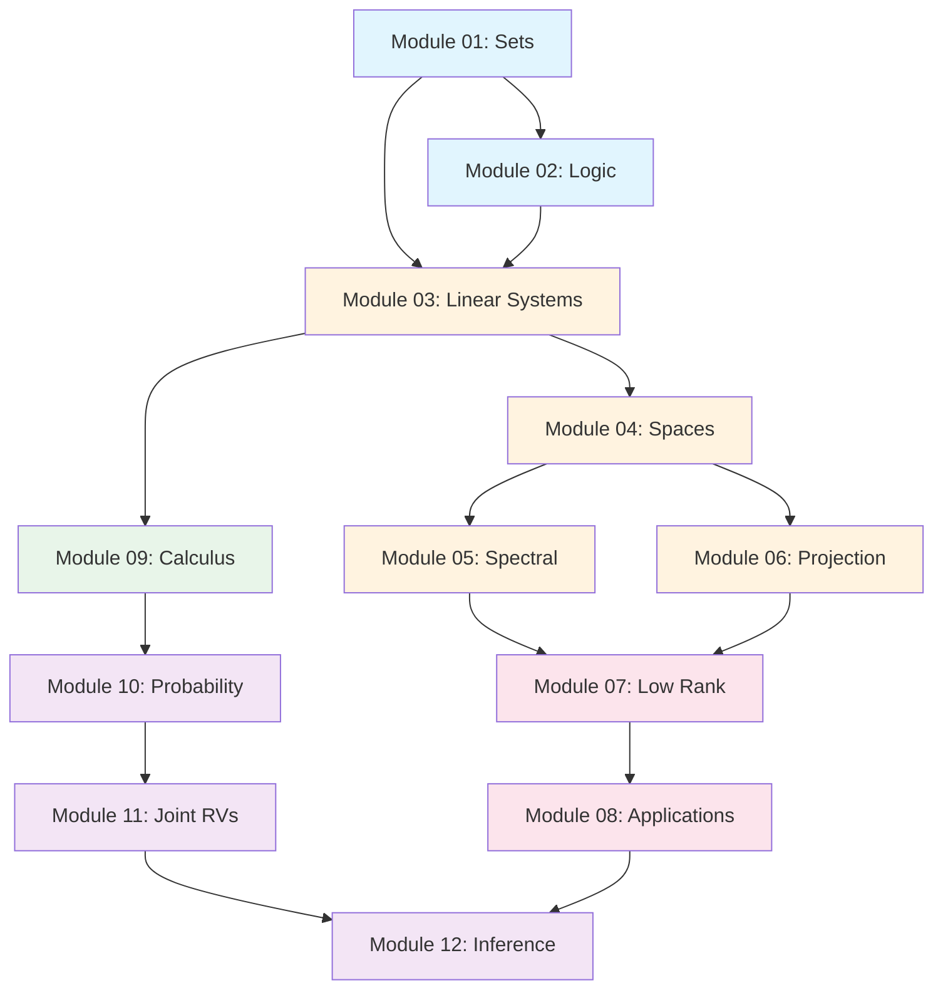

# 🧮 ML Math Foundations — Complete Curriculum

> **Build the math intuition that ML models depend on.**
> Written in plain English with real code, visual diagrams, and FAANG-level deep dives.

```
 ┌─────────────────────────────────────────────────────────┐
 │                   ML MATH ROADMAP                       │
 │                                                         │
 │  Foundation        Core Linear Algebra      Advanced    │
 │  ┌──────┐         ┌──────────────┐        ┌─────────┐  │
 │  │ Sets │──────▶  │Linear Systems│──────▶ │Spectral │  │
 │  │Logic │         │   Spaces     │        │Low Rank │  │
 │  └──────┘         │ Projection   │        │  Apps   │  │
 │                   └──────────────┘        └─────────┘  │
 │                          │                     │        │
 │                          ▼                     ▼        │
 │                   ┌──────────────┐     ┌────────────┐   │
 │                   │  Calculus    │────▶│Probability │   │
 │                   │  (Module 9) │     │Joint RVs   │   │
 │                   └──────────────┘     │ Inference  │   │
 │                                        └────────────┘   │
 └─────────────────────────────────────────────────────────┘
```

---

## 📚 Full Curriculum — 12 Modules · 47 Topics

| # | Module | Topics | Key ML Connection |
|---|--------|--------|-------------------|
| 01 | [**Sets**](module-01-sets/README.md) | Set theory, Operations, Properties | Feature spaces, data partitioning |
| 02 | [**Logic**](module-02-logic/README.md) | Predicates, Conditionals, Boolean algebra | Decision trees, logical gates in NNs |
| 03 | [**Linear Systems**](module-03-linear-systems/README.md) | Lines/planes, Determinants, Row reduction, Invertibility, Affine | Solving Ax=b, data transformations |
| 04 | [**Spaces**](module-04-spaces/README.md) | Vectors/spans, Subspaces, Bases, Dimension/rank | Embeddings, feature engineering |
| 05 | [**Spectral**](module-05-spectral/README.md) | Eigenvalues/vectors, Spectral decomposition | PCA, PageRank, stability analysis |
| 06 | [**Projection**](module-06-projection/README.md) | Inner products, Orthogonality, Projection | Least squares, Gram-Schmidt |
| 07 | [**Low Rank**](module-07-low-rank/README.md) | Curvature/quadratics, SVD | Dimensionality reduction, recommenders |
| 08 | [**Applications**](module-08-applications/README.md) | Residuals, Linear regression, PCA | Direct ML implementations |
| 09 | [**Calculus**](module-09-calculus/README.md) | Surfaces, Derivatives, Gradients, Jacobians, Integration, Optimization | Backpropagation, gradient descent |
| 10 | [**Probability**](module-10-probability/README.md) | Bayes, Continuous RVs, Moments, Distributions | Bayesian ML, generative models |
| 11 | [**Joint RVs**](module-11-joint-rvs/README.md) | Discrete/continuous joints, Covariance, Gaussians | Multivariate models, correlation |
| 12 | [**Inference**](module-12-inference/README.md) | Sampling, MLE, Confidence intervals | Model training, uncertainty |

---

## 🎯 How to Use This Guide

### For Beginners
Start at Module 01 and work forward. Each concept builds on previous ones.

### For Interview Prep
Jump to the **🔥 FAANG Deep Dive** sections in each module — they contain real interview problems from Google, Meta, Amazon, and others.

### For ML Engineers
Focus on Modules 03-09 (Linear Algebra + Calculus) — these are the backbone of deep learning.

### Legend

| Icon | Meaning |
|------|---------|
| 💡 | Key Intuition |
| 🐍 | Python Code Example |
| 📊 | Diagram / Visualization |
| 🔥 | FAANG Interview Deep Dive |
| ⚡ | ML Connection |
| 🧩 | Practice Problem |
| ✅ | Checkpoint / Summary |

---

## 🗺️ Dependency Graph



---

*Total estimated study time: ~120 hours for full mastery*
*Each module: ~10 hours (reading + code + practice)*

© 2026 ML Math Foundations Tutorial
