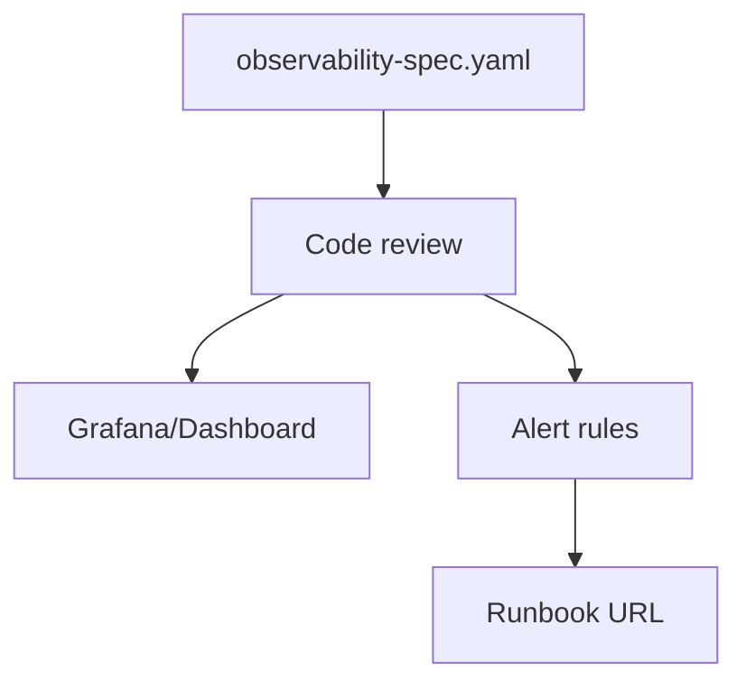

# Observability Driven Development (ODD)

## What Is It?

Most teams add observability **after** building features — as an afterthought. Observability Driven Development flips this: **design your observability first**, then build the feature.

> **Observability Driven Development (ODD)** means you define what you need to **observe, measure, and alert on** before you write the first line of business logic — the same way TDD makes you write tests first.

---

## The Problem with "Observability as Afterthought"

```
Traditional Development:                ODD (Observability Driven):

1. Write code ✅                        1. Define SLOs ✅
2. Deploy ✅                            2. Design metrics & traces ✅
3. Something breaks 💥                  3. Instrument code ✅
4. "We need logging"                    4. Write business logic ✅
5. Add print statements 🙈             5. Deploy with dashboards ready ✅
6. "We need metrics"                    6. Something breaks 💥
7. Add random counters                  7. Dashboard shows EXACTLY where ✅
8. "We need tracing"                    8. Fix in minutes, not hours ✅
9. Retrofit tracing (painful)
10. Still can't debug 😢
```

---

## The ODD Process

```mermaid
graph TB
    subgraph "Phase 1: Define Observability Requirements"
        S1[Define SLOs<br/>"99.9% of requests < 200ms"]
        S2[Identify Key Metrics<br/>"request_duration, error_rate"]
        S3[Design Trace Spans<br/>"What operations to trace?"]
        S4[Define Alert Conditions<br/>"Error rate > 1% for 5 min"]
    end

    subgraph "Phase 2: Instrument First"
        I1[Add metrics instrumentation]
        I2[Add tracing spans]
        I3[Add structured logging]
        I4[Create dashboards]
    end

    subgraph "Phase 3: Implement Business Logic"
        B1[Write the actual feature]
        B2[Business logic lives inside<br/>the instrumentation]
    end

    subgraph "Phase 4: Validate"
        V1[Verify dashboards show data]
        V2[Verify alerts fire correctly]
        V3[Verify traces capture flow]
    end

    S1 --> S2 --> S3 --> S4
    S4 --> I1 --> I2 --> I3 --> I4
    I4 --> B1 --> B2
    B2 --> V1 --> V2 --> V3

    style S1 fill:#ddf
    style I1 fill:#dfd
    style B1 fill:#ffd
    style V1 fill:#fdf
```

---

## Example: Building a Payment Service with ODD

### Phase 1: Define What to Observe

Before writing any code, define the observability contract:

```yaml
# observability-spec.yaml — Define BEFORE writing code

service: payment-service

slos:
  - name: payment-success-rate
    target: 99.9%
    metric: payment_requests_total{status="success"} / payment_requests_total
    window: 30d

  - name: payment-latency
    target: "99th percentile < 500ms"
    metric: payment_duration_seconds
    window: 7d

metrics:
  counters:
    - name: payment_requests_total
      labels: [method, status, provider, currency]
      description: "Total payment requests"
    
    - name: payment_amount_total
      labels: [currency, provider]
      description: "Total payment amount processed"

  histograms:
    - name: payment_duration_seconds
      labels: [method, provider]
      buckets: [0.01, 0.05, 0.1, 0.25, 0.5, 1.0, 2.5, 5.0]
      description: "Payment processing duration"

  gauges:
    - name: payment_provider_health
      labels: [provider]
      description: "Payment provider health status (1=healthy)"

traces:
  spans:
    - name: process_payment
      attributes: [payment_id, customer_id, amount, currency, provider]
      children:
        - name: validate_payment
        - name: fraud_check
        - name: provider_charge
          attributes: [provider_request_id, provider_response_code]
        - name: update_database
        - name: publish_event

structured_logs:
  - event: payment_initiated
    fields: [payment_id, customer_id, amount, currency]
    level: info
  - event: payment_completed
    fields: [payment_id, duration_ms, provider]
    level: info
  - event: payment_failed
    fields: [payment_id, error_code, error_message, provider]
    level: error

alerts:
  - name: high-error-rate
    condition: "error_rate > 1% for 5 minutes"
    severity: critical
    runbook: "https://wiki.internal/runbooks/payment-errors"
  
  - name: high-latency
    condition: "p99 latency > 500ms for 10 minutes"
    severity: warning
    runbook: "https://wiki.internal/runbooks/payment-latency"
  
  - name: provider-down
    condition: "payment_provider_health == 0 for 2 minutes"
    severity: critical
    runbook: "https://wiki.internal/runbooks/provider-failover"
```

### Phase 2: Instrument First (Before Business Logic)

```python
import time
from prometheus_client import Counter, Histogram, Gauge
from opentelemetry import trace

# --- Set up instrumentation ---

tracer = trace.get_tracer("payment-service")

# Metrics (defined from our spec)
payment_requests = Counter(
    "payment_requests_total",
    "Total payment requests",
    ["method", "status", "provider", "currency"],
)

payment_duration = Histogram(
    "payment_duration_seconds",
    "Payment processing duration",
    ["method", "provider"],
    buckets=[0.01, 0.05, 0.1, 0.25, 0.5, 1.0, 2.5, 5.0],
)

payment_amount = Counter(
    "payment_amount_total",
    "Total payment amount processed",
    ["currency", "provider"],
)

provider_health = Gauge(
    "payment_provider_health",
    "Payment provider health (1=healthy)",
    ["provider"],
)


class PaymentService:
    """
    Notice: Instrumentation is the STRUCTURE.
    Business logic fills in the gaps.
    """

    async def process_payment(self, payment_request):
        # Start trace span
        with tracer.start_as_current_span("process_payment") as span:
            span.set_attribute("payment_id", payment_request.id)
            span.set_attribute("customer_id", payment_request.customer_id)
            span.set_attribute("amount", payment_request.amount)
            span.set_attribute("currency", payment_request.currency)

            start_time = time.time()
            status = "success"
            provider = payment_request.provider

            try:
                # Step 1: Validate
                with tracer.start_as_current_span("validate_payment"):
                    self._validate(payment_request)  # Business logic goes here

                # Step 2: Fraud check
                with tracer.start_as_current_span("fraud_check"):
                    await self._fraud_check(payment_request)  # Business logic

                # Step 3: Charge via provider
                with tracer.start_as_current_span("provider_charge") as charge_span:
                    result = await self._charge(payment_request)  # Business logic
                    charge_span.set_attribute("provider_request_id", result.request_id)
                    charge_span.set_attribute("provider_response_code", result.code)

                # Step 4: Save to DB
                with tracer.start_as_current_span("update_database"):
                    await self._save(payment_request, result)  # Business logic

                # Step 5: Publish event
                with tracer.start_as_current_span("publish_event"):
                    await self._publish_event(payment_request)  # Business logic

                # Structured log
                logger.info("payment_completed", extra={
                    "payment_id": payment_request.id,
                    "duration_ms": (time.time() - start_time) * 1000,
                    "provider": provider,
                })

            except Exception as e:
                status = "error"
                span.set_status(trace.StatusCode.ERROR)
                span.record_exception(e)

                logger.error("payment_failed", extra={
                    "payment_id": payment_request.id,
                    "error_code": getattr(e, "code", "UNKNOWN"),
                    "error_message": str(e),
                    "provider": provider,
                })
                raise

            finally:
                duration = time.time() - start_time

                # Record metrics
                payment_requests.labels(
                    method="charge", status=status,
                    provider=provider, currency=payment_request.currency,
                ).inc()

                payment_duration.labels(
                    method="charge", provider=provider,
                ).observe(duration)

                if status == "success":
                    payment_amount.labels(
                        currency=payment_request.currency, provider=provider,
                    ).add(payment_request.amount)
```

### Phase 3: Build Dashboards Before Launch

```python
# Grafana dashboard definition (JSON model, simplified)
dashboard = {
    "title": "Payment Service",
    "rows": [
        {
            "title": "SLOs",
            "panels": [
                {
                    "title": "Success Rate SLO (target: 99.9%)",
                    "query": """
                        sum(rate(payment_requests_total{status="success"}[5m]))
                        /
                        sum(rate(payment_requests_total[5m])) * 100
                    """,
                    "thresholds": [{"value": 99.9, "color": "green"},
                                   {"value": 99.0, "color": "red"}],
                },
                {
                    "title": "P99 Latency SLO (target: 500ms)",
                    "query": """
                        histogram_quantile(0.99,
                          rate(payment_duration_seconds_bucket[5m])
                        )
                    """,
                },
            ],
        },
        {
            "title": "Traffic",
            "panels": [
                {"title": "Requests/sec", "query": "rate(payment_requests_total[1m])"},
                {"title": "Revenue", "query": "rate(payment_amount_total[1h])"},
            ],
        },
    ],
}
```

---

## ODD vs TDD Analogy

```
TDD (Test Driven Development):          ODD (Observability Driven Development):

1. Write a failing test                  1. Define an SLO that can't be measured yet
2. Write minimal code to pass           2. Add instrumentation to measure it
3. Refactor                              3. Write business logic
4. Tests document behavior               4. Dashboards document production behavior
5. Tests catch regressions               5. Alerts catch production regressions

Both share the same philosophy:
"Define what success looks like BEFORE building the thing"
```

---

## The Three Pillars of ODD

```
┌──────────────────────────────────────────────────────────────┐
│                     Observability                             │
│                                                              │
│  ┌──────────────┐  ┌──────────────┐  ┌──────────────┐       │
│  │   METRICS    │  │   TRACES     │  │    LOGS      │       │
│  │              │  │              │  │              │       │
│  │ What is      │  │ Where is it  │  │ Why did it   │       │
│  │ happening?   │  │ slow/broken? │  │ break?       │       │
│  │              │  │              │  │              │       │
│  │ Counters     │  │ Spans        │  │ Structured   │       │
│  │ Histograms   │  │ Context      │  │ JSON logs    │       │
│  │ Gauges       │  │ Propagation  │  │ Correlation  │       │
│  └──────────────┘  └──────────────┘  └──────────────┘       │
│                                                              │
│  In ODD, all three are designed TOGETHER before coding       │
└──────────────────────────────────────────────────────────────┘
```

---

## Key Takeaways

- **Define observability requirements before writing code** — just like writing tests before code (TDD)
- Start with **SLOs**: what does "healthy" look like for this feature?
- Design **metrics, traces, and structured logs** together as a spec
- **Instrument first**, then fill in business logic
- **Dashboards and alerts should be ready** before the feature goes live
- ODD produces systems that are **debuggable from day one**, not after the first outage
- The observability spec becomes **living documentation** of how the system works

---

## Senior Pitfalls

| Mistake | Impact | Fix |
|---------|--------|-----|
| Shipping features without updating the observability spec | On-call cannot tell healthy from broken during incidents | Block merge unless spec fields, SLO probes, and dashboards are updated in the same PR |
| Logging every variable at `DEBUG` in production | Log volume cost spikes; PII leaks into centralized stores | Structured logs at `INFO` with sampling; redact fields at ingest |
| Using request IDs only inside one service | Broken traces across async boundaries; hours lost stitching logs | Propagate trace context (W3C `traceparent`) on HTTP, queues, and cron |
| Dashboards built only for averages | Miss tail latency and partial outages affecting a cohort | Add histogram/SLO panels and breakdowns by region, tenant tier, and dependency |
| Alerting on log string matches | Flaky pages, alert fatigue, missed real regressions | Alert on SLO burn rate and metric thresholds tied to user journeys |

---

## Production-grade Practice

1. **Build:** For one critical API, write an observability spec (golden signals, required span attributes, log schema) and implement it before the feature flag ships; verify in staging with a synthetic journey.
2. **Debug:** Inject a controlled fault (500 from a downstream mock) and time how long it takes a new engineer to find root cause using only dashboards and traces—document gaps and fix instrumentation.
3. **Measure:** Define one SLI from logs/metrics (e.g., successful checkout latency p99) and wire a burn-rate alert; run a tabletop on what happens when the alert fires at 2 a.m.
4. **Capacity plan:** Estimate monthly log and trace ingest from peak RPS × bytes per request; model cost if debug logging is left on for 10% of traffic and set guardrail budgets.

---

## FAANG Interview Deep Dive

### Real-world FAANG examples

| Company | ODD / SLO culture | Concrete practice |
|---|---|---|
| **Google** | **SRE error budgets** tied to launches; **SLI dashboards** before feature flags widen | Search: **99.99%** availability targets with **multi-window burn alerts** |
| **Netflix** | **FIT** (Fault Injection Testing) + **Atlas** metrics; teams ship **canaries** with pre-built dashboards | **~200M+** streaming hours drive **per-region** SLO boards |
| **Amazon** | **COE** (Correction of Error) process; **Service Health Dashboard** required for Tier-1 services | Prime Day: **observability spec** is part of **launch checklist** |

**Meta:** **Oncall playbooks** link directly from alert annotations—ODD artifact is the **observability contract** in code review (like Netflix's **"ready to operate"** gate).



### Interview Q&A

### Q: How is ODD different from "we use Datadog"?

**A:** ODD is **process**: SLOs and instrumentation are **acceptance criteria** for the feature, not a ticket after launch. Staff signal: **error budget policy** blocks releases when burn is high—even if QA passed. Tools are interchangeable; **contract-first telemetry** is not.

### Q: Define SLI/SLO/SLA for a payment API in an interview.

**A:** **SLI:** `successful_charges / total_charges` (availability), `p99 latency < 500ms`. **SLO:** 99.95% success over **30d**, p99 < 500ms over **7d**. **SLA:** contractual 99.9% with credits—**SLO internal target stricter** than SLA. **Error budget:** 0.05% × 30d × 86,400s/day × RPS ≈ allowed bad seconds—use **burn rate alerts** (Google SRE workbook).

### Q: You have 500 microservices. How do you avoid metric explosion in ODD?

**A:** **Golden signals** per service (latency, traffic, errors, saturation). **Standard label set** (`service`, `env`, `region`)—no `user_id`. ODD spec template enforced by **lint** in CI. High-cardinality in **traces** only. Amazon/Google: **tiering**—only Tier-1 gets full ODD treatment.

### Q: Write ODD acceptance criteria for "add PayPal as provider."

**A:** New labels on existing metrics: `provider=paypal`. Spans: `provider_charge` with `provider_request_id`. Alerts: **provider_health==0** for 2m pages; **error_rate by provider** > 2× baseline. Dashboard row before merge. **Feature flag** canary with **compare** success rate vs Stripe.

### Q: ODD vs TDD—do you skip tests?

**A:** No—**complementary**. TDD proves logic; ODD proves **operability**. Production failures are often **integration/tail** issues tests miss. Ideal: **contract tests** + **SLO-based release gates**.

### Common mistakes

- **Vanity metrics** (CPU graphs) without **user-facing SLIs**.
- Alerts without **runbooks** → oncall pages with no action.
- **Log printf** in hot path instead of **structured** `payment_failed` events.
- Dashboards built **after** incident—missing **baseline** comparison.
- Same **threshold** dev vs prod (noise vs blindness).

### Back-of-envelope sizing

**Payment service:** 2K RPS, 5 histogram buckets × 4 labels = 20 series per metric, 10 core metrics.

| Item | Math |
|---|---|
| Prometheus series/service | ~**200–500** (healthy) |
| Log volume if 1 KB/log × 2K RPS | **2 GB/s** raw → **must sample** info logs |
| Trace volume 8 spans × 1 KB × 2K RPS | **16 MB/s** → **head 1% + tail** (see tail sampling doc) |
| On-call cost of bad alert | 1 false page/night × 30 engineers × 15 min = **150 eng-hours/month** wasted |

```yaml
# Minimal ODD gate in CI (conceptual)
observability:
  required_metrics:
    - payment_requests_total
    - payment_duration_seconds
  required_alerts:
    - high-error-rate
  dashboard_url: https://grafana/d/payments
```
