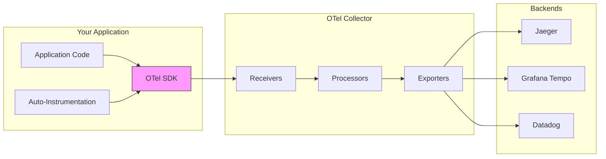
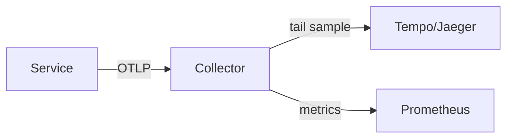

# OpenTelemetry and Distributed Tracing

## The Problem

A user clicks "Place Order" and gets a 500 error after 8 seconds. The request touched **12 different microservices**. Which one failed? Which one was slow? Where do you even look?

> **Distributed tracing** follows a single request as it travels through multiple services, showing you the **exact path, timing, and errors** at every step.

---

## What Is a Trace?

A **trace** represents the entire journey of a request. It's made up of **spans** — each span represents one operation (an HTTP call, a database query, a function execution).

```
Trace ID: abc-123
│
├── Span: API Gateway (25ms)
│   └── Span: Auth Service (10ms)
│       └── Span: JWT Validation (2ms)
│
├── Span: Order Service (200ms)
│   ├── Span: Validate Order (5ms)
│   ├── Span: DB: Insert Order (15ms)
│   └── Span: Payment Service (150ms)    ← This is slow!
│       ├── Span: Fraud Check (20ms)
│       └── Span: Stripe API Call (120ms) ← Root cause!
│
└── Span: Notification Service (30ms)
    └── Span: Send Email via SES (25ms)

Total: 255ms
```

---

## OpenTelemetry: The Standard

**OpenTelemetry (OTel)** is the industry-standard framework for creating and collecting traces, metrics, and logs. It's vendor-neutral — send data to Jaeger, Zipkin, Datadog, Grafana Tempo, or any backend.



---

## Setting Up OpenTelemetry (Node.js)

### Step 1: Install and Initialize

```typescript
// tracing.ts — Initialize ONCE at application startup (before any imports!)

import { NodeSDK } from "@opentelemetry/sdk-node";
import { getNodeAutoInstrumentations } from "@opentelemetry/auto-instrumentations-node";
import { OTLPTraceExporter } from "@opentelemetry/exporter-trace-otlp-grpc";
import { Resource } from "@opentelemetry/resources";
import { ATTR_SERVICE_NAME, ATTR_SERVICE_VERSION } from "@opentelemetry/semantic-conventions";

const sdk = new NodeSDK({
  resource: new Resource({
    [ATTR_SERVICE_NAME]: "order-service",
    [ATTR_SERVICE_VERSION]: "1.2.3",
    environment: process.env.NODE_ENV,
  }),

  traceExporter: new OTLPTraceExporter({
    url: "http://otel-collector:4317",   // gRPC endpoint
  }),

  instrumentations: [
    getNodeAutoInstrumentations({
      // Auto-instruments: HTTP, Express, pg, Redis, gRPC, etc.
      "@opentelemetry/instrumentation-http": {
        requestHook: (span, request) => {
          span.setAttribute("http.request_id", request.headers["x-request-id"]);
        },
      },
      "@opentelemetry/instrumentation-pg": {
        enhancedDatabaseReporting: true,
      },
    }),
  ],
});

sdk.start();
console.log("OpenTelemetry initialized");

// Graceful shutdown
process.on("SIGTERM", () => sdk.shutdown());
```

### Step 2: Add Custom Spans

```typescript
// order-service.ts
import { trace, SpanStatusCode, context } from "@opentelemetry/api";

const tracer = trace.getTracer("order-service");

async function processOrder(orderData: OrderRequest): Promise<Order> {
  // Create a span for the entire operation
  return tracer.startActiveSpan("processOrder", async (span) => {
    try {
      // Add attributes (searchable metadata)
      span.setAttribute("order.customer_id", orderData.customerId);
      span.setAttribute("order.item_count", orderData.items.length);
      span.setAttribute("order.total", orderData.total);

      // Child span: Validate
      const validationResult = await tracer.startActiveSpan(
        "validateOrder",
        async (validateSpan) => {
          const result = await validateOrder(orderData);
          validateSpan.setAttribute("validation.rules_checked", 5);
          validateSpan.end();
          return result;
        },
      );

      // Child span: Save to database
      const order = await tracer.startActiveSpan(
        "saveOrder",
        async (dbSpan) => {
          dbSpan.setAttribute("db.system", "postgresql");
          dbSpan.setAttribute("db.operation", "INSERT");
          const result = await db.orders.create(orderData);
          dbSpan.end();
          return result;
        },
      );

      // Child span: Call Payment Service (HTTP — auto-instrumented!)
      // Context propagation happens automatically via HTTP headers
      const payment = await fetch("http://payment-service/charge", {
        method: "POST",
        headers: { "Content-Type": "application/json" },
        body: JSON.stringify({
          orderId: order.id,
          amount: order.total,
        }),
      });

      // Add event (like a log within the span)
      span.addEvent("order_completed", {
        "order.id": order.id,
        "payment.status": payment.status,
      });

      span.setStatus({ code: SpanStatusCode.OK });
      return order;
    } catch (error) {
      // Record the error in the span
      span.setStatus({
        code: SpanStatusCode.ERROR,
        message: error.message,
      });
      span.recordException(error);
      throw error;
    } finally {
      span.end();
    }
  });
}
```

### Step 3: Context Propagation (The Magic)

```
How trace context flows across services:

Service A                    Service B                    Service C
┌──────────┐                ┌──────────┐                ┌──────────┐
│ Span A   │ ──HTTP──────►  │ Span B   │ ──gRPC──────► │ Span C   │
│          │                │          │                │          │
│ Headers: │                │ Headers: │                │ Headers: │
│ traceparent:              │ traceparent:              │ traceparent:
│ 00-abc123-               │ 00-abc123-               │ 00-abc123-
│ span1-01                  │ span2-01                  │ span3-01
└──────────┘                └──────────┘                └──────────┘

All three spans share trace ID "abc123" → they're part of the same trace!
```

```typescript
// The traceparent header (W3C Trace Context standard):
// traceparent: 00-4bf92f3577b34da6a3ce929d0e0e4736-00f067aa0ba902b7-01
//               │  │                                 │                  │
//               │  Trace ID (128-bit)                Span ID (64-bit)  Flags
//               Version                                                (01=sampled)

// OpenTelemetry handles this automatically!
// When Service A calls Service B via HTTP, the SDK:
// 1. Injects traceparent header into the outgoing request
// 2. Service B's SDK extracts it and creates a child span
// 3. All spans get linked into a single trace
```

---

## Setting Up OpenTelemetry (Python)

```python
# tracing.py
from opentelemetry import trace
from opentelemetry.sdk.trace import TracerProvider
from opentelemetry.sdk.trace.export import BatchSpanProcessor
from opentelemetry.exporter.otlp.proto.grpc.trace_exporter import OTLPSpanExporter
from opentelemetry.sdk.resources import Resource
from opentelemetry.instrumentation.fastapi import FastAPIInstrumentor
from opentelemetry.instrumentation.httpx import HTTPXClientInstrumentor
from opentelemetry.instrumentation.sqlalchemy import SQLAlchemyInstrumentor

def setup_tracing(service_name: str):
    resource = Resource.create({
        "service.name": service_name,
        "service.version": "1.0.0",
        "deployment.environment": "production",
    })

    provider = TracerProvider(resource=resource)

    exporter = OTLPSpanExporter(endpoint="http://otel-collector:4317")
    provider.add_span_processor(BatchSpanProcessor(exporter))

    trace.set_tracer_provider(provider)

    # Auto-instrument frameworks
    FastAPIInstrumentor.instrument()
    HTTPXClientInstrumentor().instrument()
    SQLAlchemyInstrumentor().instrument(engine=db_engine)

    return trace.get_tracer(service_name)


# Usage in FastAPI
from fastapi import FastAPI
from opentelemetry import trace

tracer = setup_tracing("payment-service")
app = FastAPI()

@app.post("/charge")
async def charge_payment(request: ChargeRequest):
    with tracer.start_as_current_span("charge_payment") as span:
        span.set_attribute("payment.amount", request.amount)
        span.set_attribute("payment.currency", request.currency)

        # This HTTP call automatically propagates trace context
        async with httpx.AsyncClient() as client:
            fraud_result = await client.post(
                "http://fraud-service/check",
                json={"amount": request.amount},
            )

        with tracer.start_as_current_span("stripe_charge"):
            result = await stripe.charges.create(
                amount=request.amount,
                currency=request.currency,
            )

        return {"payment_id": result.id, "status": "success"}
```

---

## OpenTelemetry Collector Configuration

```yaml
# otel-collector-config.yaml
receivers:
  otlp:
    protocols:
      grpc:
        endpoint: 0.0.0.0:4317
      http:
        endpoint: 0.0.0.0:4318

processors:
  batch:
    timeout: 5s
    send_batch_size: 1024

  # Add resource attributes
  resource:
    attributes:
      - key: environment
        value: production
        action: upsert

  # Filter out health check spans
  filter:
    spans:
      exclude:
        match_type: strict
        attributes:
          - key: http.target
            value: /health

  # Tail-based sampling (see next topic!)
  tail_sampling:
    decision_wait: 10s
    policies:
      - name: errors
        type: status_code
        status_code: {status_codes: [ERROR]}
      - name: slow-requests
        type: latency
        latency: {threshold_ms: 1000}
      - name: default
        type: probabilistic
        probabilistic: {sampling_percentage: 10}

exporters:
  otlp/jaeger:
    endpoint: jaeger:4317
    tls:
      insecure: true

  otlp/tempo:
    endpoint: tempo:4317

  prometheusremotewrite:
    endpoint: http://prometheus:9090/api/v1/write

service:
  pipelines:
    traces:
      receivers: [otlp]
      processors: [batch, resource, filter]
      exporters: [otlp/jaeger, otlp/tempo]
    metrics:
      receivers: [otlp]
      processors: [batch]
      exporters: [prometheusremotewrite]
```

---

## Trace Visualization

```
Jaeger UI / Grafana Tempo — What you see:

┌────────────────────────────────────────────────────────────────────┐
│ Trace: abc-123   Duration: 342ms   Spans: 8   Services: 4        │
├────────────────────────────────────────────────────────────────────┤
│                                                                    │
│ api-gateway       ████████████████████████████████████  342ms      │
│  └ auth-service   ██████  45ms                                     │
│                                                                    │
│ order-service        ████████████████████████████  280ms            │
│  ├ validateOrder     ██  12ms                                      │
│  ├ saveOrder           ████  25ms                                   │
│  └ payment-service       ██████████████████████  230ms             │
│    ├ fraud-check           ████  30ms                               │
│    └ stripe-api              ████████████████  190ms  ← SLOW!     │
│                                                                    │
│ notification-svc                                 ████  28ms        │
│                                                                    │
└────────────────────────────────────────────────────────────────────┘
```

---

## Key Takeaways

- **OpenTelemetry** is the vendor-neutral standard — use it instead of vendor-specific SDKs
- **Auto-instrumentation** covers HTTP, databases, and frameworks with zero code changes
- **Custom spans** capture your business-specific operations
- **Context propagation** (traceparent header) is automatic — it links spans across services
- The **OTel Collector** is the central hub: receives, processes, and exports telemetry
- Use **structured span attributes** for searchability (e.g., `order.id`, `customer.tier`)
- Start with **auto-instrumentation**, then add custom spans where you need deeper visibility

### AWS service map

| Layer | Service | Pattern |
|-------|---------|---------|
| Instrumentation | ADOT (EKS sidecar/daemonset, ECS/Lambda layer) | OTLP to collector |
| Collector | ADOT / custom OTel Collector on ECS/EKS | PII scrub, tail sampling, batch |
| Traces | X-Ray, or Tempo self-hosted | X-Ray for managed start |
| Metrics | Amazon Managed Prometheus + Grafana | Span metrics connector |
| Logs | CloudWatch Logs (JSON `trace_id`) | Correlate with traces |
| Cost | Tail sampling + S3 archive | Avoid 100% ingest to OpenSearch |

Propagation, sampling cost, PII: [`FAANG_INSIDER_KNOWLEDGE.md`](../FAANG_INSIDER_KNOWLEDGE.md) (observability section).

---

## Senior Pitfalls

| Mistake | Impact | Fix |
|---------|--------|-----|
| Head-based sampling at 1% with no error bias | Rare payment failures invisible in traces | Tail-based or error-biased sampling; always retain error and high-latency traces |
| Broken context propagation across thread pools | Orphan spans; misleading dependency graphs | Use OpenTelemetry context carriers; audit async and gRPC middleware |
| High-cardinality attributes on every span (`user_id`, `url`) | Collector and backend cost explosion | Allowlist attributes; move dimensions to logs or exemplars |
| One giant monolithic `internal` span | Cannot pinpoint slow SQL vs cache vs RPC | Standard span naming (`db.query`, `http.client`) and child spans per hop |
| PII in span attributes (email, card tokens) | Compliance breach in trace backends | Scrub at SDK or collector; use hashed or coarse identifiers |

---

## Production-grade Practice

1. **Build:** Instrument one service with OTel auto + manual spans for DB and cache; export to a collector with tail sampling rules for `status=ERROR` and latency > p99.
2. **Debug:** Reproduce a cross-service timeout and verify a single trace ID appears in all three services' logs; fix any broken propagators.
3. **Measure:** Compare trace volume and storage cost before/after adding `http.route` vs full URL as an attribute; document cardinality policy.
4. **Capacity plan:** Model collector CPU and egress at 2× peak traffic with current sampling; define when to add collector replicas vs lower default sample rate.

---

## FAANG Interview Deep Dive

### Real-world FAANG examples

| Company | Tracing stack | Scale signal |
|---|---|---|
| **Google** | **Dapper** (internal); inspired **OpenTelemetry**; **billions of spans/day** aggregated | Sampling + **critical path** analysis for Search latency |
| **Uber** | **Jaeger** (open source from Uber); **microservices** mandate trace propagation | Peak **millions of trips/day**—trace **trip_id** in baggage |
| **Netflix** | **Atlas + tracing** integration; **performance regression** detection on deploy | **Zuul/gateway** injects trace context to **1000+** services |

**Meta/AWS:** Wide **OpenTelemetry** adoption migrating off vendor agents; **Collector** as central **PII scrubber** before export.



### Interview Q&A

### Q: Trace shows 8s latency but only 200ms of span duration sums. Why?

**A:** **Missing instrumentation** (untraced waits), **async gaps**, or **clock skew**. Also **queue time** not modeled—create span around **dequeue**. Fix: **span links** for async, **eBPF** auto-trace kernel waits, enforce **context propagation** on **all** egress (Kafka, gRPC, HTTP).

### Q: How do you propagate context through Kafka?

**A:** Inject **W3C traceparent** (or OTel propagator) in **message headers** on produce; extract on consume and start **consumer span** as child (or **link** if batch). Pitfall: **batch consume** one trace per message, not per poll.

### Q: Head sampling 0.1%—you miss a rare checkout bug. Design better.

**A:** **Tail sampling** at collector: keep **100% errors**, **100% latency >2s**, **5% happy path**. Requires **trace ID routing** to same collector tier-2. Add **`debug=true`** baggage for repro.

### Q: What belongs in span attributes vs logs?

**A:** Attributes: **filterable** (`order.id`, `customer.tier`, `http.status_code`). Logs/events: **human narrative** (`provider declined: insufficient_funds`). **Never** PAN, full card—use **tokenized id**. High cardinality (**user_id**) OK in traces **with retention policy**, not metrics.

### Q: Size OTel Collector for 50K spans/sec.

**A:** Batch processor **1024 spans/batch**, 5s timeout → ~**10 batches/s/instance** at steady state; rule of thumb **1 vCPU per 10–20K spans/s** with tail sampling (memory heavy). **decision_wait=10s** × 50K traces/s worst case needs **sharded samplers**—see tail sampling doc.

### Common mistakes

- Initializing SDK **after** HTTP framework imports (broken traces).
- **Broken propagation** on internal thread pools (`context` not attached).
- **Span explosion**—one span per loop iteration (10K spans/trace).
- Exporting **health checks** and **scanner traffic** (cost + noise).
- **Vendor lock-in** SDK instead of **OTel API** + collector exporters.

### Back-of-envelope sizing

**Load:** 10K req/s, 12 spans/trace, 1.2 KB/span protobuf.

| Item | Math |
|---|---|
| Raw ingest | 10K × 12 × 1.2 KB ≈ **144 MB/s** ≈ **12.4 TB/day** |
| Head sample 1% | **124 GB/day** storage |
| Tail (100% errors + 5% base), 1% errors | 100 err/s + 500 base/s traces × 12 × 1.2 KB ≈ **8.6 MB/s** ≈ **0.74 TB/day** |

**Cost @ $0.03/GB-month (object storage)** ≈ **$22/day** tail vs **$370/day** full—why Google samples aggressively.

```typescript
// Baggage for cross-cutting debug (low volume)
import { propagation, context } from "@opentelemetry/api";
propagation.setBaggage(context.active(), propagation.createBaggage({
  "experiment.id": { value: "checkout-v2" },
}));
```
