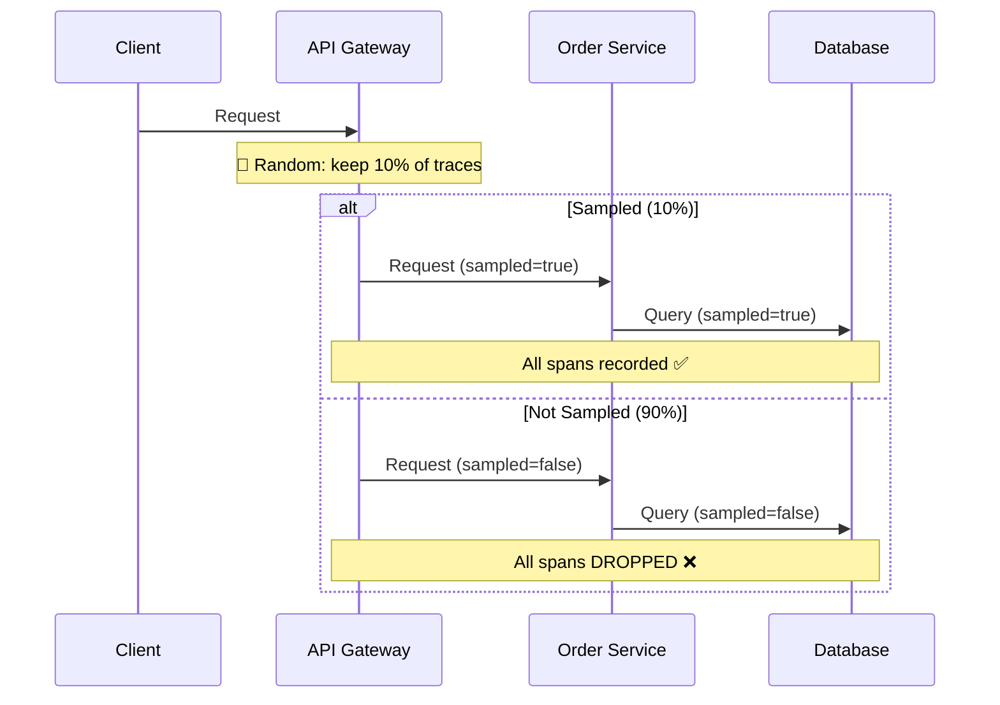
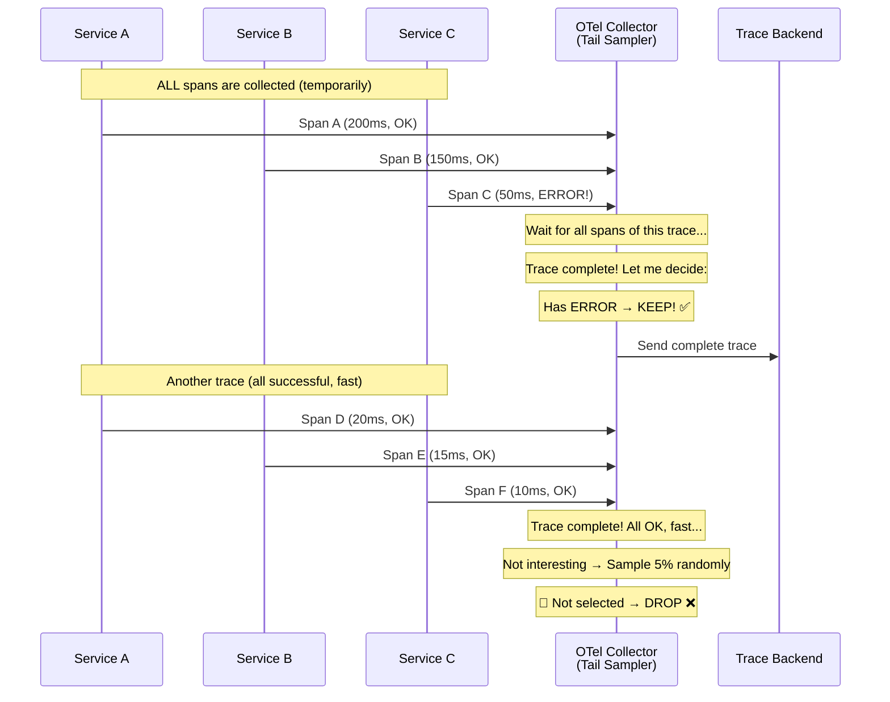
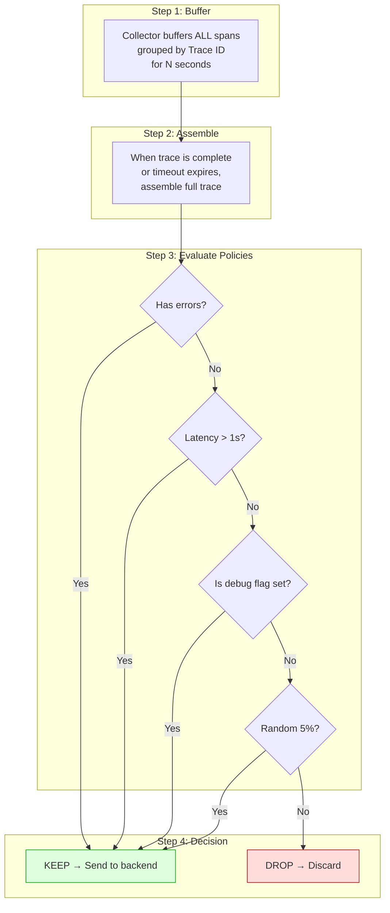
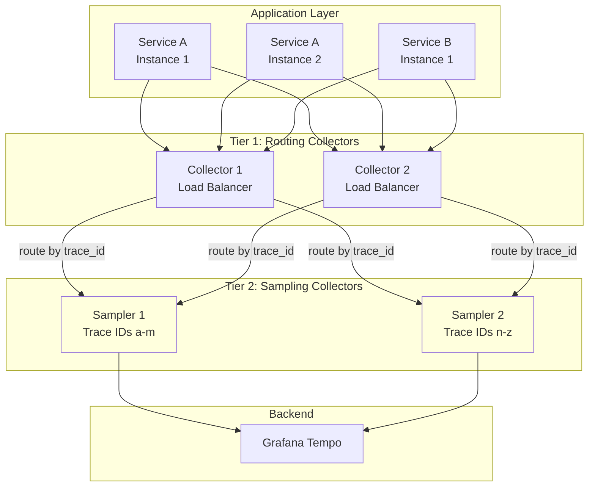
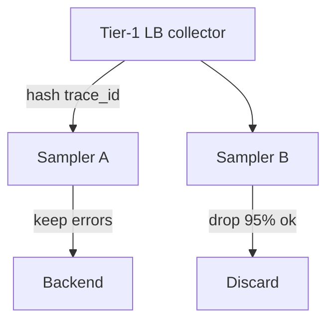

# Tail-Based Sampling

## The Problem: Too Many Traces

At scale, collecting **every trace** is expensive and impractical:

```
10,000 requests/sec × 8 spans/trace × 1KB/span = 80 MB/sec = 6.7 TB/day

That's $200+/day just for trace storage! 💸
```

You need **sampling** — but which traces do you keep?

---

## Head-Based vs Tail-Based Sampling

### Head-Based Sampling (The Simple Approach)

Decision is made **at the start** of the trace (the "head"), before you know anything about it.



**The Problem:** You're randomly keeping 10% of traces. But errors might be only 0.1% of traffic. If you're unlucky, you discard the **interesting** traces (errors, slow requests) and keep boring successful ones.

```
Head-Based: 10% random sampling
├── 9,000 successful traces kept (boring ✅ → mostly useless)
├── 990 successful traces kept
├── 10 error traces kept ← only 10 out of 100 errors!
└── 90 error traces DROPPED ← 😱 Lost critical debugging data!
```

---

### Tail-Based Sampling (The Smart Approach)

Decision is made **at the end** of the trace (the "tail"), after you know **everything** about it — duration, errors, status codes.



```
Tail-Based: Smart sampling
├── Keep ALL error traces (100%) ← never miss an error!
├── Keep ALL slow traces (>1s)   ← catch performance issues!
├── Keep 5% of normal traces     ← baseline for comparison
└── DROP 95% of boring traces    ← save money!
```

---

## How Tail-Based Sampling Works



---

## OpenTelemetry Collector: Tail Sampling Config

```yaml
# otel-collector-config.yaml

processors:
  tail_sampling:
    # How long to wait for all spans of a trace before making a decision
    decision_wait: 10s
    
    # Number of traces to keep in memory
    num_traces: 100000
    
    # Expected new traces per second (for memory allocation)
    expected_new_traces_per_sec: 1000

    policies:
      # Policy 1: ALWAYS keep error traces
      - name: errors-policy
        type: status_code
        status_code:
          status_codes: [ERROR]
      
      # Policy 2: ALWAYS keep slow traces (>1 second)
      - name: latency-policy
        type: latency
        latency:
          threshold_ms: 1000
      
      # Policy 3: Keep traces with specific attributes
      - name: high-value-customers
        type: string_attribute
        string_attribute:
          key: customer.tier
          values: [platinum, enterprise]
      
      # Policy 4: Keep traces with debug header
      - name: debug-flag
        type: string_attribute
        string_attribute:
          key: debug
          values: ["true"]
      
      # Policy 5: Rate-limited sampling for specific services
      - name: payment-service
        type: and
        and:
          and_sub_policy:
            - name: service-name
              type: string_attribute
              string_attribute:
                key: service.name
                values: [payment-service]
            - name: sample-rate
              type: probabilistic
              probabilistic:
                sampling_percentage: 25  # Keep 25% of payment traces
      
      # Policy 6: Default — keep 5% of everything else
      - name: default-policy
        type: probabilistic
        probabilistic:
          sampling_percentage: 5

service:
  pipelines:
    traces:
      receivers: [otlp]
      processors: [tail_sampling, batch]
      exporters: [otlp/tempo]
```

---

## Scaling Tail-Based Sampling

The challenge: tail-based sampling needs to see **all spans of a trace** in one place. But with multiple collector instances, spans from the same trace might land on different collectors.

### Solution: Two-Tier Collector Architecture



```yaml
# Tier 1: Load-balancing exporter (routes by trace ID)
exporters:
  loadbalancing:
    protocol:
      otlp:
        tls:
          insecure: true
    resolver:
      dns:
        hostname: otel-sampler-tier2  # K8s headless service
        port: 4317

# This ensures ALL spans for a given trace ID go to the SAME tier-2 collector
# so the tail sampler can see the complete trace.
```

---

## Implementing Debug Traces (On-Demand Full Traces)

Sometimes you need to force a specific request to be fully traced:

```typescript
// Client-side: Set debug header
const response = await fetch("/api/orders", {
  headers: {
    "X-Debug-Trace": "true",           // Force full tracing
    "X-Trace-Reason": "investigating-bug-1234",
  },
});

// Server-side: Middleware that sets trace attributes
function debugTraceMiddleware(req, res, next) {
  const span = trace.getActiveSpan();
  
  if (req.headers["x-debug-trace"] === "true") {
    span?.setAttribute("debug", "true");
    span?.setAttribute("debug.reason", req.headers["x-trace-reason"] || "manual");
    
    // The tail sampler will keep this trace based on the "debug" attribute
  }
  
  next();
}
```

---

## Cost Comparison

```
Scenario: 10,000 req/sec, avg 8 spans/trace, avg 1% error rate

Head-Based (10% random):
  Traces stored: 1,000/sec
  Errors captured: ~10/sec (only 10% of errors)
  Cost: $$$

Tail-Based (100% errors + 5% baseline):
  Traces stored: ~600/sec (100 errors + 500 baseline)
  Errors captured: 100/sec (ALL errors!)
  Cost: $$

Tail-Based saves ~40% cost AND captures 10x more errors!
```

| Approach | Error Coverage | Storage Cost | Complexity | Latency |
|---|---|---|---|---|
| **No sampling** | 100% | Very High 💸💸💸 | Low | None |
| **Head-based 10%** | ~10% | Low 💸 | Low | None |
| **Tail-based** | 100% errors | Medium 💸💸 | Medium | 10-30s buffer |
| **Tail-based + tiered** | 100% errors | Medium 💸💸 | High | 10-30s buffer |

---

## Key Takeaways

- **Head-based sampling** is simple but blind — it drops errors randomly
- **Tail-based sampling** sees the complete trace before deciding — keeps all interesting traces
- Configure policies to **always keep errors, slow traces, and debug traces**
- Use a **two-tier collector** architecture for scaling (route by trace ID → sample)
- The `decision_wait` setting is critical — too short and you miss spans, too long and you use too much memory
- Tail-based sampling adds **10-30 seconds of latency** before traces appear in your backend (acceptable for most use cases)
- Combine with **debug headers** for on-demand full tracing of specific requests

### AWS service map

| Layer | Service | Pattern |
|-------|---------|---------|
| Instrumentation | ADOT on EKS/ECS/Lambda | OTLP to collector |
| Collector | ADOT / self-managed on ECS/EKS | Tail sampling processor; `decision_wait` sizing |
| Traces | X-Ray | Managed store; pair with sampling policies |
| Metrics | Amazon Managed Prometheus | Span metrics connector from collector |
| Long archive | S3 | Cheaper than indexing 100% spans in OpenSearch |

---

## Senior Pitfalls

| Mistake | Impact | Fix |
|---------|--------|-----|
| Tail sampling only in the UI, not at ingest | Paying to index 100% of spans then dropping in queries | Implement tail decisions in collector/proxy before long-term storage |
| Keeping all traces longer than 30s | Storage dominated by a few pathological requests | Cap trace size/duration; force flush with partial trace + link to logs |
| Sampling rules that ignore `parent_sampled=false` | Broken trace trees and inconsistent analytics | Honor W3C trace flags; document override policy for errors |
| No redundancy when tail sampler is a single collector | Lost error traces during collector outages | HA collector tier + local head backup for errors |
| Tail rules keyed on free-text error messages | Cardinality and rule churn | Key on `http.status_code`, `rpc.grpc.status_code`, exception type |

---

## Production-grade Practice

1. **Build:** Deploy an OpenTelemetry Collector pipeline with tail sampling: retain errors, latency > threshold, and 1% of success; route unsampled spans to short TTL buffer only.
2. **Debug:** Compare incident investigation time for a known outage using head-only vs tail sampling on the same traffic replay.
3. **Measure:** Dashboard sample rate by outcome (success/error/slow) and alert if error retention drops below 99%.
4. **Capacity plan:** Size collector memory for max concurrent traces at peak RPS × p99 duration; load-test until OOM and tune `num_traces` limits.

---

## FAANG Interview Deep Dive

### Real-world FAANG examples

| Company | Sampling philosophy | Scale signal |
|---|---|---|
| **Google (Dapper)** | **Adaptive sampling**: higher rate for **critical services** and **slow traces** | **~0.1–1%** baseline but **near-100%** for outliers in analysis pipelines |
| **Netflix** | **Rule-based tail policies** on collector; **debug traces** for canaries | Atlas metrics on **sampled** traces—must correct for bias in dashboards |
| **Uber (Jaeger)** | Pioneered **adaptive probabilistic** + **downsampling** in storage | Original Jaeger paper: store **~0.1%** with **up-sampling** for errors in UI |

**AWS/X-Ray:** Head sampling at SDK with **rules**; moving to **OTel tail** for parity with Grafana/Datadog enterprise tiers.



### Interview Q&A

### Q: Why can't one OTel Collector do tail sampling at 100K spans/sec?

**A:** Must **buffer all spans** until trace complete (`decision_wait`). Memory ≈ **in-flight traces × spans/trace × size**. Incomplete traces from **streaming** or **lost spans** cause **wrong drop/keep**. Solution: **tier-2 routing by trace_id** + **num_traces** limit with **drop policy**.

### Q: `decision_wait=10s` but some traces run 60s. What happens?

**A:** Collector decides at **10s with partial trace**—may **miss late error span**. Fix: increase wait for batch jobs, or **separate pipeline** for long-running workflows with **span links**. Trade-off: **memory ↑** vs **correctness ↑**.

### Q: Error rate in metrics says 1% but sampled traces show 5%. Explain.

**A:** **Sampling bias**—tail policy keeps **all errors**, so trace UI **over-represents** errors vs head-based metrics. Teach teams: **metrics for rates**, **traces for exemplars**. Use **weighted analysis** or separate **error-only** backend count.

### Q: Design policies for PCI payment service vs static CDN.

**A:** Payments: **100% errors**, **100% >1s**, **25% success** (audit), **PII scrub** before export. CDN: **head 0.01%** sufficient—errors visible in **HTTP logs**. Different **pipelines**, not one policy.

### Q: Compare Datadog tail sampling vs OTel collector.

**A:** Vendor: **managed state**, faster rollout, **$$$**. OTel: **portable**, you operate **memory/routing**, integrates with **Tempo/Jaeger**. FAANG hybrid: **OTel SDK → own collector → vendor backend**.

### Common mistakes

- Tail sampling **after** head sample already dropped child spans (**unrecoverable**).
- **No trace_id affinity** in K8s—spans scattered across collectors.
- `num_traces` too low → **evicts** traces before decision → random keeps.
- Forgetting **metrics** still need **unsampled** counters for SLOs.
- **10s decision_wait** blocking **incident response** perception—set UX expectations.

### Back-of-envelope sizing

**Input:** 20K traces/sec complete in **<3s**, 10 spans/trace, 1 KB/span, `decision_wait=10s`.

| Item | Math |
|---|---|
| Spans buffered (worst) | 20K × 10s window × 10 spans = **2M spans** in flight (if all slow) |
| Memory | 2M × 1 KB ≈ **2 GB** (+ indexes) per sampler pod |
| Kept traces (1% err + 5% ok) | 200 + 1000 = **1200 traces/s** × 10 KB ≈ **12 MB/s** export |
| vs head 10% | 2000 traces/s export—tail saves **40%** with **10× error capture** |

```yaml
# Policy ordering matters: first match wins in AND/OR composites
policies:
  - name: always-errors
    type: status_code
    status_code: { status_codes: [ERROR] }
  - name: baseline
    type: probabilistic
    probabilistic: { sampling_percentage: 5 }
```
