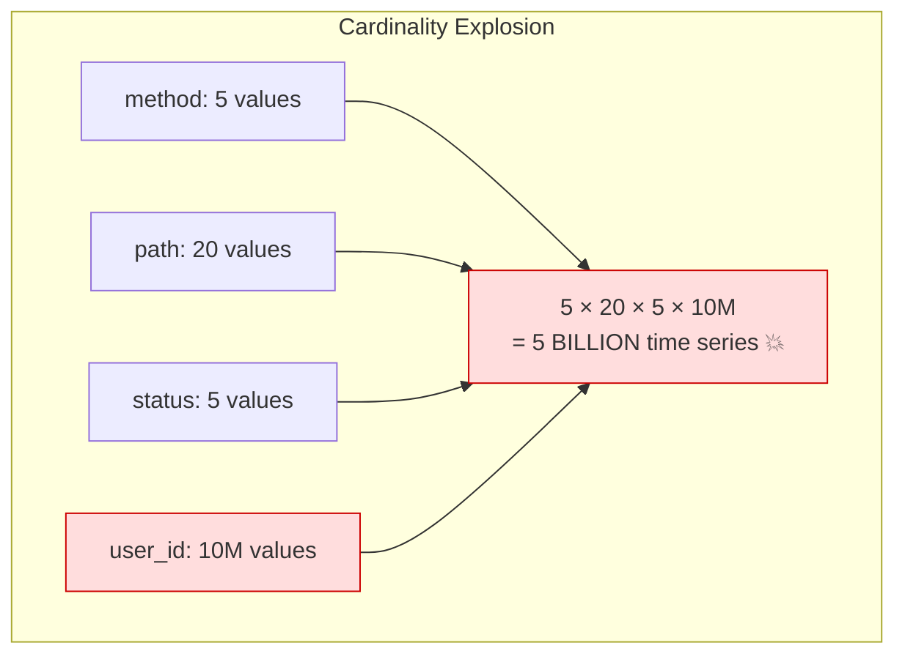
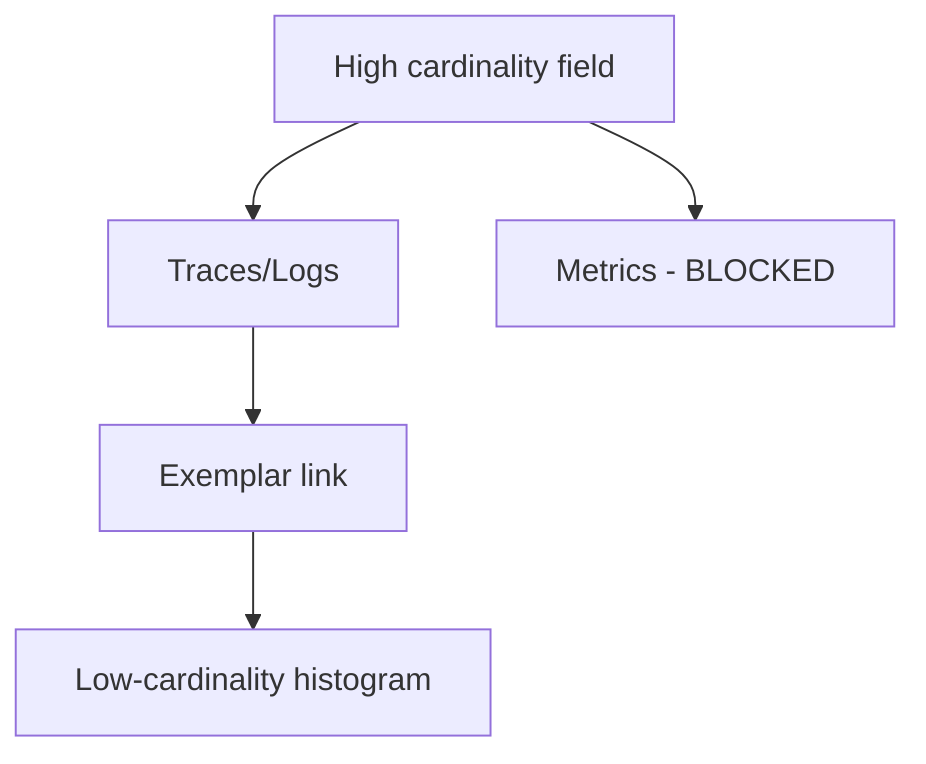

# High Cardinality Data Management

## What Is Cardinality?

**Cardinality** = the number of **unique values** a label/tag/attribute can take.

```
Low Cardinality:                     High Cardinality:
┌──────────────────────────┐         ┌──────────────────────────────┐
│ status_code: 200,404,500 │ = 3     │ user_id: u1, u2, ... u10M   │ = 10,000,000
│ http_method: GET,POST    │ = 5     │ request_id: uuid...          │ = ∞
│ region: us,eu,apac       │ = 3     │ ip_address: 1.2.3.4...      │ = ~4 billion
│ environment: dev,prod    │ = 2     │ email: alice@..., bob@...    │ = millions
└──────────────────────────┘         └──────────────────────────────┘
 Total combinations: ~90              Total combinations: TRILLIONS 💥
```

---

## Why Is High Cardinality a Problem?

Each unique combination of labels creates a **time series**. More time series = more memory, storage, and CPU.

```
# Prometheus metric with labels
http_request_duration_seconds{
    method="GET",
    path="/api/orders",
    status="200",
    region="us-east"
}

Low cardinality labels:
  method (5) × path (20) × status (5) × region (3) = 1,500 time series ✅

Add user_id (10 million users):
  5 × 20 × 5 × 3 × 10,000,000 = 15 BILLION time series 💥
  
  Prometheus: 💀 OOM killed
  Datadog: 💸 $500,000/month bill
```



---

## The Cardinality Spectrum

| Cardinality | Examples | Safe for Metrics? | Where to Put It |
|---|---|---|---|
| **Very Low** (< 10) | status_code, method, env | ✅ Yes | Metric labels |
| **Low** (< 100) | service_name, region | ✅ Yes | Metric labels |
| **Medium** (< 10,000) | endpoint path, country | ⚠️ Careful | Metric labels (with limits) |
| **High** (< 1M) | customer_id, pod_name | ❌ No | Trace attributes or logs |
| **Very High** (> 1M) | request_id, user_id, IP | ❌ Never | Trace/log fields only |

---

## Solutions

### Solution 1: Move High-Cardinality Data to the Right Signal

```
┌────────────────────────────────────────────────────────────────┐
│                    Observability Signals                        │
│                                                                │
│  METRICS (low cardinality)     │  TRACES (high cardinality)    │
│  ────────────────────────────  │  ────────────────────────────  │
│  • request count by status     │  • user_id                    │
│  • latency percentiles         │  • request_id                 │
│  • error rate by service       │  • order_id                   │
│  • queue depth                 │  • IP address                 │
│                                │  • full request path          │
│  AGGREGATE numbers             │  INDIVIDUAL request details   │
│                                │                               │
│  Question: "What % of         │  Question: "Why was THIS      │
│   requests are failing?"      │   user's request slow?"        │
└────────────────────────────────────────────────────────────────┘
```

```python
# ❌ BAD: user_id as a metric label
http_requests_total.labels(
    method="GET",
    status="200",
    user_id="user-12345",  # 💥 Creates millions of time series!
).inc()

# ✅ GOOD: user_id in trace attributes, low-cardinality in metrics
http_requests_total.labels(
    method="GET",
    status="200",
    customer_tier="premium",  # Low cardinality (free, pro, premium)
).inc()

# Put user_id in the trace span instead
span.set_attribute("user.id", "user-12345")
span.set_attribute("user.tier", "premium")
```

---

### Solution 2: Bucketing / Grouping

Reduce cardinality by grouping values into buckets.

```python
# ❌ BAD: Full URL path as label
# /api/users/12345 → /api/users/67890 → /api/users/99999...
# Thousands of unique paths!

http_requests.labels(path=request.path).inc()  # path="/api/users/12345"

# ✅ GOOD: Parameterized path template
def normalize_path(path: str) -> str:
    """Convert /api/users/12345 → /api/users/{id}"""
    import re
    # Replace UUIDs
    path = re.sub(r'[0-9a-f]{8}-[0-9a-f]{4}-[0-9a-f]{4}-[0-9a-f]{4}-[0-9a-f]{12}', '{uuid}', path)
    # Replace numeric IDs
    path = re.sub(r'/\d+', '/{id}', path)
    return path

http_requests.labels(path=normalize_path(request.path)).inc()
# path="/api/users/{id}" → one time series for all users!


# ❌ BAD: Response time as exact milliseconds
response_time.labels(duration_ms=str(response_time)).inc()  # 142ms, 143ms, 144ms...

# ✅ GOOD: Bucket into ranges
def latency_bucket(ms: float) -> str:
    if ms < 50: return "<50ms"
    elif ms < 100: return "50-100ms"
    elif ms < 500: return "100-500ms"
    elif ms < 1000: return "500ms-1s"
    else: return ">1s"

# Or better yet, use Prometheus Histograms which handle bucketing automatically
```

---

### Solution 3: Cardinality Limits and Monitoring

```python
# Monitor your cardinality in Prometheus
# PromQL query: count of time series per metric
"""
count by (__name__) ({__name__=~".+"})
"""

# Alert on cardinality explosion
# alert.rules.yaml
"""
groups:
  - name: cardinality-alerts
    rules:
      - alert: HighCardinalityMetric
        expr: count by (__name__) ({__name__=~".+"}) > 10000
        for: 5m
        labels:
          severity: warning
        annotations:
          summary: "Metric {{ $labels.__name__ }} has {{ $value }} time series"
"""
```

```yaml
# Prometheus config: limit cardinality per metric
# relabel_configs drops high-cardinality labels before storage

scrape_configs:
  - job_name: my-service
    metric_relabel_configs:
      # Drop the user_id label from all metrics
      - source_labels: [user_id]
        target_label: user_id
        action: drop
      
      # Limit path cardinality: keep top 100, bucket rest as "other"
      - source_labels: [path]
        regex: '(/api/(users|orders|products)/[^/]+)'
        target_label: path
        replacement: '$1/{id}'
```

---

### Solution 4: Exemplars (Bridge Metrics ↔ Traces)

**Exemplars** attach a **trace ID** to a metric data point, letting you jump from an aggregate metric to a specific trace.

```python
from prometheus_client import Histogram
import random

request_duration = Histogram(
    "http_request_duration_seconds",
    "Request duration",
    ["method", "path", "status"],
    buckets=[0.01, 0.05, 0.1, 0.25, 0.5, 1.0, 5.0],
)

@app.middleware("http")
async def metrics_middleware(request, call_next):
    start = time.time()
    response = await call_next(request)
    duration = time.time() - start
    
    # Record metric with LOW cardinality labels
    request_duration.labels(
        method=request.method,
        path=normalize_path(request.url.path),
        status=str(response.status_code),
    ).observe(
        duration,
        # Attach trace ID as exemplar (HIGH cardinality, but stored separately)
        exemplar={
            "trace_id": get_current_trace_id(),
        },
    )
    
    return response
```

```
How exemplars work:

Grafana Dashboard:
┌─────────────────────────────────────────────────────────┐
│ P99 Latency (http_request_duration_seconds)             │
│                                                         │
│  500ms ─── ─── ─── ─── ─── ─── ─── ─── ─── ─── ───    │
│                          ●   ← Exemplar! Click to see   │
│  200ms ─────────────────────────────────────────────    │
│                                                         │
│ Clicking the exemplar opens the trace:                  │
│   Trace ID: abc-123-def-456                             │
│   └── Shows exactly WHY that P99 was high              │
└─────────────────────────────────────────────────────────┘

You get the AGGREGATE view from metrics (low cardinality)
AND can drill into INDIVIDUAL requests via traces (high cardinality)
```

---

### Solution 5: Streaming Aggregation (Pre-Aggregation)

Aggregate high-cardinality data before it reaches your metrics backend.

```yaml
# OpenTelemetry Collector: Aggregate at the collector level

processors:
  # Convert spans to metrics (with controlled cardinality)
  spanmetrics:
    metrics_exporter: prometheus
    dimensions:
      - name: http.method
      - name: http.status_code
      - name: service.name
      # NOT including: user_id, request_id, etc.
    
    # Automatically generates:
    # - calls_total (counter)
    # - duration_bucket (histogram)
    # From spans, with only low-cardinality dimensions

  # Group and aggregate metrics
  groupbyattrs:
    keys:
      - service.name
      - http.method
      - http.status_code
```

---

## Decision Framework

```
"Should I add this as a metric label?"

┌──────────────────────────────────────────┐
│ How many unique values can this label    │
│ have in production?                       │
└─────────────────┬────────────────────────┘
                  │
     ┌────────────▼────────────┐
     │   < 100 values?         │
     └──┬─────────────────┬────┘
        │ YES             │ NO
        ▼                 ▼
  ┌──────────┐     ┌─────────────────────┐
  │ ✅ Safe  │     │ Can you bucket/group │
  │ as metric│     │ into < 100 values?   │
  │ label    │     └──┬──────────────┬────┘
  └──────────┘        │ YES          │ NO
                      ▼              ▼
                ┌──────────┐   ┌──────────────┐
                │ ✅ Use   │   │ ❌ Put in    │
                │ bucketed │   │ traces/logs  │
                │ label    │   │ not metrics  │
                └──────────┘   └──────────────┘
```

---

## Key Takeaways

- **Cardinality** = number of unique label combinations → directly maps to **cost and performance**
- **Never** use user_id, request_id, IP, or email as metric labels
- Put high-cardinality data in **traces and logs**, not metrics
- Use **exemplars** to bridge from aggregate metrics to individual traces
- **Bucket** medium-cardinality values (normalize URL paths, group latencies)
- **Monitor your cardinality** — alert when a metric exceeds expected time series count
- The most expensive observability bill is usually caused by **one careless label**

---

## Senior Pitfalls

| Mistake | Impact | Fix |
|---------|--------|-----|
| `user_id` or `request_id` as Prometheus labels | Millions of series; compactor meltdown | Keep IDs in logs/traces; aggregate metrics at coarser grain |
| Unbounded `http.path` labels with IDs in URLs | New time series per request | Normalize to route templates (`/users/{id}`) |
| Dynamic label keys from map iteration | Schema explosion in OTLP metrics | Fixed attribute schema; reject unknown labels in CI |
| No cardinality limits in agents | One bad deploy takes down metrics tier | Agent-side caps, top-N aggregation, or drop policies |
| Fixing cardinality only after the bill | Emergency label bans break dashboards | Pre-merge lint on metric definitions; cardinality budgets per team |

---

## Production-grade Practice

1. **Build:** Add a CI check that fails if new metrics introduce labels not on an allowlist; run against one service's `/metrics` output.
2. **Debug:** Identify the top 10 series contributors during a load test using TSDB cardinality APIs or Mimir/Cortex tooling; remediate the worst offender.
3. **Measure:** Track `active_series` per namespace and SLO on growth rate week-over-week; page before cost cliff.
4. **Capacity plan:** Given peak RPS and label combinations, estimate series count and storage; define when to shard vs aggregate recording rules.

---

## FAANG Interview Deep Dive

### Real-world FAANG examples

| Company | Cardinality lesson | Scale signal |
|---|---|---|
| **Google (Borgmon → Monarch)** | **Bucketing** and **hierarchical labels**; avoid per-task series at **millions of tasks** | Borg clusters: **cardinality limits** enforced by convention + tooling |
| **Netflix (Atlas)** | **Strict allow-list** of tags; **spectator** libs normalize URLs | **~2M+** time series per region target—breach triggers **deploy rollback** |
| **Uber** | Jaeger/M3: **m3tagger** limits; **per-tenant** quotas in M3 | Metric explosion from **`pod_name`** in labels—moved to **logs** |

**Datadog anecdote (industry):** A single **`user_id` label** on a counter drove **six-figure monthly** bills—standard FAANG interview cautionary tale.



### Interview Q&A

### Q: PM wants dashboard "errors per customer_id." Build it?

**A:** **Not as Prometheus metric.** Options: (1) **Logs** → ClickHouse/BigQuery `GROUP BY customer_id` with **sampling**. (2) **Traces** with `customer_id` attribute + **TraceQL** filter (retention cost). (3) **Top-N** only: streaming **HyperLogLog** or **count-min sketch** for **heavy hitters**. Trade-off: exact per-customer needs **OLAP**, not time-series DB.

### Q: Explain exemplars to a skeptical SRE worried about cardinality.

**A:** Exemplars attach **trace_id** to **histogram buckets**—storage is **sparse** (sampled points), not one series per trace. Grafana jump from p99 spike → trace. Limit: **exemplars_per_series** cap in Prometheus 2.x+.

### Q: `http.route` has 50K unique paths after bad deploy. Mitigation?

**A:** **Relabel** in collector: regex collapse to `/api/users/{id}`. **Cardinality limiter** drops new label values. **Alert** `count by (__name__)({__name__=~".+"})`. **Rollback** deploy generating dynamic paths.

### Q: How many time series is "too many" for Prometheus?

**A:** Rule of thumb: **single shard ~1–3M** active series (hardware dependent). **10M** needs **Thanos/Cortex/Mimir** sharding. Interview math: 50 labels × 100 values poor design = **10^100**—always multiply label cardinalities.

### Q: Span attributes vs metric labels for `kubernetes.pod.uid`?

**A:** **Span attribute** (or log field) with **7d retention**. For saturation, metric on **`node`** or **`deployment`** (low card). **Never** `pod_uid` on counters—**10K pods** × restarts = churn explosion.

### Common mistakes

- **`request_id` on every counter** "for debugging."
- Dynamic **SQL query text** as label.
- **Client-side** custom metrics without **platform review**.
- Copying **Datadog unlimited** mindset to **Prometheus**.
- High-cardinality in **alert queries** (OOM the querier).

### Back-of-envelope sizing

**Bad metric:** `http_requests{user_id}` with **5M** active users, 3 other labels ×10 each.

| Item | Math |
|---|---|
| Series count | 5M × 10 × ... ≈ **50M+** series |
| RAM (≈3 KB/series) | 50M × 3 KB ≈ **150 GB** just metadata → **OOM** |
| Good design | `customer_tier` (3) × `route_template` (50) × `status` (5) = **750** series |
| Trace storage for user_id | 1M traces/day × 5 KB ≈ **5 GB/day**—bounded retention |

```python
ALLOWED_METRIC_LABELS = frozenset({"service", "env", "region", "route", "status", "tier"})

def safe_inc(counter, labels: dict):
    unknown = set(labels) - ALLOWED_METRIC_LABELS
    if unknown:
        span.set_attribute("rejected_labels", str(unknown))
        raise ValueError("high cardinality labels")
    counter.labels(**labels).inc()
```
