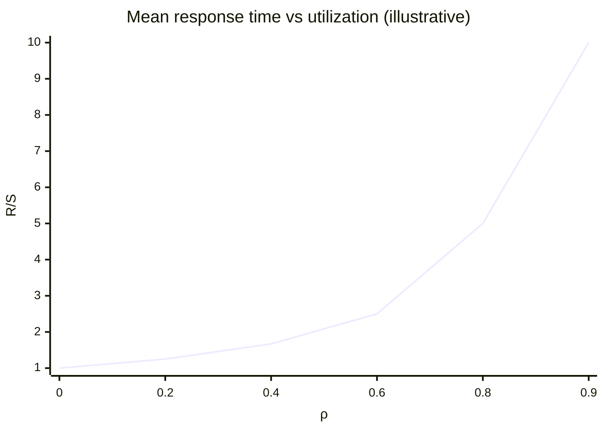
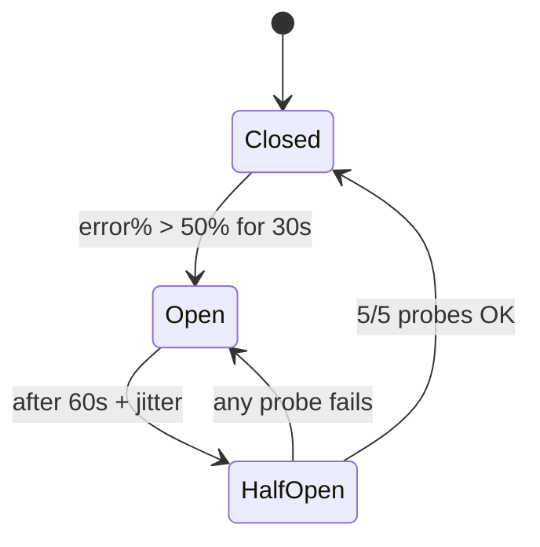
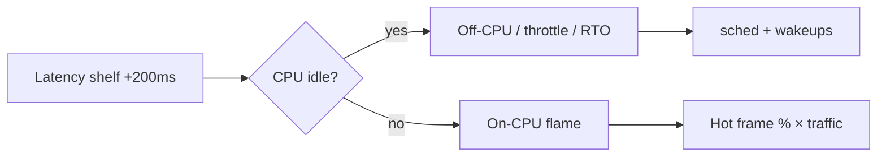
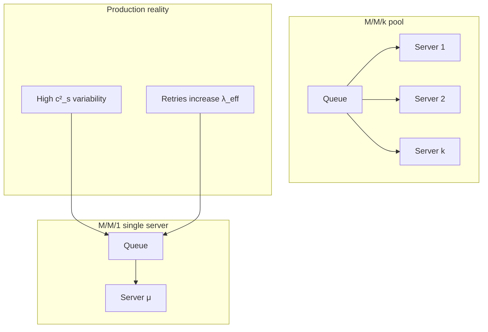
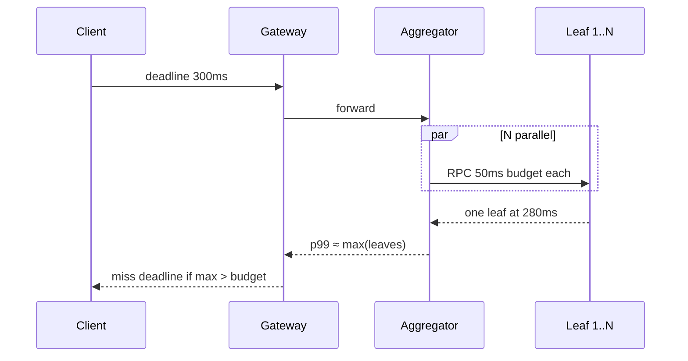

# Latency, Measurement, Profiling & Queueing

> **What you'll learn:** Why p99 at the edge is really p99.99 at each leaf, how dashboards lie about saturation, how to profile a fleet instead of one host, and the queueing math that explains "suddenly slow at 80% CPU."

Read in order: **queueing foundations → honest measurement → tail at scale → production profiling**.

---

## 1. Queueing theory you can use

### 1.1 Little's law: `L = λW`

Stable system: **average items in system = throughput × average time in system**.

**Sizing concurrency:**
```text
Pool connections ≈ (requests/sec) × (hold time sec)
Example: 2000 rps × 0.05s = 100 in-flight
If each holds DB conn 8ms → 16 conns busy on average (size >> mean)
```

**Find invisible queues:** Compare `L/λ` at load balancer vs handler timer — gap is accept queue, executor queue, sidecar.

| Boundary | Measures |
|----------|----------|
| LB in-flight ÷ λ | What caller pays |
| Handler timer | Service time only |
| **Gap** | Queueing you did not instrument |

**Listen backlog:** when full, +1s / +3s modes (SYN retransmit) — check `ListenOverflows`.

### 1.2 Utilization vs latency (M/M/1 intuition)

`R = S / (1 - ρ)` — at ρ=0.8, mean wait **5×** service time; p99 ≈ **4.6× mean** → **23× S** at 80% busy.



**Derived headroom:** For p99 budget `B`, M/M/1 gives ρ ≈ `1 - 4.6·S/B`. Replace folklore "scale at 70% CPU" with this per service.

### 1.3 Variability (Pollaczek–Khinchine)

`W_q ∝ (ρ/(1-ρ)) × ((1 + c²_s)/2) × E[S]`

**99% requests at 1ms, 1% at 100ms** → huge `c²_s` → everyone waits behind rare slow jobs.

**Fixes that don't need more hardware:**
- **Separate queues** for slow vs fast endpoints
- **Chunk** long work (pagination)
- **Jitter** crons, retries, TTLs (lower `c²_a`)

### 1.4 Multiple servers vs one fast box

Pooling helps until **coherence/contention** (Universal Scalability Law). Often: more modest machines + good LB beats one giant host for tail.

---

## 2. Measuring latency without lying

### 2.1 Clock placement

```text
Timeline:  send → [LB q] → [accept q] → [pool q] → handler → response
                              ↑____________ pink = queueing ____________↑
Most APM starts timer here ────────────────────────────────┘
```

**Alert on gaps:** edge − LB target = network/conn; LB target − handler = **in-process queue**.

### 2.2 Percentiles don't average

Ten hosts: nine p99=64ms, one p99=487ms.

| Rollup | Result vs true fleet p99 |
|--------|--------------------------|
| Mean of host p99s | **Under** (44% low in illustrative example) |
| Median of host p99s | **Hides** bad host |
| **Merge histograms, then invert** | Correct |
| Max of host p99s | ≈ fleet p99.9 |

**Mix shift:** Doubling traffic share of heavy endpoint moves aggregate p99 with **no server deploy**.

### 2.3 Coordinated omission

Closed-loop load gen: server stalls 8 intervals → records **one** slow sample, not eight.

| Instrument | During 10s stall @ 1000 rps open traffic |
|------------|----------------------------------------|
| Client histogram (from due time) | ~10k affected |
| Closed-loop 64 conn | **64** samples |
| Handler timer | ~in-flight only |

**Use open-model** generators (wrk2, k6 arrival-rate with `dropped_iterations` watched).

### 2.4 Histogram design

- Enough buckets for tail (HdrHistogram / log buckets)
- Record **timeouts at timeout value**
- SLI = success **and** under threshold

---

## 3. Tail latency at scale

### 3.1 Fan-out math (Dean & Barroso)

`P(root slow) ≈ 1 - (1-p)^N`

| Leaf slow rate p | N=100 | N=1000 |
|------------------|-------|--------|
| 1% | **63%** | ~100% |
| 0.1% | 9.5% | 63% |

**Root p99 over N independent leaves** → each leaf needs roughly `p99^(1/N)` — **deeper nines per leaf**.

**Users are fan-out:** 30 page views × 20 backends = 600 calls/session.

### 3.2 Sources of variance

| Source | Hedging? | Real fix |
|--------|----------|----------|
| Per-host queueing | Sometimes | P2C, headroom |
| GC pause | Sometimes | pause-aware routing, heap structure |
| CFS throttle | Sometimes | Drop CPU limit / right-size threads |
| TCP RTO +200ms | Yes if hedge < RTO | Warm pools |
| Correlated slow DB | **No** | Shed, circuit break |
| Request-intrinsic cost | **No** | Size classes |

**Triage splits:** slow by replica? by tenant key? `P(slow leaf | sibling slow)` >> baseline → correlated.

### 3.3 Hedged & tied requests

- **Hedging:** duplicate after delay *d* — only for **independent** variance; kills you on correlated or expensive requests.
- **Tied requests:** cancel extras when one wins — limits load multiplication.

### 3.4 Deadline budgets

Propagate **remaining budget**; inner timeouts < outer. gRPC deadline propagation example:

```go
ctx, cancel := context.WithTimeout(parent, remainingBudget)
defer cancel()
// derive DB statement_timeout from ctx.Deadline()
```

---

## 4. Profiling in production

### 4.1 Sampling is statistics

Detectable change Δ ≈ `2√2 / √k` for k samples in frame.

| Profile | Can see 5% change in 1% frame? |
|---------|--------------------------------|
| 1 core × 1 min | No (±37%) |
| Fleet-hour, 200×8 cores × 50% | Yes (~0.5%) |

**Fleet-wide top leaf CPU** finds shared "datacenter tax" (memcpy, hash, serde) no single team owns.

### 4.2 On-CPU vs off-CPU

Request thread: mostly **blocked** on I/O, locks, run queue.

| Tool | Sees |
|------|------|
| CPU flame graph | Running slices |
| Off-CPU (sched) | Blocked — **includes run-queue wait** mislabeled as I/O |
| schedstat runqueue delay | Runnable waiting for core |

**Wakeup chains:** futex wait → lock holder → fsync — fix **under lock**, not first frame.

### 4.3 eBPF rules

- **Aggregate in kernel** (hash map by stack id)
- Timer sampling for fleet-wide; uprobes expensive on hot paths
- Broken stacks: frame pointers, JIT maps, Python 3.12+

### 4.4 Locks & scheduler

Mutex ≈ queue with hard cap. Container **CPU limits** create throttle modes **invisible** to CPU profiler — use `cpu.stat` throttled metrics.

### 4.5 Flame graph → fix

1. Hypothesis from latency shape (shelf at +100ms = throttle/RTO?)
2. Profile **matching window** (fleet, off-CPU, wakeups)
3. Estimate fix size from % time in frame × traffic
4. Verify with canary + before/after histogram **merge**

---

## Quick reference table

| Symptom | Look here first |
|---------|-----------------|
| Green APM, angry users | Clock placement / LB gap |
| p99 worse after sharding | Fan-out width N |
| +75ms shelf, idle CPU graph | CFS throttling |
| +200ms / +1s modes | TCP RTO / SYN |
| Load test great, prod bad | Coordinated omission |
| 80% CPU, 10× latency | ρ knee (queueing) |
| One bad host hidden | Percentile aggregation bug |

---

## Practice: back-of-envelope

**Q:** 50ms handler, target root p99 200ms over 50 parallel leaves, independent 1% slow leaves?

1. Need leaf q such that `1 - (1-q)^50` meets SLO → q ≪ 1%
2. Check measurement: can you measure leaf p99.99 with enough samples?
3. If `P(slow|sibling slow)` high → hedging won't help; fix dependency

---

*Sources: Algoroq Performance Engineering — Queueing Theory You Can Use, Measuring Latency Without Lying, Tail Latency at Scale, Profiling in Production.*

---

## 5. Real-world incident case studies (latency lens)

### Amazon Prime Day / scaling events (recurring pattern)

**What happened:** Traffic spikes expose **queueing knees** and **connection pool limits** before CPU saturates. Symptoms: p99 latency cliffs while mean CPU stays at 60–70%, SYN retransmits, DB `too many connections`.

**Root cause:** Capacity planned on **average** CPU, not on **ρ** of the binding queue (pool, thread executor, listen backlog).

**Lessons:** Measure **LB gap vs handler**; size pools with Little’s law; load test with **open model** at peak λ.

### Google “Chubby” / metadata tail (documented industry pattern)

**What happened:** Wide fan-out services (metadata, permissions) made **rare slow leaves** dominate root latency — classic Dean & Barroso math.

**Root cause:** **N-wide parallel calls** without per-leaf SLOs or hedging discipline on correlated paths.

**Lessons:** Per-leaf p99.99 targets; **P2C** load balancing; never hedge shared DB.

### LinkedIn / JVM GC tail incidents (representative)

**What happened:** Users saw multi-second stalls while GC logs showed “acceptable” pause times — **mark assists** and allocation stalls dominated off-CPU time.

**Root cause:** High **ρ** multiplied effective pause impact; profilers showed only on-CPU frames.

**Lessons:** Profile **off-CPU** and `sched`; treat GC as queueing disturbance.

---

## 6. Circuit breaker state machine (dependency protection)



When breakers protect a **shared** database, opening all at once drops load — but **half-open synchronization** can recreate spikes. Pair with **adaptive concurrency** (below).

---

## 7. Exponential backoff with jitter (client-side)

```go
func NextBackoff(attempt int, base, cap time.Duration) time.Duration {
	if attempt < 0 {
		attempt = 0
	}
	max := cap
	shift := base << attempt
	if shift > 0 && shift < max {
		max = shift
	}
	// Full jitter
	return time.Duration(rand.Int63n(int64(max) + 1))
}
```

**Table: retry delay percentiles (base=100ms, cap=10s, attempt=5, full jitter)**

| Statistic | Delay |
|-----------|-------|
| Mean | ~1.6s |
| p99 | ~9.5s |
| Without jitter (fixed 3.2s) | synchronized wave at T+3.2s |

---

## 8. Flame graph analysis workflow

### Reading a CPU flame graph

1. **Width = samples** — widest frame is hottest on-CPU cost.
2. **Merge identical stacks** across hosts before interpreting — fleet graph ≠ single host.
3. **Look for “plateaus”** — wide shallow stacks often mean **serialization** or hashing.
4. **Compare canary vs control** over the same traffic slice.

### Example interpretation (illustrative)

```text
100% ┤████████████████████████████████ json.Marshal
  80% ┤████████████████████████████     encodeString
  40% ┤████████████                     runtime.mallocgc
```

**Action:** Schema-stable protobuf + reuse buffers → expect width shift from `json.Marshal` to smaller `proto.Marshal`; verify with **merged histogram**, not only CPU.

### Off-CPU flame (conceptual)

```text
blocked on: futex → mysql driver Read → tcp recv
```

Fix **lock hold time** under `futex`, not `tcp recv`.



---

## 9. Adaptive concurrency (Little’s law controller)

```python
class AdaptiveLimiter:
    """Increase concurrency while p99 stable; decrease when latency rises."""

    def __init__(self, min_c=10, max_c=500, target_p99_ms=100):
        self.concurrency = min_c
        self.min_c, self.max_c = min_c, max_c
        self.target = target_p99_ms

    def on_window(self, p99_ms: float, error_rate: float) -> int:
        if error_rate > 0.05:
            self.concurrency = max(self.min_c, int(self.concurrency * 0.5))
        elif p99_ms < self.target * 0.9:
            self.concurrency = min(self.max_c, self.concurrency + 5)
        elif p99_ms > self.target:
            self.concurrency = max(self.min_c, self.concurrency - 10)
        return self.concurrency
```

**Little’s law check:** At λ=2000 RPS, W=50ms → L≈100 in-flight. If limiter allows 500 but W doubles, **L** tends toward 200 — verify pool and thread counts match.

---

## 10. Quantitative examples

### Little’s law — connection pool

- λ = **2500** queries/s  
- Mean hold time **W = 8 ms** = 0.008 s  

\[
L = \lambda W = 2500 \times 0.008 = 20 \text{ connections busy on average}
\]

Size pool to **p99 hold** (e.g. 40ms) → L_p99 ≈ **100**; add headroom → **120** connections, not 20.

### M/M/1 mean vs p99

Service time S = **10 ms**, ρ = **0.8**:

\[
R = \frac{S}{1-\rho} = \frac{10}{0.2} = 50\text{ms mean}
\]

M/M/1 p99 ≈ **4.6 × mean** ≈ **230 ms** — at “only” 80% utilization.

### Fan-out: p99 vs p999 at root

50 parallel leaves, each **1%** slow (independent):

\[
P(\text{at least one slow}) = 1 - 0.99^{50} \approx 39.5\%
\]

For **0.1%** slow leaves: \(1 - 0.999^{50} \approx 4.9\%\). Root **p99** needs leaf behavior far better than 1%.

**p99 leaf target from root:** If root allows **0.1%** slow and N=100, need per-leaf slow ≈ **0.1%/100** → **1e-5** order — drives **measurement** requirements.

### Coordinated omission numeric

Open loop **1000 RPS** during **10 s** stall → **~10,000** requests should exceed threshold. Closed loop **64** connections → **≤64** recorded slow samples — **156×** under-count for tail SLO.

### Profiling detection limit

Relative change detectable ≈ **2√2/√k** for k samples. k=10,000 → ~**2.8%**; k=1,000,000 → ~**0.28%**. Fleet-hour aggregation beats staring at one core for one minute.

---

## 11. Latency budget allocation checklist

| Layer | Instrument | Alert on |
|-------|------------|----------|
| Edge | CDN + TLS timing | Region gap > budget |
| LB | `target_response_time - upstream` | Queue > 20ms |
| Service | Handler span | Pool wait span |
| DB | `statement_timeout` vs client deadline | Lock wait |
| Client | RUM histogram | SLI burn |

---

## 12. Production profiling checklist

| Step | Done? |
|------|-------|
| Frame pointers / JIT maps enabled | ☐ |
| Continuous profiling sample rate set | ☐ |
| Off-CPU profiling on tier-0 | ☐ |
| Canary vs prod diff automated | ☐ |
| Lock profiling on contention suspects | ☐ |
| eBPF maps sized for stack depth | ☐ |
| Post-fix verify merged p99 histogram | ☐ |

---

## 13. Queueing models (diagram)



---

## 14. Tail latency amplification sequence



---

## 15. Interview Q&A

### Q: Why is p99 at the edge often p99.99 at each leaf?

**A:** Fan-out: root latency is roughly the **maximum** of N parallel latencies. If each leaf has 1% slow rate, root sees ~39% slow for N=50. To hit a tight root SLO, each leaf needs **much** stricter tail behavior — often sub-0.1% — and independent variance assumptions must be validated.

### Q: What is coordinated omission?

**A:** A closed-loop load generator waits for responses before sending the next request. During a stall, it **omits** samples for requests that would have been due — understating tail latency. Use **open-loop** arrival processes and record from scheduled start time.

### Q: How do you correctly aggregate p99 across hosts?

**A:** **Merge histograms** (or raw samples), then compute percentile. Averaging per-host p99s **underestimates** fleet tail; max of host p99s approximates a high percentile but is not a substitute for merge.

### Q: When is hedged requests a bad idea?

**A:** When slowness is **correlated** (shared DB, cache miss storm) or requests are **expensive** — hedging multiplies load on the already sick resource. Use tied requests with strict caps only for independent variance (single replica noise).

### Q: Explain Kingman’s formula in one sentence for SREs.

**A:** Wait time grows with utilization **ρ/(1-ρ)** and with **variability** of arrivals and service — bursty traffic knees earlier than smooth traffic at the same average CPU.

### Q: CPU profiler shows healthy service but users complain — next step?

**A:** Check **clock placement** (LB vs handler gap), **off-CPU** profiles, **CFS throttle**, TCP RTO shelves, and client-side RUM — request threads are often blocked, not hot on CPU.

### Q: How much traffic do you need to measure p99.99?

**A:** Roughly **10,000+** independent samples per slice for stability; for rare events you need **longer windows** or **importance sampling** (always record slow traces). Sub-splitting by tenant lowers N — beware wide confidence intervals.

---

## Senior Pitfalls

| Mistake | Impact | Fix |
|---------|--------|-----|
| Reporting mean latency in SLO dashboards | Green dashboard while p99 violates user experience | SLIs on percentiles; histogram buckets aligned to SLO threshold |
| Profiling only on-CPU in IO-bound services | Misses 80% of wait time in traces | Off-CPU profiling, async debug, block/wait stacks |
| Coordinated omission in load tests (drop slow responses) | Underestimate tail under load | Correct latency recording; or use RUM and passive sampling |
| Single-region load test without cross-AZ traffic | Missing 2–5 ms per hop at scale | Include realistic network path and TLS termination |
| Adaptive concurrency without max cap | Oscillation or overload when dependency slows | Bound concurrency; tie to measured service time and error rate |
| Flame graph from 10s sample during idle | Wrong optimization targets | Profile under representative load; multiple windows |

---

## Production-grade Practice

1. **Histogram SLO audit:** For one API, verify Prometheus/Datadog buckets support accurate p99.99 at your SLO line; fix bucket layout and recompute burn alerts.
2. **Off-CPU investigation:** Take a service with high CPU but high latency; capture off-CPU profile during load; fix top wait (lock, DB, DNS) and show p99 delta.
3. **Load test tail honesty:** Run wrk/k6 with fixed concurrency vs open-loop arrival; compare p99; document which mode matches production traffic shape.
4. **Adaptive limiter prototype:** Implement concurrency controller from measured RTT and error rate; inject slowdown on dependency; verify stability without retry storm.

---

## 16. SLO / latency SLI calculation example

**SLI:** fraction of `search` requests with duration ≤ **250 ms** (successful).

Window: 1 hour, **3.6M** requests. SLO **99%** → allow **36,000** slow requests.

Observed: **45,000** slow → **9,000** over budget → **25%** of hourly budget if uniformly spread (adjust with multi-window burn).

**Latency error budget** ties directly to **queueing ρ** — fixing mean without tail leaves budget burning on the slow bin.
