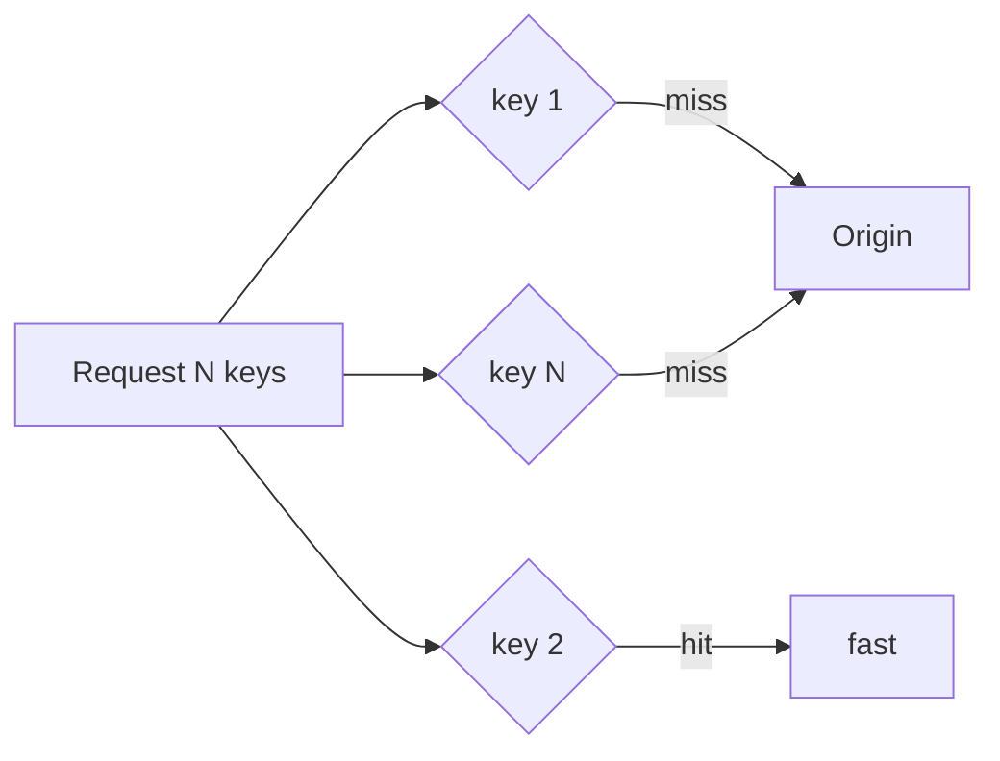
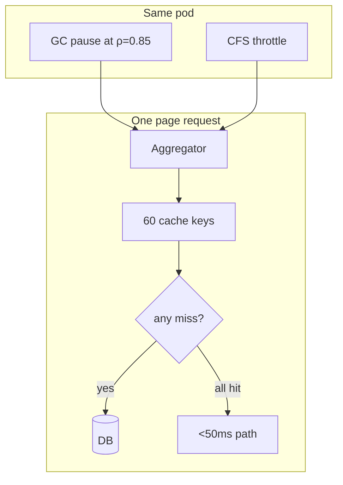
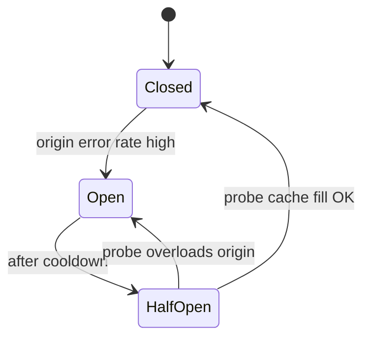
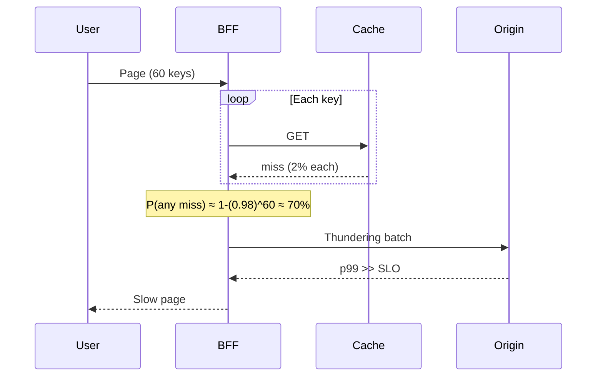
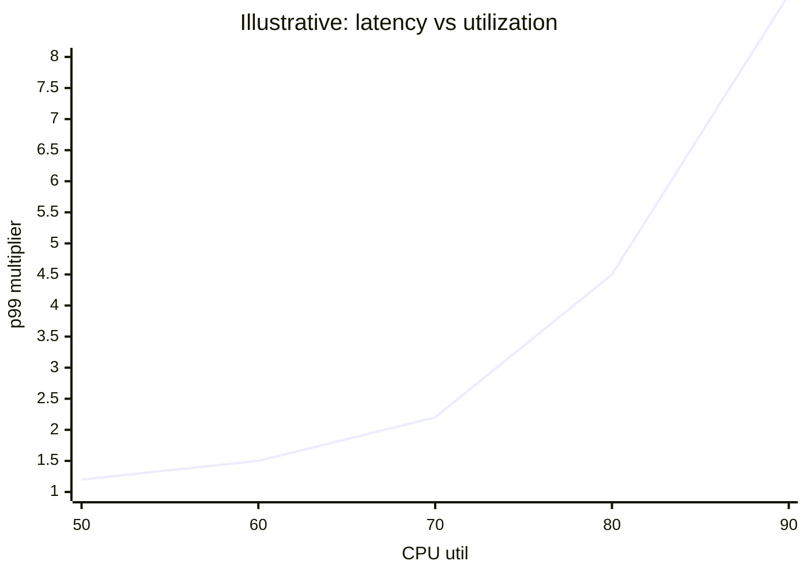

# Performance Fundamentals: Caching, Runtimes & Capacity Culture

> **What you'll learn:** Why your cache fixes p50 but not p99, how GC and CPU limits create tails profilers miss, how to model capacity from business drivers, and how to keep fast systems fast with budgets and ownership.

---

## Part 1 — Caching, locality & serialization

### 1.1 Hit ratio vs miss ratio

Report **miss ratio** on a log scale:

| Hit rate move | Origin load change |
|---------------|-------------------|
| 99% → 99.9% | **10×** fewer misses |
| 95% → 99% | **5×** fewer misses |

**Mixture model:** at hit rate `h`, quantile `q` lies on miss path when `q > h`.

**Fan-out:** request hits only if **all N keys** hit: `P(all hit) = h^N`.

```text
Need 99% of 100-key pages fully cached:
h ≥ 0.99^(1/100) ≈ 99.99% per key
```



**Expensive hit:** 300KB blob → 0.3ms network, **2–4ms deserialize** — measure hit path **including decode**.

### 1.2 Sizing & eviction

**Miss-ratio curve (MRC):** miss ratio vs cache size — find **knee**, don't buy flat tail GB.

| Pattern | MRC shape |
|---------|-----------|
| Zipf/web | Quick wins then flat |
| LRU + scan workload | **Cliff** until full working set fits |

**Admission policies:** W-TinyLFU / S3-FIFO reject one-hit wonders — often beats doubling RAM.

> **Load-bearing threshold:** Origin sized for miss traffic only → cache is **tier-0**. Alert on miss ratio approaching survivable max, not just "Redis down".

### 1.3 Multi-tier caches

L1 (in-process) **steals** L2's easy hits → L2 hit **rate** drops while origin load unchanged.

**Per-pod dilution:** key rate λ, TTL T, N pods → L1 hit ≈ `x/(1+x)` for `x = λT/N`. Autoscale **doubles N** → halves L1 effectiveness at peak.

**Staleness:** worst case ≈ `TTL_L1 + TTL_L2 + CDN`.

### 1.4 Stampede & cold start

- **Singleflight** / request coalescing on miss
- **Probabilistic early expiration** / jitter
- Warm paths after deploy; don't rely on LRU surviving batch scans

### 1.5 Locality & serialization tax

Every boundary pays:
- Copy + encode/decode (JSON, protobuf)
- Cache line movement (false sharing)
- Cross-socket NUMA

**Rule:** push work to where data already lives; prefer columnar/batch reads over chatty RPC.

Example protobuf vs JSON (conceptual — measure yours):

```python
# Prefer bounded, schema-stable payloads at hot paths
payload = OrderV1.SerializeToString()  # fixed schema, fewer branches
# vs json.dumps(large_dict)  # allocation + UTF-8 + parse cost on receiver
```

---

## Part 2 — Runtimes, memory & mechanical sympathy

### 2.1 GC as queueing

50ms STW pause at ρ=0.7 → disturbed window ≈ `P/(1-ρ)` ≈ **167ms**; at ρ=0.9 → **500ms**.

Pause budget for p99 (fluid model): shortening pause frequency helps high quantiles less than **shortening P**.

| Collector family | Pause | Steady tax |
|------------------|-------|------------|
| JVM Parallel | Large | Low CPU |
| G1 | Target ms | Moderate |
| ZGC / Shenandoah | Sub-ms | Barriers + headroom |
| Go | STW phases + **mark assists** | GOGC memory↔CPU |

**Allocation stall / mark assist:** tail shows as `runtime.gcAssistAlloc` — not in pause histogram.

> If GC cost scales with **live set**, not allocation rate: structural fix (off-heap, fewer pointers, split hot cache).

### 2.2 Heap economics

Tracing GC CPU ∝ `A/(k-1)` where `k = heap/live`. **Hyperbolic** in headroom: k=2→1.5 doubles GC CPU.

```text
GOGC=100 → heap ~2× live after GC
Raising heap buys CPU; lowering heap buys RAM
```

### 2.3 Allocation budget

- Object churn → GC pressure + cache pollution
- Pool **only** when allocation rate proves dominant (pools have their own bugs)
- Prefer **value types / arrays of primitives** for hot structures

### 2.4 CPU caches & false sharing

```java
// Bad: counters on same cache line across threads
class Bad { volatile long a; volatile long b; } // may share 64B line

// Better: pad or @Contended (JVM) / separate per-thread accumulators
```

### 2.5 NUMA

First-touch policy → memory on wrong socket → remote DRAM latency. Pin pods / use `numactl` for memory-heavy services.

### 2.6 Containers & mechanical sympathy

| Issue | Symptom |
|-------|---------|
| CPU limit | CFS throttle shelves in latency |
| Wrong GOMAXPROCS | 96-thread GC on 2 CPU weight |
| Huge pages / transparent huge pages | Latency variance |

Set runtime concurrency from ** cgroup CPU request**, not host CPU count.

---

## Part 3 — Capacity models & performance culture

### 3.1 Capacity chain (business → cores)

```text
peak_sessions × searches_per_session × shard_queries × CPU_ms_per_query ÷ target_util = cores
```

| Link | Owner | Drift driver |
|------|-------|--------------|
| Business driver | Marketing/PM | Campaigns |
| Product ratio | Product | UX (typeahead ×5) |
| Architecture ratio | Eng | Resharding |
| Service demand D | Eng | Corpus, code |
| Headroom | SRE/Perf | Policy |

**Fit demand:** regress `CPU = intercept + slope×throughput` — **slope** scales with traffic; **intercept** scales with fleet size.

### 3.2 Headroom stack

Naïve multiply all contingencies → ~37% peak target (illustrative). **Co-occurrence:** AZ loss + deploy may be exclusive if deploy halts on evacuation → **~18% fewer cores** with policy.

Include:
- **Degraded mode** (cache down → origin multiplier)
- **Forecast error** — don't double-count if already provisioning to high case

### 3.3 Load testing

- Open arrival rate, watch `dropped_iterations`
- Production-shaped mix (not uniform micro-benchmark)
- Find ρ=1 knee for **binding resource** (CPU, conn pool, disk)

### 3.4 Performance budgets in CI

- Macro benchmarks on critical paths
- Compare distributions (not just means) vs main branch
- Block regressions >X% at p95/p99

### 3.5 Culture & ownership

| Habit | Purpose |
|-------|---------|
| Named perf owner per tier | Someone answers regression |
| Blameless postmortems on tail | Fix measurement + architecture |
| Perf review in design doc | Fan-out N, cache keys, write ownership |
| Error budget ties reliability **and** latency | Same prioritization language |

**Concept inventory review:** count nouns to debug at 3am — platform should shrink list, not add tools without shrinking concepts.

---

## Integrated example: product page



**Levers (in order):**
1. Per-key hit target from N and SLO
2. Miss path (batch origin fetch)
3. Remove CPU limit / fix thread pools
4. Capacity model: sessions forecast → cores with headroom policy

---

## Cheat sheet

| Question | Chapter lever |
|----------|----------------|
| p99 flat after cache "win" | Miss path / fan-out h^N |
| GC logs small, users angry | ρ multiplier + assists |
| Efficiency program, bill flat | Commitment on pre-optimization usage |
| "Add Redis" proposal | MRC knee vs index fix |
| Growth OK, latency cliff | USL / queueing knee |

---

*Sources: Algoroq Performance Engineering — Caching Locality & Serialization, Runtimes Memory & Mechanical Sympathy, Capacity Models & Performance Culture.*

---

## Part 4 — Real-world incident case studies

### AWS S3 US-EAST-1 (2017) — cache and origin angle

**What happened:** When S3 API error rates spiked, many services had **no local degraded mode** — launch workflows, asset pipelines, and metadata stores blocked on retries. Effective load on remaining capacity increased via **retry amplification**.

**Lessons:** Size origin for **miss + failure** paths; **singleflight** on metadata; backoff with jitter at one layer; treat object store as **tier-0** with explicit capacity model.

### Facebook static cache stampede (representative large-scale pattern)

**What happened:** A hot key expired; thundering herd hit database; **p99** exploded while hit rate still looked “fine” on average.

**Lessons:** Probabilistic early expiration, request coalescing, **load-bearing** cache SLO on miss ratio — not only Redis uptime.

### Knight Capital (2012) — performance of control loops

**What happened:** Dormant code on one host created a **positive feedback trading loop** — latency of human intervention >> machine loop period.

**Lessons:** Anomaly detection on **rate of state change**; hardware kill switches; **canary instance** verification — capacity culture includes **maximum safe QPS** per binary version.

---

## Part 5 — Circuit breaker + cache miss path



On miss path, breaker **open** should serve **stale-while-revalidate** or static fallback — not block threads waiting for sick origin.

---

## Part 6 — Capacity planning spreadsheet formulas

Use a sheet with **named cells** so PMs can change drivers.

| Cell | Formula (conceptual) | Example value |
|------|----------------------|---------------|
| `peak_sessions` | input | 2,000,000 |
| `req_per_session` | input | 12 |
| `peak_rps` | `=peak_sessions*req_per_session/3600` | 6,667 |
| `cpu_ms_per_req` | benchmark | 8 |
| `cores_raw` | `=peak_rps*cpu_ms_per_req/1000` | 53.3 |
| `target_util` | policy | 0.65 |
| `cores_provisioned` | `=cores_raw/target_util` | 82 |
| `az_headroom` | `=cores_provisioned*1.5` | 123 (N+1 AZ) |
| `cache_miss_ratio` | measured | 0.02 |
| `origin_rps` | `=peak_rps*cache_miss_ratio` | 133 |
| `origin_cores` | separate model | 40 |

**Regression fit (demand curve):**

```text
CPU_cores = intercept + slope × daily_peak_rps
```

Update **slope** quarterly; **intercept** when fleet size changes (sidecars, logging).

**Degraded mode row:**

```text
origin_rps_degraded = peak_rps × (1 - cache_hit_rate_failover)
```

If cache_hit=0.99 normally but **0** in failover → origin_rps = **peak_rps** (100× miss traffic vs 1% miss) — drives **origin capacity** line item.

---

## Part 7 — GC tuning examples

### JVM (G1) — latency-sensitive service

```bash
# Illustrative flags — measure before/after with JFR + p99 RUM
-XX:+UseG1GC
-XX:MaxGCPauseMillis=50
-XX:InitiatingHeapOccupancyPercent=30
-XX:G1ReservePercent=15
-Xms8g -Xmx8g
```

**Tradeoff:** Lower `MaxGCPauseMillis` → more frequent cycles → **higher CPU tax**. Validate **allocation rate**; if live set dominates, prefer **ZGC/Shenandoah** or heap structure change.

### Go — mark assist tail

```bash
GOGC=50          # smaller heap, more frequent GC, often lower assist at cost of RAM
GOMEMLIMIT=6GiB  # Go 1.19+: cap heap soft limit
```

**Numeric:** At ρ=0.85, 30ms STW-equivalent disturbance → effective tail stretch ≈ **30/(1-0.85) = 200ms** in fluid model — explains “small pauses, big p99.”

### JVM off-heap / fewer pointers

```java
// Hot counters: Agrona DirectBuffer or primitive arrays
// vs millions of boxed Long in HashMap → tracing GC scans fewer objects
```

---

## Part 8 — Caching quantitative drill

### Fan-out hit probability

N=60 keys, per-key hit h=0.995:

\[
P(\text{all hit}) = 0.995^{60} \approx 0.74
\]

**26%** of requests still miss **at least one** key — page SLO needs **per-key** h ≈ **0.9998** for 99% full-page hit: \(0.9998^{60} \approx 0.99\).

### Miss ratio → origin load

Origin handles **λ_miss = λ × (1-h)**. Moving h from **0.99 → 0.999**:

\[
\frac{0.01}{0.001} = 10\times \text{ fewer origin requests}
\]

### W-TinyLFU admission (conceptual)

Reject keys with **low frequency** on first access — improves MRC knee without doubling RAM. Measure **origin RPS** and **p99 on miss path**, not hit % alone.

---

## Part 9 — Little’s law in capacity reviews

**Example:** Checkout service **800 RPS**, mean in-system time **W = 180 ms** (including DB):

\[
L = 800 \times 0.18 = 144 \text{ concurrent checkouts}
\]

If autoscale adds pods but **DB connections** capped at 100, **L** queues at DB — CPU headroom irrelevant. Capacity chain must name **binding resource**.

---

## Part 10 — Performance culture checklists

### SRE / perf readiness

| Item | Owner | Status |
|------|-------|--------|
| Named perf owner per tier-0 | Eng mgr | ☐ |
| Capacity model linked in design doc | SRE | ☐ |
| CI perf regression on p95/p99 | Eng | ☐ |
| Cache miss SLO + alert | SRE | ☐ |
| GC/allocator dashboard | Service | ☐ |
| Load test open-model annual | SRE | ☐ |
| Degraded mode tested | Product + SRE | ☐ |

### Chaos / failover (performance)

| Experiment | Hypothesis |
|------------|------------|
| Disable Redis cell-A | Origin stays < X RPS, p99 < Y ms |
| CPU limit 50% on canary | Throttle visible in `cpu.stat` before prod |
| Cold start after deploy | L1 hit rate recovers in < Z min |

---

## Part 11 — Latency budget table (product page)

| Stage | p99 budget (ms) | Measurement |
|-------|-----------------|-------------|
| CDN | 25 | RUM + CDN log |
| BFF aggregate | 120 | Trace root span |
| 60-key cache | 40 | Per-key span |
| Miss batch fetch | 80 | Origin trace |
| Serialize | 15 | CPU span |
| **Total** | **200** | RUM SLI |

---

## Part 12 — Diagram: tail latency amplification via cache miss



**Mitigation:** singleflight per key, batch API, higher per-key h, separate **fast vs slow** queue for origin.

---

## Part 13 — Queueing knee vs CPU target



Policy: set `target_util` from **binding queue** (ρ), not datacenter average.

---

## Part 14 — Interview Q&A

### Q: Why report cache miss ratio instead of hit ratio?

**A:** Hit ratio compresses dynamic range — 99% vs 99.9% sounds small but is **10×** origin load change. Miss ratio on log scale aligns with **capacity** and **incident severity**.

### Q: What is false sharing?

**A:** Two threads update different variables on the **same cache line** (64B), causing coherence traffic and serializing updates. Fix with padding, per-thread accumulators, or `@Contended` (JVM).

### Q: When does adding Redis hurt?

**A:** When working set >> RAM (flat MRC tail), **origin is correctly sized without cache**, or L1/L2 tiers **steal** hits and confuse metrics — measure origin RPS and miss-path latency.

### Q: Explain GOGC tradeoff in one line.

**A:** Lower GOGC → smaller heap → more frequent GC → **more CPU**, often less mark-assist stall; higher GOGC → more RAM, fewer cycles.

### Q: How do you coalesce headroom contingencies?

**A:** Multiply only **correlated** risks; AZ loss + peak traffic may co-occur; AZ loss + deploy may be **mutually exclusive** if policy halts deploy — avoids naïve 0.5×0.7×0.8 = 28% util fantasy.

### Q: What is the Universal Scalability Law warning?

**A:** Beyond some N, **coherence and contention** reduce speedup — doubling machines may not double throughput; tail latency can worsen due to shared resources.

### Q: How should perf fit CI?

**A:** Macro benchmarks on critical paths; compare **distributions** (p95/p99) vs main; block regressions above threshold; artifacts stored for triage — means alone hide tail regressions.

---

## Senior Pitfalls

| Mistake | Impact | Fix |
|---------|--------|-----|
| Cache hit ratio reported without origin load under miss storm | False confidence; origin dies on coordinated expiry | Monitor miss QPS and origin ρ; TTL jitter and singleflight |
| Serialization format changed without byte-size and CPU profile | Latency regression hidden until prod peak | Benchmark encode/decode on representative payloads in CI |
| GC tuned from defaults without allocation profile | Long pause times under allocation spike | Allocation profiling; pool buffers; generational sizing from prod heap dumps |
| Capacity plan using average RPS only | Black Friday exceeds knee; queue latency explodes | Plan at peak × safety factor; model with Little’s law and measured service time |
| Micro-optimizations before fixing N+1 queries | 10% CPU saved, 10× DB load remains | Profile critical path; fix IO and fan-out first |
| Performance tests in CI on shared runners | Flaky regressions; teams ignore red builds | Dedicated hardware or statistical thresholds; track distributions |

---

## Production-grade Practice

1. **Product page capacity sheet:** Build spreadsheet from measured RPS/pod, DB queries per request, and cache hit rate; solve for pods needed at 3× peak with ρ < 0.7 on DB.
2. **Serialization shootout:** Compare JSON, protobuf, and one alternative on your largest API payload; report bytes on wire, p99 encode+decode CPU, and developer ergonomics scorecard.
3. **Cache miss path trace:** Force 100% miss in staging; capture flame graph and dependency fan-out; list top 3 optimizations ranked by user-visible latency saved.
4. **Perf regression gate:** Add benchmark for checkout path in CI; set fail threshold on p95 vs baseline; document triage process when main branch fails.

---

## Part 15 — Error budget tie-in (performance SLO)

Monthly **99.9%** availability + **99%** requests < 200ms. Combined user happiness often tracks **product** of objectives — failing latency burns trust even at high availability. Track **two budgets** with separate burn alerts; freeze features if **either** burns past policy threshold.

**Example:** 10M requests, 99% latency SLO → 100k slow allowed. Regression adds 15k slow/day → **15% daily burn** if sustained — page via multi-window latency burn, not mean dashboard green.
