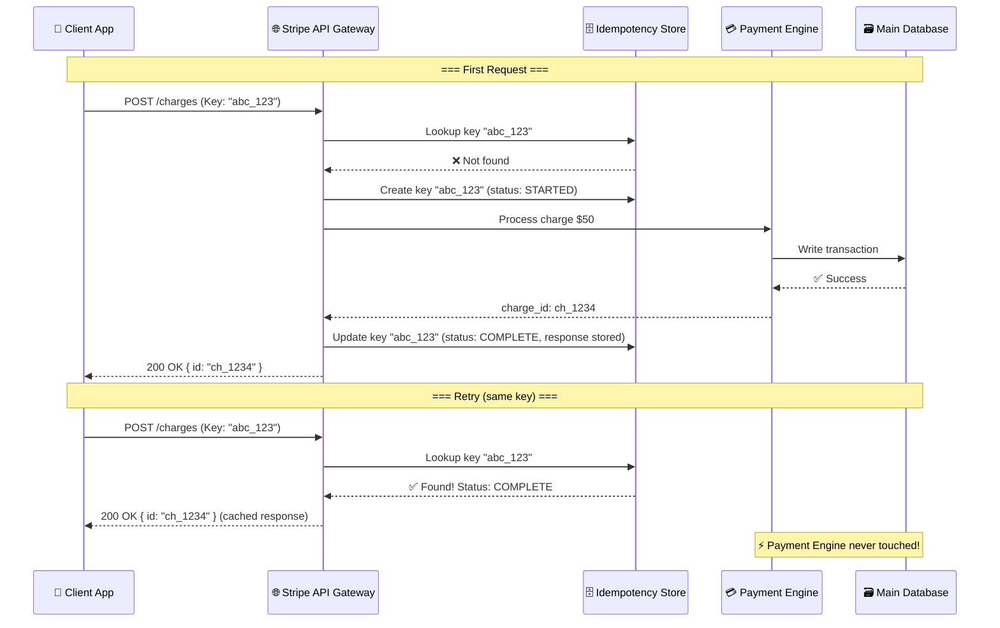
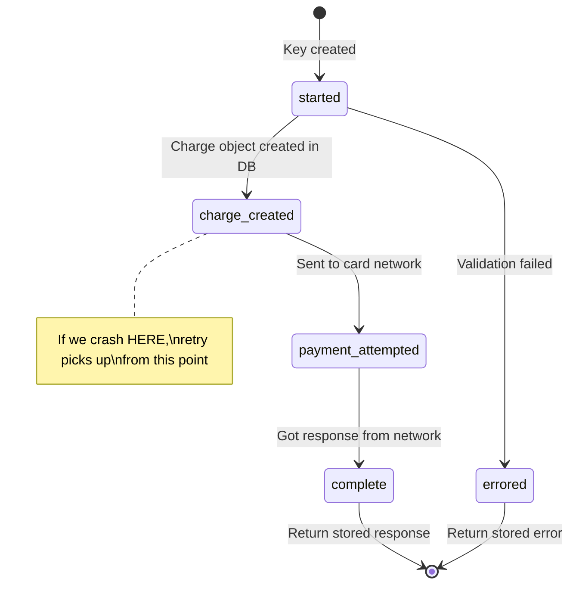

# Stripe's Idempotency Keys — Deep Dive

## 🎯 One-Line Summary

> **Idempotency keys let you safely retry a payment request without charging the customer twice.**

---

## 📌 The Problem: Why Do We Need This?

Imagine you're buying a ₹5,000 pair of shoes online. You click "Pay" — your internet hiccups for 2 seconds. Did the payment go through? You don't know. You click "Pay" again.

**Without idempotency:** You just got charged ₹10,000. 😱  
**With idempotency:** The server recognizes "I already processed this request" and returns the original result. You pay ₹5,000 once. ✅

### Real-World Analogy

Think of a **movie ticket**. You hand the ticket to the usher — they tear it and let you in. If you somehow show the same ticket again, they say *"You already used this."* The ticket number is the **idempotency key**.

---

## 🏗️ How Stripe Actually Implements It

### The Core Idea

```
Client sends: POST /v1/charges
Headers: Idempotency-Key: "order_abc_123_retry_1"
Body: { amount: 5000, currency: "usd", source: "tok_visa" }
```

Stripe's server does this:

```
1. Look up "order_abc_123_retry_1" in the idempotency store
2. If found → return the STORED response (don't process again)
3. If NOT found → process the charge, STORE the response, return it
```

### Architecture Diagram



---

## 🔬 Deep Dive: The Database Schema

Stripe uses a **relational database** (PostgreSQL) with a table like this:

```sql
CREATE TABLE idempotency_keys (
    id              BIGSERIAL PRIMARY KEY,
    idempotency_key VARCHAR(255) NOT NULL,
    user_id         BIGINT NOT NULL,
    
    -- Request fingerprint
    request_method  VARCHAR(10) NOT NULL,    -- POST
    request_path    VARCHAR(255) NOT NULL,   -- /v1/charges
    request_params  JSONB NOT NULL,          -- {amount: 5000, ...}
    
    -- Response cache
    response_code   INT,                     -- 200
    response_body   JSONB,                   -- {id: "ch_1234", ...}
    
    -- State machine
    recovery_point  VARCHAR(50) NOT NULL     -- 'started', 'charge_created', 'complete'
                    DEFAULT 'started',
    
    -- Lifecycle
    locked_at       TIMESTAMPTZ,             -- For concurrent request protection
    created_at      TIMESTAMPTZ NOT NULL DEFAULT NOW(),
    
    -- Unique per user
    UNIQUE(user_id, idempotency_key)
);

-- Index for fast lookups
CREATE INDEX idx_idemp_key_user ON idempotency_keys(user_id, idempotency_key);

-- Auto-cleanup: keys expire after 24 hours
-- (Background worker deletes old entries)
```

---

## 🔄 The State Machine (Recovery Points)

This is the **genius** part of Stripe's design. Each idempotent operation moves through **recovery points** — like save points in a video game.



### Why Recovery Points Matter

```
Scenario: Server crashes AFTER creating charge but BEFORE calling Visa

Without recovery points:
  - Retry creates ANOTHER charge object → duplicate!
  
With recovery points:
  - Retry sees recovery_point = "charge_created"
  - Skips charge creation
  - Picks up from "call Visa" step
  - No duplicate!
```

---

## 💻 Full Implementation (Production-Grade)

### 1. The Idempotency Middleware

```python
# idempotency.py — Production-grade idempotency middleware

import json
import hashlib
import time
from datetime import datetime, timedelta
from functools import wraps
from flask import request, jsonify, g
import psycopg2
from psycopg2.extras import RealDictCursor

class IdempotencyError(Exception):
    """Custom exception for idempotency violations."""
    pass

class IdempotencyStore:
    """
    Manages idempotency keys in PostgreSQL.
    
    Think of it as a "receipt drawer" — every processed request
    gets a receipt stored here. If someone shows the same receipt,
    we return the stored result.
    """
    
    def __init__(self, db_pool):
        self.db = db_pool
        self.KEY_EXPIRY_HOURS = 24  # Stripe expires keys after 24h
        self.LOCK_TIMEOUT_SECONDS = 60  # Max time to hold a lock
    
    def get_or_create(self, user_id: str, idempotency_key: str, 
                       request_params: dict) -> dict:
        """
        Look up an idempotency key. If it exists, return stored result.
        If not, create it and return None (meaning: "go ahead and process").
        
        Returns:
            {
                "status": "hit" | "miss" | "conflict",
                "stored_response": {...} or None,
                "recovery_point": "started" | "charge_created" | ...
            }
        """
        conn = self.db.getconn()
        try:
            with conn.cursor(cursor_factory=RealDictCursor) as cur:
                # Step 1: Try to find existing key
                cur.execute("""
                    SELECT * FROM idempotency_keys
                    WHERE user_id = %s AND idempotency_key = %s
                    FOR UPDATE  -- Lock the row!
                """, (user_id, idempotency_key))
                
                existing = cur.fetchone()
                
                if existing:
                    return self._handle_existing_key(existing, request_params)
                
                # Step 2: Key doesn't exist — create it
                request_hash = self._hash_params(request_params)
                cur.execute("""
                    INSERT INTO idempotency_keys 
                        (user_id, idempotency_key, request_params, 
                         request_hash, recovery_point, locked_at)
                    VALUES (%s, %s, %s, %s, 'started', NOW())
                    RETURNING *
                """, (user_id, idempotency_key, 
                      json.dumps(request_params), request_hash))
                
                conn.commit()
                return {"status": "miss", "stored_response": None, 
                        "recovery_point": "started"}
                
        except psycopg2.errors.UniqueViolation:
            conn.rollback()
            # Race condition: another request just created the same key
            return {"status": "conflict"}
        finally:
            self.db.putconn(conn)
    
    def _handle_existing_key(self, existing: dict, 
                              new_params: dict) -> dict:
        """Handle the case where we already have this key."""
        
        # Safety check: are they sending DIFFERENT params with same key?
        # This is a client bug — same key should = same request
        new_hash = self._hash_params(new_params)
        if existing['request_hash'] != new_hash:
            raise IdempotencyError(
                "Idempotency key reused with different parameters! "
                f"Key: {existing['idempotency_key']}"
            )
        
        # Is the previous request still running?
        if (existing['locked_at'] and 
            existing['recovery_point'] != 'complete'):
            lock_age = datetime.utcnow() - existing['locked_at']
            if lock_age.seconds < self.LOCK_TIMEOUT_SECONDS:
                return {"status": "conflict"}  # Still processing
        
        # Already complete? Return cached response!
        if existing['recovery_point'] == 'complete':
            return {
                "status": "hit",
                "stored_response": {
                    "code": existing['response_code'],
                    "body": existing['response_body']
                },
                "recovery_point": "complete"
            }
        
        # Incomplete (crashed mid-way) — return recovery point
        return {
            "status": "miss",
            "stored_response": None,
            "recovery_point": existing['recovery_point']
        }
    
    def update_recovery_point(self, user_id: str, key: str, 
                               point: str, **kwargs):
        """
        Move the state machine forward.
        Called after each "save point" in the operation.
        """
        conn = self.db.getconn()
        try:
            with conn.cursor() as cur:
                if point == 'complete':
                    cur.execute("""
                        UPDATE idempotency_keys 
                        SET recovery_point = %s,
                            response_code = %s,
                            response_body = %s,
                            locked_at = NULL
                        WHERE user_id = %s AND idempotency_key = %s
                    """, (point, kwargs.get('response_code'), 
                          json.dumps(kwargs.get('response_body')),
                          user_id, key))
                else:
                    cur.execute("""
                        UPDATE idempotency_keys 
                        SET recovery_point = %s
                        WHERE user_id = %s AND idempotency_key = %s
                    """, (point, user_id, key))
                conn.commit()
        finally:
            self.db.putconn(conn)
    
    def _hash_params(self, params: dict) -> str:
        """Create a fingerprint of request parameters."""
        canonical = json.dumps(params, sort_keys=True)
        return hashlib.sha256(canonical.encode()).hexdigest()


# ─── Flask Decorator for Easy Use ────────────────────────────

def idempotent(f):
    """
    Decorator that adds idempotency to any endpoint.
    
    Usage:
        @app.route('/charges', methods=['POST'])
        @idempotent
        def create_charge():
            ...
    """
    @wraps(f)
    def decorated(*args, **kwargs):
        key = request.headers.get('Idempotency-Key')
        
        if not key:
            # No key provided — process normally (not idempotent)
            return f(*args, **kwargs)
        
        if len(key) > 255:
            return jsonify({"error": "Idempotency key too long"}), 400
        
        store = g.idempotency_store  # Injected by app setup
        user_id = g.current_user_id
        
        result = store.get_or_create(
            user_id=user_id,
            idempotency_key=key,
            request_params=request.get_json()
        )
        
        if result["status"] == "hit":
            # Cache hit! Return stored response
            resp = result["stored_response"]
            return jsonify(resp["body"]), resp["code"]
        
        if result["status"] == "conflict":
            return jsonify({
                "error": "A request with this idempotency key "
                         "is already being processed"
            }), 409
        
        # Cache miss — process the request
        # Store recovery point in context for the handler to use
        g.idempotency_key = key
        g.recovery_point = result["recovery_point"]
        
        response = f(*args, **kwargs)
        
        # Store the response for future replays
        store.update_recovery_point(
            user_id=user_id,
            key=key,
            point='complete',
            response_code=response.status_code,
            response_body=response.get_json()
        )
        
        return response
    
    return decorated
```

### 2. Using It in an Endpoint

```python
# charges.py — Payment endpoint with idempotency + recovery points

@app.route('/v1/charges', methods=['POST'])
@idempotent
def create_charge():
    """
    Create a charge — safely retriable with idempotency key.
    
    Recovery Points (like save points in a video game):
      started → charge_created → payment_attempted → complete
    """
    data = request.get_json()
    store = g.idempotency_store
    user_id = g.current_user_id
    key = g.idempotency_key
    recovery = g.recovery_point
    
    # ── Step 1: Create charge object ─────────────────────
    if recovery == 'started':
        charge = Charge.create(
            amount=data['amount'],
            currency=data['currency'],
            customer_id=user_id,
            status='pending'
        )
        db.session.commit()
        
        store.update_recovery_point(user_id, key, 'charge_created',
                                     charge_id=charge.id)
        g.charge_id = charge.id
    else:
        # Resuming from crash — charge already exists
        g.charge_id = get_charge_id_from_key(key)
    
    # ── Step 2: Call payment network (Visa/Mastercard) ───
    if recovery in ('started', 'charge_created'):
        try:
            result = payment_gateway.authorize(
                charge_id=g.charge_id,
                amount=data['amount'],
                token=data['source']
            )
            store.update_recovery_point(user_id, key, 'payment_attempted')
        except PaymentGatewayTimeout:
            # Gateway timed out — we DON'T know if it succeeded
            # Mark as needs_review, don't retry automatically
            Charge.update(g.charge_id, status='needs_review')
            db.session.commit()
            return jsonify({"id": g.charge_id, "status": "needs_review"}), 202
    
    # ── Step 3: Finalize ──────────────────────────────────
    Charge.update(g.charge_id, status='succeeded')
    db.session.commit()
    
    return jsonify({
        "id": g.charge_id,
        "amount": data['amount'],
        "currency": data['currency'],
        "status": "succeeded"
    }), 200
```

### 3. Client-Side: How to Use Idempotency Keys

```javascript
// client.js — How your frontend/backend should call Stripe

const stripe = require('stripe')('sk_live_xxx');

async function chargeCustomerSafely(orderId, amount) {
    // The KEY RULE: derive the idempotency key from your business entity
    // Same order → same key → safe to retry
    const idempotencyKey = `charge_order_${orderId}`;
    
    try {
        const charge = await stripe.charges.create(
            {
                amount: amount,       // in cents
                currency: 'usd',
                source: 'tok_visa',
                metadata: { order_id: orderId }
            },
            {
                idempotencyKey: idempotencyKey  // ← THIS IS THE MAGIC
            }
        );
        
        console.log(`✅ Charge created: ${charge.id}`);
        return charge;
        
    } catch (error) {
        if (error.type === 'StripeIdempotencyError') {
            // You reused a key with different parameters — BUG!
            console.error('❌ Idempotency key mismatch!');
        } else if (error.statusCode === 409) {
            // Another request with this key is still processing
            // Wait and retry
            await sleep(1000);
            return chargeCustomerSafely(orderId, amount);
        } else {
            // Network error — SAFE to retry with same key!
            console.log('🔄 Retrying...');
            return chargeCustomerSafely(orderId, amount);
        }
    }
}
```

---

## 🧠 Key Design Decisions (FAANG Interview Gold)

### 1. Why Not Just Use Database Unique Constraints?

```
Q: "Can't we just make charge_id unique and catch duplicates?"

A: That only prevents duplicate CHARGES, not duplicate SIDE EFFECTS.
   What if creating a charge also:
   - Sends an email receipt
   - Updates inventory
   - Triggers a webhook
   
   Unique constraint catches the DB write, but the email already sent!
   Idempotency keys prevent the ENTIRE operation from re-executing.
```

### 2. Why 24-Hour Expiry?

```
- Too short (1 hour): Client retries after lunch break → duplicate charge!
- Too long (forever): Database grows forever, lookups slow down
- 24 hours: Sweet spot. Covers network retries, client crashes, 
  overnight batch jobs. After 24h, if you retry, something is very wrong.
```

### 3. Why Per-User Keys (Not Global)?

```
Global key space:
  User A: key="payment_1" → charge $50
  User B: key="payment_1" → BLOCKED! (conflict with User A)
  
Per-user key space:
  User A: key="payment_1" → charge $50  ✅
  User B: key="payment_1" → charge $30  ✅ (different user namespace)
```

### 4. What Happens with Different Parameters + Same Key?

```
Request 1: key="abc", amount=5000  → Processed ✅
Request 2: key="abc", amount=9999  → ERROR! ❌

Stripe returns 422: "Idempotency key reused with different request parameters"

This catches client bugs: you should NEVER reuse a key for a different operation.
```

---

## 🏢 How Big Companies Use This Pattern

| Company | Implementation | Key Format |
|---------|---------------|------------|
| **Stripe** | PostgreSQL + recovery points | Client-provided UUID |
| **Amazon (AWS)** | `ClientToken` parameter | Client-provided, 36 char max |
| **Google Cloud** | `requestId` field | Client-provided UUID |
| **PayPal** | `PayPal-Request-Id` header | UUID v4 |
| **Square** | `idempotency_key` in body | Client-provided, 45 char max |
| **Razorpay** | `receipt` field acts as soft-idempotency | Merchant-provided |

---

## ⚡ Common Interview Questions

### Q1: "Design an idempotent payment system"

```
Answer Framework:
1. Client generates deterministic key (order_id + action)
2. Server stores key → response mapping in DB
3. Use row-level locking (SELECT FOR UPDATE) for concurrency
4. Implement recovery points for crash resilience
5. Expire keys after 24 hours
6. Return stored response on key match
```

### Q2: "What about distributed systems with multiple servers?"

```
Challenge: Server A processes key "abc", Server B gets retry with key "abc"

Solution: 
- Store idempotency keys in a SHARED database (not local memory!)
- Use database-level locking (not application-level)
- This is why Stripe uses PostgreSQL, not Redis — needs ACID guarantees

                    ┌──────────┐
    Request 1 ──────▶ Server A ──────┐
                    └──────────┘      │
                                      ▼
                              ┌──────────────┐
                              │  PostgreSQL   │
                              │  (shared DB)  │
                              │  with row     │
                              │  locking      │
                              └──────────────┘
                                      ▲
    Retry     ──────▶ Server B ──────┘
                    └──────────┘
```

### Q3: "Why not use Redis for idempotency?"

```
Redis is tempting (fast!) but dangerous for payments:

❌ Redis: Data can be lost on restart (even with AOF)
❌ Redis: No true ACID transactions
❌ Redis: SET NX + TTL has race conditions

✅ PostgreSQL: ACID guarantees
✅ PostgreSQL: SELECT FOR UPDATE (true row locking)
✅ PostgreSQL: WAL ensures no data loss
✅ PostgreSQL: Transactional with the charge itself

For non-critical operations (like preventing duplicate API reads), 
Redis is fine! For money? Use a real database.
```

---

## 📊 Performance Considerations

```
Stripe processes ~thousands of requests/second per API pod.
Each idempotency lookup adds:
  - 1 DB read (index lookup): ~1-2ms
  - 1 DB write (on miss): ~2-5ms
  
Total overhead: 3-7ms per request
For a payment that takes 500-2000ms total? That's <1% overhead.

Key optimizations:
  1. B-tree index on (user_id, idempotency_key) — O(log n) lookup
  2. Background worker cleans expired keys every hour
  3. Read replicas for completed key lookups
  4. Connection pooling (PgBouncer) to handle high concurrency
```

---

## 🎓 Key Takeaways

1. **Idempotency ≠ Deduplication** — Idempotency means "same input → same output, no extra side effects." Deduplication just removes copies.

2. **The key must come from the CLIENT** — Server-generated keys can't help with retries (you'd need to know the key to retry, but you only get the key from the first response).

3. **Recovery points are essential** — Without them, you can't safely resume a partially-completed operation.

4. **Always use the business entity as the key seed** — `order_123_charge` not `random_uuid`. This makes debugging 10× easier.

5. **ACID database for financial idempotency** — Never trust eventually-consistent stores for money operations.

---

## 📚 References

- [Stripe's Official Idempotency Docs](https://stripe.com/docs/api/idempotent_requests)
- [Brandur Leach's "Implementing Stripe-like Idempotency Keys in Postgres"](https://brandur.org/idempotency-keys)
- [Designing robust and predictable APIs with idempotency (Stripe Blog)](https://stripe.com/blog/idempotency)
