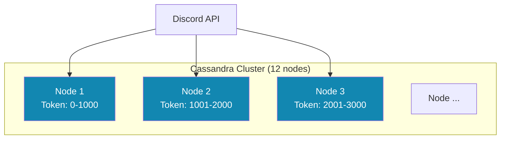
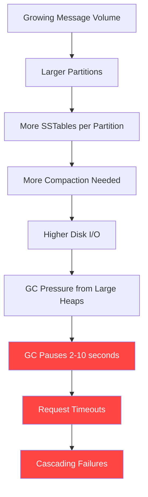
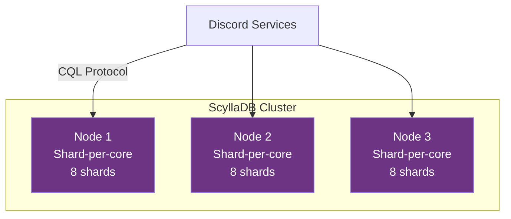
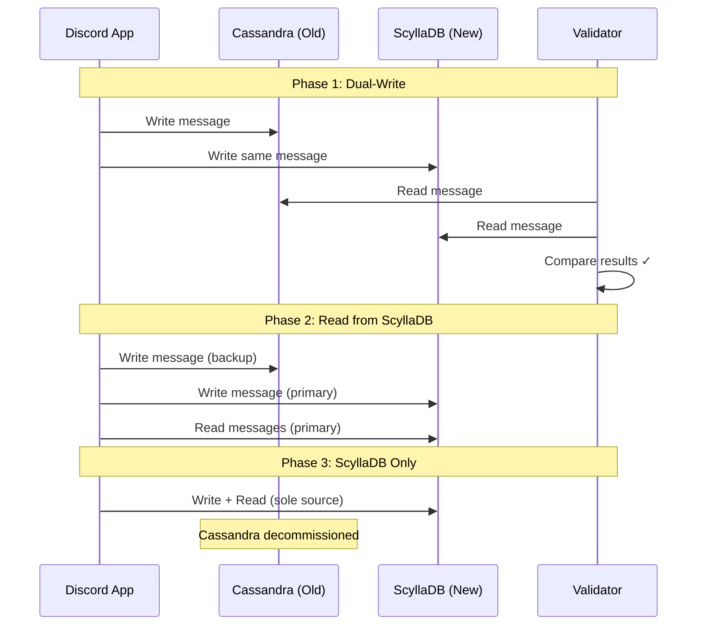
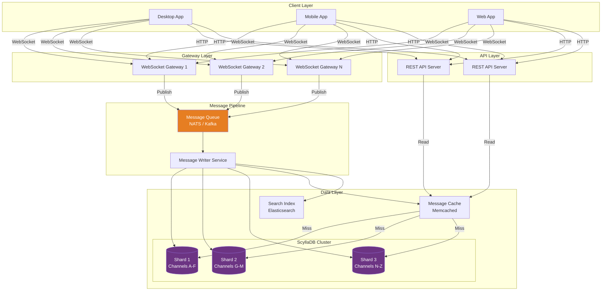

# How Discord Stores Trillions of Messages — Deep Dive

## 🎯 One-Line Summary

> **Discord migrated from MongoDB → Cassandra → ScyllaDB to handle trillions of messages, using a clever partitioning strategy that keeps reads fast even at massive scale.**

---

## 📌 The Problem in Plain English

Discord has **200+ million monthly users** sending messages in servers (communities). Some servers have millions of members. The challenges:

1. **Write-heavy**: Millions of messages per second
2. **Read-heavy too**: Users scroll up to read old messages
3. **Hot partitions**: One viral server can get 10,000 messages/minute
4. **Forever storage**: Messages are stored indefinitely (no auto-delete)
5. **Low latency**: Messages must appear in < 100ms

### Real-World Scale

```
Daily messages:       ~4 billion
Total stored:         ~4+ trillion (and growing)
Peak write rate:      ~millions/second
Storage needed:       Petabytes
Read pattern:         95% reads are "latest messages in this channel"
```

---

## 📖 The Journey: MongoDB → Cassandra → ScyllaDB

### Phase 1: MongoDB (2015 — Early Days)


**Why MongoDB first?**
- Fast to develop with (schema-flexible)
- Small user base, single replica set was enough
- Discord was a startup — speed of development > scale

**Why it broke:**
- MongoDB stores data in **B-tree indexes in RAM**
- As messages grew, indexes didn't fit in RAM → fell to disk → 100× slower
- Random I/O patterns killed disk throughput

```
Timeline of pain:
- 100M messages: MongoDB fine ✅
- 1B messages:   Indexes bigger than RAM, reads slow down ⚠️
- 10B messages:  Random disk I/O, p99 latency > 5 seconds ❌
```

---

### Phase 2: Cassandra (2017-2022)



**Why Cassandra?**
- Distributed, no single point of failure
- **LSM-tree storage**: Writes are sequential (fast!)
- Linear scalability: add nodes to handle more data
- Discord's access pattern (write-heavy, append-only) is Cassandra's sweet spot

#### The Data Model: Bucket-Based Partitioning

This is the **key insight** — how Discord organizes messages:

```sql
-- Cassandra table definition
CREATE TABLE messages (
    channel_id   BIGINT,
    bucket       INT,          -- Time-based bucket (explained below)
    message_id   BIGINT,       -- Snowflake ID (contains timestamp)
    author_id    BIGINT,
    content      TEXT,
    
    PRIMARY KEY ((channel_id, bucket), message_id)
    -- Partition key: (channel_id, bucket)
    -- Clustering key: message_id (sorted within partition)
) WITH CLUSTERING ORDER BY (message_id DESC);
```

#### What is "Bucket"?

The bucket is a **time window** that controls partition size:

```python
# How Discord calculates the bucket for a message

DISCORD_EPOCH = 1420070400000  # Jan 1, 2015 in ms

def get_bucket(channel_id: int, message_id: int) -> int:
    """
    Bucket = time window. Different channels get different bucket sizes
    based on how active they are.
    
    Think of it like organizing mail:
    - A quiet household: one mailbox per YEAR is fine
    - A busy office: one mailbox per DAY or it overflows
    """
    
    # Extract timestamp from Snowflake ID
    timestamp_ms = (message_id >> 22) + DISCORD_EPOCH
    
    # Determine bucket size based on channel activity
    bucket_size = get_bucket_size(channel_id)
    
    # Calculate bucket number
    return int(timestamp_ms / bucket_size)


def get_bucket_size(channel_id: int) -> int:
    """
    Dynamically size buckets to keep partitions manageable.
    
    Target: Each partition should have ~100K-500K messages max.
    
    Why? Cassandra partitions that get too big (>100MB) cause:
    - Slow compaction
    - GC pressure
    - Hot spots
    """
    message_rate = get_channel_message_rate(channel_id)
    
    if message_rate > 10000:   # messages per day
        return 1000 * 60 * 60          # 1-hour buckets (busy server)
    elif message_rate > 1000:
        return 1000 * 60 * 60 * 24     # 1-day buckets
    elif message_rate > 100:
        return 1000 * 60 * 60 * 24 * 7 # 1-week buckets
    else:
        return 1000 * 60 * 60 * 24 * 30 # 1-month buckets (quiet DM)
```

#### Visual: How Partitions Look

```
Channel: "general" in a big server (50K messages/day)
Bucket size: 1 day

┌─────────────────────────────────┐
│ Partition: (channel=123, day=1) │  ← 50K messages
│   msg_999, msg_998, msg_997...  │     Sorted newest-first
└─────────────────────────────────┘
┌─────────────────────────────────┐
│ Partition: (channel=123, day=2) │  ← 50K messages
│   msg_1999, msg_1998, ...       │
└─────────────────────────────────┘

Channel: "random-thoughts" in a tiny server (10 messages/day)
Bucket size: 1 month

┌─────────────────────────────────┐
│ Partition: (channel=456, jan)   │  ← 300 messages
│   msg_55, msg_54, msg_53...     │     One partition for whole month
└─────────────────────────────────┘
```

#### Reading Messages (The Hot Path)

```python
# How Discord fetches messages when you open a channel

async def get_messages(channel_id: int, before: int = None, limit: int = 50):
    """
    Fetch the latest messages in a channel.
    
    The beauty: 95% of reads hit just ONE partition (today's bucket).
    Users almost always read recent messages, not year-old ones.
    """
    
    if before is None:
        # User just opened channel — get latest messages
        current_bucket = get_current_bucket(channel_id)
        
        messages = await cassandra.execute("""
            SELECT * FROM messages
            WHERE channel_id = %s AND bucket = %s
            ORDER BY message_id DESC
            LIMIT %s
        """, (channel_id, current_bucket, limit))
        
        # If not enough messages in current bucket, go to previous
        if len(messages) < limit:
            prev_bucket = get_previous_bucket(channel_id, current_bucket)
            more = await cassandra.execute("""
                SELECT * FROM messages
                WHERE channel_id = %s AND bucket = %s
                ORDER BY message_id DESC
                LIMIT %s
            """, (channel_id, prev_bucket, limit - len(messages)))
            messages.extend(more)
        
        return messages
    
    else:
        # User is scrolling up — "load more" pagination
        target_bucket = get_bucket_for_message(channel_id, before)
        return await cassandra.execute("""
            SELECT * FROM messages
            WHERE channel_id = %s AND bucket = %s
              AND message_id < %s
            ORDER BY message_id DESC
            LIMIT %s
        """, (channel_id, target_bucket, before, limit))
```

#### Why Cassandra Started Failing (2022)

Despite the clever design, Cassandra had problems at Discord's scale:

```
Problem 1: HOT PARTITIONS
  A viral event in a big server → millions of writes to one partition
  Cassandra node holding that partition becomes CPU-saturated
  
Problem 2: GARBAGE COLLECTION PAUSES (THE KILLER)
  Cassandra runs on JVM (Java Virtual Machine)
  JVM garbage collector pauses for 2-10 seconds at unpredictable times
  During GC pause:
    - Node appears dead to the cluster
    - Requests fail or timeout
    - Other nodes take over → cascade of load
  
  At Discord's scale: GC pauses happened multiple times per day

Problem 3: COMPACTION STORMS
  Cassandra periodically merges SSTable files (compaction)
  During compaction: 50-100% more disk I/O
  Read latency spikes from 5ms to 500ms+

Problem 4: READ AMPLIFICATION
  To read 1 message, Cassandra might read 5-10 SSTables
  Each SSTable = 1 disk seek
  Bloom filters help, but at scale even 1% false positives = millions of wasted reads
```



---

### Phase 3: ScyllaDB (2022-Present) — The Solution



**What is ScyllaDB?**
- A drop-in replacement for Cassandra (same CQL query language)
- Written in **C++ instead of Java** → No garbage collection pauses!
- **Shard-per-core architecture**: Each CPU core is an independent shard
- Same data model, same queries, dramatically better performance

#### Why ScyllaDB Fixed Discord's Problems

```
Problem              │ Cassandra              │ ScyllaDB
─────────────────────┼────────────────────────┼─────────────────────
GC Pauses            │ 2-10 second pauses     │ No GC (C++, manual memory)
Tail Latency (p99)   │ 40-100ms               │ 4-10ms (10x better)
CPU Efficiency       │ 30% (JVM overhead)     │ 90%+ (bare metal perf)
Compaction Impact    │ 50-100% latency spike  │ Background, minimal impact
Nodes Needed         │ 177 Cassandra nodes    │ 72 ScyllaDB nodes (60% less)
```

#### The Migration Strategy



```python
# Discord's dual-write migration code (simplified)

class MessageStore:
    def __init__(self):
        self.cassandra = CassandraClient()
        self.scylla = ScyllaDBClient()
        self.migration_phase = "dual_write"  # or "scylla_primary" or "scylla_only"
    
    async def write_message(self, message: Message):
        """Write to both stores during migration."""
        
        if self.migration_phase == "scylla_only":
            await self.scylla.insert(message)
            return
        
        # Dual-write: write to both, but don't fail if Cassandra fails
        scylla_future = self.scylla.insert(message)
        
        try:
            cassandra_future = self.cassandra.insert(message)
            await asyncio.gather(scylla_future, cassandra_future)
        except CassandraError:
            # Cassandra failure is OK during migration
            await scylla_future
            log.warning(f"Cassandra write failed for {message.id}")
    
    async def read_messages(self, channel_id: int, limit: int = 50):
        """Read from appropriate store based on migration phase."""
        
        if self.migration_phase == "dual_write":
            # Read from both and compare (validation)
            cass_result, scylla_result = await asyncio.gather(
                self.cassandra.get_messages(channel_id, limit),
                self.scylla.get_messages(channel_id, limit)
            )
            
            if cass_result != scylla_result:
                metrics.increment("migration.read_mismatch")
                log.error(f"Mismatch in channel {channel_id}!")
                return cass_result  # Trust Cassandra during validation
            
            return scylla_result
        
        else:
            return await self.scylla.get_messages(channel_id, limit)
```

---

## 🔬 The Snowflake ID System

Discord's message IDs aren't random — they contain embedded timestamps:

```
Snowflake ID: 1145141919810364416

Binary breakdown (64 bits):
┌──────────────────────────────────────────────┬──────┬───────┬────────────┐
│          Timestamp (42 bits)                  │ WkID │ ProcID│ Sequence   │
│       milliseconds since Discord Epoch        │(5bit)│(5bit) │ (12 bits)  │
└──────────────────────────────────────────────┴──────┴───────┴────────────┘
         ↑                                        ↑       ↑        ↑
    ~139 years of IDs                          Worker  Process   4096 IDs
    (enough till 2154)                          (0-31)  (0-31)   per ms
```

```python
# Discord's Snowflake ID generator

import time
import threading

DISCORD_EPOCH = 1420070400000  # January 1, 2015 00:00:00 UTC

class SnowflakeGenerator:
    """
    Generates unique, time-sorted IDs.
    
    Why not UUID?
    - UUIDs are random → can't sort by time
    - UUIDs are 128 bits → wastes storage at trillion scale
    - Snowflakes are 64 bits AND sorted by creation time
    """
    
    def __init__(self, worker_id: int, process_id: int):
        assert 0 <= worker_id < 32,  "Worker ID must be 0-31"
        assert 0 <= process_id < 32, "Process ID must be 0-31"
        
        self.worker_id = worker_id
        self.process_id = process_id
        self.sequence = 0
        self.last_timestamp = -1
        self.lock = threading.Lock()
    
    def generate(self) -> int:
        with self.lock:
            timestamp = int(time.time() * 1000) - DISCORD_EPOCH
            
            if timestamp == self.last_timestamp:
                self.sequence = (self.sequence + 1) & 0xFFF  # 12 bits
                if self.sequence == 0:
                    # Exhausted 4096 IDs in this millisecond — wait
                    while timestamp <= self.last_timestamp:
                        timestamp = int(time.time() * 1000) - DISCORD_EPOCH
            else:
                self.sequence = 0
            
            self.last_timestamp = timestamp
            
            snowflake = (
                (timestamp << 22) |
                (self.worker_id << 17) |
                (self.process_id << 12) |
                self.sequence
            )
            
            return snowflake
    
    @staticmethod
    def extract_timestamp(snowflake_id: int) -> int:
        """Get creation time from any snowflake ID."""
        return (snowflake_id >> 22) + DISCORD_EPOCH


# Usage
gen = SnowflakeGenerator(worker_id=1, process_id=1)
msg_id = gen.generate()  # e.g., 1145141919810364416

# Later: extract when it was created
created_ms = SnowflakeGenerator.extract_timestamp(msg_id)
# → 1693526400000 (Sept 1, 2023)
```

---

## 🏗️ Full Architecture Diagram



---

## ⚡ Key Optimizations

### 1. Message Caching (Last 100 Messages)

```python
# Most users only read the LATEST messages in a channel
# Cache the last 100 messages per active channel in Memcached

class MessageCache:
    """
    Sorted set in Memcached: channel_id → [last 100 messages]
    
    Hit rate: ~95% (most reads are "show me the latest messages")
    """
    
    async def get_latest(self, channel_id: int) -> list:
        cached = await memcached.get(f"msgs:{channel_id}")
        if cached:
            return cached  # 95% of the time: done!
        
        # Cache miss: fetch from ScyllaDB
        messages = await scylla.get_messages(channel_id, limit=100)
        await memcached.set(f"msgs:{channel_id}", messages, ttl=3600)
        return messages
    
    async def on_new_message(self, channel_id: int, message: Message):
        """Push new message to cache, evict oldest."""
        cached = await memcached.get(f"msgs:{channel_id}")
        if cached:
            cached.insert(0, message)  # Add to front (newest first)
            if len(cached) > 100:
                cached.pop()  # Remove oldest
            await memcached.set(f"msgs:{channel_id}", cached, ttl=3600)
```

### 2. Lazy Migration of Old Data

```python
# Discord didn't migrate ALL trillions of messages at once.
# They migrated on-demand: when someone reads old messages,
# migrate that partition.

async def get_messages_with_lazy_migration(channel_id, bucket, limit):
    """Try ScyllaDB first. If empty, pull from Cassandra and migrate."""
    
    messages = await scylla.get_messages(channel_id, bucket, limit)
    
    if not messages and is_old_bucket(bucket):
        # This bucket hasn't been migrated yet
        messages = await cassandra.get_messages(channel_id, bucket, limit)
        
        if messages:
            # Migrate in background (don't slow down the read)
            asyncio.create_task(
                migrate_partition(channel_id, bucket)
            )
    
    return messages
```

---

## 🧠 FAANG Interview Questions

### Q1: "Why not just use PostgreSQL for messages?"

```
PostgreSQL is GREAT for structured data with relationships.
But for Discord's messages:

❌ Single-node PostgreSQL: Can't store petabytes
❌ PostgreSQL replication: Leader bottleneck for writes
❌ B-tree indexes: Random I/O at scale
❌ VACUUM overhead: PostgreSQL needs periodic cleanup

✅ ScyllaDB: LSM-tree = sequential writes (10x faster)
✅ ScyllaDB: Distributed, no single leader
✅ ScyllaDB: Handles petabytes natively
✅ ScyllaDB: Compaction instead of VACUUM
```

### Q2: "Why bucket by time? Why not just partition by channel_id?"

```
If partition key is ONLY channel_id:
  "general" in a 1M-member server = billions of messages in ONE partition
  
  Problems:
  - Partition too large (>100GB) → compaction takes forever
  - All reads/writes for that channel → ONE node (hot spot)
  - Repair operations scan the entire partition
  
With (channel_id, bucket):
  Each partition = bounded size (hours/days of messages)
  Hot partition = only TODAY's bucket, not all of history
  Compaction operates on small, manageable chunks
```

### Q3: "How does Discord handle message edits and deletes?"

```python
# Edits: Update in place (Cassandra/ScyllaDB supports UPDATE)
await scylla.execute("""
    UPDATE messages SET content = %s, edited_at = %s
    WHERE channel_id = %s AND bucket = %s AND message_id = %s
""", (new_content, now, channel_id, bucket, message_id))

# Deletes: Tombstone (write a "this is deleted" marker)
await scylla.execute("""
    DELETE FROM messages
    WHERE channel_id = %s AND bucket = %s AND message_id = %s
""", (channel_id, bucket, message_id))

# Tombstone problem at scale:
# Cassandra/ScyllaDB doesn't immediately delete — writes a "tombstone"
# Reading a range might scan thousands of tombstones
# Solution: TTL on tombstones + compaction cleans them up
```

---

## 📊 Results After Migration

```
Metric                    │ Cassandra      │ ScyllaDB
──────────────────────────┼────────────────┼────────────────
p99 Read Latency          │ 40-100ms       │ 4-10ms
p99 Write Latency         │ 5-20ms         │ 1-3ms
Tail Latency Spikes       │ 2-10 seconds   │ ~50ms max
GC Pauses                 │ Multiple/day   │ ZERO
Nodes Required            │ 177            │ 72
Operational Overhead      │ High           │ Low
Cost Efficiency           │ Baseline       │ ~60% savings
```

---

## 🎓 Key Takeaways

1. **Start simple, evolve when needed** — MongoDB → Cassandra → ScyllaDB. Don't over-engineer day 1.

2. **Partition key design is EVERYTHING** — `(channel_id, bucket)` prevents unbounded partition growth.

3. **JVM GC is a real problem at scale** — This is why ScyllaDB (C++) and projects like Redpanda exist.

4. **Dual-write migration is safest** — Write to both, compare results, switch reads, then decommission.

5. **Cache the hot path** — 95% of reads are "latest messages" → cache them aggressively.

6. **Snowflake IDs** — Embed timestamps in IDs for free time-based sorting without secondary indexes.

---

## 📚 References

- [How Discord Stores Trillions of Messages (2023 Blog)](https://discord.com/blog/how-discord-stores-trillions-of-messages)
- [How Discord Stores Billions of Messages (2017 Blog)](https://discord.com/blog/how-discord-stores-billions-of-messages)
- [ScyllaDB Summit: Discord's Migration Talk](https://www.scylladb.com/users/discord/)
- [Twitter Snowflake ID Generation](https://blog.twitter.com/engineering/en_us/a/2010/announcing-snowflake)
