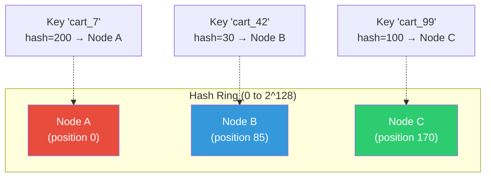
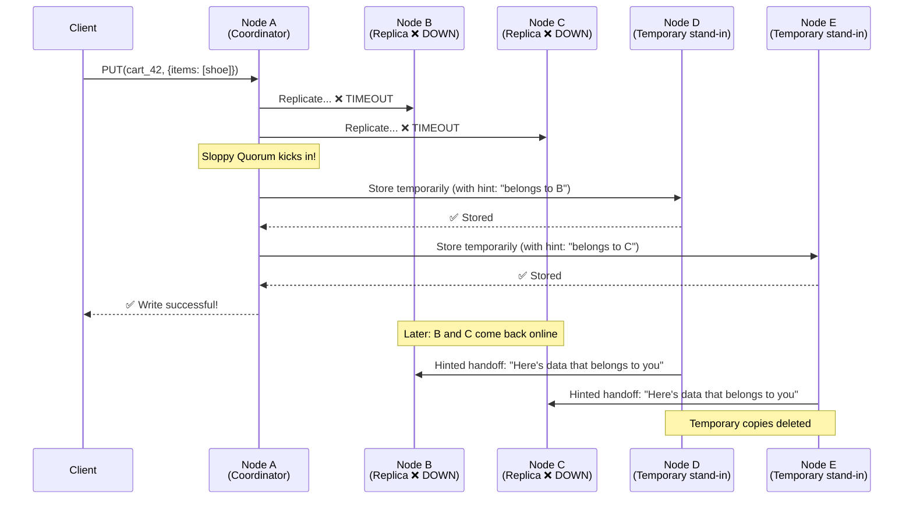
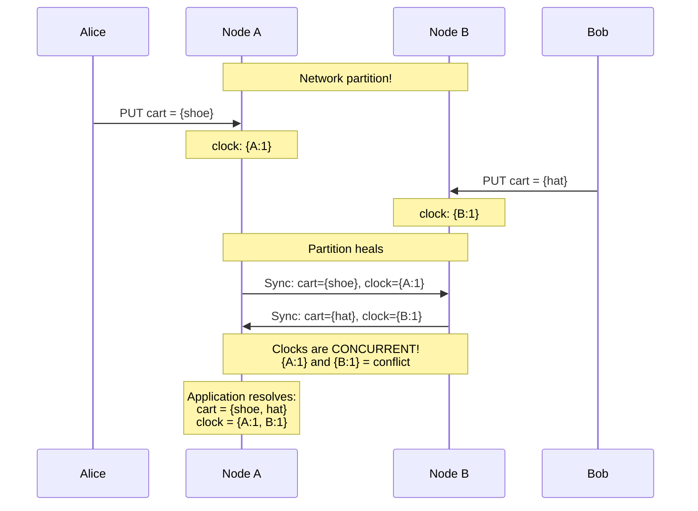
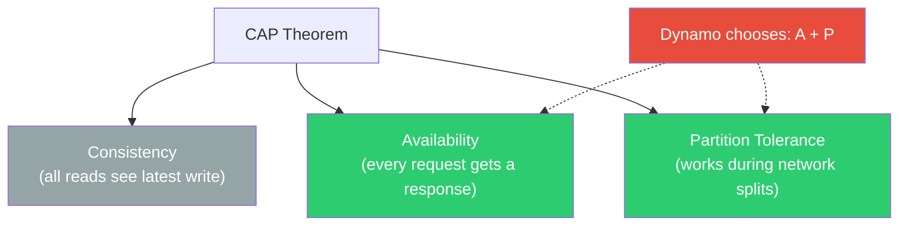

# Amazon Dynamo Paper — Deep Dive

## 🎯 One-Line Summary

> **Amazon Dynamo is a highly available key-value store that sacrifices consistency for availability, using consistent hashing, vector clocks, and sloppy quorums — it's the blueprint for DynamoDB, Cassandra, and Riak.**

---

## 📌 Why This Paper Matters

The 2007 Dynamo paper ("Dynamo: Amazon's Highly Available Key-Value Store") is one of the **most influential papers in distributed systems**. It directly inspired:

| System | What it borrowed from Dynamo |
|--------|------------------------------|
| **DynamoDB** | The commercial successor (AWS managed service) |
| **Cassandra** | Consistent hashing + partitioning (Facebook → Apache) |
| **Riak** | Vector clocks + sloppy quorum |
| **Voldemort** | Full Dynamo clone (LinkedIn) |

### The Business Problem

```
Amazon's Shopping Cart Service (2004):
- Must ALWAYS be writable (customers must ALWAYS add to cart)
- Even during datacenter failures
- Even during network partitions
- "If customers can't add to cart, we lose money"
- 99.9th percentile latency SLA: < 300ms

Traditional RDBMS fails because:
- Single leader → leader dies = WRITES STOP
- Even multi-leader → network partition = split brain
- Synchronous replication → slow (wait for all replicas)
```

---

## 🧩 Core Concepts (Building Blocks)

### 1. Consistent Hashing — How Data is Distributed

**Simple Version:**

Imagine a clock face (0 to 360 degrees). Each server "sits" at a position on the clock. Each piece of data also hashes to a position. Data is stored on the **next server clockwise**.

```
Regular Hashing Problem:
  hash(key) % num_servers
  
  3 servers: hash("cart_123") % 3 = server 1
  Add 1 server: hash("cart_123") % 4 = server 3  ← DIFFERENT SERVER!
  
  Adding 1 server reshuffles ~75% of all data! 💥

Consistent Hashing Solution:
  Adding 1 server only moves ~1/N of the data (where N = number of servers)
```



```python
# Consistent hashing implementation

import hashlib
import bisect

class ConsistentHashRing:
    """
    A ring of servers where data finds its home.
    
    Real-world analogy: Imagine a roundabout with houses.
    Your mail goes to the NEXT house clockwise from your address number.
    Adding a new house only redirects mail from its immediate neighbors.
    """
    
    def __init__(self, num_virtual_nodes: int = 150):
        self.ring = {}              # position → node
        self.sorted_keys = []       # sorted positions for binary search
        self.num_vnodes = num_virtual_nodes
    
    def add_node(self, node: str):
        """
        Add a node with virtual nodes for better distribution.
        
        Why virtual nodes?
        Without: 3 nodes might get 10%, 30%, 60% of data (uneven!)
        With 150 vnodes each: ~33%, ~33%, ~33% (balanced)
        """
        for i in range(self.num_vnodes):
            vnode_key = f"{node}:vnode_{i}"
            position = self._hash(vnode_key)
            self.ring[position] = node
            bisect.insort(self.sorted_keys, position)
    
    def remove_node(self, node: str):
        """Remove a node — only its data moves to neighbors."""
        for i in range(self.num_vnodes):
            vnode_key = f"{node}:vnode_{i}"
            position = self._hash(vnode_key)
            del self.ring[position]
            self.sorted_keys.remove(position)
    
    def get_node(self, key: str) -> str:
        """Find which node owns this key."""
        if not self.ring:
            raise Exception("Empty ring!")
        
        position = self._hash(key)
        
        # Find the first node position >= key position (clockwise)
        idx = bisect.bisect_right(self.sorted_keys, position)
        
        # Wrap around if we're past the last node
        if idx >= len(self.sorted_keys):
            idx = 0
        
        return self.ring[self.sorted_keys[idx]]
    
    def get_preference_list(self, key: str, n: int = 3) -> list:
        """
        Get N distinct nodes for replication.
        
        Dynamo stores each key on N nodes (default N=3).
        The "preference list" = ordered list of nodes responsible for this key.
        
        Node 1 = "coordinator" (primary)
        Nodes 2,3 = replicas
        """
        if not self.ring:
            return []
        
        position = self._hash(key)
        idx = bisect.bisect_right(self.sorted_keys, position)
        
        nodes = []
        seen = set()
        
        for i in range(len(self.sorted_keys)):
            actual_idx = (idx + i) % len(self.sorted_keys)
            node = self.ring[self.sorted_keys[actual_idx]]
            
            if node not in seen:
                nodes.append(node)
                seen.add(node)
            
            if len(nodes) >= n:
                break
        
        return nodes
    
    def _hash(self, key: str) -> int:
        """MD5 hash → integer position on the ring."""
        digest = hashlib.md5(key.encode()).hexdigest()
        return int(digest, 16)


# Usage
ring = ConsistentHashRing(num_virtual_nodes=150)
ring.add_node("server-1")
ring.add_node("server-2")
ring.add_node("server-3")

# Where does this shopping cart live?
owner = ring.get_node("cart_user_42")
print(f"cart_user_42 → {owner}")  # e.g., "server-2"

# Which 3 nodes store replicas?
replicas = ring.get_preference_list("cart_user_42", n=3)
print(f"Replicas: {replicas}")  # e.g., ["server-2", "server-3", "server-1"]
```

---

### 2. Sloppy Quorum — Always Accept Writes

This is the **key innovation** that makes Dynamo "always writable."

```
Traditional Quorum:
  N = 3 replicas, W = 2 (write to 2 before confirming)
  If 2 of 3 nodes are down → WRITE FAILS ❌
  
Sloppy Quorum (Dynamo):
  N = 3 replicas, W = 2
  If nodes B and C are down → write to nodes D and E instead!
  When B and C come back → transfer data back ("hinted handoff")
  WRITE NEVER FAILS ✅ (as long as ANY W nodes are alive)
```



```python
# Sloppy quorum with hinted handoff

class DynamoNode:
    """
    A single node in the Dynamo cluster.
    """
    
    def __init__(self, node_id: str, ring: ConsistentHashRing):
        self.node_id = node_id
        self.ring = ring
        self.data = {}                  # key → {value, vector_clock}
        self.hint_store = {}            # Hints for offline nodes
        
        # Quorum settings
        self.N = 3  # Total replicas
        self.W = 2  # Write quorum
        self.R = 2  # Read quorum
    
    async def put(self, key: str, value: any, 
                   context: VectorClock = None) -> bool:
        """
        Write a key-value pair.
        
        Always succeeds as long as W nodes are reachable
        (even if they're not the "right" nodes).
        """
        preference_list = self.ring.get_preference_list(key, self.N)
        
        # Try to write to the preferred nodes first
        successful_writes = 0
        hints_needed = []
        
        for target_node in preference_list:
            try:
                await self._send_write(target_node, key, value, context)
                successful_writes += 1
            except NodeUnreachableError:
                hints_needed.append(target_node)
        
        # If not enough writes, use sloppy quorum
        if successful_writes < self.W:
            # Find backup nodes (next nodes on the ring)
            backup_nodes = self._get_backup_nodes(key, preference_list)
            
            for backup, original_target in zip(backup_nodes, hints_needed):
                if successful_writes >= self.W:
                    break
                try:
                    # Write with a HINT: "this data belongs to original_target"
                    await self._send_write_with_hint(
                        backup, key, value, context,
                        hint_for=original_target
                    )
                    successful_writes += 1
                except NodeUnreachableError:
                    continue
        
        return successful_writes >= self.W
    
    async def hinted_handoff_worker(self):
        """
        Background worker: periodically check if hinted nodes are back,
        and send them their data.
        """
        while True:
            for hint_target, items in self.hint_store.items():
                if await self._is_node_alive(hint_target):
                    for key, value, context in items:
                        await self._send_write(
                            hint_target, key, value, context
                        )
                    del self.hint_store[hint_target]
                    log.info(f"Hinted handoff to {hint_target} complete")
            
            await asyncio.sleep(30)  # Check every 30 seconds
```

---

### 3. Vector Clocks — Tracking Causality

**The Problem:** Two users update the same shopping cart on different nodes (during a network partition). When the partition heals, which version is correct?

```
Alice (connected to Node A):  cart = {shoe, hat}
Bob   (connected to Node B):  cart = {shoe, belt}

When partition heals: cart = {shoe, hat} or {shoe, belt}?
Answer: BOTH are valid. We need to MERGE them.
But how do we know they diverged? → Vector Clocks!
```

```python
# Vector clock implementation

class VectorClock:
    """
    A vector clock tracks "who updated what, and when."
    
    Simple analogy: 
    Think of a group chat where everyone has a counter.
    Each time you send a message, YOUR counter goes up.
    When you see someone else's counter, you update yours
    to at least match theirs.
    
    This lets us answer: "Did update A happen before B, 
    or did they happen at the same time (conflict)?"
    """
    
    def __init__(self):
        self.clock = {}  # node_id → counter
    
    def increment(self, node_id: str):
        """This node made an update."""
        self.clock[node_id] = self.clock.get(node_id, 0) + 1
    
    def merge(self, other: 'VectorClock') -> 'VectorClock':
        """Merge two vector clocks (take max of each counter)."""
        merged = VectorClock()
        all_nodes = set(self.clock.keys()) | set(other.clock.keys())
        
        for node in all_nodes:
            merged.clock[node] = max(
                self.clock.get(node, 0),
                other.clock.get(node, 0)
            )
        
        return merged
    
    def happens_before(self, other: 'VectorClock') -> bool:
        """
        Returns True if self happened BEFORE other.
        
        A happens-before B if:
          - Every counter in A ≤ corresponding counter in B
          - At least one counter in A < corresponding counter in B
        """
        dominated = False
        for node in set(self.clock.keys()) | set(other.clock.keys()):
            my_val = self.clock.get(node, 0)
            other_val = other.clock.get(node, 0)
            
            if my_val > other_val:
                return False  # I'm ahead on at least one node
            if my_val < other_val:
                dominated = True
        
        return dominated
    
    def is_concurrent(self, other: 'VectorClock') -> bool:
        """
        Returns True if neither happened before the other.
        This means CONFLICT — both are valid.
        """
        return (not self.happens_before(other) and 
                not other.happens_before(self) and
                self.clock != other.clock)


# ─── Example: Shopping Cart Conflict ────────────────────

# Initial state
cart_clock = VectorClock()

# Alice adds a shoe (on Node A)
clock_a = VectorClock()
clock_a.clock = dict(cart_clock.clock)  # Copy
clock_a.increment("node_a")
# clock_a = {node_a: 1}
cart_a = {"items": ["shoe"]}

# Bob adds a hat (on Node B, doesn't know about Alice's update)
clock_b = VectorClock()
clock_b.clock = dict(cart_clock.clock)  # Copy from ORIGINAL
clock_b.increment("node_b")
# clock_b = {node_b: 1}
cart_b = {"items": ["hat"]}

# Are they in conflict?
print(clock_a.is_concurrent(clock_b))  # True! ← CONFLICT

# Resolution: merge both
merged_clock = clock_a.merge(clock_b)
# merged_clock = {node_a: 1, node_b: 1}
merged_cart = {"items": ["shoe", "hat"]}  # Union of both!

print("Merged cart:", merged_cart)
# Output: Merged cart: {'items': ['shoe', 'hat']}
```



---

### 4. Anti-Entropy with Merkle Trees

**Problem:** How do you find which keys are out-of-sync between two replicas without comparing every single key?

**Solution:** Merkle trees — a hash tree where you can quickly find differences.

```
Merkle Tree for Node A's data:

                    ROOT HASH: abc123
                   /                    \
          HASH: def456              HASH: ghi789
         /           \             /           \
    HASH: jkl     HASH: mno   HASH: pqr     HASH: stu
     |              |           |              |
  keys 0-24     keys 25-49  keys 50-74     keys 75-99


Merkle Tree for Node B's data:

                    ROOT HASH: abc123  ← Same! Or...
                    ROOT HASH: xyz999  ← Different!
                   /                    \
          HASH: def456              HASH: CHANGED!
                                   /           \
                               HASH: CHANGED!  HASH: stu
                                |
                             keys 50-74  ← Only sync THESE keys!
```

```python
# Merkle tree for anti-entropy

import hashlib

class MerkleTree:
    """
    Efficient comparison of data between two replicas.
    
    Instead of comparing millions of keys one-by-one,
    we compare tree hashes top-down. Different root hash?
    Go deeper. Same subtree hash? Skip that entire subtree.
    
    Time complexity: O(log N) to find differences instead of O(N)
    """
    
    def __init__(self, key_range_start: int, key_range_end: int):
        self.start = key_range_start
        self.end = key_range_end
        self.hash = None
        self.left = None
        self.right = None
        self.is_leaf = (key_range_end - key_range_start <= 1000)
        self.leaf_hashes = {}  # key → hash(value)
    
    def update(self, key: int, value_hash: str):
        """Update the tree when a key changes."""
        if self.is_leaf:
            self.leaf_hashes[key] = value_hash
            self._recompute_hash()
        else:
            mid = (self.start + self.end) // 2
            if key < mid:
                if not self.left:
                    self.left = MerkleTree(self.start, mid)
                self.left.update(key, value_hash)
            else:
                if not self.right:
                    self.right = MerkleTree(mid, self.end)
                self.right.update(key, value_hash)
            self._recompute_hash()
    
    def _recompute_hash(self):
        """Recompute this node's hash from children."""
        if self.is_leaf:
            combined = ''.join(sorted(self.leaf_hashes.values()))
        else:
            left_hash = self.left.hash if self.left else ''
            right_hash = self.right.hash if self.right else ''
            combined = left_hash + right_hash
        
        self.hash = hashlib.sha256(combined.encode()).hexdigest()
    
    @staticmethod
    def find_differences(tree_a: 'MerkleTree', 
                          tree_b: 'MerkleTree') -> list:
        """
        Compare two Merkle trees and return ranges that differ.
        
        This is the magic: if root hashes match, ALL data matches.
        If they differ, drill down to find exactly which ranges differ.
        """
        if tree_a.hash == tree_b.hash:
            return []  # Entire subtree matches!
        
        if tree_a.is_leaf:
            # Found the differing range — need to sync these keys
            return [(tree_a.start, tree_a.end)]
        
        diffs = []
        
        if tree_a.left and tree_b.left:
            diffs.extend(MerkleTree.find_differences(
                tree_a.left, tree_b.left))
        
        if tree_a.right and tree_b.right:
            diffs.extend(MerkleTree.find_differences(
                tree_a.right, tree_b.right))
        
        return diffs
```

---

### 5. Read Repair

```python
# When reading, fix inconsistencies on the fly

async def get_with_read_repair(key: str) -> any:
    """
    Read from R replicas. If they disagree, fix the stale ones.
    
    This is "passive anti-entropy" — inconsistencies are fixed
    as a side effect of normal reads.
    """
    preference_list = ring.get_preference_list(key, N=3)
    
    # Read from R=2 nodes
    responses = await asyncio.gather(*[
        read_from_node(node, key) for node in preference_list[:R]
    ])
    
    # Find the latest version (highest vector clock)
    latest = max(responses, key=lambda r: r.vector_clock)
    
    # Are any replicas stale?
    for response in responses:
        if response.vector_clock.happens_before(latest.vector_clock):
            # This replica is behind — repair it in background
            asyncio.create_task(
                write_to_node(response.node, key, 
                             latest.value, latest.vector_clock)
            )
    
    return latest.value
```

---

## 🔧 Putting It All Together

```mermaid
graph TB
    subgraph "Client Request: PUT(cart_42, {items: [shoe]})"
        C[Client]
    end
    
    subgraph "Step 1: Find Responsible Nodes"
        HR[Hash Ring Lookup]
        PL["Preference List:<br/>Node A (coordinator)<br/>Node B (replica)<br/>Node C (replica)"]
    end
    
    subgraph "Step 2: Coordinate Write"
        CO[Coordinator Node A]
        VC[Update Vector Clock<br/>{A:1} → {A:2}]
    end
    
    subgraph "Step 3: Replicate"
        WB[Write to Node B]
        WC[Write to Node C]
        SQ{Sloppy Quorum:<br/>W=2 responses?}
    end
    
    subgraph "Step 4: Respond"
        OK[Return Success to Client]
    end
    
    C --> HR --> PL --> CO --> VC
    VC --> WB & WC
    WB & WC --> SQ
    SQ -->|Yes| OK
    SQ -->|No: use backup nodes| BN[Backup Node D<br/>with hinted handoff]
    BN --> OK
    
    style C fill:#3498DB,color:white
    style OK fill:#2ECC71,color:white
    style SQ fill:#E67E22,color:white
```

---

## ⚖️ The CAP Trade-off in Dynamo



```
Dynamo's trade-off:
  ✅ Available: Writes ALWAYS succeed (sloppy quorum)
  ✅ Partition-tolerant: Works across data centers
  ⚠️ Eventually consistent: You might read stale data
  
This is PERFECT for shopping carts:
  - Worst case: cart shows slightly stale items
  - That's WAY better than: "Sorry, can't add to cart right now"
  
This is NOT good for:
  - Bank account balances (need strong consistency)
  - Inventory counts (might oversell)
  - Primary key uniqueness (might create duplicates)
```

### Tunable Consistency via N, R, W

```
N = total replicas
R = reads needed for response  
W = writes needed for confirmation

Rules:
  R + W > N  → Strong consistency (reads always see latest write)
  R + W ≤ N  → Eventual consistency (might read stale data)

Common configurations:
  N=3, R=2, W=2 → Strong consistency (2+2=4 > 3)
  N=3, R=1, W=1 → Fast but eventually consistent (1+1=2 ≤ 3)
  N=3, R=3, W=1 → Strong reads, fast writes
  N=3, R=1, W=3 → Fast reads, strong writes

Amazon's shopping cart:
  N=3, R=1, W=1 → Maximum speed, eventual consistency
```

---

## 🧠 FAANG Interview Deep Questions

### Q1: "How does Dynamo handle permanent node failures?"

```
Hinted handoff only works for TEMPORARY failures.
For PERMANENT failures (dead disk, decommissioned server):

1. The ring detects the node is gone (heartbeat timeout)
2. Adjacent nodes take over the dead node's key ranges
3. Merkle trees detect which keys need re-replication
4. Background process copies data to restore N replicas

Time to restore: depends on data size, typically minutes to hours
```

### Q2: "What are the problems with vector clocks?"

```
Problem 1: SIZE GROWTH
  Every node that touches a key adds to the vector clock.
  100 nodes update key "cart_42" → vector clock has 100 entries!
  
  Dynamo's solution: Truncation
  - Timestamp each (node, counter) pair
  - Delete the OLDEST entry when clock exceeds threshold (e.g., 10)
  - Risk: might lose causality info → more "false conflicts"
  - In practice: works fine (most keys are updated by 2-3 nodes)

Problem 2: CONFLICT RESOLUTION BURDEN
  Concurrent writes → application must resolve
  For shopping carts: union merge (keep all items)
  For other data: "last write wins" (lossy but simple)
```

### Q3: "Why not just use timestamps instead of vector clocks?"

```
Timestamps seem simpler: "just pick the newest one!"

But:
  ❌ Clock skew: Node A's clock is 2 seconds ahead of Node B
     Node A writes at 12:00:01 (real time: 12:00:01)
     Node B writes at 12:00:02 (real time: 12:00:04) ← actually LATER
     Timestamp says A is newer, but B was actually later!
  
  ❌ Lost writes: "Last Write Wins" silently drops valid data
     User adds shoe at T1, another user adds hat at T2
     LWW keeps hat, LOSES shoe → customer angry
  
  ✅ Vector clocks DETECT the conflict instead of silently losing data
     The application then decides how to merge
```

---

## 📊 Dynamo at Amazon's Scale

```
Amazon's internal Dynamo deployment (2007 paper):
  - Hundreds of Dynamo instances
  - Each instance: dozens of nodes
  - Services: shopping cart, session store, product catalog
  
Performance:
  - 99.9th percentile read:  < 50ms
  - 99.9th percentile write: < 50ms
  - Availability: 99.9995%

Key lesson from the paper:
  "The main TORTURE test for Dynamo was the holiday shopping season.
   During peak, Dynamo handled 3 million checkouts in a single day
   without any downtime."
```

---

## 🎓 Key Takeaways

1. **Availability over Consistency** — For many real-world applications, being always-writable is more valuable than having perfectly consistent reads.

2. **Consistent Hashing + Virtual Nodes** — The standard way to distribute data across nodes. Used by almost every distributed database today.

3. **Vector Clocks detect conflicts; application resolves them** — Don't silently lose data with "last write wins" unless you understand the trade-off.

4. **Sloppy Quorum + Hinted Handoff** — "Write somewhere, fix it later" — genius trade-off for availability.

5. **Merkle Trees for anti-entropy** — O(log N) way to find differences between replicas instead of comparing everything.

6. **Tunable N/R/W** — Let each use case choose its own consistency level. Shopping cart ≠ bank account.

---

## 📚 References

- [Dynamo: Amazon's Highly Available Key-Value Store (2007 Paper)](https://www.allthingsdistributed.com/files/amazon-dynamo-sosp2007.pdf)
- [Werner Vogels' Blog — Eventually Consistent](https://www.allthingsdistributed.com/2008/12/eventually_consistent.html)
- [Designing Data-Intensive Applications — Chapter 5 (Martin Kleppmann)](https://dataintensive.net/)
