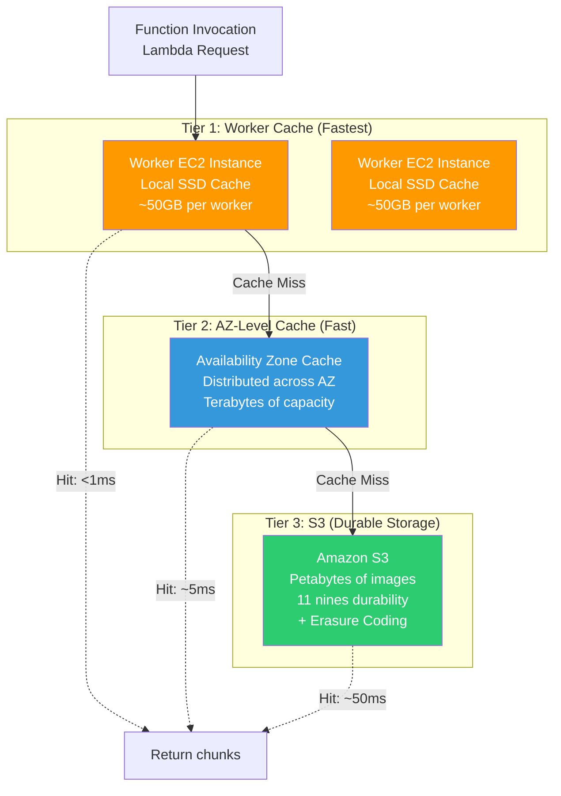
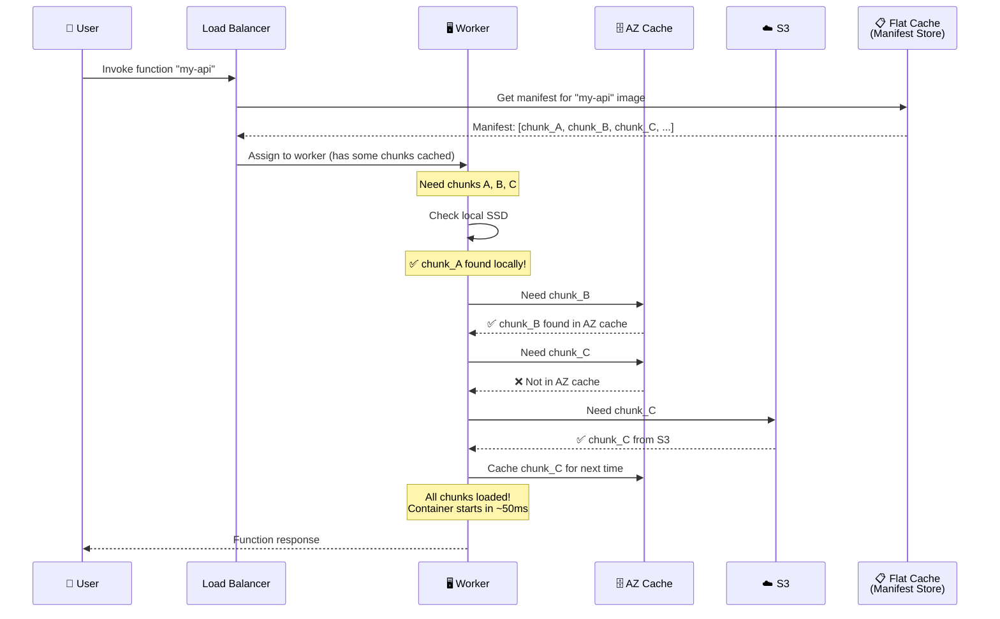
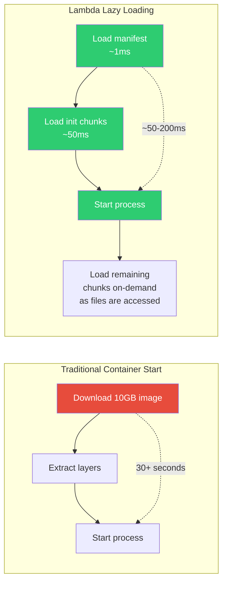
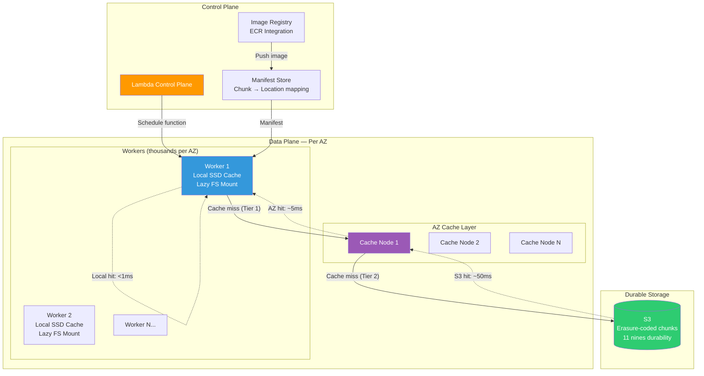
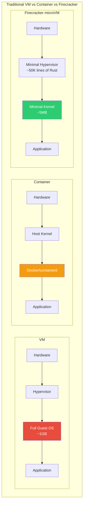

# AWS Lambda Paper: On-Demand Container Loading — Deep Dive

## 🎯 One-Line Summary

> **AWS Lambda boots your code in ~50ms by deduplicating container images across millions of functions, caching chunks in a tiered storage system, and using erasure coding for durability — all invisible to the user.**

---

## 📌 The Problem in Plain English

When you deploy a Lambda function with a **container image** (up to 10 GB!), AWS has to:

1. **Store** millions of container images (petabytes of data)
2. **Load** the right image when a function is invoked — in **milliseconds**
3. **Handle** thousands of functions starting simultaneously (burst traffic)
4. **Deduplicate** — many images share the same base layers (e.g., Python 3.11)
5. **Be durable** — never lose a customer's image

### Why Is This Hard?

```
Simple approach: Store each container image on an EC2 instance

Problems:
  - 10GB image × 100,000 functions = 1 PETABYTE of storage
  - Cold start: download 10GB before first request? → 30+ seconds!
  - Most images share 80% of their layers (all use Ubuntu, Python, etc.)
  - Storing duplicates wastes money and time

AWS Lambda serves BILLIONS of invocations per day.
They needed something much smarter.
```

---

## 🏗️ The Architecture (3-Tier Cache System)



### How It Works Step by Step



---

## 🔬 Deep Dive: Chunking and Deduplication

### Content-Addressable Chunking

AWS doesn't store container images as single blobs. They break each image into **small chunks** and deduplicate identical chunks.

```python
# How AWS Lambda chunks container images (conceptual)

import hashlib

class ContainerImageChunker:
    """
    Break a container image into content-addressed chunks.
    
    Key insight: Many Lambda functions use the same base image.
    - 10,000 Python functions all start with python:3.11 (~900MB)
    - That's 10,000 × 900MB = 9TB naively
    - With dedup: just 900MB stored once + tiny unique layers
    """
    
    CHUNK_SIZE = 512 * 1024  # 512KB chunks (AWS's actual size)
    
    def chunk_image(self, image_layers: list) -> dict:
        """
        Break image into content-addressed chunks.
        
        Returns:
            {
                "manifest": [chunk_hash_1, chunk_hash_2, ...],
                "chunks": {chunk_hash: chunk_data, ...}
            }
        """
        manifest = []
        chunks = {}
        
        for layer in image_layers:
            # Each layer is a tar file
            data = layer.read()
            
            for offset in range(0, len(data), self.CHUNK_SIZE):
                chunk = data[offset:offset + self.CHUNK_SIZE]
                chunk_hash = hashlib.sha256(chunk).hexdigest()
                
                manifest.append(chunk_hash)
                
                # Only store if we haven't seen this chunk before
                if chunk_hash not in self.global_chunk_store:
                    chunks[chunk_hash] = chunk
        
        return {"manifest": manifest, "chunks": chunks}
    
    def calculate_dedup_savings(self, images: list) -> dict:
        """Show how much storage deduplication saves."""
        all_chunks = set()
        total_chunks = 0
        
        for image in images:
            result = self.chunk_image(image)
            total_chunks += len(result["manifest"])
            all_chunks.update(result["manifest"])
        
        return {
            "total_chunks_without_dedup": total_chunks,
            "unique_chunks_with_dedup": len(all_chunks),
            "dedup_ratio": total_chunks / len(all_chunks),
            "storage_saved_pct": (1 - len(all_chunks)/total_chunks) * 100
        }


# Real-world example:
# 10,000 Lambda functions using python:3.11 + different app code
# 
# Without dedup: 10,000 × 1.2GB = 12TB
# With dedup:    900MB (shared base) + 10,000 × 50MB (unique) = 1.4TB
# Savings: 88%!
```

### Visualization: Chunk Deduplication

```
Function A: Python ML model (1.2 GB image)
┌──────────────────────────────────────────────────────┐
│  ubuntu base │ python 3.11 │ numpy │ my_model.pkl   │
│  chunk_001   │ chunk_042   │ c_088 │ chunk_unique_A │
└──────────────────────────────────────────────────────┘

Function B: Python API server (800 MB image)  
┌──────────────────────────────────────────────────┐
│  ubuntu base │ python 3.11 │ flask │ app.py       │
│  chunk_001   │ chunk_042   │ c_055 │ chunk_uniq_B │
└──────────────────────────────────────────────────┘
       ↑              ↑
    SAME chunk!    SAME chunk!     ← Stored ONCE

Storage actually used:
  chunk_001 (ubuntu)      → stored once    ← shared by A and B
  chunk_042 (python)      → stored once    ← shared by A and B
  chunk_088 (numpy)       → stored once    ← only A
  chunk_055 (flask)       → stored once    ← only B
  chunk_unique_A (model)  → stored once    ← only A
  chunk_unique_B (app)    → stored once    ← only B
  
Total: 6 unique chunks instead of 8 total chunks
At scale: billions of chunks, ~60-80% dedup ratio
```

---

## 🛡️ Erasure Coding: How AWS Never Loses Your Image

Instead of storing 3 copies of each chunk (3× storage cost), AWS uses **erasure coding** — a smarter way to achieve durability.

```
Simple Replication (3 copies):
  chunk_001 → Server A, Server B, Server C
  Storage: 3× the data
  Can survive: 2 server failures
  
Erasure Coding (Reed-Solomon):
  chunk_001 → Split into 4 data fragments + 2 parity fragments
  Spread across 6 servers
  Storage: 1.5× the data (not 3×!)
  Can survive: ANY 2 server failures
  
  50% less storage, SAME durability!
```

```python
# Erasure coding concept (simplified Reed-Solomon)

class ErasureCoding:
    """
    Split data into k data chunks + m parity chunks.
    Can recover ALL data from ANY k of the (k+m) chunks.
    
    Real-world analogy:
    Imagine you have a 4-digit PIN: 1234
    You create 2 "parity" numbers using math:
      parity_1 = 1+2+3+4 = 10
      parity_2 = 1×1 + 2×2 + 3×3 + 4×4 = 30
    
    Now you write each number on a separate card and give to 6 friends.
    If ANY 2 cards are lost, you can solve the equations to recover them!
    """
    
    def __init__(self, data_chunks: int = 4, parity_chunks: int = 2):
        self.k = data_chunks    # Need this many to recover
        self.m = parity_chunks  # Extra redundancy
        self.total = self.k + self.m
    
    def encode(self, data: bytes) -> list:
        """
        Split data into k+m fragments.
        Any k fragments can reconstruct the original data.
        """
        # Split into k equal pieces
        chunk_size = len(data) // self.k
        data_fragments = []
        for i in range(self.k):
            start = i * chunk_size
            end = start + chunk_size if i < self.k - 1 else len(data)
            data_fragments.append(data[start:end])
        
        # Generate m parity fragments using Reed-Solomon math
        parity_fragments = self._generate_parity(data_fragments)
        
        return data_fragments + parity_fragments
    
    def decode(self, fragments: list, fragment_indices: list) -> bytes:
        """
        Reconstruct original data from any k fragments.
        
        fragments: list of available fragment data
        fragment_indices: which fragments we have (0 to k+m-1)
        """
        if len(fragments) < self.k:
            raise Exception(f"Need at least {self.k} fragments, got {len(fragments)}")
        
        # Use Reed-Solomon decoding to reconstruct
        return self._reed_solomon_decode(fragments, fragment_indices)
    
    def storage_overhead(self) -> float:
        """Compare to simple replication."""
        replication_3x = 3.0
        erasure_coding = self.total / self.k
        savings = (1 - erasure_coding / replication_3x) * 100
        
        return {
            "replication_factor": replication_3x,
            "erasure_factor": erasure_coding,
            "storage_savings": f"{savings:.0f}%"
        }


# AWS Lambda uses 4+2 erasure coding:
ec = ErasureCoding(data_chunks=4, parity_chunks=2)
print(ec.storage_overhead())
# {
#   "replication_factor": 3.0,
#   "erasure_factor": 1.5,       ← Only 1.5× storage!
#   "storage_savings": "50%"     ← Half the cost of 3× replication
# }
```

---

## ⚡ Cold Start Optimization: Lazy Loading

The **key insight**: Lambda doesn't load the ENTIRE 10GB image before starting. It loads **only the chunks needed to start the process**, then loads the rest on-demand.



```python
# Lambda's lazy loading filesystem (FUSE-based)

class LambdaLazyFS:
    """
    A virtual filesystem that loads container chunks ON DEMAND.
    
    Instead of downloading 10GB, we mount a virtual filesystem.
    When the Lambda function reads a file (e.g., import numpy),
    ONLY the chunks containing numpy are fetched.
    
    Files never accessed? Never downloaded!
    
    Uses Linux FUSE (Filesystem in Userspace).
    """
    
    def __init__(self, manifest: dict, chunk_cache: 'TieredCache'):
        self.manifest = manifest        # file → list of chunk hashes
        self.cache = chunk_cache        # 3-tier cache system
        self.loaded_chunks = set()      # Track what we've loaded
        self.total_chunks = sum(len(c) for c in manifest.values())
    
    def read(self, path: str, offset: int, size: int) -> bytes:
        """
        Called by the OS when Lambda code reads a file.
        
        Example: Lambda does `import pandas`
        → Python reads /opt/python/pandas/__init__.py
        → This method is called
        → We fetch only the chunks containing that file
        """
        file_chunks = self.manifest.get(path)
        if not file_chunks:
            raise FileNotFoundError(path)
        
        # Calculate which chunks contain the requested byte range
        chunk_start = offset // CHUNK_SIZE
        chunk_end = (offset + size) // CHUNK_SIZE + 1
        needed_chunks = file_chunks[chunk_start:chunk_end]
        
        data = b''
        for chunk_hash in needed_chunks:
            chunk_data = self._get_chunk(chunk_hash)
            data += chunk_data
            self.loaded_chunks.add(chunk_hash)
        
        return data[offset % CHUNK_SIZE : offset % CHUNK_SIZE + size]
    
    def _get_chunk(self, chunk_hash: str) -> bytes:
        """
        Fetch a chunk through the 3-tier cache.
        
        Tier 1: Worker local SSD (~1ms)
        Tier 2: AZ-level distributed cache (~5ms)  
        Tier 3: S3 (~50ms)
        """
        return self.cache.get(chunk_hash)
    
    def get_loading_stats(self) -> dict:
        """Show how lazy loading saves time."""
        loaded_pct = len(self.loaded_chunks) / self.total_chunks * 100
        return {
            "total_chunks": self.total_chunks,
            "loaded_chunks": len(self.loaded_chunks),
            "loaded_percentage": f"{loaded_pct:.1f}%",
            "data_saved": f"{(100 - loaded_pct):.1f}% of image never loaded!"
        }

# Typical result after a Lambda invocation:
# {
#   "total_chunks": 20000,       (10GB image)
#   "loaded_chunks": 3400,       (1.7GB actually used)
#   "loaded_percentage": "17.0%",
#   "data_saved": "83.0% of image never loaded!"
# }
```

---

## 🏗️ The Complete System Architecture



---

## 📊 Performance Numbers from the Paper

```
Image Size    │ Cold Start (Before) │ Cold Start (After)  │ Improvement
──────────────┼─────────────────────┼─────────────────────┼────────────
256 MB        │ 2.5 seconds         │ 200ms               │ 12.5×
1 GB          │ 8 seconds           │ 350ms               │ 23×
5 GB          │ 30 seconds          │ 700ms               │ 43×
10 GB         │ 60+ seconds         │ 1.2 seconds         │ 50×

Deduplication:
- Average dedup ratio: 3.6× (every unique chunk stored once serves 3.6 functions)
- Popular base images (python, node): 20-50× dedup
- Storage savings: ~60-80% across all Lambda functions

Cache Hit Rates:
- Worker local cache: ~70% hit rate
- AZ-level cache: ~95% hit rate (after warming)
- S3 (always available): 100%

Scale:
- Serves billions of invocations per day
- Stores petabytes of container images
- 10s of billions of unique chunks
```

---

## 🧠 Key Design Decisions (Interview Deep Dive)

### Q1: "Why chunks instead of layers?"

```
Docker images have LAYERS. Why not cache at the layer level?

Layer-level caching problems:
  - One changed file = entire layer is different (can be GB)
  - Layer A in image X ≠ Layer A in image Y (even if 95% identical)
  - Layers are too coarse for effective deduplication

Chunk-level caching wins:
  - 512KB chunks = fine-grained dedup
  - Change one file = only a few chunks change
  - Identical chunks across ANY image are stored once
  - 80% dedup at chunk level vs 30% at layer level
```

### Q2: "Why not just use EBS (Elastic Block Store)?"

```
EBS seems simpler — mount a volume with the image!

Problems:
  ❌ EBS volumes are per-AZ (can't share across AZs easily)
  ❌ No deduplication — each function gets its own volume
  ❌ Provisioning an EBS volume takes seconds
  ❌ Costs: 10GB EBS × millions of functions = $$$$
  ❌ Snapshots from S3 to EBS are slow for first read

Lambda's approach:
  ✅ Shared chunk store across ALL functions
  ✅ Deduplication saves 60-80% storage
  ✅ Tiered caching = fast reads without per-function volumes
  ✅ Pay only for unique chunks stored
```

### Q3: "How does AWS handle cache eviction?"

```
Challenge: Limited cache space, millions of functions

Cache eviction strategy (per tier):

Tier 1 (Worker SSD):
  - LRU (Least Recently Used)
  - Priority: chunks from currently-active functions
  - Prefetch: when a function is scheduled, preload its hot chunks

Tier 2 (AZ Cache):
  - Popularity-based: chunks used by many functions stay longer
  - ARC (Adaptive Replacement Cache): balances frequency + recency
  - Admission filter: only cache chunks accessed > 1 time (avoid scan pollution)

Tier 3 (S3):
  - Never evicted! This is the source of truth.
  - Erasure-coded for durability and cost efficiency
```

### Q4: "What about security? Functions reading each other's chunks?"

```
Even though chunks are deduplicated, security is maintained:

1. Content-addressed = chunk hash is deterministic
   - If Function A and Function B have the same base layer,
     they get the SAME chunk hashes
   - This is OK: it's the same public base image!

2. Unique application code = unique chunk hashes
   - Your secret API keys are in YOUR chunks
   - Another function would need to guess the SHA-256 hash
     to even reference your chunk (computationally impossible)

3. Worker isolation:
   - Each Lambda function runs in a Firecracker microVM
   - The Lazy FS only serves chunks listed in YOUR manifest
   - Even if chunk_ABC exists in the cache, Function B can't 
     read it unless chunk_ABC is in Function B's manifest

4. Encryption at rest:
   - All chunks encrypted in S3 and cache layers
   - Per-function encryption keys via AWS KMS
```

---

## 🔧 Firecracker: The MicroVM That Makes It Possible

Lambda functions run inside **Firecracker microVMs** — lightweight VMs that boot in ~125ms.



```
Comparison:
                    │ Traditional VM │ Container  │ Firecracker
────────────────────┼────────────────┼────────────┼─────────────
Boot time           │ 10-30 seconds  │ 1-5 seconds│ ~125ms
Memory overhead     │ 200-500MB      │ 10-50MB    │ ~5MB
Security isolation  │ ✅ Strong       │ ⚠️ Shared   │ ✅ Strong
                    │ (full VM)      │   kernel   │ (VM-level)
Density per host    │ ~10 VMs        │ ~100       │ ~1000+
```

---

## 🎓 Key Takeaways

1. **Content-addressable chunking** enables massive deduplication across millions of functions. Same base image = shared chunks = huge storage savings.

2. **Lazy loading beats eager loading** — Why download 10GB when you only use 2GB? Mount a virtual filesystem and load on-demand.

3. **Tiered caching is essential** — Hot data on local SSD, warm data in AZ cache, cold data in S3. Each tier trades latency for capacity.

4. **Erasure coding > simple replication** — Same durability at 50% less storage cost. Critical at petabyte scale.

5. **Firecracker microVMs** — VM-level security with container-like speed. The foundation that makes Lambda's density possible.

6. **Design for the common case** — 95% of invocations hit warm functions with cached chunks. Optimize for that, handle the 5% cold starts gracefully.

---

## 📚 References

- [On-demand Container Loading in AWS Lambda (USENIX ATC '23)](https://www.usenix.org/conference/atc23/presentation/brooker)
- [Firecracker: Lightweight Virtualization for Serverless (NSDI '20)](https://www.usenix.org/conference/nsdi20/presentation/agache)
- [Marc Brooker's Blog — Lambda Internals](https://brooker.co.za/blog/)
- [AWS Lambda Container Image Support (AWS Blog)](https://aws.amazon.com/blogs/aws/new-for-aws-lambda-container-image-support/)
