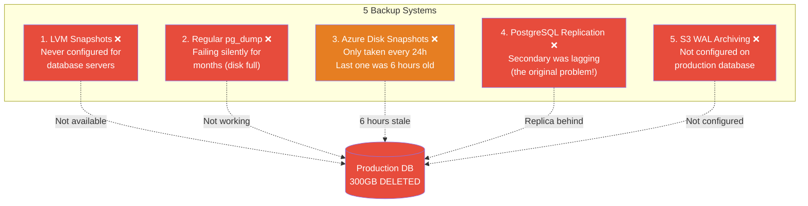
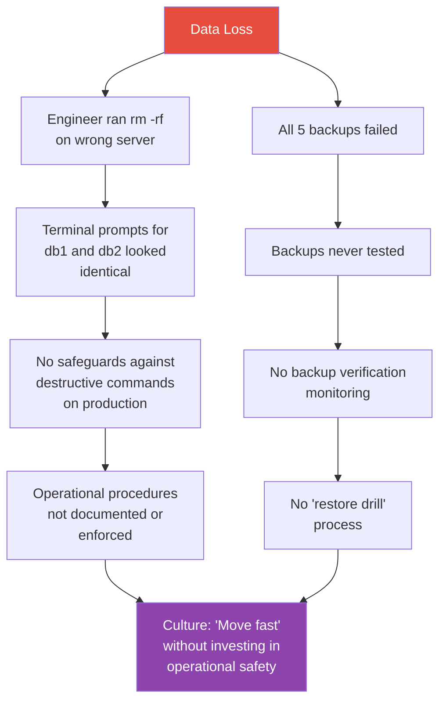
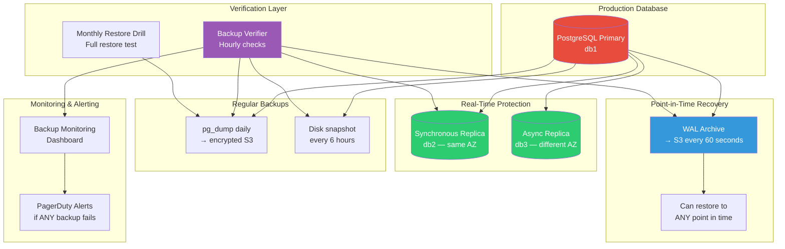

# GitLab's Database Incident (2017) — Deep Dive

## 🎯 One-Line Summary

> **A tired engineer accidentally ran `rm -rf` on the production database directory, deleting 300GB of live data. Five backup systems ALL failed. GitLab lost 6 hours of user data. This is the most educational production incident in history.**

---

## 📌 What Happened (The Timeline)

### The Full Story in Simple English

It's **January 31, 2017**, around 11 PM (UTC). A GitLab engineer is trying to fix a **database replication lag** issue. The secondary PostgreSQL database is falling behind the primary.

The engineer decides to:
1. Remove the data on the secondary database
2. Re-sync it from the primary

**The fatal mistake:** He ran the delete command on the **primary production database** instead of the secondary.

```
What he MEANT to type (on db2 — the SECONDARY):
  $ sudo rm -rf /var/opt/gitlab/postgresql/data

What he ACTUALLY typed (on db1 — the PRIMARY):
  $ sudo rm -rf /var/opt/gitlab/postgresql/data
  
He noticed after 1.7 seconds. Pressed Ctrl+C.
But 300GB of production data was already gone.
```

---

## ⏰ Detailed Timeline

```mermaid
timeline
    title GitLab Database Incident — January 31, 2017
    
    section Before the Incident
        ~21:00 UTC : Database replication lag detected
                   : Secondary (db2) falling behind primary (db1)
        ~22:00 UTC : Engineer tries multiple fixes
                   : pg_basebackup keeps failing
                   : Replication slot causes WAL buildup on primary
    
    section The Incident
        23:00 UTC : Engineer decides to wipe db2 and re-sync
                  : ACCIDENTALLY runs rm -rf on db1 (PRIMARY!)
                  : Notices after ~1.7 seconds
                  : 300GB of PostgreSQL data deleted
    
    section Recovery Attempts
        23:00-01:00 : Try all 5 backup methods — ALL FAIL
                    : LVM snapshots — not configured for db hosts
                    : Regular backups — not running (silent failure)
                    : Azure disk snapshots — 6 hours old
                    : pg_dump — only had partial data
                    : Replication — secondary was lagging (unusable)
    
    section Resolution  
        01:00-17:00 : Restore from 6-hour-old Azure snapshot
                    : Manually replay what WAL segments they had
                    : GitLab.com back online with 6 hours of data loss
```

---

## 💥 The 5 Backup Methods That ALL Failed

This is the most important lesson. GitLab had **five** backup systems. **Every single one failed.**



### Detailed Breakdown of Each Failure

```
BACKUP 1: LVM Snapshots
  Expected: Periodic snapshots of the logical volume
  Reality:  LVM snapshots were configured for NFS servers,
            but NEVER set up for database servers.
  Root cause: Infrastructure-as-code didn't include DB hosts
  
BACKUP 2: Regular pg_dump backups
  Expected: Daily PostgreSQL dumps to object storage
  Reality:  The pg_dump cron job had been SILENTLY FAILING
            for MONTHS because the database had grown too large
            and the dump disk filled up.
  Root cause: No monitoring on backup job success/failure!

BACKUP 3: Azure Disk Snapshots
  Expected: Point-in-time recovery
  Reality:  Snapshots were only taken every 24 hours.
            The most recent one was 6 hours old.
  Root cause: Snapshot frequency too low for an active database
  
BACKUP 4: PostgreSQL Streaming Replication
  Expected: Real-time replica of primary
  Reality:  The replica was LAGGING — this was the original
            problem the engineer was trying to fix!
  Root cause: Replication was broken, triggered the whole incident

BACKUP 5: WAL (Write-Ahead Log) Archiving to S3
  Expected: Continuous backup of transaction logs
  Reality:  WAL archiving was configured in the docs but
            NEVER ACTUALLY SET UP on the production server.
  Root cause: Gap between documentation and reality
```

---

## 🔬 The Root Causes (5 Whys Analysis)



---

## 💻 What Should Have Been in Place

### 1. Terminal Safety — Prevent Fat-Finger Mistakes

```bash
# ── BEFORE (What GitLab's terminals looked like) ──

# db1 (PRODUCTION) — looks identical to db2!
[engineer@db1 ~]$ 

# db2 (SECONDARY) — same prompt, easy to mix up
[engineer@db2 ~]$ 


# ── AFTER (What they should have looked like) ──

# db1 (PRODUCTION) — screaming red warning
[engineer@db1-PRODUCTION ~]$ 
# With PS1 set to:
export PS1='\[\033[01;31m\]⚠️  PRODUCTION \[\033[00m\]\u@\h:\w\$ '

# db2 (SECONDARY) — calm green
[engineer@db2-secondary ~]$
export PS1='\[\033[01;32m\]secondary \[\033[00m\]\u@\h:\w\$ '
```

```python
# Production safety wrapper

#!/usr/bin/env python3
"""
production_guard.py — Wrapper that prevents destructive commands
on production servers.

Install: alias rm='python3 /usr/local/bin/production_guard.py rm'
"""

import sys
import os
import socket

PRODUCTION_HOSTS = ['db1', 'db1.gitlab.com', 'prod-db-primary']
DANGEROUS_COMMANDS = ['rm -rf', 'rm -r', 'DROP DATABASE', 'DROP TABLE',
                      'TRUNCATE', 'dd if=', 'mkfs']

def is_production():
    hostname = socket.gethostname()
    return any(prod in hostname for prod in PRODUCTION_HOSTS)

def is_dangerous(args):
    full_command = ' '.join(args)
    return any(danger in full_command for danger in DANGEROUS_COMMANDS)

def main():
    command = sys.argv[1:]
    full_cmd = ' '.join(command)
    
    if is_production() and is_dangerous(command):
        print(f"\n{'='*60}")
        print(f"⛔ BLOCKED: Destructive command on PRODUCTION!")
        print(f"{'='*60}")
        print(f"  Command: {full_cmd}")
        print(f"  Host:    {socket.gethostname()}")
        print(f"\n  To proceed, use: /usr/bin/rm --i-know-what-im-doing {' '.join(command[1:])}")
        print(f"{'='*60}\n")
        
        # Log to incident channel
        log_to_slack(f"⚠️ Blocked destructive command on prod: `{full_cmd}` by {os.getenv('USER')}")
        sys.exit(1)
    
    # Safe to proceed
    os.execvp(command[0], command)

if __name__ == '__main__':
    main()
```

### 2. Backup Verification System

```python
# backup_verifier.py — Never trust a backup you haven't tested

import subprocess
import datetime
from dataclasses import dataclass
from typing import Optional

@dataclass
class BackupCheck:
    name: str
    last_success: Optional[datetime.datetime]
    size_bytes: int
    is_restorable: bool
    error: Optional[str]

class BackupVerifier:
    """
    Continuously verify that ALL backup systems are working.
    
    The GitLab lesson: "A backup that hasn't been tested
    is NOT a backup — it's a HOPE."
    """
    
    def __init__(self):
        self.checks = []
        self.alert_channels = ['slack', 'pagerduty', 'email']
    
    def verify_pg_dump(self) -> BackupCheck:
        """
        Check that pg_dump backups exist and are restorable.
        
        GitLab's failure: pg_dump was silently failing for months.
        Fix: Check that backup exists AND can be restored.
        """
        try:
            # Check: does the backup file exist?
            latest_backup = self._find_latest_backup('/backups/pg_dump/')
            
            if not latest_backup:
                return BackupCheck(
                    name="pg_dump",
                    last_success=None,
                    size_bytes=0,
                    is_restorable=False,
                    error="NO BACKUP FILES FOUND!"
                )
            
            # Check: is it recent enough? (< 24 hours old)
            age = datetime.datetime.now() - latest_backup.modified_time
            if age > datetime.timedelta(hours=24):
                return BackupCheck(
                    name="pg_dump",
                    last_success=latest_backup.modified_time,
                    size_bytes=latest_backup.size,
                    is_restorable=False,
                    error=f"Backup is {age.hours} hours old! Max: 24h"
                )
            
            # Check: can we ACTUALLY restore it?
            # Restore to a test database, run basic queries
            restore_success = self._test_restore(latest_backup.path)
            
            return BackupCheck(
                name="pg_dump",
                last_success=latest_backup.modified_time,
                size_bytes=latest_backup.size,
                is_restorable=restore_success,
                error=None if restore_success else "Restore failed!"
            )
            
        except Exception as e:
            return BackupCheck(
                name="pg_dump",
                last_success=None,
                size_bytes=0,
                is_restorable=False,
                error=str(e)
            )
    
    def verify_replication(self) -> BackupCheck:
        """
        Check that replication is healthy and not lagging.
        
        GitLab's failure: Replication was broken — the whole 
        reason the engineer was working at 11 PM!
        """
        try:
            result = subprocess.run(
                ['psql', '-h', 'db2', '-c', 
                 'SELECT now() - pg_last_xact_replay_timestamp() AS lag;'],
                capture_output=True, text=True
            )
            
            # Parse lag
            lag_seconds = self._parse_lag(result.stdout)
            
            return BackupCheck(
                name="replication",
                last_success=datetime.datetime.now(),
                size_bytes=0,
                is_restorable=lag_seconds < 60,  # < 1 minute lag
                error=f"Lag: {lag_seconds}s" if lag_seconds > 60 else None
            )
            
        except Exception as e:
            return BackupCheck(
                name="replication",
                last_success=None,
                size_bytes=0,
                is_restorable=False,
                error=str(e)
            )
    
    def verify_all(self) -> list:
        """
        Run ALL backup checks. Alert if ANY fail.
        
        This should run every hour via cron/systemd timer.
        """
        results = [
            self.verify_pg_dump(),
            self.verify_replication(),
            self.verify_wal_archiving(),
            self.verify_disk_snapshots(),
            self.verify_lvm_snapshots(),
        ]
        
        failures = [r for r in results if not r.is_restorable]
        
        if failures:
            self._send_alert(
                severity="CRITICAL",
                message=f"🚨 {len(failures)} backup systems failing!\n" +
                        '\n'.join(f"  ❌ {f.name}: {f.error}" for f in failures)
            )
        
        return results
    
    def _test_restore(self, backup_path: str) -> bool:
        """
        Actually try restoring a backup to a test database.
        
        This is the step GitLab skipped. "Untested backups
        are Schrödinger's backups — both working and not working
        until you try to restore."
        """
        try:
            # Create test database
            subprocess.run([
                'createdb', '-h', 'test-db-server', 'backup_test'
            ], check=True)
            
            # Restore backup
            subprocess.run([
                'pg_restore', '-h', 'test-db-server', 
                '-d', 'backup_test', backup_path
            ], check=True, timeout=3600)
            
            # Run validation queries
            result = subprocess.run([
                'psql', '-h', 'test-db-server', '-d', 'backup_test',
                '-c', 'SELECT COUNT(*) FROM projects; SELECT COUNT(*) FROM users;'
            ], capture_output=True, text=True, check=True)
            
            # Cleanup
            subprocess.run([
                'dropdb', '-h', 'test-db-server', 'backup_test'
            ], check=True)
            
            return True
            
        except Exception:
            return False
```

### 3. Proper Incident Response Runbook

```yaml
# incident_runbook.yml — Database disaster recovery

database_disaster_recovery:
  severity: SEV-1
  oncall_team: infrastructure
  
  immediate_actions:
    - step: "STOP ALL WRITES to the affected database"
      command: |
        # Revoke write access immediately
        psql -c "ALTER DATABASE gitlabhq_production SET default_transaction_read_only = on;"
      why: "Prevent further data corruption while we assess damage"
    
    - step: "Assess the damage"
      command: |
        # Check what data exists
        psql -c "SELECT schemaname, tablename, n_live_tup 
                 FROM pg_stat_user_tables ORDER BY n_live_tup DESC;"
      why: "Understand scope of data loss"
    
    - step: "Notify stakeholders"
      template: |
        🚨 SEV-1: Database incident in progress
        Impact: [describe user impact]
        Status: Investigating
        Next update: 30 minutes

  recovery_priority_order:
    1:
      name: "PostgreSQL streaming replication"
      rto: "5 minutes"
      rpo: "seconds"
      steps:
        - "Promote secondary: pg_ctl promote -D /var/lib/postgresql/data"
        - "Update DNS/config to point to new primary"
        - "Verify data integrity"
      when_to_use: "Replica is healthy and caught up"
    
    2:
      name: "WAL-based Point-in-Time Recovery"
      rto: "30-60 minutes"
      rpo: "seconds"
      steps:
        - "Restore base backup from S3"
        - "Replay WAL files up to the incident timestamp"
        - "Command: pg_restore --target-time='2017-01-31 22:59:00'"
      when_to_use: "WAL archiving is working, replica is down"
    
    3:
      name: "Latest pg_dump restore"
      rto: "2-4 hours"
      rpo: "up to 24 hours"
      steps:
        - "Find latest valid backup: ls -lt /backups/pg_dump/"
        - "Restore: pg_restore -d gitlabhq_production latest.dump"
      when_to_use: "WAL archiving failed, but pg_dump exists"
    
    4:
      name: "Disk snapshot restore"
      rto: "1-2 hours"
      rpo: "up to 24 hours"
      steps:
        - "List snapshots: az snapshot list --resource-group prod-db"
        - "Create disk from snapshot"
        - "Attach to new VM, start PostgreSQL"
      when_to_use: "All PostgreSQL-level backups failed"

  post_incident:
    - "Write blameless post-mortem within 48 hours"
    - "Identify all contributing factors (not just root cause)"
    - "Create action items with owners and deadlines"
    - "Schedule backup fire drill within 30 days"
```

---

## 🏗️ What GitLab Built After the Incident

### The Backup Architecture They Should Have Had



---

## 📋 The Post-Mortem: Lessons for Every Engineer

### GitLab's 12 Action Items

```
These are the actual action items from GitLab's public post-mortem:

1. ✅ Update PS1 in production terminals to clearly show environment
2. ✅ Automate backup verification — test restore weekly
3. ✅ Alert on pg_dump failures (was silently failing for months!)
4. ✅ Configure WAL archiving on ALL database servers
5. ✅ Increase Azure snapshot frequency (24h → 6h)
6. ✅ Set up LVM snapshots on database servers
7. ✅ Create database disaster recovery runbook
8. ✅ Practice disaster recovery monthly
9. ✅ Set up monitoring dashboard for all backup systems
10. ✅ Implement "production access requires pair" policy
11. ✅ Add safeguards against rm -rf on production data directories
12. ✅ Document the incident publicly (radical transparency)
```

### The "Swiss Cheese" Model

```
James Reason's Swiss Cheese Model of Accidents:

Each safety layer is like a slice of Swiss cheese — it has holes.
An accident happens when the holes in ALL slices align.

        Layer 1:        Layer 2:       Layer 3:       Layer 4:
        Terminal        Backup         Monitoring     Training
        Safety          Systems        & Alerts       
        
        ┌─────┐        ┌─────┐        ┌─────┐       ┌─────┐
        │ ●   │        │     │        │   ● │       │     │
        │     │        │  ●  │        │     │       │  ●  │
        │  ●  │───────▶│     │───────▶│  ●  │──────▶│     │──▶ 💥
        │     │        │     │        │     │       │  ●  │    INCIDENT
        │   ● │        │ ●   │        │     │       │     │
        └─────┘        └─────┘        └─────┘       └─────┘
        
        ● = hole (failure point)
        
        GitLab: ALL layers had aligned holes
        - Terminal: identical prompts (hole)
        - Backups: all 5 failing (hole)
        - Monitoring: no backup health alerts (hole)
        - Training: no runbook, no drills (hole)
```

---

## 🧠 FAANG Interview: Lessons Applied

### Q1: "Design a backup strategy for a critical database"

```
The 3-2-1 Rule:
  3 copies of data
  2 different storage types
  1 offsite copy

Applied to PostgreSQL:

1. SYNCHRONOUS REPLICA (RPO: 0, RTO: minutes)
   - Same AZ, synchronous replication
   - Zero data loss on failover
   - Trade-off: 10-20% write latency increase

2. ASYNCHRONOUS REPLICA (RPO: seconds, RTO: minutes)
   - Different AZ (survives AZ failure)
   - Seconds of lag acceptable
   - Can be promoted if primary + sync replica both fail

3. CONTINUOUS WAL ARCHIVING (RPO: seconds, RTO: 30-60 min)
   - Archive WAL to S3 every 60 seconds
   - Point-in-time recovery to ANY second
   - Survives complete region failure

4. DAILY PG_DUMP (RPO: 24 hours, RTO: 2-4 hours)
   - Logical backup — portable across versions
   - Encrypted, stored in different region
   - Last resort, but always works

5. DISK SNAPSHOTS (RPO: 6 hours, RTO: 1-2 hours)
   - Cloud provider snapshots every 6 hours
   - Fast restore (just mount the disk)
   - Independent of PostgreSQL tooling
```

### Q2: "How would you prevent the rm -rf mistake?"

```python
# Multiple layers of protection:

# Layer 1: Distinctive terminal prompts (visual)
# Production terminals are RED with hostname clearly visible

# Layer 2: Alias protection
"""
# In /etc/profile.d/safety.sh on all production hosts:
alias rm='rm -i'  # Always confirm
alias mv='mv -i'
alias cp='cp -i'

# Block rm -rf on data directories
production_rm() {
    for arg in "$@"; do
        case "$arg" in
            /var/opt/gitlab/postgresql/data*|/var/lib/postgresql*)
                echo "⛔ BLOCKED: Cannot delete database directory on production!"
                echo "Use the database decommission runbook instead."
                return 1
                ;;
        esac
    done
    /usr/bin/rm "$@"
}
alias rm=production_rm
"""

# Layer 3: Filesystem protection
"""
# Make critical directories immutable
sudo chattr +i /var/opt/gitlab/postgresql/data
# Now even root can't delete without first removing the flag:
# sudo chattr -i /var/opt/gitlab/postgresql/data
"""

# Layer 4: Require peer approval for destructive operations
"""
# Production changes require another engineer to approve
# Implemented via a Slack bot or internal tool:
# 1. Engineer requests: "Need to rm data dir on db2"
# 2. Second engineer reviews and approves
# 3. Tool generates a time-limited token
# 4. rm command requires the token
"""

# Layer 5: Delayed deletion
"""
# Instead of rm -rf, move to a trash directory
# Actual deletion happens after 24-hour delay
mv /var/opt/gitlab/postgresql/data /var/opt/gitlab/trash/data_$(date +%s)
# Cron job cleans trash after 24 hours
"""
```

### Q3: "GitLab was transparent about this. Was that the right call?"

```
GitLab live-streamed the incident recovery on YouTube.
They published the full post-mortem publicly.

WHY this was BRILLIANT:

1. TRUST: Users saw exactly what happened and what was being fixed
   → More trust than "we experienced a brief outage"

2. INDUSTRY LEARNING: Thousands of companies improved their backup
   systems after reading GitLab's post-mortem

3. RECRUITMENT: Engineers WANT to work at transparent companies
   → GitLab received positive hiring signals

4. ACCOUNTABILITY: Public commitments to action items
   → Hard to sweep under the rug

5. CULTURE: Set the standard for blameless post-mortems
   → Engineers report issues instead of hiding them

The alternative (hiding it) would have been discovered anyway,
and the cover-up is always worse than the incident.
```

---

## 📊 Impact and Recovery Numbers

```
Data Loss:
  - 6 hours of production data lost
  - ~5,000 projects affected
  - ~700 import/export records lost
  - Merge requests, comments, CI pipelines from those 6 hours — gone

Recovery:
  - Total downtime: ~18 hours
  - Restored from 6-hour-old Azure disk snapshot
  - Some WAL segments were recovered, reducing gap slightly
  
  
Financial Impact (estimated):
  - Engineering time: ~$500K (dozens of engineers, 18+ hours)
  - Lost customer trust: unquantifiable
  - GitLab.com was FREE at the time, so no SLA penalties
  - But reputational damage affected enterprise sales

Positive Outcomes:
  - Became the go-to case study for backup importance
  - GitLab rebuilt their entire backup infrastructure
  - Industry-wide improvement in backup verification practices
  - GitLab's transparency became a competitive advantage
```

---

## 🔁 The Backup Testing Drill (What Everyone Should Do)

```python
# quarterly_backup_drill.py — Practice makes perfect

class BackupDrill:
    """
    Quarterly exercise: pretend production is gone.
    Can we restore from backups?
    
    "Everyone has a backup strategy.
     Few have a TESTED restore strategy."
    """
    
    def __init__(self):
        self.drill_date = None
        self.results = {}
    
    def run_full_drill(self):
        """
        Simulate complete database loss and measure recovery.
        
        Goals:
          1. Verify backups are restorable
          2. Measure actual RTO (Recovery Time Objective)
          3. Verify RPO (Recovery Point Objective)
          4. Train the team on the recovery process
          5. Find gaps before a real disaster finds them
        """
        
        print("🔥 BACKUP DRILL STARTING")
        print("=" * 50)
        
        # Step 1: Create an isolated test environment
        test_db = self.create_test_environment()
        
        # Step 2: Try each backup method
        methods = [
            ("Streaming Replication Failover", self.test_replication_failover),
            ("WAL Point-in-Time Recovery", self.test_wal_pitr),
            ("pg_dump Restore", self.test_pgdump_restore),
            ("Disk Snapshot Restore", self.test_snapshot_restore),
        ]
        
        for name, test_fn in methods:
            print(f"\n--- Testing: {name} ---")
            start_time = time.time()
            
            try:
                success, rpo = test_fn(test_db)
                elapsed = time.time() - start_time
                
                self.results[name] = {
                    "success": success,
                    "rto_seconds": elapsed,
                    "rpo_seconds": rpo,
                    "status": "✅ PASS" if success else "❌ FAIL"
                }
                
                print(f"  Status: {'✅ PASS' if success else '❌ FAIL'}")
                print(f"  RTO: {elapsed:.0f} seconds")
                print(f"  RPO: {rpo:.0f} seconds of data loss")
                
            except Exception as e:
                self.results[name] = {
                    "success": False,
                    "error": str(e),
                    "status": "❌ FAIL"
                }
                print(f"  Status: ❌ FAIL — {e}")
        
        # Step 3: Generate report
        self.generate_drill_report()
        
        # Step 4: Clean up test environment
        self.cleanup_test_environment(test_db)
    
    def generate_drill_report(self):
        """
        Generate report and alert if any method failed.
        
        This report goes to:
          - Engineering leadership
          - SRE team
          - Compliance (for SOC2/ISO27001)
        """
        failures = [k for k, v in self.results.items() if not v.get("success")]
        
        report = f"""
        ╔══════════════════════════════════════════╗
        ║     QUARTERLY BACKUP DRILL REPORT         ║
        ╠══════════════════════════════════════════╣
        ║ Date: {self.drill_date}                  ║
        ║ Overall: {'✅ ALL PASSED' if not failures else '❌ FAILURES FOUND'}  ║
        ╚══════════════════════════════════════════╝
        
        Results:
        """
        
        for name, result in self.results.items():
            report += f"  {result['status']} {name}\n"
            if result.get("rto_seconds"):
                report += f"       RTO: {result['rto_seconds']:.0f}s | RPO: {result['rpo_seconds']:.0f}s\n"
            if result.get("error"):
                report += f"       Error: {result['error']}\n"
        
        if failures:
            report += f"\n  🚨 ACTION REQUIRED: {len(failures)} backup methods failed!\n"
            report += "  Create JIRA tickets and fix within 2 weeks.\n"
        
        print(report)
        return report
```

---

## 🎓 Key Takeaways

1. **Untested backups are not backups** — GitLab had 5 backup systems. All 5 failed. The only way to know a backup works is to **restore from it regularly**.

2. **Monitor backup health, not just backup execution** — A cron job running doesn't mean it succeeded. Check: Does the backup exist? Is it recent? Can it be restored?

3. **Visual differentiation of environments** — Production terminals must look DIFFERENT from staging/dev. Color coding, banners, prompts — make it impossible to confuse.

4. **Defense in depth (Swiss Cheese Model)** — Single safety layers fail. Stack multiple independent layers so no single failure causes disaster.

5. **Blameless post-mortems** — The engineer made a mistake at 11 PM while tired. The SYSTEM should have prevented this. Blame the process, not the person.

6. **Transparency builds trust** — GitLab's public post-mortem became their greatest PR win despite being their worst technical failure.

7. **Practice disaster recovery** — Quarterly drills. Full restore tests. Timed exercises. Make recovery a muscle memory, not a panic scramble.

---

## 📚 References

- [GitLab's Official Post-Mortem (Public)](https://about.gitlab.com/blog/2017/02/10/postmortem-of-database-outage-of-january-31/)
- [GitLab's Live Recovery YouTube Stream](https://www.youtube.com/watch?v=2KbMTRiBkCU)
- [Google SRE Book — Chapter on Post-Mortems](https://sre.google/sre-book/postmortem-culture/)
- [The Swiss Cheese Model — James Reason](https://en.wikipedia.org/wiki/Swiss_cheese_model)
