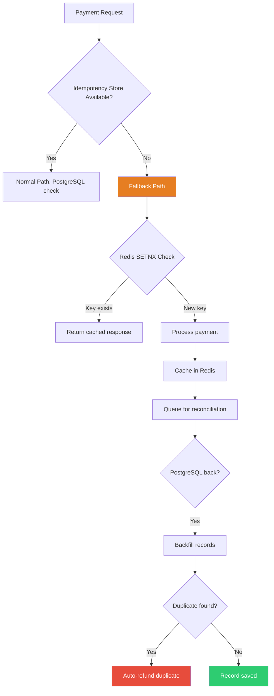
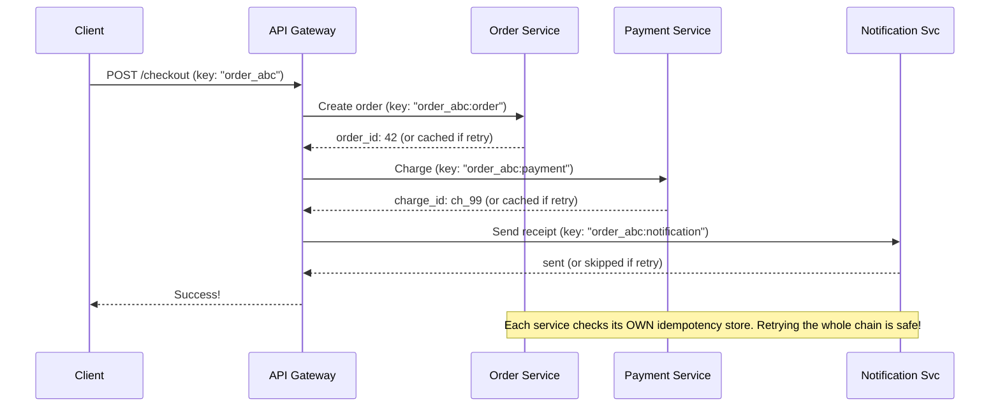

# Stripe Idempotency Keys — Production Scenarios & Solutions (Q&A Deep Dive)

---

## 🔥 SCENARIO 1: Double Charge in Production

### The Incident

```
3:00 AM — PagerDuty Alert
"Customer support ticket #8821: User charged TWICE for order #ORD-55123"

Investigation reveals:
- Mobile app sent POST /charges twice within 200ms
- Both requests hit DIFFERENT API servers (Server A and Server B)
- Both servers checked idempotency store at the EXACT same time
- Both saw "key not found"
- Both processed the charge
- Customer charged $499.99 x 2 = $999.98
```

### Q: What went wrong? Why did two servers both see "key not found"?

**A: Classic race condition — "Check-then-Act" without proper locking.**

```
Timeline (the bug):

  T=0ms    Server A: SELECT * FROM idempotency_keys WHERE key='abc'  -> NOT FOUND
  T=1ms    Server B: SELECT * FROM idempotency_keys WHERE key='abc'  -> NOT FOUND
  T=2ms    Server A: INSERT INTO idempotency_keys (key, status) VALUES ('abc', 'started')  -> OK
  T=3ms    Server B: INSERT INTO idempotency_keys (key, status) VALUES ('abc', 'started')  -> ???

If no UNIQUE constraint: both inserts succeed -> DOUBLE CHARGE
If UNIQUE constraint but app ignores the error: still processes -> DOUBLE CHARGE
```

### Q: How do you fix this?

**A: Use database-level atomicity. Three approaches:**

```sql
-- FIX 1: INSERT ... ON CONFLICT (best for PostgreSQL)
-- This is ATOMIC — the database guarantees only ONE insert wins

INSERT INTO idempotency_keys (user_id, idempotency_key, status, locked_at)
VALUES ($1, $2, 'started', NOW())
ON CONFLICT (user_id, idempotency_key) DO NOTHING
RETURNING *;

-- If RETURNING gives 0 rows -> key already exists -> fetch and return cached response
-- If RETURNING gives 1 row -> we just created it -> proceed with charge
```

```python
# FIX 2: SELECT ... FOR UPDATE with advisory locks

async def get_or_create_idempotency_key(user_id, key, params):
    """
    Atomic check-and-create using advisory locks.
    
    Why advisory lock? 
    - SELECT FOR UPDATE only works if the row EXISTS
    - But we need to lock BEFORE the row exists (on INSERT)
    - Advisory locks lock a CONCEPT, not a row
    """
    lock_id = hash(f"{user_id}:{key}") % (2**31)
    
    async with db.transaction():
        # Grab advisory lock (blocks other servers with same key)
        await db.execute("SELECT pg_advisory_xact_lock($1)", lock_id)
        
        # Now safely check if key exists
        existing = await db.fetchrow("""
            SELECT * FROM idempotency_keys 
            WHERE user_id = $1 AND idempotency_key = $2
        """, user_id, key)
        
        if existing:
            if existing['status'] == 'complete':
                return {"action": "return_cached", "response": existing['response_body']}
            elif existing['status'] == 'started':
                return {"action": "resume", "recovery_point": existing['recovery_point']}
        
        # Key doesn't exist — create it (we hold the lock, so no race)
        await db.execute("""
            INSERT INTO idempotency_keys (user_id, idempotency_key, status, request_hash)
            VALUES ($1, $2, 'started', $3)
        """, user_id, key, hash_params(params))
        
        return {"action": "process_new"}
    # Advisory lock automatically released at end of transaction
```

```python
# FIX 3: Redis SETNX for fast-path dedup + DB for durability

async def idempotency_check_fast(user_id, key):
    """
    Two-layer approach:
    Layer 1: Redis SETNX — catches 99% of duplicates in <1ms
    Layer 2: PostgreSQL — guarantees durability for the remaining 1%
    """
    redis_key = f"idemp:{user_id}:{key}"
    
    # Fast path: Redis check (sub-millisecond)
    acquired = await redis.set(redis_key, "processing", nx=True, ex=86400)
    
    if not acquired:
        # Key exists in Redis — very likely a duplicate
        stored = await db.fetchrow("""
            SELECT response_code, response_body FROM idempotency_keys
            WHERE user_id = $1 AND idempotency_key = $2 AND status = 'complete'
        """, user_id, key)
        
        if stored:
            return {"action": "return_cached", "response": stored}
        else:
            return {"action": "wait_and_retry"}
    
    # Slow path: DB insert (safe)
    await db.execute("""
        INSERT INTO idempotency_keys (user_id, idempotency_key, status)
        VALUES ($1, $2, 'started')
        ON CONFLICT DO NOTHING
    """, user_id, key)
    
    return {"action": "process_new"}
```

---

## 🔥 SCENARIO 2: Server Crashes Mid-Payment

### The Incident

```
Production Log:
  10:14:22.001  [charge-svc] Starting charge for order ORD-77810, amount=$1,200
  10:14:22.050  [charge-svc] Created charge object: ch_9f8e7d6c
  10:14:22.100  [charge-svc] Sending to Visa payment network...
  10:14:22.105  [charge-svc] ---- PROCESS KILLED (OOM) ----
  
What happened:
  1. Charge object created in database
  2. Request sent to Visa (maybe... we don't know!)
  3. Server crashed before recording Visa's response
  4. Did Visa charge the card? Unknown!
  
Customer retries — what happens?
```

### Q: How do you safely resume after a crash?

**A: Recovery points + external state check.**

```python
async def create_charge_with_recovery(order_id, amount, card_token):
    """
    State machine with recovery points.
    Each step is a "save point". If we crash at any step,
    retry picks up from the last saved point.
    """
    key = f"charge_{order_id}"
    state = await idempotency_store.get_state(key)
    
    # == RECOVERY POINT 1: Create charge object ==
    if state.recovery_point in (None, 'started'):
        if state.charge_id:
            charge_id = state.charge_id
        else:
            charge = await db.execute("""
                INSERT INTO charges (order_id, amount, status)
                VALUES ($1, $2, 'pending') RETURNING id
            """, order_id, amount)
            charge_id = charge['id']
        
        await idempotency_store.save_checkpoint(
            key, recovery_point='charge_created', charge_id=charge_id
        )
    else:
        charge_id = state.charge_id
    
    # == RECOVERY POINT 2: Call payment network ==
    if state.recovery_point in ('started', 'charge_created'):
        # CRITICAL: Before calling Visa AGAIN, CHECK if previous call went through!
        existing_payment = await visa_api.check_payment(
            merchant_ref=f"ch_{charge_id}",
            amount=amount
        )
        
        if existing_payment:
            payment_result = existing_payment
            logger.info(f"Found existing Visa payment: {existing_payment.id}")
        else:
            payment_result = await visa_api.authorize(
                merchant_ref=f"ch_{charge_id}",
                amount=amount,
                card_token=card_token,
                idempotency_key=f"visa_{charge_id}"
            )
        
        await idempotency_store.save_checkpoint(
            key, recovery_point='payment_sent',
            payment_id=payment_result.id, payment_status=payment_result.status
        )
    
    # == RECOVERY POINT 3: Finalize ==
    if payment_result.status == 'approved':
        await db.execute("""
            UPDATE charges SET status = 'succeeded', payment_id = $1 WHERE id = $2
        """, payment_result.id, charge_id)
        await send_receipt_idempotent(order_id, charge_id)
        
        final_response = {"charge_id": charge_id, "status": "succeeded", "amount": amount}
    else:
        await db.execute("""
            UPDATE charges SET status = 'failed', failure_reason = $1 WHERE id = $2
        """, payment_result.decline_reason, charge_id)
        final_response = {"charge_id": charge_id, "status": "failed"}
    
    await idempotency_store.complete(key, response=final_response)
    return final_response
```

```mermaid
stateDiagram-v2
    [*] --> started
    started --> charge_created: DB insert succeeds
    charge_created --> check_visa: Before calling Visa
    check_visa --> payment_exists: Visa says already processed
    check_visa --> send_to_visa: Visa says never seen this
    send_to_visa --> payment_sent: Visa responds
    payment_exists --> payment_sent: Use existing result
    payment_sent --> complete: Finalize in DB
    complete --> [*]
    
    note right of check_visa: KEY INSIGHT: Always CHECK before re-sending to payment network after a crash
```

### Q: What if the payment network does NOT support idempotency?

```python
async def handle_non_idempotent_payment_network(charge_id, amount):
    """
    Some payment networks don't support idempotency keys.
    Solution: Create a PENDING record first, then check it on retry.
    """
    # Step 1: Check if we already have a pending/completed transaction
    existing = await db.fetchrow("""
        SELECT * FROM payment_attempts
        WHERE charge_id = $1 AND status IN ('pending', 'approved', 'declined')
        ORDER BY created_at DESC LIMIT 1
    """, charge_id)
    
    if existing:
        if existing['status'] == 'approved':
            return {"status": "approved", "id": existing['network_id']}
        elif existing['status'] == 'pending':
            # We sent to network but crashed before getting response
            # Query the network for the transaction status
            network_status = await payment_network.query_transaction(
                merchant_ref=existing['merchant_ref']
            )
            if network_status:
                await db.execute("""
                    UPDATE payment_attempts SET status = $1, network_id = $2 WHERE id = $3
                """, network_status.status, network_status.id, existing['id'])
                return network_status
            # Network has no record — safe to retry
    
    # Step 2: Create PENDING record BEFORE calling network
    merchant_ref = f"mref_{charge_id}_{int(time.time())}"
    attempt_id = await db.execute("""
        INSERT INTO payment_attempts (charge_id, merchant_ref, amount, status)
        VALUES ($1, $2, $3, 'pending') RETURNING id
    """, charge_id, merchant_ref, amount)
    
    # Step 3: Call the payment network
    try:
        result = await payment_network.charge(merchant_ref=merchant_ref, amount=amount)
        await db.execute("""
            UPDATE payment_attempts SET status = $1, network_id = $2 WHERE id = $3
        """, result.status, result.id, attempt_id)
        return result
    except TimeoutError:
        raise RetryableError("Payment network timeout, will check on retry")
```

---

## 🔥 SCENARIO 3: Idempotency Key Store is Down

### The Incident

```
9:00 AM Monday — Peak traffic
PostgreSQL (idempotency store) goes down — connection pool exhausted.
All payment requests fail because they can't check idempotency keys.
Revenue impact: $50,000/minute lost
```

### Q: Should you process payments WITHOUT idempotency when the store is down?

**A: Use graceful degradation with reconciliation.**

```python
class IdempotencyWithFallback:
    async def handle_request(self, key, params):
        try:
            result = await self.idempotency_store.get_or_create(key, params)
            return await self.process_with_idempotency(result, params)
        except IdempotencyStoreUnavailable:
            return await self.fallback_strategy(key, params)
    
    async def fallback_strategy(self, key, params):
        """
        Smart degradation:
        1. Use Redis as temporary idempotency store (faster, less durable)
        2. Add requests to a reconciliation queue
        3. When PostgreSQL recovers, reconcile
        """
        metrics.increment("idempotency.store_unavailable")
        
        # Try Redis as fallback
        redis_key = f"idemp_fallback:{key}"
        acquired = await redis.set(redis_key, "processing", nx=True, ex=3600)
        
        if not acquired:
            cached = await redis.get(f"idemp_response:{key}")
            if cached:
                return json.loads(cached)
            return {"status": "processing", "retry_after": 5}, 202
        
        result = await self.process_payment(params)
        
        await redis.set(f"idemp_response:{key}", json.dumps(result), ex=86400)
        
        # Queue for reconciliation when PostgreSQL recovers
        await reconciliation_queue.enqueue({
            "key": key, "params": params, "result": result,
            "timestamp": time.time(), "source": "redis_fallback"
        })
        return result
    
    async def reconciliation_worker(self):
        """Runs when PostgreSQL comes back. Backfills + detects duplicates."""
        while True:
            batch = await reconciliation_queue.dequeue_batch(100)
            for item in batch:
                existing = await self.idempotency_store.get(item['key'])
                if existing and existing['status'] == 'complete':
                    if existing['charge_id'] != item['result']['charge_id']:
                        await self.auto_refund(item['result']['charge_id'])
                        metrics.increment("idempotency.fallback_duplicate_refunded")
                else:
                    await self.idempotency_store.create(
                        key=item['key'], status='complete', response=item['result']
                    )
            await asyncio.sleep(1)
```



---

## 🔥 SCENARIO 4: Idempotency Table Growing Uncontrollably

### The Incident

```
Alert: PostgreSQL disk usage at 92%
- idempotency_keys table: 450GB, 2 billion rows
- Index bloat: 180GB  
- Cleanup cron job silently broken for 3 months
- Query p99: 3ms -> 40ms
```

### Q: How do you manage idempotency key lifecycle at scale?

```sql
-- SOLUTION: Time-based partitioning
-- Instead of DELETE WHERE created_at < X (scans billions of rows),
-- just DROP the old partition (instant!)

CREATE TABLE idempotency_keys (
    id              BIGSERIAL,
    idempotency_key VARCHAR(255) NOT NULL,
    user_id         BIGINT NOT NULL,
    request_hash    VARCHAR(64),
    response_code   INT,
    response_body   JSONB,
    recovery_point  VARCHAR(50) DEFAULT 'started',
    created_at      TIMESTAMPTZ NOT NULL DEFAULT NOW(),
    PRIMARY KEY (id, created_at)
) PARTITION BY RANGE (created_at);

-- Monthly partitions
CREATE TABLE idempotency_keys_2026_10 PARTITION OF idempotency_keys
    FOR VALUES FROM ('2026-10-01') TO ('2026-11-01');

CREATE INDEX ON idempotency_keys_2026_10 (user_id, idempotency_key);

-- To cleanup: DROP TABLE idempotency_keys_2026_07;  -- instant, no vacuum!
```

```python
async def manage_partitions():
    """Cron: auto-create future partitions, drop expired ones."""
    # Create partitions for next 3 months
    for months_ahead in range(1, 4):
        future_date = datetime.now() + timedelta(days=30 * months_ahead)
        name = f"idempotency_keys_{future_date.strftime('%Y_%m')}"
        start = future_date.replace(day=1)
        end = (start + timedelta(days=32)).replace(day=1)
        
        await db.execute(f"""
            CREATE TABLE IF NOT EXISTS {name} 
            PARTITION OF idempotency_keys
            FOR VALUES FROM ('{start.isoformat()}') TO ('{end.isoformat()}')
        """)
    
    # Drop partitions older than 90 days
    cutoff = datetime.now() - timedelta(days=90)
    old = await db.fetch("""
        SELECT tablename FROM pg_tables 
        WHERE tablename LIKE 'idempotency_keys_%' AND tablename < $1
    """, f"idempotency_keys_{cutoff.strftime('%Y_%m')}")
    
    for p in old:
        await db.execute(f"DROP TABLE IF EXISTS {p['tablename']}")
```

---

## 🔥 SCENARIO 5: Client Sends Broken Idempotency Keys

### The Incident

```
"I placed 3 separate orders today but only the first one went through."

Cause: Client uses STATIC key "payment_key" for EVERY payment.
After the first, all subsequent ones return the cached response.
```

### Q: How do you detect bad key patterns?

```python
class IdempotencyKeyValidator:
    KNOWN_BAD_PATTERNS = [r'^test$', r'^key$', r'^123+$', r'^payment_key$']
    
    async def validate_key(self, user_id, key, params):
        issues = []
        
        if len(key) < 8:
            issues.append("Key too short — likely not unique enough")
        
        for pattern in self.KNOWN_BAD_PATTERNS:
            if re.match(pattern, key, re.IGNORECASE):
                issues.append(f"Key matches known bad pattern: {pattern}")
        
        # Same key, different params = CLIENT BUG
        existing = await db.fetchrow("""
            SELECT request_hash FROM idempotency_keys
            WHERE user_id = $1 AND idempotency_key = $2
        """, user_id, key)
        
        if existing:
            if existing['request_hash'] != hash_params(params):
                return {
                    "valid": False,
                    "error": "Idempotency key used with different parameters",
                    "http_code": 422,
                    "help": "Use format: '{action}_{entity_id}'"
                }
        
        if issues:
            await self.alert_merchant(user_id, key, issues)
        return {"valid": True, "warnings": issues}
```

**Best practice key formats:**

```javascript
// BAD: static key
const key = "payment_key";

// BAD: random on every retry (defeats the purpose!)
const key = crypto.randomUUID();

// GOOD: derived from business entity
const key = `charge_order_${orderId}`;

// GOOD: UUID generated ONCE, stored with the order
order.idempotencyKey = crypto.randomUUID();  // saved, reused on retry
```

---

## 🔥 SCENARIO 6: Idempotency Across Microservices

### The Problem

```
API Gateway -> Order Service -> Payment Service -> Notification Service

If Payment Service crashes after charging:
Retry hits Order Service -> creates ANOTHER order!
How do we make the ENTIRE chain idempotent?
```

### Q: How do you implement end-to-end idempotency across services?

```python
class DistributedIdempotencyChain:
    """Each service derives its own key from the original."""
    
    async def api_gateway(self, client_key, order_data):
        order_key = f"{client_key}:order"
        payment_key = f"{client_key}:payment"
        notif_key = f"{client_key}:notification"
        
        order = await self.order_service.create_order(
            idempotency_key=order_key, data=order_data
        )
        payment = await self.payment_service.charge(
            idempotency_key=payment_key,
            order_id=order['id'], amount=order['total']
        )
        await self.notification_service.send_receipt(
            idempotency_key=notif_key, order_id=order['id']
        )
        return {"order": order, "payment": payment}
```



---

## 📋 Quick Reference: Production Checklist

```
IDEMPOTENCY SYSTEM — PRODUCTION READINESS

[ ] Atomic key creation (INSERT ON CONFLICT or advisory locks)
[ ] UNIQUE constraint on (user_id, idempotency_key)
[ ] Recovery points for multi-step operations
[ ] Request parameter hash comparison (detect key reuse with different params)
[ ] 24-hour key expiry with partition-based cleanup
[ ] Fallback strategy when idempotency store is down
[ ] Monitoring: key hit rate, miss rate, conflict rate, param mismatches
[ ] Client key validation (length, pattern, reuse rate)
[ ] Distributed tracing through idempotency key across services
[ ] Load testing: 10,000 concurrent duplicates with same key
```
