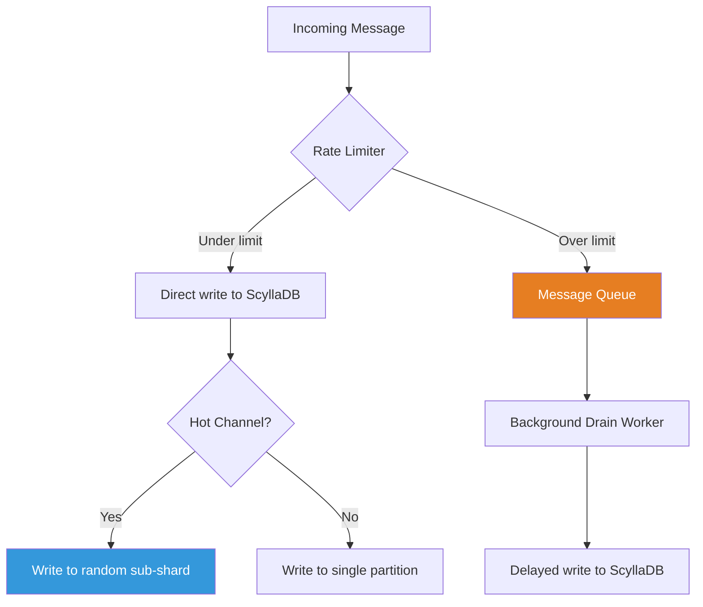
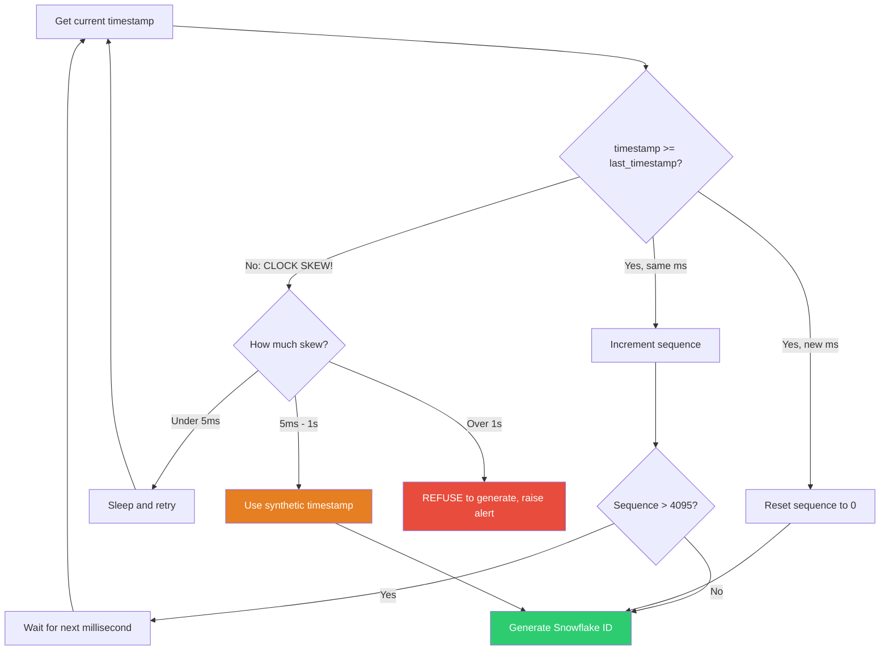
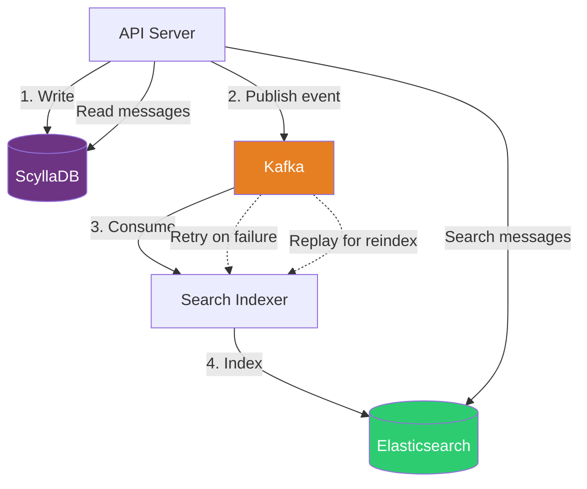

# Discord Trillions of Messages — Production Scenarios & Solutions (Q&A Deep Dive)

---

## 🔥 SCENARIO 1: Hot Partition — Viral Server Melting One Node

### The Incident

```
2:00 AM — Alert: ScyllaDB Node 7 CPU at 98%, p99 latency 2 seconds
Root cause: A K-pop group just announced a concert
  -> Their Discord server (2M members) is generating 50,000 messages/minute
  -> ALL messages for the "general" channel go to ONE partition
  -> That partition lives on Node 7
  -> Node 7 can't keep up, requests queuing

Impact:
  - 2M users in that server: messages delayed 5-10 seconds
  - Other channels on Node 7: also affected (noisy neighbor)
  - Users complaining on Twitter within minutes
```

### Q: Why does one busy channel overload one node?

**A: Partition key is `(channel_id, bucket)`. During a burst, ALL writes for the current time bucket go to the same partition, which lives on one node.**

```
Partition: (channel_id=general_kpop, bucket=2026-10-26-14:00)

Normal: 200 writes/sec -> Node 7 handles fine
Burst:  50,000 writes/sec -> Node 7 is crushed

The problem: You can NOT split a single partition across nodes.
A partition is the SMALLEST unit of distribution in ScyllaDB/Cassandra.
```

### Q: How do you solve hot partition problems?

```python
# SOLUTION 1: Sub-bucket splitting (write sharding)

def get_write_partition(channel_id: str, message_id: int) -> tuple:
    """
    Split a hot channel's bucket into sub-buckets.
    
    Instead of ONE partition per time bucket,
    create N sub-partitions to spread the load.
    
    Normal channel:  (channel_id, bucket)           -> 1 partition
    Hot channel:     (channel_id, bucket, shard_N)  -> 16 partitions
    """
    bucket = get_time_bucket(message_id)
    
    if is_hot_channel(channel_id):
        # Spread across 16 sub-shards
        shard = message_id % 16
        return (channel_id, bucket, shard)
    else:
        return (channel_id, bucket, 0)  # Single shard for normal channels


def is_hot_channel(channel_id: str) -> bool:
    """
    Track message rates per channel.
    Hot = more than 1000 messages/minute.
    
    Uses a sliding window counter in Redis.
    """
    current_minute = int(time.time() / 60)
    redis_key = f"msg_rate:{channel_id}:{current_minute}"
    
    rate = redis.incr(redis_key)
    redis.expire(redis_key, 120)  # TTL: 2 minutes
    
    return rate > 1000
```

```python
# SOLUTION 1 continued: Reading from sub-sharded channels

async def read_messages_sharded(channel_id: str, limit: int = 50):
    """
    When reading, we need to merge results from all sub-shards.
    This is the trade-off: writes are spread out, but reads are more complex.
    """
    bucket = get_current_bucket(channel_id)
    
    if is_hot_channel(channel_id):
        # Read from ALL 16 shards in parallel
        shard_queries = []
        for shard in range(16):
            shard_queries.append(
                scylla.execute("""
                    SELECT * FROM messages
                    WHERE channel_id = %s AND bucket = %s AND shard = %s
                    ORDER BY message_id DESC
                    LIMIT %s
                """, (channel_id, bucket, shard, limit))
            )
        
        # Execute all 16 queries in parallel
        shard_results = await asyncio.gather(*shard_queries)
        
        # Merge and sort all results by message_id (newest first)
        all_messages = []
        for result in shard_results:
            all_messages.extend(result)
        
        all_messages.sort(key=lambda m: m['message_id'], reverse=True)
        return all_messages[:limit]
    else:
        # Normal channel: single partition read (fast)
        return await scylla.execute("""
            SELECT * FROM messages
            WHERE channel_id = %s AND bucket = %s
            ORDER BY message_id DESC LIMIT %s
        """, (channel_id, bucket, limit))
```

```python
# SOLUTION 2: Rate limiting at the application layer

class ChannelRateLimiter:
    """
    Don't let one channel consume all database resources.
    
    Apply back-pressure: if a channel exceeds its write budget,
    queue excess messages and drain them at a controlled rate.
    """
    
    def __init__(self):
        self.limits = {
            "normal": 500,     # messages per second
            "boosted": 2000,   # Nitro-boosted servers
            "mega": 10000,     # Top 0.1% servers (special handling)
        }
    
    async def write_message(self, channel_id, message):
        tier = await self.get_channel_tier(channel_id)
        limit = self.limits[tier]
        
        # Token bucket rate limiter
        allowed = await self.token_bucket.consume(
            key=f"write_rate:{channel_id}",
            tokens=1,
            max_tokens=limit,
            refill_rate=limit  # tokens per second
        )
        
        if allowed:
            await scylla.insert(message)
            return {"status": "sent"}
        else:
            # Over rate limit — queue for async processing
            await message_queue.enqueue(channel_id, message)
            return {"status": "queued", "note": "High traffic, message will appear shortly"}
    
    async def drain_queue(self):
        """Background worker: drain queued messages at controlled rate."""
        while True:
            batch = await message_queue.dequeue_batch(100)
            for msg in batch:
                await scylla.insert(msg)
                await asyncio.sleep(0.001)  # 1ms between writes = 1000/sec max
```



---

## 🔥 SCENARIO 2: Tombstone Avalanche After Bulk Delete

### The Incident

```
A server moderator bulk-deleted 500,000 messages from a channel (spam cleanup).
Two hours later:
  - Reading messages in that channel takes 10+ seconds
  - ScyllaDB is scanning millions of TOMBSTONES
  - CPU on the affected node at 85%
  
Why? Each deleted message becomes a TOMBSTONE.
ScyllaDB must read through tombstones to find live messages.
Reading 50 messages actually scans 500,050 entries!
```

### Q: What is the tombstone problem and how do you fix it?

```
HOW TOMBSTONES WORK IN LSM-TREE DATABASES:

Write: "Hello world" -> message_123 added to SSTable_1
Delete: message_123  -> TOMBSTONE marker added to SSTable_2

When reading, ScyllaDB must:
  1. Read SSTable_2: finds tombstone for message_123
  2. Read SSTable_1: finds message_123 but... it's tombstoned, skip it
  
Now imagine 500,000 tombstones:
  Reading 50 messages = scan 500,050 entries = 500,000 tombstones + 50 live messages

This is READ AMPLIFICATION from tombstones.
```

```python
# SOLUTION 1: Soft delete with TTL

async def delete_message(channel_id, bucket, message_id):
    """
    Instead of DELETE (which creates tombstones),
    mark as deleted and let TTL clean it up during compaction.
    """
    # Option A: Set a 'deleted' flag (no tombstone)
    await scylla.execute("""
        UPDATE messages SET deleted = true, content = ''
        WHERE channel_id = %s AND bucket = %s AND message_id = %s
    """, (channel_id, bucket, message_id))
    
    # Read queries filter out deleted messages
    # SELECT * FROM messages WHERE ... AND deleted = false
    
    # Alternatively...
    # Option B: Use Cassandra/ScyllaDB TTL (auto-cleanup)
    await scylla.execute("""
        UPDATE messages USING TTL 604800  -- 7 days
        SET deleted = true, content = ''
        WHERE channel_id = %s AND bucket = %s AND message_id = %s
    """, (channel_id, bucket, message_id))
    # After 7 days, Cassandra's compaction will truly remove the data


# SOLUTION 2: Batch deletes into a new partition strategy
async def bulk_delete_messages(channel_id, message_ids: list):
    """
    For bulk deletes (>1000 messages):
    Instead of deleting in place, create a "pruned" partition.
    """
    if len(message_ids) > 1000:
        # Read all LIVE messages (excluding the ones to delete)
        delete_set = set(message_ids)
        bucket = get_bucket_for_message(channel_id, message_ids[0])
        
        all_messages = await scylla.execute("""
            SELECT * FROM messages
            WHERE channel_id = %s AND bucket = %s
        """, (channel_id, bucket))
        
        live_messages = [m for m in all_messages if m['message_id'] not in delete_set]
        
        # Write live messages to a NEW bucket (no tombstones!)
        new_bucket = f"{bucket}_pruned"
        for msg in live_messages:
            await scylla.execute("""
                INSERT INTO messages (channel_id, bucket, message_id, content, author_id)
                VALUES (%s, %s, %s, %s, %s)
            """, (channel_id, new_bucket, msg['message_id'], msg['content'], msg['author_id']))
        
        # Update the bucket mapping to point to new_bucket
        await update_bucket_mapping(channel_id, bucket, new_bucket)
        
        # Drop the old partition (no tombstones, instant)
        await scylla.execute("""
            DELETE FROM messages WHERE channel_id = %s AND bucket = %s
        """, (channel_id, bucket))
    else:
        # Small delete: regular tombstones are fine
        for msg_id in message_ids:
            await scylla.execute("""
                DELETE FROM messages
                WHERE channel_id = %s AND bucket = %s AND message_id = %s
            """, (channel_id, get_bucket_for_message(channel_id, msg_id), msg_id))
```

---

## 🔥 SCENARIO 3: Snowflake ID Generator Clock Skew

### The Incident

```
Alert: "Duplicate message_id detected!"

Server A's clock: 10:00:00.000
Server B's clock: 09:59:59.500  (500ms behind due to NTP drift)

Server A generates: snowflake at T=10:00:00.000 -> id = 1145141919810364416
Server B generates: snowflake at T=09:59:59.500 -> id = 1145141917663019008

These are different, so no collision. BUT...

Then NTP corrects Server B's clock forward by 500ms.
Server B now generates: snowflake at T=10:00:00.000 -> id = 1145141919810364416
SAME ID as Server A! -> COLLISION!
```

### Q: How do you handle clock skew in Snowflake IDs?

```python
class SafeSnowflakeGenerator:
    """
    Snowflake ID generator that handles clock skew safely.
    """
    
    def __init__(self, worker_id, process_id):
        self.worker_id = worker_id
        self.process_id = process_id
        self.sequence = 0
        self.last_timestamp = -1
        self.lock = threading.Lock()
    
    def generate(self) -> int:
        with self.lock:
            timestamp = self._current_time_ms()
            
            # CLOCK SKEW PROTECTION
            if timestamp < self.last_timestamp:
                # Clock went BACKWARDS! NTP correction happened.
                skew_ms = self.last_timestamp - timestamp
                
                if skew_ms < 5:
                    # Small skew: just wait it out
                    time.sleep(skew_ms / 1000.0)
                    timestamp = self._current_time_ms()
                elif skew_ms < 1000:
                    # Medium skew (< 1 second): use last_timestamp + 1
                    # This means IDs won't match real time briefly, but no duplicates
                    timestamp = self.last_timestamp + 1
                    logger.warning(f"Clock skew detected: {skew_ms}ms. Using synthetic timestamp.")
                else:
                    # Large skew (> 1 second): something is very wrong
                    # Refuse to generate IDs until clock catches up
                    raise ClockSkewError(
                        f"Clock went backwards by {skew_ms}ms! "
                        "Refusing to generate IDs. Check NTP."
                    )
            
            if timestamp == self.last_timestamp:
                self.sequence = (self.sequence + 1) & 0xFFF
                if self.sequence == 0:
                    timestamp = self._wait_next_ms(self.last_timestamp)
            else:
                self.sequence = 0
            
            self.last_timestamp = timestamp
            
            return (
                (timestamp << 22) |
                (self.worker_id << 17) |
                (self.process_id << 12) |
                self.sequence
            )
    
    def _current_time_ms(self):
        return int(time.time() * 1000) - DISCORD_EPOCH
    
    def _wait_next_ms(self, last_ts):
        ts = self._current_time_ms()
        while ts <= last_ts:
            ts = self._current_time_ms()
        return ts


# ALTERNATIVE: Use worker_id as collision avoidance
# Each server has a UNIQUE worker_id (0-31)
# Even if timestamps collide, worker_id makes them different

# Server A: worker_id=5  -> ...00101...  (bits 17-21)
# Server B: worker_id=12 -> ...01100...  (bits 17-21)
# Same timestamp + sequence, but different worker_id = different Snowflake!
```



---

## 🔥 SCENARIO 4: Migration Day — Cassandra to ScyllaDB Live Migration Failure

### The Incident

```
Day 15 of Cassandra -> ScyllaDB migration (dual-write phase):

Alert: "Data mismatch! 0.3% of messages differ between Cassandra and ScyllaDB"

Investigation:
  - Some messages exist in Cassandra but NOT in ScyllaDB
  - Some messages have DIFFERENT content between the two
  
Root causes found:
  1. ScyllaDB write timeout during a burst -> message lost on ScyllaDB side
  2. User edited a message -> edit went to Cassandra (primary) but 
     ScyllaDB write for the edit failed silently
  3. Timezone handling bug: bucket calculation differs between old and new code
```

### Q: How do you validate data consistency during a live database migration?

```python
class MigrationValidator:
    """
    Continuously validate data consistency between old and new databases.
    Run during the entire migration period.
    """
    
    async def continuous_validation(self):
        """
        Three types of validation running simultaneously:
        1. Real-time: compare every write
        2. Periodic: sample and compare old data  
        3. Reconciliation: fix mismatches
        """
        await asyncio.gather(
            self.realtime_validation(),
            self.periodic_sampling(),
            self.reconciliation_worker()
        )
    
    async def realtime_validation(self):
        """Compare every write in real-time."""
        async for message in write_event_stream:
            # Read back from both databases
            cass_msg = await cassandra.get(message.channel_id, message.id)
            scylla_msg = await scylladb.get(message.channel_id, message.id)
            
            if not scylla_msg:
                metrics.increment("migration.missing_in_scylla")
                await self.repair_queue.enqueue({
                    "type": "missing",
                    "source": "cassandra",
                    "message": cass_msg
                })
            elif cass_msg.content != scylla_msg.content:
                metrics.increment("migration.content_mismatch")
                await self.repair_queue.enqueue({
                    "type": "mismatch",
                    "cassandra": cass_msg,
                    "scylla": scylla_msg
                })
            else:
                metrics.increment("migration.validated_ok")
    
    async def periodic_sampling(self):
        """Sample random channels and deep-compare."""
        while True:
            # Pick 100 random channels
            channels = await get_random_channels(100)
            
            for channel_id in channels:
                # Compare last 1000 messages
                cass_msgs = await cassandra.get_messages(channel_id, limit=1000)
                scylla_msgs = await scylladb.get_messages(channel_id, limit=1000)
                
                cass_set = {m['id']: m for m in cass_msgs}
                scylla_set = {m['id']: m for m in scylla_msgs}
                
                # Messages in Cassandra but not ScyllaDB
                missing = set(cass_set.keys()) - set(scylla_set.keys())
                if missing:
                    logger.error(
                        f"Channel {channel_id}: {len(missing)} messages "
                        f"in Cassandra but not ScyllaDB"
                    )
                    for msg_id in missing:
                        await self.repair_queue.enqueue({
                            "type": "missing",
                            "source": "cassandra",
                            "message": cass_set[msg_id]
                        })
                
                # Content mismatches
                common = set(cass_set.keys()) & set(scylla_set.keys())
                for msg_id in common:
                    if cass_set[msg_id]['content'] != scylla_set[msg_id]['content']:
                        await self.repair_queue.enqueue({
                            "type": "mismatch",
                            "cassandra": cass_set[msg_id],
                            "scylla": scylla_set[msg_id]
                        })
            
            await asyncio.sleep(300)  # Every 5 minutes
    
    async def reconciliation_worker(self):
        """Repair mismatches automatically."""
        while True:
            batch = await self.repair_queue.dequeue_batch(50)
            for item in batch:
                if item['type'] == 'missing':
                    # Copy from Cassandra to ScyllaDB
                    await scylladb.insert(item['message'])
                    metrics.increment("migration.repaired_missing")
                
                elif item['type'] == 'mismatch':
                    # Cassandra is source of truth during migration
                    await scylladb.update(item['cassandra'])
                    metrics.increment("migration.repaired_mismatch")
            
            await asyncio.sleep(1)
```

---

## 🔥 SCENARIO 5: Search Index Out of Sync with Message Store

### The Incident

```
Users report: "I can see the message in the channel, but search can't find it."
Also: "Search shows a message that was deleted 3 hours ago."

Root cause:
  - Message writes go to ScyllaDB (primary) and Elasticsearch (search) independently
  - ScyllaDB write succeeded but Elasticsearch indexing failed (ES cluster was full)
  - ES index has stale data for deleted messages (delete event was lost)
```

### Q: How do you keep search in sync with the message store?

```python
class MessageSearchSync:
    """
    Keep Elasticsearch in sync with ScyllaDB using CDC (Change Data Capture).
    
    The key insight: NEVER write to ES directly from the API.
    Instead, use an event stream so retries and ordering are guaranteed.
    """
    
    async def write_message(self, message):
        """Primary write path."""
        # Step 1: Write to ScyllaDB (source of truth)
        await scylladb.insert(message)
        
        # Step 2: Publish event to Kafka (NOT directly to ES!)
        await kafka.produce("message-events", {
            "type": "message_create",
            "channel_id": message.channel_id,
            "message_id": message.id,
            "content": message.content,
            "author_id": message.author_id,
            "timestamp": message.created_at
        })
    
    async def search_indexer_consumer(self):
        """
        Kafka consumer: reads message events and indexes in ES.
        
        Why Kafka instead of direct ES write?
        1. Kafka retries automatically on ES failures
        2. Kafka preserves ordering (per partition)
        3. Kafka acts as a buffer during ES outages
        4. Can replay events if ES index is corrupted
        """
        async for event in kafka.consume("message-events"):
            try:
                if event['type'] == 'message_create':
                    await elasticsearch.index(
                        index="messages",
                        id=event['message_id'],
                        body={
                            "content": event['content'],
                            "channel_id": event['channel_id'],
                            "author_id": event['author_id'],
                            "timestamp": event['timestamp']
                        }
                    )
                elif event['type'] == 'message_delete':
                    await elasticsearch.delete(
                        index="messages",
                        id=event['message_id']
                    )
                elif event['type'] == 'message_update':
                    await elasticsearch.update(
                        index="messages",
                        id=event['message_id'],
                        body={"doc": {"content": event['new_content']}}
                    )
                
                await kafka.commit(event)
                
            except ElasticsearchError as e:
                # Don't commit — Kafka will redeliver
                logger.error(f"ES indexing failed: {e}")
                await asyncio.sleep(5)  # Back off before retry
    
    async def full_reindex(self, channel_id: str = None):
        """
        Nuclear option: rebuild ES index from ScyllaDB.
        Used when ES is badly out of sync.
        """
        if channel_id:
            messages = scylladb.scan_channel(channel_id)
        else:
            messages = scylladb.full_table_scan()
        
        batch = []
        for msg in messages:
            batch.append({"index": {"_id": msg['id']}})
            batch.append({
                "content": msg['content'],
                "channel_id": msg['channel_id'],
                "author_id": msg['author_id'],
                "timestamp": msg['created_at']
            })
            
            if len(batch) >= 2000:  # Bulk index 1000 messages at a time
                await elasticsearch.bulk(body=batch, index="messages")
                batch = []
        
        if batch:
            await elasticsearch.bulk(body=batch, index="messages")
```



---

## 🔥 SCENARIO 6: Message Delivery Ordering — Out-of-Order Messages

### The Incident

```
User report: "Messages appear out of order! Bob's reply shows BEFORE Alice's question."

Alice sends: "Anyone know how to fix error 503?" at 10:00:00.000
Bob sends:   "Try restarting the server" at 10:00:00.500

Displayed order:
  Bob:   "Try restarting the server"  (appears first!)
  Alice: "Anyone know how to fix error 503?"

Root cause:
  - Alice's message was processed by Server A (slower, under load)
  - Bob's message was processed by Server B (fast, idle)
  - Bob's message was written to ScyllaDB before Alice's
  - ScyllaDB orders by message_id (Snowflake), not insertion time
  - But both servers' clocks were slightly different...
```

### Q: How do you guarantee message ordering?

```python
# Messages are ordered by Snowflake ID, which embeds the timestamp.
# But clock skew between servers can cause ordering issues.

# SOLUTION: Per-channel ordering through a coordinator

class MessageOrderingService:
    """
    Ensure strict ordering within a channel.
    
    Key insight: You don't need GLOBAL ordering.
    Users only care about ordering WITHIN a channel.
    """
    
    async def send_message(self, channel_id, author_id, content):
        """
        Option 1: Channel-level sequence numbers
        Each channel has a monotonically increasing counter.
        """
        # Atomic increment of channel's sequence counter
        sequence = await redis.incr(f"channel_seq:{channel_id}")
        
        # Generate snowflake (for global uniqueness + rough time sorting)
        snowflake_id = snowflake_gen.generate()
        
        message = {
            "id": snowflake_id,
            "channel_id": channel_id,
            "sequence": sequence,      # Strict ordering within channel
            "author_id": author_id,
            "content": content,
            "created_at": datetime.utcnow()
        }
        
        await scylladb.insert(message)
        return message
    
    async def get_messages(self, channel_id, limit=50):
        """Read messages ordered by sequence number (not snowflake)."""
        return await scylladb.execute("""
            SELECT * FROM messages
            WHERE channel_id = %s AND bucket = %s
            ORDER BY sequence DESC
            LIMIT %s
        """, (channel_id, get_current_bucket(channel_id), limit))
```

```python
# SOLUTION 2 (What Discord actually does): 
# Accept that Snowflake ordering is "good enough"

# Snowflake IDs embed millisecond timestamps.
# Clock skew between servers is typically <10ms with NTP.
# 10ms reordering is INVISIBLE to humans reading a chat.

# For the rare cases where it matters:
# 1. Client-side sorting: the client re-sorts by snowflake_id after receiving
# 2. Snowflake generator uses monotonic clock (not wall clock)

import time

class MonotonicSnowflake:
    """Use monotonic clock to prevent backwards time jumps."""
    
    def __init__(self, worker_id):
        self.worker_id = worker_id
        self.offset = time.time() * 1000 - time.monotonic() * 1000
        # offset = wall_clock - monotonic at startup
        # After this, we only use monotonic (never goes backwards)
    
    def current_ms(self):
        """Monotonic clock mapped to wall clock epoch."""
        return int(time.monotonic() * 1000 + self.offset)
```

---

## 📋 Quick Reference: Production Checklist

```
DISCORD-SCALE MESSAGE STORAGE — PRODUCTION READINESS

[ ] Partition key: (channel_id, bucket) with dynamic bucket sizing
[ ] Sub-sharding for hot channels (>1000 msg/min)
[ ] Rate limiting per channel with back-pressure queuing
[ ] Tombstone management: soft deletes + TTL for bulk operations
[ ] Snowflake ID: clock skew protection + monotonic timestamp
[ ] Search sync via Kafka CDC (not direct writes to ES)
[ ] Full reindex capability for search recovery
[ ] Migration validation: real-time comparison + periodic sampling + auto-repair
[ ] Message cache: last 100 messages per active channel in Memcached
[ ] Client-side ordering as final safety net
[ ] Monitoring: partition size, tombstone ratio, write latency per channel
[ ] Alerting: hot partition detection, replication lag, search index lag
```
