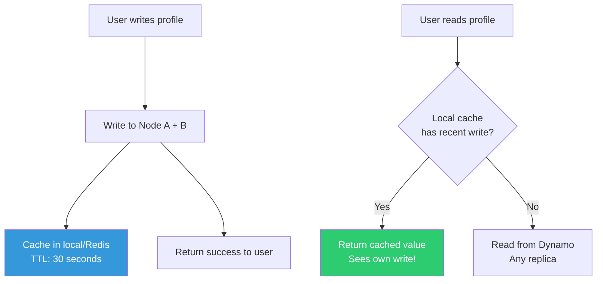
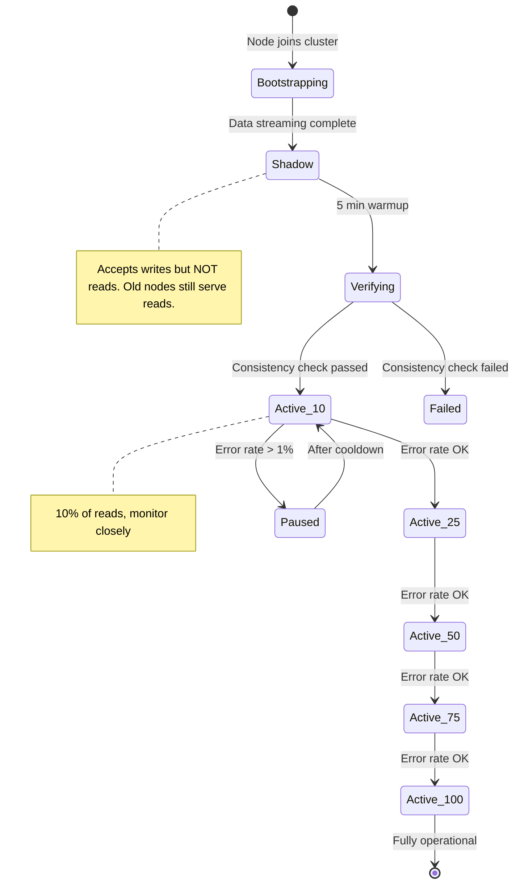

# Amazon Dynamo — Production Scenarios & Solutions (Q&A Deep Dive)

---

## 🔥 SCENARIO 1: Shopping Cart Conflict During Black Friday

### The Incident

```
Black Friday, 11:59 PM — Flash sale starts at midnight

User opens phone app AND laptop simultaneously.
Phone:   Adds "Nike Shoes" to cart  (hits Node A)
Laptop:  Adds "AirPods" to cart     (hits Node B)

Both happen at the exact same moment during a network partition.

When partition heals:
  Node A's cart: {shoes}
  Node B's cart: {airpods}
  
  Which one is correct?
  BOTH are correct — they happened concurrently.
  
  Wrong answer (Last-Write-Wins): cart = {airpods}, shoes LOST!
  Right answer (Merge): cart = {shoes, airpods}
```

### Q: How do you implement correct conflict resolution for shopping carts?

```python
class ShoppingCartConflictResolver:
    """
    Shopping cart conflict resolution using CRDTs (Conflict-free Replicated Data Types).
    
    Key insight: A shopping cart is an ADD/REMOVE set.
    To merge correctly, we track both additions and removals separately.
    """
    
    def __init__(self):
        # OR-Set CRDT: tracks adds and removes separately
        # Each add has a unique tag (prevents remove from killing future adds)
        pass
    
    def merge_carts(self, cart_a: dict, cart_b: dict) -> dict:
        """
        Merge two conflicting carts.
        
        WRONG approach (union of items):
          cart_a = {shoes}
          cart_b = {airpods}
          merged = {shoes, airpods}  -- seems right...
          
          BUT what if user REMOVED shoes from cart_b?
          cart_a = {shoes}          (added shoes)
          cart_b = {airpods}        (added airpods, then REMOVED shoes)
          union = {shoes, airpods}  -- shoes is BACK! User didn't want it!
        
        RIGHT approach (track add/remove with unique tags):
        """
        merged_adds = {}    # item -> set of add-tags
        merged_removes = {}  # item -> set of remove-tags
        
        # Merge add sets (union of all adds)
        for item, tags in cart_a.get('adds', {}).items():
            merged_adds.setdefault(item, set()).update(tags)
        for item, tags in cart_b.get('adds', {}).items():
            merged_adds.setdefault(item, set()).update(tags)
        
        # Merge remove sets (union of all removes)
        for item, tags in cart_a.get('removes', {}).items():
            merged_removes.setdefault(item, set()).update(tags)
        for item, tags in cart_b.get('removes', {}).items():
            merged_removes.setdefault(item, set()).update(tags)
        
        # An item is in the cart if it has any add-tag NOT in the remove set
        final_items = {}
        for item, add_tags in merged_adds.items():
            remove_tags = merged_removes.get(item, set())
            surviving_tags = add_tags - remove_tags
            if surviving_tags:
                final_items[item] = surviving_tags
        
        return {
            'items': list(final_items.keys()),
            'adds': merged_adds,
            'removes': merged_removes
        }
    
    def add_item(self, cart: dict, item: str) -> dict:
        """Add an item to the cart."""
        tag = str(uuid.uuid4())  # Unique tag for this add operation
        cart.setdefault('adds', {}).setdefault(item, set()).add(tag)
        return cart
    
    def remove_item(self, cart: dict, item: str) -> dict:
        """Remove an item from the cart."""
        # Remove ALL existing add-tags for this item
        add_tags = cart.get('adds', {}).get(item, set())
        cart.setdefault('removes', {}).setdefault(item, set()).update(add_tags)
        return cart


# EXAMPLE:
resolver = ShoppingCartConflictResolver()

# Initial cart
cart = {'adds': {}, 'removes': {}}

# User adds shoes on phone (Node A)
cart_a = resolver.add_item(dict(cart), "shoes")
# cart_a.adds = {"shoes": {"tag_1"}}

# User adds airpods on laptop (Node B)  -- concurrent!
cart_b = resolver.add_item(dict(cart), "airpods")
# cart_b.adds = {"airpods": {"tag_2"}}

# Merge!
merged = resolver.merge_carts(cart_a, cart_b)
print(merged['items'])  # ["shoes", "airpods"]  -- both preserved!

# Now user removes shoes on phone
cart_c = resolver.remove_item(dict(merged), "shoes")
# cart_c.removes = {"shoes": {"tag_1"}}

print(cart_c['items'])  # ["airpods"]  -- shoes removed correctly!
```

---

## 🔥 SCENARIO 2: Hinted Handoff Backlog Exploding

### The Incident

```
Node C has been down for 6 hours (disk failure).
Nodes A and B have been storing "hints" for Node C.

Problem:
  - 6 hours of writes = 50GB of hint data on Node A
  - 6 hours of writes = 48GB of hint data on Node B
  - Node A is running out of disk space!
  - When Node C comes back, transferring 98GB will take 30+ minutes
  - During transfer, Node A and B are doing extra I/O (degraded performance)
```

### Q: How do you manage hinted handoff at scale?

```python
class HintedHandoffManager:
    """
    Production-grade hinted handoff with resource limits.
    """
    
    MAX_HINT_STORAGE_BYTES = 10 * 1024**3  # 10GB max hints per node
    MAX_HINT_AGE_HOURS = 3                  # Discard hints older than 3 hours
    HANDOFF_RATE_LIMIT = 50 * 1024**2       # 50MB/s transfer rate
    
    def __init__(self, node_id):
        self.node_id = node_id
        self.hint_store = {}  # target_node -> list of hints
        self.hint_sizes = {}  # target_node -> total bytes
    
    async def store_hint(self, target_node, key, value, vector_clock):
        """
        Store a hint for a downed node.
        BUT: enforce limits to prevent our own node from dying.
        """
        hint_data = {
            "key": key,
            "value": value,
            "vector_clock": vector_clock,
            "timestamp": time.time()
        }
        hint_size = len(json.dumps(hint_data))
        
        current_total = sum(self.hint_sizes.values())
        
        # Limit 1: Total hint storage per node
        if current_total + hint_size > self.MAX_HINT_STORAGE_BYTES:
            metrics.increment("hints.dropped.storage_full")
            logger.warning(
                f"Hint storage full ({current_total / 1024**3:.1f}GB). "
                f"Dropping hint for {target_node}. "
                f"Anti-entropy will fix this later."
            )
            return False  # Drop the hint; anti-entropy will catch it later
        
        # Limit 2: Hint age (don't accumulate forever)
        self._evict_old_hints(target_node)
        
        self.hint_store.setdefault(target_node, []).append(hint_data)
        self.hint_sizes[target_node] = self.hint_sizes.get(target_node, 0) + hint_size
        
        return True
    
    def _evict_old_hints(self, target_node):
        """Remove hints older than MAX_HINT_AGE_HOURS."""
        cutoff = time.time() - (self.MAX_HINT_AGE_HOURS * 3600)
        hints = self.hint_store.get(target_node, [])
        
        new_hints = [h for h in hints if h['timestamp'] > cutoff]
        evicted = len(hints) - len(new_hints)
        
        if evicted > 0:
            logger.info(f"Evicted {evicted} stale hints for {target_node}")
            metrics.increment("hints.evicted.age", evicted)
        
        self.hint_store[target_node] = new_hints
    
    async def handoff_worker(self):
        """
        Background: Transfer hints to recovered nodes.
        Rate-limited to prevent overwhelming the recovering node.
        """
        while True:
            for target_node, hints in list(self.hint_store.items()):
                if not hints:
                    continue
                
                if not await self._is_node_alive(target_node):
                    continue
                
                logger.info(f"Starting handoff to {target_node}: {len(hints)} hints")
                
                bytes_sent = 0
                transferred = 0
                
                for hint in hints[:]:  # Copy list to allow modification
                    # Rate limiting
                    if bytes_sent > self.HANDOFF_RATE_LIMIT:
                        await asyncio.sleep(1)
                        bytes_sent = 0
                    
                    try:
                        await self._send_to_node(
                            target_node,
                            hint['key'],
                            hint['value'],
                            hint['vector_clock']
                        )
                        hints.remove(hint)
                        transferred += 1
                        bytes_sent += len(json.dumps(hint))
                        
                    except NodeUnreachableError:
                        logger.warning(f"{target_node} went down again during handoff")
                        break
                
                logger.info(f"Handoff to {target_node}: {transferred} hints transferred")
            
            await asyncio.sleep(10)
```

### Q: What happens to writes that exceed the hint storage limit?

```
When hints are dropped (storage full or too old):

  The data is LOST from the hint perspective.
  BUT it's NOT lost permanently!

  Safety net: ANTI-ENTROPY with Merkle Trees
  
  Merkle tree sync runs periodically (e.g., every hour).
  It compares ALL data between replica nodes.
  Any missing data is detected and copied.
  
  So the guarantee is:
    - Hinted handoff: repairs within SECONDS of node recovery
    - Anti-entropy: repairs within HOURS if hints are lost
    - Combined: eventually consistent with bounded repair time
  
  The only scenario where data is truly lost:
    ALL N replicas of a key are simultaneously destroyed
    before anti-entropy can create new replicas.
    With N=3, this requires 3 simultaneous disk failures.
    Probability: astronomically low.
```

---

## 🔥 SCENARIO 3: Vector Clock Explosion

### The Incident

```
Alert: "Key 'popular_product_123' has vector clock with 847 entries!"

This product listing is updated by:
  - 50 different API servers (load balanced)
  - Each server adds its node_id to the vector clock
  - Over months, 847 unique servers have touched this key
  
Problems:
  - Vector clock is 12KB (bigger than the actual data!)
  - Every read/write must serialize/deserialize this monster
  - Network bandwidth wasted sending huge vector clocks
  - Comparison time: O(N) where N=847 → slow
```

### Q: How do you prevent vector clock growth?

```python
class BoundedVectorClock:
    """
    Vector clock with size bounds.
    
    Amazon's solution: limit to ~10 entries.
    When exceeding the limit, evict the OLDEST entry.
    
    Trade-off: might lose some causality info → more "false conflicts"
    But in practice: most keys are touched by 2-3 nodes, not 847.
    The 847-node case is pathological and should be addressed architecturally.
    """
    
    MAX_ENTRIES = 10
    
    def __init__(self):
        self.clock = {}  # node_id -> (counter, timestamp)
    
    def increment(self, node_id):
        counter = self.clock.get(node_id, (0, 0))[0] + 1
        self.clock[node_id] = (counter, time.time())
        self._prune()
    
    def _prune(self):
        """Remove oldest entries if clock exceeds max size."""
        if len(self.clock) <= self.MAX_ENTRIES:
            return
        
        # Sort by timestamp (oldest first)
        sorted_entries = sorted(
            self.clock.items(),
            key=lambda x: x[1][1]  # Sort by timestamp
        )
        
        # Remove oldest entries
        entries_to_remove = len(self.clock) - self.MAX_ENTRIES
        for i in range(entries_to_remove):
            node_id = sorted_entries[i][0]
            del self.clock[node_id]
            metrics.increment("vector_clock.pruned")


# BETTER SOLUTION: Use client-side coordinator affinity

class CoordinatorAffinity:
    """
    Instead of any server touching any key,
    route requests for the SAME key to the SAME coordinator.
    
    This means the vector clock only has 1-3 entries
    (the N replica nodes), not 847 API servers.
    """
    
    def __init__(self, ring):
        self.ring = ring
    
    def get_coordinator(self, key):
        """
        Route the request to the node that OWNS this key.
        That node coordinates all writes for this key.
        
        Result: vector clock entries = N replicas (e.g., 3), not # of API servers
        """
        preference_list = self.ring.get_preference_list(key, n=3)
        return preference_list[0]  # First node is the coordinator
    
    async def put(self, key, value):
        coordinator = self.get_coordinator(key)
        
        if coordinator == self.my_node_id:
            # I'm the coordinator — handle locally
            return await self._local_put(key, value)
        else:
            # Forward to the coordinator
            return await self._forward_put(coordinator, key, value)
```

---

## 🔥 SCENARIO 4: Read-Your-Writes Consistency Violated

### The Incident

```
User flow:
  1. User updates their profile picture (POST /profile)
  2. Server writes to Node A (coordinator) + Node B (replica)
  3. Response: "Profile updated!"
  4. User refreshes page (GET /profile)
  5. Load balancer sends read to Node C (different replica)
  6. Node C hasn't received the replication yet
  7. User sees their OLD profile picture!
  8. User: "The app is broken! My update didn't save!"

Config: N=3, W=1, R=1
Write went to 1 node, read went to a DIFFERENT node.
The read node hasn't replicated yet → stale data.
```

### Q: How do you guarantee "read-your-writes" consistency in Dynamo?

```python
# SOLUTION 1: Sticky sessions (route reads to the write coordinator)

class ReadYourWritesRouter:
    """
    After a write, route subsequent reads from the SAME USER
    to the SAME node that handled the write.
    """
    
    async def write(self, user_id, key, value):
        coordinator = ring.get_preference_list(key)[0]
        await coordinator.put(key, value)
        
        # Remember which node handled this write
        await redis.set(
            f"last_write_node:{user_id}:{key}",
            coordinator.node_id,
            ex=30  # Remember for 30 seconds (enough for replication)
        )
        return {"status": "ok"}
    
    async def read(self, user_id, key):
        # Check if user recently wrote to this key
        preferred_node = await redis.get(f"last_write_node:{user_id}:{key}")
        
        if preferred_node:
            # Read from the same node that handled the write
            return await get_node(preferred_node).get(key)
        else:
            # No recent write — read from any replica
            return await random_replica.get(key)


# SOLUTION 2: Use quorum read (R + W > N)

class QuorumConsistency:
    """
    If R + W > N, reads MUST overlap with writes.
    At least one node in the read set will have the latest write.
    """
    
    async def consistent_read(self, key):
        """
        With N=3, W=2, R=2:
        Write goes to 2 nodes.
        Read queries 2 nodes.
        At least 1 node is in BOTH sets → guaranteed to see latest write.
        """
        preference_list = ring.get_preference_list(key, n=3)
        
        # Read from R=2 nodes
        responses = await asyncio.gather(*[
            node.get(key) for node in preference_list[:2]
        ])
        
        # Return the one with the highest vector clock (latest version)
        latest = max(responses, key=lambda r: r.vector_clock)
        
        # Repair stale replicas in background
        for resp in responses:
            if resp.vector_clock.happens_before(latest.vector_clock):
                asyncio.create_task(
                    resp.node.put(key, latest.value, latest.vector_clock)
                )
        
        return latest.value


# SOLUTION 3: Write-through cache

class WriteThoughCache:
    """
    After writing, cache the value locally.
    Next read hits cache first → always sees own writes.
    """
    
    async def write(self, user_id, key, value):
        await dynamo.put(key, value)
        
        # Cache locally for 30 seconds
        await local_cache.set(
            f"{user_id}:{key}", value,
            ttl=30
        )
    
    async def read(self, user_id, key):
        # Check local cache first
        cached = await local_cache.get(f"{user_id}:{key}")
        if cached:
            return cached  # Guaranteed to be our own write
        
        # Cache miss — read from Dynamo
        return await dynamo.get(key)
```



---

## 🔥 SCENARIO 5: Network Partition Between Data Centers

### The Incident

```
Two data centers: US-East and US-West
Network link between them goes down for 45 minutes.

During partition:
  US-East users: can read/write normally (their local replicas)
  US-West users: can read/write normally (their local replicas)
  
  But: cross-datacenter replicas are NOT syncing!
  
After partition heals:
  Key "user_profile_42" has DIFFERENT values in each datacenter:
    US-East: {name: "Alice", bio: "Hello!"} 
    US-West: {name: "Alice", bio: "Hi there!"}
    
  Both updates are valid. How to merge?
```

### Q: How does Dynamo handle cross-datacenter conflicts?

```python
class CrossDatacenterConflictHandler:
    """
    Handle conflicts that arise from network partitions between data centers.
    """
    
    async def anti_entropy_after_partition(self):
        """
        Run immediately when network partition heals.
        Use Merkle trees to find all divergent keys.
        """
        local_tree = await self.build_merkle_tree("local_dc")
        remote_tree = await self.get_remote_merkle_tree("remote_dc")
        
        # Find which key ranges differ
        diff_ranges = MerkleTree.find_differences(local_tree, remote_tree)
        
        logger.info(f"Post-partition: {len(diff_ranges)} ranges need reconciliation")
        
        for key_range_start, key_range_end in diff_ranges:
            # Get all keys in the differing range from both DCs
            local_keys = await self.scan_range("local_dc", key_range_start, key_range_end)
            remote_keys = await self.scan_range("remote_dc", key_range_start, key_range_end)
            
            for key in set(local_keys.keys()) | set(remote_keys.keys()):
                local_val = local_keys.get(key)
                remote_val = remote_keys.get(key)
                
                if local_val and remote_val:
                    if local_val.vector_clock.is_concurrent(remote_val.vector_clock):
                        # CONFLICT: both DCs modified during partition
                        resolved = await self.resolve_conflict(key, local_val, remote_val)
                        await self.write_to_both_dcs(key, resolved)
                        metrics.increment("partition.conflicts_resolved")
                    
                    elif local_val.vector_clock.happens_before(remote_val.vector_clock):
                        # Remote is newer — update local
                        await self.write_local(key, remote_val)
                    
                    else:
                        # Local is newer — update remote
                        await self.write_remote(key, local_val)
                
                elif local_val and not remote_val:
                    # Created locally during partition — replicate
                    await self.write_remote(key, local_val)
                
                elif remote_val and not local_val:
                    # Created remotely during partition — replicate
                    await self.write_local(key, remote_val)
    
    async def resolve_conflict(self, key, val_a, val_b):
        """
        Application-specific conflict resolution.
        Different data types need different strategies.
        """
        data_type = self.get_data_type(key)
        
        if data_type == "shopping_cart":
            # Shopping cart: MERGE (keep all items)
            return self.merge_carts(val_a.value, val_b.value)
        
        elif data_type == "user_profile":
            # Profile: field-level merge
            merged = {}
            for field in set(val_a.value.keys()) | set(val_b.value.keys()):
                a_val = val_a.value.get(field)
                b_val = val_b.value.get(field)
                
                if a_val == b_val:
                    merged[field] = a_val
                elif a_val and not b_val:
                    merged[field] = a_val
                elif b_val and not a_val:
                    merged[field] = b_val
                else:
                    # Both modified same field — use Last-Write-Wins for this field
                    merged[field] = a_val if val_a.timestamp > val_b.timestamp else b_val
                    metrics.increment("conflict.field_level_lww")
            
            return merged
        
        elif data_type == "counter":
            # Counter: SUM both increments
            return {"count": val_a.value["count"] + val_b.value["count"]}
        
        else:
            # Default: Last-Write-Wins (acceptable data loss)
            return val_a.value if val_a.timestamp > val_b.timestamp else val_b.value
```

---

## 🔥 SCENARIO 6: Cascading Failure During Node Addition

### The Incident

```
Adding 3 new nodes to a 12-node Dynamo cluster to handle holiday traffic.

What should happen:
  - New nodes join the ring
  - ~25% of data streams from existing nodes to new nodes
  - Traffic gradually shifts to new nodes

What actually happened:
  - New nodes join and start receiving reads immediately
  - They have NO DATA yet (streaming hasn't finished)
  - Every read to new nodes = cache miss -> falls through to remaining replicas
  - Remaining replicas get 2x the read load
  - Those replicas start timing out
  - Timeouts cascade -> more retries -> more load -> meltdown
```

### Q: How do you safely add nodes to a Dynamo cluster?

```python
class SafeNodeJoin:
    """
    Add nodes to the ring WITHOUT causing a cascading failure.
    """
    
    async def add_node_safely(self, new_node):
        """
        Phase 1: Bootstrap (load data before taking traffic)
        Phase 2: Shadow (receive writes but don't serve reads)
        Phase 3: Active (fully operational)
        """
        
        # Phase 1: BOOTSTRAP — stream data from existing nodes
        logger.info(f"Phase 1: Bootstrapping {new_node.id}")
        new_node.status = "bootstrapping"
        
        # Determine which key ranges this node will own
        key_ranges = self.ring.get_ranges_for_node(new_node.id)
        
        for key_range in key_ranges:
            # Find source node that currently owns this range
            source = self.ring.get_current_owner(key_range)
            
            # Stream data from source to new node
            await self.stream_range(
                source=source,
                target=new_node,
                key_range=key_range,
                rate_limit_mbps=100  # Don't overwhelm source
            )
        
        logger.info(f"Phase 1 complete: {new_node.id} has all data")
        
        # Phase 2: SHADOW — accept writes but don't serve reads yet
        logger.info(f"Phase 2: Shadow mode for {new_node.id}")
        new_node.status = "shadow"
        
        # New node receives writes (dual-write) but reads still go to old nodes
        # Wait for a few minutes to catch up on any writes during streaming
        await asyncio.sleep(300)  # 5 minutes of shadow mode
        
        # Verify data consistency
        is_consistent = await self.verify_consistency(new_node, key_ranges)
        if not is_consistent:
            logger.error(f"{new_node.id} data inconsistent! Aborting join.")
            new_node.status = "failed"
            return False
        
        # Phase 3: ACTIVE — now serve reads too
        logger.info(f"Phase 3: Activating {new_node.id}")
        new_node.status = "active"
        
        # Gradually shift read traffic (not all at once!)
        for percentage in [10, 25, 50, 75, 100]:
            self.ring.set_read_weight(new_node.id, percentage)
            await asyncio.sleep(60)  # Wait 1 minute between increases
            
            # Check health metrics
            error_rate = await self.get_error_rate(new_node.id)
            if error_rate > 0.01:  # >1% error rate
                logger.warning(f"High error rate at {percentage}% — pausing ramp")
                await asyncio.sleep(300)  # Extra 5 min wait
        
        logger.info(f"Node {new_node.id} fully active!")
        return True
```



---

## 📋 Quick Reference: Production Checklist

```
DYNAMO-STYLE SYSTEM — PRODUCTION READINESS

[ ] Consistent hashing with 150+ virtual nodes per physical node
[ ] Sloppy quorum with hint storage limits (10GB max, 3h max age)
[ ] Vector clock pruning (max 10 entries, evict oldest)
[ ] Coordinator affinity to keep vector clocks small
[ ] Read-your-writes: sticky sessions OR quorum reads OR write-through cache
[ ] Merkle tree anti-entropy running every hour
[ ] Read repair on every read (background fix for stale replicas)
[ ] Application-level conflict resolution (not just LWW)
[ ] Safe node join: bootstrap -> shadow -> gradual ramp
[ ] Cross-DC conflict resolution for network partitions
[ ] Monitoring: replication lag, hint backlog, vector clock sizes, conflict rate
[ ] Tunable N/R/W per use case (strong consistency for critical data)
```
