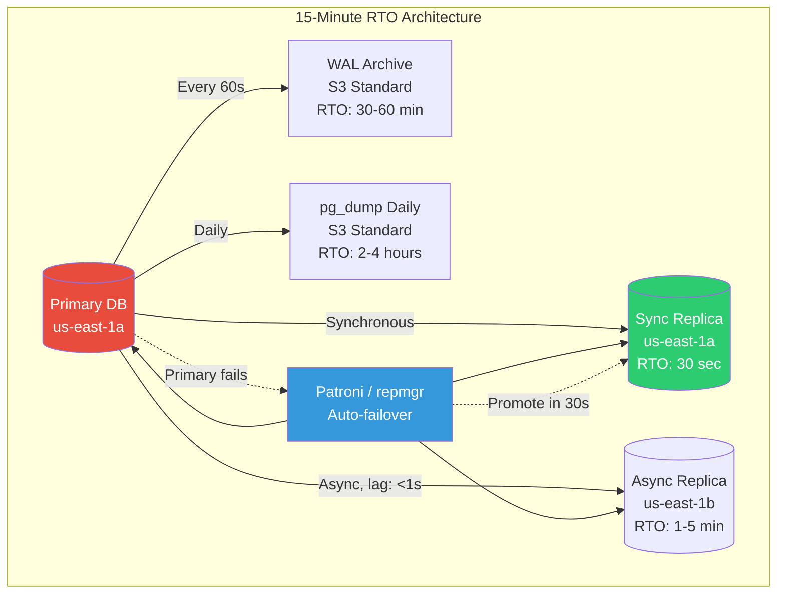

# GitLab Database Incident — Production Scenarios & Solutions (Q&A Deep Dive)

---

## 🔥 SCENARIO 1: Your Backup Restore Takes 18 Hours (Too Long!)

### The Incident

```
4:00 AM — Database server's primary disk fails. 
  - Automatic failover to replica: FAILED (replica was 3 hours behind)
  - WAL archiving: last archive was 45 minutes ago (gap)
  - pg_dump backup: 2TB compressed, stored in S3 Glacier
  
Recovery plan:
  Step 1: Retrieve from Glacier → 4-12 hours (retrieval time!)
  Step 2: Download 2TB from S3 → 2 hours (network transfer)
  Step 3: pg_restore → 6-8 hours (for 2TB database)
  Step 4: WAL replay → 1-2 hours
  Total RTO: 13-24 HOURS
  
Business impact: $500K/hour downtime cost
```

### Q: How do you design for a 15-minute RTO?

```python
class RapidRecoveryArchitecture:
    """
    Design for 15-minute Recovery Time Objective (RTO).
    
    Key principle: Every minute of design time saves hours of outage.
    """
    
    def get_architecture(self):
        return {
            # LAYER 1: Synchronous replica (RTO: 30 seconds, RPO: 0)
            "synchronous_standby": {
                "setup": """
                    -- postgresql.conf on primary
                    synchronous_standby_names = 'replica1'
                    synchronous_commit = on
                    
                    -- This means: every write WAITS for replica to confirm
                    -- Slower writes (+5ms) but ZERO data loss on failover
                """,
                "failover": """
                    -- On replica1 (automatic via Patroni/repmgr):
                    SELECT pg_promote();
                    -- Update DNS/pgbouncer to point to new primary
                    -- Total time: 10-30 seconds
                """,
                "rto": "30 seconds",
                "rpo": "0 (zero data loss)",
                "trade_off": "5-10ms added write latency"
            },
            
            # LAYER 2: Async replica in different AZ (RTO: 1-5 min, RPO: seconds)
            "async_standby_different_az": {
                "purpose": "Survives AZ failure",
                "lag": "typically < 1 second",
                "rto": "1-5 minutes (DNS failover)",
                "rpo": "0-5 seconds of data loss"
            },
            
            # LAYER 3: Continuous WAL archiving (RTO: 30-60 min, RPO: ~1 min)
            "continuous_wal_archiving": {
                "setup": """
                    -- postgresql.conf
                    archive_mode = on
                    archive_command = 'wal-g wal-push %p'
                    archive_timeout = 60  -- Archive every 60 seconds minimum
                """,
                "restore": """
                    # Restore base backup + replay WAL to exact point in time
                    wal-g backup-fetch /var/lib/postgresql/data LATEST
                    cat > /var/lib/postgresql/data/recovery.signal
                    # Set recovery_target_time in postgresql.conf
                    pg_ctl start
                """,
                "rto": "30-60 minutes",
                "rpo": "~60 seconds"
            },
            
            # LAYER 4: Daily pg_dump to S3 Standard (RTO: 2-4 hours, RPO: 24 hours)
            "daily_logical_backup": {
                "storage_class": "S3 Standard (NOT Glacier!)",
                "note": "Glacier retrieval takes hours — useless for DR",
                "rto": "2-4 hours",
                "rpo": "up to 24 hours"
            }
        }
```



### Complete Failover Automation

```python
# Patroni-style automatic failover

class AutomaticFailover:
    """
    PostgreSQL automatic failover using leader election.
    
    When primary dies:
    1. Detect failure (health check fails 3 times)
    2. Elect new primary (sync replica wins)
    3. Promote replica
    4. Update routing (DNS/pgbouncer)
    5. Alert on-call
    
    Total time: < 30 seconds
    """
    
    def __init__(self):
        self.primary = None
        self.replicas = []
        self.health_check_interval = 3  # seconds
        self.failure_threshold = 3       # consecutive failures
    
    async def monitor_loop(self):
        """Continuous health monitoring."""
        failure_count = 0
        
        while True:
            is_healthy = await self.health_check(self.primary)
            
            if is_healthy:
                failure_count = 0
            else:
                failure_count += 1
                logger.warning(
                    f"Primary health check failed ({failure_count}/{self.failure_threshold})"
                )
            
            if failure_count >= self.failure_threshold:
                logger.critical("PRIMARY IS DOWN! Starting failover...")
                await self.execute_failover()
                failure_count = 0
            
            await asyncio.sleep(self.health_check_interval)
    
    async def execute_failover(self):
        """
        Failover sequence. Must complete in < 30 seconds.
        """
        start = time.time()
        
        # Step 1: Verify primary is truly down (not just a network blip)
        # Try connecting from multiple monitors
        confirmations = await asyncio.gather(*[
            self.health_check_from(monitor, self.primary)
            for monitor in self.health_monitors
        ])
        
        if any(confirmations):
            logger.info("False alarm — primary reachable from other monitors")
            return
        
        # Step 2: Select best replica to promote
        best_replica = await self.select_promotion_candidate()
        logger.info(f"Promoting {best_replica.host} to primary")
        
        # Step 3: Promote the replica
        await best_replica.execute("SELECT pg_promote();")
        
        # Step 4: Wait for promotion to complete
        for _ in range(30):
            if await best_replica.execute("SELECT pg_is_in_recovery();") == False:
                break
            await asyncio.sleep(0.5)
        
        # Step 5: Update routing
        await self.update_pgbouncer(new_primary=best_replica.host)
        await self.update_dns(new_primary=best_replica.host)
        
        # Step 6: Reconfigure other replicas to follow new primary
        for replica in self.replicas:
            if replica != best_replica:
                await replica.execute(f"""
                    ALTER SYSTEM SET primary_conninfo = 
                    'host={best_replica.host} port=5432';
                    SELECT pg_reload_conf();
                """)
        
        elapsed = time.time() - start
        logger.critical(f"FAILOVER COMPLETE in {elapsed:.1f} seconds")
        
        await self.alert_oncall(
            severity="critical",
            message=f"Database failover completed in {elapsed:.1f}s. "
                    f"New primary: {best_replica.host}. "
                    f"Old primary {self.primary.host} is DOWN."
        )
        
        self.primary = best_replica
    
    async def select_promotion_candidate(self):
        """
        Pick the replica closest to the primary's state.
        
        Priority:
        1. Synchronous replica (zero data loss)
        2. Replica with least replication lag
        3. Replica in the same AZ as the primary
        """
        candidates = []
        
        for replica in self.replicas:
            try:
                lag = await replica.execute("""
                    SELECT EXTRACT(EPOCH FROM (now() - pg_last_xact_replay_timestamp()))
                """)
                is_sync = replica.sync_mode == "synchronous"
                same_az = replica.az == self.primary.az
                
                candidates.append({
                    "replica": replica,
                    "lag_seconds": lag,
                    "is_sync": is_sync,
                    "same_az": same_az,
                    # Lower score = better candidate
                    "score": (0 if is_sync else 100) + lag + (0 if same_az else 10)
                })
            except Exception:
                continue  # Replica unreachable, skip
        
        candidates.sort(key=lambda c: c["score"])
        return candidates[0]["replica"]
```

---

## 🔥 SCENARIO 2: Backup Job Silently Failing for Months

### The Incident (Exactly What Happened to GitLab)

```
GitLab's pg_dump cron job:
  0 2 * * * pg_dump gitlabhq_production | gzip > /backups/daily.sql.gz

This job failed silently for MONTHS because:
  1. /backups/ disk was 100% full
  2. pg_dump wrote 0 bytes, gzip created an empty file
  3. Cron job exit code was 0 (gzip succeeded on empty input!)
  4. Nobody checked if the backup file was actually valid
  5. No alerting on backup size or freshness
```

### Q: How do you build a backup monitoring system that NEVER lets this happen?

```python
class BackupMonitoringSystem:
    """
    Production backup monitoring.
    
    Three rules:
    1. Monitor the OUTPUT, not the PROCESS
    2. Alert on ABSENCE, not just presence
    3. Periodically RESTORE to verify
    """
    
    def __init__(self):
        self.expected_backup_size_min = 100 * 1024**3  # 100GB min
        self.expected_backup_size_max = 5 * 1024**4    # 5TB max
        self.max_backup_age_hours = 25  # Must have backup < 25 hours old
    
    async def check_backup_health(self) -> dict:
        """
        Run every 15 minutes. Alert immediately on any failure.
        """
        checks = {}
        
        # CHECK 1: Does a recent backup FILE exist?
        latest = self.find_latest_backup("/backups/pg_dump/")
        
        if not latest:
            checks["file_exists"] = {
                "status": "CRITICAL",
                "message": "NO BACKUP FILES FOUND AT ALL!"
            }
            await self.page_oncall("No backup files exist!")
            return checks
        
        checks["file_exists"] = {"status": "OK", "file": latest.name}
        
        # CHECK 2: Is the backup RECENT enough?
        age_hours = (datetime.now() - latest.modified_time).total_seconds() / 3600
        
        if age_hours > self.max_backup_age_hours:
            checks["freshness"] = {
                "status": "CRITICAL",
                "message": f"Latest backup is {age_hours:.1f} hours old! (max: {self.max_backup_age_hours}h)",
                "last_backup": latest.modified_time.isoformat()
            }
            await self.page_oncall(f"Backup is {age_hours:.0f} hours stale!")
        else:
            checks["freshness"] = {
                "status": "OK",
                "age_hours": round(age_hours, 1)
            }
        
        # CHECK 3: Is the backup BIG ENOUGH? (catches empty/truncated backups)
        if latest.size < self.expected_backup_size_min:
            checks["size"] = {
                "status": "CRITICAL",
                "message": f"Backup is only {latest.size / 1024**3:.1f}GB! "
                           f"Expected > {self.expected_backup_size_min / 1024**3:.0f}GB. "
                           f"Possible truncation or empty dump!",
            }
            await self.page_oncall("Backup file suspiciously small!")
        elif latest.size > self.expected_backup_size_max:
            checks["size"] = {
                "status": "WARNING",
                "message": f"Backup is {latest.size / 1024**4:.1f}TB — unusually large"
            }
        else:
            checks["size"] = {
                "status": "OK",
                "size_gb": round(latest.size / 1024**3, 1)
            }
        
        # CHECK 4: Can we READ the backup? (catches corruption)
        try:
            # Try to list tables in the backup without fully restoring
            result = subprocess.run(
                ['pg_restore', '--list', latest.path],
                capture_output=True, timeout=60
            )
            table_count = len([l for l in result.stdout.decode().split('\n') if 'TABLE' in l])
            
            if table_count < 50:  # We expect at least 50 tables
                checks["integrity"] = {
                    "status": "WARNING",
                    "message": f"Only {table_count} tables in backup (expected 50+)"
                }
            else:
                checks["integrity"] = {
                    "status": "OK",
                    "table_count": table_count
                }
        except Exception as e:
            checks["integrity"] = {
                "status": "CRITICAL",
                "message": f"Cannot read backup file: {e}"
            }
            await self.page_oncall("Backup file is corrupted!")
        
        # CHECK 5: Backup disk space (prevent the GitLab scenario)
        disk_usage = self.get_disk_usage("/backups/")
        if disk_usage > 80:
            checks["disk_space"] = {
                "status": "WARNING" if disk_usage < 90 else "CRITICAL",
                "message": f"Backup disk {disk_usage}% full! "
                           f"Next backup may fail!"
            }
            if disk_usage > 90:
                await self.page_oncall(f"Backup disk {disk_usage}% full!")
        else:
            checks["disk_space"] = {"status": "OK", "usage_pct": disk_usage}
        
        return checks
    
    async def weekly_restore_drill(self):
        """
        Every week: actually RESTORE the backup to a test database.
        
        This is the check that GitLab never did.
        If you can't restore it, it's not a backup.
        """
        logger.info("Starting weekly restore drill...")
        start = time.time()
        
        latest = self.find_latest_backup("/backups/pg_dump/")
        
        try:
            # Spin up a test database server
            test_server = await self.create_test_db_server()
            
            # Restore the backup
            restore_result = subprocess.run(
                ['pg_restore', 
                 '-h', test_server.host, 
                 '-d', 'restore_test',
                 '-j', '4',  # 4 parallel jobs for speed
                 latest.path],
                capture_output=True,
                timeout=14400  # 4 hour timeout
            )
            
            if restore_result.returncode != 0:
                await self.page_oncall(
                    f"WEEKLY RESTORE DRILL FAILED! "
                    f"pg_restore exit code: {restore_result.returncode}. "
                    f"stderr: {restore_result.stderr.decode()[:500]}"
                )
                return {"status": "FAILED", "error": restore_result.stderr.decode()}
            
            # Run validation queries
            validations = await self.validate_restored_db(test_server)
            
            elapsed = time.time() - start
            
            result = {
                "status": "PASSED",
                "restore_time_seconds": elapsed,
                "backup_age_hours": (datetime.now() - latest.modified_time).total_seconds() / 3600,
                "validations": validations
            }
            
            logger.info(f"Restore drill PASSED in {elapsed/60:.0f} minutes")
            
            # Record RTO metric (how long restore actually takes)
            metrics.record("backup.restore_time_seconds", elapsed)
            
            return result
            
        finally:
            await self.destroy_test_db_server(test_server)
    
    async def validate_restored_db(self, test_server):
        """Verify the restored data makes sense."""
        checks = {}
        
        queries = {
            "users": "SELECT COUNT(*) FROM users",
            "projects": "SELECT COUNT(*) FROM projects",
            "merge_requests": "SELECT COUNT(*) FROM merge_requests",
            "latest_user": "SELECT MAX(created_at) FROM users",
        }
        
        for name, query in queries.items():
            try:
                result = await test_server.execute(query)
                checks[name] = {"status": "OK", "value": result}
            except Exception as e:
                checks[name] = {"status": "FAILED", "error": str(e)}
        
        return checks
```

```bash
# Proper backup cron job (what GitLab should have had)

#!/bin/bash
# backup_with_verification.sh

set -euo pipefail  # Exit on ANY error!

BACKUP_DIR="/backups/pg_dump"
BACKUP_FILE="${BACKUP_DIR}/backup_$(date +%Y%m%d_%H%M%S).dump"
SLACK_WEBHOOK="https://hooks.slack.com/services/xxx"
MIN_SIZE_BYTES=$((100 * 1024 * 1024 * 1024))  # 100GB

# Step 1: Check disk space BEFORE backup
DISK_FREE=$(df -B1 ${BACKUP_DIR} | tail -1 | awk '{print $4}')
if [ "${DISK_FREE}" -lt "${MIN_SIZE_BYTES}" ]; then
    curl -X POST "${SLACK_WEBHOOK}" \
        -d '{"text":"BACKUP FAILED: Insufficient disk space!"}'
    exit 1
fi

# Step 2: Run backup
pg_dump -Fc -j 4 -f "${BACKUP_FILE}" gitlabhq_production
EXIT_CODE=$?

if [ ${EXIT_CODE} -ne 0 ]; then
    curl -X POST "${SLACK_WEBHOOK}" \
        -d "{\"text\":\"BACKUP FAILED: pg_dump exit code ${EXIT_CODE}\"}"
    exit 1
fi

# Step 3: Verify backup size
FILE_SIZE=$(stat -f%z "${BACKUP_FILE}" 2>/dev/null || stat -c%s "${BACKUP_FILE}")
if [ "${FILE_SIZE}" -lt "${MIN_SIZE_BYTES}" ]; then
    curl -X POST "${SLACK_WEBHOOK}" \
        -d "{\"text\":\"BACKUP SUSPICIOUS: Only $(( FILE_SIZE / 1024 / 1024 ))MB!\"}"
    exit 1
fi

# Step 4: Verify backup is readable
TABLE_COUNT=$(pg_restore --list "${BACKUP_FILE}" | grep -c "TABLE")
if [ "${TABLE_COUNT}" -lt 50 ]; then
    curl -X POST "${SLACK_WEBHOOK}" \
        -d "{\"text\":\"BACKUP SUSPICIOUS: Only ${TABLE_COUNT} tables found!\"}"
    exit 1
fi

# Step 5: Upload to S3 (redundant storage)
aws s3 cp "${BACKUP_FILE}" "s3://company-db-backups/daily/" \
    --storage-class STANDARD_IA

# Step 6: Clean up old local backups (keep last 7 days)
find "${BACKUP_DIR}" -name "backup_*.dump" -mtime +7 -delete

# Step 7: Report success
curl -X POST "${SLACK_WEBHOOK}" \
    -d "{\"text\":\"Backup SUCCESS: $(( FILE_SIZE / 1024 / 1024 / 1024 ))GB, ${TABLE_COUNT} tables\"}"
```

---

## 🔥 SCENARIO 3: Engineer Makes Destructive Change at 2 AM

### The Incident Pattern

```
GitLab's core problem: A tired engineer at 11 PM made a catastrophic mistake.

This pattern repeats across the industry:
  - Knight Capital (2012): $440M lost in 45 minutes from bad deployment
  - GitHub (2018): 24 hours of data loss from failover misconfiguration  
  - Cloudflare (2019): 30 minute global outage from bad regex
  
Common thread: human error under fatigue/pressure + insufficient guardrails
```

### Q: How do you build systems that are resilient to human error?

```python
class ProductionSafetySystem:
    """
    Defense in depth against human errors.
    
    Philosophy: "Make the right thing easy, and the wrong thing hard."
    """
    
    # LAYER 1: Make production LOOK different
    def configure_terminal_safety(self):
        return {
            "production_prompt": {
                "PS1": r'\[\033[41;37m\] PRODUCTION \[\033[0m\] \u@\h:\w\$ ',
                "note": "RED background, white text — impossible to miss"
            },
            "staging_prompt": {
                "PS1": r'\[\033[43;30m\] staging \[\033[0m\] \u@\h:\w\$ ',
                "note": "Yellow background — caution"
            },
            "dev_prompt": {
                "PS1": r'\[\033[42;30m\] dev \[\033[0m\] \u@\h:\w\$ ',
                "note": "Green — safe to experiment"
            },
            "motd": """
                ┌─────────────────────────────────────────┐
                │  ⚠️  THIS IS A PRODUCTION DATABASE       │
                │  All changes are logged and audited      │
                │  Destructive commands require approval    │
                │  When in doubt, ask in #db-ops            │
                └─────────────────────────────────────────┘
            """
        }
    
    # LAYER 2: Block dangerous commands
    def dangerous_command_interceptor(self):
        return """
        # /etc/profile.d/production-safety.sh
        
        # Override rm to prevent catastrophic deletes
        rm() {
            for arg in "$@"; do
                # Block rm on known critical paths
                case "$(readlink -f "$arg" 2>/dev/null)" in
                    /var/lib/postgresql/data*|/var/opt/gitlab/*)
                        echo "BLOCKED: Cannot rm database/application directories!"
                        echo "Use the official decommission runbook: https://wiki/db-decommission"
                        logger -p auth.alert "BLOCKED rm on critical path: $arg by $USER"
                        return 1
                        ;;
                esac
            done
            command rm "$@"
        }
        
        # Require confirmation for DROP commands
        psql() {
            # Check if command contains destructive SQL
            for arg in "$@"; do
                if echo "$arg" | grep -iE '(DROP|TRUNCATE|DELETE FROM .* WHERE 1|ALTER.*DROP)' > /dev/null; then
                    echo "⚠️  DESTRUCTIVE SQL DETECTED"
                    echo "Command: $arg"
                    read -p "Type the database name to confirm: " confirm
                    if [ "$confirm" != "$(hostname -s)" ]; then
                        echo "Confirmation failed. Aborted."
                        return 1
                    fi
                fi
            done
            command psql "$@"
        }
        """
    
    # LAYER 3: Time-based access controls
    async def check_change_window(self, action, user):
        """
        Restrict high-risk operations to safe hours.
        No database schema changes at 2 AM!
        """
        current_hour = datetime.now().hour
        
        HIGH_RISK_ACTIONS = [
            "database_migration", "schema_change", "data_delete",
            "replica_rebuild", "config_change", "deployment"
        ]
        
        SAFE_HOURS = range(9, 17)  # 9 AM - 5 PM only
        
        if action in HIGH_RISK_ACTIONS and current_hour not in SAFE_HOURS:
            # Require VP-level approval for after-hours changes
            approval = await self.request_approval(
                action=action,
                user=user,
                reason="After-hours high-risk operation",
                approver_level="director_or_above"
            )
            
            if not approval.granted:
                return {
                    "allowed": False,
                    "message": f"High-risk operation '{action}' blocked outside safe hours (9AM-5PM). "
                               f"Approval required from director+. "
                               f"Or wait until {9}:00 AM."
                }
        
        return {"allowed": True}
    
    # LAYER 4: Two-person rule for destructive operations
    async def require_peer_approval(self, operation, operator):
        """
        Destructive operations require a second person to approve.
        
        Like nuclear launch keys: two people, two keys.
        """
        request = await self.create_approval_request(
            operation=operation,
            requested_by=operator,
            channel="#db-operations"
        )
        
        # Post to Slack
        await slack.post_message(
            channel="#db-operations",
            text=f"🔐 *Approval Required*\n"
                 f"*Operation:* {operation}\n"
                 f"*Requested by:* {operator}\n"
                 f"*Expires:* 30 minutes\n\n"
                 f"React with ✅ to approve (must be different person)"
        )
        
        # Wait for approval (max 30 minutes)
        approval = await self.wait_for_approval(request.id, timeout=1800)
        
        if approval and approval.approver != operator:
            logger.info(f"Operation '{operation}' approved by {approval.approver}")
            return True
        else:
            logger.warning(f"Operation '{operation}' NOT approved. Blocking.")
            return False
```

---

## 🔥 SCENARIO 4: Replication Lag Cascading into Data Loss

### The Incident

```
This is the TRIGGER for GitLab's entire incident.

Timeline:
  1. Replication lag starts growing (replica falling behind)
  2. Engineer tries to fix by rebuilding replica
  3. pg_basebackup from primary keeps failing (WAL files recycled too fast)
  4. Engineer gets frustrated, decides to wipe and re-sync
  5. Wipes PRIMARY instead of replica ← THE MISTAKE

The real question: How do you prevent replication lag from becoming an emergency?
```

### Q: How do you monitor and auto-heal replication lag?

```python
class ReplicationLagManager:
    """
    Monitor replication lag and auto-heal before it becomes critical.
    
    Lag causes:
    1. Heavy write load on primary (too many WALs to replay)
    2. Slow disk on replica (can't keep up with WAL replay)
    3. Network congestion between primary and replica
    4. Long-running queries on replica blocking WAL replay
    5. Replica CPU saturated
    """
    
    THRESHOLDS = {
        "healthy": 5,          # < 5 seconds: normal
        "warning": 60,         # < 60 seconds: investigate
        "critical": 300,       # < 5 minutes: take action
        "emergency": 1800,     # < 30 minutes: escalate
        "catastrophic": 3600,  # > 1 hour: rebuild replica
    }
    
    async def monitor_loop(self):
        """Check replication lag every 10 seconds."""
        while True:
            lag = await self.get_replication_lag()
            
            if lag < self.THRESHOLDS["healthy"]:
                metrics.gauge("replication.lag_seconds", lag)
            
            elif lag < self.THRESHOLDS["warning"]:
                logger.warning(f"Replication lag: {lag}s")
                metrics.gauge("replication.lag_seconds", lag)
            
            elif lag < self.THRESHOLDS["critical"]:
                logger.error(f"Replication lag CRITICAL: {lag}s")
                await self.auto_heal_attempt_1(lag)
            
            elif lag < self.THRESHOLDS["emergency"]:
                logger.critical(f"Replication lag EMERGENCY: {lag}s")
                await self.page_oncall(
                    f"Replication lag at {lag}s. Auto-heal running. "
                    f"Please monitor."
                )
                await self.auto_heal_attempt_2(lag)
            
            else:
                logger.critical(f"Replication lag CATASTROPHIC: {lag}s")
                await self.page_oncall(
                    f"CATASTROPHIC replication lag: {lag}s. "
                    f"Replica may need full rebuild. "
                    f"DO NOT manually modify database. Follow runbook."
                )
            
            await asyncio.sleep(10)
    
    async def auto_heal_attempt_1(self, lag):
        """
        First attempt: reduce load on replica.
        Often, long-running queries block WAL replay.
        """
        # Cancel long-running queries on replica
        long_queries = await replica.execute("""
            SELECT pid, query, now() - query_start AS duration
            FROM pg_stat_activity
            WHERE state = 'active' 
            AND now() - query_start > interval '5 minutes'
            AND backend_type = 'client backend'
        """)
        
        for query in long_queries:
            logger.info(f"Canceling long query (pid={query['pid']}): {query['query'][:100]}")
            await replica.execute(f"SELECT pg_cancel_backend({query['pid']})")
        
        # Increase max_parallel_workers for WAL replay
        await replica.execute("""
            ALTER SYSTEM SET max_parallel_workers = 8;
            SELECT pg_reload_conf();
        """)
    
    async def auto_heal_attempt_2(self, lag):
        """
        Second attempt: reduce load on PRIMARY to let replica catch up.
        """
        # Temporarily reduce write-heavy workloads
        await self.throttle_batch_jobs(reduction_pct=50)
        
        # Increase WAL keep segments so replica doesn't lose its place
        await primary.execute("""
            ALTER SYSTEM SET wal_keep_size = '10GB';
            SELECT pg_reload_conf();
        """)
        
        logger.info("Throttled batch jobs by 50% to help replica catch up")
    
    async def get_replication_lag(self):
        """Get replication lag in seconds."""
        try:
            result = await replica.execute("""
                SELECT EXTRACT(EPOCH FROM 
                    now() - pg_last_xact_replay_timestamp()
                ) AS lag_seconds
            """)
            return result[0]['lag_seconds'] or 0
        except Exception:
            return float('inf')  # Can't connect = infinite lag
```

---

## 🔥 SCENARIO 5: Post-Mortem Culture — Turning Incidents into Improvements

### Q: How do you write a blameless post-mortem?

```python
class PostMortemTemplate:
    """
    Production post-mortem template used by Google, GitLab, and other 
    top engineering organizations.
    
    KEY PRINCIPLE: Blame the SYSTEM, not the PERSON.
    
    Wrong: "Engineer X deleted the database"
    Right: "Our systems allowed a database deletion command to execute 
           on production without safety checks"
    """
    
    template = {
        "title": "Incident #XXX: [Brief description]",
        
        "summary": {
            "duration": "How long the incident lasted",
            "impact": "Who was affected and how",
            "severity": "SEV-1 / SEV-2 / SEV-3",
            "root_cause": "One sentence"
        },
        
        "timeline": [
            # Every significant event with exact timestamps
            # "10:14 UTC — Alert fired: database connection errors"
            # "10:15 UTC — On-call acknowledged alert"
            # "10:22 UTC — Root cause identified: disk full"
        ],
        
        "root_cause_analysis": {
            "what_happened": "Factual description, no blame",
            "why_it_happened": "5 Whys analysis",
            "contributing_factors": [
                "Factor 1: What made this possible?",
                "Factor 2: What made detection slow?",
                "Factor 3: What made recovery slow?"
            ]
        },
        
        "what_went_well": [
            # Always include positives!
            "Alert fired within 2 minutes",
            "Team assembled within 10 minutes",
            "Communication to customers was clear"
        ],
        
        "what_went_poorly": [
            "Backup was stale — 6 hours old",
            "Runbook was outdated",
            "Recovery took 18 hours instead of target 1 hour"
        ],
        
        "action_items": [
            {
                "action": "Implement backup freshness monitoring",
                "owner": "SRE Team",
                "priority": "P0",
                "deadline": "2 weeks",
                "ticket": "INFRA-4521",
                "status": "In Progress"
            },
            # Every action item must have: owner, deadline, ticket
            # Otherwise they never get done
        ],
        
        "lessons_learned": [
            "A backup that hasn't been tested is not a backup",
            "Tired engineers should not be making production changes alone",
            "Terminal prompts must clearly distinguish environments"
        ]
    }
    
    @staticmethod
    def five_whys_example():
        return """
        WHY 1: Why did we lose data?
          → Because the production database was deleted.
        
        WHY 2: Why was the production database deleted?
          → Because an engineer ran rm -rf on the wrong server.
        
        WHY 3: Why did the engineer run it on the wrong server?
          → Because production and staging terminals looked identical.
        
        WHY 4: Why did identical terminals not have safeguards?
          → Because we never implemented production safety controls.
        
        WHY 5: Why were production safety controls never implemented?
          → Because there was no process to identify and mitigate 
            operational risks before incidents occur.
        
        ROOT CAUSE: Lack of systematic operational risk management
        (NOT "engineer made a mistake")
        """
```

---

## 📋 Quick Reference: Production Checklist

```
DATABASE DISASTER PREVENTION — PRODUCTION READINESS

BACKUP LAYERS:
[ ] Synchronous replica in same AZ (RPO: 0, RTO: 30s)
[ ] Async replica in different AZ (RPO: seconds, RTO: 1-5min)
[ ] Continuous WAL archiving to S3 Standard every 60s
[ ] Daily pg_dump to S3 Standard (NOT Glacier!)
[ ] Disk snapshots every 6 hours

BACKUP VERIFICATION:
[ ] Automated backup health check every 15 minutes
[ ] File exists? Recent enough? Big enough? Readable?
[ ] Backup disk space monitoring with alerts at 80%
[ ] Weekly full restore drill to test database
[ ] Monthly RTO/RPO measurement and reporting

HUMAN ERROR PREVENTION:
[ ] Color-coded terminal prompts (RED = production)
[ ] MOTD banner on production servers
[ ] Destructive command interception (rm, DROP, TRUNCATE)
[ ] Two-person approval for high-risk operations
[ ] Change windows: high-risk ops only during business hours
[ ] Immutable file flags on critical data directories

REPLICATION HEALTH:
[ ] Lag monitoring every 10 seconds with auto-heal
[ ] Auto-cancel long queries blocking WAL replay
[ ] WAL retention sized for worst-case lag
[ ] Alert escalation: warning -> critical -> emergency -> page

INCIDENT RESPONSE:
[ ] Automatic failover (Patroni/repmgr) < 30 seconds
[ ] Documented runbook for every failure mode
[ ] Blameless post-mortem within 48 hours
[ ] Action items with owners, deadlines, and ticket numbers
[ ] Quarterly disaster recovery drills
```
