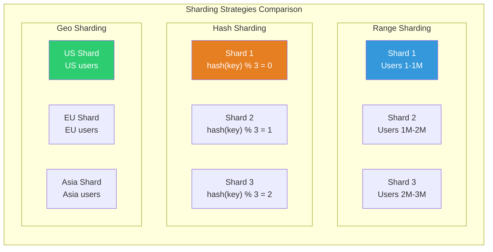
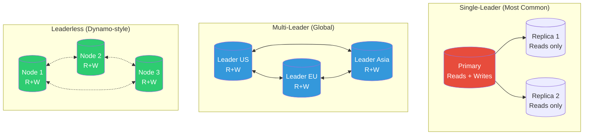
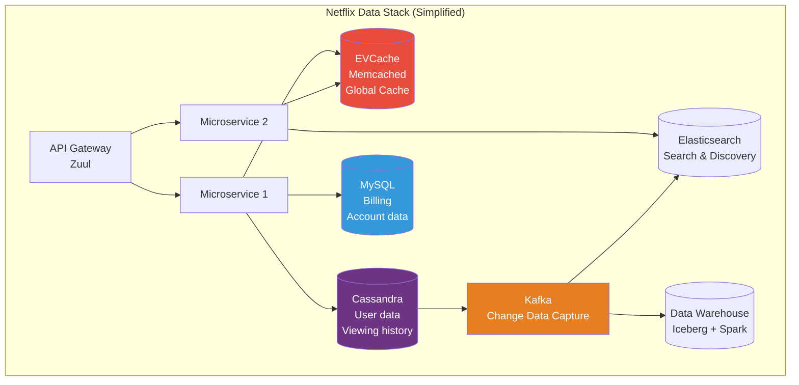

# Large-Scale Data Infrastructure — Sharding, Partitioning & Replication

> How Netflix, Uber, Meta, and Google handle **billions of rows** without breaking a sweat.

---

## 🎯 One-Line Summary

> **At scale, one database is never enough. You SPLIT data across machines (sharding), COPY data for safety (replication), and ROUTE requests to the right place — all while keeping it invisible to your application.**

---

## 1. Sharding — Splitting Data Across Machines

### The Problem

```
Single PostgreSQL server:
  - Max practical size: ~5-10TB
  - Max connections: ~500
  - Max writes/sec: ~10,000
  
Uber's ride data:
  - 20TB+ and growing
  - 100,000 writes/sec
  - 500,000 reads/sec
  
One server can't handle this. You need SHARDING.
```

### What is Sharding?

```
Imagine a library with 1 million books and 1 librarian.
Finding any book takes forever — too many books, one person.

Solution: Split into 10 rooms, each with 100K books and its own librarian.
  Room A: Books with authors A-C
  Room B: Books with authors D-F
  ...
  
Now each "librarian" handles 1/10th the load.
THIS is sharding.
```

### Sharding Strategies (With Code)

```python
# ── STRATEGY 1: Range-Based Sharding ──────────────────────

class RangeSharding:
    """
    Split data by key ranges.
    
    Used by: Google Spanner, HBase, CockroachDB
    
    Example: User IDs 1-1M → Shard 1, 1M-2M → Shard 2
    
    Pros: Range queries are efficient (all nearby keys on same shard)
    Cons: Hot spots if one range is more popular (e.g., new users)
    """
    
    def __init__(self):
        self.range_map = [
            (0,       1_000_000,  "shard_1"),
            (1_000_001, 2_000_000, "shard_2"),
            (2_000_001, 3_000_000, "shard_3"),
            (3_000_001, float('inf'), "shard_4"),
        ]
    
    def get_shard(self, user_id: int) -> str:
        for low, high, shard in self.range_map:
            if low <= user_id <= high:
                return shard
        raise ValueError(f"No shard for user_id={user_id}")
    
    def rebalance(self):
        """
        When shard_1 gets too big: split it in half.
        Move users 500K-1M to a new shard_1b.
        
        Problem: This is an ONLINE operation while serving traffic.
        Google Spanner does this automatically.
        """
        pass


# ── STRATEGY 2: Hash-Based Sharding ──────────────────────

class HashSharding:
    """
    Hash the key, mod by number of shards.
    
    Used by: Redis Cluster, Cassandra, DynamoDB
    
    Pros: Even distribution, no hot spots
    Cons: Range queries need to hit ALL shards (scatter-gather)
    """
    
    def __init__(self, num_shards: int = 16):
        self.num_shards = num_shards
    
    def get_shard(self, key: str) -> int:
        hash_val = hashlib.md5(key.encode()).hexdigest()
        return int(hash_val, 16) % self.num_shards
    
    # Problem: adding a shard reshuffles everything!
    # Old: hash(key) % 16 = shard 5
    # New: hash(key) % 17 = shard 12  ← different!
    # Solution: use consistent hashing (see Dynamo deep dive)


# ── STRATEGY 3: Directory-Based Sharding ──────────────────

class DirectorySharding:
    """
    A lookup table tells you which shard holds each key.
    
    Used by: Vitess (YouTube's MySQL sharding), custom solutions
    
    Pros: Can move individual keys between shards
    Cons: Lookup table is a single point of failure
    """
    
    def __init__(self):
        # Redis or dedicated DB stores the mapping
        self.directory = {}  # key → shard
    
    def get_shard(self, key: str) -> str:
        shard = self.directory.get(key)
        if not shard:
            # New key: assign to least-loaded shard
            shard = self.find_least_loaded_shard()
            self.directory[key] = shard
        return shard
    
    def move_key(self, key: str, new_shard: str):
        """Move a specific key to a different shard — zero-downtime."""
        old_shard = self.directory[key]
        # 1. Copy data from old shard to new shard
        # 2. Update directory
        # 3. Delete from old shard
        self.directory[key] = new_shard


# ── STRATEGY 4: Geographic Sharding ──────────────────────

class GeoSharding:
    """
    Shard by geography — data stays close to users.
    
    Used by: Uber, Netflix, any global service
    
    Pros: Low latency (data near users), data sovereignty compliance
    Cons: Cross-region queries are expensive
    """
    
    REGION_MAP = {
        "US": "shard_us_east",
        "EU": "shard_eu_west", 
        "IN": "shard_ap_south",
        "JP": "shard_ap_northeast",
    }
    
    def get_shard(self, user_country: str) -> str:
        return self.REGION_MAP.get(user_country, "shard_us_east")
```



---

## 2. Uber's Shard Rebalancing (Real-World)

```python
class UberShardRebalancer:
    """
    Uber shards by city (geographic sharding).
    When a city grows, its shard gets too hot.
    
    Example: Bangalore shard handles 50K rides/min.
    Need to split into Bangalore-North and Bangalore-South.
    
    This must happen LIVE without downtime.
    """
    
    async def split_shard_online(self, old_shard: str, 
                                   split_key, new_shard: str):
        """
        Split a shard in half while serving live traffic.
        
        Phase 1: Dual-write (write to both old and new)
        Phase 2: Backfill (copy historical data to new shard)
        Phase 3: Verify (compare data between shards)
        Phase 4: Cut over (update routing, stop dual-write)
        """
        
        # PHASE 1: Start dual-writing
        logger.info(f"Phase 1: Dual-write {old_shard} → {new_shard}")
        await self.router.enable_dual_write(old_shard, new_shard, split_key)
        # All NEW writes for keys > split_key go to BOTH shards
        
        # PHASE 2: Backfill historical data
        logger.info(f"Phase 2: Backfilling {old_shard} → {new_shard}")
        total_rows = 0
        async for batch in self.scan_shard(old_shard, where=f"key > {split_key}"):
            await self.write_batch(new_shard, batch)
            total_rows += len(batch)
            
            # Throttle to not overwhelm the source shard
            await asyncio.sleep(0.1)  # 100ms between batches
        
        logger.info(f"Phase 2 complete: {total_rows} rows backfilled")
        
        # PHASE 3: Verify consistency
        logger.info(f"Phase 3: Verifying consistency")
        mismatches = 0
        async for batch in self.scan_shard(old_shard, where=f"key > {split_key}"):
            new_data = await self.read_batch(new_shard, [row['key'] for row in batch])
            for old_row, new_row in zip(batch, new_data):
                if old_row != new_row:
                    mismatches += 1
        
        if mismatches > 0:
            logger.error(f"Verification failed: {mismatches} mismatches!")
            await self.router.disable_dual_write(old_shard, new_shard)
            raise ShardSplitError(f"{mismatches} mismatches during verification")
        
        # PHASE 4: Cut over routing
        logger.info(f"Phase 4: Cutting over routing")
        await self.router.update_shard_map(
            key_range=(split_key, float('inf')),
            new_shard=new_shard
        )
        
        # Stop dual-write (new shard is now authoritative)
        await self.router.disable_dual_write(old_shard, new_shard)
        
        # Clean up old data from source shard (background, low priority)
        asyncio.create_task(
            self.cleanup_old_shard(old_shard, where=f"key > {split_key}")
        )
        
        logger.info(f"Shard split COMPLETE: {old_shard} → {new_shard}")
```

---

## 3. Replication Topologies



### When to Use Which

```
SINGLE-LEADER:
  Best for: Most applications, strong consistency needed
  Used by:  MySQL, PostgreSQL, MongoDB (default)
  Trade-off: Leader is bottleneck for writes
  
  Example: Banking system — one source of truth for balances.

MULTI-LEADER:
  Best for: Global applications, low write latency everywhere
  Used by:  CockroachDB, Google Spanner, DynamoDB Global Tables
  Trade-off: Conflict resolution needed (complex!)
  
  Example: Google Docs — edit from anywhere in the world.

LEADERLESS:
  Best for: Maximum availability, write-heavy workloads
  Used by:  Cassandra, ScyllaDB, Riak, Amazon Dynamo
  Trade-off: Eventually consistent, application handles conflicts
  
  Example: IoT sensor data — millions of writes, rare reads.
```

---

## 4. Cross-Shard Queries (The Hard Part)

```python
class CrossShardQueryEngine:
    """
    What happens when a query needs data from MULTIPLE shards?
    
    Example: "Find all orders by user_123 across all regions"
    User's orders might be on US shard, EU shard, and Asia shard.
    
    This is the SCATTER-GATHER pattern.
    """
    
    async def scatter_gather_query(self, query: str, params: dict):
        """
        Send query to ALL shards, collect results, merge.
        
        Used by: Vitess, Citus, any distributed SQL system
        """
        # SCATTER: send query to all shards in parallel
        shard_futures = []
        for shard in self.all_shards:
            shard_futures.append(
                self.execute_on_shard(shard, query, params)
            )
        
        # GATHER: collect all results
        shard_results = await asyncio.gather(*shard_futures, return_exceptions=True)
        
        # Handle partial failures
        successful = []
        failed = []
        for shard, result in zip(self.all_shards, shard_results):
            if isinstance(result, Exception):
                failed.append((shard, result))
            else:
                successful.extend(result)
        
        if failed:
            logger.warning(f"{len(failed)} shards failed: {failed}")
            # Decide: return partial results or fail entirely?
        
        # MERGE: combine and sort results
        if 'ORDER BY' in query:
            successful.sort(key=lambda r: r[params.get('sort_key', 'id')])
        
        if 'LIMIT' in query:
            successful = successful[:params.get('limit', 100)]
        
        return successful
    
    async def cross_shard_join(self, table_a_shard, table_b_shard, 
                                join_key):
        """
        JOINs across shards are VERY expensive.
        
        Strategy: Fetch from one shard, then lookup in the other.
        This is why denormalization is preferred at scale.
        """
        # Fetch IDs from shard A
        a_data = await self.execute_on_shard(
            table_a_shard, 
            "SELECT * FROM orders WHERE user_id = %s", 
            (user_id,)
        )
        
        # Batch lookup in shard B
        product_ids = [row['product_id'] for row in a_data]
        b_data = await self.execute_on_shard(
            table_b_shard,
            "SELECT * FROM products WHERE id IN %s",
            (tuple(product_ids),)
        )
        
        # Join in application code
        b_map = {row['id']: row for row in b_data}
        for row in a_data:
            row['product'] = b_map.get(row['product_id'])
        
        return a_data
```

### Best Practice: Avoid Cross-Shard Queries

```
RULE: Design your shard key so that 95% of queries hit ONE shard.

Example: E-commerce

  ❌ BAD shard key: product_id
     "Show user's order history" → hits ALL shards (orders spread everywhere)
  
  ✅ GOOD shard key: user_id
     "Show user's order history" → hits ONE shard (all user's data together)
     "Show product details" → hits ONE shard (product data on product shard)
  
  Trade-off: "Show all orders for product X" is now expensive
  Solution: Maintain a SECONDARY index (Elasticsearch) for product-based queries
```

---

## 5. Netflix's Data Infrastructure at Scale



```
Netflix data numbers:
  - 250M+ subscribers
  - 1 trillion events per day to Kafka
  - 60+ Cassandra clusters (10,000+ nodes total)
  - 30+ petabytes in S3
  - EVCache: 50M+ requests/second (global)
  
Key architectural decisions:
  1. Cassandra for WRITE-HEAVY data (viewing history, bookmarks)
  2. MySQL for CRITICAL data (billing, accounts) — strong consistency
  3. EVCache (Memcached) for READ-HEAVY data — 99% cache hit rate
  4. Elasticsearch for SEARCH (catalog, titles)
  5. Kafka as the "nervous system" connecting everything
```

---

## 6. Production Checklist: Data Infrastructure at Scale

```
SHARDING:
[ ] Shard key chosen to minimize cross-shard queries
[ ] Even data distribution across shards (no hot shards)
[ ] Online shard splitting capability (no downtime)
[ ] Shard-aware connection pooling
[ ] Cross-shard query engine with scatter-gather
[ ] Monitoring: shard sizes, query distribution, hot spots

REPLICATION:
[ ] Sync replica for zero-RPO failover
[ ] Async replica in different AZ for disaster recovery
[ ] Read replicas for scaling read traffic
[ ] Replication lag monitoring with auto-alerting
[ ] Automatic failover tested monthly

DATA MODELING:
[ ] Denormalize for common query patterns (avoid joins at scale)
[ ] Secondary indexes via Elasticsearch/Solr for cross-shard lookups
[ ] CDC (Change Data Capture) pipeline to keep indexes in sync
[ ] Schema evolution strategy (backward + forward compatible)

CAPACITY PLANNING:
[ ] 6-month growth projections per shard
[ ] Auto-scaling rules for read replicas
[ ] Storage alerts at 60%, 80%, 90% capacity
[ ] Load testing: verify system handles 3x current peak
```

---

## 📚 References

- [Vitess: YouTube's MySQL Sharding System](https://vitess.io/docs/overview/whatisvitess/)
- [Netflix Data Architecture Blog](https://netflixtechblog.com/tagged/data-engineering)
- [Uber's Shard Manager](https://www.uber.com/en-US/blog/shard-manager/)
- [Designing Data-Intensive Applications (Kleppmann) — Ch. 6](https://dataintensive.net/)
