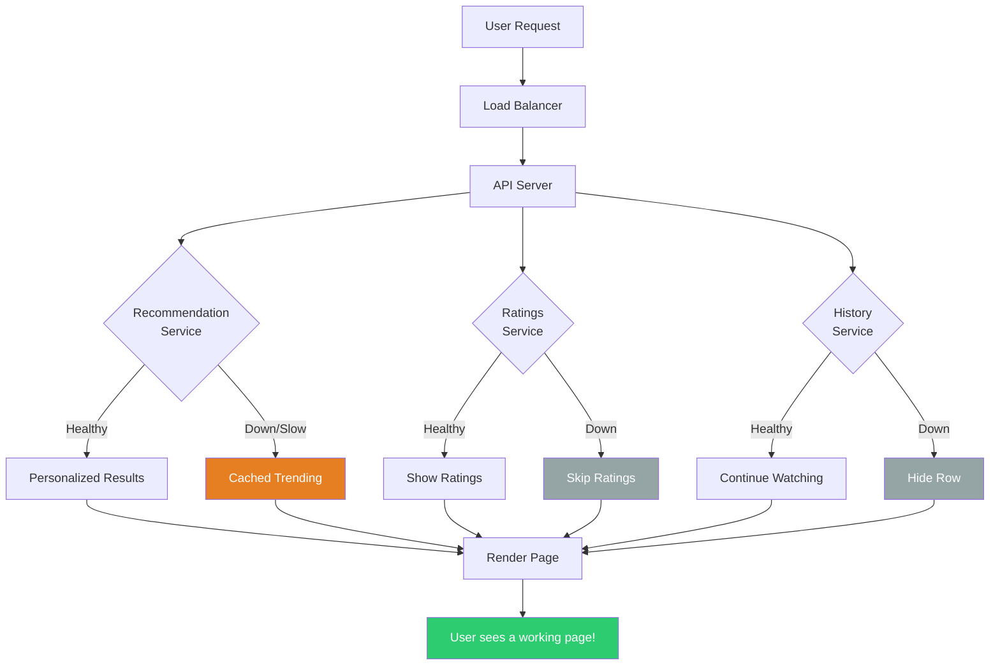
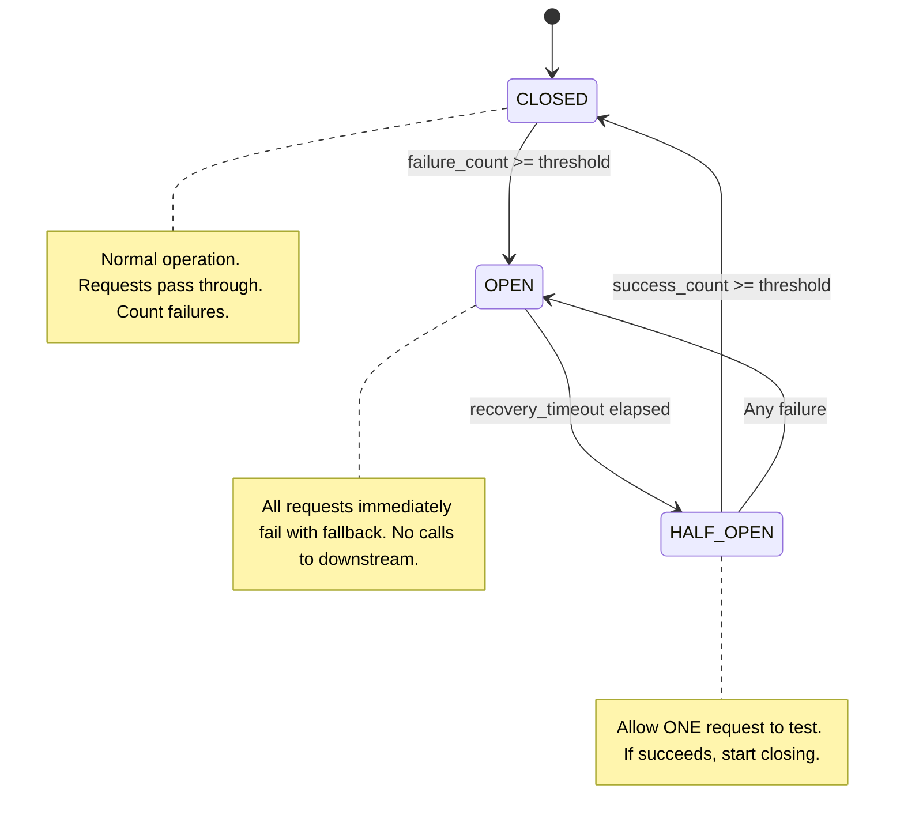
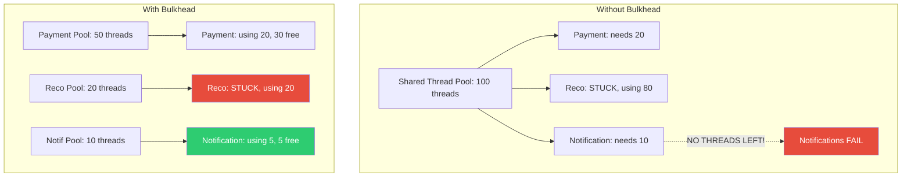

# Large-Scale Reliability Patterns — Chaos Engineering, Graceful Degradation & SLOs

> How Netflix, Google, Amazon survive failures that would kill most systems.

---

## 🎯 One-Line Summary

> **At scale, failures aren't exceptions — they're CONSTANTS. Design for failure by setting SLOs, testing with chaos, and degrading gracefully when things break.**

---

## 1. SLOs, SLIs, SLAs — The Foundation

### Plain English

```
SLI (Service Level Indicator) = What you MEASURE
  "99.2% of requests completed in under 200ms this month"

SLO (Service Level Objective) = What you PROMISE internally  
  "We aim for 99.9% of requests under 200ms"

SLA (Service Level Agreement) = What you PROMISE to customers (with penalties)
  "We guarantee 99.95% uptime or you get credits"

Relationship:
  SLI (actual) should meet SLO (target) which should beat SLA (contract)
  
  SLI: 99.92%  ← Actual measurement
  SLO: 99.9%   ← Internal target (SLI > SLO? Great!)
  SLA: 99.5%   ← Customer promise (buffer above SLA = safe)
```

### Error Budget — The Game Changer

```python
class ErrorBudget:
    """
    Error budget = how much failure you can AFFORD.
    
    Google invented this concept. It changed how SRE works.
    
    Instead of "never fail" (impossible), it's:
    "You have X minutes of allowed downtime. Spend them wisely."
    """
    
    def __init__(self, slo_target: float = 99.9):
        self.slo_target = slo_target
        self.window_days = 30  # Rolling 30-day window
    
    def calculate(self):
        """
        SLO: 99.9% → Error budget: 0.1%
        
        In a 30-day month:
          Total minutes: 30 × 24 × 60 = 43,200
          Error budget:  43,200 × 0.001 = 43.2 minutes
          
        You can have 43 minutes of downtime per month
        and still meet your SLO.
        """
        total_minutes = self.window_days * 24 * 60
        budget_fraction = 1 - (self.slo_target / 100)
        budget_minutes = total_minutes * budget_fraction
        
        return {
            "slo": f"{self.slo_target}%",
            "error_budget_pct": f"{budget_fraction * 100}%",
            "budget_minutes": round(budget_minutes, 1),
            "budget_hours": round(budget_minutes / 60, 1),
        }
    
    def should_we_deploy(self, remaining_budget_pct: float) -> dict:
        """
        Google's rule: If error budget is exhausted, STOP deploying.
        Focus on reliability until budget replenishes.
        """
        if remaining_budget_pct > 50:
            return {
                "deploy": True,
                "reason": f"Budget healthy ({remaining_budget_pct}% remaining). Ship fast!"
            }
        elif remaining_budget_pct > 20:
            return {
                "deploy": True,
                "reason": f"Budget moderate ({remaining_budget_pct}%). Deploy with caution.",
                "requirements": ["Canary deployment required", "Rollback plan documented"]
            }
        elif remaining_budget_pct > 0:
            return {
                "deploy": "only_reliability_fixes",
                "reason": f"Budget LOW ({remaining_budget_pct}%). Only reliability fixes allowed."
            }
        else:
            return {
                "deploy": False,
                "reason": "Budget EXHAUSTED. Feature freeze until budget replenishes.",
                "action": "Focus 100% on reliability improvements."
            }

# 99.9% SLO = 43 minutes/month of allowed downtime
print(ErrorBudget(99.9).calculate())
# 99.99% SLO = 4.3 minutes/month
print(ErrorBudget(99.99).calculate())
# 99.999% SLO = 26 SECONDS/month (Google Search level)
print(ErrorBudget(99.999).calculate())
```

---

## 2. Graceful Degradation — Breaking on Purpose

```python
class GracefulDegradation:
    """
    When part of the system fails, DON'T let the whole thing crash.
    Disable non-essential features and keep the core working.
    
    Real-world analogy: 
    Airplane loses one engine → it doesn't crash!
    It flies on remaining engines with reduced performance.
    """

    # Netflix example: What degrades during an outage
    DEGRADATION_LEVELS = {
        "level_0": {
            "name": "Fully Operational",
            "features": "Everything works normally",
        },
        "level_1": {
            "name": "Mild Degradation",
            "disabled": [
                "Personalized recommendations (show generic trending)",
                "Recently watched row (cached version shown)",
                "User reviews and ratings",
            ],
            "still_working": [
                "Video playback (core)",
                "Search",
                "User authentication",
                "Billing",
            ],
            "trigger": "Recommendation service down"
        },
        "level_2": {
            "name": "Moderate Degradation",
            "disabled": [
                "All personalization",
                "Search (show browse-only mode)",
                "Profiles (default profile used)",
                "Download for offline",
            ],
            "still_working": [
                "Video playback (core)",
                "Basic catalog browsing",
                "User authentication",
            ],
            "trigger": "Multiple microservices down"
        },
        "level_3": {
            "name": "Emergency Mode",
            "disabled": [
                "New user signups",
                "Account changes",
                "All non-playback features",
            ],
            "still_working": [
                "Video playback for logged-in users",
                "Cached content catalog",
            ],
            "trigger": "Major infrastructure failure"
        },
    }


class FeatureFlagDegradation:
    """
    Use feature flags to turn off expensive features during overload.
    """
    
    async def serve_homepage(self, user_id):
        response = {"videos": []}
        
        # Core: Always try to show SOMETHING
        try:
            if await feature_flags.is_enabled("personalized_recommendations"):
                response["videos"] = await recommendation_service.get(user_id, timeout=200)
            else:
                response["videos"] = await self.get_cached_trending()
        except (TimeoutError, ServiceUnavailable):
            # Recommendation service is slow/down — fallback to cached
            response["videos"] = await self.get_cached_trending()
            metrics.increment("degradation.recommendations_fallback")
        
        # Non-critical: ratings, reviews
        try:
            if await feature_flags.is_enabled("user_ratings"):
                response["ratings"] = await ratings_service.get(user_id, timeout=100)
        except Exception:
            response["ratings"] = None  # Page works fine without ratings
        
        # Non-critical: continue watching row
        try:
            if await feature_flags.is_enabled("continue_watching"):
                response["continue_watching"] = await history_service.get(user_id, timeout=100)
        except Exception:
            response["continue_watching"] = []
        
        return response
    
    async def get_cached_trending(self):
        """Fallback: show the same trending list to everyone."""
        cached = await redis.get("trending_videos")
        if cached:
            return json.loads(cached)
        # Even Redis is down? Return hardcoded popular titles
        return HARDCODED_POPULAR_TITLES  # Updated weekly, baked into code
```



---

## 3. Circuit Breaker Pattern — Stop Calling Dead Services

```python
import time
import enum
from collections import deque

class CircuitState(enum.Enum):
    CLOSED = "closed"        # Normal — requests flow through
    OPEN = "open"            # Tripped — all requests immediately fail
    HALF_OPEN = "half_open"  # Testing — allow ONE request to check recovery

class CircuitBreaker:
    """
    Like an electrical circuit breaker:
    Too many failures → TRIP the breaker → stop sending requests.
    
    Without circuit breaker:
      Service B is down → Service A keeps calling → A's threads all stuck
      waiting → A runs out of threads → A is also down → CASCADING FAILURE
    
    With circuit breaker:
      Service B is down → 5 failures → breaker OPENS → A instantly returns
      fallback → A stays healthy → periodically tests if B recovered
    """
    
    def __init__(self, name: str, failure_threshold: int = 5,
                 recovery_timeout: int = 30, success_threshold: int = 3):
        self.name = name
        self.state = CircuitState.CLOSED
        self.failure_count = 0
        self.success_count = 0
        self.failure_threshold = failure_threshold    # Failures before tripping
        self.recovery_timeout = recovery_timeout      # Seconds before trying again
        self.success_threshold = success_threshold    # Successes to fully close
        self.last_failure_time = 0
        self.recent_response_times = deque(maxlen=100)
    
    async def call(self, func, *args, fallback=None, **kwargs):
        """
        Execute a function through the circuit breaker.
        
        Usage:
            breaker = CircuitBreaker("payment-service")
            result = await breaker.call(
                payment_api.charge,
                amount=100,
                fallback=lambda: {"status": "queued"}
            )
        """
        # OPEN: Fail immediately (don't waste time calling dead service)
        if self.state == CircuitState.OPEN:
            if time.time() - self.last_failure_time > self.recovery_timeout:
                self.state = CircuitState.HALF_OPEN
                self.success_count = 0
            else:
                metrics.increment(f"circuit_breaker.{self.name}.rejected")
                if fallback:
                    return fallback()
                raise CircuitBreakerOpen(f"{self.name} circuit is OPEN")
        
        # CLOSED or HALF_OPEN: Try the call
        try:
            start = time.time()
            result = await asyncio.wait_for(func(*args, **kwargs), timeout=5.0)
            elapsed = time.time() - start
            
            self._on_success(elapsed)
            return result
            
        except (TimeoutError, ConnectionError, Exception) as e:
            self._on_failure()
            
            if fallback:
                return fallback()
            raise
    
    def _on_success(self, response_time: float):
        self.recent_response_times.append(response_time)
        
        if self.state == CircuitState.HALF_OPEN:
            self.success_count += 1
            if self.success_count >= self.success_threshold:
                self.state = CircuitState.CLOSED
                self.failure_count = 0
                metrics.increment(f"circuit_breaker.{self.name}.closed")
        
        self.failure_count = 0
    
    def _on_failure(self):
        self.failure_count += 1
        self.last_failure_time = time.time()
        
        if self.failure_count >= self.failure_threshold:
            self.state = CircuitState.OPEN
            metrics.increment(f"circuit_breaker.{self.name}.opened")
        
        if self.state == CircuitState.HALF_OPEN:
            self.state = CircuitState.OPEN  # Test failed, reopen


# Usage in production
payment_breaker = CircuitBreaker("payment-service", failure_threshold=5)
recommendation_breaker = CircuitBreaker("reco-service", failure_threshold=3)

async def checkout(order):
    payment = await payment_breaker.call(
        payment_api.charge,
        amount=order.total,
        fallback=lambda: queue_for_later(order)  # Degrade gracefully
    )
    return payment
```



---

## 4. Chaos Engineering — Netflix's Simian Army

```python
class ChaosExperiments:
    """
    Netflix's philosophy: "The best way to avoid failure in production 
    is to continuously cause failure in production."
    
    Run controlled experiments that break things on purpose 
    to find weaknesses BEFORE real failures find them.
    """
    
    # Experiment 1: Kill random instances
    async def chaos_monkey(self):
        """
        Randomly kill one production instance per day.
        
        Purpose: Ensure every service can handle instance failure.
        If killing one instance causes an outage → that service
        has a single point of failure → FIX IT.
        """
        # Pick a random instance from a random service
        services = await kubernetes.get_all_services()
        target_service = random.choice(services)
        target_pod = random.choice(target_service.pods)
        
        # Safety checks
        if target_service.pod_count <= 2:
            return  # Don't kill if there aren't enough replicas
        if target_service.name in ["billing", "auth"]:
            return  # Never chaos-test critical path without approval
        
        logger.info(f"Chaos Monkey: killing {target_pod.name} in {target_service.name}")
        await kubernetes.delete_pod(target_pod.name)
        
        # Monitor for 10 minutes
        await asyncio.sleep(600)
        error_rate = await metrics.get_error_rate(target_service.name, window="10m")
        
        if error_rate > 0.01:
            await alert_team(
                f"Chaos Monkey found a weakness! "
                f"Killing {target_pod.name} caused {error_rate*100:.1f}% errors "
                f"in {target_service.name}"
            )
    
    # Experiment 2: Simulate network latency
    async def latency_monkey(self):
        """Add artificial latency between services to test timeout handling."""
        # Use tc (traffic control) to add 500ms delay
        target_service = random.choice(await self.get_non_critical_services())
        
        await kubernetes.exec_in_pod(
            target_service.pods[0].name,
            f"tc qdisc add dev eth0 root netem delay 500ms 100ms"
        )
        
        logger.info(f"Latency Monkey: added 500ms delay to {target_service.name}")
        
        # Monitor: do callers handle the latency gracefully?
        await asyncio.sleep(300)  # 5 minutes of chaos
        
        # Cleanup
        await kubernetes.exec_in_pod(
            target_service.pods[0].name,
            f"tc qdisc del dev eth0 root"
        )
    
    # Experiment 3: Simulate AZ failure  
    async def chaos_gorilla(self):
        """
        Simulate an entire Availability Zone going down.
        
        This is the BIG test. Can your system survive losing 
        1/3 of its infrastructure?
        """
        target_az = random.choice(["us-east-1a", "us-east-1b", "us-east-1c"])
        
        # Don't actually kill the AZ — block traffic to/from it
        # Using network policies in Kubernetes
        logger.critical(f"Chaos Gorilla: simulating {target_az} failure")
        
        await kubernetes.apply_network_policy({
            "name": f"chaos-block-{target_az}",
            "spec": {
                "podSelector": {"matchLabels": {"topology.kubernetes.io/zone": target_az}},
                "policyTypes": ["Ingress", "Egress"],
                "ingress": [],  # Block all incoming
                "egress": [],   # Block all outgoing
            }
        })
        
        # Monitor overall system health
        await asyncio.sleep(600)  # 10 minutes
        
        global_error_rate = await metrics.get_global_error_rate(window="10m")
        global_latency_p99 = await metrics.get_global_latency_p99(window="10m")
        
        # Cleanup
        await kubernetes.delete_network_policy(f"chaos-block-{target_az}")
        
        return {
            "az_blocked": target_az,
            "duration": "10 minutes",
            "error_rate_during": f"{global_error_rate*100:.2f}%",
            "p99_latency_during": f"{global_latency_p99}ms",
            "passed": global_error_rate < 0.01 and global_latency_p99 < 500
        }
```

---

## 5. Retry & Backoff — The Right Way

```python
import random

class RetryWithBackoff:
    """
    WRONG way to retry:
      while True: call_service()  → DDoS your own service!
    
    RIGHT way: exponential backoff + jitter + limits
    """
    
    @staticmethod
    async def retry(func, max_retries=3, base_delay=1.0,
                     max_delay=30.0, jitter=True):
        """
        Exponential backoff with jitter.
        
        Attempt 1: wait 1s  (+ random 0-500ms)
        Attempt 2: wait 2s  (+ random 0-1000ms)
        Attempt 3: wait 4s  (+ random 0-2000ms)
        Attempt 4: give up
        
        WHY JITTER?
        Without jitter: 1000 clients all retry at exactly T+1s, T+2s, T+4s
          → Thundering herd hits server at exact same moments
        
        With jitter: 1000 clients retry at T+1.2s, T+0.8s, T+1.5s...
          → Requests spread out, server handles them smoothly
        """
        last_exception = None
        
        for attempt in range(max_retries + 1):
            try:
                return await func()
            except RetryableError as e:
                last_exception = e
                
                if attempt == max_retries:
                    break  # No more retries
                
                # Calculate delay with exponential backoff
                delay = min(base_delay * (2 ** attempt), max_delay)
                
                # Add jitter (randomize to avoid thundering herd)
                if jitter:
                    delay = delay * (0.5 + random.random())  # 50% to 150% of delay
                
                logger.warning(
                    f"Retry {attempt + 1}/{max_retries} after {delay:.1f}s: {e}"
                )
                await asyncio.sleep(delay)
            
            except NonRetryableError:
                raise  # Don't retry client errors (400, 422, etc.)
        
        raise MaxRetriesExceeded(f"Failed after {max_retries} retries: {last_exception}")
```

```
WHICH ERRORS ARE RETRYABLE?

  RETRY (server might recover):
    ✅ 429 Too Many Requests (back off and try later)
    ✅ 500 Internal Server Error (transient bug)
    ✅ 502 Bad Gateway (load balancer lost backend)
    ✅ 503 Service Unavailable (overloaded)
    ✅ 504 Gateway Timeout (slow response)
    ✅ Connection refused / reset
    ✅ DNS resolution failure (temporary)
  
  DON'T RETRY (won't help):
    ❌ 400 Bad Request (your request is wrong)
    ❌ 401 Unauthorized (invalid credentials)
    ❌ 403 Forbidden (no permission)
    ❌ 404 Not Found (resource doesn't exist)
    ❌ 409 Conflict (business logic conflict)
    ❌ 422 Unprocessable Entity (validation error)
```

---

## 6. Rate Limiting & Load Shedding

```python
class ProductionRateLimiter:
    """
    Protect your service from being overwhelmed.
    
    Three layers:
    1. Per-user rate limit (prevent abuse)
    2. Per-service rate limit (prevent cascade)
    3. Global load shedding (protect the whole system)
    """
    
    # Layer 1: Token Bucket per user
    async def check_user_rate_limit(self, user_id: str, endpoint: str) -> bool:
        """
        Each user gets N tokens per minute.
        Each request costs 1 token.
        Tokens refill at a fixed rate.
        """
        key = f"ratelimit:{user_id}:{endpoint}"
        
        # Redis-based token bucket
        lua_script = """
        local tokens = tonumber(redis.call('get', KEYS[1]) or ARGV[1])
        local max_tokens = tonumber(ARGV[1])
        local refill_rate = tonumber(ARGV[2])
        local now = tonumber(ARGV[3])
        local last_refill = tonumber(redis.call('get', KEYS[2]) or now)
        
        -- Refill tokens based on elapsed time
        local elapsed = now - last_refill
        tokens = math.min(max_tokens, tokens + elapsed * refill_rate)
        
        if tokens >= 1 then
            tokens = tokens - 1
            redis.call('set', KEYS[1], tokens)
            redis.call('set', KEYS[2], now)
            return 1  -- Allowed
        else
            return 0  -- Rate limited
        end
        """
        
        allowed = await redis.eval(
            lua_script,
            keys=[f"{key}:tokens", f"{key}:last_refill"],
            args=[100, 1.67, time.time()]  # 100 max tokens, ~100/min refill
        )
        
        return bool(allowed)
    
    # Layer 3: Global load shedding
    async def load_shedding(self, request):
        """
        When the system is overloaded, shed LOW-PRIORITY requests
        to protect HIGH-PRIORITY ones.
        
        Priority levels:
          P0: Health checks, billing, auth → NEVER shed
          P1: Core features (video playback, checkout) → Shed at 95% CPU
          P2: Nice-to-have (recommendations, analytics) → Shed at 80% CPU
          P3: Background jobs (reports, exports) → Shed at 70% CPU
        """
        cpu_usage = await metrics.get_cpu_usage()
        priority = self.get_request_priority(request)
        
        shedding_thresholds = {
            0: 1.0,    # P0: never shed (threshold = 100% CPU)
            1: 0.95,   # P1: shed above 95% CPU
            2: 0.80,   # P2: shed above 80% CPU
            3: 0.70,   # P3: shed above 70% CPU
        }
        
        threshold = shedding_thresholds.get(priority, 0.80)
        
        if cpu_usage > threshold:
            metrics.increment("load_shedding.shed", tags={"priority": priority})
            return Response(
                status=503,
                body={"error": "Service temporarily overloaded", "retry_after": 5}
            )
        
        return None  # Allow request through
```

---

## 7. Bulkhead Pattern — Isolate Failures

```python
class BulkheadIsolation:
    """
    Named after ship bulkheads: sealed compartments that prevent 
    water from flooding the entire ship if one section is breached.
    
    Applied to software: isolate resources so one failing service 
    can't consume ALL threads/connections/memory.
    """
    
    def __init__(self):
        # Each service gets its OWN thread pool / connection pool
        self.pools = {
            "payment": ThreadPool(max_workers=50),
            "recommendation": ThreadPool(max_workers=20),
            "notification": ThreadPool(max_workers=10),
            "analytics": ThreadPool(max_workers=5),
        }
    
    async def call_service(self, service_name, func, *args):
        pool = self.pools.get(service_name)
        
        if pool.active_count >= pool.max_workers:
            # This service's pool is exhausted
            # But OTHER services are unaffected!
            metrics.increment(f"bulkhead.{service_name}.rejected")
            raise BulkheadFullError(f"{service_name} pool exhausted")
        
        return await pool.submit(func, *args)

# WITHOUT bulkhead:
#   Recommendation service hangs → uses ALL 100 threads
#   Payment service: "no threads available!" → checkout broken!
#
# WITH bulkhead:
#   Recommendation service hangs → uses its 20 threads
#   Payment service: still has its 50 threads → checkout works!
```



---

## 📋 Production Checklist: Reliability at Scale

```
SLOs & ERROR BUDGETS:
[ ] SLIs defined for every user-facing service (latency, error rate, throughput)
[ ] SLOs set with business stakeholders (not just engineers)
[ ] Error budget tracked and visible on dashboard
[ ] Feature freeze policy when error budget exhausted
[ ] Monthly SLO review with trends

GRACEFUL DEGRADATION:
[ ] Degradation levels defined (Level 0-3)
[ ] Feature flags for every non-critical feature
[ ] Cached fallbacks for personalization/recommendation services
[ ] Static/hardcoded fallback data as last resort
[ ] Tested: can each feature be disabled independently?

CIRCUIT BREAKERS:
[ ] Circuit breaker on every cross-service call
[ ] Fallback defined for each circuit breaker
[ ] Metrics: open/close state, rejection count
[ ] Dashboard showing all circuit breaker states

RETRIES:
[ ] Exponential backoff with jitter on all retries
[ ] Max retry limit (never unlimited!)
[ ] Retryable vs non-retryable errors classified
[ ] Dead letter queue for exhausted retries
[ ] Idempotency keys on all retried writes

RATE LIMITING & LOAD SHEDDING:
[ ] Per-user rate limits on all public APIs
[ ] Per-service rate limits between internal services
[ ] Priority-based load shedding (shed P3 before P0)
[ ] 429 responses with Retry-After header

CHAOS ENGINEERING:
[ ] Chaos Monkey: random instance killing (weekly)
[ ] Latency injection experiments (monthly)
[ ] AZ failure simulation (quarterly)
[ ] Game days with full team participation
```

---

## 📚 References

- [Google SRE Book — Error Budgets](https://sre.google/sre-book/embracing-risk/)
- [Netflix Chaos Engineering](https://netflixtechblog.com/tagged/chaos-engineering)
- [Release It! by Michael Nygard (Circuit Breakers, Bulkheads)](https://pragprog.com/titles/mnee2/release-it-second-edition/)
- [AWS Well-Architected: Reliability Pillar](https://docs.aws.amazon.com/wellarchitected/latest/reliability-pillar/)
