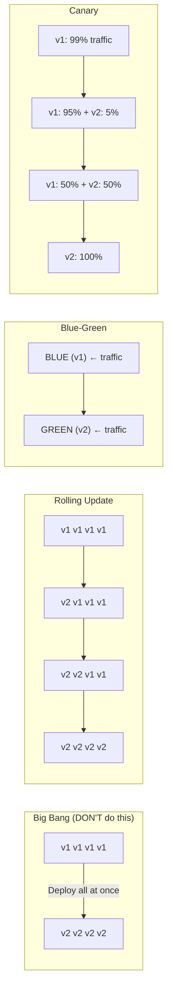
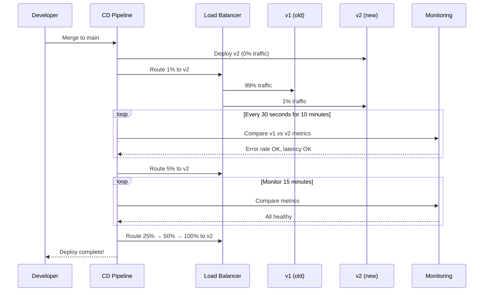
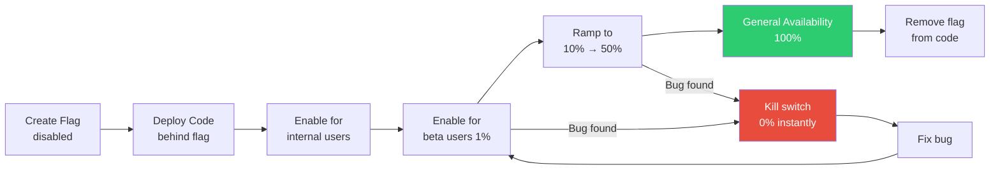
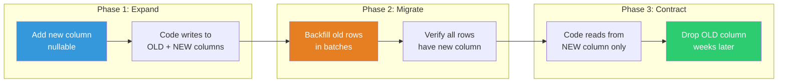

# Large-Scale Deployments — Zero-Downtime, Canary, Blue-Green & Feature Flags

> How FAANG companies deploy thousands of times per day without breaking anything.

---

## 🎯 One-Line Summary

> **Never deploy to ALL servers at once. Roll out gradually, measure impact, and auto-rollback if anything goes wrong.**

---

## 1. Deployment Strategies Compared



```
Strategy      │ Downtime │ Risk     │ Rollback Speed │ Infra Cost  │ Used By
──────────────┼──────────┼──────────┼────────────────┼─────────────┼──────────────
Big Bang      │ Minutes  │ VERY HIGH│ Slow (redeploy)│ 1x          │ Small projects
Rolling       │ Zero     │ Medium   │ Medium         │ 1x          │ Kubernetes default
Blue-Green    │ Zero     │ Low      │ Instant (swap) │ 2x          │ AWS, Netflix
Canary        │ Zero     │ Very Low │ Instant        │ 1.05x       │ Google, Facebook
```

---

## 2. Canary Deployments — Google's Approach

```python
class CanaryDeploymentController:
    """
    Deploy new version to 1% of traffic.
    If metrics are healthy, gradually increase.
    If metrics degrade, auto-rollback immediately.
    
    Google deploys to production THOUSANDS of times per day using this.
    """
    
    CANARY_STAGES = [
        {"traffic_pct": 1,   "duration_min": 10, "name": "smoke_test"},
        {"traffic_pct": 5,   "duration_min": 15, "name": "small_canary"},
        {"traffic_pct": 25,  "duration_min": 20, "name": "medium_canary"},
        {"traffic_pct": 50,  "duration_min": 30, "name": "large_canary"},
        {"traffic_pct": 100, "duration_min": 0,  "name": "full_rollout"},
    ]
    
    async def deploy(self, service: str, new_version: str):
        old_version = await self.get_current_version(service)
        
        for stage in self.CANARY_STAGES:
            pct = stage["traffic_pct"]
            duration = stage["duration_min"]
            
            logger.info(f"Canary stage: {stage['name']} — {pct}% traffic to {new_version}")
            
            # Route traffic
            await self.set_traffic_split(service, {
                old_version: 100 - pct,
                new_version: pct,
            })
            
            if pct == 100:
                logger.info(f"Full rollout complete: {new_version}")
                break
            
            # Monitor for the stage duration
            is_healthy = await self.monitor_canary(
                service, old_version, new_version,
                duration_minutes=duration
            )
            
            if not is_healthy:
                logger.critical(f"Canary FAILED at {pct}%! Rolling back.")
                await self.rollback(service, old_version)
                await self.alert_deployer(
                    f"Deploy of {new_version} rolled back at {pct}% canary."
                )
                return {"status": "rolled_back", "stage": stage["name"]}
        
        return {"status": "success", "version": new_version}
    
    async def monitor_canary(self, service, old_ver, new_ver, 
                              duration_minutes):
        """
        Compare metrics between old and new versions.
        If new version is significantly worse, return False.
        """
        end_time = time.time() + (duration_minutes * 60)
        
        while time.time() < end_time:
            # Get metrics for both versions
            old_metrics = await self.get_version_metrics(service, old_ver)
            new_metrics = await self.get_version_metrics(service, new_ver)
            
            # Check 1: Error rate
            if new_metrics["error_rate"] > old_metrics["error_rate"] * 1.5:
                logger.error(
                    f"Canary error rate {new_metrics['error_rate']:.2%} > "
                    f"1.5x baseline {old_metrics['error_rate']:.2%}"
                )
                return False
            
            # Check 2: Latency (p99)
            if new_metrics["p99_latency_ms"] > old_metrics["p99_latency_ms"] * 1.3:
                logger.error(
                    f"Canary p99 latency {new_metrics['p99_latency_ms']}ms > "
                    f"1.3x baseline {old_metrics['p99_latency_ms']}ms"
                )
                return False
            
            # Check 3: CPU/Memory
            if new_metrics["cpu_pct"] > 90 or new_metrics["memory_pct"] > 85:
                logger.error("Canary resource usage too high")
                return False
            
            # Check 4: Custom business metrics
            if new_metrics.get("checkout_conversion") is not None:
                if new_metrics["checkout_conversion"] < old_metrics["checkout_conversion"] * 0.95:
                    logger.error("Canary checkout conversion dropped >5%")
                    return False
            
            await asyncio.sleep(30)  # Check every 30 seconds
        
        return True  # Survived the monitoring period!
    
    async def rollback(self, service, old_version):
        """Instant rollback: send 100% traffic back to old version."""
        await self.set_traffic_split(service, {old_version: 100})
        logger.critical(f"ROLLED BACK {service} to {old_version}")
```



---

## 3. Feature Flags — Deploy != Release

```python
class FeatureFlagSystem:
    """
    Separate DEPLOYMENT from RELEASE.
    
    Deploy: Code is on the server (running but gated behind a flag)
    Release: Flag is turned ON (users can see the feature)
    
    Why?
    - Deploy risky code ANYTIME (flag is OFF, users don't see it)
    - Turn flag ON for 1% of users (test in production)
    - Bug found? Turn flag OFF instantly (no redeploy needed!)
    - A/B test: flag ON for 50%, compare metrics
    """
    
    async def is_enabled(self, flag_name: str, user_id: str = None,
                          context: dict = None) -> bool:
        """
        Check if a feature flag is enabled for this user/request.
        
        Flag types:
        1. Boolean: ON/OFF for everyone
        2. Percentage: ON for X% of users
        3. User list: ON for specific users
        4. Rule-based: ON for users matching criteria
        """
        flag = await self.get_flag(flag_name)
        
        if not flag:
            return False  # Unknown flag = disabled
        
        if flag["type"] == "boolean":
            return flag["enabled"]
        
        elif flag["type"] == "percentage":
            # Deterministic: same user always gets same result
            hash_val = hash(f"{flag_name}:{user_id}") % 100
            return hash_val < flag["percentage"]
        
        elif flag["type"] == "user_list":
            return user_id in flag["users"]
        
        elif flag["type"] == "rule":
            return self._evaluate_rules(flag["rules"], context)
        
        return False
    
    def _evaluate_rules(self, rules, context):
        """
        Rule-based targeting.
        Example: Enable for users in India with >100 orders.
        """
        for rule in rules:
            field = context.get(rule["field"])
            operator = rule["operator"]
            value = rule["value"]
            
            if operator == "eq" and field == value:
                return True
            elif operator == "gt" and field > value:
                return True
            elif operator == "in" and field in value:
                return True
            elif operator == "contains" and value in field:
                return True
        
        return False


# ── Example: Safe rollout of a new checkout flow ──

async def checkout_page(request, user):
    flags = FeatureFlagSystem()
    
    if await flags.is_enabled("new_checkout_v2", user_id=user.id, context={
        "country": user.country,
        "total_orders": user.order_count,
        "platform": request.headers.get("X-Platform"),
    }):
        return render_new_checkout(request, user)
    else:
        return render_old_checkout(request, user)


# Flag configuration (stored in DB or config service):
NEW_CHECKOUT_FLAG = {
    "name": "new_checkout_v2",
    "type": "percentage",
    "percentage": 5,          # Only 5% of users see it
    "kill_switch": True,      # Can be disabled instantly
    "owner": "checkout-team",
    "created": "2026-10-26",
    "stale_after": "2027-01-26",  # Reminder to clean up
}
```

### Feature Flag Lifecycle



---

## 4. Database Migrations Without Downtime

```python
class ZeroDowntimeMigration:
    """
    Changing database schema on a live system with millions of users.
    
    WRONG: ALTER TABLE users ADD COLUMN phone VARCHAR(20);
    This LOCKS the table for minutes/hours on large tables!
    
    RIGHT: Expand-and-Contract pattern (3-phase migration)
    """
    
    async def add_column_safely(self, table, column, column_type):
        """
        Phase 1: EXPAND — Add column, write to both old and new
        Phase 2: MIGRATE — Backfill old rows
        Phase 3: CONTRACT — Remove old column (optional, later)
        """
        
        # PHASE 1: Add column (nullable, no default = instant on Postgres 11+)
        logger.info("Phase 1: Adding column")
        await db.execute(f"""
            ALTER TABLE {table} ADD COLUMN IF NOT EXISTS {column} {column_type}
        """)
        # Instant! No table lock because it's nullable with no default.
        
        # Deploy new application code that writes to BOTH old and new columns
        # This is done via a code deploy, not a DB change
        
        # PHASE 2: Backfill existing rows (in small batches!)
        logger.info("Phase 2: Backfilling")
        total_updated = 0
        
        while True:
            result = await db.execute(f"""
                UPDATE {table}
                SET {column} = compute_value(old_column)
                WHERE {column} IS NULL
                AND id IN (
                    SELECT id FROM {table}
                    WHERE {column} IS NULL
                    LIMIT 1000
                    FOR UPDATE SKIP LOCKED
                )
                RETURNING id
            """)
            
            batch_size = len(result)
            total_updated += batch_size
            
            if batch_size == 0:
                break
            
            logger.info(f"Backfilled {total_updated} rows...")
            await asyncio.sleep(0.5)  # Don't overwhelm the DB
        
        logger.info(f"Phase 2 complete: {total_updated} rows backfilled")
        
        # PHASE 3: Deploy code that reads from new column
        # Then optionally drop old column (weeks later, after verification)
    
    async def rename_column_safely(self, table, old_name, new_name):
        """
        Renaming a column: you can't just ALTER TABLE RENAME.
        That breaks all queries using the old name!
        
        Steps:
        1. Add new column
        2. Deploy code that writes to BOTH
        3. Backfill new column from old
        4. Deploy code that reads from new column
        5. Drop old column (weeks later)
        """
        # Step 1: Add new column
        await self.add_column_safely(table, new_name, "same_type_as_old")
        
        # Step 2: Create a trigger to keep them in sync during migration
        await db.execute(f"""
            CREATE OR REPLACE FUNCTION sync_{old_name}_to_{new_name}()
            RETURNS TRIGGER AS $$
            BEGIN
                IF NEW.{new_name} IS NULL AND NEW.{old_name} IS NOT NULL THEN
                    NEW.{new_name} = NEW.{old_name};
                END IF;
                RETURN NEW;
            END;
            $$ LANGUAGE plpgsql;
            
            CREATE TRIGGER trigger_sync_{old_name}
            BEFORE INSERT OR UPDATE ON {table}
            FOR EACH ROW EXECUTE FUNCTION sync_{old_name}_to_{new_name}();
        """)
        
        # Step 3: Backfill
        # Step 4: Deploy code reading new column
        # Step 5: Drop trigger, then drop old column after verification
```



---

## 5. GitOps — Infrastructure as Code Deployments

```yaml
# Kubernetes deployment with canary using Argo Rollouts

apiVersion: argoproj.io/v1alpha1
kind: Rollout
metadata:
  name: checkout-service
spec:
  replicas: 20
  strategy:
    canary:
      steps:
        - setWeight: 5        # 5% traffic to new version
        - pause:
            duration: 10m     # Wait 10 minutes
        - analysis:            # Auto-check metrics
            templates:
              - templateName: success-rate
            args:
              - name: service-name
                value: checkout-service
        - setWeight: 25
        - pause:
            duration: 15m
        - analysis:
            templates:
              - templateName: success-rate
        - setWeight: 50
        - pause:
            duration: 20m
        - setWeight: 100       # Full rollout
      
      # Auto-rollback if analysis fails
      rollbackWindow:
        revisions: 1
      
      # Anti-affinity: old and new pods on different nodes
      antiAffinity:
        requiredDuringSchedulingIgnoredDuringExecution: {}

---
# Analysis template: auto-check if canary is healthy
apiVersion: argoproj.io/v1alpha1
kind: AnalysisTemplate
metadata:
  name: success-rate
spec:
  metrics:
    - name: success-rate
      interval: 60s
      successCondition: result[0] >= 0.99  # 99% success rate
      provider:
        prometheus:
          address: http://prometheus:9090
          query: |
            sum(rate(http_requests_total{service="{{args.service-name}}",status=~"2.."}[5m]))
            /
            sum(rate(http_requests_total{service="{{args.service-name}}"}[5m]))
    
    - name: latency-p99
      interval: 60s
      successCondition: result[0] <= 500  # p99 < 500ms
      provider:
        prometheus:
          address: http://prometheus:9090
          query: |
            histogram_quantile(0.99,
              rate(http_request_duration_seconds_bucket{service="{{args.service-name}}"}[5m])
            ) * 1000
```

---

## 📋 Production Checklist: Deployments at Scale

```
CANARY DEPLOYMENTS:
[ ] Automated canary stages: 1% → 5% → 25% → 50% → 100%
[ ] Metric comparison: error rate, latency, CPU, business KPIs
[ ] Auto-rollback on metric degradation
[ ] Canary duration: minimum 10 minutes per stage
[ ] Bake time: 30+ minutes at 100% before declaring success

FEATURE FLAGS:
[ ] Flag for every user-facing feature change
[ ] Kill switch capability (disable in <1 minute)
[ ] Percentage-based rollout for gradual release
[ ] Flag cleanup policy (remove after full rollout)
[ ] Flag ownership and staleness tracking

DATABASE MIGRATIONS:
[ ] Expand-and-Contract pattern (never lock tables)
[ ] Backfill in small batches with sleep between
[ ] Backward-compatible changes only
[ ] Migration tested on production-sized dataset
[ ] Rollback plan for every migration

DEPLOYMENT SAFETY:
[ ] No deploys during peak traffic hours
[ ] No deploys on Fridays (or before holidays)
[ ] Deploy diff reviewed before production
[ ] Smoke tests run immediately after deploy
[ ] On-call engineer available during every deploy
```

---

## 📚 References

- [Google's Canary Analysis Service](https://cloud.google.com/deploy/docs/deployment-strategies/canary)
- [Argo Rollouts — Progressive Delivery](https://argoproj.github.io/argo-rollouts/)
- [Martin Fowler — Feature Toggles](https://martinfowler.com/articles/feature-toggles.html)
- [GitHub — Move Fast and Fix Things](https://github.blog/2015-12-15-move-fast/)
