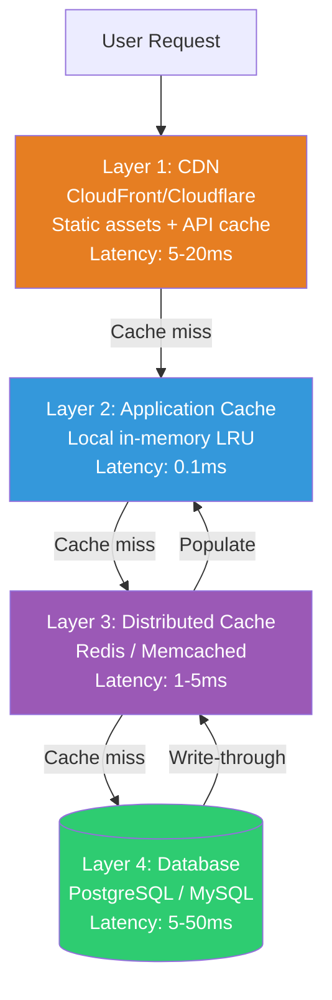
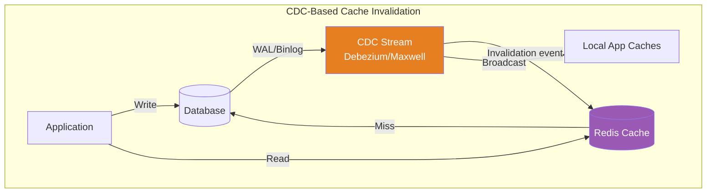

# Large-Scale Caching — Multi-Layer, Stampede Prevention & Consistency

> How Facebook serves 10 billion cache requests per second with Memcached.

---

## 🎯 One-Line Summary

> **Caching is not "just put Redis in front." At scale, you need multi-layer caches, stampede protection, cache invalidation strategies, and consistency protocols — or your cache becomes your biggest problem.**

---

## 1. Multi-Layer Cache Architecture



```python
class MultiLayerCache:
    """
    Each layer trades capacity for speed.
    
    Layer 1 (CDN):       Terabytes capacity, 5-20ms latency,  highest hit rate for static
    Layer 2 (App local): Megabytes capacity, 0.1ms latency,   per-server, no network hop
    Layer 3 (Redis):     Gigabytes capacity, 1-5ms latency,   shared across all servers
    Layer 4 (Database):  Terabytes capacity, 5-50ms latency,  source of truth
    """
    
    def __init__(self):
        self.local_cache = LRUCache(max_size=10_000)  # Per-server, in-process
        self.redis = RedisCluster()                     # Shared across servers
    
    async def get(self, key: str) -> any:
        # Layer 2: Local cache (fastest, no network)
        value = self.local_cache.get(key)
        if value is not None:
            metrics.increment("cache.hit.local")
            return value
        
        # Layer 3: Redis (fast, shared)
        value = await self.redis.get(key)
        if value is not None:
            metrics.increment("cache.hit.redis")
            self.local_cache.set(key, value, ttl=60)  # Promote to local
            return value
        
        # Layer 4: Database (slow, but authoritative)
        metrics.increment("cache.miss")
        value = await self.database.get(key)
        
        if value is not None:
            # Populate caches (write-through)
            await self.redis.set(key, value, ex=3600)    # 1 hour in Redis
            self.local_cache.set(key, value, ttl=60)     # 1 min locally
        
        return value
    
    async def invalidate(self, key: str):
        """
        When data changes, invalidate ALL cache layers.
        Order matters: database first, then caches.
        """
        # Step 1: Update database (source of truth)
        # (Already done by the caller)
        
        # Step 2: Delete from Redis
        await self.redis.delete(key)
        
        # Step 3: Delete from local cache ON ALL SERVERS
        # This is the hard part — local caches are per-server!
        await self.broadcast_invalidation(key)
    
    async def broadcast_invalidation(self, key: str):
        """
        Tell ALL application servers to clear their local cache.
        
        Options:
        1. Redis Pub/Sub (what Facebook uses)
        2. Kafka topic
        3. Just use short TTLs (accept brief staleness)
        """
        await self.redis.publish("cache_invalidation", json.dumps({
            "key": key,
            "timestamp": time.time()
        }))
```

---

## 2. Cache Stampede (Thundering Herd) — The #1 Caching Problem

```
WHAT IS A CACHE STAMPEDE?

Popular item "iPhone 16" has 100,000 views per second.
Cached in Redis with TTL = 60 seconds.

At T=60s, cache entry expires.
100,000 requests simultaneously see "cache miss."
All 100,000 hit the database at the same time.
Database: "I can handle 1,000 queries/sec, not 100,000!" → CRASH 💥

    ┌─────────────────────────────────────────────────────────┐
    │                                                         │
    │  Requests        ████████████████████████████████████    │
    │  to DB           █                                  █   │
    │                  █    Normal    █ STAMPEDE! █ Normal █   │
    │                  █   ~100/sec  █ 100K/sec  █ ~100/sec   │
    │                  ████████████████████████████████████    │
    │                              ↑                           │
    │                     Cache expires here                   │
    └─────────────────────────────────────────────────────────┘
```

```python
# ── SOLUTION 1: Locking (Only ONE request refreshes cache) ─────

class StampedeProtection:
    """
    When cache expires, only ONE request goes to the database.
    All other requests wait for that one request to populate the cache.
    """
    
    async def get_with_lock(self, key: str):
        # Try cache first
        value = await self.redis.get(key)
        if value:
            return json.loads(value)
        
        # Cache miss — try to acquire lock
        lock_key = f"lock:{key}"
        acquired = await self.redis.set(lock_key, "1", nx=True, ex=10)
        
        if acquired:
            # I won the lock — I'll refresh the cache
            try:
                value = await self.database.get(key)
                await self.redis.set(key, json.dumps(value), ex=3600)
                return value
            finally:
                await self.redis.delete(lock_key)
        else:
            # Someone else is refreshing — wait for them
            for _ in range(50):  # Wait up to 5 seconds
                await asyncio.sleep(0.1)
                value = await self.redis.get(key)
                if value:
                    return json.loads(value)
            
            # Timeout — go to database (fallback)
            return await self.database.get(key)


# ── SOLUTION 2: Early Refresh (Refresh BEFORE expiry) ──────────

class EarlyRefreshCache:
    """
    Don't wait for cache to expire.
    Refresh it BEFORE expiry so there's never a gap.
    
    TTL = 60 seconds, but at T=50s (83% of TTL), 
    trigger a background refresh.
    """
    
    async def get_with_early_refresh(self, key: str):
        value, ttl = await self.redis.get_with_ttl(key)
        
        if value:
            original_ttl = 3600  # 1 hour
            
            # If less than 17% of TTL remaining, refresh in background
            if ttl < original_ttl * 0.17:
                # Fire-and-forget background refresh
                asyncio.create_task(self.refresh_cache(key))
            
            return json.loads(value)
        
        # Full cache miss
        return await self.refresh_cache(key)
    
    async def refresh_cache(self, key):
        value = await self.database.get(key)
        await self.redis.set(key, json.dumps(value), ex=3600)
        return value


# ── SOLUTION 3: Stale-While-Revalidate ──────────────────────

class StaleWhileRevalidate:
    """
    Return STALE data immediately, refresh in background.
    
    User gets fast response (stale by a few seconds).
    Cache is refreshed for the next request.
    
    Used by: HTTP Cache-Control: stale-while-revalidate
    """
    
    async def get_swr(self, key: str):
        # Store value with two TTLs:
        # - Fresh TTL: 60s (data is considered fresh)
        # - Stale TTL: 300s (data is stale but usable)
        
        entry = await self.redis.hgetall(f"swr:{key}")
        
        if entry:
            value = json.loads(entry['value'])
            created_at = float(entry['created_at'])
            age = time.time() - created_at
            
            if age < 60:
                # Fresh — return as-is
                return value
            elif age < 300:
                # Stale but usable — return immediately, refresh in background
                asyncio.create_task(self._refresh(key))
                return value
            else:
                # Too stale — must refresh synchronously
                pass
        
        # No cache or too stale
        return await self._refresh(key)
    
    async def _refresh(self, key):
        value = await self.database.get(key)
        await self.redis.hset(f"swr:{key}", mapping={
            'value': json.dumps(value),
            'created_at': str(time.time())
        })
        await self.redis.expire(f"swr:{key}", 300)
        return value
```

---

## 3. Cache Invalidation — "The Hardest Problem in CS"

```python
class CacheInvalidationStrategies:
    """
    Phil Karlton: "There are only two hard things in Computer Science:
    cache invalidation and naming things."
    
    Three strategies, each with different trade-offs.
    """
    
    # Strategy 1: TTL (Time-To-Live) — Simplest
    async def ttl_based(self, key, value, ttl_seconds=300):
        """
        Set a timer. After TTL, data is automatically evicted.
        
        Pros: Dead simple, no invalidation logic needed
        Cons: Data is stale for up to TTL seconds
        
        Best for: data that changes rarely (product catalog, config)
        """
        await self.redis.set(key, value, ex=ttl_seconds)
    
    # Strategy 2: Write-Through — Update cache on every write
    async def write_through(self, key, value):
        """
        Every time you write to DB, also update the cache.
        
        Pros: Cache is always fresh
        Cons: Every write is slower (DB + cache)
              Race condition if two writes happen simultaneously
        
        Best for: data read much more than written (user profiles)
        """
        # Write to DB first (source of truth)
        await self.database.update(key, value)
        # Then update cache
        await self.redis.set(key, json.dumps(value), ex=3600)
    
    # Strategy 3: Write-Behind — Async cache update
    async def write_behind(self, key, value):
        """
        Write to cache immediately, update DB asynchronously.
        
        Pros: Fastest writes (cache is in-memory)
        Cons: Data loss if cache crashes before DB write
              Complex — need a reliable queue
        
        Best for: high-write workloads where some data loss is OK (analytics)
        """
        await self.redis.set(key, json.dumps(value))
        await self.write_queue.enqueue({"key": key, "value": value})
        # Background worker drains queue to database
    
    # Strategy 4: Cache-Aside with Event-Driven Invalidation (BEST for most)
    async def cache_aside_with_cdc(self, key):
        """
        Application manages cache reads.
        Database changes trigger cache invalidation via CDC (Change Data Capture).
        
        This is what Facebook, Uber, and most large systems use.
        
        Flow:
        1. App reads from cache → cache hit → done
        2. App reads from cache → cache miss → read DB → populate cache
        3. DB write happens → CDC event → invalidate cache
        """
        pass


# Facebook's approach: McSqueal (CDC-based invalidation)
class CDCCacheInvalidator:
    """
    Listen to database changelog and invalidate cache automatically.
    No manual cache invalidation code needed!
    """
    
    async def cdc_consumer(self):
        """
        Read PostgreSQL WAL / MySQL binlog / Debezium events.
        For every row change, invalidate the corresponding cache key.
        """
        async for event in self.cdc_stream:
            table = event['table']
            operation = event['operation']  # INSERT, UPDATE, DELETE
            row = event['after'] if operation != 'DELETE' else event['before']
            
            # Determine which cache keys to invalidate
            cache_keys = self.get_cache_keys_for_row(table, row)
            
            for key in cache_keys:
                await self.redis.delete(key)
                await self.broadcast_local_cache_invalidation(key)
                
                metrics.increment("cache.invalidated", tags={
                    "table": table,
                    "operation": operation
                })
    
    def get_cache_keys_for_row(self, table, row):
        """Map database rows to cache keys."""
        keys = []
        
        if table == "users":
            keys.append(f"user:{row['id']}")
            keys.append(f"user_profile:{row['id']}")
            keys.append(f"user_settings:{row['id']}")
        
        elif table == "products":
            keys.append(f"product:{row['id']}")
            keys.append(f"product_listing:{row['category_id']}")
            # Also invalidate search results that might include this product
            keys.append(f"search_results:category_{row['category_id']}")
        
        elif table == "orders":
            keys.append(f"order:{row['id']}")
            keys.append(f"user_orders:{row['user_id']}")
        
        return keys
```



---

## 4. Facebook's Memcached at Scale

```
Facebook's cache infrastructure (real numbers from their paper):

  - Billions of key-value pairs
  - 10+ billion requests per second (across all clusters)
  - Thousands of Memcached servers
  - ~75% of all reads served from cache (never hit DB)
  - Cache miss → database read → populate cache

  Architecture: Regional pools + cross-region replication

  ┌──────────────────────────────────────────────────────────┐
  │ Region: US-East                                          │
  │                                                          │
  │  ┌─────────────┐  ┌─────────────┐  ┌─────────────┐     │
  │  │ Web Server  │  │ Web Server  │  │ Web Server  │     │
  │  │ Cluster A   │  │ Cluster B   │  │ Cluster C   │     │
  │  └──────┬──────┘  └──────┬──────┘  └──────┬──────┘     │
  │         │                │                │              │
  │  ┌──────▼──────┐  ┌──────▼──────┐  ┌──────▼──────┐     │
  │  │ Memcached   │  │ Memcached   │  │ Memcached   │     │
  │  │ Pool A      │  │ Pool B      │  │ Pool C      │     │
  │  └──────┬──────┘  └──────┬──────┘  └──────┬──────┘     │
  │         │                │                │              │
  │         └────────────────┼────────────────┘              │
  │                          │                               │
  │                   ┌──────▼──────┐                        │
  │                   │  MySQL      │                        │
  │                   │  Primary    │                        │
  │                   └─────────────┘                        │
  └──────────────────────────────────────────────────────────┘
```

```python
# Facebook's "lease" mechanism to prevent stampedes

class FacebookLeaseCache:
    """
    Facebook's solution to the thundering herd problem.
    
    Instead of just a lock, they use a "lease" — a token that:
    1. Only one client gets the lease (prevents stampede)
    2. Lease expires automatically (prevents deadlock)
    3. Stale set detection (prevents race conditions)
    """
    
    async def get_with_lease(self, key: str):
        result = await self.memcached.get(key)
        
        if result is not None:
            return result  # Cache hit
        
        # Cache miss — request a lease
        lease_token = await self.memcached.get_lease(key)
        
        if lease_token:
            # I got the lease — I'm responsible for populating cache
            value = await self.database.query(key)
            
            # Set value with the lease token
            # If someone else deleted this key while we were querying,
            # the lease token won't match → set is rejected (prevents stale data)
            await self.memcached.set_with_lease(key, value, lease_token)
            return value
        else:
            # Someone else has the lease — wait for them
            # But DON'T wait forever — use a short timeout
            for _ in range(10):
                await asyncio.sleep(0.1)
                result = await self.memcached.get(key)
                if result is not None:
                    return result
            
            # Timeout — fall through to database
            return await self.database.query(key)
```

---

## 5. Redis Cluster at Scale — Gotchas and Solutions

```python
class RedisClusterBestPractices:
    """
    Redis Cluster pitfalls that bite at scale.
    """
    
    # GOTCHA 1: Hot Key Problem
    async def handle_hot_key(self, key: str):
        """
        One key getting millions of requests per second.
        
        Example: "trending_topic_1" during a viral event.
        Even Redis can't handle 1M ops/sec on a SINGLE key
        because one key = one slot = one node.
        """
        # Solution: Read replicas + local cache
        # 1. Use Redis read replicas (READONLY mode)
        # 2. Cache the hot key locally with short TTL
        
        value = self.local_cache.get(key)
        if value:
            return value
        
        value = await self.redis_replica.get(key)  # Read from replica
        if value:
            self.local_cache.set(key, value, ttl=1)  # 1 second local cache
            return value
        
        # Only primary for writes
        return await self.redis_primary.get(key)
    
    # GOTCHA 2: Big Key Problem
    async def handle_big_key(self, key: str):
        """
        A key storing a 50MB JSON object.
        Reading it blocks Redis (single-threaded!) for 100ms.
        All other requests wait.
        
        Solution: Break big values into chunks.
        """
        # Instead of: SET user:123:feed "50MB of JSON"
        # Do: SET user:123:feed:chunk:0 "5MB"
        #     SET user:123:feed:chunk:1 "5MB"
        #     ...
        #     SET user:123:feed:meta '{"chunks": 10}'
        pass
    
    # GOTCHA 3: Thundering herd on Redis restart
    async def warm_cache_on_restart(self):
        """
        Redis restarts (deploy, crash, scaling) = cold cache.
        All requests suddenly hit database = stampede.
        
        Solution: Pre-warm cache from database before taking traffic.
        """
        logger.info("Pre-warming cache before accepting traffic...")
        
        # Load the most frequently accessed keys
        hot_keys = await self.database.query("""
            SELECT key, value FROM cache_warmup_list
            ORDER BY access_count DESC
            LIMIT 10000
        """)
        
        pipeline = self.redis.pipeline()
        for row in hot_keys:
            pipeline.set(row['key'], row['value'], ex=3600)
        
        await pipeline.execute()
        logger.info(f"Pre-warmed {len(hot_keys)} keys")
        
        # NOW accept traffic
        await self.mark_ready()
```

---

## 📋 Production Checklist: Caching at Scale

```
MULTI-LAYER CACHING:
[ ] CDN for static assets and cacheable API responses
[ ] Local in-memory cache (LRU) for ultra-hot data
[ ] Distributed cache (Redis/Memcached) for shared data
[ ] Cache-aside pattern with proper miss handling

STAMPEDE PREVENTION:
[ ] Lock-based refresh (only one request populates cache)
[ ] Early refresh (refresh at 80% of TTL)
[ ] Stale-while-revalidate for latency-sensitive endpoints
[ ] Request coalescing for identical concurrent requests

INVALIDATION:
[ ] CDC-based invalidation (database changelog → cache delete)
[ ] Broadcast invalidation for local caches (Redis Pub/Sub)
[ ] TTL as safety net (never rely solely on explicit invalidation)
[ ] Invalidation monitoring (alert if invalidation lag > threshold)

OPERATIONAL:
[ ] Cache hit rate monitoring (target: >90%)
[ ] Hot key detection and auto-mitigation
[ ] Big key detection (alert on keys > 1MB)
[ ] Cache pre-warming on restart
[ ] Memory eviction policy configured (allkeys-lru for most cases)
[ ] Redis Cluster slot distribution balanced
[ ] Connection pooling configured (don't exhaust connections)
```

---

## 📚 References

- [Scaling Memcache at Facebook (NSDI '13)](https://research.facebook.com/publications/scaling-memcache-at-facebook/)
- [Redis Cluster Specification](https://redis.io/docs/reference/cluster-spec/)
- [AWS ElastiCache Best Practices](https://docs.aws.amazon.com/AmazonElastiCache/latest/red-ug/BestPractices.html)
