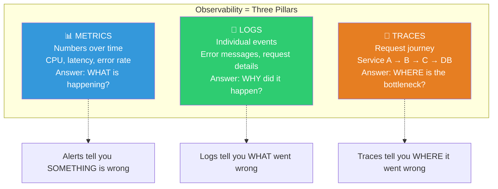
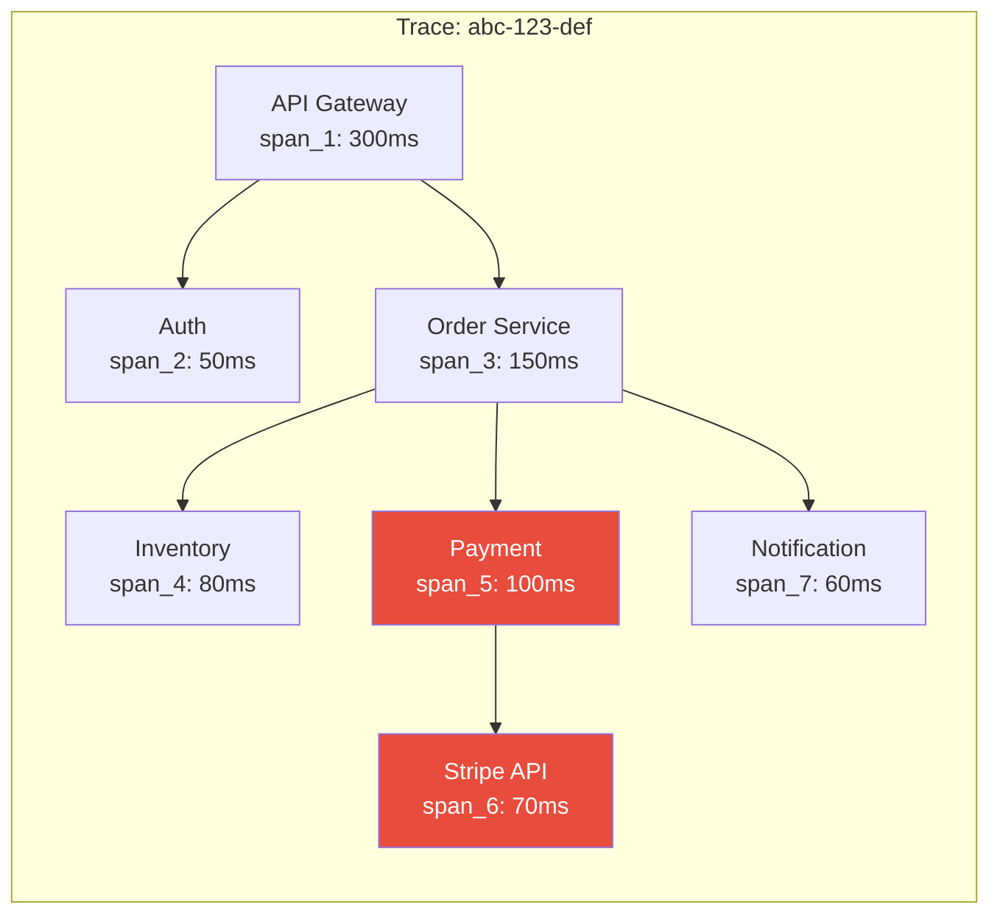
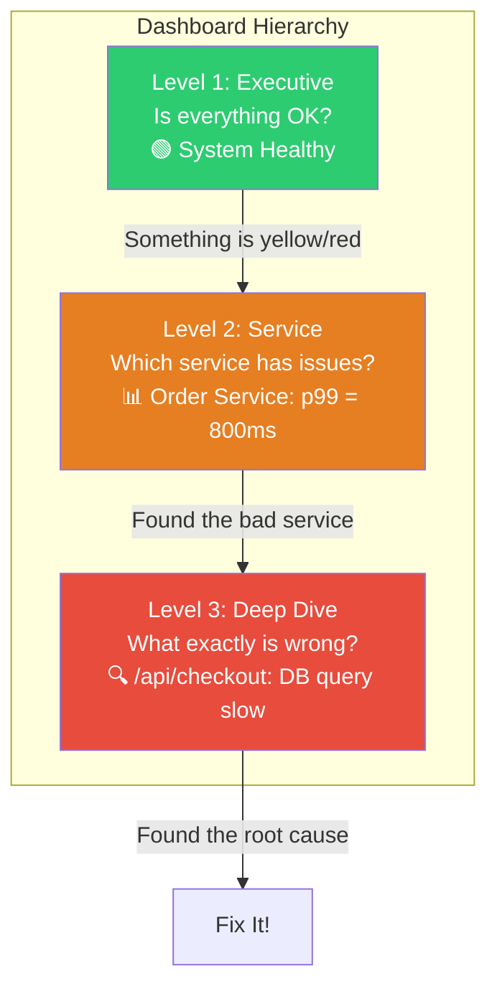

# Large-Scale Observability — Monitoring, Alerting & Distributed Tracing

> How Google, Uber, and Netflix see what's happening across millions of servers.

---

## 🎯 One-Line Summary

> **Observability = Metrics (what's happening) + Logs (why it happened) + Traces (where it happened). Without all three, you're debugging blind at scale.**

---

## 1. The Three Pillars



---

## 2. Metrics — The RED and USE Methods

```python
class MetricsStrategy:
    """
    Two proven frameworks for what to measure:
    
    RED Method (for services):
      Rate:    requests per second
      Errors:  failed requests per second
      Duration: how long requests take
    
    USE Method (for infrastructure):
      Utilization: % of resource busy (CPU 75%)
      Saturation:  work waiting in queue (10 items queued)
      Errors:      error count (5 disk errors/hour)
    """
    
    def instrument_service(self, service_name: str):
        """RED metrics for every microservice."""
        return {
            # RATE: How many requests are we handling?
            "request_rate": Counter(
                f"{service_name}_requests_total",
                "Total requests",
                labels=["method", "endpoint", "status_code"]
            ),
            
            # ERRORS: How many are failing?
            "error_rate": Counter(
                f"{service_name}_errors_total",
                "Total errors",
                labels=["method", "endpoint", "error_type"]
            ),
            
            # DURATION: How long do they take?
            "duration": Histogram(
                f"{service_name}_request_duration_seconds",
                "Request duration",
                labels=["method", "endpoint"],
                buckets=[0.01, 0.05, 0.1, 0.25, 0.5, 1.0, 2.5, 5.0, 10.0]
            ),
        }
    
    def instrument_infrastructure(self, resource_name: str):
        """USE metrics for every infrastructure component."""
        return {
            # UTILIZATION: How busy is it?
            "utilization": Gauge(
                f"{resource_name}_utilization_ratio",
                "Resource utilization (0-1)",
                labels=["instance"]
            ),
            
            # SATURATION: Is work queuing up?
            "saturation": Gauge(
                f"{resource_name}_saturation_queue_depth",
                "Items waiting in queue",
                labels=["instance"]
            ),
            
            # ERRORS: Is the resource failing?
            "errors": Counter(
                f"{resource_name}_errors_total",
                "Resource errors",
                labels=["instance", "error_type"]
            ),
        }


# Middleware to auto-instrument every endpoint
class MetricsMiddleware:
    """Add to every service. Automatically tracks RED metrics."""
    
    async def __call__(self, request, handler):
        start = time.time()
        method = request.method
        endpoint = request.path
        
        try:
            response = await handler(request)
            
            # Record metrics
            duration = time.time() - start
            REQUEST_COUNT.labels(method, endpoint, response.status).inc()
            REQUEST_DURATION.labels(method, endpoint).observe(duration)
            
            if response.status >= 500:
                ERROR_COUNT.labels(method, endpoint, "server_error").inc()
            
            return response
            
        except Exception as e:
            duration = time.time() - start
            REQUEST_COUNT.labels(method, endpoint, 500).inc()
            REQUEST_DURATION.labels(method, endpoint).observe(duration)
            ERROR_COUNT.labels(method, endpoint, type(e).__name__).inc()
            raise
```

---

## 3. Distributed Tracing — Following a Request Across Services

```python
# How one user request flows through 12 microservices

"""
User clicks "Place Order" → trace_id: abc-123-def

API Gateway        [============]                              300ms total
  Auth Service       [====]                                    50ms
  Order Service        [====================]                  150ms
    Inventory Svc         [========]                           80ms
      Database              [====]                             40ms
    Payment Svc                    [=============]             100ms
      Stripe API                     [=========]              70ms
    Notification Svc                              [======]    60ms
      Email Provider                                [====]    30ms

Trace shows:
  - Total latency: 300ms
  - Bottleneck: Payment Service (100ms, 33% of total)
  - Stripe API alone: 70ms (23% of total)
  - If we want to speed up checkout, optimize Stripe call first
"""

import uuid

class DistributedTracer:
    """
    Propagate trace context across all service calls.
    Each service adds its own "span" to the trace.
    """
    
    def create_trace(self) -> dict:
        """Start a new trace at the entry point (API Gateway)."""
        return {
            "trace_id": str(uuid.uuid4()),
            "span_id": str(uuid.uuid4()),
            "parent_span_id": None,
            "service": "api-gateway",
            "operation": "handle_request",
            "start_time": time.time(),
            "tags": {},
            "logs": [],
        }
    
    def create_child_span(self, parent_trace: dict, 
                           service: str, operation: str) -> dict:
        """Create a child span when calling another service."""
        return {
            "trace_id": parent_trace["trace_id"],  # Same trace!
            "span_id": str(uuid.uuid4()),           # New span
            "parent_span_id": parent_trace["span_id"],
            "service": service,
            "operation": operation,
            "start_time": time.time(),
            "tags": {},
            "logs": [],
        }
    
    def finish_span(self, span: dict):
        """Record span duration and send to tracing backend."""
        span["end_time"] = time.time()
        span["duration_ms"] = (span["end_time"] - span["start_time"]) * 1000
        
        # Send to Jaeger/Zipkin/Datadog
        self.exporter.export(span)


# In practice, use OpenTelemetry (industry standard)
from opentelemetry import trace
from opentelemetry.sdk.trace import TracerProvider

tracer = trace.get_tracer("checkout-service")

async def place_order(request):
    with tracer.start_as_current_span("place_order") as span:
        span.set_attribute("order.amount", request.amount)
        span.set_attribute("user.id", request.user_id)
        
        # Each downstream call automatically creates a child span
        with tracer.start_as_current_span("check_inventory"):
            inventory = await inventory_service.check(request.items)
        
        with tracer.start_as_current_span("process_payment"):
            payment = await payment_service.charge(request.amount)
            span.set_attribute("payment.id", payment.id)
        
        with tracer.start_as_current_span("send_notification"):
            await notification_service.send_receipt(request.user_id)
        
        return {"order_id": order.id, "payment_id": payment.id}
```



---

## 4. Alerting That Doesn't Suck

```python
class AlertingBestPractices:
    """
    Bad alerting: 500 alerts/day, on-call ignores them all, real issue missed.
    Good alerting: 2-3 meaningful alerts/week, each one actionable.
    
    Google's rule: "Every alert should either require immediate human action
    or be deleted."
    """
    
    # Rule 1: Alert on SYMPTOMS, not CAUSES
    GOOD_ALERTS = {
        "symptom_alert": {
            "name": "High Error Rate",
            "query": "rate(http_errors_total[5m]) / rate(http_requests_total[5m]) > 0.01",
            "why": "Users are experiencing errors — something is wrong",
            "action": "Check logs, traces, find the failing component",
        },
        "slo_burn_rate": {
            "name": "SLO Burn Rate Too High",
            "query": "error_budget_remaining < 0.5 AND burn_rate_1h > 1.5",
            "why": "We're consuming error budget faster than expected",
            "action": "Investigate recent deploys or traffic changes",
        },
    }
    
    BAD_ALERTS = {
        "cause_alert_1": {
            "name": "CPU > 80%",
            "why_bad": "CPU can be 90% and everything is fine. "
                       "Alert on the EFFECT (high latency), not the CAUSE (high CPU).",
        },
        "cause_alert_2": {
            "name": "1 pod restarted",
            "why_bad": "Kubernetes restarts pods routinely. "
                       "Alert if SERVICE is degraded, not if one pod bounced.",
        },
    }
    
    # Rule 2: Multi-window, multi-burn-rate alerts (Google SRE)
    def slo_based_alerts(self):
        """
        Instead of "error rate > 1%", alert based on how fast
        you're burning through your error budget.
        
        Fast burn (2% errors for 5 min) → Page immediately
        Slow burn (0.5% errors for 6 hours) → Create ticket
        """
        return [
            {
                "name": "Fast Burn — Page Immediately",
                "condition": "burn_rate_5min > 14.4",
                "meaning": "At this rate, entire monthly error budget "
                           "exhausted in 1 HOUR",
                "severity": "critical",
                "action": "page_oncall"
            },
            {
                "name": "Medium Burn — Page",
                "condition": "burn_rate_1h > 6",
                "meaning": "Error budget exhausted in 5 hours",
                "severity": "warning",
                "action": "page_oncall"
            },
            {
                "name": "Slow Burn — Ticket",
                "condition": "burn_rate_6h > 1.5",
                "meaning": "Error budget exhausted in 20 days "
                           "(faster than the 30-day window)",
                "severity": "info",
                "action": "create_ticket"
            },
        ]
```

```yaml
# Prometheus alerting rules (production-ready)

groups:
  - name: service-slo-alerts
    rules:
      # Fast burn: page immediately
      - alert: HighErrorBurnRate
        expr: |
          (
            sum(rate(http_requests_total{status=~"5.."}[5m]))
            /
            sum(rate(http_requests_total[5m]))
          ) > (14.4 * 0.001)  # 14.4x the SLO error rate
        for: 2m
        labels:
          severity: critical
        annotations:
          summary: "Service {{ $labels.service }} burning error budget 14x faster than allowed"
          runbook: "https://wiki.internal/runbooks/high-error-rate"
      
      # Latency SLO: p99 > 500ms for 10 minutes
      - alert: HighLatency
        expr: |
          histogram_quantile(0.99,
            rate(http_request_duration_seconds_bucket[5m])
          ) > 0.5
        for: 10m
        labels:
          severity: warning
        annotations:
          summary: "p99 latency above 500ms for {{ $labels.service }}"
```

---

## 5. Structured Logging at Scale

```python
import structlog
import json

# Configure structured logging (JSON format)
structlog.configure(
    processors=[
        structlog.processors.TimeStamper(fmt="iso"),
        structlog.processors.add_log_level,
        structlog.processors.JSONRenderer()
    ]
)

logger = structlog.get_logger()

class StructuredLogging:
    """
    At scale, grep-able text logs are useless.
    You need STRUCTURED (JSON) logs with consistent fields.
    
    Bad log:
      "Error processing order for user 123, amount $50"
      → How do you search for all errors for user 123?
      → Regex? Good luck across 10TB of logs.
    
    Good log:
      {"level":"error", "event":"order_failed", "user_id":"123",
       "amount":50, "error":"card_declined", "trace_id":"abc-123"}
      → Query: event="order_failed" AND user_id="123"
      → Instant results in Elasticsearch/CloudWatch/Datadog
    """
    
    async def process_order(self, order):
        log = logger.bind(
            trace_id=get_trace_id(),
            user_id=order.user_id,
            order_id=order.id,
            amount=order.amount,
        )
        
        log.info("order_processing_started")
        
        try:
            payment = await self.charge(order)
            
            log.info("order_completed",
                     payment_id=payment.id,
                     duration_ms=elapsed_ms)
        
        except CardDeclinedError as e:
            log.warning("order_payment_declined",
                        decline_reason=e.reason,
                        card_last_four=e.card[-4:])
        
        except Exception as e:
            log.error("order_failed",
                      error_type=type(e).__name__,
                      error_message=str(e),
                      stack_trace=traceback.format_exc())
```

```
# What structured logs look like at scale:

# In Elasticsearch / CloudWatch Insights / Datadog:

# Query: "Show me all failed orders over $100 in the last hour"
event = "order_failed" AND amount > 100 AND timestamp > now()-1h

# Query: "Trace a specific request across all services"  
trace_id = "abc-123-def"

# Query: "What's the most common error this week?"
event = "*_error" | stats count by error_type | sort -count | head 10

# Query: "How many orders per minute, broken down by status?"
event =~ "order_*" | timechart count by event span=1m
```

---

## 6. Dashboards — What to Show

```python
class DashboardDesign:
    """
    Three levels of dashboards for different audiences.
    """
    
    DASHBOARDS = {
        # Level 1: "Is everything OK?" (for everyone)
        "executive_dashboard": {
            "refresh": "5 seconds",
            "panels": [
                "Overall system health: GREEN/YELLOW/RED",
                "Active users right now",
                "Revenue in the last hour",
                "Error rate trend (24h)",
                "Uptime: 99.97% (last 30 days)",
            ],
            "audience": "VP/C-suite, entire company"
        },
        
        # Level 2: "What service is having issues?" (for on-call)
        "service_dashboard": {
            "refresh": "10 seconds",
            "panels": [
                "Per-service error rates (heatmap)",
                "Per-service p99 latency (graph)",
                "Recent deployments (timeline overlay)",
                "Active alerts",
                "Top 5 slowest endpoints right now",
                "Database connection pool usage",
                "Cache hit rates",
            ],
            "audience": "On-call engineers, SRE team"
        },
        
        # Level 3: "What's wrong with THIS specific service?" (for debugging)
        "deep_dive_dashboard": {
            "refresh": "10 seconds",
            "panels": [
                "Request rate by endpoint",
                "Error rate by endpoint and error type",
                "Latency percentiles (p50, p90, p99, p999)",
                "CPU, memory, network per pod",
                "Garbage collection pauses",
                "Database query performance (slow query log)",
                "Upstream/downstream dependency health",
                "Recent error logs (live tail)",
                "Active traces sorted by duration",
            ],
            "audience": "Service team engineers"
        },
    }
```



---

## 📋 Production Checklist: Observability at Scale

```
METRICS:
[ ] RED metrics on every service (Rate, Errors, Duration)
[ ] USE metrics on every resource (Utilization, Saturation, Errors)
[ ] Business metrics (signups, checkouts, revenue per minute)
[ ] Metrics retention: 15s resolution for 7d, 1m for 30d, 1h for 1y
[ ] Dashboard for each level (executive, service, deep-dive)

LOGGING:
[ ] Structured JSON logs everywhere (no unstructured text)
[ ] Consistent fields: trace_id, user_id, service, level, event
[ ] Log levels enforced: DEBUG→INFO→WARNING→ERROR→CRITICAL
[ ] Log aggregation pipeline (FluentBit → Elasticsearch/CloudWatch)
[ ] Sensitive data scrubbed (no PII in logs)
[ ] Log retention: 30 days hot, 1 year cold (compliance)

TRACING:
[ ] OpenTelemetry instrumentation on every service
[ ] Trace context propagated via HTTP headers
[ ] Trace sampling: 100% for errors, 1% for normal traffic
[ ] Trace-to-log correlation (click trace → see logs)
[ ] Service dependency map auto-generated from traces

ALERTING:
[ ] Alert on symptoms, not causes
[ ] Multi-window burn rate alerts (fast, medium, slow)
[ ] Every alert has a runbook link
[ ] Alert deduplication (don't page 50 times for same issue)
[ ] Escalation policy: 5min → backup → manager
[ ] Monthly alert review: delete noisy, add missing
```

---

## 📚 References

- [Google SRE Book — Monitoring Distributed Systems](https://sre.google/sre-book/monitoring-distributed-systems/)
- [OpenTelemetry Documentation](https://opentelemetry.io/docs/)
- [The RED Method — Tom Wilkie](https://grafana.com/blog/2018/08/02/the-red-method-how-to-instrument-your-services/)
- [The USE Method — Brendan Gregg](https://www.brendangregg.com/usemethod.html)
