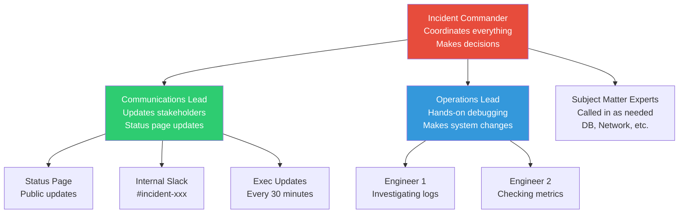

# Large-Scale Incident Management — On-Call, War Rooms & Runbooks

> How Google, Meta, and Amazon handle production incidents without panic.

---

## 🎯 One-Line Summary

> **Great incident management isn't about having heroes. It's about having clear roles, practiced playbooks, and a culture where finding problems early is rewarded.**

---

## 1. Incident Severity Levels

```
SEV-1 (Critical): Revenue-impacting, user-facing, total outage
  Example: "Payment processing is down. No customer can checkout."
  Response: All hands on deck. War room. Exec communication.
  Target: Acknowledged in 5 min, resolved in 1 hour.

SEV-2 (High): Major feature broken, significant user impact
  Example: "Search is returning empty results for 30% of users."
  Response: On-call investigates immediately. May escalate.
  Target: Acknowledged in 15 min, resolved in 4 hours.

SEV-3 (Medium): Degraded performance, limited user impact
  Example: "Image uploads are slow (10s instead of 2s)."
  Response: On-call investigates during business hours.
  Target: Acknowledged in 1 hour, resolved in 1 business day.

SEV-4 (Low): Minor issue, workaround available
  Example: "Export CSV button shows wrong date format."
  Response: Regular ticket workflow.
  Target: Resolved in 1 sprint.
```

---

## 2. Incident Response Roles (The ICS Framework)



```python
class IncidentResponse:
    """
    Clear roles prevent chaos during incidents.
    
    Key principle: The Incident Commander DOES NOT debug.
    They coordinate. Like an air traffic controller doesn't fly planes.
    """
    
    ROLES = {
        "incident_commander": {
            "responsibilities": [
                "Declare incident severity",
                "Assign roles",
                "Make go/no-go decisions (rollback? scale up? failover?)",
                "Run the war room call",
                "Ensure handoff if incident spans shifts",
            ],
            "does_NOT_do": [
                "Debug code",
                "SSH into servers",
                "Write queries",
                "Talk to customers (that's Comms Lead)",
            ]
        },
        "operations_lead": {
            "responsibilities": [
                "Hands-on investigation",
                "Execute remediation steps",
                "Coordinate with SMEs",
                "Keep IC informed of findings every 15 min",
            ]
        },
        "communications_lead": {
            "responsibilities": [
                "Update status page every 30 min",
                "Send internal updates to Slack",
                "Prepare exec summaries",
                "Notify affected customers",
                "Draft post-incident communication",
            ]
        },
    }
    
    async def declare_incident(self, severity: int, description: str,
                                reporter: str):
        """
        Standard incident declaration flow.
        """
        incident_id = f"INC-{int(time.time())}"
        
        # Step 1: Create incident channel
        channel = await slack.create_channel(f"incident-{incident_id}")
        
        # Step 2: Page the right people
        if severity <= 2:
            await pagerduty.trigger(
                service="platform-oncall",
                severity="critical" if severity == 1 else "high",
                description=description,
                incident_id=incident_id
            )
        
        # Step 3: Post initial update
        await slack.post(channel, f"""
🚨 *INCIDENT DECLARED: {incident_id}*
*Severity:* SEV-{severity}
*Description:* {description}
*Reported by:* {reporter}
*Status:* Investigating

*Roles (assign yourselves):*
• Incident Commander: _unassigned_
• Operations Lead: _unassigned_  
• Communications Lead: _unassigned_

React with 🎖️ to take IC, 🔧 for Ops, 📢 for Comms
        """)
        
        # Step 4: Start timeline logging
        await self.timeline.add(incident_id, "Incident declared", reporter)
        
        # Step 5: Auto-gather initial diagnostics
        diagnostics = await self.gather_auto_diagnostics()
        await slack.post(channel, f"""
📊 *Auto-gathered diagnostics:*
• Error rate: {diagnostics['error_rate']:.2%}
• p99 latency: {diagnostics['p99_ms']}ms
• Recent deploys: {diagnostics['recent_deploys']}
• Active alerts: {diagnostics['active_alerts']}
        """)
        
        return incident_id
```

---

## 3. Runbooks — Scripted Recovery Steps

```python
class RunbookSystem:
    """
    A runbook = step-by-step instructions for handling a known problem.
    
    Every alert MUST link to a runbook.
    Every runbook MUST be tested quarterly.
    
    Good runbook: Even a new hire at 3 AM can follow it.
    Bad runbook: "Ask Bob. He knows how to fix this." (What if Bob is on vacation?)
    """
    
    DATABASE_HIGH_CONNECTIONS_RUNBOOK = {
        "alert": "PostgreSQL connection count > 80% of max",
        "severity": "SEV-2",
        "last_tested": "2026-09-15",
        
        "steps": [
            {
                "step": 1,
                "title": "Verify the alert is real",
                "command": """
                    psql -c "SELECT count(*) FROM pg_stat_activity;"
                    psql -c "SELECT max_connections FROM pg_settings WHERE name='max_connections';"
                """,
                "expected": "Connection count should be > 80% of max_connections",
                "if_not": "False alarm. Check monitoring system for stale data."
            },
            {
                "step": 2,
                "title": "Identify what's consuming connections",
                "command": """
                    psql -c "
                    SELECT application_name, state, count(*) 
                    FROM pg_stat_activity 
                    GROUP BY application_name, state 
                    ORDER BY count DESC 
                    LIMIT 10;"
                """,
                "look_for": "One application using disproportionate connections"
            },
            {
                "step": 3,
                "title": "Kill idle connections (safe)",
                "command": """
                    psql -c "
                    SELECT pg_terminate_backend(pid) 
                    FROM pg_stat_activity 
                    WHERE state = 'idle' 
                    AND state_change < now() - interval '10 minutes'
                    AND pid != pg_backend_pid();"
                """,
                "caution": "This kills connections idle for >10 min. Safe to run."
            },
            {
                "step": 4,
                "title": "If still high: check for connection leaks",
                "command": """
                    # Check if PgBouncer is properly configured
                    psql -p 6432 pgbouncer -c "SHOW POOLS;"
                    
                    # Check application connection pool settings
                    kubectl logs -l app=<app_name> | grep -i "connection"
                """,
                "escalate": "If connection pool misconfigured, page the app team"
            },
            {
                "step": 5,
                "title": "Emergency: Increase max_connections",
                "command": """
                    # Temporary increase (requires restart)
                    psql -c "ALTER SYSTEM SET max_connections = 500;"
                    sudo systemctl restart postgresql
                """,
                "warning": "This requires DB restart (brief downtime). "
                          "Use only if steps 1-4 don't resolve.",
                "approval_required": True
            },
        ],
        
        "prevention": [
            "Set up PgBouncer connection pooling",
            "Configure application connection pool max size",
            "Alert at 60% threshold (early warning) not just 80%",
        ]
    }
```

### Runbook Automation

```python
class AutomatedRunbook:
    """
    The BEST runbook is one that runs itself.
    
    Progression:
    1. Document the steps (runbook)
    2. Script the steps (automation)
    3. Auto-trigger on alert (self-healing)
    
    Goal: 80% of incidents resolved automatically.
    Humans handle the remaining 20% (novel failures).
    """
    
    async def auto_remediate(self, alert):
        """
        Match alert to runbook and auto-execute safe steps.
        """
        runbook = self.find_runbook(alert.name)
        
        if not runbook:
            return {"action": "manual", "reason": "No runbook found"}
        
        for step in runbook["steps"]:
            if step.get("approval_required"):
                # Stop here — need human approval
                await self.request_human_approval(alert, step)
                return {"action": "waiting_approval", "step": step["step"]}
            
            if step.get("safe_to_auto_execute", True):
                result = await self.execute_step(step)
                await self.log_action(alert, step, result)
                
                # Check if the issue is resolved
                await asyncio.sleep(30)  # Wait 30 seconds
                if await self.is_alert_resolved(alert):
                    await self.notify(
                        f"Auto-remediated alert '{alert.name}' "
                        f"using step {step['step']}: {step['title']}"
                    )
                    return {"action": "auto_resolved", "step": step["step"]}
        
        # All safe steps exhausted — escalate to human
        await self.escalate_to_oncall(alert, runbook)
        return {"action": "escalated"}
```

---

## 4. On-Call Best Practices

```python
class OnCallBestPractices:
    """
    On-call shouldn't ruin engineers' lives.
    If it does, your system is too fragile.
    """
    
    SCHEDULE = {
        "rotation": "weekly",
        "team_size": 6,  # Each person on-call ~8 weeks/year
        "primary_and_secondary": True,  # Always have backup
        "handoff": {
            "time": "10 AM Monday",  # During business hours
            "process": [
                "Outgoing on-call: brief incoming on active issues",
                "Review last week's incidents",
                "Check: any scheduled maintenance this week?",
                "Verify pager is working (test page)",
            ]
        },
        "compensation": {
            "base": "Extra day off per week of on-call",
            "paged_outside_hours": "$200 per incident + comp time",
            "extended_incident": "If incident > 4 hours, next day off",
        }
    }
    
    RULES = [
        "Page only for user-impacting issues (not internal metrics)",
        "Maximum 2 pages per week average (if more, fix the system)",
        "If same alert fires 3+ times, auto-create a fix ticket",
        "On-call engineer has 20% time for toil reduction",
        "No new feature work during on-call week",
        "Incidents outside business hours = comp time guaranteed",
    ]
    
    async def on_page(self, alert):
        """Standard on-call response protocol."""
        
        # Step 1: Acknowledge within 5 minutes
        await pagerduty.acknowledge(alert.id)
        
        # Step 2: Assess severity (is this SEV-1 or can it wait?)
        severity = await self.assess_severity(alert)
        
        if severity == 1:
            # Step 3a: Declare incident, open war room
            await incident_response.declare_incident(
                severity=1,
                description=alert.description,
                reporter="on-call-automation"
            )
        elif severity <= 3:
            # Step 3b: Investigate, follow runbook
            runbook = self.find_runbook(alert.name)
            if runbook:
                await self.follow_runbook(runbook, alert)
            else:
                # No runbook — investigate manually, then WRITE ONE
                await self.investigate_and_document(alert)
        
        # Step 4: Post-resolution
        await self.update_incident_log(alert, resolution)
        
        # Step 5: If this is a repeat issue, create a reliability ticket
        occurrences = await self.count_recent_occurrences(alert.name, days=30)
        if occurrences >= 3:
            await self.create_reliability_ticket(
                title=f"Recurring alert: {alert.name} ({occurrences} times in 30d)",
                priority="high",
                assignee="on-call-team-rotation"
            )
```

---

## 5. War Room Protocol (SEV-1 Incidents)

```python
class WarRoomProtocol:
    """
    A war room is a focused, structured response to a critical incident.
    
    Key principle: Structure prevents panic.
    """
    
    async def run_war_room(self, incident_id: str):
        """
        War room cadence for SEV-1 incidents.
        """
        # Open video call
        call = await zoom.create_meeting(f"WAR ROOM: {incident_id}")
        await slack.post(f"#incident-{incident_id}", 
                        f"🔴 War room: {call.url}")
        
        # Start the loop
        cycle = 0
        while not await self.is_resolved(incident_id):
            cycle += 1
            
            # Every 15 minutes: structured update
            await self.fifteen_minute_update(incident_id, cycle)
            
            # Every 30 minutes: stakeholder communication
            if cycle % 2 == 0:
                await self.stakeholder_update(incident_id)
            
            # Every 60 minutes: IC rotation check
            if cycle % 4 == 0:
                await self.check_ic_fatigue(incident_id)
            
            await asyncio.sleep(900)  # 15 minutes
    
    async def fifteen_minute_update(self, incident_id, cycle):
        """
        Structured update every 15 minutes.
        IC asks three questions:
        """
        update = f"""
📋 *15-Min Update #{cycle}* (Incident: {incident_id})

1. **What do we know?** (Ops Lead answers)
   _What's the current state, what have we confirmed?_

2. **What are we doing right now?** (Ops Lead answers)
   _Specific actions in progress_

3. **What's our next step if current action doesn't work?** (IC decides)
   _Fallback plan, escalation path_

⏰ Next update in 15 minutes.
        """
        await slack.post(f"#incident-{incident_id}", update)
    
    async def check_ic_fatigue(self, incident_id):
        """
        After 1 hour, check if IC needs a break.
        Fatigued decision-makers make bad decisions.
        """
        ic = await self.get_current_ic(incident_id)
        time_as_ic = time.time() - ic.started_at
        
        if time_as_ic > 3600:  # More than 1 hour
            await slack.post(f"#incident-{incident_id}",
                f"⚠️ {ic.name} has been IC for {time_as_ic//3600:.0f}h "
                f"{(time_as_ic%3600)//60:.0f}m. Consider rotating IC.\n"
                f"Who can take over? React with 🎖️"
            )
```

---

## 6. Post-Incident Review Framework

```yaml
# post_incident_review_template.yaml

incident_id: "INC-20261026-001"
title: "Payment Service Outage — 45 minutes of failed checkouts"
date: "2026-10-26"
severity: "SEV-1"
duration: "45 minutes"
impact: "~3,200 checkout attempts failed, estimated $180K revenue impact"

# What happened (FACTUAL, no blame)
timeline:
  - time: "14:02"
    event: "Deploy of payment-service v2.34 started (canary 5%)"
  - time: "14:08"  
    event: "Canary error rate: 0.3% (baseline 0.1%) — within auto-rollback threshold"
  - time: "14:15"
    event: "Canary promoted to 100% (auto — error rate was below 2x threshold)"
  - time: "14:17"
    event: "Error rate spikes to 15% across all instances"
  - time: "14:19"
    event: "PagerDuty alert fired, on-call acknowledged"
  - time: "14:25"
    event: "Root cause identified: new code path triggers deadlock under high concurrency"
  - time: "14:30"
    event: "Rollback initiated to v2.33"
  - time: "14:35"
    event: "Rollback complete, error rate dropping"
  - time: "14:47"
    event: "Error rate back to baseline, incident resolved"

root_cause:
  what: "Database deadlock in new payment validation logic"
  why: |
    The new code acquired locks in a different order than the existing code.
    Under low concurrency (canary), deadlocks were rare (<0.3%).
    Under full traffic, deadlock frequency jumped to 15%.
  contributing_factors:
    - "Canary threshold was 2x baseline — too generous for this type of failure"
    - "Load testing didn't test for deadlocks (only tested throughput)"
    - "No integration test for concurrent payment processing"

what_went_well:
  - "On-call acknowledged within 2 minutes"
  - "Root cause identified in 6 minutes"
  - "Rollback completed in 5 minutes"
  - "Customer communication posted within 20 minutes"

what_went_poorly:
  - "Canary didn't catch the issue (threshold too lenient)"
  - "No deadlock detection monitoring"
  - "45 minutes total duration — should target <15 minutes"

action_items:
  - action: "Add deadlock detection metric and alert"
    owner: "database-team"
    priority: "P0"
    deadline: "2026-11-02"
    ticket: "INFRA-5521"
    
  - action: "Tighten canary threshold from 2x to 1.5x for payment services"
    owner: "platform-team"
    priority: "P0"
    deadline: "2026-10-30"
    ticket: "PLAT-8832"
    
  - action: "Add concurrent payment load test to CI pipeline"
    owner: "payment-team"
    priority: "P1"
    deadline: "2026-11-15"
    ticket: "PAY-3341"
    
  - action: "Implement automatic deadlock detection + kill in PostgreSQL"
    owner: "database-team"
    priority: "P1"
    deadline: "2026-11-30"
    ticket: "INFRA-5522"

lessons_learned:
  - "Canary error rate threshold must be tuned per service criticality"
  - "Concurrency-related bugs need specific load tests, not just throughput tests"
  - "Database lock ordering must be documented and reviewed in code review"
```

---

## 📋 Production Checklist: Incident Management

```
ON-CALL:
[ ] Rotation schedule: weekly, 6+ person team
[ ] Primary + secondary on-call
[ ] Handoff process documented and practiced
[ ] Compensation policy for after-hours pages
[ ] Max 2 pages/week average (fix system if more)
[ ] On-call engineer has 20% time for toil reduction

INCIDENT RESPONSE:
[ ] Severity levels defined (SEV-1 through SEV-4)
[ ] Response time targets per severity level
[ ] Incident Commander / Ops Lead / Comms Lead roles defined
[ ] Auto-create incident channel and page on-call
[ ] Auto-gather initial diagnostics on incident declaration
[ ] 15-minute structured update cadence for SEV-1

RUNBOOKS:
[ ] Every alert links to a runbook
[ ] Runbooks tested quarterly (actually run the steps)
[ ] Common incidents auto-remediated (self-healing)
[ ] Runbooks reviewed and updated after every incident
[ ] New hire can follow any runbook at 3 AM

POST-INCIDENT:
[ ] Blameless post-mortem within 48 hours for SEV-1/SEV-2
[ ] Timeline with exact timestamps
[ ] Action items with owner + deadline + ticket
[ ] Action items tracked to completion
[ ] Monthly incident trend review
[ ] Quarterly "game day" exercises

COMMUNICATION:
[ ] Status page auto-updated on SEV-1/SEV-2
[ ] Internal Slack updates every 15 min during incident
[ ] Exec summary every 30 min for SEV-1
[ ] Customer notification template ready
[ ] Post-incident customer communication within 24 hours
```

---

## 📚 References

- [Google SRE Book — Being On-Call](https://sre.google/sre-book/being-on-call/)
- [PagerDuty Incident Response Guide](https://response.pagerduty.com/)
- [Jeli.io — Post-Incident Learning](https://www.jeli.io/blog)
- [Incident Command System (ICS) for Tech](https://en.wikipedia.org/wiki/Incident_Command_System)
