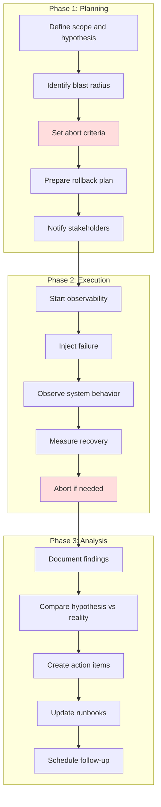
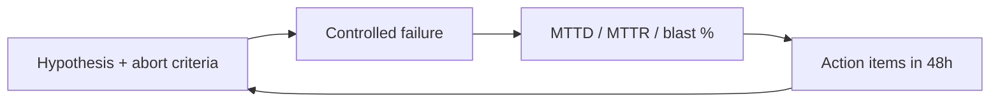

# Game Days and DiRT Testing

## What Are They?

> A **Game Day** is a planned exercise where you intentionally inject failures into your production (or production-like) system to test your team's ability to detect, respond, and recover.

> **DiRT (Disaster Recovery Testing)** is Google's approach: large-scale, company-wide disaster simulations to validate that critical systems survive real-world failures.

Think of it as a **fire drill** for your engineering team. You don't wait for a real fire to find out your fire escape is blocked.

---

## Why Do This?

```
Without Game Days:                      With Game Days:

Outage at 3am on Saturday               Same outage at 3am
├── Nobody knows what to do              ├── Team follows rehearsed runbook
├── Runbooks are outdated                ├── Runbooks verified last month
├── Monitoring doesn't alert             ├── Alerts fire correctly
├── Failover doesn't work               ├── Failover tested quarterly
├── 4-hour MTTR                          ├── 15-minute MTTR
└── Post-mortem: "We should             └── Post-mortem: "Worked as
    have tested this"                        practiced, minor tweaks needed"
```

---

## Game Day: Step-by-Step



### Phase 1: Planning (The Most Important Phase)

```yaml
# game-day-plan.yaml

title: "Database Failover Game Day"
date: "2024-03-15 14:00 UTC"
duration: "2 hours"
facilitator: "Jane (SRE Lead)"
participants:
  - "Order Service team"
  - "Database team"
  - "On-call engineer (observing)"

hypothesis: >
  When the primary database fails, the system should:
  1. Detect the failure within 30 seconds
  2. Failover to the replica within 60 seconds
  3. Resume serving requests with < 5 seconds of errors
  4. No data loss

scope:
  environment: "staging (mirrors production)"
  services_affected: ["order-service", "user-service"]
  blast_radius: "Staging only, no customer impact"

failure_injection:
  type: "Kill primary database instance"
  method: "AWS CLI: aws rds failover-db-cluster"
  timing: "14:15 UTC (15 min after start)"

abort_criteria:
  - "Staging is shared with QA — abort if QA reports critical issues"
  - "If failover doesn't complete in 5 minutes, abort and restore"
  - "If any unexpected production impact detected"

rollback:
  - "Restore primary database from snapshot"
  - "Force promote old primary if automatic failover fails"

observability:
  dashboards:
    - "https://grafana.internal/d/db-overview"
    - "https://grafana.internal/d/order-service"
  alerts_to_watch:
    - "DatabaseConnectionError"
    - "HighErrorRate"
    - "HighLatency"
```

### Phase 2: Execution

```python
# game_day_runner.py — Structured game day execution

import time
import datetime

class GameDayRunner:
    def __init__(self, plan):
        self.plan = plan
        self.log = []
        self.start_time = None
        self.abort = False
    
    def execute(self):
        self.start_time = time.time()
        self.record("🟢 Game Day started")
        
        # Pre-flight checks
        self.record("Checking dashboards are accessible...")
        self.record("Checking rollback tools are ready...")
        self.record("Confirming all participants are present...")
        
        # Steady-state observation (5 minutes)
        self.record("📊 Recording baseline metrics for 5 minutes...")
        baseline = self.capture_baseline()
        self.record(f"Baseline: error_rate={baseline['error_rate']:.2f}%, "
                   f"p99_latency={baseline['p99_latency']}ms")
        
        # Inject failure
        if not self.abort:
            self.record("💥 INJECTING FAILURE: Killing primary database")
            self.inject_failure()
        
        # Observe
        self.record("👀 Observing system behavior...")
        observations = self.observe(duration_minutes=5)
        
        for obs in observations:
            self.record(f"  {obs['time']}: {obs['event']}")
        
        # Measure recovery
        self.record("📏 Measuring recovery...")
        recovery = self.measure_recovery()
        self.record(f"Detection time: {recovery['detection_seconds']}s "
                   f"(target: <30s)")
        self.record(f"Failover time: {recovery['failover_seconds']}s "
                   f"(target: <60s)")
        self.record(f"Error duration: {recovery['error_duration_seconds']}s "
                   f"(target: <5s)")
        
        # Validate hypothesis
        self.validate_hypothesis(baseline, recovery)
        
        self.record("🟢 Game Day completed")
        return self.generate_report()
    
    def validate_hypothesis(self, baseline, recovery):
        results = {
            "Detection < 30s": recovery['detection_seconds'] < 30,
            "Failover < 60s": recovery['failover_seconds'] < 60,
            "Errors < 5s": recovery['error_duration_seconds'] < 5,
            "No data loss": recovery.get('data_loss', False) == False,
        }
        
        for check, passed in results.items():
            status = "✅ PASS" if passed else "❌ FAIL"
            self.record(f"  {status}: {check}")
```

### Phase 3: After the Game Day

```markdown
# Game Day Report: Database Failover
**Date:** 2024-03-15
**Facilitator:** Jane (SRE Lead)

## Hypothesis vs Reality

| Expectation | Target | Actual | Result |
|---|---|---|---|
| Detection time | < 30s | 22s | ✅ PASS |
| Failover time | < 60s | 45s | ✅ PASS |
| Error duration | < 5s | 12s | ❌ FAIL |
| Data loss | None | None | ✅ PASS |

## Key Findings
1. **Connection pool didn't recover fast enough** — after failover,
   stale connections caused 12 seconds of errors instead of < 5s
2. **Alert was correct** but the alert message didn't include the
   replica endpoint, making it harder to verify failover

## Action Items
- [ ] Configure connection pool to detect dead connections faster (health check interval)
- [ ] Update alert template to include replica status
- [ ] Add dashboard panel showing active DB connections per instance
- [ ] Schedule follow-up game day in 6 weeks to verify fixes
```

---

## Google DiRT (Disaster Recovery Testing)

Google's DiRT takes game days to the next level:

```
Regular Game Day:                        Google DiRT:
├── One team                             ├── Company-wide
├── One failure scenario                 ├── Multiple simultaneous failures
├── Staging environment                  ├── Production (!)
├── 1-2 hours                            ├── Multi-day events
├── Known failure time                   ├── Surprise timing
└── Planned participants                 └── Tests on-call response
```

### DiRT Principles

```
1. TEST IN PRODUCTION
   "If you haven't tested it in production, you don't know it works."

2. COMBINE FAILURES
   Real disasters are never single failures. Test:
   - Data center outage + DNS failure
   - Database failover + deployment in progress
   - Network partition + traffic spike

3. TEST PEOPLE AND PROCESS, NOT JUST SYSTEMS
   - Can the on-call engineer find the runbook?
   - Can the team communicate during the incident?
   - Are escalation paths clear?

4. MAKE IT ROUTINE
   - Monthly small-scale tests
   - Quarterly large-scale tests
   - Annual company-wide DiRT event
```

### DiRT Scenario Examples

```yaml
# Level 1: Component failure (monthly)
scenarios:
  - name: "Kill a random pod"
    tool: "Chaos Monkey"
    blast_radius: "Single service"

  - name: "Inject 500ms latency to database"
    tool: "Toxiproxy / Chaos Mesh"
    blast_radius: "One service's DB calls"

# Level 2: Service failure (quarterly)
scenarios:
  - name: "Kill entire service (all pods)"
    tool: "kubectl delete deployment order-service"
    blast_radius: "One microservice + dependents"

  - name: "Network partition between US and EU"
    tool: "tc netem / Chaos Mesh"
    blast_radius: "Cross-region communication"

# Level 3: Infrastructure failure (annually)
scenarios:
  - name: "Simulate availability zone outage"
    tool: "Drain all nodes in AZ-A"
    blast_radius: "1/3 of infrastructure"

  - name: "DNS provider failure"
    tool: "Block DNS resolution"
    blast_radius: "Service discovery"

# Level 4: Full DiRT (annual company-wide)
scenarios:
  - name: "Primary data center evacuation"
    description: "Simulate complete loss of us-east-1"
    blast_radius: "All services, all users"
    duration: "48 hours"
```

---

## Tools for Game Days

| Tool | Type | What It Does |
|---|---|---|
| **Chaos Monkey** (Netflix) | Pod killer | Randomly kills instances |
| **Gremlin** | Platform | Commercial chaos engineering |
| **Chaos Mesh** | K8s native | Network, pod, IO faults in Kubernetes |
| **LitmusChaos** | K8s native | Open-source Kubernetes chaos |
| **Toxiproxy** | Network proxy | Simulate network conditions (latency, timeout) |
| **AWS FIS** | Managed | AWS Fault Injection Simulator |
| **tc netem** | Linux kernel | Network delay, loss, corruption |

---

## Game Day Maturity Model

```
Level 1: Ad Hoc
  "We did a game day once after a big outage"
  
Level 2: Periodic
  "We run game days quarterly with planned scenarios"
  
Level 3: Systematic
  "Every new service must have a game day before going to production"
  "We have a game day library of common scenarios"
  
Level 4: Continuous
  "Chaos experiments run continuously in production"
  "Game days are automated and part of CI/CD"
  "Teams proactively create game day scenarios"
  
Level 5: Cultural
  "Game days are celebrated, not feared"
  "Findings lead to immediate action items"
  "We test people and processes, not just systems"
```

---

## Key Takeaways

- **Plan thoroughly** — the planning phase is more important than the execution
- **Set abort criteria** before starting — know when to stop
- **Start small** — kill a pod before you simulate a data center outage
- **Test people and processes** — not just technology
- **Document everything** — the report and action items are the real value
- **Make it routine** — quarterly at minimum, monthly if possible
- Google's DiRT proves that **production testing** catches things staging never will
- The goal isn't to break things — it's to **build confidence** in your ability to recover

---

## Senior Pitfalls

| Mistake | Impact | Fix |
|---------|--------|-----|
| Game days with no defined success criteria | Team celebrates "we tried" without improving MTTR | Pre-write hypotheses, blast radius limits, and measurable recovery goals |
| Running chaos only in staging with toy data | False confidence; prod-specific failures missed | Graduated prod experiments with feature flags and automatic abort |
| No executive or legal sign-off for prod faults | Experiment cancelled mid-incident or blamed on engineering | RACI, comms plan, and rollback triggers documented before start |
| Injecting failure without observability baselines | Cannot tell if the exercise helped | Capture metrics/traces before; compare error budget burn during drill |
| One-off heroics instead of runbook updates | Same gaps on the next real outage | Every finding becomes a ticket: runbook, automation, or architectural fix |

---

## Production-grade Practice

1. **Build:** Design a 90-minute game day scenario (e.g., regional AZ loss) with injectors, guardrails, and a comms template; get SRE and product approval.
2. **Debug:** During the drill, forbid SSH "fixes" not in the runbook; time detection → mitigation → customer impact end; debrief with timeline.
3. **Measure:** Track MTTD/MTTR for injected faults quarterly; tie improvement to error budget policy.
4. **Capacity plan:** Estimate max safe fault rate (experiments per quarter) given on-call load and change freeze windows; schedule DiRT-style calendar.

---

## FAANG Interview Deep Dive

### Real-world examples

**Google DiRT (Disaster Recovery Testing)**  
Since 2008, Google runs **DiRT** exercises where teams inject controlled failures across production-adjacent systems—power loss in a building, DNS misconfigurations, regional evacuations. Exercises often involve **thousands of engineers** and are graded on detection time, runbook accuracy, and customer impact. A famous lesson: dashboards that depend on the failing subsystem (S3-style) cannot be your sole source of truth during the drill.

**Netflix Chaos Monkey / Simian Army**  
Netflix terminates **random production instances** during business hours (Chaos Monkey), with higher-order tools (Latency Monkey, Conformity Monkey) testing config drift. At peak they ran against **thousands of ASG instances**; the cultural outcome was **MTTR measured in minutes** for instance loss because auto-healing and routing were rehearsed continuously—not quarterly.

**Amazon GameDay (internal + AWS)**  
AWS and Amazon retail run large-scale **GameDay** scenarios before major events (Prime Day): kill AZ capacity, throttle dependencies, validate cell-based blast radius. Interview signal: they measure **revenue-at-risk per minute** during the exercise and pre-approve abort thresholds (e.g., error rate > 0.5% for 5 minutes → rollback injection).



### Interview Q&A

### Q: Why run Game Days in production instead of staging?
**A:** Staging rarely matches **traffic shape, data skew, feature flags, and dependency fan-out**. Production exercises validate **people, paging, and runbooks** under real cardinality (billions of rows, real cache warmth). Trade-off: accept bounded customer risk with **abort criteria**, feature-flagged cohorts, and off-peak windows. Staging remains for **destructive schema tests**; production proves **operational readiness**.

### Q: How do you define abort criteria for a database failover Game Day?
**A:** Pre-agree measurable gates: p99 latency > 2× baseline for 3 minutes, error budget burn > 10× normal, replication lag > 30s, or **any** data correctness alarm. Assign a **single incident commander** with authority to stop without debate. Without numeric abort rules, exercises become political—or teams push past safe limits to “finish the script.”

### Q: DiRT found runbooks were wrong—how do you prevent Game Days from becoming theater?
**A:** Tie every finding to a **tracked action item with owner and due date**; block “Level 3 maturity” claims until scenarios are **automated in a library** and re-run quarterly. Measure **MTTR delta** month-over-month. Interview depth: separate **learning goals** (discover unknowns) from **certification goals** (prove known recovery path).

### Q: How does chaos engineering differ from a one-off Game Day?
**A:** Game Days are **planned, social, cross-team** events with narratives. Chaos engineering is **continuous, automated experimentation** (small blast radius, always-on). Netflix moved toward always-on because quarterly drills missed **combinatorial failure modes** (slow dependency + retry storm). Use both: Game Days for **coordination**, chaos for **regression of defenses**.

### Q: What metrics prove a Game Day succeeded?
**A:** **MTTD** (time to page), **MTTR** (time to restore SLO), **blast radius %** (users affected), **runbook steps completed without improvisation**, and **post-exercise defect count**. A “successful” day that finds 12 gaps is better than a clean day that found zero—unless zero means the scenario was too tame.

| Metric | Weak signal | Strong signal |
|--------|-------------|---------------|
| Duration | “We finished the script” | SLO restored < target MTTR |
| Blast | Unmeasured | ≤ agreed % traffic / tenants |
| Learning | No tickets opened | P0/P1 fixes within 2 weeks |

### Common mistakes candidates make

- Proposing **region-wide outages** before **pod/AZ-level** drills—skips learning on observability gaps.
- No **rollback of the experiment itself** (e.g., leave fault injection enabled).
- Testing only **technology**, not **on-call rotation, comms, and executive updates**.
- Running exercises **once** after a major outage, then deprioritizing until the next incident.
- Confusing **staging load tests** with **failure injection**—throughput tests do not validate failover.

### Decision framework: Game Day maturity vs risk

| Stage | Injection | Typical blast | When to advance |
|-------|-----------|---------------|-----------------|
| 0 | Tabletop | 0% | No runbooks |
| 1 | Kill pod / single host | < 0.01% | Auto-heal proven |
| 2 | AZ drain, DB replica promote | 1–5% | Abort criteria exercised |
| 3 | Region evacuation (synthetic traffic) | 10–25% | Error budget policy exists |
| 4 | Continuous chaos in prod | Capped by automation | DiRT-style org buy-in |

**Capacity math (failover):** If each region runs at **60% peak** capacity, losing one region in active-active requires **≥ 100/60 ≈ 1.67×** headroom in survivors—or you must **shed load** during the drill. Game Days should explicitly test **load shed + scale-up lag** (often 5–15 minutes for ASG/K8s).

### Whiteboard checklist

| Stakeholder | Must approve before prod inject |
|-------------|----------------------------------|
| SRE / incident commander | Abort criteria + comms template |
| Product | Customer-visible risk window |
| Support | FAQ + status page wording |
| Legal/compliance | Data residency if region drained |

```yaml
# Minimal game-day inject record (audit trail)
inject_id: gd-2026-03-db-failover
hypothesis: "Promote replica < 120s, RPO < 5s"
abort_if:
  error_rate_5m: "> 0.3%"
  p99_latency_ms: "> 2x baseline"
rollback_inject: "terraform apply -var enable_fault=false"
```

**Staff signal:** Strong candidates narrate **who learns what**—engineers practice failover, leadership practices **customer comms**, finance practices **revenue-at-risk** assumptions—not “we killed a pod and it was fine.”
