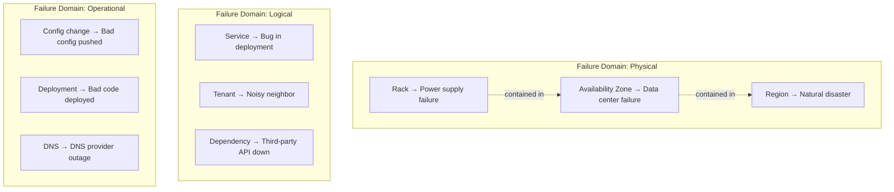
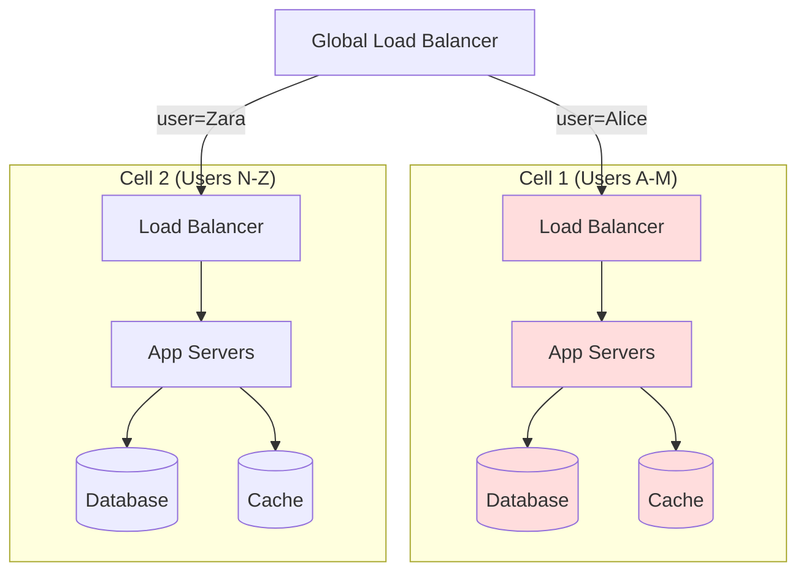
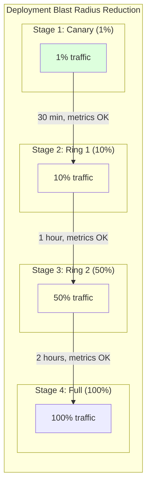
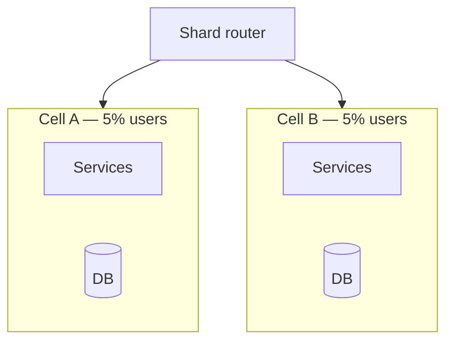

# Blast Radius and Failure Domain Isolation

## What Is Blast Radius?

When a bomb goes off, the **blast radius** is how far the damage reaches. In systems engineering, it's the same concept:

> **Blast radius** = the scope of impact when a component fails. How many users, services, or features are affected?

The goal: **minimize blast radius** so that when (not if) something fails, the damage is contained.

---

## Blast Radius Examples

```
No Isolation (everything shared):
┌────────────────────────────────────────┐
│ ████████████████████████████████████████│  One bad deployment
│ ALL USERS AFFECTED (100%)              │  → 100% of users down
│ ████████████████████████████████████████│
└────────────────────────────────────────┘

With Isolation (cell-based):
┌──────────┐ ┌──────────┐ ┌──────────┐ ┌──────────┐
│ Cell 1   │ │ Cell 2   │ │ Cell 3   │ │ Cell 4   │
│ 25% users│ │ 25% users│ │ 25% users│ │ 25% users│
│ ████████ │ │          │ │          │ │          │
│ AFFECTED │ │ HEALTHY  │ │ HEALTHY  │ │ HEALTHY  │
└──────────┘ └──────────┘ └──────────┘ └──────────┘
  One bad deployment in Cell 1 → only 25% affected
```

---

## Failure Domains

A **failure domain** is a group of components that share a common failure mode — they all go down together.



### Hierarchy of Failure Domains

```
┌───────────────────────────────────────────────────┐
│ GLOBAL                                             │
│  DNS, CDN, Global Load Balancer                    │
│ ┌───────────────────┐  ┌───────────────────┐      │
│ │ REGION (us-east)   │  │ REGION (eu-west)   │     │
│ │ ┌───────┐┌───────┐ │  │ ┌───────┐┌───────┐│     │
│ │ │AZ-a   ││AZ-b   │ │  │ │AZ-a   ││AZ-b   ││     │
│ │ │┌─────┐││┌─────┐│ │  │ │┌─────┐││┌─────┐││     │
│ │ ││Rack1│││Rack3│││ │  │ ││Rack5│││Rack7│││     │
│ │ ││Rack2│││Rack4│││ │  │ ││Rack6│││Rack8│││     │
│ │ │└─────┘││└─────┘│ │  │ │└─────┘││└─────┘││     │
│ │ └───────┘└───────┘ │  │ └───────┘└───────┘│     │
│ └───────────────────┘  └───────────────────┘      │
└───────────────────────────────────────────────────┘

Failure at each level affects:
  Rack:   ~ 0.5% of capacity
  AZ:     ~ 33% of a region
  Region: ~ 50% of global (if 2 regions)
  Global: 100% (DNS, identity provider)
```

---

## Isolation Strategies

### Strategy 1: Cell-Based Architecture

Divide your system into **independent cells**, each serving a subset of users.



```python
# Cell router — assigns users to cells
class CellRouter:
    def __init__(self, num_cells: int = 4):
        self.num_cells = num_cells
    
    def get_cell(self, user_id: str) -> int:
        """Consistent hashing to assign user to a cell."""
        hash_value = hashlib.md5(user_id.encode()).hexdigest()
        return int(hash_value, 16) % self.num_cells
    
    def get_cell_endpoint(self, user_id: str) -> str:
        cell = self.get_cell(user_id)
        return f"https://cell-{cell}.internal.example.com"


# Global load balancer configuration
router = CellRouter(num_cells=4)

@app.route("/api/{path:path}")
async def route_to_cell(request, path):
    user_id = extract_user_id(request)
    cell_endpoint = router.get_cell_endpoint(user_id)
    
    # Forward to the appropriate cell
    return await proxy_request(cell_endpoint, path, request)
```

**AWS uses cell-based architecture** for many services. Each cell operates independently — a failure in one cell doesn't affect others.

---

### Strategy 2: Bulkhead Pattern

Isolate resources so one failure can't consume everything.

```
Without Bulkhead:                    With Bulkhead:
┌─────────────────────────┐          ┌────────┐ ┌────────┐ ┌────────┐
│  Shared Thread Pool     │          │ Pool A │ │ Pool B │ │ Pool C │
│  ┌───┐┌───┐┌───┐┌───┐  │          │ ┌───┐  │ │ ┌───┐  │ │ ┌───┐  │
│  │ A ││ A ││ A ││ A │  │          │ │ A │  │ │ │ B │  │ │ │ C │  │
│  │   ││   ││   ││   │  │          │ │   │  │ │ │   │  │ │ │   │  │
│  │ A ││ A ││ A ││ A │  │          │ │ A │  │ │ │ B │  │ │ │ C │  │
│  └───┘└───┘└───┘└───┘  │          │ └───┘  │ │ └───┘  │ │ └───┘  │
│  Service A is slow →     │          │ A slow │ │ B fine │ │ C fine │
│  ALL threads consumed!   │          │ only A │ │        │ │        │
│  B and C also fail! 💥   │          │ fails! │ │        │ │        │
└─────────────────────────┘          └────────┘ └────────┘ └────────┘
```

```python
import asyncio
from asyncio import Semaphore

class BulkheadPool:
    """Isolate operations into separate resource pools."""
    
    def __init__(self):
        self.pools = {
            "payment-api":   Semaphore(20),  # Max 20 concurrent calls
            "inventory-api": Semaphore(10),  # Max 10 concurrent calls
            "email-api":     Semaphore(5),   # Max 5 concurrent calls
        }
    
    async def execute(self, pool_name: str, operation):
        semaphore = self.pools[pool_name]
        
        # Try to acquire — if pool is full, fail fast
        acquired = semaphore._value > 0
        if not acquired:
            raise BulkheadFullError(
                f"Bulkhead '{pool_name}' is full. "
                f"Rejecting to protect other operations."
            )
        
        async with semaphore:
            return await operation()


# Usage
bulkhead = BulkheadPool()

async def process_order(order):
    # Payment API being slow won't affect inventory or email
    payment = await bulkhead.execute(
        "payment-api",
        lambda: call_payment_service(order)
    )
    
    inventory = await bulkhead.execute(
        "inventory-api",
        lambda: call_inventory_service(order)
    )
    
    await bulkhead.execute(
        "email-api",
        lambda: send_confirmation(order)
    )
```

---

### Strategy 3: Shuffle Sharding

Assign each customer to a **random subset** of resources. Even if a noisy neighbor takes down some resources, different customers use different subsets.

```
Traditional Sharding:                Shuffle Sharding:
Shard 1: [A, B, C]                  Customer A → Workers {1, 3}
Shard 2: [D, E, F]                  Customer B → Workers {2, 4}
                                     Customer C → Workers {1, 4}
If A is noisy:                       Customer D → Workers {2, 3}
  B and C also affected             
                                     If A is noisy:
                                       Only Workers {1, 3} affected
                                       B uses {2, 4} → fine!
                                       C uses {1, 4} → partially affected
                                       D uses {2, 3} → partially affected
```

```python
import hashlib

class ShuffleShardRouter:
    """
    Assign each tenant to a random subset of N workers.
    This limits blast radius: a bad tenant only affects their shard.
    """
    
    def __init__(self, all_workers: list[str], shard_size: int = 2):
        self.all_workers = sorted(all_workers)
        self.shard_size = shard_size
    
    def get_shard(self, tenant_id: str) -> list[str]:
        """Get the set of workers assigned to this tenant."""
        # Use consistent hashing to pick workers
        selected = []
        for i in range(self.shard_size):
            hash_input = f"{tenant_id}:{i}".encode()
            hash_val = int(hashlib.sha256(hash_input).hexdigest(), 16)
            worker_idx = hash_val % len(self.all_workers)
            
            # Avoid duplicates
            while self.all_workers[worker_idx] in selected:
                worker_idx = (worker_idx + 1) % len(self.all_workers)
            
            selected.append(self.all_workers[worker_idx])
        
        return selected


# With 8 workers and shard_size=2:
router = ShuffleShardRouter(
    all_workers=["w1", "w2", "w3", "w4", "w5", "w6", "w7", "w8"],
    shard_size=2,
)

# Each tenant gets a different pair of workers
# Probability of two tenants sharing the EXACT same shard:
# 1/C(8,2) = 1/28 = 3.6%
```

---

### Strategy 4: Deployment Isolation



```yaml
# Progressive deployment — limit blast radius of bad deploys
# ArgoCD Rollout configuration

apiVersion: argoproj.io/v1alpha1
kind: Rollout
spec:
  strategy:
    canary:
      steps:
        - setWeight: 1       # 1% of traffic
        - pause: { duration: 30m }
        - analysis:
            templates:
              - templateName: error-rate-check
        - setWeight: 10      # 10% of traffic
        - pause: { duration: 1h }
        - analysis:
            templates:
              - templateName: error-rate-check
        - setWeight: 50      # 50% of traffic
        - pause: { duration: 2h }
        - setWeight: 100     # Full rollout
```

---

## Measuring Blast Radius

```python
# Quantify your blast radius for each failure scenario
blast_radius_assessment = {
    "single_pod_failure": {
        "users_affected_pct": 0.1,
        "services_affected": 1,
        "estimated_revenue_impact": "$100/hour",
        "mitigation": "Auto-scaling replaces pod in 30s",
    },
    "az_failure": {
        "users_affected_pct": 33,
        "services_affected": "all in that AZ",
        "estimated_revenue_impact": "$50,000/hour",
        "mitigation": "Multi-AZ deployment, auto-failover",
    },
    "region_failure": {
        "users_affected_pct": 50,
        "services_affected": "all",
        "estimated_revenue_impact": "$200,000/hour",
        "mitigation": "Multi-region active-active",
    },
    "dns_failure": {
        "users_affected_pct": 100,
        "services_affected": "everything",
        "estimated_revenue_impact": "$500,000/hour",
        "mitigation": "Multiple DNS providers, low TTL",
    },
}
```

---

## Key Takeaways

- **Every component will fail** — the question is how much damage it causes
- **Cell-based architecture** limits blast radius to a subset of users
- **Bulkheads** prevent one slow dependency from consuming all resources
- **Shuffle sharding** ensures noisy tenants only affect a small subset of infrastructure
- **Progressive deployments** (canary → ring 1 → ring 2) limit blast radius of bad code
- **Measure your blast radius** for each failure scenario and reduce the biggest ones
- The goal is: **no single failure should take down the entire system**

---

## Senior Pitfalls

| Mistake | Impact | Fix |
|---------|--------|-----|
| Shared Redis cluster for cache and sessions | Cache flush takes down auth for all tenants | Separate failure domains per tier; cell-based architecture |
| Single global config service outage | Entire fleet cannot start | Local config bundles + graceful degradation defaults |
| No bulkheads on thread pools | One slow dependency exhausts all workers | Per-dependency pools and queue limits |
| Cross-tenant noisy neighbor on one DB shard | One customer query kills others on shard | Shard by tenant; rate limits and query timeouts |
| "Small" shared Kafka cluster for all products | Broker loss stalls unrelated pipelines | Cluster per domain or enforce quotas and isolation |

---

## Production-grade Practice

1. **Build:** Map services to failure domains (AZ, cell, shard); diagram one scenario where a domain fails and verify others stay within SLO.
2. **Debug:** Simulate dependency timeout storm; verify bulkheads prevent total thread starvation and circuit breakers open per client.
3. **Measure:** Define blast radius KPI (max % users affected per incident class); track in postmortems.
4. **Capacity plan:** For cell-based design, model cost of N cells vs max simultaneous failure coverage; pick cell size for target blast radius.

---

## FAANG Interview Deep Dive

### Real-world examples

**Amazon cell-based architecture**  
AWS control planes and many retail services shard customers into **cells** (often **~1/100 to 1/500** of traffic per cell). A bad deployment or dependency bug in one cell affects **single-digit percent** of requests, not 100%. Cells share **no synchronous fate**: separate databases, queues, and config namespaces. Interviewers expect you to explain **how routing picks a cell** (hash of account ID) and what breaks **cross-cell** operations (global lists, admin tools).

**Meta / Facebook “shuffle sharding”**  
For some infrastructure, endpoints are assigned to **multiple small shards** (e.g., 2 of 100) so a hot tenant or bad node hits **~2%** of keys, not 100%. Combined with **bulkheads** (separate thread pools per dependency), this prevented noisy-neighbor outages when one workload spiked GPU or cache traffic.

**GitHub (2018 DNS incident)**  
A brief **DNS / routing misconfiguration** effectively made GitHub unreachable globally—**100% blast radius** at the edge despite healthy origin servers. Lesson: **logical failure domains** (DNS, TLS, CDN config) can dwarf application isolation. Mitigation: multiple DNS providers, health-checked origins, and **config change blast limits** (canary on DNS weight).



### Interview Q&A

### Q: Cell-based vs multi-AZ—what problem does each solve?
**A:** Multi-AZ survives **datacenter failure** within a region; all tenants still share fate if you deploy **one monolithic stack**. Cells add **logical isolation** so code, config, and data partitions limit **software blast radius**. Cost: **N× operational overhead**, cross-cell queries, and harder global features. Use cells when **frequency of logical failures** (deployments, tenant abuse) exceeds **AZ failure rate**.

### Q: How do you size a bulkhead thread pool for dependency X?
**A:** Start from **p99 latency L** and max acceptable concurrent calls **C = λ × L** (Little’s law) at peak **λ**. Cap the pool at **C × safety factor (1.2–1.5)** so a slow X cannot exhaust the entire service pool. Monitor **rejected / queued** tasks—bulkheads that never trip may be too loose; always-tripping may be too tight for legitimate spikes.

### Q: Shuffle sharding sounds expensive—when is it worth it?
**A:** When **tenant skew** is extreme (one customer = 30% traffic) or **failure correlation** across a single hash bucket is high. Trade-off: more connections, more cache duplication, complex routing. AWS DynamoDB and internal systems use similar ideas at **hundreds to thousands** of partitions.

### Q: What is the blast radius of a bad feature flag?
**A:** Often **100%** if the flag gates core path code. Mitigation: **percentage rollouts**, **cohort by tenant ID**, **kill switch** owned by SRE, and **synthetic canaries** on the flag-on path. Interview depth: flags are **deployments**—treat them in progressive rings like binary releases.

### Q: How do you measure blast radius before an incident?
**A:** Maintain a **failure mode catalog**: dependency, max % users affected, revenue/hour, time to mitigate. Tabletop + Game Days update it. Staff-level answer ties to **SLO error budget**: “This failure consumes **40% of monthly budget in 10 minutes**.”

### Common mistakes candidates make

- Claiming **microservices alone** reduce blast radius—shared DB, mesh, or logging can re-couple fate.
- **One pool for all dependencies**—classic path to cascading failure.
- Cells without **per-cell observability**—you cannot tell which 5% is on fire.
- Ignoring **global control plane** (DNS, IAM, certificates) in isolation design.
- Deploying **100% canary** (“we use blue-green”) with no per-tenant or per-cell stage.

### Decision framework

| Failure type | Primary isolation | Secondary |
|--------------|-------------------|-----------|
| Bad binary | Progressive deploy, cells | Feature flag rollback |
| Noisy tenant | Shuffle sharding, rate limits | Per-tenant quotas |
| AZ loss | Multi-AZ replicas | Regional failover |
| Region loss | Multi-region active-passive/active-active | GSLB + data replication |
| Operator error | Break-glass, approval, rate limits | Immutable infra |

**Blast radius math:** With **R** independent cells of equal size, a cell-local incident affects **≈ 1/R** of users. To bound deploy risk to **≤ 2%**, you need **R ≥ 50** or equivalent ring-based rollout (e.g., 5 rings × 20% with halt on SLO burn).

### Whiteboard checklist

| Control | Typical limit | What it contains |
|---------|---------------|------------------|
| Cell | 1–5% traffic | DB, queues, config namespace |
| Bulkhead pool | 50–200 threads | Per dependency cap |
| Canary ring | 1% → 10% → 50% | Halt on burn-rate alert |
| Rate limit | Per tenant QPS | Noisy neighbor cap |

```python
# Shuffle sharding sketch: assign tenant to k of n shards
import hashlib
def shards_for(tenant_id: str, n: int = 100, k: int = 2) -> list[int]:
    h = int(hashlib.sha256(tenant_id.encode()).hexdigest(), 16)
    return [(h + i * 9973) % n for i in range(k)]  # k distinct shards
```

**Staff signal:** Tie isolation to **measurable user %** and **SLO budget**, not architecture labels—“we have microservices” without shared fate analysis fails the interview.
