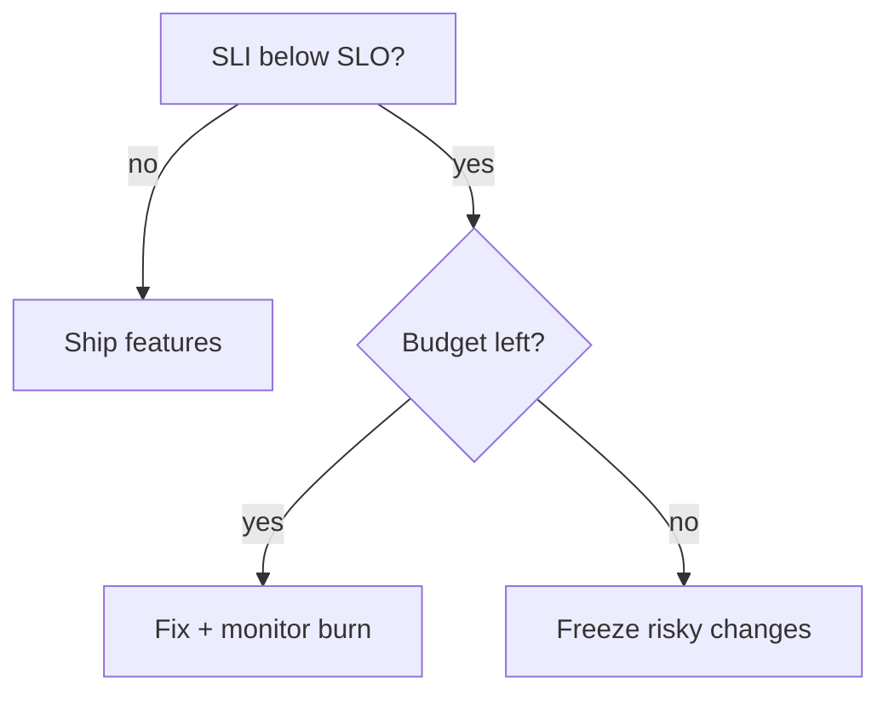

# SLIs, SLOs, and Error Budgets

## The Big Picture

How do you objectively measure if your service is "reliable enough"? Not gut feeling — actual numbers.

> **SLI** (Service Level Indicator) = a metric that measures reliability  
> **SLO** (Service Level Objective) = a target for that metric  
> **SLA** (Service Level Agreement) = a legal contract with consequences  
> **Error Budget** = how much unreliability you can afford

---

## How They Relate

```
SLI (What you measure)
  "99.2% of requests return in < 200ms"
       │
       ▼
SLO (What you aim for)
  "We target 99.5% of requests under 200ms"
       │
       ▼
SLA (What you promise customers)
  "We guarantee 99.0% or you get credits"
       │
       ▼
Error Budget (How much room you have)
  "We can afford 0.5% failures this month"
  (SLO is 99.5% → budget is 0.5%)
```

```mermaid
graph LR
    SLI[SLI<br/>Measurement<br/>"99.2%"]
    SLO[SLO<br/>Target<br/>"99.5%"]
    SLA[SLA<br/>Contract<br/>"99.0%"]
    Budget[Error Budget<br/>Remaining<br/>"0.3% left"]

    SLI --> SLO
    SLO --> SLA
    SLO --> Budget

    style SLI fill:#ddf
    style SLO fill:#dfd
    style SLA fill:#ffd
    style Budget fill:#fdf
```

---

## SLIs: What to Measure

### The Four Golden Signals (Google SRE)

```
1. LATENCY    — How long does it take to serve a request?
2. ERROR RATE — What percentage of requests fail?
3. THROUGHPUT — How many requests per second?
4. SATURATION — How "full" is the system? (CPU, memory, queue depth)
```

### Common SLIs

```python
# SLI: Availability
# "What fraction of requests succeed?"
availability_sli = (
    successful_requests / total_requests
)
# Example: 99,500 / 100,000 = 99.5%


# SLI: Latency
# "What fraction of requests are faster than threshold?"
latency_sli = (
    requests_under_200ms / total_requests
)
# Example: 99,200 / 100,000 = 99.2%


# SLI: Correctness
# "What fraction of responses have the right data?"
correctness_sli = (
    correct_responses / total_responses
)


# SLI: Freshness
# "What fraction of data reads are within acceptable staleness?"
freshness_sli = (
    reads_within_1_minute / total_reads
)
```

### Measuring SLIs with Prometheus

```yaml
# PromQL queries for common SLIs

# Availability SLI (over 30 days)
availability: |
  sum(rate(http_requests_total{status!~"5.."}[30d]))
  /
  sum(rate(http_requests_total[30d]))

# Latency SLI: % of requests under 200ms (over 30 days)
latency: |
  sum(rate(http_request_duration_seconds_bucket{le="0.2"}[30d]))
  /
  sum(rate(http_request_duration_seconds_count[30d]))

# Error rate (inverse of availability)
error_rate: |
  sum(rate(http_requests_total{status=~"5.."}[5m]))
  /
  sum(rate(http_requests_total[5m]))
```

---

## SLOs: Setting Targets

### How to Choose Your SLO

```
"Just set everything to 99.99%!" ← WRONG!

Higher SLO = more reliability work = slower feature development
Lower SLO  = more freedom to ship = users might notice issues

The right SLO balances user happiness with engineering velocity.
```

```
Common SLOs by service type:

Internal tools:        99.0 - 99.5%    (7-3.5 hours downtime/month)
B2B SaaS:             99.5 - 99.9%    (3.5 hours - 43 min/month)
Consumer web app:     99.9 - 99.95%   (43 - 22 min/month)
Payment processing:   99.95 - 99.99%  (22 - 4 min/month)
Infrastructure:       99.99 - 99.999% (4 min - 26 sec/month)
```

### Defining SLOs

```yaml
# slo-definitions.yaml

service: order-service

slos:
  - name: availability
    description: "Orders API returns non-5xx responses"
    sli:
      type: availability
      good_events: 'http_requests_total{status!~"5.."}'
      total_events: 'http_requests_total'
    target: 99.9%    # 43 minutes of downtime per month
    window: 30d      # Rolling 30-day window

  - name: latency
    description: "Orders API responds within 200ms"
    sli:
      type: latency
      good_events: 'http_request_duration_seconds_bucket{le="0.2"}'
      total_events: 'http_request_duration_seconds_count'
    target: 99.5%    # 0.5% of requests can exceed 200ms
    window: 30d

  - name: correctness
    description: "Order totals are calculated correctly"
    sli:
      type: correctness
      good_events: 'order_calculation_correct_total'
      total_events: 'order_calculation_total'
    target: 99.99%
    window: 30d
```

---

## Error Budgets: The Magic

The **error budget** is how much unreliability you can afford and still meet your SLO.

```
SLO = 99.9% availability over 30 days
Error Budget = 100% - 99.9% = 0.1%

In a 30-day month:
  0.1% × 30 days × 24 hours × 60 minutes = 43.2 minutes

You can "spend" 43.2 minutes of downtime this month!
```

### Error Budget Visualization

```
Month Start                                    Month End
├──────────────────────────────────────────────┤
│ Error Budget: 43.2 minutes                    │
│ ████████████████████████████████████████████  │
│                                               │
│ Day 5: 10-min outage                         │
│ ██████████████████████████████████░░░░░░░░░  │
│ Remaining: 33.2 minutes                       │
│                                               │
│ Day 15: 20-min deploy rollback               │
│ ████████████████████░░░░░░░░░░░░░░░░░░░░░░  │
│ Remaining: 13.2 minutes ⚠️                   │
│                                               │
│ Day 20: 15-min database failover             │
│ ░░░░░░░░░░░░░░░░░░░░░░░░░░░░░░░░░░░░░░░░░  │
│ BUDGET EXHAUSTED! 🚨                         │
│ Remaining: -1.8 minutes → FREEZE DEPLOYMENTS │
└──────────────────────────────────────────────┘
```

### Error Budget Policies

```python
class ErrorBudgetPolicy:
    """Define actions based on error budget status."""
    
    def __init__(self, slo_target: float, window_days: int = 30):
        self.slo_target = slo_target
        self.budget_total = (1 - slo_target) * window_days * 24 * 60  # in minutes
    
    def evaluate(self, budget_consumed_minutes: float):
        remaining = self.budget_total - budget_consumed_minutes
        percentage_remaining = remaining / self.budget_total * 100
        
        if percentage_remaining > 50:
            return {
                "status": "GREEN",
                "action": "Normal development velocity. Ship features!",
                "deploys_allowed": True,
                "risk_tolerance": "high",
            }
        elif percentage_remaining > 25:
            return {
                "status": "YELLOW",
                "action": "Slow down. Review deploy risk carefully.",
                "deploys_allowed": True,
                "risk_tolerance": "medium",
            }
        elif percentage_remaining > 0:
            return {
                "status": "RED",
                "action": "Focus on reliability. Only critical deploys.",
                "deploys_allowed": "critical only",
                "risk_tolerance": "low",
            }
        else:
            return {
                "status": "EXHAUSTED",
                "action": "FREEZE all deployments. Fix reliability first!",
                "deploys_allowed": False,
                "risk_tolerance": "none",
            }

# Example
policy = ErrorBudgetPolicy(slo_target=0.999)  # 99.9%
print(f"Total budget: {policy.budget_total:.1f} minutes")  # 43.2 min

result = policy.evaluate(budget_consumed_minutes=35)
# status: RED
# action: Focus on reliability. Only critical deploys.
```

---

## Error Budget Burn Rate Alerts

Instead of alerting when the SLO is breached (too late!), alert based on **how fast you're burning** the error budget.

```yaml
# Burn rate alerts (from Google SRE workbook)

# Fast burn: 14.4x budget consumption rate (burns budget in 2 hours)
# → Page the on-call immediately
- alert: ErrorBudgetFastBurn
  expr: |
    (
      sum(rate(http_requests_total{status=~"5.."}[5m]))
      /
      sum(rate(http_requests_total[5m]))
    ) > (14.4 * 0.001)  # 14.4x the budget burn rate for 99.9% SLO
  for: 2m
  labels:
    severity: critical
  annotations:
    summary: "Error budget burning 14.4x too fast — will exhaust in 2 hours!"

# Slow burn: 3x budget consumption rate (burns budget in 10 days)
# → Create a ticket for investigation
- alert: ErrorBudgetSlowBurn
  expr: |
    (
      sum(rate(http_requests_total{status=~"5.."}[1h]))
      /
      sum(rate(http_requests_total[1h]))
    ) > (3 * 0.001)
  for: 30m
  labels:
    severity: warning
  annotations:
    summary: "Error budget burning 3x too fast — will exhaust in 10 days"
```

```
Burn Rate Visualization:

Budget │ ████████████████████████████████████████
100%   │ █
       │  █                        
       │   █          Normal burn rate (OK)
       │    ██                     
       │      ████                 
       │          █████████        
       │                   ████████████ → Runs out at day 30 (exactly on target)
  0%   │─────────────────────────────────────────
       0    5    10   15   20   25   30 days

Budget │ ████████████████████████████████████████
100%   │ █
       │  █
       │   █         3x burn rate (WARNING ⚠️)
       │    █
       │     ██
       │       ██
       │         ████
  0%   │──────────────█ → Runs out at day 10!
       0    5    10   15   20   25   30 days

Budget │ ████████████████████████████████████████
100%   │ ██
       │   ████      14.4x burn rate (CRITICAL 🚨)
       │       ████
  0%   │───────────█ → Runs out in 2 days!
       0    5    10   15   20   25   30 days
```

---

## SLO Dashboard

```python
# Grafana dashboard panels (conceptual)
dashboard_panels = {
    "SLO Status": {
        "query": """
            sum(rate(http_requests_total{status!~"5.."}[30d]))
            /
            sum(rate(http_requests_total[30d]))
            * 100
        """,
        "thresholds": [
            {"value": 99.9, "color": "green"},   # Meeting SLO
            {"value": 99.5, "color": "yellow"},   # Warning
            {"value": 99.0, "color": "red"},      # SLO breach
        ],
        "display": "Gauge: 99.85%",
    },

    "Error Budget Remaining": {
        "query": """
            # Minutes remaining in 30-day error budget
            (0.001 * 30 * 24 * 60) - (
                sum(increase(http_requests_total{status=~"5.."}[30d]))
                /
                sum(increase(http_requests_total[30d]))
                * 30 * 24 * 60
            )
        """,
        "display": "28.5 minutes remaining (66%)",
    },

    "Burn Rate (current)": {
        "query": """
            (
              sum(rate(http_requests_total{status=~"5.."}[1h]))
              /
              sum(rate(http_requests_total[1h]))
            ) / 0.001  # Normalized to budget burn rate
        """,
        "display": "1.2x (normal)",
    },
}
```

---

## The SLO Process

```mermaid
graph TB
    Step1[1. Choose SLIs<br/>"What indicates user happiness?"]
    Step2[2. Set SLO targets<br/>"What's good enough?"]
    Step3[3. Calculate error budget<br/>"How much can we fail?"]
    Step4[4. Build dashboards<br/>"Visualize SLO status"]
    Step5[5. Set up burn rate alerts<br/>"When to page?"]
    Step6[6. Define error budget policy<br/>"What happens when budget runs low?"]
    Step7[7. Review quarterly<br/>"Are SLOs still appropriate?"]

    Step1 --> Step2 --> Step3 --> Step4 --> Step5 --> Step6 --> Step7
    Step7 -->|"adjust"| Step2

    style Step6 fill:#ffd,stroke:#aa0,stroke-width:2px
```

---

## Key Takeaways

- **SLIs** measure what matters to users, not internal metrics (users don't care about CPU)
- **SLOs** should be achievable — don't set 99.99% if you can only reliably hit 99.9%
- **Error budgets** align reliability with feature velocity — spend budget on innovation, not just uptime
- **Burn rate alerts** are better than threshold alerts — they predict budget exhaustion
- When budget is exhausted: **freeze deploys and fix reliability**
- When budget is healthy: **ship features faster!**
- **Review SLOs quarterly** — they're living targets, not set-and-forget
- SLOs are an **organizational alignment tool** — not just a technical metric

---

## Senior Pitfalls

| Mistake | Impact | Fix |
|---------|--------|-----|
| SLOs on infrastructure metrics (CPU) not user journeys | Green dashboards while users cannot check out | SLIs from client or edge: success rate, latency, freshness |
| 99.99% SLO on every microservice | No error budget for innovation; alert noise | Tier services; only customer-facing paths get strict SLOs |
| Error budget spent but releases continue | Repeated outages; loss of trust | Policy: freeze features when budget < 10%; prioritize reliability |
| Multi-window burn alerts misconfigured | Either never pages or pages constantly | Use Google SRE multi-burn-rate; tune windows in staging |
| SLO targets copied from marketing | Unachievable promises vs architecture | Negotiate SLO with product from historical data + cost |

---

## Production-grade Practice

1. **Build:** Define one SLI/SLO pair for a revenue path; implement measurement in load balancer or RUM; publish dashboard to eng + product.
2. **Debug:** Walk through a past outage and recalculate error budget burn—would your alerts have fired early enough?
3. **Measure:** Run monthly error budget review: remaining budget, top contributors, planned risky changes.
4. **Capacity plan:** Relate SLO target to redundancy cost (extra regions, replicas); document tradeoff curve for leadership.

---

## FAANG Interview Deep Dive

### Real-world examples

**Google Search / Ads SRE**  
Google popularized **error budgets** tied to **release velocity**: when a service burns budget too fast, **feature freezes** and reliability work take priority. Internal teams track **multi-window burn rates** (1h, 6h, 3d) so a brief spike pages differently from a sustained regression. Numbers interviewers cite: moving from **99.9% → 99.99%** costs roughly **10×** error budget headroom (0.1% → 0.01% allowed bad events).

**Netflix streaming availability**  
Netflix measures **customer-perceived** availability (playback start, rebuffer rate) not just API 200s. A **0.1%** increase in failed starts at **200M+ subscribers** is millions of bad sessions per day—SLO discussions anchor on **member minutes** and regional skew.

**Stripe API SLOs**  
Payment APIs publish **99.99%+** targets with **idempotency** as part of the reliability contract. Partial outages map to **error budget consumption per endpoint** (`/v1/charges` vs webhooks)—staff candidates explain **why one global SLO is wrong** for heterogeneous criticality.

```python
# Monthly error budget (availability SLO 99.9%)
allowed_bad = 0.001 * requests_per_month
# 1B requests/mo → 1M bad requests still "in budget"
burn_rate_1h = (bad_last_1h / allowed_bad) * (30 * 24)  # projected monthly burn
```

### Interview Q&A

### Q: SLI vs SLA vs SLO—which do you set first?
**A:** **SLI** (measurable user happiness) → **SLO** (internal target stricter than SLA) → **SLA** (legal + credits). Never set SLA first—it locks you into contracts without understanding measurement. Gap between SLO and SLA is **margin** for incidents and measurement error.

### Q: Why use burn-rate alerts instead of “error rate > 1%”?
**A:** Static thresholds ignore **traffic volume** and **budget context**. A **14.4× burn** over 1 hour consumes **~2% of 30-day budget**—worth paging. Same error rate at 3am vs Black Friday means different **user impact**. Multi-window (fast + slow) reduces **false positives** and **false negatives**.

### Q: Your team wants 99.99% on a non-critical internal tool—what do you say?
**A:** **Reliability has cost**—nines, redundancy, and on-call toil. Push for **tiering**: Tier-1 customer-facing 99.95%, Tier-3 internal 99.5%. Over-SLOing wastes budget that could go to **Tier-1** or features. Cite **error budget math**: 99.99% = **4.32 min/month** downtime—often unjustified for low-traffic admin UIs.

### Q: How do you SLO a dependency you do not own (e.g., OpenAI)?
**A:** Define **SLI on your wrapper**: success within deadline, fallback used, degraded mode. Track **dependency budget** separately; negotiate **timeouts, caching, and multi-provider routing** when vendor burns your budget. Do not inherit vendor SLA as your SLO without **buffer**.

### Q: Error budget exhausted mid-quarter—what policy kicks in?
**A:** Typical ladder: (1) freeze **risky** deploys, (2) mandatory **reliability review** for exceptions, (3) redirect sprint capacity to **incident fixes and debt**. Healthy orgs **pre-write** this policy so PM/Eng agree before emotions run high.

### Common mistakes candidates make

- SLIs on **CPU or queue depth** without mapping to user pain.
- **Averaging** global availability while **one region** is fully down (min/max per slice matters).
- SLO **99.99%** with **no measurement** at that precision (sampling bias).
- Treating error budget as **uptime only**—latency and freshness SLIs matter for search and feeds.
- **Same SLO** for batch jobs and synchronous APIs.

### Decision framework & capacity math

| Monthly SLO | Allowed downtime | Bad requests @ 1B/mo (availability SLI) |
|-------------|------------------|----------------------------------------|
| 99.9% | ~43 min | 1,000,000 |
| 99.95% | ~22 min | 500,000 |
| 99.99% | ~4.3 min | 100,000 |



**Pick SLI types:** Latency → **percentile threshold** (e.g., % < 300ms). Availability → **good events / valid events** (exclude client 4xx if appropriate). **Freshness** for pipelines → max age of served data.

### Burn-rate paging (multi-window)

| Window | Burn multiplier | Budget consumed if sustained |
|--------|-----------------|------------------------------|
| 1h | 14.4× | ~2% of 30-day budget |
| 6h | 6× | ~5% |
| 3d | 1× | ~10% |

```python
# Simplified burn alert: is 1h error rate unsustainable?
bad_1h, total_1h = 1200, 1_000_000
slo = 0.999
budget_rate = 1 - slo
burn = (bad_1h / total_1h) / budget_rate
page = burn > 14.4  # illustrative Google-style fast window
```

**Staff signal:** Explain **why SLA < SLO** (legal margin) and how **feature freeze** is negotiated when product still has launch commitments—politics is part of SRE at scale.
