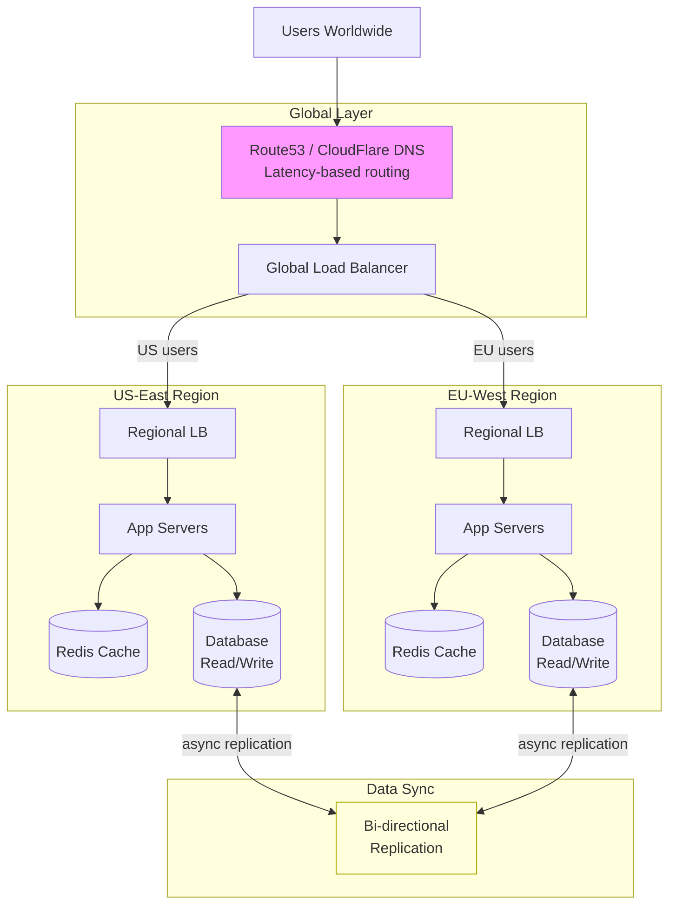
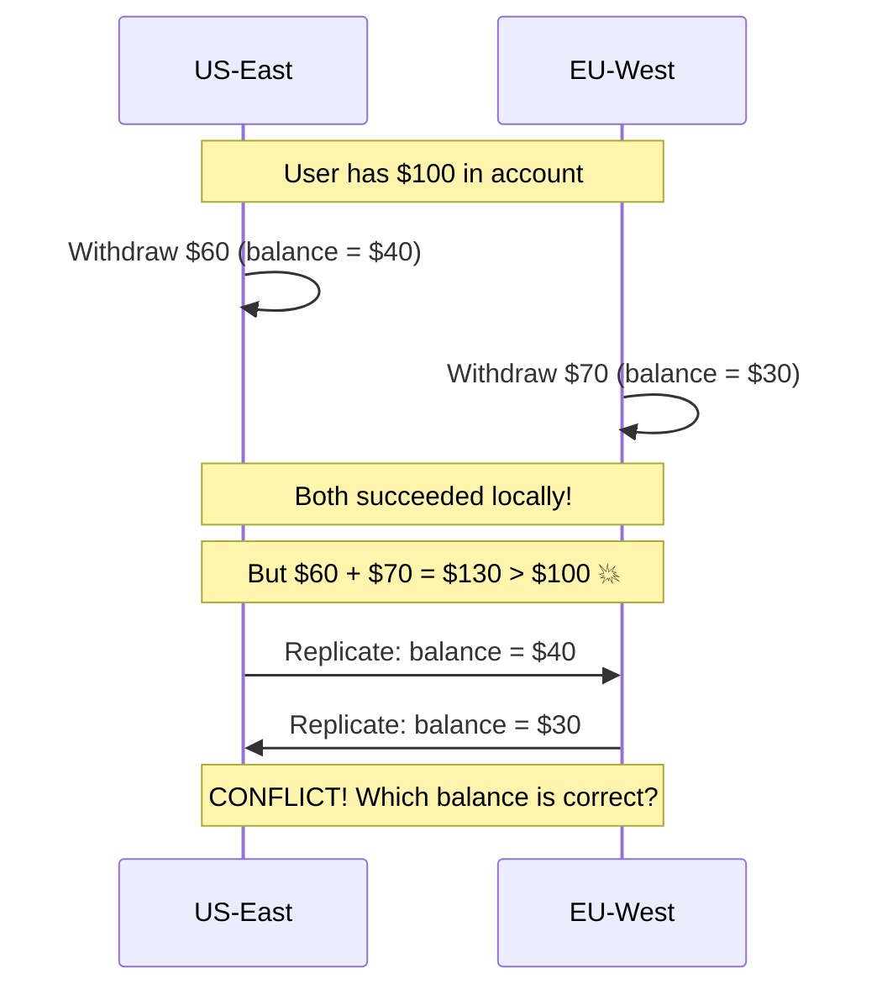
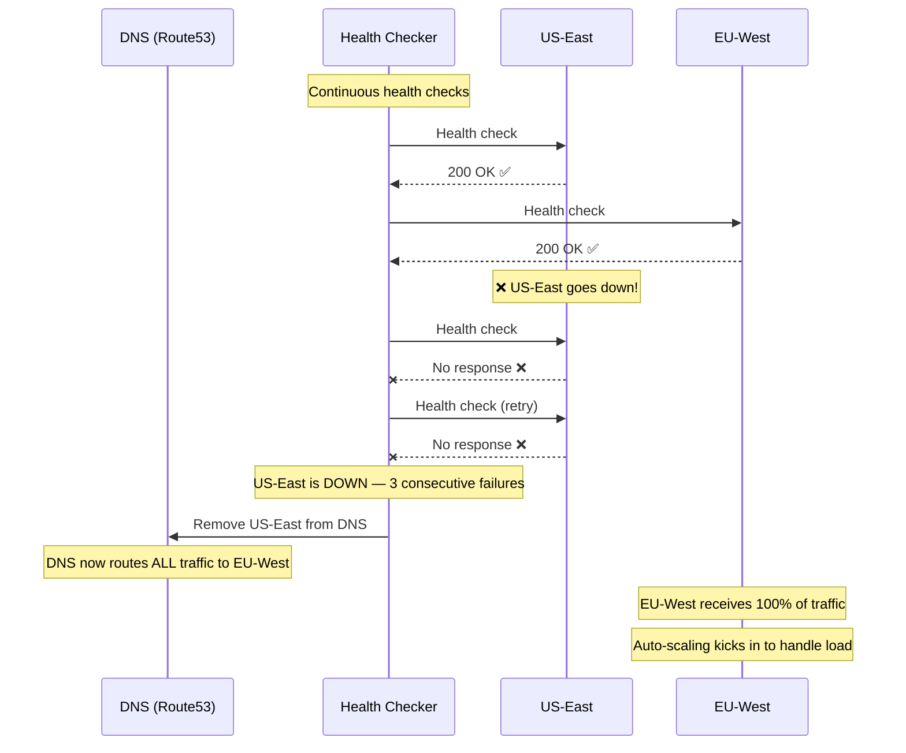
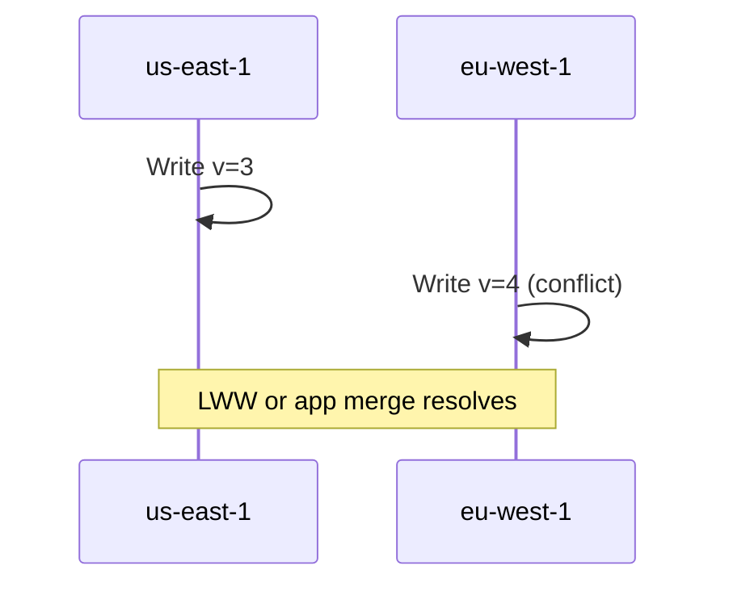

# Multi-Region Active-Active Architecture

## What Does Active-Active Mean?

```
Active-Passive (Standby):             Active-Active:
┌──────────┐  ┌──────────┐            ┌──────────┐  ┌──────────┐
│ US-East  │  │ EU-West  │            │ US-East  │  │ EU-West  │
│ ████████ │  │          │            │ ████████ │  │ ████████ │
│ ACTIVE   │  │ STANDBY  │            │ ACTIVE   │  │ ACTIVE   │
│ All      │  │ Idle     │            │ Serves   │  │ Serves   │
│ traffic  │  │ (warm)   │            │ US users │  │ EU users │
└──────────┘  └──────────┘            └──────────┘  └──────────┘

If US-East fails:                      If US-East fails:
  EU-West takes over (minutes)          EU-West absorbs traffic (seconds)
  Failover is manual/slow               Already serving — just reroute
```

> **Active-Active** means **all regions serve live traffic simultaneously**. If one region goes down, others absorb the load with near-zero downtime.

---

## Architecture Overview



---

## The Hardest Problem: Data Consistency

In active-active, **both regions can write to the database simultaneously**. This creates conflicts.

### Conflict Scenario



### Conflict Resolution Strategies

```python
# Strategy 1: Last Writer Wins (LWW)
# Simple but can lose data
class LastWriterWins:
    def resolve(self, local_value, remote_value):
        if remote_value.timestamp > local_value.timestamp:
            return remote_value  # Remote is newer → accept
        return local_value       # Local is newer → keep

# Strategy 2: Application-level merge
# Complex but preserves intent
class ApplicationMerge:
    def resolve_balance(self, local_ops, remote_ops):
        # Don't merge values — merge OPERATIONS
        # Replay all operations to get correct balance
        initial_balance = self.get_initial_balance()
        all_ops = sorted(
            local_ops + remote_ops,
            key=lambda op: op.timestamp,
        )
        balance = initial_balance
        for op in all_ops:
            if op.type == "withdraw" and balance >= op.amount:
                balance -= op.amount
            elif op.type == "deposit":
                balance += op.amount
            else:
                op.status = "rejected"  # Insufficient funds
        return balance

# Strategy 3: CRDTs (Conflict-free Replicated Data Types)
# Mathematically guaranteed no conflicts
class GCounter:
    """Grow-only counter CRDT — increments never conflict."""
    def __init__(self, node_id, nodes):
        self.node_id = node_id
        self.counts = {node: 0 for node in nodes}
    
    def increment(self, amount=1):
        self.counts[self.node_id] += amount
    
    def value(self):
        return sum(self.counts.values())
    
    def merge(self, other):
        for node in self.counts:
            self.counts[node] = max(self.counts[node], other.counts[node])
        # After merge, both replicas have the same value!
        # No conflicts possible!
```

---

## Data Replication Patterns

### Pattern 1: Single-Leader Per Record

Route writes for each record to **one primary region** based on the data owner.

```python
class RegionRouter:
    """Route writes to the owner region for each user."""
    
    def get_write_region(self, user_id: str) -> str:
        # User's home region is their write primary
        user = self.user_registry.get(user_id)
        return user.home_region  # "us-east-1" or "eu-west-1"
    
    async def write(self, user_id: str, data: dict):
        primary = self.get_write_region(user_id)
        
        if primary == self.current_region:
            # We are the primary → write locally
            await self.local_db.write(user_id, data)
        else:
            # Forward write to the primary region
            await self.remote_write(primary, user_id, data)
    
    async def read(self, user_id: str):
        # Read locally (eventually consistent replica)
        return await self.local_db.read(user_id)
```

```
User "Alice" (home: US-East):
  US-East: READ ✅ WRITE ✅ (primary)
  EU-West: READ ✅ WRITE → forwards to US-East

User "Hans" (home: EU-West):
  US-East: READ ✅ WRITE → forwards to EU-West
  EU-West: READ ✅ WRITE ✅ (primary)
```

### Pattern 2: Multi-Leader with Conflict Resolution

Both regions accept writes. Conflicts are resolved asynchronously.

```yaml
# AWS DynamoDB Global Tables — Built-in multi-region active-active
# Last-writer-wins conflict resolution

resource "aws_dynamodb_table" "orders" {
  name         = "orders"
  billing_mode = "PAY_PER_REQUEST"
  hash_key     = "order_id"

  attribute {
    name = "order_id"
    type = "S"
  }

  # Enable Global Tables (multi-region replication)
  replica {
    region_name = "us-east-1"
  }
  replica {
    region_name = "eu-west-1"
  }
  replica {
    region_name = "ap-southeast-1"
  }
}

# Writes in any region automatically replicate to all others
# Conflict resolution: last-writer-wins (based on timestamp)
# Replication latency: typically < 1 second
```

### Pattern 3: CockroachDB (Globally Distributed SQL)

```sql
-- CockroachDB: Distributed SQL with multi-region support
-- Rows are automatically geo-partitioned

ALTER DATABASE mydb SET PRIMARY REGION = "us-east1";
ALTER DATABASE mydb ADD REGION "europe-west1";
ALTER DATABASE mydb ADD REGION "asia-southeast1";

-- Pin user data to their home region (data domiciling)
ALTER TABLE users SET LOCALITY REGIONAL BY ROW;

-- Add a region column
ALTER TABLE users ADD COLUMN region crdb_internal_region 
  DEFAULT gateway_region();

-- Now a user in Europe has their data stored in europe-west1
-- Reads and writes are local to their region!
-- Cross-region reads are consistent (Raft consensus)
```

---

## Failover Mechanism



```python
# Route53 health check + failover configuration
import boto3

route53 = boto3.client('route53')

# Health check for US-East
route53.create_health_check(
    CallerReference='us-east-health',
    HealthCheckConfig={
        'IPAddress': '52.1.2.3',
        'Port': 443,
        'Type': 'HTTPS',
        'ResourcePath': '/health',
        'RequestInterval': 10,         # Check every 10 seconds
        'FailureThreshold': 3,          # 3 failures = unhealthy
        'EnableSNI': True,
    }
)

# DNS record with failover routing
route53.change_resource_record_sets(
    HostedZoneId='Z123456',
    ChangeBatch={
        'Changes': [{
            'Action': 'CREATE',
            'ResourceRecordSet': {
                'Name': 'api.example.com',
                'Type': 'A',
                'SetIdentifier': 'us-east',
                'Region': 'us-east-1',
                'HealthCheckId': 'us-east-health-id',
                'AliasTarget': {
                    'DNSName': 'us-east-alb.amazonaws.com',
                    'HostedZoneId': 'Z35SXDOTRQ7X7K',
                    'EvaluateTargetHealth': True,
                },
            },
        }],
    },
)
```

---

## Capacity Planning for Active-Active

```
Key Rule: Each region must handle TOTAL traffic, not just its share!

❌ WRONG:
  US-East: capacity for 50% traffic
  EU-West: capacity for 50% traffic
  → If US fails, EU can't handle 100%!

✅ RIGHT:
  US-East: capacity for 100% traffic (N+1)
  EU-West: capacity for 100% traffic (N+1)
  → If either fails, the other absorbs everything

  OR with auto-scaling:
  US-East: normal capacity for 50% + auto-scale to 100%
  EU-West: normal capacity for 50% + auto-scale to 100%
  → Save cost, but takes minutes to scale
```

---

## Testing Multi-Region

```yaml
# Regular testing schedule
testing:
  weekly:
    - "Simulate single AZ failure in each region"
    - "Verify health checks detect failures within 30s"
  
  monthly:
    - "Failover one region completely"
    - "Verify auto-scaling handles 2x traffic"
    - "Measure data replication lag"
  
  quarterly:
    - "Full region evacuation drill"
    - "Test failback after region recovery"
    - "Verify zero data loss during failover"
```

---

## Key Takeaways

- **Active-active** means all regions serve live traffic — not just warm standbys
- The **hardest problem** is data consistency across regions (conflicts will happen)
- Use **CRDTs** for conflict-free data, **single-leader per record** for strong consistency
- **DynamoDB Global Tables** and **CockroachDB** provide built-in multi-region support
- Each region must be able to handle **100% of traffic** for true fault tolerance
- **DNS-based failover** with health checks provides the routing layer
- **Test your failover regularly** — an untested failover is no failover at all
- Active-active is expensive (2x infra cost minimum) — make sure you need it

### AWS service map

| Concern | Service | Notes |
|---------|---------|--------|
| Global routing | Route 53 latency/failover, Global Accelerator | DNS TTL vs TCP connection failover |
| Data (LWW) | DynamoDB Global Tables | Not strong cross-region; know conflict resolution |
| Data (OLTP global) | Aurora Global Database | Single writer region; fast cross-region read replicas |
| Compute | Multi-region ECS/EKS + ALB | Each region must carry 100% peak if true active-active |
| Events | EventBridge global endpoints, MSK mirroring | Ordering still per-partition / per-key |
| Health | Route 53 health checks, CloudWatch Synthetics | Probe app + dependencies, not only ALB |

---

## Senior Pitfalls

| Mistake | Impact | Fix |
|---------|--------|-----|
| Active-active writes without conflict resolution | Lost updates, double charges | CRDTs, version vectors, or single-writer per entity with async replication |
| Assuming clock sync for ordering | Incorrect "last write wins" | Use logical clocks or source-of-truth per partition key |
| Global DB with sync replication to all regions | Latency kills UX; one region drag slows all | Regional primaries + async replication; read local write global where needed |
| Failover DNS only, no data plane readiness | Traffic lands in region that cannot serve | Health checks on dependencies; warm pools; replication lag gates |
| Ignoring compliance data residency | Legal exposure after go-live | Pin tenants to regions; routing layer enforces residency |

---

## Production-grade Practice

1. **Build:** Sketch active-active for one entity (e.g., user profile): write path, replication lag SLO, and conflict policy; prototype failover drill.
2. **Debug:** Fail one region during load test; measure RTO/RPO and whether clients retry correctly with idempotency keys.
3. **Measure:** Monitor replication lag p99 per region pair; alert when lag threatens RPO.
4. **Capacity plan:** Model write QPS per region at 50/50 split vs 80/20; size DB and link bandwidth for peak + failover surge.

---

## FAANG Interview Deep Dive

### Real-world examples

**Google Spanner / TrueTime**  
Spanner provides **externally consistent** reads/writes across regions using **GPS/atomic clocks** and **two-phase commit**—enabling active-active OLTP at global scale with **~99.999%** design goals. Interview signal: you pay **latency tax** (~tens of ms cross-region) and **cost** for that consistency; most teams do not need Spanner-level guarantees.

**Meta Cassandra at exabyte scale**  
Meta runs **Cassandra** clusters measured in **exabytes** and **thousands of nodes** for messaging, feeds metadata, and UGC. Multi-region is **async replication** with **tunable consistency (LOCAL_QUORUM, etc.)**—explicit **last-write-wins** or **version vectors** for conflicts. Not “one global Postgres.”

**DynamoDB Global Tables**  
AWS Global Tables replicate **DynamoDB** across regions with **last writer wins** on conflicts—typical **< 1 second** replication lag under normal load, but **not** serializable cross-region transactions. Used for session state, carts, and gaming leaderboards where **RPO in seconds** is acceptable.



### Interview Q&A

### Q: Active-active vs active-passive—when is 2× cost justified?
**A:** When **RTO must be seconds** and **RPO near zero** for a large user base, and traffic is **geographically split** so both regions earn their keep. Active-passive wins when **failover minutes** are OK and **one region carries 100% peak** is cheaper than **two regions at 60% each**.

### Q: How do you handle inventory / money in active-active?
**A:** Prefer **single-leader per entity** (hash customer ID → home region), **CRDTs** for commutative counters, or **reservation + async settlement**. True dual-write financial balances without coordination is an **interview trap**. Stripe-scale systems use **strong consistency on the payment shard** and **eventual** elsewhere.

### Q: What replication lag can you tolerate for social feeds vs banking?
**A:** Feeds: **seconds**, with **version stamps** and “may be stale” UX. Banking ledger: **zero cross-region staleness** on balance reads—or route reads to leader. Quantify: at **50k writes/s** and **200ms lag**, **10k events** may be unordered across regions.

### Q: How does DNS fit into regional failover?
**A:** DNS TTL (**30–60s**) bounds **worst-case stickiness** to a dead region. Pair with **anycast** or **global LB** for faster drain. Test **resolver caching**—some ISPs ignore low TTL.

### Q: CockroachDB vs app-level active-active—trade-offs?
**A:** Cockroach gives **distributed SQL** and **survivable replicas**; you still design **partition keys** and watch **cross-region write latency**. App-level dual regions with DynamoDB/Cassandra push **conflict logic to application**—more code, more control.

### Common mistakes candidates make

- Assuming **active-active = no downtime**—split brain and conflicts still cause user-visible errors.
- **Both regions at 100% steady load**—no headroom for failover (need **≤ ~60%** per region or auto-scale lag plan).
- Ignoring **compliance data residency** (GDPR)—EU data in US region is a legal blast radius.
- **Synchronous cross-region DB** on every request—p99 latency becomes **RTT-bound**.

### Decision framework

| Requirement | Pattern |
|-------------|---------|
| RPO ~0, RTO minutes | Active-passive + sync replica |
| RPO seconds, global users | Active-active + LWW / CRDT |
| Strong global transactions | Spanner / Cockroach / single leader |
| Read-heavy, rare writes | Read replicas + write leader |

**Headroom math:** Regions **N=2**, max utilization **u** per region. Failover requires **traffic sum ≤ capacity**. Need **u ≤ 1/(N-1)** for one region loss → **u ≤ 50%** for 2 regions (before scale-up).

### Conflict resolution cheat sheet

| Data type | Pattern | Example |
|-----------|---------|---------|
| Balance / inventory | Single leader per key | `home_region = hash(user_id)` |
| Counters / likes | CRDT or async aggregate | HLL, delta counter |
| Profile fields | LWW + `updated_at` | Last timestamp wins |
| Immutable events | Append-only log | Event ID dedupe |

```sql
-- Home-region routing (application layer)
SELECT region FROM user_home WHERE user_id = $1;  -- sticky writes
```

**Staff signal:** Quantify **RPO in seconds × write rate** = rows at risk during partition (`50k/s × 30s = 1.5M events`)—interviewers want numbers, not “eventually consistent.”
